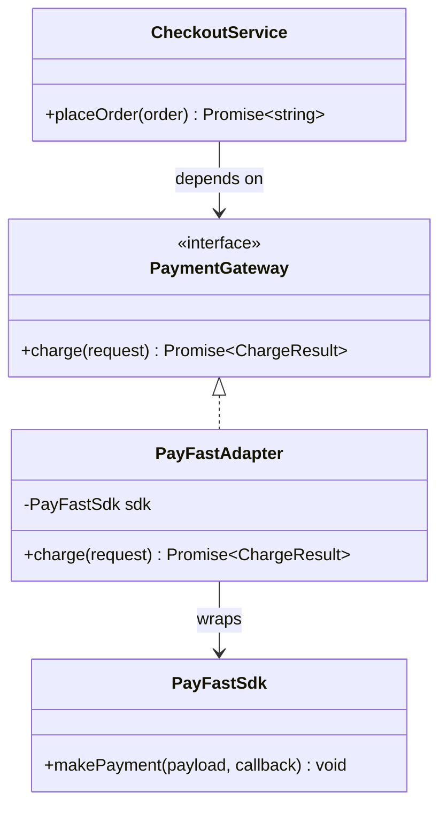
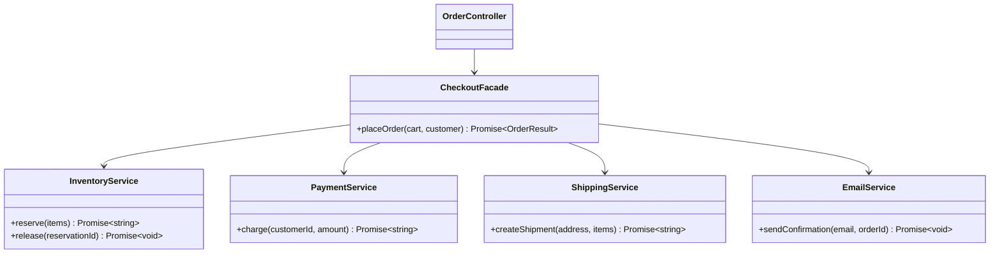
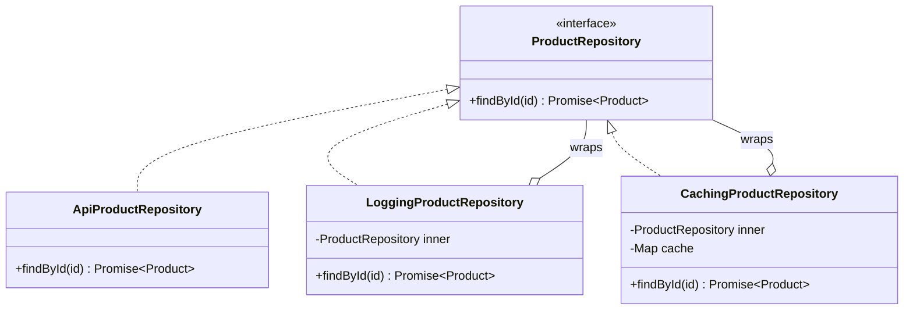
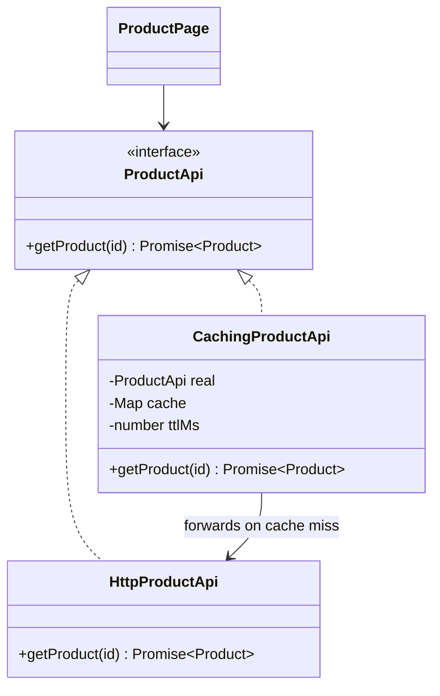
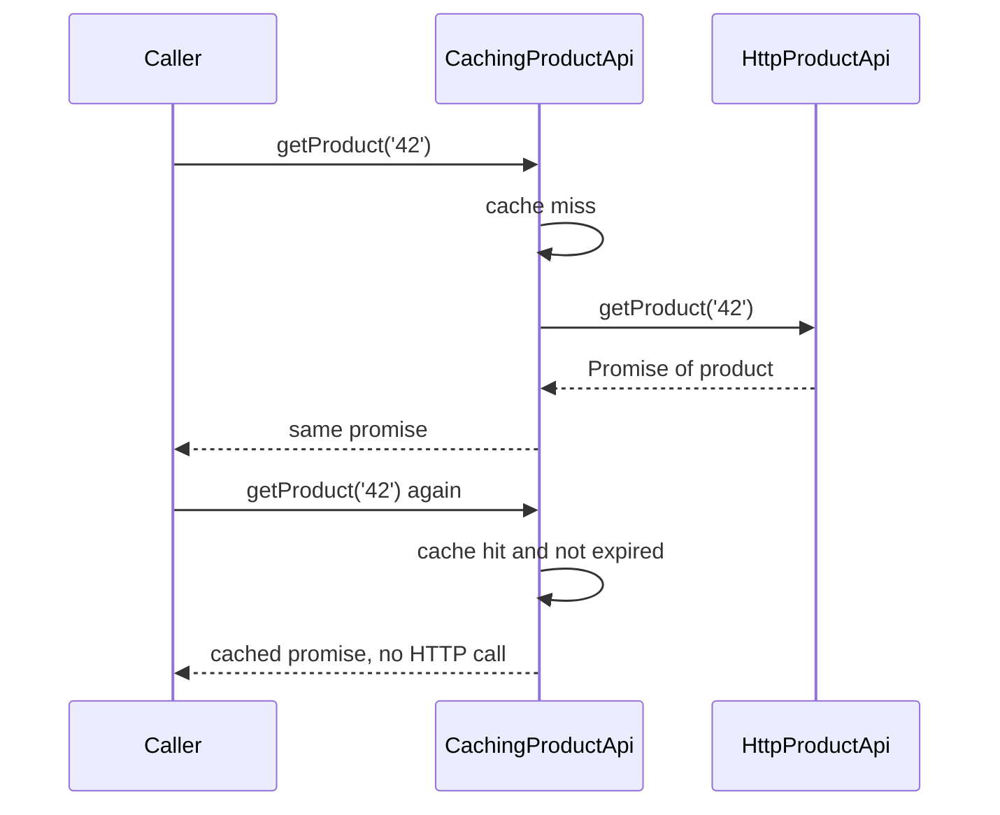
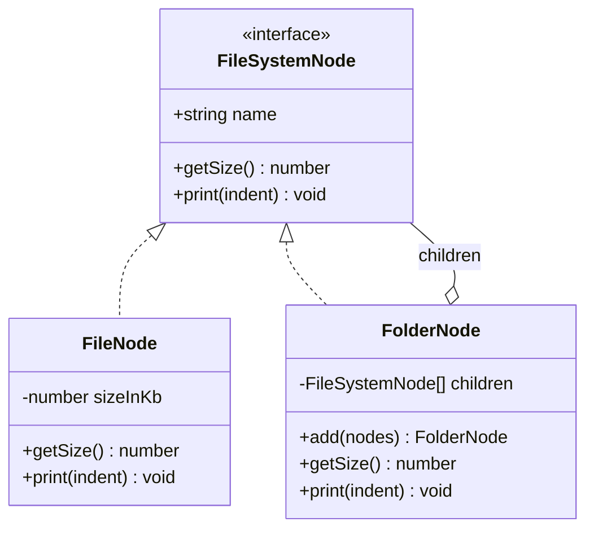
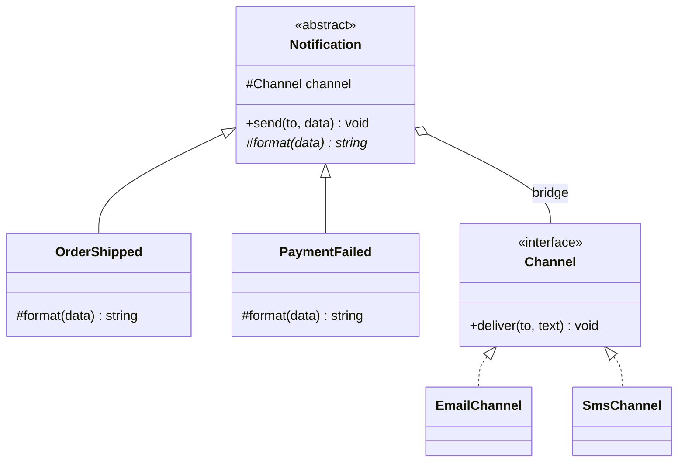
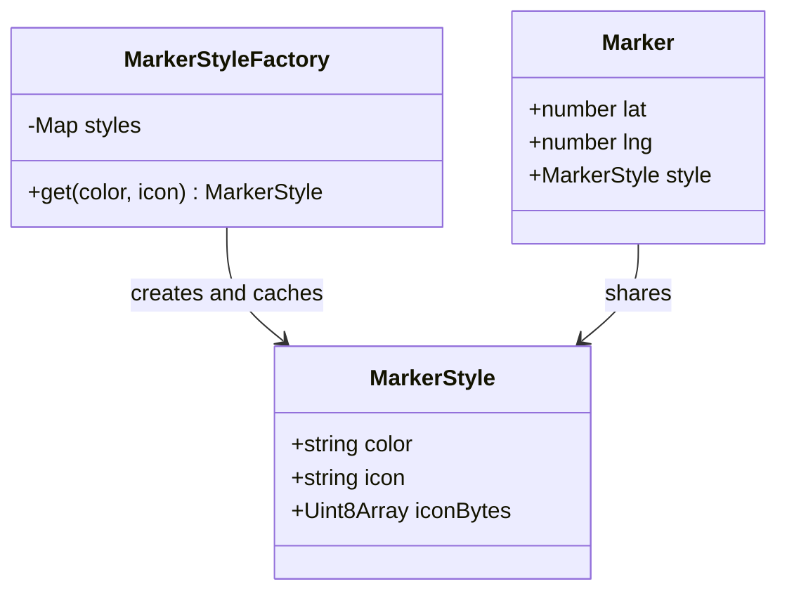
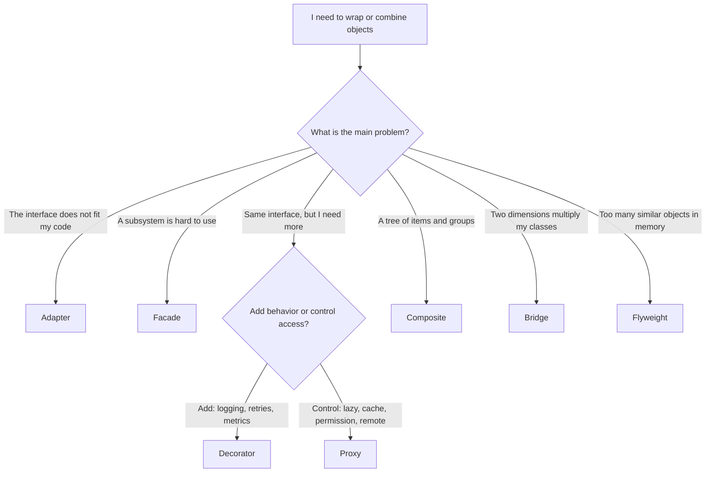

# Structural Patterns

> In this document you will learn how to combine objects with the Adapter, Facade, Decorator, Proxy, Composite, Bridge and Flyweight patterns, using real JavaScript, TypeScript, Angular and Node.js examples. Interviewers love to ask you to compare Adapter, Facade, Decorator and Proxy, because they look similar in code but solve different problems.

**Before this:** [Creational patterns](06-creational-patterns.md) · [Composition, inheritance and mixins](02-composition-inheritance-and-mixins.md) · [Functions and functional programming](../02-javascript/04-functions-and-functional-programming.md) · **Interview questions:** [jump to questions](#interview-questions)

## Table of contents

1. [What structural patterns solve](#what-structural-patterns-solve)
2. [Adapter](#adapter)
3. [Facade](#facade)
4. [Decorator](#decorator)
5. [Proxy](#proxy)
6. [Composite](#composite)
7. [Bridge](#bridge)
8. [Flyweight](#flyweight)
9. [Comparing the structural patterns](#comparing-the-structural-patterns)
10. [How to explain structural patterns in an interview](#how-to-explain-structural-patterns-in-an-interview)
11. [Interview questions](#interview-questions)
12. [Summary](#summary)
13. [References](#references)

---

## What structural patterns solve

**Structural patterns** are about how you connect objects and modules so they work together, without making them depend too much on each other.

Typical situations:

| Situation | Pattern |
| --- | --- |
| A library has the wrong interface for your code | **Adapter** translates it |
| A subsystem is complicated to use | **Facade** gives it one simple entry point |
| You want to add logging, caching or retries without changing a class | **Decorator** wraps it |
| You want to control access to an object (lazy, cached, checked) | **Proxy** stands in front of it |
| You have a tree of items and groups | **Composite** treats them the same way |
| Two things vary independently and classes multiply | **Bridge** splits them |
| Millions of similar objects use too much memory | **Flyweight** shares the common part |

Almost all of them use **composition**: one object holds a reference to another and calls it. That is why they are flexible. If composition vs inheritance is new to you, read [composition, inheritance and mixins](02-composition-inheritance-and-mixins.md) first.

A useful way to remember four of them is by their **interface**:

- **Adapter:** *different* interface outside, translated to what the inside needs.
- **Facade:** a *new, simpler* interface over many objects.
- **Decorator:** the *same* interface, with *extra behavior*.
- **Proxy:** the *same* interface, with *controlled access*.

---

## Adapter

### The problem

Your app has its own interface for payments: `charge({ amountInCents, currency })` that returns a promise. Then your company picks a payment provider. Its SDK looks completely different:

- method name `makePayment` instead of `charge`
- amount as a string in "minor units" (`'4999'`)
- results through a **callback** instead of a promise
- errors as numeric codes instead of exceptions

If you call the SDK directly from 30 places, your code becomes tied to this provider. Switching providers later means changing 30 files.

### The idea in simple words

An **Adapter** is a small wrapper that converts one interface into another interface that your code expects. Your code talks to the adapter. The adapter talks to the library. Only the adapter knows both sides.

**Analogy:** a travel plug adapter. Your laptop charger has a European plug. The wall socket is American. The adapter changes the shape so the two fit. The laptop and the wall do not change.

**Where the analogy breaks:** a plug adapter only changes the shape. A software adapter often also converts *data* (dollars to cents, snake_case to camelCase) and *errors* (codes to exceptions). It should still not add business logic.

### Class diagram



### Example: wrapping a third-party payment SDK

`PayFastSdk` below is a made-up SDK that stands in for any real one. The important part is the adapter.

```ts
// ---- Our app's interface (we own this) ----
interface ChargeRequest {
  amountInCents: number;
  currency: 'USD' | 'EUR';
  customerId: string;
}

interface ChargeResult {
  transactionId: string;
}

interface PaymentGateway {
  charge(request: ChargeRequest): Promise<ChargeResult>;
}

class PaymentDeclinedError extends Error {}

// ---- A third-party SDK (we do NOT own this; its style is different) ----
type PayFastCallback = (errorCode: number | null, response?: { txn_ref: string }) => void;

class PayFastSdk {
  makePayment(payload: { amt_minor: string; curr: string; cust: string }, callback: PayFastCallback): void {
    setTimeout(() => {
      if (payload.cust === 'blocked-customer') {
        callback(402); // the SDK reports errors as numeric codes
      } else {
        callback(null, { txn_ref: `PF-${payload.amt_minor}` });
      }
    }, 10);
  }
}

// ---- The adapter: the ONLY place that knows both sides ----
class PayFastAdapter implements PaymentGateway {
  constructor(private readonly sdk: PayFastSdk) {}

  charge(request: ChargeRequest): Promise<ChargeResult> {
    const payload = {
      amt_minor: String(request.amountInCents), // number -> string
      curr: request.currency,
      cust: request.customerId,
    };
    return new Promise((resolve, reject) => {
      // callback style -> promise style
      this.sdk.makePayment(payload, (errorCode, response) => {
        if (errorCode === 402) return reject(new PaymentDeclinedError('Card was declined'));
        if (errorCode !== null || !response) return reject(new Error(`PayFast error ${errorCode}`));
        resolve({ transactionId: response.txn_ref }); // snake_case -> our naming
      });
    });
  }
}

// ---- Business code: knows only PaymentGateway ----
class CheckoutService {
  constructor(private readonly payments: PaymentGateway) {}

  async placeOrder(customerId: string, amountInCents: number): Promise<string> {
    try {
      const result = await this.payments.charge({ amountInCents, currency: 'USD', customerId });
      return `Order paid (${result.transactionId})`;
    } catch (error) {
      if (error instanceof PaymentDeclinedError) return 'Payment declined, please try another card';
      throw error;
    }
  }
}

const checkout = new CheckoutService(new PayFastAdapter(new PayFastSdk()));
checkout.placeOrder('cust-42', 4999).then(console.log); // Order paid (PF-4999)
checkout.placeOrder('blocked-customer', 1000).then(console.log); // Payment declined, please try another card
```

**Step by step for the first call:**

1. `CheckoutService` calls `payments.charge(...)` with *our* request shape.
2. The adapter converts the request into the SDK's payload (`amt_minor: '4999'`).
3. The adapter wraps the callback API in a `Promise` and calls `makePayment`.
4. After 10 ms, the SDK calls the callback with `(null, { txn_ref: 'PF-4999' })`.
5. The adapter resolves the promise with `{ transactionId: 'PF-4999' }`.
6. `CheckoutService` builds the message. It never saw the SDK's types, names or error codes.

If the company switches providers, you write `StripeAdapter implements PaymentGateway` and change one line in the composition root. `CheckoutService` and its tests do not change.

### Example: adapting a legacy API response

The most common adapter in frontend code is just a **mapping function**. Imagine an old backend that returns this:

```ts
interface LegacyCustomerDto {
  CUST_ID: string;
  full_name: string;
  created: string; // '2024-03-15'
  credit_limit: string; // money as a string in dollars: '1500.50'
  is_active: 'Y' | 'N';
}

// The clean model the rest of the app uses
interface Customer {
  id: string;
  name: string;
  createdAt: Date;
  creditLimitInCents: number;
  active: boolean;
}

function toCustomer(dto: LegacyCustomerDto): Customer {
  return {
    id: dto.CUST_ID,
    name: dto.full_name.trim(),
    createdAt: new Date(`${dto.created}T00:00:00Z`),
    creditLimitInCents: Math.round(Number(dto.credit_limit) * 100),
    active: dto.is_active === 'Y',
  };
}

const customer = toCustomer({
  CUST_ID: 'C-881',
  full_name: ' Ana Silva ',
  created: '2024-03-15',
  credit_limit: '1500.50',
  is_active: 'Y',
});
console.log(customer.name, customer.creditLimitInCents, customer.active); // Ana Silva 150050 true
console.log(customer.createdAt.toISOString()); // 2024-03-15T00:00:00.000Z
```

In an Angular app, do this mapping inside the data service, so components never see the legacy shape:

```ts
import { Injectable, inject } from '@angular/core';
import { HttpClient } from '@angular/common/http';
import { Observable, map } from 'rxjs';

@Injectable({ providedIn: 'root' })
export class CustomerApiService {
  private readonly http = inject(HttpClient);

  getCustomer(id: string): Observable<Customer> {
    return this.http
      .get<LegacyCustomerDto>(`/api/legacy/customers/${id}`)
      .pipe(map(toCustomer)); // the adapter runs at the edge of the app
  }
}
```

When the backend is rewritten, only `toCustomer` and the URL change. This protective layer at the edge of your app is sometimes called an **anti-corruption layer**: it stops a foreign model from spreading into your code.

### Example: callback to promise with util.promisify

Node.js ships an adapter: `util.promisify` turns a function that uses Node-style callbacks `(error, result)` into a function that returns a promise.

```js
import { promisify } from 'node:util';

// An old-style API: the last argument is a callback (error, result)
function findUserLegacy(id, callback) {
  setTimeout(() => {
    if (id <= 0) callback(new Error('Invalid id'));
    else callback(null, { id, name: 'Ana' });
  }, 10);
}

const findUser = promisify(findUserLegacy); // the adapter

const user = await findUser(7);
console.log(user); // { id: 7, name: 'Ana' }

try {
  await findUser(0);
} catch (error) {
  console.log(error.message); // Invalid id
}
```

How to write `promisify` yourself is covered in [polyfills and implementations](../11-coding-interviews/04-javascript-polyfills-and-implementations.md).

### Real-world usage

- **`util.promisify`** in Node.js (callback API to promise API).
- **HTTP clients:** axios uses an XHR-based adapter in browsers and an `http`-module adapter in Node.js behind the same API.
- **ORMs and query builders** use a dialect adapter per database (PostgreSQL, MySQL, SQLite).
- **Electron preload scripts** often adapt raw `ipcRenderer.invoke('channel', ...)` calls into a friendly typed API such as `window.desktopApi.saveFile(...)` (see [IPC and preload scripts](../08-electron-desktop/03-ipc-and-preload-scripts.md)).
- **Frontend data services** that map DTOs (data transfer objects, the raw shape from the API) into domain models.

### Class adapter vs object adapter

The GoF book shows two forms:

- **Object adapter:** the adapter *holds* the adaptee and calls it (composition). All examples above use this.
- **Class adapter:** the adapter *inherits* from the adaptee and implements the target interface. This needs multiple inheritance in most languages.

In JavaScript and TypeScript, use the object adapter. It is simpler and works with any object.

### Advantages and disadvantages

| Advantages | Disadvantages |
| --- | --- |
| Third-party details stay in one place | One more layer to maintain |
| Switching providers touches one class | The adapter must be kept in sync when the SDK changes |
| Business code and tests use your own clean interface | A thin adapter can hide important SDK features you later need |

### When NOT to use it

- The library's interface already fits your code well. Do not wrap for the sake of wrapping.
- A tiny one-off conversion in one place. A short mapping inline is fine; extract it when it repeats.

### Common mistakes

- **Leaking SDK types** through the adapter (returning the SDK's response object). Then the adapter protects nothing.
- **Putting business rules in the adapter** ("give a 10% discount if..."). The adapter translates; it does not decide.
- **Swallowing errors.** Translate them into your own error types; do not turn them into `null`.

---

## Facade

### The problem

Placing an order needs several subsystems, in the right order:

1. reserve stock in the inventory service
2. charge the payment
3. create a shipment
4. send a confirmation email
5. if payment fails, release the stock

If every caller (web controller, mobile API, admin tool) repeats these five steps, the logic is duplicated. One caller will forget step 5.

### The idea in simple words

A **Facade** is one simple interface in front of a complex subsystem. It does the orchestration so callers do not have to. The subsystem classes still exist, and advanced callers can still use them directly.

**Analogy:** a waiter in a restaurant. You say "one pasta, please". You do not talk to the chef, the dishwasher and the cashier yourself. The waiter coordinates them.

### Class diagram



### Example: a checkout facade in Node.js

```js
const inventory = {
  async reserve(items) { console.log(`  inventory: reserved ${items.length} item(s)`); return 'res-1'; },
  async release(reservationId) { console.log(`  inventory: released ${reservationId}`); },
};
const payments = {
  async charge(customerId, amountInCents) {
    if (amountInCents > 100_000) throw new Error('Card limit exceeded');
    console.log(`  payments: charged ${amountInCents} cents to ${customerId}`);
    return 'pay-1';
  },
};
const shipping = {
  async createShipment(address) { console.log(`  shipping: shipment to ${address.city}`); return 'ship-1'; },
};
const email = {
  async sendConfirmation(to, orderId) { console.log(`  email: confirmation for ${orderId} sent to ${to}`); },
};

class CheckoutFacade {
  constructor({ inventory, payments, shipping, email }) {
    Object.assign(this, { inventory, payments, shipping, email });
  }

  async placeOrder(cart, customer) {
    const total = cart.items.reduce((sum, item) => sum + item.priceInCents * item.quantity, 0);
    const reservationId = await this.inventory.reserve(cart.items);
    try {
      await this.payments.charge(customer.id, total);
    } catch (error) {
      await this.inventory.release(reservationId); // the step callers used to forget
      return { ok: false, reason: error.message };
    }
    const orderId = `ord-${Date.now() % 1000}`;
    await this.shipping.createShipment(customer.address, cart.items);
    await this.email.sendConfirmation(customer.email, orderId);
    return { ok: true, total };
  }
}

const checkout = new CheckoutFacade({ inventory, payments, shipping, email });
const customer = { id: 'cust-1', email: 'ana@example.com', address: { city: 'Lisbon' } };

console.log('Order 1:');
console.log(await checkout.placeOrder({ items: [{ priceInCents: 2500, quantity: 2 }] }, customer));
console.log('Order 2:');
console.log(await checkout.placeOrder({ items: [{ priceInCents: 90_000, quantity: 2 }] }, customer));
```

Output (the order id number varies):

```text
Order 1:
  inventory: reserved 1 item(s)
  payments: charged 5000 cents to cust-1
  shipping: shipment to Lisbon
  email: confirmation for ord-... sent to ana@example.com
{ ok: true, total: 5000 }
Order 2:
  inventory: reserved 1 item(s)
  inventory: released res-1
{ ok: false, reason: 'Card limit exceeded' }
```

Every caller now writes one line: `checkout.placeOrder(cart, customer)`. The rules about order and rollback live in one place.

### Example: an Angular facade over an NgRx store

In Angular apps that use NgRx, components often inject `Store`, dispatch actions and select state directly. A **facade service** hides this:

```ts
// products.facade.ts
import { Injectable, inject } from '@angular/core';
import { Store } from '@ngrx/store';
import { ProductsActions } from './state/products.actions';
import { selectAllProducts, selectProductsLoading } from './state/products.selectors';

@Injectable({ providedIn: 'root' })
export class ProductsFacade {
  private readonly store = inject(Store);

  readonly products$ = this.store.select(selectAllProducts);
  readonly loading$ = this.store.select(selectProductsLoading);

  loadProducts(): void {
    this.store.dispatch(ProductsActions.loadProducts());
  }

  addToCart(productId: string): void {
    this.store.dispatch(ProductsActions.addToCart({ productId }));
  }
}
```

```ts
// product-list.component.ts (declared in an NgModule that imports CommonModule)
import { Component, OnInit, inject } from '@angular/core';
import { ProductsFacade } from './products.facade';

@Component({
  selector: 'app-product-list',
  template: `
    <p *ngIf="loading$ | async">Loading...</p>
    <ul>
      <li *ngFor="let product of products$ | async">
        {{ product.name }}
        <button type="button" (click)="add(product.id)">Add to cart</button>
      </li>
    </ul>
  `,
})
export class ProductListComponent implements OnInit {
  private readonly facade = inject(ProductsFacade);
  readonly products$ = this.facade.products$;
  readonly loading$ = this.facade.loading$;

  ngOnInit(): void {
    this.facade.loadProducts();
  }

  add(productId: string): void {
    this.facade.addToCart(productId);
  }
}
```

> **Newer Angular (17+):** templates can use the built-in control flow `@if` and `@for` instead of `*ngIf` and `*ngFor`. The facade itself does not change.

**Why teams do this:**

- Components do not know NgRx exists. They see simple methods and observables.
- Unit tests of components mock one small facade instead of a whole store.
- If you later replace NgRx with a signal-based service, components do not change.

**The trade-offs:**

- One more layer. For a small feature with a simple service, a facade adds nothing.
- NgRx actions are meant to describe *events* ("Product Page Opened"). Facade methods named like commands (`loadProducts()`) can push teams toward treating actions as method calls and reusing one action everywhere, which makes the action log less useful for debugging.
- A single facade for the whole app becomes a "god facade". Keep one facade per feature.

More about NgRx is in [state management and NgRx](../06-angular-16/11-state-management-and-ngrx.md). Facades in large Angular architectures are discussed in [enterprise architecture](../06-angular-16/13-enterprise-architecture.md).

### Example: a simplified SDK

A facade is also a good way to give your app one small API over several vendors:

```js
// analytics.js — one simple function over two vendor SDKs
const vendorA = { logEvent: (name, params) => console.log('vendorA', name, params) };
const vendorB = { track: (payload) => console.log('vendorB', payload) };

export const analytics = {
  track(eventName, properties = {}) {
    const safe = { ...properties };
    delete safe.email; // one place to enforce "no personal data in analytics"
    vendorA.logEvent(eventName, safe);
    vendorB.track({ event: eventName, ...safe });
  },
};

analytics.track('purchase_completed', { orderId: 'A-17', email: 'ana@example.com' });
// vendorA purchase_completed { orderId: 'A-17' }
// vendorB { event: 'purchase_completed', orderId: 'A-17' }
```

### Real-world usage

- **Node.js `fs.promises.readFile()`** hides opening a file, reading chunks and closing the file descriptor.
- **Angular `HttpClient`** hides the low-level browser request API, JSON parsing and the interceptor chain behind `http.get<T>(url)`.
- **Feature facades** in Angular (over NgRx or over several services).
- **Backend "application services"** that coordinate repositories, payment, email and events for one use case.

### Facade vs Adapter vs Mediator

| | Facade | Adapter | Mediator |
| --- | --- | --- | --- |
| Purpose | Make a subsystem *easy* to use | Make an interface *fit* | Coordinate objects that talk to *each other* |
| Direction | Client to subsystem (one way) | Client to one adaptee | Many-to-many, through the mediator |
| Subsystem knows about it? | No | No | Yes, colleagues talk to the mediator |

The Mediator is covered in [behavioral patterns](08-behavioral-patterns.md#mediator).

### Advantages and disadvantages

| Advantages | Disadvantages |
| --- | --- |
| Simple API for common tasks | Can grow into a god object that does everything |
| Orchestration and rollback rules in one place | Hides details that some callers need (offer access to subsystems too) |
| Decouples clients from subsystem changes | One more layer of indirection |

### When NOT to use it

- The subsystem is already simple (one service with two methods).
- Each caller needs different, detailed control. A facade would just forward every method.

### Common mistakes

- **A facade that only forwards calls one-to-one.** That is a useless layer.
- **One giant facade for the whole app.** Split by feature or use case.
- **Hiding errors.** A facade simplifies the happy path, but it must still report failures clearly.

---

## Decorator

### The problem

You have a `ProductRepository` that loads products from an API. Now you want:

- logging of every call
- caching of results
- retries on network errors

You could edit the class and add all of this inside. Then the class does four jobs. Or you could use inheritance: `LoggingRepository extends ApiRepository`, `CachingLoggingRepository extends LoggingRepository`... The number of subclasses explodes, and you cannot choose the combination at runtime.

### The idea in simple words

A **Decorator** wraps an object and has the **same interface** as that object. It adds behavior before or after it calls the wrapped object. Because the interface is the same, you can wrap a decorator in another decorator, like layers.

**Analogy:** a phone case. The phone still works exactly the same: same buttons, same screen. The case adds protection. You can add a screen protector too. Each layer adds something, and you can remove it without changing the phone.

### Class diagram



### Example: object decorators for logging and caching

```ts
interface Product {
  id: string;
  name: string;
}

interface ProductRepository {
  findById(id: string): Promise<Product>;
}

class ApiProductRepository implements ProductRepository {
  async findById(id: string): Promise<Product> {
    console.log(`    [api] GET /products/${id}`);
    return { id, name: `Product ${id}` };
  }
}

class LoggingProductRepository implements ProductRepository {
  constructor(private readonly inner: ProductRepository) {}

  async findById(id: string): Promise<Product> {
    console.log(`[log] findById(${id}) started`);
    const product = await this.inner.findById(id);
    console.log(`[log] findById(${id}) finished`);
    return product;
  }
}

class CachingProductRepository implements ProductRepository {
  private readonly cache = new Map<string, Product>();

  constructor(private readonly inner: ProductRepository) {}

  async findById(id: string): Promise<Product> {
    const cached = this.cache.get(id);
    if (cached) {
      console.log(`  [cache] hit ${id}`);
      return cached;
    }
    console.log(`  [cache] miss ${id}`);
    const product = await this.inner.findById(id);
    this.cache.set(id, product);
    return product;
  }
}

async function main(): Promise<void> {
  // Layers: logging -> caching -> api
  const repository: ProductRepository = new LoggingProductRepository(
    new CachingProductRepository(new ApiProductRepository()),
  );
  await repository.findById('p1');
  await repository.findById('p1');
}

main();
// [log] findById(p1) started
//   [cache] miss p1
//     [api] GET /products/p1
// [log] findById(p1) finished
// [log] findById(p1) started
//   [cache] hit p1
// [log] findById(p1) finished
```

**What happens:**

1. The caller only sees a `ProductRepository`. It does not know there are three layers.
2. The first call goes through logging, misses the cache, and reaches the API.
3. The second call goes through logging and is answered by the cache. The API is not called.
4. Each class has **one job**. You choose the combination in the composition root. In tests, you use `ApiProductRepository` alone, or a fake.

**Order matters.** If you put caching *outside* logging (`new CachingProductRepository(new LoggingProductRepository(api))`), cache hits are not logged at all, because the cache answers before the call reaches the logger. See [Q9](#q9-what-does-this-decorator-stacking-code-print).

### Function decorators (higher-order functions)

In JavaScript, the most common decorator wraps a **function**, not an object. A function that takes a function and returns a new function is called a **higher-order function**.

```js
function withLogging(fn) {
  return function (...args) {
    console.log(`calling ${fn.name}(${args.join(', ')})`);
    const result = fn.apply(this, args); // keep `this` and all arguments
    console.log(`${fn.name} returned ${result}`);
    return result;
  };
}

function add(a, b) {
  return a + b;
}

const loggedAdd = withLogging(add);
loggedAdd(2, 3);
// calling add(2, 3)
// add returned 5
```

A realistic one: **retry** for flaky network calls.

```js
function withRetry(fn, { retries = 2, delayMs = 50 } = {}) {
  return async function (...args) {
    for (let attempt = 0; ; attempt++) {
      try {
        return await fn.apply(this, args);
      } catch (error) {
        if (attempt >= retries) throw error;
        console.log(`attempt ${attempt + 1} failed (${error.message}), retrying...`);
        await new Promise((resolve) => setTimeout(resolve, delayMs * 2 ** attempt)); // exponential backoff
      }
    }
  };
}

let calls = 0;
async function fetchExchangeRate(currency) {
  calls += 1;
  if (calls < 3) throw new Error('network timeout');
  return { currency, rate: 1.08 };
}

const fetchWithRetry = withRetry(fetchExchangeRate, { retries: 3, delayMs: 10 });
console.log(await fetchWithRetry('EUR'));
// attempt 1 failed (network timeout), retrying...
// attempt 2 failed (network timeout), retrying...
// { currency: 'EUR', rate: 1.08 }
```

Only retry operations that are safe to repeat (**idempotent**, meaning running them twice has the same effect as once), such as reading data. Retrying "charge the card" can charge twice.

Other function decorators you already know: `debounce`, `throttle` (see [debounce, throttle and performance](../02-javascript/20-debounce-throttle-and-performance.md)), `memoize`, and `once`.

### Decorator pattern vs TypeScript decorators

These share a name but are different things:

- The **Decorator pattern** is a design idea: wrap an object or function to add behavior while keeping the same interface. It works in any language.
- **TypeScript/ECMAScript decorators** (`@something`) are a **language feature**. They are functions that run when a class is *defined* and can annotate or replace a class, method, accessor or field.

Angular's `@Component`, `@Injectable` and `@Input` are language decorators that mostly attach **metadata** ("this class is a component with this template"). They do not wrap objects at runtime to add behavior, so they are not the Decorator pattern.

A method decorator *can* implement the pattern by replacing the method with a wrapper. With TypeScript 5's standard decorators:

```ts
function logged<This, Args extends unknown[], Return>(
  target: (this: This, ...args: Args) => Return,
  context: ClassMethodDecoratorContext<This, (this: This, ...args: Args) => Return>,
) {
  const methodName = String(context.name);
  return function (this: This, ...args: Args): Return {
    console.log(`-> ${methodName}(${args.join(', ')})`);
    const result = target.call(this, ...args);
    console.log(`<- ${methodName} returned ${String(result)}`);
    return result;
  };
}

class PriceCalculator {
  constructor(private readonly taxRate: number) {}

  @logged
  withTax(amountInCents: number): number {
    return Math.round(amountInCents * (1 + this.taxRate));
  }
}

new PriceCalculator(0.2).withTax(1000);
// -> withTax(1000)
// <- withTax returned 1200
```

Version note: TypeScript 5.0 added support for the standard ECMAScript decorators shown above. Angular 16 projects still use the older **experimental decorators** (`"experimentalDecorators": true` in `tsconfig.json`), which have a different function signature. Full details are in [TypeScript decorators](../03-typescript/10-decorators.md).

### Fixing a common "decorator" mistake: mutating instead of wrapping

```js
// ❌ Wrong: this changes the original object
function addMilk(coffee) {
  const basePrice = coffee.cost();
  coffee.cost = () => basePrice + 2; // the original coffee is now changed forever
  return coffee;
}

// ✅ Correct: return a new object with the same interface
const coffee = { cost: () => 5, describe: () => 'Coffee' };

const withMilk = (inner) => ({
  cost: () => inner.cost() + 2,
  describe: () => `${inner.describe()} + milk`,
});

const withCaramel = (inner) => ({
  cost: () => inner.cost() + 3,
  describe: () => `${inner.describe()} + caramel`,
});

const order = withCaramel(withMilk(coffee));
console.log(order.describe(), order.cost()); // Coffee + milk + caramel 10
console.log(coffee.cost()); // 5 — the original is untouched
```

The wrong version also calls `cost()` only once, at decoration time. If the base price changes later, the "decorated" price is stale.

### Real-world usage

- **React higher-order components** (`React.memo(Component)`, `connect(...)(Component)` in react-redux) wrap a component and return a component with the same props.
- **Utility libraries:** lodash `memoize`, `debounce`, `throttle`, `once`.
- **Node.js streams:** a `Transform` stream (for example `zlib.createGzip()`) wraps a data flow and changes the bytes passing through.
- **Backend repositories and HTTP clients:** caching, logging, metrics and retry layers around a real client.

### Advantages and disadvantages

| Advantages | Disadvantages |
| --- | --- |
| Add behavior without changing existing code (Open/Closed) | Many small wrappers can make stack traces and debugging harder |
| Each layer has one job (Single Responsibility) | Order of layers changes behavior, and it is easy to get wrong |
| Combine features at runtime instead of subclass explosion | The decorated object is a different object (`decorated !== original`) |
| Works on objects and plain functions | An object decorator must implement every method of the interface |

### When NOT to use it

- The extra behavior is needed in exactly one place. Just write it there.
- The wrapper must change the interface. That is an Adapter, not a Decorator.

### Common mistakes

- **Losing `this`** in function decorators (using an arrow function and `fn(...args)` instead of `fn.apply(this, args)`). See [Q11](#q11-find-the-bug-a-function-decorator-breaks-a-method).
- **Forgetting methods** when you hand-write an object decorator. Callers then get `undefined is not a function`.
- **Unbounded caches** in memoize decorators, which slowly use all memory. Add a size limit or expiry.
- **Retrying non-idempotent operations.**

---

## Proxy

### The problem

Sometimes you want to stand *in front of* an object and control how people use it:

- Create a heavy object only when someone first uses it (**lazy loading**).
- Return a cached answer instead of calling a slow API again (**caching**).
- Check permissions before a method runs (**access control**).
- Check values before they are written (**validation**).
- Call an object that really lives in another thread or process (**remote proxy**).

The callers should not need to change. They should keep using the same interface.

### The idea in simple words

A **Proxy** is a stand-in object with the **same interface** as the real object. Callers talk to the proxy. The proxy decides whether, when and how to pass the call to the real object.

**Analogy:** a company receptionist. Visitors ask for a manager. The receptionist checks your appointment (access control), answers simple questions directly (caching), and only calls the manager when needed.

There are two meanings of "proxy" in JavaScript. Keep them apart:

1. The **Proxy pattern** (a design idea). You can write it with a plain class.
2. The built-in **`Proxy` object** (ES2015), a language feature that lets you intercept basic operations like reading or writing a property. It is a powerful tool for building the pattern.

### Class diagram



### Example: a caching proxy for an API client (class version)

```ts
interface Product {
  id: string;
  name: string;
}

interface ProductApi {
  getProduct(id: string): Promise<Product>;
}

class HttpProductApi implements ProductApi {
  async getProduct(id: string): Promise<Product> {
    console.log(`HTTP GET /products/${id}`);
    await new Promise((resolve) => setTimeout(resolve, 20));
    return { id, name: `Product ${id}` };
  }
}

class CachingProductApi implements ProductApi {
  private readonly cache = new Map<string, { expiresAt: number; value: Promise<Product> }>();

  constructor(
    private readonly real: ProductApi,
    private readonly ttlMs: number,
    private readonly now: () => number = Date.now,
  ) {}

  getProduct(id: string): Promise<Product> {
    const entry = this.cache.get(id);
    if (entry && entry.expiresAt > this.now()) {
      return entry.value;
    }
    // Store the PROMISE, so parallel callers share one request
    const value = this.real.getProduct(id).catch((error: unknown) => {
      this.cache.delete(id); // never cache failures
      throw error;
    });
    this.cache.set(id, { expiresAt: this.now() + this.ttlMs, value });
    return value;
  }
}

async function main(): Promise<void> {
  const api: ProductApi = new CachingProductApi(new HttpProductApi(), 60_000);
  const [a, b, c] = await Promise.all([api.getProduct('42'), api.getProduct('42'), api.getProduct('42')]);
  console.log(a.name, a === b && b === c); // Product 42 true
  await api.getProduct('42'); // served from cache, no HTTP call
}

main();
// HTTP GET /products/42
// Product 42 true
```

Three things make this a good caching proxy:

- **Same interface:** `ProductPage` cannot tell the difference.
- **Request deduplication:** caching the promise means three parallel calls send one request.
- **No cached failures, and an expiry time:** stale or broken data does not stay forever. The `now` function is injected so tests can control time.



### The built-in Proxy object

`new Proxy(target, handler)` creates an object that looks like `target`. The `handler` object can define **traps**: functions that run when someone does a basic operation on the proxy.

| Trap | Runs when you... |
| --- | --- |
| `get(target, property, receiver)` | read `proxy.x` |
| `set(target, property, value, receiver)` | write `proxy.x = 1` |
| `has(target, property)` | use `'x' in proxy` |
| `deleteProperty(target, property)` | use `delete proxy.x` |
| `ownKeys(target)` | use `Object.keys(proxy)`, `for...in` |
| `apply(target, thisArg, args)` | call a proxied function |
| `construct(target, args)` | use `new` on a proxied class |

Inside a trap, use the matching **`Reflect`** method (`Reflect.get`, `Reflect.set`, ...) to do the default behavior. `Reflect` has one method for each trap with the same arguments.

```js
const user = { name: 'Ana', role: 'admin' };

const watched = new Proxy(user, {
  get(target, property, receiver) {
    console.log(`read ${String(property)}`);
    return Reflect.get(target, property, receiver);
  },
});

console.log(watched.name);
// read name
// Ana
```

**How it works inside:** every object operation in JavaScript is defined in the spec as an *internal method* (`[[Get]]`, `[[Set]]`, `[[HasProperty]]` and so on). A Proxy object replaces those internal methods with your traps. If a trap is missing, the operation goes straight to the target. The engine also checks **invariants**. For example, if the target has a non-configurable, read-only property, the `get` trap must return its real value, or the engine throws a `TypeError`.

### Example: a validation proxy

```js
function createValidatedProfile(initial) {
  const rules = {
    name: (value) => typeof value === 'string' && value.trim().length > 0,
    age: (value) => Number.isInteger(value) && value >= 0 && value <= 150,
    email: (value) => typeof value === 'string' && value.includes('@'),
  };

  return new Proxy({ ...initial }, {
    set(target, property, value, receiver) {
      const rule = rules[property];
      if (!rule) throw new Error(`Unknown field: ${String(property)}`);
      if (!rule(value)) throw new TypeError(`Invalid ${String(property)}: ${JSON.stringify(value)}`);
      return Reflect.set(target, property, value, receiver);
    },
  });
}

const profile = createValidatedProfile({ name: 'Ana', age: 30, email: 'ana@example.com' });
profile.age = 31;
console.log(profile.age); // 31

for (const [field, value] of [['age', -5], ['email', 'not-an-email'], ['nickname', 'Annie']]) {
  try {
    profile[field] = value;
  } catch (error) {
    console.log(error.message);
  }
}
// Invalid age: -5
// Invalid email: "not-an-email"
// Unknown field: nickname
```

### Example: lazy loading (a virtual proxy)

```js
function lazy(createRealObject) {
  let real = null;
  return new Proxy({}, {
    get(_target, property) {
      if (!real) {
        console.log('Creating the real object...');
        real = createRealObject();
      }
      const value = real[property];
      return typeof value === 'function' ? value.bind(real) : value;
    },
  });
}

const reportEngine = lazy(() => ({
  pagesRendered: 0,
  render(name) {
    this.pagesRendered += 1;
    return `Rendered ${name}`;
  },
}));

console.log('App started'); // App started — nothing heavy created yet
console.log(reportEngine.render('sales'));
// Creating the real object...
// Rendered sales
console.log(reportEngine.render('stock')); // Rendered stock
console.log(reportEngine.pagesRendered); // 2
```

### Example: access control

On a **server**, a proxy can enforce permissions around a service:

```js
function withPermissions(service, user, requiredRoles) {
  return new Proxy(service, {
    get(target, property, receiver) {
      const value = Reflect.get(target, property, receiver);
      if (typeof value !== 'function') return value;
      const role = requiredRoles[property];
      return (...args) => {
        if (role && !user.roles.includes(role)) {
          throw new Error(`Forbidden: ${String(property)} needs role '${role}'`);
        }
        return value.apply(target, args);
      };
    },
  });
}

const invoiceService = {
  list() { return ['INV-1', 'INV-2']; },
  delete(id) { return `deleted ${id}`; },
};

const forViewer = withPermissions(invoiceService, { roles: ['viewer'] }, { delete: 'admin' });
console.log(forViewer.list()); // [ 'INV-1', 'INV-2' ]
try {
  forViewer.delete('INV-1');
} catch (error) {
  console.log(error.message); // Forbidden: delete needs role 'admin'
}
```

**Security note:** in a browser, any check like this is only for user experience (hiding buttons, showing a nice message). Users control the browser and can bypass any frontend code. The **server must always enforce authorization**.

### Gotchas of the built-in Proxy

**1. Private fields and internal slots.** Class `#private` fields and built-ins like `Map`, `Set` and `Date` store data in hidden slots on the *real* object. When a method runs with `this` set to the proxy, it cannot find those slots:

```js
class Counter {
  #count = 0;
  increment() { return ++this.#count; }
}

const counter = new Proxy(new Counter(), {});
try {
  counter.increment();
} catch (error) {
  console.log(error.message); // Cannot read private member #count from an object whose class did not declare it
}

const cache = new Proxy(new Map([['a', 1]]), {});
try {
  cache.get('a');
} catch (error) {
  console.log(error.message); // Method Map.prototype.get called on incompatible receiver #<Map>
}
```

The fix is to bind methods to the real target in the `get` trap:

```js
const cache = new Proxy(new Map([['a', 1]]), {
  get(target, property) {
    const value = Reflect.get(target, property, target);
    return typeof value === 'function' ? value.bind(target) : value;
  },
});
console.log(cache.get('a')); // 1
```

**2. Identity.** `proxy !== target`. If you put the target in a `Set` or `WeakMap` and later look up the proxy, you will not find it.

**3. Speed.** Every intercepted operation runs your trap function. That is fine for app-level objects, but avoid proxies in very hot loops (millions of operations per second).

**4. Surprise.** A proxy can make `obj.x = 1` throw or `obj.y` run a network call. Hidden behavior surprises other developers, so use proxies for clear, well-documented cases.

### Real-world usage

- **Vue 3 reactivity** wraps your state in `Proxy` objects to know which properties a component reads and when they change (Vue 2 used `Object.defineProperty` getters instead).
- **Immer** gives you a proxy "draft" object. You write normal mutating code, and Immer produces a new immutable state.
- **MobX** (version 6) uses proxies to track observable state.
- **Comlink** wraps a Web Worker in a proxy, so calling `api.compute()` sends a message to the worker: a **remote proxy**.
- **Class-based proxies** for API caching, lazy loading of heavy modules and permission checks in Node services.

### Proxy vs Decorator

Both keep the same interface and wrap an object, so the code can look the same. The difference is the **intent**:

| | Decorator | Proxy |
| --- | --- | --- |
| Goal | *Add* behavior (logging, metrics, retries) | *Control access* (lazy, cache, permission, remote) |
| Who creates the real object | Usually the client, then wraps it | Often the proxy itself (for example lazy creation) |
| Stacking | Designed to be stacked in many layers | Usually one proxy in front of one object |

Our caching repository earlier could be called either. In an interview, say the pattern name *and* explain the intent.

### Advantages and disadvantages

| Advantages | Disadvantages |
| --- | --- |
| Adds control without changing the real object or its callers | Hidden behavior can surprise developers |
| Enables lazy loading, caching and access checks | The built-in `Proxy` breaks with private fields and some built-ins unless you bind |
| The built-in `Proxy` can intercept any property, even unknown ones | Overhead on every intercepted operation |

### When NOT to use it

- You can add a normal method or getter. That is simpler and more visible.
- You need the frontend to *enforce* security. It cannot.
- The code is performance-critical and runs millions of times per second.

### Common mistakes

- Forgetting to return `true` (or the `Reflect.set` result) from a `set` trap. In strict mode, returning a falsy value makes the assignment throw a `TypeError`.
- Not binding methods when proxying class instances with private fields, or `Map`/`Set`.
- Thinking a read-only proxy is deep. It protects only the top level unless you wrap nested objects too.

---

## Composite

### The problem

Many things in software are **trees**: folders contain files and other folders; menus contain items and submenus; a page contains components that contain components. You want to ask "what is your total size?" or "render yourself" without checking every time whether something is a single item or a group.

### The idea in simple words

The **Composite pattern** gives single items (**leaves**) and groups (**composites**) the **same interface**. A group does the operation by asking each child to do it and combining the results. The client treats the whole tree as one object.

**Analogy:** a company org chart. You ask a department head, "What does your department cost per month?" The head asks each team lead, who asks each person. The answers add up. You did not need to know how deep the tree is.

### Class diagram



### Example: a file tree

```ts
interface FileSystemNode {
  readonly name: string;
  getSize(): number;
  print(indent?: string): void;
}

class FileNode implements FileSystemNode {
  constructor(readonly name: string, private readonly sizeInKb: number) {}

  getSize(): number {
    return this.sizeInKb;
  }

  print(indent = ''): void {
    console.log(`${indent}- ${this.name} (${this.sizeInKb} KB)`);
  }
}

class FolderNode implements FileSystemNode {
  private readonly children: FileSystemNode[] = [];

  constructor(readonly name: string) {}

  add(...nodes: FileSystemNode[]): this {
    this.children.push(...nodes);
    return this;
  }

  getSize(): number {
    // A folder's size is the sum of its children — files OR folders
    return this.children.reduce((sum, child) => sum + child.getSize(), 0);
  }

  print(indent = ''): void {
    console.log(`${indent}+ ${this.name}/ (${this.getSize()} KB)`);
    for (const child of this.children) {
      child.print(indent + '  ');
    }
  }
}

const project = new FolderNode('project').add(
  new FileNode('package.json', 2),
  new FolderNode('src').add(
    new FileNode('main.ts', 4),
    new FileNode('app.ts', 12),
    new FolderNode('assets').add(new FileNode('logo.png', 40)),
  ),
  new FileNode('README.md', 3),
);

project.print();
console.log('Total:', project.getSize(), 'KB');
// + project/ (61 KB)
//   - package.json (2 KB)
//   + src/ (56 KB)
//     - main.ts (4 KB)
//     - app.ts (12 KB)
//     + assets/ (40 KB)
//       - logo.png (40 KB)
//   - README.md (3 KB)
// Total: 61 KB
```

`project.getSize()` does not know how deep the tree is. Each folder delegates to its children, and recursion does the rest.

### The JavaScript way: plain data and a recursive function

When the tree is just data (for example a menu from a JSON config), you often do not need classes. A recursive function over plain objects is the same idea:

```js
const menu = [
  {
    label: 'File',
    children: [
      { label: 'New', shortcut: 'Ctrl+N' },
      { label: 'Export', children: [{ label: 'PDF' }, { label: 'CSV' }] },
    ],
  },
  { label: 'Help' },
];

function renderMenu(items, depth = 0) {
  for (const item of items) {
    const shortcut = item.shortcut ? ` (${item.shortcut})` : '';
    console.log(`${'  '.repeat(depth)}${item.children ? '>' : '-'} ${item.label}${shortcut}`);
    if (item.children) renderMenu(item.children, depth + 1);
  }
}

function countLeaves(items) {
  return items.reduce((count, item) => count + (item.children ? countLeaves(item.children) : 1), 0);
}

renderMenu(menu);
// > File
//   - New (Ctrl+N)
//   > Export
//     - PDF
//     - CSV
// - Help
console.log(countLeaves(menu)); // 4
```

Use classes when nodes have different *behavior*. Use plain data and functions when nodes are just *data*.

### Real-world usage

- **The DOM** is a composite. An `Element` can contain text nodes and other elements. `element.textContent` returns the text of the whole subtree, and `element.remove()` works the same for a leaf or a big subtree.
- **Component trees** in Angular and React: a page renders child components, which render their own children.
- **Electron menus:** `Menu.buildFromTemplate([...])` takes items where any item can have a `submenu` array of more items.
- **Permissions and org structures:** a group of users can contain users and other groups.
- **Expression trees and ASTs** (abstract syntax trees used by compilers, Babel and ESLint).

### Advantages and disadvantages

| Advantages | Disadvantages |
| --- | --- |
| Client code treats items and groups the same way | Leaves may get methods that make no sense for them (`add()` on a file) |
| Adding new node types is easy | Recursion can hit the stack limit on very deep trees |
| Natural fit for recursive operations | Hard to put type limits on children (for example "a folder may not contain a menu") |

The "`add()` on a leaf" question is a known trade-off. Putting `add()` in the shared interface makes the client simpler (**transparency**), but then leaves must throw. Putting `add()` only on the composite (as above) is **safer**, but the client must know which is which when building the tree.

### When NOT to use it

- The data is not a tree, or it is only one level deep (a flat list).
- Leaves and groups need completely different operations.

### Common mistakes

- **Cycles:** a folder that (by mistake) contains itself causes infinite recursion. If cycles are possible (graphs, shared references), track visited nodes in a `Set`.
- **Very deep trees:** recursion can throw `RangeError: Maximum call stack size exceeded`. Use an explicit stack (iteration) for trees that can be thousands of levels deep.
- **Recomputing totals again and again** (like `getSize()` inside `print()` above, which is fine for a small tree but is O(n²) for a big one). Cache or compute in one pass when trees are large.

---

## Bridge

### The problem

You have two things that vary **independently**. For example:

- **What** you send: order shipped, payment failed, password reset...
- **How** you send it: email, SMS, Slack...

With inheritance, you get one class for every combination: `EmailOrderShipped`, `SmsOrderShipped`, `SlackOrderShipped`, `EmailPaymentFailed`... With 3 messages and 3 channels, that is 9 classes. Adding one channel adds 3 more. This is called a **class explosion** (M × N classes).

### The idea in simple words

The **Bridge pattern** splits the two dimensions into two separate hierarchies and connects them with composition. The "abstraction" (what) **holds a reference** to the "implementation" (how). Now you need M + N classes, and any message works with any channel.

**Analogy:** a TV remote and a TV. Different remotes (basic, advanced) work with different TVs (Sony, Samsung) through a common signal. You do not need a special remote for every TV model.



```js
// Implementations: HOW to deliver
const emailChannel = { deliver: (to, text) => console.log(`[email to ${to}] ${text}`) };
const smsChannel = { deliver: (to, text) => console.log(`[sms to ${to}] ${text}`) };

// Abstractions: WHAT to say
class Notification {
  constructor(channel) {
    this.channel = channel; // the bridge
  }
  send(to, data) {
    this.channel.deliver(to, this.format(data));
  }
}

class OrderShipped extends Notification {
  format({ orderId }) { return `Order ${orderId} has shipped`; }
}

class PaymentFailed extends Notification {
  format({ amount }) { return `Payment of $${amount} failed, please update your card`; }
}

new OrderShipped(emailChannel).send('ana@example.com', { orderId: 'A-17' });
new PaymentFailed(smsChannel).send('+15550100', { amount: 25 });
new OrderShipped(smsChannel).send('+15550100', { orderId: 'A-18' });
// [email to ana@example.com] Order A-17 has shipped
// [sms to +15550100] Payment of $25 failed, please update your card
// [sms to +15550100] Order A-18 has shipped
```

**Real-world usage:** logging libraries such as winston separate the *logger* (levels, formatting) from *transports* (console, file, HTTP). Database libraries separate a generic query API from drivers. Angular separates components from the platform-specific renderer.

**Bridge vs Strategy:** the code shape is similar (an object holds another object and delegates). Strategy is about swapping *one algorithm* inside a class. Bridge is about designing *two hierarchies* that grow independently. Bridge vs Adapter: a Bridge is designed up front so both sides can vary; an Adapter is added later to make two existing things fit.

---

## Flyweight

### The problem

Some apps create a huge number of similar objects: 100,000 markers on a map, a million characters in a text editor, many particles in a game. If each object stores its own copy of heavy shared data (icon image, font data, color settings), memory use explodes.

### The idea in simple words

The **Flyweight pattern** splits an object's data in two:

- **Intrinsic state:** the part that is the same for many objects (icon, color, font). It is stored **once** in a shared, immutable flyweight object.
- **Extrinsic state:** the part that is unique to each object (position, text). It is stored per object, or passed in when needed.

A **flyweight factory** returns an existing shared object when one with the same intrinsic state already exists.

**Analogy:** a print shop uses one metal letter "A" stamp for every "A" on the page. It does not make a new stamp each time. Only the *position* of each "A" changes.



```js
class MarkerStyle {
  constructor(color, icon) {
    this.color = color;
    this.icon = icon;
    this.iconBytes = new Uint8Array(2048); // pretend this is a 2 KB icon image
    Object.freeze(this); // shared state must never change
  }
}

class MarkerStyleFactory {
  #styles = new Map();

  get(color, icon) {
    const key = `${color}|${icon}`;
    if (!this.#styles.has(key)) {
      this.#styles.set(key, new MarkerStyle(color, icon));
    }
    return this.#styles.get(key);
  }

  get count() {
    return this.#styles.size;
  }
}

const styles = new MarkerStyleFactory();
const colors = ['red', 'green', 'blue'];
const icons = ['shop', 'cafe'];
const markers = [];

for (let i = 0; i < 100_000; i++) {
  markers.push({
    lat: 38.7 + (i % 1000) / 10_000, // extrinsic: unique per marker
    lng: -9.1 - Math.floor(i / 1000) / 10_000,
    style: styles.get(colors[i % 3], icons[i % 2]), // intrinsic: shared
  });
}

console.log(markers.length, 'markers share', styles.count, 'style objects'); // 100000 markers share 6 style objects
console.log(markers[0].style === markers[6].style); // true
```

Without sharing, 100,000 markers × 2 KB of icon data is about 200 MB. With flyweights it is 6 × 2 KB.

**Real-world usage:** sharing icon and sprite data in maps and games; sharing style objects in large tables or charts; text editors that store glyph data once per character. JavaScript engines use a similar idea inside: V8 lets objects with the same property layout share one hidden class ("shape") instead of each storing its own layout description.

**When not to use it:** most apps never need it. Measure memory first. Also consider alternatives: **virtual scrolling** renders only the rows on screen, which often solves the "too many objects" problem in UIs more simply.

**The main rule:** shared flyweight state must be **immutable**. If one marker could change the shared style, every marker would change.

---

## Comparing the structural patterns

| Pattern | Interface the client sees | Main intent | One-line example |
| --- | --- | --- | --- |
| Adapter | **Your** interface, translated to the wrapped one | Make incompatible things fit | `PayFastAdapter implements PaymentGateway` |
| Facade | A **new, simpler** interface | Make a subsystem easy to use | `checkout.placeOrder(cart, customer)` |
| Decorator | The **same** interface | Add behavior in layers | `new Logging(new Caching(api))` |
| Proxy | The **same** interface | Control access (lazy, cache, permissions, remote) | `new CachingProductApi(httpApi)`, `new Proxy(obj, handler)` |
| Composite | The **same** interface for leaf and group | Treat trees uniformly | `folder.getSize()` |
| Bridge | An abstraction holding an implementation | Let two dimensions vary independently | `new OrderShipped(smsChannel)` |
| Flyweight | Shared objects from a factory | Save memory by sharing common state | `styles.get('red', 'shop')` |



---

## How to explain structural patterns in an interview

1. **Define them:** "Structural patterns are about how objects are connected. Adapter changes an interface to fit, Facade simplifies a subsystem, Decorator adds behavior with the same interface, and Proxy controls access with the same interface."
2. **Why they exist:** "They let me reuse code I cannot or should not change, like a third-party SDK or a legacy API, and add features without editing existing classes."
3. **How they work:** "Almost all of them use composition: one object holds another and delegates to it. The difference is what happens to the interface and why we wrap."
4. **Small example:** "We wrapped our payment SDK in an adapter that implements our `PaymentGateway` interface, so switching providers was one new class. In front of our product API we had a caching proxy that stored promises, so parallel requests shared one HTTP call."
5. **Where it is useful:** "`util.promisify` is an adapter, an Angular facade hides NgRx from components, React HOCs and lodash `memoize` are decorators, and Vue 3 reactivity is built on the JavaScript `Proxy` object."
6. **Trade-offs / gotchas:** "Each wrapper is another layer to debug. Decorator order matters. The built-in `Proxy` breaks with private fields unless you bind methods. And a facade can grow into a god object."

---

## Interview questions

### Q1. What is the Adapter pattern? Give a real example.

**What the interviewer is checking:** that you understand the adapter as a translation layer at the boundary of your system, and that you can give a concrete case.

**Short spoken answer (30–60 seconds):**
> An adapter converts one interface into the interface my code expects. My code calls the adapter, and the adapter calls the library, so only the adapter knows both sides. A real example: we integrated a payment provider whose SDK used callbacks, string amounts and numeric error codes. Our app had its own `PaymentGateway` interface with `charge()` returning a promise. I wrote an adapter that implemented our interface, converted the amount, wrapped the callback in a promise and turned error codes into our own error classes. Business code and tests only knew our interface. When we added a second provider, it was just one more adapter. The rule I follow is that an adapter translates but never contains business logic.

**Detailed explanation:**
The adapter is usually an **object adapter**: it holds the adaptee and delegates. It translates three things: method names and shapes, data formats (units, casing, dates) and error styles. It belongs at the edge of your system, which keeps foreign models from spreading through your code.

**Follow-up questions:**
- **Is `util.promisify` an adapter?** — Yes. It adapts a callback-style function into a promise-returning function without changing the original.
- **What is an anti-corruption layer?** — A boundary layer, made of adapters and mappers, that protects your domain model from an external or legacy model.
- **Should the adapter return the SDK's objects?** — No. Return your own types, or the SDK leaks through.

**Common mistakes:** describing an adapter as "any wrapper"; putting discounts or validation rules inside it; leaking SDK types.

**Where this is used in real projects:** payment, email and storage provider integrations, legacy API mapping, Electron preload APIs.

### Q2. What is the difference between Adapter, Facade, Decorator and Proxy?

**What the interviewer is checking:** that you can distinguish patterns with similar code by their *intent* and *interface*.

**Short spoken answer (30–60 seconds):**
> All four wrap something, so the code can look alike. The difference is the interface and the reason. An adapter changes an interface so that something fits what my code expects. A facade creates a new, simpler interface over a whole subsystem, like a `placeOrder()` that coordinates inventory, payment and shipping. A decorator keeps the same interface and adds behavior, like logging or retries, and decorators can be stacked. A proxy also keeps the same interface, but it controls access to the real object: lazy creation, caching, permission checks or calling something remote. If I had to say it in one line: adapter translates, facade simplifies, decorator adds, proxy controls.

**Code or diagram:**

```text
Adapter:    client -> [your interface] Adapter -> [their interface] Library
Facade:     client -> [simple interface] Facade -> Service A, Service B, Service C
Decorator:  client -> [same interface] Logging -> [same] Caching -> [same] Real
Proxy:      client -> [same interface] Proxy  -(decides if, when, how)-> Real
```

**Follow-up questions:**
- **Can one class be both?** — Yes. A caching wrapper can be described as a decorator (adds caching) or a proxy (controls access). Name the intent you care about.
- **Which ones are stackable?** — Decorators are designed for it. Proxies usually are not stacked, and adapters stack only if you translate twice, which is a smell.

**Common mistakes:** saying "they are all the same"; mixing up facade and adapter (facade is about *simplifying many*, adapter about *fitting one*).

**Where this is used in real projects:** SDK wrappers (adapter), feature services (facade), HTTP client layers (decorator), API caching and lazy modules (proxy).

### Q3. Your company is switching payment providers next quarter. How do you design the code so the switch is small?

**What the interviewer is checking:** practical use of interfaces, adapters and dependency injection under real constraints.

**Short spoken answer (30–60 seconds):**
> First, I define our own `PaymentGateway` interface based on what *our* business needs: charge, refund, maybe get status, with our own types and error classes. Then I wrap the current provider in an adapter that implements that interface, and I make sure no other code imports the SDK directly. A lint rule can enforce that. The gateway is injected into services, so the provider is chosen in one place. For the switch, I write a second adapter and run the same contract tests against both adapters. During the migration I can even route a percentage of traffic to the new adapter with a feature flag. Things like webhooks also need an adapter on the incoming side.

**Follow-up questions:**
- **What are contract tests here?** — One shared test suite that any `PaymentGateway` implementation must pass (successful charge, declined card, refund, network error), run against each adapter with the provider's sandbox or a recorded fake.
- **What about features only one provider has?** — Keep the interface to what the business needs. Expose special features through a separate, optional interface rather than making every adapter fake them.
- **Where do stored provider IDs go?** — Store the provider name with each transaction ID, so refunds for old payments go to the right adapter.

**Common mistakes:** designing the interface by copying the current SDK's methods (then the "abstraction" is the old provider); forgetting incoming webhooks and stored IDs.

The same design seen from the SOLID side (a gateway registry for OCP, DIP and contract tests for LSP, with code) is in [SOLID principles, Q13](03-solid-principles.md#q13-scenario-your-company-adds-a-new-payment-provider-every-few-months-and-each-time-the-checkout-code-breaks-somewhere-how-do-you-redesign-it).

**Where this is used in real projects:** payments, SMS/email vendors, cloud storage, maps, analytics.

### Q4. Write a function that adapts a callback-style function into one that returns a promise.

**Short answer:** Return a new function that creates a promise, calls the original with the same arguments plus a callback, and resolves or rejects based on the callback's `(error, result)` arguments.

```js
function promisify(fn) {
  return function (...args) {
    return new Promise((resolve, reject) => {
      fn.call(this, ...args, (error, result) => {
        if (error) reject(error);
        else resolve(result);
      });
    });
  };
}

function readConfig(name, callback) {
  setTimeout(() => (name ? callback(null, { name, debug: true }) : callback(new Error('name required'))), 5);
}

const readConfigAsync = promisify(readConfig);
console.log(await readConfigAsync('app')); // { name: 'app', debug: true }
await readConfigAsync('').catch((error) => console.log(error.message)); // name required
```

Mention that `fn.call(this, ...)` keeps `this` for methods, and that Node's real `util.promisify` also supports a custom `util.promisify.custom` symbol. More implementations are in [polyfills and implementations](../11-coding-interviews/04-javascript-polyfills-and-implementations.md).

### Q5. Where should you map a legacy API response in an Angular app, and why?

**What the interviewer is checking:** separation of concerns and where adapters live in a frontend architecture.

**Short spoken answer (30–60 seconds):**
> I map it at the edge, in the data-access service that calls `HttpClient`, using a pure mapping function inside `pipe(map(...))`. Components and stores then only see our clean domain model: camelCase names, real `Date` objects, money in cents, booleans instead of `'Y'` and `'N'`. That way the legacy shape exists in exactly one file. When the backend changes, I update one mapper and its unit test. If I mapped inside components, every component would know the old format, and changing the API would mean touching all of them.

**Follow-up questions:**
- **Why a pure function and not a class?** — A pure function is trivial to unit test with plain objects and has no dependencies.
- **What about validation?** — For untrusted or unstable APIs, validate the raw response first (for example with a schema library) and fail clearly. See [runtime validation](../03-typescript/11-runtime-validation-and-type-safe-apis.md).

**Common mistakes:** trusting `http.get<Customer>()` to convert the data (the generic is only a compile-time type; no conversion happens at runtime).

**Where this is used in real projects:** enterprise Angular apps talking to old SOAP/REST backends, BFF (backend for frontend) layers.

### Q6. What is a facade in an Angular app, and what are the trade-offs when it sits over NgRx?

**What the interviewer is checking:** understanding of the facade's benefits and its specific risks with Redux-style stores.

**Short spoken answer (30–60 seconds):**
> A facade is a service that gives components a small, simple API over more complex state logic. With NgRx, the facade exposes observables from selectors, like `products$`, and methods like `loadProducts()` that dispatch actions. Components don't inject the store or know action names. That makes components simpler and easier to test, and it lets us change the state solution later without touching components. The trade-offs are an extra layer, and a subtle one: NgRx actions should describe events, like "Product Page Opened". If facade methods are named like commands and reused everywhere, the action log loses its meaning. So I use one facade per feature, name actions by their source, and skip the facade for small features.

**Follow-up questions:**
- **Does a facade break the Redux "single source of truth"?** — No. State is still in the store. The facade only hides how to read and change it.
- **How do you test a component that uses a facade?** — Provide a fake facade with `of([...])` observables and spy methods. No store setup needed.

**Common mistakes:** one facade for the whole app; putting business logic into the facade instead of effects/reducers or services.

**Where this is used in real projects:** large Angular and Nx monorepos, where facades are the public API of a feature's data-access library. See [enterprise architecture](../06-angular-16/13-enterprise-architecture.md).

### Q7. Decorator pattern vs inheritance: why prefer decorators for cross-cutting features?

**What the interviewer is checking:** composition over inheritance, applied.

**Short spoken answer (30–60 seconds):**
> With inheritance, every combination of features needs its own subclass: logging, caching, logging plus caching, caching plus retries, and so on. The number of classes explodes, and the combination is fixed at compile time. With decorators, each feature is one small wrapper that implements the same interface and delegates to the inner object. I can combine them in any order at runtime, in one place, and each class has a single job. The base class never changes, so it follows the Open/Closed Principle. The cost is more objects to step through when debugging, and I need to think about the order of the layers.

**Follow-up questions:**
- **When is inheritance still fine?** — When there is a true "is-a" relationship and a stable base class, for example `class ValidationError extends Error`. See [composition, inheritance and mixins](02-composition-inheritance-and-mixins.md).
- **What is a cross-cutting concern?** — A feature needed in many places that is not part of the core job: logging, caching, metrics, retries, authorization.

**Common mistakes:** confusing the pattern with TypeScript `@decorators`; forgetting that order matters.

**Where this is used in real projects:** repository and HTTP client layers, React HOCs, function wrappers like `memoize` and `retry`.

### Q8. Is Angular's @Component decorator an example of the Decorator pattern?

**What the interviewer is checking:** whether you can separate a language feature from a design pattern.

**Short spoken answer (30–60 seconds):**
> Not really. `@Component` is a TypeScript decorator, which is a language feature: a function that runs when the class is defined. Angular uses it mainly to attach metadata: the selector, the template, the styles. The compiler reads that metadata. It doesn't wrap the component instance at runtime to add behavior while keeping the same interface, which is what the Decorator pattern means. A language decorator *can* implement the pattern, for example a method decorator that replaces a method with a logging wrapper. So the names overlap, but `@Component`, `@Injectable` and `@Input` are metadata annotations, not GoF decorators.

**Follow-up questions:**
- **What changed with TypeScript 5.0?** — TypeScript 5.0 supports the standard ECMAScript decorators proposal. Angular 16 still compiles with the older `experimentalDecorators` mode, which has a different decorator signature.
- **Show a method decorator that is the pattern.** — See the `@logged` example in [Decorator pattern vs TypeScript decorators](#decorator-pattern-vs-typescript-decorators).

**Common mistakes:** answering "yes, because it is called a decorator".

**Where this is used in real projects:** Angular, NestJS and TypeORM use decorators heavily for metadata.

### Q9. What does this decorator stacking code print?

```js
const repo = {
  find(id) {
    console.log(`  db query ${id}`);
    return { id };
  },
};

function withLogging(inner) {
  return {
    find(id) {
      console.log(`log: find(${id})`);
      return inner.find(id);
    },
  };
}

function withCache(inner) {
  const cache = new Map();
  return {
    find(id) {
      if (!cache.has(id)) cache.set(id, inner.find(id));
      return cache.get(id);
    },
  };
}

const a = withLogging(withCache(repo));
const b = withCache(withLogging(repo));

console.log('A:');
a.find(1);
a.find(1);
console.log('B:');
b.find(1);
b.find(1);
```

**Answer:**

```text
A:
log: find(1)
  db query 1
log: find(1)
B:
log: find(1)
  db query 1
```

**Why, step by step:**

1. `a` is logging *outside* caching. Every call passes through logging first, so both calls print `log: find(1)`. Only the first call misses the cache and reaches the database.
2. `b` is caching *outside* logging. The first call misses the cache, goes through logging and reaches the database. The second call is answered by the cache before it reaches the logging layer, so nothing is printed.
3. So with the same two decorators, `a` logs every request and `b` logs only cache misses. Decide the order based on what you want to measure.

### Q10. Write a memoize function decorator. What can go wrong with it?

**What the interviewer is checking:** a practical higher-order function plus awareness of its risks.

**Short spoken answer (30–60 seconds):**
> Memoize wraps a function and keeps a cache from arguments to results. On each call it builds a key from the arguments; if the key is in the cache it returns the stored result, otherwise it calls the real function and stores the result. Things that can go wrong: the key. `JSON.stringify` is slow for big arguments and can give collisions, for example `undefined` and `null` in an array both become `null`. Memory: an unbounded cache grows forever, so I add a size limit or expiry. It only makes sense for pure functions, because a function that reads the clock or the network gives stale results. And for async functions, a rejected promise would be cached unless I remove it.

```js
function memoize(fn, { getKey = (...args) => JSON.stringify(args), maxSize = 100 } = {}) {
  const cache = new Map();
  return function (...args) {
    const key = getKey(...args);
    if (cache.has(key)) return cache.get(key);
    const result = fn.apply(this, args);
    cache.set(key, result);
    if (cache.size > maxSize) {
      cache.delete(cache.keys().next().value); // Map keeps insertion order: remove the oldest
    }
    return result;
  };
}

let computeCount = 0;
const slowSquare = (n) => {
  computeCount += 1;
  return n * n;
};

const fastSquare = memoize(slowSquare);
console.log(fastSquare(4), fastSquare(4), fastSquare(5)); // 16 16 25
console.log(computeCount); // 2
```

**Follow-up questions:**
- **How do you memoize by object identity?** — Use a `WeakMap` keyed by the object, so entries disappear when the object is garbage collected.
- **How would you make it an LRU cache?** — On a hit, delete and re-insert the key so it becomes the newest; evict from the front.

**Common mistakes:** losing `this`; memoizing impure functions; no cache limit.

**Where this is used in real projects:** NgRx and Reselect selectors are memoized; expensive formatting and parsing helpers.

### Q11. Find the bug: a function decorator breaks a method

```js
function withCallLog(fn) {
  return (...args) => {
    console.log(`calling ${fn.name}`);
    return fn(...args);
  };
}

class Cart {
  constructor() {
    this.items = [10, 20];
  }
  total() {
    return this.items.reduce((sum, price) => sum + price, 0);
  }
}

const cart = new Cart();
cart.total = withCallLog(cart.total);
try {
  console.log(cart.total());
} catch (error) {
  console.log(error.message);
}
```

**Output:**

```text
calling total
Cannot read properties of undefined (reading 'items')
```

**Why:** the wrapper calls `fn(...args)` as a plain function, so inside `total` the value of `this` is `undefined` (class bodies are always strict mode). The arrow function also cannot receive `this` from `cart.total()`.

**Fix:** use a regular function and forward `this`:

```js
function withCallLog(fn) {
  return function (...args) {
    console.log(`calling ${fn.name}`);
    return fn.apply(this, args); // `this` is cart when called as cart.total()
  };
}
```

Now `cart.total()` prints `calling total` and then `30`. This is the same reason `debounce` and `throttle` implementations use `fn.apply(this, args)`.

### Q12. What is the JavaScript Proxy object, and what would you use it for?

**What the interviewer is checking:** knowledge of the language feature, its traps, and its practical uses and limits.

**Short spoken answer (30–60 seconds):**
> `Proxy` is a built-in object since ES2015. `new Proxy(target, handler)` returns an object that looks like the target, but the handler can intercept basic operations through traps: `get` for reading a property, `set` for writing, `has` for the `in` operator, `deleteProperty`, `apply` for function calls and others. Inside a trap you usually call the matching `Reflect` method to do the default behavior. I would use it for validation on write, lazy loading, logging or change tracking, and access control on the server. Frameworks use it a lot: Vue 3's reactivity and Immer's drafts are built on it. The gotchas are that it breaks with private class fields and built-ins like `Map` unless you bind methods to the target, it adds overhead on every operation, and hidden behavior can surprise people.

**Follow-up questions:**
- **What is `Reflect` for?** — It provides the default implementation of each trap with the same arguments, so a trap can add behavior and then forward correctly (including the `receiver` for getters).
- **What is an invariant?** — A rule the engine enforces on traps. For example, `get` must return the real value of a non-configurable, non-writable property, or the engine throws a `TypeError`.
- **Can you revoke a proxy?** — Yes, `Proxy.revocable(target, handler)` returns `{ proxy, revoke }`. After `revoke()`, any operation on the proxy throws. Useful for giving temporary access.

**Common mistakes:** confusing the `Proxy` object with the Proxy pattern; forgetting that a `set` trap must return `true`.

**Where this is used in real projects:** Vue 3, Immer, MobX, Comlink, validation layers, test spies.

### Q13. What does this Proxy code print?

```js
const target = { price: 10 };

const product = new Proxy(target, {
  get(t, property, receiver) {
    return property in t ? Reflect.get(t, property, receiver) : `no ${String(property)}`;
  },
  set(t, property, value) {
    if (value < 0) return false;
    t[property] = value;
    return true;
  },
});

console.log(product.price);
console.log(product.discount);
product.price = 20;
console.log(target.price);
try {
  product.price = -1;
} catch (error) {
  console.log(error.constructor.name);
}
console.log(product.price, product === target);
```

**Answer (in strict mode, which includes ES modules and classes):**

```text
10
no discount
20
TypeError
20 false
```

**Why, step by step:**

1. `product.price`: the `get` trap finds `price` in the target and returns `10`.
2. `product.discount`: not in the target, so the trap returns the string `no discount`.
3. `product.price = 20`: the `set` trap writes to the target, so `target.price` is `20`. The proxy and target share the same data.
4. `product.price = -1`: the trap returns `false`. In strict mode, a `false` result from `set` makes the assignment throw a `TypeError`. (In old non-strict scripts it would fail silently.)
5. The price is still `20`, and the proxy is a different object from the target.

### Q14. Why does this Proxy throw a TypeError, and how do you fix it?

```js
class Session {
  #token = 'abc';
  getToken() { return this.#token; }
}
const logged = new Proxy(new Session(), {});
logged.getToken(); // TypeError: Cannot read private member #token from an object whose class did not declare it
```

**Short answer:** `logged.getToken()` calls the method with `this` set to the **proxy**. Private fields (and the internal slots of `Map`, `Set`, `Date` and similar built-ins) exist only on the real object, so the lookup fails. Fix it in the `get` trap by binding functions to the target:

```js
const logged = new Proxy(new Session(), {
  get(target, property) {
    const value = Reflect.get(target, property, target);
    return typeof value === 'function' ? value.bind(target) : value;
  },
});
console.log(logged.getToken()); // abc
```

### Q15. Why did Vue 3 move from getters and setters to Proxy for reactivity?

**What the interviewer is checking:** that you understand the practical limits of `Object.defineProperty` compared with `Proxy`.

**Short spoken answer (30–60 seconds):**
> Vue 2 made data reactive by converting each existing property into a getter and setter with `Object.defineProperty`. That only works for properties that exist when the object is made reactive. Adding a new property or deleting one was not detected, so Vue 2 needed special helpers like `Vue.set`. Setting an array item by index or changing `length` was also not detected, so array methods had to be patched. A `Proxy` intercepts *every* property read, write, add and delete on the object, including ones that did not exist before, so those limitations go away. Vue 3 can also wrap nested objects lazily, only when they are accessed. The cost is that `Proxy` cannot be polyfilled for old browsers, which is why Vue 3 dropped IE11 support.

**Follow-up questions:**
- **Why does `reactiveObj !== rawObj` matter?** — Code that compares identity or stores the raw object in a `Set` will not match the proxy. Vue offers `toRaw()` for this reason.

**Common mistakes:** saying Proxy is "faster" as the main reason; the main reason is that it can intercept operations getters cannot.

**Where this is used in real projects:** Vue 3, MobX 6 and other reactive state libraries.

### Q16. Can you use a Proxy in the frontend to enforce permissions?

**What the interviewer is checking:** the client/server trust boundary.

**Short spoken answer (30–60 seconds):**
> I can use it to improve the user experience, for example to block an action early and show a friendly message, or to hide admin features. But it cannot *enforce* anything. The user controls the browser: they can open DevTools, change variables, or call the API directly with `curl`. So every permission must be checked again on the server for every request. On a Node.js server, a permission proxy around a service is a real control, because the user cannot change server code.

**Common mistakes:** "we hide the delete button, so non-admins cannot delete". See [web security](../01-cs-and-web-fundamentals/08-browser-storage-and-web-security-basics.md) and [authentication and authorization](../07-nodejs-backend/09-authentication-and-authorization.md).

### Q17. What is the Composite pattern, and how is the DOM an example of it?

**What the interviewer is checking:** recognizing tree structures and uniform interfaces.

**Short spoken answer (30–60 seconds):**
> Composite lets me treat single items and groups of items the same way, which is perfect for trees. Leaves and composites share one interface. A composite does an operation by delegating to its children and combining the results. A file system is the classic example: `getSize()` on a file returns its size; on a folder, it sums the sizes of its children, which may be files or folders. The DOM works the same way. Elements contain other nodes, and operations like `textContent`, `remove()` or `querySelectorAll()` work on any subtree, whether it is one text node or a whole page section. Component trees in Angular and React, and Electron menus with submenus, are composites too.

**Follow-up questions:**
- **Should `add()` be on the leaf interface?** — It is a trade-off: in the shared interface it is simpler for clients (transparency) but leaves must throw; only on composites it is safer.
- **When are plain recursive functions better?** — When nodes are only data, like a JSON menu config. Classes help when node types have different behavior.

**Common mistakes:** not handling cycles or very deep trees.

**Where this is used in real projects:** file explorers, nested menus, org charts, comment threads, permission groups, UI component trees.

### Q18. Your recursive tree function crashes with "Maximum call stack size exceeded". What could be wrong?

**What the interviewer is checking:** debugging recursion on composite structures.

**Short spoken answer (30–60 seconds):**
> There are two usual causes. Either the data has a cycle, for example a folder that references its parent as a child, so recursion never ends. Or the tree is truly very deep, deeper than the engine's call stack allows. For cycles, I track visited nodes in a `Set` and skip nodes I have seen, and I also check where the cycle came from, because often it is a data bug. For deep trees, I replace recursion with a loop and an explicit stack array, which lives on the heap and is not limited by the call stack.

```js
function totalSize(root) {
  let total = 0;
  const stack = [root];
  const visited = new Set();
  while (stack.length > 0) {
    const node = stack.pop();
    if (visited.has(node)) continue; // protects against cycles
    visited.add(node);
    if (node.children) stack.push(...node.children);
    else total += node.size;
  }
  return total;
}

const root = { name: 'root', children: [{ name: 'a.txt', size: 1 }, { name: 'logo.png', size: 40 }] };
root.children.push(root); // a cycle, added by mistake
console.log(totalSize(root)); // 41
```

**Common mistakes:** increasing the stack size as the "fix"; not asking why the data has a cycle.

### Q19. Explain the Bridge pattern using the class explosion problem.

**Short answer:** When two things vary independently (message type × delivery channel), inheritance needs one class per combination: 3 messages × 3 channels = 9 classes, and each new channel adds 3 more. Bridge splits them into two hierarchies, and the message object *holds* a channel object. Now you need 3 + 3 classes, and any message works with any channel at runtime: `new OrderShipped(smsChannel)`. Real examples: loggers and transports in winston, a query API and database drivers.

### Q20. When does Flyweight help in a JavaScript app, and what is the main rule?

**Short answer:** It helps when you have a very large number of similar objects that each carry the same heavy data, like 100,000 map markers with the same few icons. You store the shared (intrinsic) data once in flyweight objects from a factory cache, and keep the unique (extrinsic) data, like position, per object. The main rule: shared state must be **immutable**, otherwise changing one object changes all of them. Measure memory first; in UIs, virtual scrolling often solves the same problem more simply.

### Q21. Do wrappers like decorators and proxies hurt performance?

**What the interviewer is checking:** balanced performance reasoning instead of myths.

**Short spoken answer (30–60 seconds):**
> Each layer adds a function call, and a JavaScript `Proxy` adds a trap call on every intercepted operation, which engines optimize less well than normal property access. For typical app code, like a service call that does network I/O, this overhead is tiny compared with the network time, so clarity wins. It matters in hot paths that run millions of times per second, such as tight loops in data processing or rendering. There I avoid proxies and deep wrapper chains, and I measure with a profiler before and after. Caching proxies and memoize decorators can of course make things much faster, but they cost memory.

**Common mistakes:** "proxies are slow, never use them" or "performance never matters". Measure.

**Where this is used in real projects:** choosing whether to use a reactive proxy library for large data tables, or plain arrays with explicit updates.

---

## Summary

- Structural patterns connect objects using **composition**. Four look similar in code but differ in intent: **adapter translates, facade simplifies, decorator adds, proxy controls**.
- **Adapter:** wraps a library or legacy API so it fits *your* interface. Keep SDK types and error codes inside it. `util.promisify` and DTO mappers are adapters.
- **Facade:** one simple entry point over a subsystem (`placeOrder()`); in Angular, a feature facade can hide NgRx from components. Avoid god facades.
- **Decorator:** same interface, extra behavior, stackable layers (logging, caching, retries). Order matters. In JavaScript, function decorators (higher-order functions) must forward `this` with `fn.apply(this, args)`.
- TypeScript/Angular `@decorators` are a **language feature** for metadata and definition-time changes; they are not automatically the Decorator pattern.
- **Proxy:** same interface, controlled access (lazy, cache, permissions, remote). The built-in `Proxy` object intercepts operations through traps; use `Reflect` for defaults and bind methods for private fields and `Map`/`Set`.
- Frontend proxies and checks never replace **server-side authorization**.
- **Composite:** leaves and groups share one interface, perfect for trees (file systems, DOM, menus). Watch out for cycles and very deep recursion.
- **Bridge:** split two independent dimensions to avoid M × N classes. **Flyweight:** share immutable common state to save memory, only when measurements show a need.

## References

- [Refactoring Guru: Structural design patterns](https://refactoring.guru/design-patterns/structural-patterns)
- [MDN: Proxy](https://developer.mozilla.org/en-US/docs/Web/JavaScript/Reference/Global_Objects/Proxy)
- [MDN: Reflect](https://developer.mozilla.org/en-US/docs/Web/JavaScript/Reference/Global_Objects/Reflect)
- [MDN: Private properties (and Proxy limitations)](https://developer.mozilla.org/en-US/docs/Web/JavaScript/Reference/Classes/Private_properties)
- [ECMAScript specification: Proxy object internal methods](https://tc39.es/ecma262/#sec-proxy-object-internal-methods-and-internal-slots)
- [Node.js docs: util.promisify](https://nodejs.org/api/util.html#utilpromisifyoriginal)
- [TypeScript 5.0 release notes: Decorators](https://www.typescriptlang.org/docs/handbook/release-notes/typescript-5-0.html#decorators)
- [Vue docs: Reactivity in depth](https://vuejs.org/guide/extras/reactivity-in-depth.html)
- [NgRx docs: Store and actions](https://ngrx.io/guide/store)
- [MDN: Node.textContent (DOM tree)](https://developer.mozilla.org/en-US/docs/Web/API/Node/textContent)
- [Electron docs: Menu.buildFromTemplate](https://www.electronjs.org/docs/latest/api/menu#menubuildfromtemplatetemplate)
