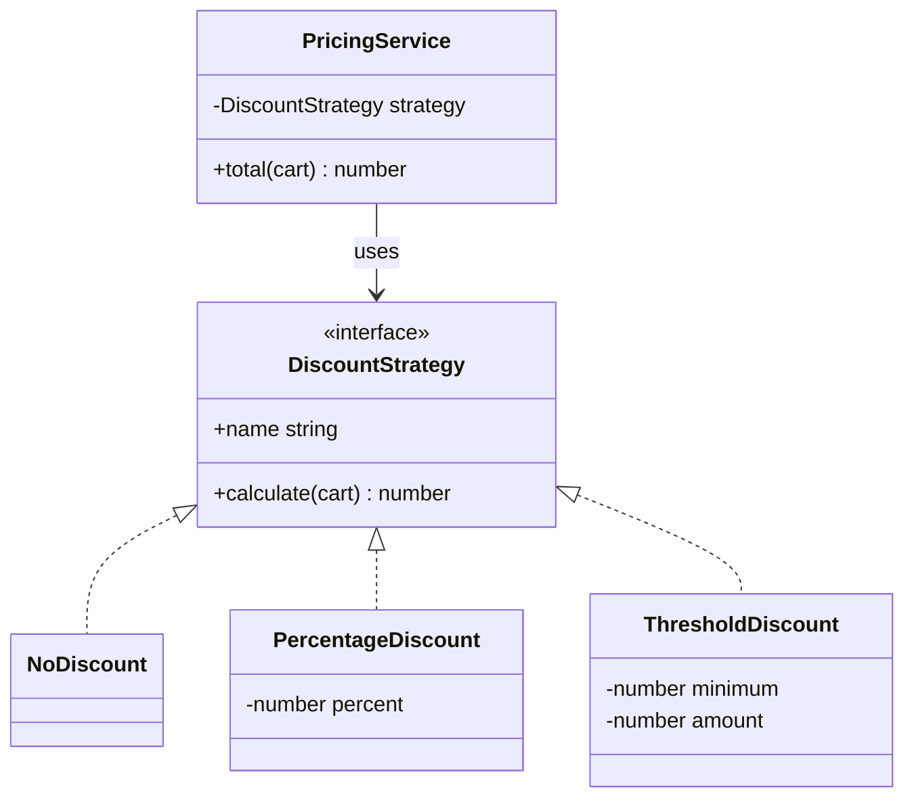
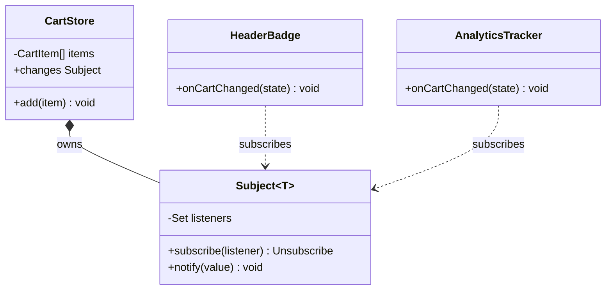
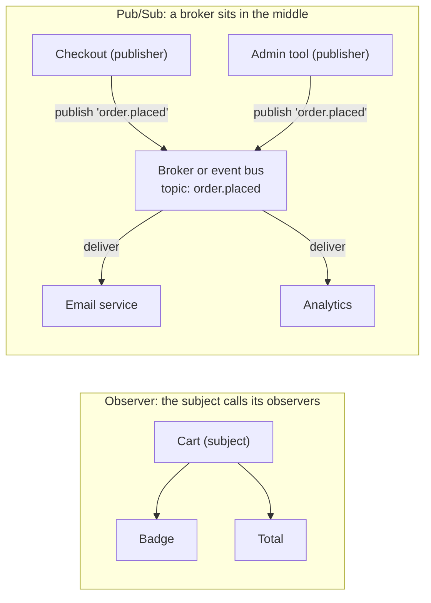
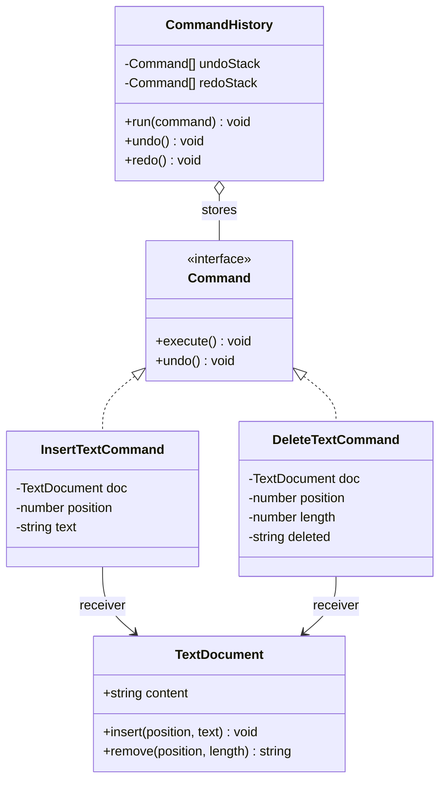
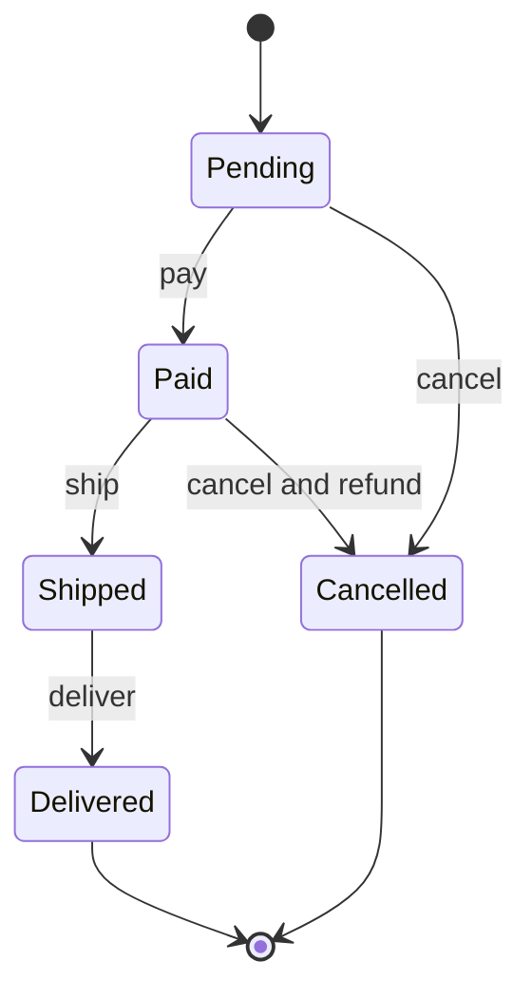
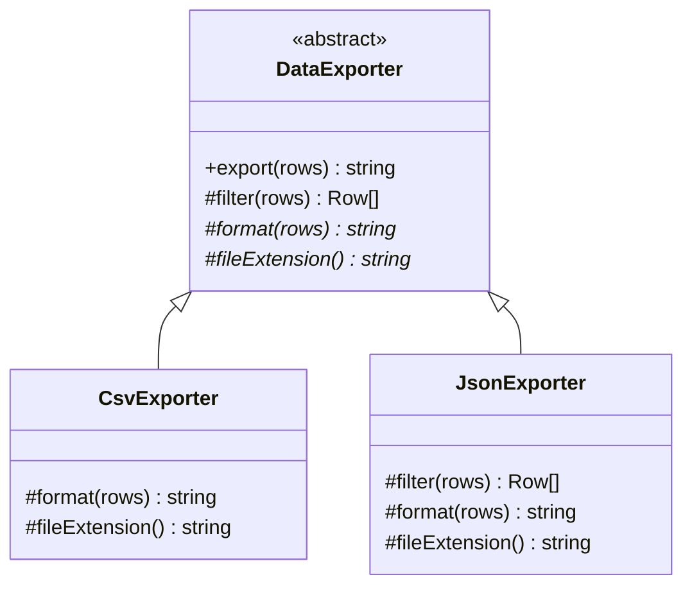
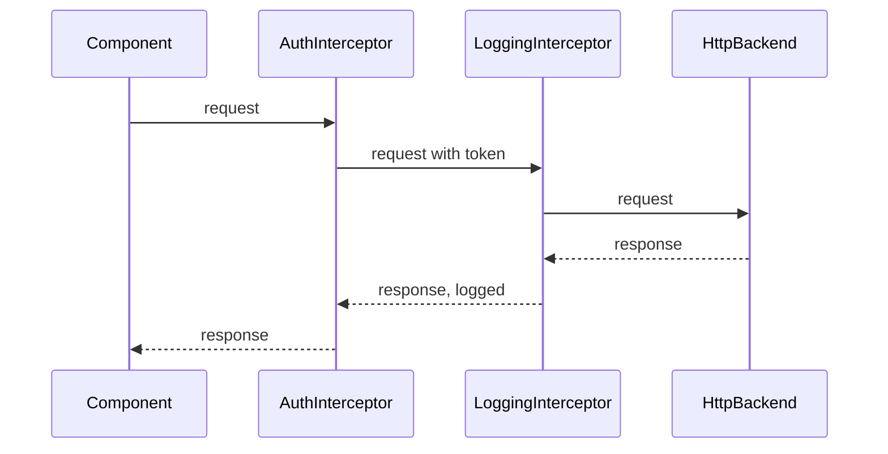
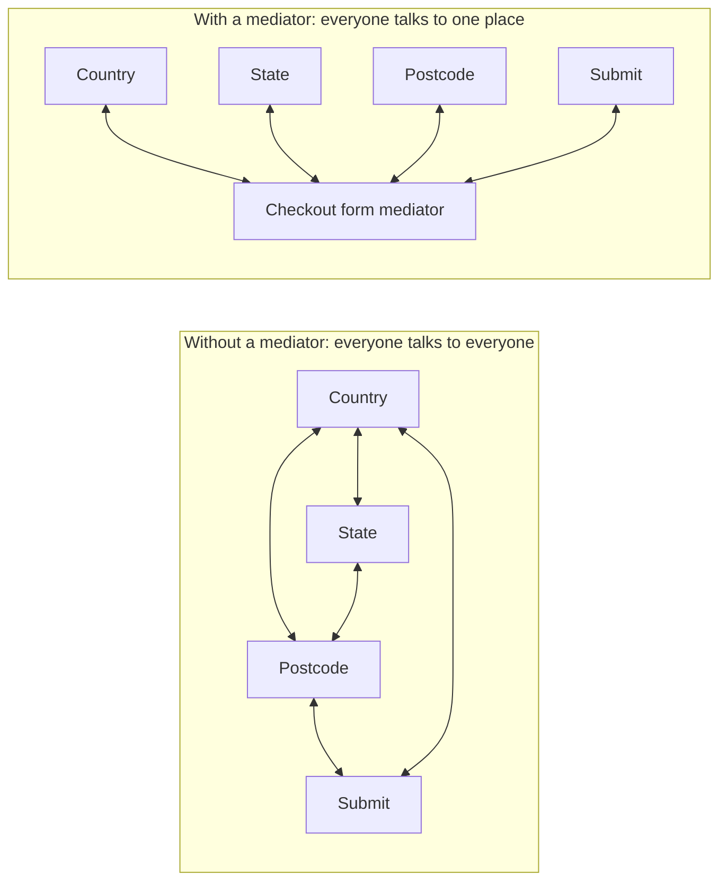
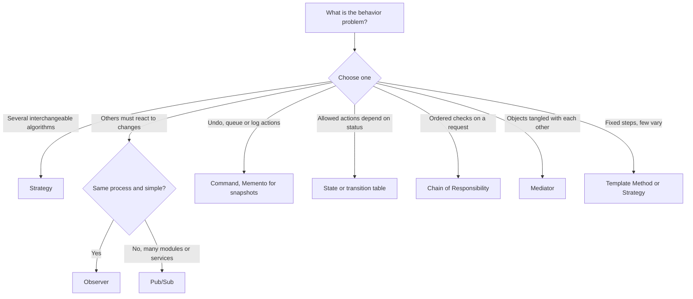

# Behavioral Patterns

> In this document you will learn the behavioral patterns: Strategy, Observer (and how it differs from Pub/Sub), Command, State, Iterator, Template Method, Chain of Responsibility, Mediator, Memento and Visitor. These patterns describe how objects share work and talk to each other, and they appear everywhere in JavaScript: event listeners, RxJS, Express middleware, Angular interceptors, Redux actions and undo/redo.

**Before this:** [Creational patterns](06-creational-patterns.md) · [Structural patterns](07-structural-patterns.md) · [Callbacks and promises](../02-javascript/17-callbacks-and-promises.md) · **Interview questions:** [jump to questions](#interview-questions)

## Table of contents

1. [What behavioral patterns solve](#what-behavioral-patterns-solve)
2. [Strategy](#strategy)
3. [Observer](#observer)
4. [Observer vs Pub/Sub](#observer-vs-pubsub)
5. [Command](#command)
6. [State](#state)
7. [Iterator](#iterator)
8. [Template Method](#template-method)
9. [Chain of Responsibility](#chain-of-responsibility)
10. [Mediator](#mediator)
11. [Memento](#memento)
12. [Visitor](#visitor)
13. [Comparing the behavioral patterns](#comparing-the-behavioral-patterns)
14. [How to explain behavioral patterns in an interview](#how-to-explain-behavioral-patterns-in-an-interview)
15. [Interview questions](#interview-questions)
16. [Summary](#summary)
17. [References](#references)

---

## What behavioral patterns solve

**Behavioral patterns** are about *responsibilities* and *communication*: which object does which part of the work, and how objects tell each other that something happened, without being tightly tied together.

| Problem | Pattern |
| --- | --- |
| "There are several ways to do this, and I want to swap them" | **Strategy** |
| "Many parts of the app must react when this changes" | **Observer**, **Pub/Sub** |
| "I want to queue, log or undo actions" | **Command** (and **Memento** for snapshots) |
| "Behavior depends on the current status, and only some changes are allowed" | **State** |
| "I want to loop over my custom collection with `for...of`" | **Iterator** |
| "The steps are always the same, only some details change" | **Template Method** |
| "A request must pass through several checks in order" | **Chain of Responsibility** |
| "Too many objects talk directly to each other" | **Mediator** |
| "I want to add new operations to a fixed set of object types" | **Visitor** |

In JavaScript, functions are values, so several of these patterns become very small. A strategy can be a function. An observer can be a callback. A command can be a plain object. Keep that in mind: the class versions are useful to understand the idea, but the function versions are often what you write in real code.

---

## Strategy

### The problem

Pricing rules grow over time. Code like this gets worse with every new rule:

```js
// ❌ Every new customer type or promotion means editing this function
function calculateDiscount(cart, customerType) {
  const subtotal = cart.items.reduce((sum, item) => sum + item.priceInCents * item.quantity, 0);
  if (customerType === 'regular') {
    return 0;
  } else if (customerType === 'premium') {
    return Math.round(subtotal * 0.1);
  } else if (customerType === 'employee') {
    return Math.round(subtotal * 0.3);
  } else if (customerType === 'black-friday') {
    return subtotal > 10_000 ? 2_000 : 0;
  }
  throw new Error(`Unknown customer type: ${customerType}`);
}
```

The function mixes *choosing* a rule with *doing* every rule. It is hard to test one rule alone, and two developers adding promotions at the same time will conflict.

This is the same problem the **Open/Closed Principle** describes: you want to add new behavior without editing working code. The principle, with a `DiscountRule` example and its limits, is explained in [SOLID: Open/Closed Principle](03-solid-principles.md#o-openclosed-principle). Strategy is the most common *pattern* that puts that principle into practice. This section focuses on the pattern itself and its JavaScript forms.

### The idea in simple words

The **Strategy pattern** puts each algorithm (each "way of doing it") behind the same interface. The code that needs the algorithm (the **context**) receives one strategy and just calls it. You can swap strategies without changing the context.

**Analogy:** a navigation app. You ask for a route. You can choose "car", "bike" or "walking". The request is the same, and the result has the same shape (a route), but the algorithm behind it is different.

### Class diagram



### Example 1: strategies as functions

In JavaScript, the simplest strategy is a function. Put them in an object and look one up:

```js
const subtotalOf = (cart) => cart.items.reduce((sum, item) => sum + item.priceInCents * item.quantity, 0);

const discountStrategies = {
  regular: () => 0,
  premium: (cart) => Math.round(subtotalOf(cart) * 0.1),
  employee: (cart) => Math.round(subtotalOf(cart) * 0.3),
  blackFriday: (cart) => (subtotalOf(cart) > 10_000 ? 2_000 : 0),
};

function calculateTotal(cart, discountStrategy) {
  return subtotalOf(cart) - discountStrategy(cart);
}

const cart = { items: [{ priceInCents: 6_000, quantity: 2 }] };
console.log(calculateTotal(cart, discountStrategies.regular)); // 12000
console.log(calculateTotal(cart, discountStrategies.premium)); // 10800
console.log(calculateTotal(cart, discountStrategies.blackFriday)); // 10000
```

`calculateTotal` never changes when marketing invents a new promotion. You add one function to the object.

### Example 2: configurable strategy classes in TypeScript

When strategies need configuration, a name for logging, or several methods, classes work well:

```ts
interface CartItem {
  sku: string;
  priceInCents: number;
  quantity: number;
}

interface Cart {
  items: CartItem[];
}

interface DiscountStrategy {
  readonly name: string;
  calculate(cart: Cart): number; // returns the discount in cents
}

const subtotal = (cart: Cart): number =>
  cart.items.reduce((sum, item) => sum + item.priceInCents * item.quantity, 0);

class NoDiscount implements DiscountStrategy {
  readonly name = 'none';
  calculate(): number {
    return 0;
  }
}

class PercentageDiscount implements DiscountStrategy {
  constructor(private readonly percent: number) {}
  get name(): string {
    return `${this.percent}% off`;
  }
  calculate(cart: Cart): number {
    return Math.round((subtotal(cart) * this.percent) / 100);
  }
}

class ThresholdDiscount implements DiscountStrategy {
  constructor(private readonly minimumInCents: number, private readonly amountInCents: number) {}
  get name(): string {
    return `${this.amountInCents / 100} off orders over ${this.minimumInCents / 100}`;
  }
  calculate(cart: Cart): number {
    return subtotal(cart) >= this.minimumInCents ? this.amountInCents : 0;
  }
}

// A strategy built from other strategies: give the customer the best one
class BestOfDiscount implements DiscountStrategy {
  readonly name = 'best available';
  constructor(private readonly options: DiscountStrategy[]) {}
  calculate(cart: Cart): number {
    return Math.max(0, ...this.options.map((option) => option.calculate(cart)));
  }
}

class PricingService {
  constructor(private readonly strategy: DiscountStrategy) {}

  total(cart: Cart): number {
    const discount = Math.min(this.strategy.calculate(cart), subtotal(cart)); // never below zero
    console.log(`discount "${this.strategy.name}": ${discount}`);
    return subtotal(cart) - discount;
  }
}

const cart: Cart = { items: [{ sku: 'KB-1', priceInCents: 4_500, quantity: 3 }] }; // 13500

console.log(new PricingService(new NoDiscount()).total(cart));
// discount "none": 0
// 13500
console.log(new PricingService(new PercentageDiscount(10)).total(cart));
// discount "10% off": 1350
// 12150
const best = new BestOfDiscount([new PercentageDiscount(10), new ThresholdDiscount(10_000, 2_000)]);
console.log(new PricingService(best).total(cart));
// discount "best available": 2000
// 11500
```

The *choice* of strategy (based on customer type, date or a feature flag) happens in one place, often a small factory. Every strategy can be unit tested alone.

### Example 3: sorting with comparator strategies

You already use the Strategy pattern every time you call `Array.prototype.sort` with a compare function. The sorting algorithm is fixed; the comparison strategy is yours.

```js
const products = [
  { name: 'Mouse', priceInCents: 2_500, rating: 4.7 },
  { name: 'Keyboard', priceInCents: 4_500, rating: 4.3 },
  { name: 'Cable', priceInCents: 900, rating: 4.7 },
];

const sortStrategies = {
  priceLowToHigh: (a, b) => a.priceInCents - b.priceInCents,
  bestRated: (a, b) => b.rating - a.rating || a.name.localeCompare(b.name), // tie-break by name
  name: (a, b) => a.name.localeCompare(b.name),
};

function sortProducts(list, strategyName) {
  return [...list].sort(sortStrategies[strategyName]); // copy first: sort() mutates
}

console.log(sortProducts(products, 'priceLowToHigh').map((p) => p.name)); // [ 'Cable', 'Mouse', 'Keyboard' ]
console.log(sortProducts(products, 'bestRated').map((p) => p.name)); // [ 'Cable', 'Mouse', 'Keyboard' ]
console.log(sortProducts(products, 'name').map((p) => p.name)); // [ 'Cable', 'Keyboard', 'Mouse' ]
```

In a UI, the "Sort by" dropdown value is simply the strategy name. (`toSorted()`, added in ES2023, returns a sorted copy without the manual spread.)

### Real-world usage

- **Passport.js** (Node authentication) is built around strategies. Each login method is a strategy with the same interface, and the route chooses one by name:

```js
import passport from 'passport';
import { Strategy as LocalStrategy } from 'passport-local';
import { Strategy as JwtStrategy, ExtractJwt } from 'passport-jwt';

passport.use(new LocalStrategy(async (username, password, done) => {
  const user = await users.verifyPassword(username, password);
  return done(null, user ?? false);
}));

passport.use(new JwtStrategy(
  { jwtFromRequest: ExtractJwt.fromAuthHeaderAsBearerToken(), secretOrKey: process.env.JWT_SECRET },
  async (payload, done) => done(null, await users.findById(payload.sub)),
));

app.post('/login', passport.authenticate('local', { session: false }), issueToken);
app.get('/orders', passport.authenticate('jwt', { session: false }), listOrders);
```

- **Angular** lets you plug in strategies through DI: `RouteReuseStrategy`, `PreloadingStrategy` (`PreloadAllModules`, `NoPreloading`), `TitleStrategy`, `LocationStrategy` (`PathLocationStrategy`, `HashLocationStrategy`). You provide your own class with `{ provide: RouteReuseStrategy, useClass: MyReuseStrategy }`. See [patterns in real JavaScript apps](09-patterns-in-real-javascript-apps.md#patterns-inside-angular).
- **Validation:** one validator function per rule, chosen by field type.
- **Compression, export formats, retry policies:** gzip vs brotli, CSV vs Excel, fixed vs exponential backoff.

### Advantages and disadvantages

| Advantages | Disadvantages |
| --- | --- |
| Add new algorithms without changing the context (Open/Closed) | More small pieces to find and name |
| Each algorithm can be tested alone | The client (or a factory) must know which strategy to choose |
| Swap behavior at runtime (user choice, feature flag) | Strategies may need data the context must pass in |
| Removes long `if/else` and `switch` chains | Overkill for two simple, stable branches |

### When NOT to use it

- There are two branches and no sign of more. A simple `if` is clearer.
- The "strategies" share almost all their code and differ in one number. Pass the number as a parameter instead.

### Common mistakes

- **Moving the `if/else` into every caller.** The selection logic should live in one place (a map or factory).
- **Strategies with different interfaces**, so the context has to check which one it got.
- **Strategies that secretly read global state.** Pass what they need as arguments.

---

## Observer

### The problem

When the shopping cart changes, many parts of the page must update: the badge in the header, the cart total, the "free shipping" banner, and an analytics tracker. If the cart calls each of them directly, it must know about all of them. Every new widget means editing the cart.

### The idea in simple words

In the **Observer pattern**, an object called the **subject** keeps a list of **observers** (listeners). Observers **subscribe** to the subject. When something changes, the subject **notifies** every observer. The subject does not know what the observers do; it only knows they want to be told.

**Analogy:** subscribing to a newsletter. You give the publisher your email. When a new issue comes out, the publisher sends it to everyone on the list. You can unsubscribe any time.

**Where the analogy breaks:** in the Observer pattern, the subject itself keeps the list and calls observers directly, usually right away (synchronously). Some newsletters go through a separate mailing service in between; that version is closer to **Pub/Sub**, covered in the next section.

### Class diagram



### Example: a small observable store

```ts
type Listener<T> = (value: T) => void;
type Unsubscribe = () => void;

class Subject<T> {
  private readonly listeners = new Set<Listener<T>>();

  subscribe(listener: Listener<T>): Unsubscribe {
    this.listeners.add(listener);
    return () => this.listeners.delete(listener); // give the caller a way to stop listening
  }

  notify(value: T): void {
    for (const listener of [...this.listeners]) { // copy: listeners may unsubscribe while we loop
      try {
        listener(value);
      } catch (error) {
        console.error('listener failed:', (error as Error).message); // one bad listener must not stop the others
      }
    }
  }
}

interface CartState {
  itemCount: number;
  totalInCents: number;
}

class CartStore {
  readonly changes = new Subject<CartState>();
  private state: CartState = { itemCount: 0, totalInCents: 0 };

  add(priceInCents: number): void {
    this.state = {
      itemCount: this.state.itemCount + 1,
      totalInCents: this.state.totalInCents + priceInCents,
    };
    this.changes.notify(this.state);
  }
}

const cart = new CartStore();

const stopBadge = cart.changes.subscribe((s) => console.log(`badge: ${s.itemCount}`));
cart.changes.subscribe((s) => console.log(`total: $${(s.totalInCents / 100).toFixed(2)}`));
cart.changes.subscribe((s) => {
  if (s.totalInCents > 5_000) throw new Error('analytics server down');
});

cart.add(2_500);
// badge: 1
// total: $25.00
cart.add(3_000);
// badge: 2
// total: $55.00
// listener failed: analytics server down
stopBadge(); // the badge component was destroyed
cart.add(1_000);
// total: $65.00
// listener failed: analytics server down
```

**Step by step:**

1. Three observers subscribe. The cart keeps them in a `Set`.
2. `cart.add(2_500)` creates a new state and calls `notify`. Each listener runs **synchronously**, in the order it subscribed.
3. On the second `add`, the analytics listener throws. The `try/catch` inside `notify` logs it and continues, so the other listeners are not affected.
4. `stopBadge()` removes the badge listener, so the third `add` no longer updates it.

Two design choices to notice:

- `subscribe` **returns an unsubscribe function**. This is the most common modern API shape (RxJS, Redux, many signal libraries).
- `notify` **isolates errors**. Without that, one broken listener stops all the listeners after it. Node's `EventEmitter` does *not* do this (see below).

### Push vs pull

- **Push:** the subject sends the new data in `notify(value)` (as above).
- **Pull:** the subject only says "something changed", and observers read what they need (`store.getState()`). Redux's `store.subscribe(listener)` uses pull: the listener receives no arguments and calls `getState()`.

### Observer in Node.js: EventEmitter

Node's `EventEmitter` (in `node:events`) is a ready-made subject with named events. Many core objects extend it: HTTP servers, streams, child processes.

```js
import { EventEmitter } from 'node:events';

class OrderService extends EventEmitter {
  place(order) {
    console.log(`placing ${order.id}`);
    this.emit('order:placed', order); // notifies listeners right now, synchronously
    console.log(`placed ${order.id}`);
  }
}

const orders = new OrderService();
orders.on('order:placed', (order) => console.log(`  email receipt for ${order.id}`));
orders.on('order:placed', (order) => console.log(`  update stock for ${order.id}`));
orders.once('order:placed', () => console.log('  (first order of the day)'));

orders.place({ id: 'A-1' });
// placing A-1
//   email receipt for A-1
//   update stock for A-1
//   (first order of the day)
// placed A-1
orders.place({ id: 'A-2' });
// placing A-2
//   email receipt for A-2
//   update stock for A-2
// placed A-2
```

Important facts about `EventEmitter`:

- Listeners run **synchronously, in the order they were registered**. `emit()` returns only after all of them finish. A slow listener slows down `place()`.
- `emit()` returns `true` if the event had listeners, `false` otherwise.
- If a listener **throws**, the error goes up to the code that called `emit()`, and later listeners do not run.
- Emitting `'error'` with **no `'error'` listener** throws the error, which crashes the process if nothing catches it. Always add an `'error'` listener to emitters that can fail.
- By default, adding more than 10 listeners for one event prints a "possible EventEmitter memory leak" warning. It is not a hard limit; it is a hint that you may be forgetting to remove listeners. Use `off()` (or `removeListener()`) to remove them.

Details are in [Node core modules](../07-nodejs-backend/04-core-modules-fs-path-events-buffer.md).

### Observer in the browser: DOM events

`addEventListener` is the Observer pattern. The element is the subject.

```js
const button = document.querySelector('#save');

function onSave() {
  console.log('saving...');
}

button.addEventListener('click', onSave);
button.removeEventListener('click', onSave); // must be the SAME function reference

// Remove many listeners at once with an AbortController
const controller = new AbortController();
window.addEventListener('resize', () => console.log('resized'), { signal: controller.signal });
window.addEventListener('scroll', () => console.log('scrolled'), { signal: controller.signal });
controller.abort(); // both listeners are removed

button.addEventListener('click', () => console.log('only once'), { once: true });
```

This is browser behavior (DOM API), not part of the JavaScript language. DOM details are in [DOM and events](../05-frontend-engineering/03-dom-and-events.md).

### Observer with RxJS in Angular

RxJS is built on the Observer idea, with many operators on top. A `BehaviorSubject` is a subject that remembers its latest value and gives it to new subscribers immediately:

```ts
import { Injectable } from '@angular/core';
import { BehaviorSubject, map } from 'rxjs';

@Injectable({ providedIn: 'root' })
export class CartService {
  private readonly items$ = new BehaviorSubject<string[]>([]);
  readonly count$ = this.items$.pipe(map((items) => items.length));

  add(item: string): void {
    this.items$.next([...this.items$.value, item]); // new array: observers get a new value
  }
}
```

```ts
import { Component, inject } from '@angular/core';
import { CartService } from './cart.service';

@Component({
  selector: 'app-cart-badge',
  template: `<span class="badge">{{ count$ | async }}</span>`,
})
export class CartBadgeComponent {
  readonly count$ = inject(CartService).count$; // the async pipe subscribes AND unsubscribes for you
}
```

If you subscribe manually in a component, you must unsubscribe when it is destroyed. In Angular 16, `takeUntilDestroyed()` from `@angular/core/rxjs-interop` (developer preview in v16) does this:

```ts
import { Component, inject } from '@angular/core';
import { takeUntilDestroyed } from '@angular/core/rxjs-interop';
import { CartService } from './cart.service';

@Component({ selector: 'app-cart-logger', template: '' })
export class CartLoggerComponent {
  constructor() {
    inject(CartService)
      .count$.pipe(takeUntilDestroyed()) // completes when the component is destroyed
      .subscribe((count) => console.log('cart count', count));
  }
}
```

RxJS in depth is in [RxJS](../06-angular-16/09-rxjs.md).

### Real-world usage

- DOM events, `MutationObserver`, `IntersectionObserver`, `ResizeObserver` (all named after the pattern).
- Node `EventEmitter`, streams (`'data'`, `'end'`, `'error'` events), `process.on('exit')`.
- RxJS observables, Angular `@Output()` `EventEmitter` (which extends RxJS `Subject`), signals and their effects.
- Redux and NgRx `store.subscribe` / `store.select`.
- Electron: `app.on('ready')`, `win.on('closed')`, `ipcMain.on(channel, ...)`.

### Advantages and disadvantages

| Advantages | Disadvantages |
| --- | --- |
| The subject does not know who listens (loose coupling) | Hard to follow the flow: "who reacts to this event?" |
| Add new reactions without changing the subject | Forgotten subscriptions cause **memory leaks** |
| Natural fit for UI updates and domain events | Order of listeners and error handling must be designed |
| One change can update many parts | Many synchronous listeners can slow down the subject |

### When NOT to use it

- There is exactly one consumer. A direct method call or a callback parameter is clearer.
- You need a reply. Observers are "fire and forget"; use a normal function call or a request/response API.

### Common mistakes

- **Never unsubscribing.** A listener keeps its owner (for example a destroyed component) alive in memory. This is called the **lapsed listener** problem.
- **`removeEventListener` with a new function** (`() => onSave()` creates a different function each time, so nothing is removed).
- **Listeners that change the subject during `notify`**, causing loops. Copy the listener list and avoid emitting from inside a listener of the same event.
- **Assuming listeners are async.** `EventEmitter` and simple subjects call listeners synchronously.

---

## Observer vs Pub/Sub

People often use the two names as if they were the same. They are related, but there is one key difference: **who keeps the subscriber list**.

- **Observer:** the subject keeps the list of observers and calls them directly. Observers know which subject they subscribed to.
- **Publish/Subscribe (Pub/Sub):** publishers send messages to a **channel** or **topic** on a **broker** (an event bus or message service). Subscribers subscribe to the topic on the broker. Publishers and subscribers do not know about each other at all.



| | Observer | Pub/Sub |
| --- | --- | --- |
| Who keeps subscribers | The subject | A broker / event bus |
| Do the sides know each other? | Observers know the subject | No, they only know topic names |
| Typical timing | Synchronous, in the same process | Often asynchronous, can cross processes and machines |
| Filtering | By which subject you subscribe to | By topic or channel name |
| Examples | DOM events, `EventEmitter`, RxJS `Subject` | An app-wide event bus, Redis Pub/Sub, RabbitMQ, Google Cloud Pub/Sub, Kafka topics, `BroadcastChannel` |
| Main risk | Memory leaks from forgotten observers | Hidden flows ("who publishes this?"), delivery guarantees |

A tiny in-process Pub/Sub event bus:

```js
const bus = {
  topics: new Map(),
  subscribe(topic, handler) {
    if (!this.topics.has(topic)) this.topics.set(topic, new Set());
    this.topics.get(topic).add(handler);
    return () => this.topics.get(topic).delete(handler);
  },
  publish(topic, payload) {
    for (const handler of this.topics.get(topic) ?? []) handler(payload);
  },
};

// The email module and the checkout module never import each other
bus.subscribe('order.placed', (order) => console.log(`email: receipt for ${order.id}`));
bus.subscribe('order.placed', (order) => console.log(`analytics: revenue ${order.total}`));
bus.publish('order.placed', { id: 'A-9', total: 120 });
// email: receipt for A-9
// analytics: revenue 120
bus.publish('user.deleted', { id: 'u1' }); // no subscribers: nothing happens
```

A typed, production-ready event bus is built in [patterns in real JavaScript apps](09-patterns-in-real-javascript-apps.md#pubsub-event-bus).

In the browser, `BroadcastChannel` is Pub/Sub across tabs of the same origin. It is great for "log out in every tab":

```js
const authChannel = new BroadcastChannel('auth');
authChannel.onmessage = (event) => {
  if (event.data.type === 'logout') window.location.assign('/login');
};
// In the tab where the user clicked "Log out":
authChannel.postMessage({ type: 'logout' });
```

**Distributed Pub/Sub warning:** when messages cross the network (Redis, RabbitMQ, Kafka), you must think about delivery guarantees. Redis Pub/Sub drops messages if no subscriber is connected. Queues and logs like RabbitMQ and Kafka can redeliver, so consumers must handle duplicates (be **idempotent**). See [background jobs and queues](../07-nodejs-backend/13-background-jobs-and-queues.md).

---

## Command

### The problem

A text editor needs **undo and redo**. A desktop app wants the same action ("Bold") to run from a menu, a toolbar button and a keyboard shortcut. A backend wants to put work in a **queue** and run it later, with retries and a log of what happened.

In all these cases, "call a method right now" is not enough. You need the action itself as something you can store, pass around, log, run later and reverse.

### The idea in simple words

The **Command pattern** turns a request into an **object**. The object knows what to do (`execute()`) and often how to reverse it (`undo()`). Three roles:

- **Command:** the object that wraps one action and its data.
- **Receiver:** the object that really does the work (the document).
- **Invoker:** the object that runs commands and may store them (the undo manager, a queue, a menu).

**Analogy:** an order ticket in a restaurant. The waiter writes the order on a ticket (the command) and puts it on the kitchen rail (the queue). The chef (the receiver) cooks from the ticket later. A ticket can be cancelled, and the restaurant keeps tickets as a record.

### Class diagram



### Example: undo and redo in a text editor

```js
class TextDocument {
  content = '';
  insert(position, text) {
    this.content = this.content.slice(0, position) + text + this.content.slice(position);
  }
  remove(position, length) {
    const removed = this.content.slice(position, position + length);
    this.content = this.content.slice(0, position) + this.content.slice(position + length);
    return removed;
  }
}

class InsertTextCommand {
  constructor(doc, position, text) {
    Object.assign(this, { doc, position, text });
  }
  execute() { this.doc.insert(this.position, this.text); }
  undo() { this.doc.remove(this.position, this.text.length); }
}

class DeleteTextCommand {
  constructor(doc, position, length) {
    Object.assign(this, { doc, position, length, deleted: '' });
  }
  execute() { this.deleted = this.doc.remove(this.position, this.length); } // remember what we removed
  undo() { this.doc.insert(this.position, this.deleted); }
}

class CommandHistory {
  #undoStack = [];
  #redoStack = [];

  run(command) {
    command.execute();
    this.#undoStack.push(command);
    this.#redoStack = []; // a new action makes the old "future" invalid
  }
  undo() {
    const command = this.#undoStack.pop();
    if (!command) return;
    command.undo();
    this.#redoStack.push(command);
  }
  redo() {
    const command = this.#redoStack.pop();
    if (!command) return;
    command.execute();
    this.#undoStack.push(command);
  }
}

const doc = new TextDocument();
const history = new CommandHistory();

history.run(new InsertTextCommand(doc, 0, 'Hello world'));
history.run(new InsertTextCommand(doc, 5, ','));
console.log(doc.content); // Hello, world
history.run(new DeleteTextCommand(doc, 5, 7));
console.log(doc.content); // Hello
history.undo();
console.log(doc.content); // Hello, world
history.undo();
console.log(doc.content); // Hello world
history.redo();
console.log(doc.content); // Hello, world
history.run(new InsertTextCommand(doc, 12, '!'));
history.redo(); // nothing to redo: the redo stack was cleared
console.log(doc.content); // Hello, world!
```

**Step by step for the important part:**

1. Each `run()` executes a command and pushes it on the undo stack.
2. `undo()` pops the last command, calls its `undo()`, and moves it to the redo stack.
3. `redo()` does the opposite.
4. When you run a **new** command after undoing, the redo stack is cleared. The old "future" no longer makes sense, because the document is now on a different path. Every editor you know works this way.

Notice that `DeleteTextCommand` saves the deleted text during `execute()`. A command must keep enough data to reverse itself.

### Example: commands as data in a task queue

When commands must be stored, sent over the network or retried, make them **plain data** plus a **handler registry**:

```js
const handlers = {
  sendEmail: async ({ to, template }) => console.log(`email "${template}" sent to ${to}`),
  resizeImage: async ({ file, width }) => console.log(`resized ${file} to ${width}px`),
};

const queue = [];
const enqueue = (type, payload) => queue.push({ type, payload, attempts: 0 }); // JSON-friendly

async function processQueue() {
  while (queue.length > 0) {
    const command = queue.shift();
    const handler = handlers[command.type];
    if (!handler) {
      console.log(`unknown command ${command.type}, skipped`);
      continue;
    }
    try {
      command.attempts += 1;
      await handler(command.payload);
    } catch (error) {
      if (command.attempts < 3) queue.push(command); // retry later
    }
  }
}

enqueue('sendEmail', { to: 'ana@example.com', template: 'welcome' });
enqueue('resizeImage', { file: 'avatar.png', width: 128 });
enqueue('launchRocket', {});
await processQueue();
// email "welcome" sent to ana@example.com
// resized avatar.png to 128px
// unknown command launchRocket, skipped
```

Because commands are plain objects, a real system can save them in Redis or a database (with BullMQ, for example) and process them in another process. See [background jobs and queues](../07-nodejs-backend/13-background-jobs-and-queues.md).

### Real-world usage

- **Undo/redo** in editors, drawing tools, form builders, spreadsheet apps.
- **Command palettes:** VS Code registers commands by id (`registerCommand('editor.action.formatDocument', handler)`), and menus, shortcuts and the palette all run the same command.
- **Electron menus:** a menu item's `click` and its `accelerator` (keyboard shortcut) can call the same command function that a toolbar button calls.
- **Redux and NgRx actions** are plain objects describing something to do or something that happened; the store "executes" them through reducers. (Redux recommends naming actions as *events* that happened.)
- **Job queues:** BullMQ jobs, cloud task queues.

### Advantages and disadvantages

| Advantages | Disadvantages |
| --- | --- |
| Undo/redo, logging, queueing and retries become easy | Many small command classes |
| The invoker does not know what the command does | Every command must correctly reverse itself for undo |
| Commands as data can be stored and replayed | Undo is hard for side effects outside your app (an email cannot be "unsent") |

### When NOT to use it

- You just need to call a function now. A closure (`() => save(doc)`) is a perfectly good tiny command.
- You need undo but commands are hard to reverse. Snapshots (Memento) may be simpler.

### Common mistakes

- **Not clearing the redo stack** after a new command.
- **Commands that do not store enough data** to undo (forgetting what was deleted).
- **Undo for external side effects.** Use a *compensating action* instead ("send a correction email", "refund the payment"), and name it honestly.

---

## State

### The problem

An order goes through statuses: pending, paid, shipped, delivered, cancelled. Different actions are allowed in each status. Code like this appears in every method:

```js
// ❌ The same switch in every method, and it is easy to forget a case
function ship(order) {
  switch (order.status) {
    case 'pending': throw new Error('Cannot ship an unpaid order');
    case 'paid': order.status = 'shipped'; break;
    case 'shipped': throw new Error('Already shipped');
    case 'delivered': throw new Error('Already delivered');
    case 'cancelled': throw new Error('Order was cancelled');
  }
}
// ...and the same again in pay(), cancel(), deliver()
```

Adding one new status ("on hold") means editing every switch. One missed case lets a cancelled order ship.

### The idea in simple words

The **State pattern** lets an object change its behavior when its internal state changes. Each state knows which actions it allows and which state comes next. The object (the **context**) delegates to its current state.

The data-driven cousin is a **finite state machine**: a fixed list of states, plus a table of allowed transitions (`state + event -> next state`).

**Analogy:** a vending machine. When it is "waiting for money", the button does nothing. After you insert coins, it is "ready", and the button gives you a drink. The same button behaves differently depending on the state.

### State diagram



### Example 1: a transition table (the simplest version)

In JavaScript, a table of allowed transitions is often all you need:

```js
const orderTransitions = {
  pending: { pay: 'paid', cancel: 'cancelled' },
  paid: { ship: 'shipped', cancel: 'cancelled' },
  shipped: { deliver: 'delivered' },
  delivered: {},
  cancelled: {},
};

function transition(order, event) {
  const next = orderTransitions[order.status][event];
  if (!next) {
    throw new Error(`Cannot ${event} an order that is ${order.status}`);
  }
  return { ...order, status: next, history: [...order.history, `${order.status} -> ${next}`] };
}

let order = { id: 'A-1', status: 'pending', history: [] };
order = transition(order, 'pay');
order = transition(order, 'ship');
console.log(order.status); // shipped

try {
  transition(order, 'cancel');
} catch (error) {
  console.log(error.message); // Cannot cancel an order that is shipped
}
console.log(order.history); // [ 'pending -> paid', 'paid -> shipped' ]
```

All the rules are in one readable object. You can even show the table to a product manager. You can also ask "what can I do now?": `Object.keys(orderTransitions[order.status])` gives the buttons to show in the UI.

### Example 2: state classes (the GoF version)

When each state has real *behavior* (not just a next status), use one class per state:

```ts
interface OrderState {
  readonly name: string;
  pay(order: Order): void;
  ship(order: Order): void;
  cancel(order: Order): void;
}

class Order {
  private state: OrderState = new PendingState();
  constructor(readonly id: string, readonly totalInCents: number) {}

  get status(): string { return this.state.name; }
  setState(state: OrderState): void { this.state = state; }

  pay(): void { this.state.pay(this); }
  ship(): void { this.state.ship(this); }
  cancel(): void { this.state.cancel(this); }
}

// Base class: by default every action is not allowed
abstract class BaseState implements OrderState {
  abstract readonly name: string;
  pay(_order: Order): void { throw new Error(`Cannot pay: order is ${this.name}`); }
  ship(_order: Order): void { throw new Error(`Cannot ship: order is ${this.name}`); }
  cancel(_order: Order): void { throw new Error(`Cannot cancel: order is ${this.name}`); }
}

class PendingState extends BaseState {
  readonly name = 'pending';
  pay(order: Order): void {
    console.log(`charging ${order.totalInCents} cents`);
    order.setState(new PaidState());
  }
  cancel(order: Order): void {
    order.setState(new CancelledState());
  }
}

class PaidState extends BaseState {
  readonly name = 'paid';
  ship(order: Order): void {
    console.log(`creating shipment for ${order.id}`);
    order.setState(new ShippedState());
  }
  cancel(order: Order): void {
    console.log(`refunding ${order.totalInCents} cents`); // behavior that only this state has
    order.setState(new CancelledState());
  }
}

class ShippedState extends BaseState {
  readonly name = 'shipped';
}

class CancelledState extends BaseState {
  readonly name = 'cancelled';
}

const order = new Order('A-7', 4_999);
order.pay(); // charging 4999 cents
order.cancel(); // refunding 4999 cents
console.log(order.status); // cancelled
try {
  order.ship();
} catch (error) {
  console.log((error as Error).message); // Cannot ship: order is cancelled
}
```

Adding an "on hold" state now means adding one class and changing the states that can move into it. No switch statements to hunt down.

### Example 3: UI state with discriminated unions

A very common frontend version of the same idea: replace several boolean flags with **one** state value.

```ts
// ❌ Booleans allow impossible combinations: isLoading AND error AND data at the same time
interface BadState {
  isLoading: boolean;
  error: string | null;
  data: string[] | null;
}

// ✅ One status at a time; TypeScript knows which fields exist in each case
type RemoteData<T> =
  | { status: 'idle' }
  | { status: 'loading' }
  | { status: 'success'; data: T }
  | { status: 'error'; message: string };

function render(state: RemoteData<string[]>): string {
  switch (state.status) {
    case 'idle': return 'Click "Load" to start';
    case 'loading': return 'Loading...';
    case 'success': return `Loaded ${state.data.length} products`;
    case 'error': return `Error: ${state.message}`;
    default: {
      const unreachable: never = state; // compile error if a new status is not handled
      return unreachable;
    }
  }
}

console.log(render({ status: 'loading' })); // Loading...
console.log(render({ status: 'success', data: ['Mouse', 'Cable'] })); // Loaded 2 products
console.log(render({ status: 'error', message: 'Timeout' })); // Error: Timeout
```

With a 4-boolean design there are 16 combinations, most of them meaningless. With a union there are exactly the 4 states you designed. More in [unions, narrowing and type guards](../03-typescript/03-unions-narrowing-and-type-guards.md).

### Real-world usage

- Order, payment, ticket and approval workflows in backends.
- UI components: wizard steps, upload progress, media players, connection status (connecting, online, reconnecting, offline).
- Libraries such as XState implement full state machines and statecharts, with diagrams and visual tools.
- TCP connections and HTTP/2 streams are specified as state machines.

### State vs Strategy

They look the same in code: a context holds an object and delegates to it. The difference:

- **Strategy:** the *client* chooses the algorithm, and it usually stays the same during the object's life.
- **State:** the *states themselves* move the context to the next state, as a result of actions. The states know about each other.

### Advantages and disadvantages

| Advantages | Disadvantages |
| --- | --- |
| Invalid transitions become impossible or loudly rejected | More classes, or a table to maintain |
| All rules for one state are in one place | Overkill for two states (a boolean is fine) |
| Easy to draw, review and test | States that know each other are coupled |

### Common mistakes

- **Booleans for mutually exclusive states.**
- **Changing `status` directly** from many places instead of going through `transition()`.
- **Not storing the history** of transitions when the business needs an audit trail.
- **Trusting a frontend state machine for security.** The server must also check that a transition is allowed.

---

## Iterator

### The idea in simple words

The **Iterator pattern** gives a standard way to go through the items of a collection one by one, without exposing how the collection stores them (array, tree, linked list, pages from an API).

JavaScript has the pattern **built into the language** (ES2015): an object is **iterable** if it has a `[Symbol.iterator]()` method that returns an **iterator** (an object with `next()` that returns `{ value, done }`). Everything that loops uses this protocol: `for...of`, spread `[...x]`, `Array.from`, destructuring, `Promise.all`, `new Map(iterable)`. Full details, including generators, are in [iterators and generators](../02-javascript/13-iterators-and-generators.md).

### Example: a custom collection with a generator

```js
class Playlist {
  #songs = [];
  add(title, durationSec) {
    this.#songs.push({ title, durationSec });
    return this;
  }
  *[Symbol.iterator]() { // a generator makes the iterator for us
    for (const song of this.#songs) yield song.title;
  }
  *longSongs(minSec) {
    for (const song of this.#songs) if (song.durationSec >= minSec) yield song.title;
  }
}

const playlist = new Playlist().add('Intro', 60).add('Long Jam', 420).add('Outro', 200);
for (const title of playlist) console.log(title);
// Intro
// Long Jam
// Outro
console.log([...playlist.longSongs(180)]); // [ 'Long Jam', 'Outro' ]
```

Callers cannot see or change `#songs`, but they can loop over it in several ways.

### Example: an async iterator over a paginated API

```js
async function fetchPage(page) {
  const pages = { 1: ['a', 'b'], 2: ['c', 'd'], 3: ['e'] }; // pretend this is an HTTP call
  return { items: pages[page], nextPage: page < 3 ? page + 1 : null };
}

async function* allItems() {
  let page = 1;
  while (page !== null) {
    const response = await fetchPage(page);
    yield* response.items;
    page = response.nextPage;
  }
}

for await (const item of allItems()) {
  console.log(item);
  if (item === 'c') break; // stop early: pages after this are never fetched
}
// a
// b
// c
```

The caller does not know about pages at all. It also stops fetching when it stops looping, because iterators are **lazy**: they produce the next value only when asked. Node.js readable streams are async iterable too (`for await (const chunk of stream)`).

---

## Template Method

### The problem

You export reports in CSV and JSON. Both exports do the same steps: load rows, filter them, format them, save the file. Only "format" differs. Copying the whole flow into each exporter means fixing every bug twice.

### The idea in simple words

The **Template Method pattern** puts the fixed skeleton of an algorithm in a base class method (the **template method**). The steps that vary are separate methods that subclasses override. Optional steps with a default are called **hooks**.

**Analogy:** building a house. The order is always foundation, walls, roof. One builder uses bricks, another uses wood. The *order* is fixed by the plan; the *materials* vary.

The framework calls your code, not the other way around. This is sometimes called the **Hollywood principle**: "Don't call us, we'll call you."

### Class diagram



### Example: data exporters

```ts
interface Row {
  id: number;
  customer: string;
  totalInCents: number;
  status: 'paid' | 'refunded';
}

abstract class DataExporter {
  // The template method: the steps and their order never change
  export(rows: Row[]): string {
    const selected = this.filter(rows);
    const body = this.format(selected);
    const fileName = `orders.${this.fileExtension()}`;
    return `${fileName} (${selected.length} rows)\n${body}`;
  }

  // A hook: subclasses MAY override it
  protected filter(rows: Row[]): Row[] {
    return rows;
  }

  // Abstract steps: subclasses MUST implement them
  protected abstract format(rows: Row[]): string;
  protected abstract fileExtension(): string;
}

class CsvExporter extends DataExporter {
  protected format(rows: Row[]): string {
    const header = 'id,customer,total';
    const lines = rows.map((r) => `${r.id},${r.customer},${(r.totalInCents / 100).toFixed(2)}`);
    return [header, ...lines].join('\n');
  }
  protected fileExtension(): string {
    return 'csv';
  }
}

class JsonExporter extends DataExporter {
  protected filter(rows: Row[]): Row[] {
    return rows.filter((r) => r.status === 'paid'); // overrides the hook
  }
  protected format(rows: Row[]): string {
    return JSON.stringify(rows.map((r) => ({ id: r.id, total: r.totalInCents })));
  }
  protected fileExtension(): string {
    return 'json';
  }
}

const rows: Row[] = [
  { id: 1, customer: 'Ana', totalInCents: 2_500, status: 'paid' },
  { id: 2, customer: 'Ben', totalInCents: 990, status: 'refunded' },
];

console.log(new CsvExporter().export(rows));
// orders.csv (2 rows)
// id,customer,total
// 1,Ana,25.00
// 2,Ben,9.90
console.log(new JsonExporter().export(rows));
// orders.json (1 rows)
// [{"id":1,"total":2500}]
```

The Factory Method from [creational patterns](06-creational-patterns.md#simple-factory-and-factory-method) is a Template Method whose varying step is "create an object".

### Real-world usage

- **Node.js streams:** to build a custom stream, you extend `Readable`, `Writable` or `Transform` and implement `_read()`, `_write()` or `_transform()`. Node runs the whole streaming algorithm (buffering, backpressure, events) and calls your step when it needs it:

```js
import { Transform, Readable } from 'node:stream';

class UpperCase extends Transform {
  _transform(chunk, encoding, callback) {
    callback(null, chunk.toString().toUpperCase()); // only our step; Node does the rest
  }
}

const output = [];
Readable.from(['hello ', 'streams'])
  .pipe(new UpperCase())
  .on('data', (chunk) => output.push(chunk.toString()))
  .on('end', () => console.log(output.join(''))); // HELLO STREAMS
```

- **Angular lifecycle hooks:** Angular runs the component lifecycle and calls your `ngOnInit`, `ngOnChanges` and `ngOnDestroy` at the right moments. You fill in the steps; the framework owns the order. See [lifecycle hooks](../06-angular-16/04-lifecycle-hooks.md).
- **Test runners:** `beforeEach` / `afterEach` are hooks around each test, in a fixed order.

### Template Method vs Strategy

| | Template Method | Strategy |
| --- | --- | --- |
| Mechanism | Inheritance: subclasses override steps | Composition: pass in an object or function |
| What varies | Some *steps* of a fixed algorithm | The *whole* algorithm |
| When chosen | When the class is written (compile time) | At runtime |

Many teams prefer Strategy because inheritance is rigid (see [composition, inheritance and mixins](02-composition-inheritance-and-mixins.md)). You can get the same effect as a template method by passing the varying steps as functions: `createExporter({ format, fileExtension })`.

### Common mistakes

- **Subclasses overriding the template method itself**, which breaks the fixed order. In TypeScript there is no `final` keyword, so document it, or use composition.
- **Too many hooks**, so nobody understands the flow.
- **Deep hierarchies** of exporters extending exporters.

---

## Chain of Responsibility

### The problem

A request must pass through several checks: is the user logged in? Are they over the rate limit? Is the input valid? Each check may stop the request or pass it on. Writing all checks in one function makes it huge, and different routes need different combinations of checks.

### The idea in simple words

In **Chain of Responsibility**, handlers are linked in a chain. Each handler gets the request and decides: handle it (and maybe stop), change it, or pass it to the next handler. The sender does not know which handler will handle it.

There are two flavors:

- **Classic:** the first handler that *can* handle the request does it, and the chain stops (support escalation, approval levels).
- **Pipeline:** *every* handler runs in order and can stop the chain early (Express middleware, HTTP interceptors).

**Analogy:** a support hotline. A chatbot tries first. If it cannot help, it passes you to level 1 support, then level 2, then an engineer. You just "ask for help"; you do not choose the person.

### Example: an expense approval chain (classic)

```js
class Approver {
  #next = null;
  constructor(name, limitInDollars) {
    this.name = name;
    this.limit = limitInDollars;
  }
  setNext(next) {
    this.#next = next;
    return next; // allows chaining: a.setNext(b).setNext(c)
  }
  approve(expense) {
    if (expense.amount <= this.limit) {
      return `${this.name} approved $${expense.amount} for ${expense.purpose}`;
    }
    if (this.#next) return this.#next.approve(expense); // pass it on
    return `Rejected: $${expense.amount} is above every limit`;
  }
}

const teamLead = new Approver('Team lead', 500);
teamLead.setNext(new Approver('Manager', 5_000)).setNext(new Approver('Director', 50_000));

console.log(teamLead.approve({ amount: 120, purpose: 'books' }));
// Team lead approved $120 for books
console.log(teamLead.approve({ amount: 3_200, purpose: 'conference' }));
// Manager approved $3200 for conference
console.log(teamLead.approve({ amount: 90_000, purpose: 'new office' }));
// Rejected: $90000 is above every limit
```

### Example: Express middleware (pipeline)

Express middleware is a chain where each function receives `(req, res, next)`:

```js
import express from 'express';

const app = express();

function requestLogger(req, res, next) {
  console.log(`${req.method} ${req.url}`);
  next(); // pass to the next middleware
}

function requireAuth(req, res, next) {
  if (!req.headers.authorization) {
    return res.status(401).json({ error: 'Not logged in' }); // stop the chain: response sent
  }
  next();
}

app.use(requestLogger);
app.get('/orders', requireAuth, (req, res) => res.json([{ id: 'A-1' }]));

// Error-handling middleware has FOUR parameters
app.use((err, req, res, next) => {
  console.error(err);
  res.status(500).json({ error: 'Something went wrong' });
});
```

Rules to remember:

- Every middleware must either **send a response** or **call `next()`**. If it does neither, the request hangs until it times out.
- Calling `next()` *and* sending a response (or sending twice) causes the error "Cannot set headers after they are sent to the client".
- `next(error)` skips normal middleware and jumps to error middleware.
- In Express 4, errors thrown inside `async` middleware must be caught and passed to `next(error)`. Express 5 forwards rejected promises to the error handler automatically.

You will build your own middleware runner in [patterns in real JavaScript apps](09-patterns-in-real-javascript-apps.md#middleware-pipeline). Express itself is covered in [HTTP servers and Express](../07-nodejs-backend/06-http-servers-and-express.md).

### Example: Angular HTTP interceptors

Angular's `HttpClient` passes every request through a chain of interceptors before it reaches the backend:

```ts
import { Injectable } from '@angular/core';
import { HttpEvent, HttpHandler, HttpInterceptor, HttpRequest } from '@angular/common/http';
import { Observable } from 'rxjs';
import { AuthService } from './auth.service';

@Injectable()
export class AuthInterceptor implements HttpInterceptor {
  constructor(private readonly auth: AuthService) {}

  intercept(req: HttpRequest<unknown>, next: HttpHandler): Observable<HttpEvent<unknown>> {
    const token = this.auth.token;
    const authReq = token ? req.clone({ setHeaders: { Authorization: `Bearer ${token}` } }) : req;
    return next.handle(authReq); // pass the (cloned) request to the next interceptor
  }
}

// In the NgModule providers:
// { provide: HTTP_INTERCEPTORS, useClass: AuthInterceptor, multi: true }
```

- Requests are immutable, so you `clone()` to change them.
- Angular runs interceptors **in the order you provide them** for the request, and the response comes back through them in **reverse order**.
- Angular 15+ also supports functional interceptors (`HttpInterceptorFn`) registered with `provideHttpClient(withInterceptors([...]))`. Both styles work in Angular 16.

See [HttpClient and interceptors](../06-angular-16/08-httpclient-and-interceptors.md).



### Advantages and disadvantages

| Advantages | Disadvantages |
| --- | --- |
| Each handler has one job and can be reused | Hard to see which handler handled the request |
| Easy to add, remove or reorder handlers | Order matters, and mistakes are subtle |
| The sender does not know the handlers | A request may fall off the end unhandled, so add a final default |

### Common mistakes

- Forgetting `next()` (request hangs) or calling it after sending a response.
- Putting the auth check *after* the handler that needs it.
- No final handler for "nobody handled this" (a 404 handler in Express).

---

## Mediator

### The problem

In a checkout form, fields depend on each other: changing the country clears the state field and changes the postcode rules; ticking "same as billing" copies the address and disables the shipping fields; the submit button is enabled only when everything is valid. If every field talks to every other field directly, you get a web of connections. With n components, there can be about n² links.

### The idea in simple words

A **Mediator** is a central object that coordinates a group of objects (called **colleagues**). The colleagues do not talk to each other. They tell the mediator "something happened to me", and the mediator decides what the others should do.

**Analogy:** an airport control tower. Pilots do not negotiate with each other about who lands first. Each pilot talks only to the tower, and the tower coordinates everyone.



### Example: a chat room

```js
class ChatRoom {
  #members = new Map();

  join(member) {
    this.#members.set(member.name, member);
    member.room = this;
    this.#broadcast(`${member.name} joined`, member);
  }

  send(from, text, to = null) {
    if (to) {
      const target = this.#members.get(to);
      if (!target) return from.receive(`system: ${to} is not here`);
      return target.receive(`${from.name} (private): ${text}`);
    }
    this.#broadcast(`${from.name}: ${text}`, from);
  }

  #broadcast(message, sender) {
    for (const member of this.#members.values()) {
      if (member !== sender) member.receive(message);
    }
  }
}

class Member {
  constructor(name) {
    this.name = name;
    this.room = null;
  }
  say(text, to) { this.room.send(this, text, to); } // talks only to the mediator
  receive(message) { console.log(`[${this.name}] ${message}`); }
}

const room = new ChatRoom();
const ana = new Member('Ana');
const ben = new Member('Ben');
room.join(ana);
room.join(ben); // [Ana] Ben joined
ana.say('Hi Ben!'); // [Ben] Ana: Hi Ben!
ben.say('Lunch?', 'Ana'); // [Ana] Ben (private): Lunch?
ben.say('Hello?', 'Carl'); // [Ben] system: Carl is not here
```

`Member` objects never hold references to each other. Rules like private messages and "who is here" live in one place.

### Example: a form coordinator

```js
function createField(name, value = '') {
  return { name, value, disabled: false };
}

class CheckoutFormMediator {
  constructor() {
    this.fields = {
      country: createField('country', 'US'),
      state: createField('state'),
      sameAsBilling: createField('sameAsBilling', false),
      shippingAddress: createField('shippingAddress'),
      billingAddress: createField('billingAddress'),
      submit: createField('submit'),
    };
    this.update();
  }

  // Colleagues only report changes; the mediator decides the effects
  changed(name, value) {
    this.fields[name].value = value;
    if (name === 'country') this.fields.state.value = ''; // states differ per country
    if (name === 'sameAsBilling' || name === 'billingAddress') this.syncShipping();
    this.update();
  }

  syncShipping() {
    const same = this.fields.sameAsBilling.value;
    this.fields.shippingAddress.disabled = same;
    if (same) this.fields.shippingAddress.value = this.fields.billingAddress.value;
  }

  update() {
    const f = this.fields;
    f.submit.disabled = !(f.state.value && f.billingAddress.value && f.shippingAddress.value);
  }
}

const form = new CheckoutFormMediator();
form.changed('state', 'CA');
form.changed('billingAddress', '1 Main St');
console.log(form.fields.submit.disabled); // true — no shipping address yet
form.changed('sameAsBilling', true);
console.log(form.fields.shippingAddress.value, form.fields.submit.disabled); // 1 Main St false
form.changed('country', 'CA');
console.log(form.fields.state.value === '', form.fields.submit.disabled); // true true
```

### Real-world usage

- **Angular container ("smart") components** coordinate their child ("presentational") components: children emit `@Output()` events up, and the parent decides what to pass down through `@Input()`.
- **Electron:** renderer windows cannot talk to each other directly. They send IPC messages to the **main process**, which forwards them or updates shared state. The main process acts as a mediator (see [patterns in real JavaScript apps](09-patterns-in-real-javascript-apps.md#patterns-inside-electron)).
- **Chat servers, multiplayer game servers, air-traffic-style dispatch systems.**
- A Redux or NgRx store also centralizes communication: components dispatch actions instead of calling each other.

### Mediator vs Observer vs Facade

- **Observer:** one subject broadcasts to many listeners. Listeners do not reply. The Mediator often *uses* events internally.
- **Mediator:** many colleagues talk *to and through* one coordinator, both ways. It contains the coordination rules.
- **Facade:** simplifies access to a subsystem for outside callers; the subsystem does not know the facade exists. Colleagues *do* know their mediator.

### Common mistakes

- **The god mediator:** all app logic ends up in one huge mediator. Keep one mediator per feature (one per form, one per chat room).
- Colleagues that bypass the mediator "just this once", bringing back the web of links.

---

## Memento

The **Memento pattern** saves a snapshot of an object's state so you can restore it later, without exposing the object's private details. Three roles: the **originator** (the object), the **memento** (the snapshot) and the **caretaker** (who stores snapshots but never looks inside).

```js
class Editor {
  #text = '';
  #cursor = 0;

  type(words) {
    this.#text += words;
    this.#cursor = this.#text.length;
  }
  save() {
    return Object.freeze({ text: this.#text, cursor: this.#cursor }); // the memento
  }
  restore(memento) {
    this.#text = memento.text;
    this.#cursor = memento.cursor;
  }
  toString() {
    return `"${this.#text}" (cursor ${this.#cursor})`;
  }
}

const editor = new Editor();
const snapshots = []; // the caretaker

editor.type('Dear team,');
snapshots.push(editor.save());
editor.type(' the release is delayed.');
console.log(String(editor)); // "Dear team, the release is delayed." (cursor 34)
editor.restore(snapshots.pop());
console.log(String(editor)); // "Dear team," (cursor 10)
```

**Memento vs Command for undo:**

- **Memento (snapshots):** simple and reliable; every snapshot costs memory. Good for small state (form drafts, settings).
- **Command (inverse operations):** stores only the change, so it uses little memory, but every command must know how to reverse itself. Good for big documents.

**Real-world usage:** saving form drafts to `localStorage`; "restore previous version" features; game save points. In Redux, every state is an immutable snapshot, which is what makes Redux DevTools "time travel" possible.

---

## Visitor

The **Visitor pattern** lets you add new **operations** to a fixed set of object **types** without changing those classes. Each type has an `accept(visitor)` method that calls the right method on the visitor (`visitor.visitNumber(this)`). This trick is called **double dispatch**: the operation chosen depends on both the visitor and the node type.

```ts
interface ExprVisitor<R> {
  visitNumber(node: NumberNode): R;
  visitAdd(node: AddNode): R;
  visitMultiply(node: MultiplyNode): R;
}

interface Expr {
  accept<R>(visitor: ExprVisitor<R>): R;
}

class NumberNode implements Expr {
  constructor(readonly value: number) {}
  accept<R>(visitor: ExprVisitor<R>): R { return visitor.visitNumber(this); }
}
class AddNode implements Expr {
  constructor(readonly left: Expr, readonly right: Expr) {}
  accept<R>(visitor: ExprVisitor<R>): R { return visitor.visitAdd(this); }
}
class MultiplyNode implements Expr {
  constructor(readonly left: Expr, readonly right: Expr) {}
  accept<R>(visitor: ExprVisitor<R>): R { return visitor.visitMultiply(this); }
}

// Two operations, added without touching the node classes
const evaluate: ExprVisitor<number> = {
  visitNumber: (n) => n.value,
  visitAdd: (n) => n.left.accept(evaluate) + n.right.accept(evaluate),
  visitMultiply: (n) => n.left.accept(evaluate) * n.right.accept(evaluate),
};

const print: ExprVisitor<string> = {
  visitNumber: (n) => String(n.value),
  visitAdd: (n) => `(${n.left.accept(print)} + ${n.right.accept(print)})`,
  visitMultiply: (n) => `${n.left.accept(print)} * ${n.right.accept(print)}`,
};

// 2 * (3 + 4)
const expression = new MultiplyNode(new NumberNode(2), new AddNode(new NumberNode(3), new NumberNode(4)));
console.log(expression.accept(print)); // 2 * (3 + 4)
console.log(expression.accept(evaluate)); // 14
```

**The trade-off:** adding a new *operation* is easy (one new visitor). Adding a new *node type* is hard (every visitor needs a new method).

**In JavaScript you often skip `accept()`** and use plain data with a `type` field and a `switch` (with TypeScript checking that every case is handled). That is the same idea with less code.

**Real-world usage:** compilers and code tools. Babel plugins export `visitor: { Identifier(path) { ... } }`; ESLint rules return an object like `{ CallExpression(node) { ... } }`; the TypeScript compiler API walks syntax trees. Each tool visits every node of the abstract syntax tree and runs the method for that node type.

---

## Comparing the behavioral patterns

| Pattern | One-line purpose | JavaScript-friendly form |
| --- | --- | --- |
| Strategy | Swap an algorithm | Pass a function, or a map of functions |
| Observer | Notify many listeners about a change | `addEventListener`, `EventEmitter`, RxJS, `subscribe()` returning unsubscribe |
| Pub/Sub | Decouple publishers and subscribers through a broker | Event bus, `BroadcastChannel`, Redis, message queues |
| Command | Turn an action into an object (undo, queue, log) | Plain action objects plus handlers, or closures |
| State | Behavior depends on state; control transitions | Transition table, discriminated union |
| Iterator | Loop over items without exposing structure | `Symbol.iterator`, generators, `for await` |
| Template Method | Fixed steps, variable details (inheritance) | Pass the variable steps as functions |
| Chain of Responsibility | Pass a request along handlers | Middleware arrays with `next()` |
| Mediator | Centralize communication between many objects | A coordinator service or parent component |
| Memento | Snapshot and restore state | Immutable state objects, `structuredClone` |
| Visitor | Add operations over a fixed set of types | `switch` on a `type` field |



---

## How to explain behavioral patterns in an interview

### Explaining Strategy

1. **Define it:** "Strategy puts each version of an algorithm behind the same interface, so I can swap them without changing the code that uses them."
2. **Why it exists:** "It replaces growing `if/else` chains, like discount rules per customer type, which are hard to test and extend."
3. **How it works:** "The context receives a strategy, a class or just a function in JavaScript, and calls it. The choice of strategy happens in one place, often a map or factory."
4. **Small example:** "`array.sort(compareFn)` is a strategy. In our shop, each discount rule was a function in a map keyed by customer type."
5. **Where it is useful:** "Pricing, sorting, validation, retry policies, Passport.js login strategies, Angular's `RouteReuseStrategy` and `PreloadingStrategy`."
6. **Trade-offs / gotchas:** "More small units to name. For two stable branches an `if` is clearer. It is similar to State, but with Strategy the client chooses; with State the states switch themselves."

### Explaining Observer

1. **Define it:** "Observer is a one-to-many relationship: a subject keeps a list of listeners and notifies all of them when something changes."
2. **Why it exists:** "So the subject does not need to know who reacts. The cart doesn't need to know about the badge, the total and analytics."
3. **How it works:** "Listeners subscribe and get an unsubscribe function. On change, the subject calls each listener, usually synchronously and in order."
4. **Small example:** "`addEventListener`, Node's `EventEmitter`, an RxJS `BehaviorSubject` in an Angular service."
5. **Where it is useful:** "UI updates, domain events like 'order placed', streams of data."
6. **Trade-offs / gotchas:** "Forgotten subscriptions leak memory, one throwing listener can stop the rest in `EventEmitter`, and the flow is harder to trace. Pub/Sub is different because a broker sits in between and the sides don't know each other."

---

## Interview questions

### Q1. What is the Strategy pattern? Show it in JavaScript.

**What the interviewer is checking:** that you know the pattern and its lightweight JavaScript form.

**Short spoken answer (30–60 seconds):**
> Strategy means I have several interchangeable algorithms behind one interface, and the code that uses them receives one and calls it without knowing which one it is. In JavaScript a strategy is usually just a function. For example, shipping cost: I keep an object with `standard`, `express` and `pickup` functions that all take an order and return a price. The checkout code calls `shippingStrategies[order.shippingMethod](order)`. Adding a new method means adding one function, and each one is easy to unit test. `array.sort(compareFn)` is the classic built-in example: the sort algorithm is fixed, and the comparison strategy is mine.

```js
const shippingStrategies = {
  standard: (order) => (order.totalInCents >= 5_000 ? 0 : 499),
  express: () => 1_499,
  pickup: () => 0,
};

function shippingCost(order) {
  const strategy = shippingStrategies[order.shippingMethod];
  if (!strategy) throw new Error(`Unknown shipping method: ${order.shippingMethod}`);
  return strategy(order);
}

console.log(shippingCost({ totalInCents: 6_000, shippingMethod: 'standard' })); // 0
console.log(shippingCost({ totalInCents: 2_000, shippingMethod: 'standard' })); // 499
console.log(shippingCost({ totalInCents: 2_000, shippingMethod: 'express' })); // 1499
```

**Follow-up questions:**
- **When would you use classes instead of functions?** — When strategies need configuration, several methods, or DI (Angular providers, NestJS).
- **Where does the choice of strategy live?** — In one place: a map, a factory, or the DI configuration. Not repeated in every caller.

**Common mistakes:** describing only the class diagram; not mentioning that the selection must be centralized.

**Where this is used in real projects:** pricing, shipping, sorting, Passport.js, retry and caching policies.

### Q2. Code review: how would you refactor this function?

```js
function exportReport(data, format) {
  if (format === 'csv') {
    return data.map((row) => Object.values(row).join(',')).join('\n');
  } else if (format === 'json') {
    return JSON.stringify(data);
  } else if (format === 'tsv') {
    return data.map((row) => Object.values(row).join('\t')).join('\n');
  }
}
```

**What the interviewer is checking:** recognizing a Strategy opportunity and also spotting the real bugs.

**Short spoken answer (30–60 seconds):**
> I see three things. First, every new format means editing this function, so I'd move each format into a strategy, a map of format name to function, which also makes each one testable alone. Second, an unknown format silently returns `undefined`, so I'd throw a clear error. Third, the CSV export is wrong for real data: a value that contains a comma, a quote or a newline breaks the file, so values need escaping. And `Object.values` depends on property order, so I'd export explicit columns. I'd keep the change small: a map and an escape helper, not a class hierarchy.

```js
const escapeCsv = (value) => {
  const text = String(value ?? '');
  return /[",\r\n]/.test(text) ? `"${text.replaceAll('"', '""')}"` : text;
};

const exporters = {
  csv: (rows, columns) => [columns.join(','), ...rows.map((r) => columns.map((c) => escapeCsv(r[c])).join(','))].join('\n'),
  json: (rows) => JSON.stringify(rows),
};

function exportReport(rows, format, columns) {
  const exporter = exporters[format];
  if (!exporter) throw new Error(`Unsupported format: ${format}`);
  return exporter(rows, columns);
}

console.log(exportReport([{ name: 'Smith, Ana', city: 'Lisbon' }], 'csv', ['name', 'city']));
// name,city
// "Smith, Ana",Lisbon
```

**Follow-up questions:**
- **Is a CSV injection a concern?** — Yes, if the file opens in Excel: values starting with `=`, `+`, `-` or `@` can run as formulas. Prefix them with a single quote when exporting user data.

**Common mistakes:** only applying the pattern and missing the silent `undefined` and the escaping bug.

### Q3. What is the difference between Strategy and State?

**What the interviewer is checking:** whether you understand intent beyond identical class diagrams.

**Short spoken answer (30–60 seconds):**
> Structurally they are the same: a context holds an object and delegates to it. The difference is who changes that object and why. With Strategy, the client picks an algorithm, like a discount rule or a sort order, and the strategies don't know about each other. With State, the object moves between states as a result of its own actions. Paying an order moves it from pending to paid, and the states themselves decide the next state. So State models a lifecycle with allowed transitions, and Strategy models interchangeable ways of doing one job.

**Follow-up questions:**
- **Can you combine them?** — Yes. Each state could use a different strategy, for example a different pricing strategy for trial vs paid subscriptions.

**Common mistakes:** "they are the same pattern".

### Q4. What is the difference between Strategy and Template Method?

**Short answer:** Template Method uses **inheritance**: a base class fixes the steps of an algorithm and subclasses override some steps. Strategy uses **composition**: the whole algorithm is a separate object or function passed in, and it can change at runtime. Template Method fits frameworks that own the flow (Node streams calling `_transform`, Angular calling lifecycle hooks). Strategy is usually more flexible and easier to test, which is why JavaScript code often passes the varying steps as functions instead of subclassing.

### Q5. What is the Observer pattern, and where do you see it in JavaScript?

**What the interviewer is checking:** the definition plus concrete platform knowledge.

**Short spoken answer (30–60 seconds):**
> Observer is a one-to-many relationship: a subject keeps a list of observers and notifies them when something changes, so the subject doesn't depend on what the observers do. JavaScript is full of it. In the browser, `addEventListener` registers observers on DOM elements, and there are `IntersectionObserver` and `ResizeObserver`. In Node, `EventEmitter` is the base of servers and streams. In Angular, RxJS observables and subjects, and `@Output()` events, are observers. A good implementation returns an unsubscribe function, because forgotten subscriptions are the main source of memory leaks with this pattern.

**Follow-up questions:**
- **Synchronous or asynchronous?** — Usually synchronous: `EventEmitter.emit()` and `dispatchEvent()` call listeners immediately, in order. RxJS subjects are synchronous too, unless you add a scheduler.
- **What is the difference from a callback?** — A callback is one function for one consumer. Observer manages a list of many consumers that can come and go.

**Common mistakes:** confusing it with Pub/Sub; forgetting unsubscribe.

**Where this is used in real projects:** UI state stores, domain events, live data (websockets feeding subjects).

### Q6. What is the difference between Observer and Pub/Sub?

**What the interviewer is checking:** the broker distinction and its consequences.

**Short spoken answer (30–60 seconds):**
> In Observer, the subject itself keeps the list of observers and calls them directly, so observers know the subject, and it usually happens synchronously in one process. In Pub/Sub, there is a broker or event bus in the middle. Publishers send messages to a topic, subscribers listen to a topic, and they don't know each other at all. That makes Pub/Sub more decoupled and lets it work across modules, tabs, processes or services, like Redis Pub/Sub, RabbitMQ or `BroadcastChannel`. The cost is that it's harder to see who reacts to what, and across a network you must think about lost or duplicated messages.

**Follow-up questions:**
- **Is Node's `EventEmitter` Observer or Pub/Sub?** — It is the Observer pattern (the emitter keeps its own listeners), with named events. If you create one global emitter that all modules use, you are using it as a Pub/Sub bus.
- **What delivery guarantees should you think about?** — At-most-once (may lose messages, like Redis Pub/Sub), at-least-once (may duplicate, so consumers must be idempotent), and ordering.

**Common mistakes:** "they are the same thing".

**Where this is used in real projects:** micro-frontend communication, cross-tab logout, microservice events.

### Q7. What does this EventEmitter code print?

```js
import { EventEmitter } from 'node:events';

const orders = new EventEmitter();
orders.on('placed', (id) => console.log(`email for ${id}`));
orders.once('placed', (id) => console.log(`first-order bonus for ${id}`));
orders.prependListener('placed', (id) => console.log(`audit ${id}`));

console.log('before emit');
const hadListeners = orders.emit('placed', 'A-1');
console.log('after emit', hadListeners);
orders.emit('placed', 'A-2');
console.log(orders.listenerCount('placed'));
```

**Answer:**

```text
before emit
audit A-1
email for A-1
first-order bonus for A-1
after emit true
audit A-2
email for A-2
2
```

**Why, step by step:**

1. `prependListener` puts the audit listener at the **front** of the list, so the order is: audit, email, bonus.
2. `emit` calls all listeners **synchronously**, so they print before `after emit`.
3. `emit` returns `true` because there were listeners.
4. The `once` listener removed itself after the first call, so the second emit runs only audit and email.
5. Two listeners remain.

### Q8. What happens when a listener throws inside EventEmitter?

```js
import { EventEmitter } from 'node:events';

const bus = new EventEmitter();
bus.on('saved', () => console.log('first'));
bus.on('saved', () => { throw new Error('boom'); });
bus.on('saved', () => console.log('third'));

try {
  bus.emit('saved');
} catch (error) {
  console.log('caught:', error.message);
}

try {
  bus.emit('error', new Error('disk full'));
} catch (error) {
  console.log('error event without listener throws:', error.message);
}
```

**Answer:**

```text
first
caught: boom
error event without listener throws: disk full
```

**Short spoken answer:**
> Listeners run synchronously inside `emit`, so an exception goes straight up to whoever called `emit`, and the listeners after it never run. That's why `third` is missing. And the `'error'` event is special: if you emit it and nobody listens, `EventEmitter` throws the error, which crashes the process if it is not caught. So I always attach an `'error'` listener to emitters like streams and sockets, and in my own subjects I wrap each listener call in `try/catch` so one bad listener cannot break the others.

**Follow-up questions:**
- **What about async listeners that reject?** — `emit` ignores the returned promise, so the rejection becomes an unhandled rejection. Node offers the `captureRejections: true` option to route those rejections to the `'error'` event.

### Q9. An Angular component subscribes to a service observable but never unsubscribes. What goes wrong, and how do you fix it?

**What the interviewer is checking:** practical memory-leak knowledge in Angular.

**Short spoken answer (30–60 seconds):**
> The service usually lives for the whole app, and its subject holds a reference to the subscriber callback, which closes over the component. So when the component is destroyed, it can't be garbage collected, and the callback keeps running, maybe updating a destroyed view or calling the API again. Each time the user opens the page, another subscription is added. The cleanest fix is the `async` pipe, which subscribes and unsubscribes automatically. For manual subscriptions in Angular 16, I use `takeUntilDestroyed()`, or the older pattern with a `destroy$` subject and `takeUntil` in `ngOnDestroy`. HTTP observables complete on their own, but long-lived ones like subjects, intervals, store selects and router events don't.

**Code:**

```ts
// Before Angular 16 (still common)
import { Component, OnDestroy, OnInit } from '@angular/core';
import { Subject, takeUntil } from 'rxjs';
import { Order, OrderService } from './order.service';

@Component({ selector: 'app-orders', template: '...' })
export class OrdersComponent implements OnInit, OnDestroy {
  orders: Order[] = [];
  private readonly destroy$ = new Subject<void>();

  constructor(private readonly orderService: OrderService) {}

  ngOnInit(): void {
    this.orderService.orders$.pipe(takeUntil(this.destroy$)).subscribe((orders) => (this.orders = orders));
  }

  ngOnDestroy(): void {
    this.destroy$.next();
    this.destroy$.complete();
  }
}
```

**Follow-up questions:**
- **Where should `takeUntil` go in the pipe?** — Last, so operators after it cannot keep inner subscriptions alive.
- **Do you need to unsubscribe from `HttpClient` calls?** — They complete after one response, so it is not required for leaks, but unsubscribing cancels the request when the user leaves, which can be useful.

**Common mistakes:** "Angular unsubscribes everything automatically" (only the `async` pipe and some framework-owned observables do).

### Q10. Implement a small EventEmitter with on, off, once and emit.

**What the interviewer is checking:** clean implementation, edge cases (once, removing during emit).

**Short spoken answer (30–60 seconds):**
> I'd keep a `Map` from event name to an array of listeners. `on` pushes and returns an unsubscribe function. `off` removes by reference. `once` wraps the listener in a function that removes itself and then calls the original, and I keep a link to the original so `off(original)` still works. In `emit`, I loop over a copy of the array, so listeners that remove themselves during the loop don't make me skip others. I return whether there were listeners, like Node.

```js
class MiniEmitter {
  #events = new Map();

  on(event, listener) {
    if (!this.#events.has(event)) this.#events.set(event, []);
    this.#events.get(event).push(listener);
    return () => this.off(event, listener);
  }

  off(event, listener) {
    const list = this.#events.get(event);
    if (!list) return;
    const index = list.findIndex((l) => l === listener || l.original === listener);
    if (index !== -1) list.splice(index, 1);
  }

  once(event, listener) {
    const wrapper = (...args) => {
      this.off(event, wrapper);
      listener(...args);
    };
    wrapper.original = listener;
    return this.on(event, wrapper);
  }

  emit(event, ...args) {
    const list = this.#events.get(event);
    if (!list || list.length === 0) return false;
    for (const listener of [...list]) listener(...args); // copy: safe if listeners unsubscribe
    return true;
  }
}

const emitter = new MiniEmitter();
const stop = emitter.on('tick', (n) => console.log('tick', n));
emitter.once('tick', (n) => console.log('first tick only', n));
emitter.emit('tick', 1); // tick 1, then: first tick only 1
emitter.emit('tick', 2); // tick 2
stop();
console.log(emitter.emit('tick', 3)); // false
```

**Follow-up questions:**
- **How would you handle errors in listeners?** — Wrap each call in `try/catch` and report errors, or follow Node's rule and let them throw to the caller; document the choice.
- **How would you type it in TypeScript?** — With an event map type: `class Emitter<Events extends Record<string, unknown[]>>` and `on<K extends keyof Events>(event: K, listener: (...args: Events[K]) => void)`.

More polyfill-style implementations are in [polyfills and implementations](../11-coding-interviews/04-javascript-polyfills-and-implementations.md).

### Q11. What is the Command pattern, and how do you implement undo/redo with it?

**What the interviewer is checking:** the idea of actions as objects, and the undo/redo stack logic.

**Short spoken answer (30–60 seconds):**
> Command turns an action into an object with `execute` and usually `undo`, plus the data it needs. That lets me store actions, queue them, log them or reverse them. For undo/redo I keep two stacks. Running a command executes it, pushes it onto the undo stack and clears the redo stack. Undo pops from the undo stack, calls `undo()`, and pushes onto the redo stack; redo does the reverse. Each command must store enough to reverse itself, for example a delete command remembers the deleted text. The redo stack is cleared on a new command because the old future no longer applies to the new document.

**Follow-up questions:**
- **How do you group several commands into one undo step?** — A *macro command* (composite) holds a list of commands, executes them in order and undoes them in reverse order.
- **How do you limit memory?** — Cap the undo stack length (drop the oldest), or merge small commands (typing letters becomes one "typed word" command).

**Common mistakes:** forgetting to clear redo; commands that cannot undo because they did not save the old data.

**Where this is used in real projects:** editors, design tools, admin "undo delete" toasts, job queues.

### Q12. Should undo use Command or Memento?

**Short answer:** Memento stores **snapshots** of the whole state: very simple and always correct, but each snapshot uses memory, so it fits small state (forms, settings, a small canvas). Command stores **operations** and their inverses: memory-efficient for large documents, but every command must reverse itself correctly. Many apps combine them: commands for normal edits, plus occasional snapshots as checkpoints. Immutable state (Redux) makes snapshots cheap because unchanged parts are shared between versions.

### Q13. Model an order lifecycle so that invalid transitions are impossible.

**What the interviewer is checking:** State pattern or state machine design, plus practical concerns.

**Short spoken answer (30–60 seconds):**
> I'd define the states and a transition table: from pending you can pay or cancel; from paid you can ship or cancel with a refund; from shipped you can only deliver. All changes go through one `transition(order, event)` function that looks up the next state and throws if the event is not allowed. Nobody sets `status` directly. If states need real behavior, like a refund only when cancelling a paid order, I use one class per state. I'd also store a transition history for auditing, check the transition again on the server even if the UI hides the buttons, and in the database use a conditional update, like `UPDATE ... WHERE status = 'paid'`, so two concurrent requests cannot both ship the order.

**Follow-up questions:**
- **How does the UI know which buttons to show?** — Ask the machine: `Object.keys(transitions[order.status])`.
- **What library would you use for complex flows?** — XState, which supports nested and parallel states, guards and visualization.

**Common mistakes:** a `switch` in every method; forgetting concurrency.

### Q14. What is wrong with using isLoading, isError and data flags for UI state?

**What the interviewer is checking:** "make impossible states impossible" with discriminated unions.

**Short spoken answer (30–60 seconds):**
> Separate flags allow combinations that make no sense, like `isLoading` true and `error` set at the same time, or `data` from the previous request still showing during a new error. Every template then needs defensive checks, and bugs appear when someone forgets to reset one flag. I prefer one `status` field with a discriminated union: idle, loading, success with data, or error with a message. Only one is possible at a time, TypeScript knows that `data` exists only in the success case, and a `never` check in the `switch` forces me to handle new states. It is the State pattern applied to UI data.

**Follow-up questions:**
- **What if you want to show old data while refreshing?** — Model it explicitly: `{ status: 'refreshing'; data: T }`. Being explicit is the point.

### Q15. How do Express middleware and Angular interceptors use Chain of Responsibility? What happens if you forget next()?

**What the interviewer is checking:** practical knowledge of two very common chains.

**Short spoken answer (30–60 seconds):**
> Both pass a request through an ordered list of handlers, and each handler can do work, change the request, stop the chain, or pass it on. In Express, each middleware gets `req`, `res` and `next`. It must either send a response or call `next()`. If it does neither, the request just hangs until the client times out. If it calls `next()` and also sends a response, Express throws "Cannot set headers after they are sent". In Angular, each interceptor gets the request and a `next` handler and returns `next.handle(modifiedRequest)`. Requests go through interceptors in the order they are provided, and responses come back in reverse order, so it is an onion. If an interceptor doesn't call `next.handle`, the HTTP call never reaches the backend.

**Follow-up questions:**
- **How do errors flow in Express?** — `next(err)` skips to error middleware with four parameters. Express 5 also catches rejected promises from async handlers; in Express 4 you must catch them yourself.
- **Why must Angular interceptors clone the request?** — `HttpRequest` is immutable, so retries and other interceptors can safely reuse the original.

### Q16. What does this middleware chain print?

```js
const log = [];

const middlewares = [
  async (ctx, next) => { log.push('auth in'); await next(); log.push('auth out'); },
  async (ctx, next) => { log.push('timing in'); await next(); log.push('timing out'); },
  async (ctx) => { log.push('handler'); },
];

function run(ctx, index = 0) {
  const middleware = middlewares[index];
  return middleware ? middleware(ctx, () => run(ctx, index + 1)) : Promise.resolve();
}

await run({});
console.log(log.join(' -> '));
```

**Answer:**

```text
auth in -> timing in -> handler -> timing out -> auth out
```

**Why, step by step:**

1. `run` calls the first middleware with a `next` that runs the second one.
2. Each middleware does its "in" work, then `await next()` waits for everything after it.
3. The handler runs last and does not call `next`.
4. As the awaits finish, the code after `await next()` runs from the inside out: timing first, then auth.

This "onion" order is how Koa middleware works, and it is the same order Angular interceptors see requests and responses.

### Q17. Mediator vs Observer, and Mediator vs Facade: what is the difference?

**What the interviewer is checking:** fine distinctions among coordination patterns.

**Short spoken answer (30–60 seconds):**
> Observer is one-to-many broadcasting: the subject announces a change and doesn't care what listeners do. Mediator is many-to-many coordination through one object: colleagues report events to the mediator, and the mediator contains the rules about how the others react, like a form coordinator that clears the state field when the country changes. A mediator often uses events internally, but its value is the central coordination logic. A facade is different again: it simplifies access to a subsystem for outside callers, and the subsystem doesn't know the facade exists, while colleagues do know and talk to their mediator.

**Follow-up questions:**
- **What is the main risk of a mediator?** — It can become a god object holding all logic. Keep it per feature.
- **Example in Angular?** — A container component coordinating presentational children through inputs and outputs.

### Q18. How do you make a custom class work with for...of, and why is that useful?

**Short answer:** Implement `[Symbol.iterator]()`, most easily as a generator method (`*[Symbol.iterator]() { for (const item of this.#items) yield item; }`). Then the class works with `for...of`, spread, `Array.from`, destructuring and anything else that accepts iterables, while its internal storage stays private. Generators also make iteration **lazy**, so you can represent huge or infinite sequences and paginated APIs (`async *` with `for await`) without loading everything first. See [iterators and generators](../02-javascript/13-iterators-and-generators.md).

### Q19. Where do you see the Template Method pattern in Node.js and Angular?

**Short answer:** In Node streams, you subclass `Readable`, `Writable` or `Transform` and implement only `_read`, `_write` or `_transform`; Node owns the algorithm (buffering, backpressure, events) and calls your step. In Angular, the framework runs the component lifecycle and calls your hooks (`ngOnInit`, `ngOnChanges`, `ngAfterViewInit`, `ngOnDestroy`) in a fixed order. Both follow the Hollywood principle: the framework calls you. Test runners do the same with `beforeEach` and `afterEach`.

### Q20. What problem does the Visitor pattern solve, and why is it rare in everyday JavaScript?

**Short answer:** Visitor adds new operations to a fixed set of types without editing those types: each node has `accept(visitor)` that calls `visitor.visitX(this)` (double dispatch). It fits compilers and tools that run many operations over syntax trees, which is why Babel plugins and ESLint rules are written as visitors. In everyday JavaScript, you usually model nodes as plain objects with a `type` field and use a `switch` (with TypeScript's exhaustiveness check), which gives the same benefit with less code. The trade-off stays the same: adding operations is easy, adding new node types means updating every operation.

### Q21. Scenario: users can get notifications by email, SMS or push based on their preferences, new channels will be added later, and checkout must not get slower. Which patterns would you use?

**What the interviewer is checking:** combining patterns sensibly for a realistic design.

**Short spoken answer (30–60 seconds):**
> I'd split it into three parts. First, checkout should only publish a domain event like `order.placed`, so it doesn't know about notifications at all. That's Observer or Pub/Sub, and for speed and reliability the event goes into a queue processed by a worker, so a slow SMS provider never blocks checkout. Second, the notification worker reads the user's preferences and, for each enabled channel, picks a sender from a registry of strategies: email, SMS, push, each implementing the same `send()` interface. A new channel is a new strategy plus a registry entry. Third, each sender wraps its vendor SDK in an adapter, and I'd add a retry decorator for temporary failures, making sends idempotent with a notification ID so retries don't send duplicates.

**Follow-up questions:**
- **How do you avoid duplicate messages on retry?** — Store a notification ID with its status; skip sending if it is already marked sent, and use provider idempotency keys where available.
- **How do you test it?** — Unit test each strategy with a fake adapter; test the worker with an in-memory queue.

**Common mistakes:** calling the email and SMS providers directly inside the checkout request.

### Q22. What are the downsides of event-driven designs, and how do you keep them maintainable?

**What the interviewer is checking:** senior-level awareness of trade-offs.

**Short spoken answer (30–60 seconds):**
> Events decouple code, but they also hide the flow. When something happens, you can't just follow a function call to see what runs next, so debugging becomes "who listens to this?". Ordering can surprise you, errors in one listener can be swallowed or can break others, forgotten listeners leak memory, and loops appear when a listener emits an event that triggers itself. Across services you also get lost or duplicated messages. To keep it maintainable, I use typed event names and payloads, keep a list of events and their consumers, log events with correlation IDs, make handlers idempotent, define clear error handling, and use direct calls when there is exactly one consumer that needs a result. Events are for "this happened"; method calls are for "do this and tell me the result".

**Follow-up questions:**
- **How do you trace an event across services?** — Pass a correlation or trace ID with every event and use distributed tracing (for example OpenTelemetry). See [Production Node.js](../07-nodejs-backend/14-production-nodejs.md).

---

## Summary

- Behavioral patterns are about **who does what** and **how objects communicate** without being tightly coupled.
- **Strategy:** interchangeable algorithms behind one interface. In JavaScript, often a map of functions. `array.sort(compareFn)`, Passport.js and Angular's `*Strategy` providers use it.
- **Observer:** a subject notifies its listeners (DOM events, `EventEmitter`, RxJS). Return an unsubscribe function, isolate listener errors, and always clean up to avoid memory leaks.
- **Pub/Sub** adds a broker in the middle, so publishers and subscribers do not know each other; across a network, think about lost and duplicated messages.
- **Command:** actions as objects, for undo/redo (two stacks, clear redo on a new command), queues and logs. **Memento** stores snapshots instead of inverse operations.
- **State:** behavior depends on the current state; use a transition table or state classes so invalid transitions are rejected. In UIs, replace boolean flags with a discriminated union.
- **Iterator** is built into JavaScript (`Symbol.iterator`, generators, `for await`), and it is lazy.
- **Template Method:** fixed steps in a base class, varying steps in subclasses (Node stream `_transform`, Angular lifecycle hooks). Strategy is the composition-based alternative.
- **Chain of Responsibility:** handlers pass a request along (Express middleware, Angular interceptors). Always call `next()` or respond; responses flow back in reverse order.
- **Mediator** centralizes many-to-many coordination (forms, chat rooms, Electron main process); **Visitor** adds operations over fixed node types (Babel, ESLint).

## References

- [Refactoring Guru: Behavioral design patterns](https://refactoring.guru/design-patterns/behavioral-patterns)
- [Node.js docs: Events (EventEmitter)](https://nodejs.org/api/events.html)
- [Node.js docs: Stream, API for stream implementers](https://nodejs.org/api/stream.html#api-for-stream-implementers)
- [MDN: EventTarget.addEventListener()](https://developer.mozilla.org/en-US/docs/Web/API/EventTarget/addEventListener)
- [MDN: BroadcastChannel](https://developer.mozilla.org/en-US/docs/Web/API/BroadcastChannel)
- [MDN: Iteration protocols](https://developer.mozilla.org/en-US/docs/Web/JavaScript/Reference/Iteration_protocols)
- [MDN: Array.prototype.sort()](https://developer.mozilla.org/en-US/docs/Web/JavaScript/Reference/Global_Objects/Array/sort)
- [Angular v16 docs: Intercepting requests and responses](https://v16.angular.io/guide/http-intercept-requests-and-responses)
- [Angular API: takeUntilDestroyed](https://angular.dev/api/core/rxjs-interop/takeUntilDestroyed)
- [RxJS docs: Subject](https://rxjs.dev/guide/subject)
- [Express docs: Using middleware](https://expressjs.com/en/guide/using-middleware.html)
- [Express docs: Error handling](https://expressjs.com/en/guide/error-handling.html)
- [Passport.js docs: Strategies](https://www.passportjs.org/concepts/authentication/strategies/)
- [TypeScript Handbook: Narrowing and discriminated unions](https://www.typescriptlang.org/docs/handbook/2/narrowing.html#discriminated-unions)
- [XState documentation](https://stately.ai/docs)
- [Babel plugin handbook: Visitors](https://github.com/jamiebuilds/babel-handbook/blob/master/translations/en/plugin-handbook.md#visitors)
