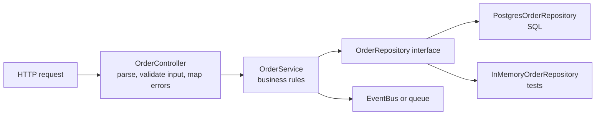
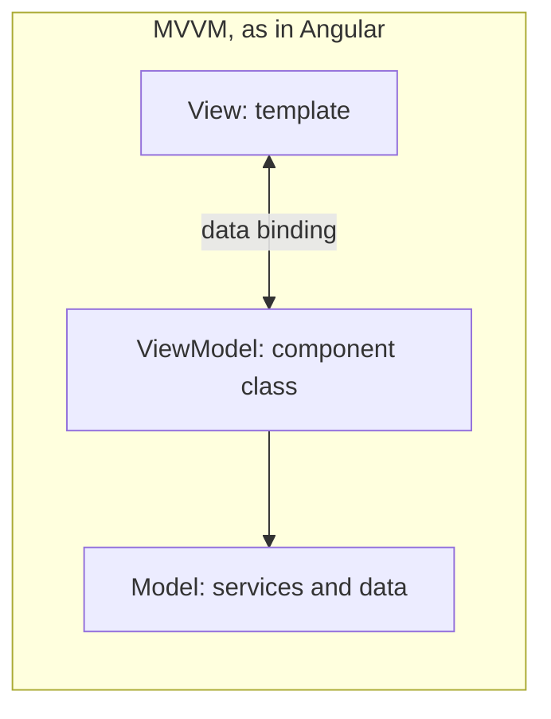
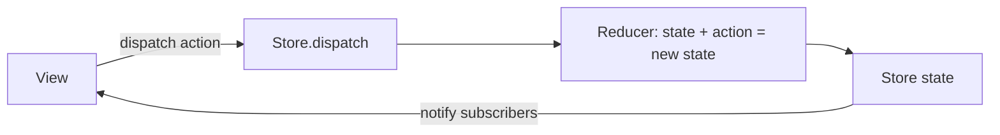
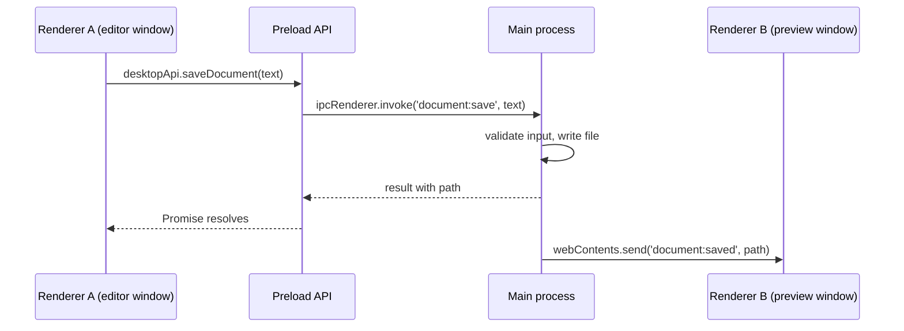
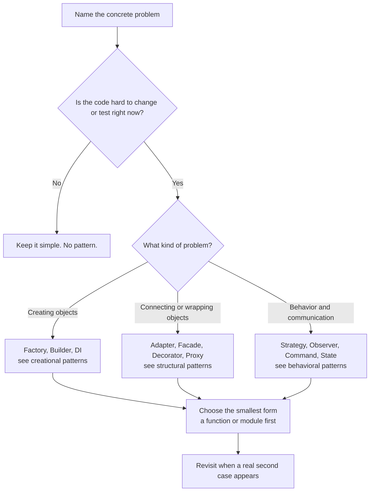

# Patterns in Real JavaScript Apps

> In this document you will see the patterns that real JavaScript applications are built on: modules, event buses, middleware pipelines, repositories and service layers, MVC/MVVM, Redux-style unidirectional flow and plugin systems, and how Angular, Node.js, Electron and React use the classic patterns inside. Interviewers use this topic to check whether you can connect pattern names to code you have actually written, and whether you know when *not* to add a pattern.

**Before this:** [Creational patterns](06-creational-patterns.md) · [Structural patterns](07-structural-patterns.md) · [Behavioral patterns](08-behavioral-patterns.md) · [Dependency inversion and injection](05-dependency-inversion-and-injection.md) · **Interview questions:** [jump to questions](#interview-questions)

## Table of contents

1. [Module pattern, revealing module and IIFE](#module-pattern-revealing-module-and-iife)
2. [Pub/Sub event bus](#pubsub-event-bus)
3. [Middleware pipeline](#middleware-pipeline)
4. [Repository and service layer](#repository-and-service-layer)
5. [MVC, MVP and MVVM in frontends](#mvc-mvp-and-mvvm-in-frontends)
6. [Flux and Redux unidirectional data flow](#flux-and-redux-unidirectional-data-flow)
7. [Plugin architecture](#plugin-architecture)
8. [Patterns inside Angular](#patterns-inside-angular)
9. [Patterns inside Node.js](#patterns-inside-nodejs)
10. [Patterns inside Electron](#patterns-inside-electron)
11. [Patterns inside React](#patterns-inside-react)
12. [Anti-patterns](#anti-patterns)
13. [How to choose a pattern](#how-to-choose-a-pattern)
14. [How to talk about patterns from your own projects](#how-to-talk-about-patterns-from-your-own-projects)
15. [Interview questions](#interview-questions)
16. [Summary](#summary)
17. [References](#references)

---

## Module pattern, revealing module and IIFE

### The problem (before ES2015)

Before JavaScript had modules, every `<script>` file shared one global scope. Two files that both declared `var count` overwrote each other. Libraries had to protect their private variables somehow.

### IIFE

An **IIFE** (Immediately Invoked Function Expression) is a function that runs as soon as it is defined. Variables inside it are private to that function, so they do not leak into the global scope.

```js
(function () {
  var secret = 'only visible in here';
  console.log(secret); // only visible in here
})();

console.log(typeof secret); // undefined — nothing leaked
```

The parentheses around the function turn it into an expression, and the final `()` calls it.

### The module pattern

The **module pattern** uses an IIFE plus a [closure](../02-javascript/05-closures.md): private state lives inside the function, and the function returns an object with the public methods.

```js
const counterModule = (function () {
  let count = 0; // private

  function log(action) { // private helper
    console.log(`${action}: ${count}`);
  }

  return {
    increment() { count += 1; log('increment'); },
    reset() { count = 0; log('reset'); },
    getCount() { return count; },
  };
})();

counterModule.increment(); // increment: 1
counterModule.increment(); // increment: 2
console.log(counterModule.getCount()); // 2
console.log(counterModule.count); // undefined — private
```

### The revealing module pattern

The **revealing module pattern** is a variation: write *all* functions as private functions, then "reveal" the public ones at the end by name. The public API is easy to read in one place.

```js
const cartModule = (function () {
  const items = [];

  function add(item) { items.push(item); }
  function total() { return items.reduce((sum, item) => sum + item.price, 0); }
  function clear() { items.length = 0; }

  return { add, total, clear }; // reveal the public API
})();

cartModule.add({ name: 'Mouse', price: 25 });
cartModule.add({ name: 'Cable', price: 9 });
console.log(cartModule.total()); // 34
```

A known gotcha: if you reveal a **primitive value**, callers get a copy, and it never updates (see [Q2](#q2-what-does-this-revealing-module-code-print)). Reveal a function (`getCount()`) or a getter instead.

### Today: ES modules

Since ES2015, **ES modules** give each file its own scope. Anything not exported is private. This is the module pattern built into the language:

```js
// cart.js
const items = []; // private: not exported

export function add(item) { items.push(item); }
export function total() { return items.reduce((sum, item) => sum + item.price, 0); }
```

Use ES modules for new code. You will still see IIFEs and the module pattern in older code, in bundler output (bundlers wrap modules in functions), and in quick scripts. Details are in [modules: ESM and CommonJS](../02-javascript/14-modules-esm-and-commonjs.md).

---

## Pub/Sub event bus

An **event bus** is an in-process Pub/Sub broker: modules publish events by name, and other modules subscribe, without importing each other. The difference between Observer and Pub/Sub is explained in [behavioral patterns](08-behavioral-patterns.md#observer-vs-pubsub). Here we build a typed, safe version.

```ts
type EventMap = {
  'cart:item-added': { productId: string; quantity: number };
  'user:logged-out': { userId: string };
};

type Handler<T> = (payload: T) => void;

class EventBus<Events extends Record<string, unknown>> {
  private readonly handlers = new Map<keyof Events, Set<Handler<any>>>();

  on<K extends keyof Events>(event: K, handler: Handler<Events[K]>): () => void {
    if (!this.handlers.has(event)) this.handlers.set(event, new Set());
    this.handlers.get(event)!.add(handler);
    return () => this.handlers.get(event)?.delete(handler); // unsubscribe
  }

  once<K extends keyof Events>(event: K, handler: Handler<Events[K]>): () => void {
    const off = this.on(event, (payload) => {
      off();
      handler(payload);
    });
    return off;
  }

  emit<K extends keyof Events>(event: K, payload: Events[K]): void {
    for (const handler of [...(this.handlers.get(event) ?? [])]) {
      try {
        handler(payload);
      } catch (error) {
        console.error(`handler for ${String(event)} failed: ${(error as Error).message}`);
      }
    }
  }
}

const bus = new EventBus<EventMap>();

const stop = bus.on('cart:item-added', ({ productId, quantity }) => {
  console.log(`mini-cart: +${quantity} ${productId}`);
});
bus.once('user:logged-out', ({ userId }) => console.log(`clear caches for ${userId}`));

bus.emit('cart:item-added', { productId: 'KB-1', quantity: 2 }); // mini-cart: +2 KB-1
bus.emit('user:logged-out', { userId: 'u42' }); // clear caches for u42
bus.emit('user:logged-out', { userId: 'u42' }); // (nothing: once)
stop();
bus.emit('cart:item-added', { productId: 'KB-1', quantity: 1 }); // (nothing: unsubscribed)
// bus.emit('cart:item-added', { productId: 'KB-1' }); // ❌ compile error: quantity is missing
```

What makes this version production-friendly:

- **Typed events:** the `EventMap` lists every event and its payload, so typos and wrong payloads fail at compile time. It also documents all events in one place.
- **Unsubscribe** functions and `once`.
- **Error isolation**, so one failing handler does not stop others.

**When an event bus is a good idea:** decoupled features that react to the same app-wide events (logout, theme change), micro-frontends that must not import each other, and plugins.

**When it is a bad idea:** as a replacement for normal function calls or state management. A global bus where anyone emits anything turns into **event spaghetti**: you cannot tell who triggers what, and the order of handlers becomes a hidden dependency. In Angular, prefer a focused service with an RxJS `Subject` per feature, or a store, over one global bus.

---

## Middleware pipeline

A **middleware pipeline** passes a request through a list of functions. Each function can do work, change the request, stop the pipeline by responding, or call `next()` to continue. It is a pipeline form of the [Chain of Responsibility](08-behavioral-patterns.md#chain-of-responsibility). Express, Koa, Redux middleware and Angular interceptors all use this idea.

### Build a mini Express-style runner

```js
class MiniApp {
  #middleware = [];
  #errorHandlers = [];

  use(fn) {
    // Like Express: functions with 4 parameters are error handlers
    (fn.length === 4 ? this.#errorHandlers : this.#middleware).push(fn);
    return this;
  }

  async handle(req) {
    const res = { status: 200, body: null, sent: false };
    res.send = (status, body) => {
      if (res.sent) throw new Error('Response already sent');
      Object.assign(res, { status, body, sent: true });
    };

    let index = 0;
    const next = async (error) => {
      if (error) return this.#runErrorHandlers(error, req, res);
      const fn = this.#middleware[index++];
      if (!fn) {
        if (!res.sent) res.send(404, 'Not found'); // the final default handler
        return;
      }
      let called = false;
      try {
        await fn(req, res, (err) => {
          if (called) throw new Error('next() called twice');
          called = true;
          return next(err);
        });
      } catch (err) {
        await this.#runErrorHandlers(err, req, res); // catches sync throws AND rejected promises
      }
    };

    await next();
    return res;
  }

  async #runErrorHandlers(error, req, res) {
    const handler = this.#errorHandlers[0];
    if (handler) await handler(error, req, res, () => {});
    else if (!res.sent) res.send(500, 'Internal error');
  }
}

const app = new MiniApp()
  .use(async (req, res, next) => {
    await next(); // wait for everything after this middleware
    console.log(`${req.method} ${req.path} -> ${res.status}`); // a real app would also log the duration
  })
  .use((req, res, next) => {
    if (req.path.startsWith('/admin') && req.user?.role !== 'admin') {
      return res.send(403, 'Forbidden'); // stop the pipeline
    }
    return next();
  })
  .use(async (req, res, next) => {
    if (req.path === '/orders') return res.send(200, [{ id: 'A-1' }]);
    if (req.path === '/crash') throw new Error('database down');
    return next();
  })
  .use((error, req, res, next) => res.send(500, { error: error.message }));

for (const req of [
  { method: 'GET', path: '/orders' },
  { method: 'GET', path: '/admin/users', user: { role: 'viewer' } },
  { method: 'GET', path: '/crash' },
  { method: 'GET', path: '/missing' },
]) {
  const res = await app.handle(req);
  console.log('  body:', JSON.stringify(res.body));
}
// GET /orders -> 200
//   body: [{"id":"A-1"}]
// GET /admin/users -> 403
//   body: "Forbidden"
// GET /crash -> 500
//   body: {"error":"database down"}
// GET /missing -> 404
//   body: "Not found"
```

**Step by step for `GET /crash`:**

1. `handle` creates `res` and calls `next()`, which runs the timing middleware (index 0).
2. Timing calls its `next`, which runs the auth middleware. The path is not `/admin`, so it calls `next`.
3. The route middleware throws `database down`. The `try/catch` around it catches the error and runs the error handler, which sends a 500.
4. Control returns to the timing middleware after its `await next()`. It logs the final status.
5. The `res.sent` flag prevents sending twice, and the `called` flag catches `next()` called twice: the two classic middleware bugs.

### Express vs Koa: linear vs onion

- **Express** middleware is usually *linear*: each one does its work, then calls `next()` and is done. To act on the response (for example to log timing), you listen to `res.on('finish')`.
- **Koa** middleware is an *onion*: `await next()` waits for all inner middleware, so code after it runs on the way back out. The runner above supports both styles because it awaits `next()`.

A Koa-style `compose` is short enough to write in an interview:

```js
function compose(middleware) {
  return function run(ctx) {
    const dispatch = (i) => {
      const fn = middleware[i];
      if (!fn) return Promise.resolve();
      return Promise.resolve(fn(ctx, () => dispatch(i + 1)));
    };
    return dispatch(0);
  };
}

const steps = [];
const handler = compose([
  async (ctx, next) => { steps.push('a-in'); await next(); steps.push('a-out'); },
  async (ctx, next) => { steps.push('b-in'); await next(); steps.push('b-out'); },
  async (ctx) => { ctx.body = 'done'; steps.push('handler'); },
]);

const ctx = {};
await handler(ctx);
console.log(steps.join(' > '), '|', ctx.body); // a-in > b-in > handler > b-out > a-out | done
```

A step-by-step walkthrough of this "onion" order is in [Behavioral patterns, Q16](08-behavioral-patterns.md#q16-what-does-this-middleware-chain-print).

Real Express is covered in [HTTP servers and Express](../07-nodejs-backend/06-http-servers-and-express.md).

---

## Repository and service layer

### The problem

A "fat controller" does everything: parses the HTTP request, checks business rules, writes SQL, sends emails. It cannot be tested without a database and an HTTP server, and the business rules are mixed with transport and storage details.

### The idea

Split the backend into layers, each with one job:

- **Controller (or route handler):** HTTP only. Read the request, call a service, map the result or error to an HTTP response.
- **Service layer:** business rules for one use case ("place order": check stock, calculate total, save, publish an event). It knows nothing about HTTP or SQL.
- **Repository:** data access for one kind of entity, behind an interface (`findById`, `save`, `findPendingOlderThan`). It hides SQL, ORMs and caching.



### Example

```ts
interface Order {
  id: string;
  customerId: string;
  totalInCents: number;
  status: 'pending' | 'paid';
}

// The repository interface belongs to the business layer
interface OrderRepository {
  findById(id: string): Promise<Order | null>;
  save(order: Order): Promise<void>;
}

class InMemoryOrderRepository implements OrderRepository {
  private readonly orders = new Map<string, Order>();
  async findById(id: string): Promise<Order | null> {
    const order = this.orders.get(id);
    return order ? { ...order } : null; // return copies, like a real database would
  }
  async save(order: Order): Promise<void> {
    this.orders.set(order.id, { ...order });
  }
}

class NotFoundError extends Error {}
class BusinessRuleError extends Error {}

class OrderService {
  constructor(private readonly orders: OrderRepository) {}

  async placeOrder(id: string, customerId: string, totalInCents: number): Promise<Order> {
    if (totalInCents <= 0) throw new BusinessRuleError('Order total must be positive');
    const order: Order = { id, customerId, totalInCents, status: 'pending' };
    await this.orders.save(order);
    return order;
  }

  async markPaid(id: string): Promise<Order> {
    const order = await this.orders.findById(id);
    if (!order) throw new NotFoundError(`Order ${id} not found`);
    if (order.status === 'paid') throw new BusinessRuleError('Order is already paid');
    const paid: Order = { ...order, status: 'paid' };
    await this.orders.save(paid);
    return paid;
  }
}

// A thin controller: HTTP in, HTTP out (framework-free here so it runs anywhere)
async function markPaidController(service: OrderService, params: { id: string }) {
  try {
    return { status: 200, body: await service.markPaid(params.id) };
  } catch (error) {
    if (error instanceof NotFoundError) return { status: 404, body: { error: error.message } };
    if (error instanceof BusinessRuleError) return { status: 409, body: { error: error.message } };
    throw error;
  }
}

async function main(): Promise<void> {
  const service = new OrderService(new InMemoryOrderRepository()); // composition root
  await service.placeOrder('A-1', 'cust-1', 4_999);
  console.log(await markPaidController(service, { id: 'A-1' }));
  console.log(await markPaidController(service, { id: 'A-1' }));
  console.log(await markPaidController(service, { id: 'Z-9' }));
}

main();
// { status: 200, body: { id: 'A-1', customerId: 'cust-1', totalInCents: 4999, status: 'paid' } }
// { status: 409, body: { error: 'Order is already paid' } }
// { status: 404, body: { error: 'Order Z-9 not found' } }
```

**Why this helps:**

- `OrderService` tests use `InMemoryOrderRepository`. They run in milliseconds, with no database.
- Switching from one database or ORM to another means writing one new repository.
- Business rules live in one place, so the HTTP API, a CLI and a queue worker can all reuse `OrderService`.

**Trade-offs and mistakes:**

- **Generic repositories** (`Repository<T>` with `findAll`, `update(any)`) often leak database ideas and get in the way of specific, efficient queries. Prefer methods named after what the business needs (`findUnpaidOlderThan(days)`).
- **Transactions** that span several repositories need a plan (a unit-of-work object or passing a transaction handle). Do not pretend a repository call is atomic if it is not.
- In-memory fakes can hide differences from the real database (constraints, case sensitivity), so keep a few integration tests against the real one.
- For a tiny CRUD service, three layers may be more ceremony than value.

Databases are covered in [databases](../07-nodejs-backend/10-databases.md), and testing APIs in [Angular testing](../06-angular-16/14-testing.md).

---

## MVC, MVP and MVVM in frontends

All three split an app into a **Model** (data and business rules), a **View** (what the user sees) and something in between. They differ in what that middle part does and how the View gets updated.

| | MVC | MVP | MVVM |
| --- | --- | --- | --- |
| Middle part | **Controller** handles input and updates the model | **Presenter** handles input and updates the view directly | **ViewModel** exposes state and commands for the view |
| How the view updates | Reads from the model (often after a controller action) | The presenter calls methods on a passive view (`view.showError()`) | Automatic **data binding** to the ViewModel |
| Where you see it | Server-side frameworks (Rails, ASP.NET MVC, Express with templates), early frontend frameworks | Older Android, WinForms, some testable UI designs | Angular, Knockout, WPF; Vue is often described this way |



**Angular as MVVM:** the template is the View, the component class is the ViewModel (properties and methods the template binds to), and services plus data models are the Model. Two-way binding (`[(ngModel)]`) and property/event binding keep the View and ViewModel in sync. Angular does not force a strict pattern, but this is the usual description.

**React** is usually described as just the "V" (view) layer: components render UI from props and state, and you choose how to manage the model (hooks, context, Redux, query libraries).

**Express with server-rendered templates** is classic MVC: a route handler (controller) loads data (model) and renders a template (view).

The key interview point is not the exact definitions, which vary between authors, but the shared goal: **keep business logic out of the view**, so it can be tested and reused.

---

## Flux and Redux unidirectional data flow

### The problem

With two-way bindings between many models and views, a change in one place can trigger changes in others, which trigger more changes. It becomes hard to answer "why did this value change?"

### The idea

**Flux** (from Facebook) and **Redux** make data flow in **one direction**:

1. The view **dispatches an action**: a plain object describing what happened (`{ type: 'cart/itemAdded', payload }`).
2. A **reducer** (a pure function) calculates the new state: `(state, action) => newState`.
3. The **store** saves the new state and notifies subscribers.
4. The view re-renders from the new state.



Patterns inside: actions are **commands/events as data**, the store is an **observable subject**, and middleware (Redux middleware, NgRx effects) is a **chain** around dispatch.

### Build a mini Redux store

```js
function createStore(reducer, initialState) {
  let state = initialState;
  const listeners = new Set();

  return {
    getState: () => state,
    dispatch(action) {
      state = reducer(state, action); // the only way state changes
      for (const listener of [...listeners]) listener();
      return action;
    },
    subscribe(listener) {
      listeners.add(listener);
      return () => listeners.delete(listener);
    },
  };
}

function cartReducer(state, action) {
  switch (action.type) {
    case 'cart/itemAdded':
      return { ...state, items: [...state.items, action.payload] }; // new objects, never mutate
    case 'cart/cleared':
      return { ...state, items: [] };
    default:
      return state; // unknown actions: same state object
  }
}

const store = createStore(cartReducer, { items: [] });
const unsubscribe = store.subscribe(() => console.log('items:', store.getState().items.length));

store.dispatch({ type: 'cart/itemAdded', payload: { sku: 'KB-1' } }); // items: 1
store.dispatch({ type: 'cart/itemAdded', payload: { sku: 'MS-2' } }); // items: 2
store.dispatch({ type: 'cart/cleared' }); // items: 0
unsubscribe();
store.dispatch({ type: 'cart/itemAdded', payload: { sku: 'X' } }); // (no log)
```

**Why reducers must be pure and must not mutate:** subscribers and UI libraries detect changes by comparing **references** (`oldState !== newState`). If a reducer mutates the old object and returns it, the reference is the same, and nothing re-renders (see [Q12](#q12-why-must-redux-reducers-return-new-objects-instead-of-mutating)). Purity also makes reducers easy to test and enables time-travel debugging.

**Real-world usage:** Redux Toolkit (the recommended way to write Redux today; its `createSlice` uses Immer, so you can write "mutating" code that produces new state safely), NgRx in Angular (actions, reducers, selectors, effects), Vuex/Pinia ideas, React's `useReducer`. NgRx details are in [state management and NgRx](../06-angular-16/11-state-management-and-ngrx.md).

**Trade-offs:** more boilerplate and indirection than a simple service, and not every piece of state belongs in a global store (form input and UI toggles usually do not). See [components and state management](../05-frontend-engineering/06-components-and-state-management.md).

---

## Plugin architecture

### The problem

You want others (other teams, customers, the open-source community) to extend your app without changing its core code: add export formats, editor features, build steps or payment methods.

### The idea

A **plugin architecture** has a small **core** that defines **extension points** (also called **hooks**), and **plugins** that register code for those hooks. The core calls the registered plugins at the right moments. It combines several patterns: a **registry** (factory), **Observer** (hooks), **Strategy** (plugins as interchangeable implementations) and often **Chain of Responsibility** (plugins transform data in sequence).

```js
class MarkdownRenderer {
  #hooks = { beforeRender: [], afterRender: [] };
  #plugins = new Set();

  use(plugin) {
    if (this.#plugins.has(plugin.name)) throw new Error(`Plugin already installed: ${plugin.name}`);
    this.#plugins.add(plugin.name);
    plugin.setup({
      // The core gives plugins a SMALL, controlled API, not access to everything
      onBeforeRender: (fn) => this.#hooks.beforeRender.push(fn),
      onAfterRender: (fn) => this.#hooks.afterRender.push(fn),
    });
    return this;
  }

  render(markdown) {
    let text = this.#hooks.beforeRender.reduce((current, fn) => fn(current), markdown);
    text = text.replace(/\*\*(.+?)\*\*/g, '<b>$1</b>'); // the core feature
    return this.#hooks.afterRender.reduce((current, fn) => fn(current), text);
  }
}

const emojiShortcodes = {
  name: 'emoji',
  setup(api) {
    api.onBeforeRender((text) => text.replaceAll(':check:', '[x]'));
  },
};

const paragraphWrapper = {
  name: 'paragraph',
  setup(api) {
    api.onAfterRender((html) => `<p>${html}</p>`);
  },
};

const renderer = new MarkdownRenderer().use(emojiShortcodes).use(paragraphWrapper);
console.log(renderer.render('**Done** :check:')); // <p><b>Done</b> [x]</p>
```

**Design rules for plugin systems:**

- Give plugins a **narrow API object**, not your internal objects. This keeps the core free to change and limits damage from a bad plugin.
- Define **order** (registration order, or explicit priorities) and **error handling** (does one failing plugin stop the others?).
- **Version** the plugin API, so plugins can declare which core versions they support.
- **Security:** a plugin runs with your app's permissions. Only load trusted plugins, or isolate untrusted ones (separate process, worker or sandbox).

**Real-world usage:**

- **webpack** plugins tap into compiler hooks (`compiler.hooks.emit.tapAsync(...)`), built on the Tapable library.
- **Vite and Rollup** plugins are objects with hook functions (`resolveId`, `load`, `transform`).
- **Babel** plugins are visitors; **ESLint** rules and plugins register node handlers.
- **Fastify** has `fastify.register(plugin)` with encapsulated scopes.
- **Angular multi providers** are a plugin system built on DI: many providers register under one token (`HTTP_INTERCEPTORS`, `APP_INITIALIZER`, `NG_VALIDATORS`), and Angular injects the whole array.

---

## Patterns inside Angular

Angular is built on many classic patterns. Knowing them helps you explain *why* Angular code looks the way it does.

| Pattern | Where it appears in Angular |
| --- | --- |
| **Dependency injection** | Constructor injection and `inject()`, hierarchical injectors, `providedIn: 'root'` |
| **Singleton (DI lifetime)** | Root-provided services: one instance per application injector |
| **Observer** | RxJS observables, `@Output()` `EventEmitter`, `HttpClient` returning observables, router events |
| **Decorator (language feature, metadata)** | `@Component`, `@Injectable`, `@Input`: metadata, not the GoF Decorator pattern |
| **Strategy via providers** | `RouteReuseStrategy`, `PreloadingStrategy`, `TitleStrategy`, `LocationStrategy`, `ErrorHandler` replaced with `useClass` |
| **Chain of Responsibility** | HTTP interceptors (`next.handle(req)`) |
| **Facade** | Feature facade services over NgRx or several services |
| **Composite** | The component tree; content projection |
| **Template Method / hooks** | Lifecycle hooks called by the framework (`ngOnInit`, `ngOnDestroy`) |
| **Plugin / multi provider** | `HTTP_INTERCEPTORS`, `APP_INITIALIZER`, `NG_VALIDATORS` |
| **Abstract Factory** | `RendererFactory2` creating platform-specific renderers (browser vs server) |
| **Mediator** | Container components coordinating presentational children |

### Strategy via providers

Angular lets you replace framework behavior by providing your own class for a token. The framework depends on the abstraction; you choose the strategy.

```ts
import { ErrorHandler, Injectable, NgModule } from '@angular/core';
import { PreloadAllModules, RouterModule } from '@angular/router';

@Injectable()
export class GlobalErrorHandler implements ErrorHandler {
  handleError(error: unknown): void {
    // send to a monitoring service, show a friendly toast, etc.
    console.error('Unexpected error', error);
  }
}

@NgModule({
  imports: [RouterModule.forRoot(routes, { preloadingStrategy: PreloadAllModules })], // a built-in strategy
  providers: [{ provide: ErrorHandler, useClass: GlobalErrorHandler }], // replace the default strategy
})
export class AppModule {}
```

Your own code can use the same idea with an `InjectionToken`:

```ts
import { InjectionToken } from '@angular/core';

export interface PriceFormatter {
  format(amountInCents: number): string;
}

export const PRICE_FORMATTER = new InjectionToken<PriceFormatter>('PRICE_FORMATTER');

// In a module or component: choose the strategy
// providers: [{ provide: PRICE_FORMATTER, useClass: EuroPriceFormatter }]

// In a component or service: depend only on the token
// private readonly formatter = inject(PRICE_FORMATTER);
```

### Plugins through multi providers

```ts
import { APP_INITIALIZER, NgModule } from '@angular/core';
import { HTTP_INTERCEPTORS } from '@angular/common/http';
import { AuthInterceptor } from './auth.interceptor';
import { LoggingInterceptor } from './logging.interceptor';
import { ConfigService } from './config.service';

@NgModule({
  providers: [
    { provide: HTTP_INTERCEPTORS, useClass: AuthInterceptor, multi: true },
    { provide: HTTP_INTERCEPTORS, useClass: LoggingInterceptor, multi: true }, // the order matters
    {
      provide: APP_INITIALIZER,
      useFactory: (config: ConfigService) => () => config.load(), // runs before the app starts
      deps: [ConfigService],
      multi: true,
    },
  ],
})
export class CoreModule {}
```

`multi: true` means "add to the list" instead of "replace". Angular injects an array of all registered values. That is a plugin registry built into DI.

> **Newer Angular:** Angular 15+ also offers functional interceptors with `provideHttpClient(withInterceptors([...]))`, and Angular 19 added `provideAppInitializer()` as a simpler replacement for the `APP_INITIALIZER` token.

Angular-specific details are in [Angular dependency injection](../06-angular-16/05-dependency-injection.md) and [enterprise architecture](../06-angular-16/13-enterprise-architecture.md).

---

## Patterns inside Node.js

| Pattern | Where it appears in Node.js |
| --- | --- |
| **Observer** | `EventEmitter`, which servers, sockets, streams and child processes extend |
| **Iterator** | Readable streams are async iterable (`for await (const chunk of stream)`); `events.on(emitter, name)` returns an async iterator |
| **Pipes and filters / Chain** | `pipeline(source, transform1, transform2, destination)` from `node:stream/promises` |
| **Template Method** | Custom streams implement `_read`, `_write`, `_transform` |
| **Decorator** | Transform streams such as `zlib.createGzip()` wrap a data flow |
| **Chain of Responsibility** | Express/Koa/Fastify middleware and hooks |
| **Factory** | `http.createServer()`, `crypto.createHash()`, `fs.createReadStream()`, `net.connect()` |
| **Singleton (module cache)** | A module runs once per process; exported instances are shared |
| **Adapter** | `util.promisify`, `stream.Readable.from(iterable)` |
| **Object pool** | Database connection pools, `http.Agent` keeping sockets alive |

A small example that combines several of these: a pipeline of streams (pipes and filters), with a custom transform (template method), compression (decorator-like transform) and `await` on the whole chain.

```js
import { pipeline } from 'node:stream/promises';
import { Readable, Transform, Writable } from 'node:stream';
import { createGzip, gunzipSync } from 'node:zlib';

const lines = Readable.from(['id,amount\n', '1,250\n', '2,-40\n', '3,99\n']);

const onlyPositive = new Transform({
  transform(chunk, encoding, callback) {
    const line = chunk.toString();
    const amount = Number(line.split(',')[1]);
    callback(null, Number.isNaN(amount) || amount >= 0 ? line : ''); // drop negative rows
  },
});

const chunks = [];
const collect = new Writable({
  write(chunk, encoding, callback) {
    chunks.push(chunk);
    callback();
  },
});

await pipeline(lines, onlyPositive, createGzip(), collect);
console.log(gunzipSync(Buffer.concat(chunks)).toString());
// id,amount
// 1,250
// 3,99
```

`pipeline` also handles errors and cleanup for every stream in the chain, which manual `.pipe()` chains do not. See [streams](../07-nodejs-backend/05-streams.md).

---

## Patterns inside Electron

An Electron app has one **main process** (Node.js, full system access) and one **renderer process** per window (web pages). They talk through **IPC** (inter-process communication). Several patterns shape a secure Electron app:

| Pattern | Where it appears in Electron |
| --- | --- |
| **Message passing / Command** | IPC channels like `'file:save'` carry a request (a command name plus data) |
| **Facade + Proxy (security boundary)** | The preload script exposes a small API with `contextBridge.exposeInMainWorld`, instead of giving the page Node.js or the whole `ipcRenderer` |
| **Mediator** | Windows cannot talk to each other directly; the main process receives messages and routes them |
| **Observer** | `app.on('ready')`, `win.on('closed')`, `ipcMain.on(...)`, `webContents.send(...)` push events to windows |
| **Singleton (process level)** | `app.requestSingleInstanceLock()` keeps only one running copy of the app |



```js
// preload.js — the facade: a narrow, safe API (contextIsolation: true, sandbox: true)
const { contextBridge, ipcRenderer } = require('electron');

contextBridge.exposeInMainWorld('desktopApi', {
  saveDocument: (text) => ipcRenderer.invoke('document:save', text), // one channel, not all of IPC
  onDocumentSaved: (callback) => {
    const listener = (_event, path) => callback(path);
    ipcRenderer.on('document:saved', listener);
    return () => ipcRenderer.removeListener('document:saved', listener); // unsubscribe
  },
});
```

```js
// main.js — the mediator: validates, does the work, and notifies other windows
const { ipcMain, BrowserWindow } = require('electron');

ipcMain.handle('document:save', async (event, text) => {
  if (typeof text !== 'string' || text.length > 5_000_000) throw new Error('Invalid document');
  const path = await saveToDisk(text); // your own function
  for (const win of BrowserWindow.getAllWindows()) {
    if (win.webContents !== event.sender) win.webContents.send('document:saved', path);
  }
  return { path };
});
```

The preload API is a **facade** (simple) and a **security boundary** (it controls exactly what the page can do). Never expose `ipcRenderer` itself or Node.js APIs to the page, and always validate input in the main process, because a compromised renderer can send anything. Full details are in [IPC and preload scripts](../08-electron-desktop/03-ipc-and-preload-scripts.md) and [Electron security](../08-electron-desktop/04-electron-security.md).

---

## Patterns inside React

React's component model created its own patterns. They are useful to know even if you work mostly in Angular. (React basics are in [React essentials](../05-frontend-engineering/08-react-essentials.md).)

### Higher-order components (Decorator)

A **higher-order component (HOC)** is a function that takes a component and returns a new component with extra behavior, keeping the same props. It is the Decorator pattern for components.

```js
function withLoading(Component) {
  return function WithLoading({ isLoading, ...props }) {
    if (isLoading) return <p>Loading...</p>;
    return <Component {...props} />;
  };
}

const ProductListWithLoading = withLoading(ProductList);
// <ProductListWithLoading isLoading={loading} products={products} />
```

Examples: `React.memo(Component)`, react-redux's `connect()`. HOCs were very common before hooks.

### Render props (Strategy / inversion of control)

A component receives a **function prop** that decides what to render. The component owns the behavior; the caller supplies the rendering strategy.

```js
function MouseTracker({ render }) {
  const [position, setPosition] = useState({ x: 0, y: 0 });
  return (
    <div onMouseMove={(e) => setPosition({ x: e.clientX, y: e.clientY })}>
      {render(position)}
    </div>
  );
}

// <MouseTracker render={({ x, y }) => <p>Mouse at {x}, {y}</p>} />
```

### Custom hooks (composition)

Since React 16.8, **custom hooks** are the main way to share stateful logic. They replaced most HOCs and render props because they compose without extra wrapper components.

```js
function useOnlineStatus() {
  const [online, setOnline] = useState(navigator.onLine);
  useEffect(() => {
    const update = () => setOnline(navigator.onLine);
    window.addEventListener('online', update); // Observer
    window.addEventListener('offline', update);
    return () => {
      window.removeEventListener('online', update); // cleanup: no leaks
      window.removeEventListener('offline', update);
    };
  }, []);
  return online;
}

function StatusBadge() {
  const online = useOnlineStatus();
  return <span>{online ? 'Online' : 'Offline'}</span>;
}
```

`useReducer` brings the Redux pattern (actions and a pure reducer) into one component. Context (`createContext` / `useContext`) provides values to a whole subtree, which works like simple dependency injection.

### Compound components

**Compound components** are a set of components that work together and share hidden state through context, giving the caller a flexible, readable API (like `<select>` and `<option>` in HTML).

```js
const TabsContext = createContext(null);

function Tabs({ children, defaultTab }) {
  const [active, setActive] = useState(defaultTab);
  return <TabsContext.Provider value={{ active, setActive }}>{children}</TabsContext.Provider>;
}

function Tab({ id, children }) {
  const { active, setActive } = useContext(TabsContext);
  return (
    <button aria-selected={active === id} onClick={() => setActive(id)}>
      {children}
    </button>
  );
}

function Panel({ id, children }) {
  const { active } = useContext(TabsContext);
  return active === id ? <div role="tabpanel">{children}</div> : null;
}

Tabs.Tab = Tab;
Tabs.Panel = Panel;

// <Tabs defaultTab="profile">
//   <Tabs.Tab id="profile">Profile</Tabs.Tab>
//   <Tabs.Tab id="billing">Billing</Tabs.Tab>
//   <Tabs.Panel id="profile">...</Tabs.Panel>
//   <Tabs.Panel id="billing">...</Tabs.Panel>
// </Tabs>
```

The caller controls layout and content; `Tabs` controls the state. (A production tabs component also needs keyboard navigation and full ARIA roles; see [accessibility](../05-frontend-engineering/04-accessibility.md).)

---

## Anti-patterns

An **anti-pattern** is a common solution that looks reasonable but causes more problems than it solves.

### God object

One class or service that knows and does everything: `AppService` with 80 methods for users, orders, emails and reports. Every change touches it, every test needs a huge setup, and merge conflicts are constant.

**How to spot it:** a file over a thousand lines, a name like `Manager`, `Helper`, `Utils` or `AppService`, and many unrelated dependencies in the constructor.

**Fix:** split by responsibility or feature (`OrderService`, `InvoiceService`, `EmailSender`). See [coupling, cohesion and design principles](04-coupling-cohesion-and-design-principles.md).

### Singleton abuse

Making things global "for convenience". It hides dependencies, leaks state between tests and causes cross-user data leaks on servers. **Fix:** create one instance at the composition root and inject it (see [creational patterns](06-creational-patterns.md#singleton)).

### Premature abstraction

Adding interfaces, factories and layers for variations that do not exist yet:

```ts
// ❌ One implementation, three layers, zero benefit
interface IGreetingStrategy { greet(name: string): string; }
class DefaultGreetingStrategy implements IGreetingStrategy { greet(name: string) { return `Hello ${name}`; } }
class GreetingStrategyFactory { create(): IGreetingStrategy { return new DefaultGreetingStrategy(); } }
const greeting = new GreetingStrategyFactory().create().greet('Ana');

// ✅ Until a second variation really exists
const greet = (name: string): string => `Hello ${name}`;
```

Reminder: a wrong abstraction is usually more expensive than duplication, so wait for the third similar case before you extract one (the **rule of three**). The full explanation, with a refactoring example, is in [The wrong abstraction](04-coupling-cohesion-and-design-principles.md#the-wrong-abstraction).

### Pattern-itis (golden hammer)

Using patterns because they are known, not because the problem needs them: a Builder for a two-field object, an Observer where a direct call would do, an event bus for everything. "If all you have is a hammer, everything looks like a nail." **Fix:** name the concrete problem first, then pick the smallest solution.

### Event spaghetti

Many modules emit and listen to global events, so no one can trace the flow. **Fix:** typed events, a documented event list, direct calls when there is one consumer, and feature-scoped buses instead of one global bus.

### Leaky abstraction

An abstraction that forces callers to know its internals anyway: a repository that returns ORM query objects, or an adapter that throws the SDK's error codes. **Fix:** return your own types and errors at the boundary.

---

## How to choose a pattern

Start from the **problem**, not the pattern. Ask: what is changing, or what hurts right now?

| Concrete problem | Pattern to consider | Try this simpler option first |
| --- | --- | --- |
| Creation differs by runtime input | Factory / registry | A function returning the right object |
| Products must come in matching families | Abstract Factory | One factory function per family |
| Many optional parts, validated together | Builder | An options object with defaults |
| One shared instance in a clear scope | DI singleton lifetime | Export one instance from a module |
| External API does not fit your types | Adapter | A mapping function |
| Callers repeat multi-step orchestration | Facade | One service function |
| Add behavior without changing the class | Decorator | A wrapper function |
| Lazy, cached or checked access | Proxy | An explicit caching client |
| Uniform operations on a tree | Composite | A recursive function over data |
| Interchangeable algorithms | Strategy | Pass a function |
| Many listeners react to a change | Observer | A direct callback, if there is one listener |
| Queue, log or undo operations | Command | A closure, if you only need "run later" |
| Behavior depends on allowed transitions | State | A transition table / discriminated union |
| Ordered handlers that may stop a request | Chain / middleware | An explicit list of functions |
| Persistence hidden from business rules | Repository | A small data-access module |
| Swap collaborators in tests | Dependency injection | Constructor or function parameters |



---

## How to talk about patterns from your own projects

Interviewers often ask, "Which design patterns have you used?" A list of names is a weak answer. A short story is a strong one.

### How to explain this in an interview

1. **Define it:** name the pattern and say what it does in one sentence. "We used the Adapter pattern: a wrapper that turns a vendor's API into our own interface."
2. **Why it exists:** describe the problem you had. "Our payment provider's SDK used callbacks and its own error codes, and it was called from many places."
3. **How it works:** describe your implementation. "We defined a `PaymentGateway` interface, wrote `ProviderXAdapter` that implemented it, and injected it into the checkout service."
4. **Small example:** give one concrete detail. "The adapter converted amounts to cents and turned error code 402 into a `PaymentDeclinedError`."
5. **Where it is useful:** give the result. "When we added a second provider, we wrote one new adapter and reused all the checkout tests."
6. **Trade-offs / gotchas:** show judgment. "The adapter had to be updated when the SDK changed, and we kept it thin so business rules didn't creep in."

Prepare two or three stories like this from your own work (an Angular facade, an interceptor chain, a strategy map, an event-driven feature). Honest, specific stories beat long lists.

---

## Interview questions

### Q1. What is the module pattern, and why is it used less today?

**What the interviewer is checking:** history, closures and modern modules.

**Short spoken answer (30–60 seconds):**
> The module pattern uses an immediately invoked function and a closure to create private state. Variables inside the function are hidden, and the function returns an object with the public methods. It was the main way to avoid global variables before JavaScript had real modules. The revealing module version defines everything privately and returns an object that "reveals" the public functions by name. Today, ES modules give every file its own scope, and only exported names are public, so the language does this for us. I still see the pattern in older code, in bundler output, and when I need several private instances, where a factory function with a closure is the modern equivalent.

**Follow-up questions:**
- **Why the parentheses around the function in an IIFE?** — A line starting with `function` is parsed as a declaration, which cannot be called immediately. The parentheses make it an expression.
- **Module pattern vs class with `#private`?** — Both give real privacy. A class shares methods on the prototype and supports many instances with `new`; the module pattern creates one object (or one per factory call) with methods in the closure.

**Common mistakes:** thinking ES modules are just syntax for the same global scope.

### Q2. What does this revealing module code print?

```js
const counter = (function () {
  let count = 0;
  function increment() {
    count += 1;
  }
  return { count, increment, getCount: () => count };
})();

counter.increment();
counter.increment();
console.log(counter.count);
console.log(counter.getCount());
```

**Answer:**

```text
0
2
```

**Why, step by step:**

1. When the IIFE runs, `count` is `0`. The returned object gets a property `count` with a **copy** of that primitive value: `0`.
2. `increment()` changes the private variable `count` inside the closure, not the object property.
3. `counter.count` still holds the copy, `0`.
4. `getCount()` reads the private variable through the closure, so it returns `2`.

Reveal functions or getters (`get count() { return count; }`), not primitive values. (ES module `export let` is different: it is a *live binding*, so importers see updates.)

### Q3. Implement a typed event bus. What would you watch out for?

**What the interviewer is checking:** API design, typing and the risks of global events.

**Short spoken answer (30–60 seconds):**
> I'd keep a `Map` from event name to a `Set` of handlers. `on` returns an unsubscribe function, `once` wraps the handler so it removes itself, and `emit` loops over a copy of the handlers with a `try/catch` around each one, so one failing handler doesn't stop the others. In TypeScript I'd type it with an event map, an object type from event names to payload types, so `emit('cart:item-added', ...)` checks the payload at compile time and the map documents every event. The things I'd watch out for are memory leaks from handlers that are never removed, and event spaghetti if the bus becomes the default way for everything to talk. I'd keep buses scoped to a feature and use direct calls when there's only one consumer.

See the full implementation in [Pub/Sub event bus](#pubsub-event-bus).

**Follow-up questions:**
- **Synchronous or asynchronous emit?** — Synchronous is simpler and predictable. Asynchronous (`queueMicrotask` per handler) prevents a slow handler from blocking the emitter, but makes ordering and errors harder to reason about. Choose deliberately and document it.

### Q4. When would you avoid a global event bus in an Angular app?

**Short answer:** When the communication is between a parent and child (use `@Input`/`@Output`), when it is shared state (use a service with a `BehaviorSubject`, signals or a store, which also hold the *current* value for late subscribers), or when only one consumer needs a result (call a method). A global bus hides who depends on what, has no current state for new subscribers, and its events are hard to type and trace. It fits truly app-wide, fire-and-forget events like "user logged out" or cross-micro-frontend messages.

### Q5. Implement an Express-style middleware runner.

**What the interviewer is checking:** control flow with `next`, async handling, error routing, and the classic bugs.

**Short spoken answer (30–60 seconds):**
> I keep an array of middleware functions and an index. `next()` takes the next function from the array and calls it with `req`, `res` and a new `next`. If there are no functions left and nothing was sent, I send a 404. I wrap each call in `try/await` so that both thrown errors and rejected promises go to the error handlers, and `next(err)` jumps to them directly. To catch the two classic bugs, I keep a `sent` flag so a response can't be sent twice, and a `called` flag per middleware so calling `next()` twice throws. Because I await `next()`, middleware can also run code after the inner ones finish, like Koa.

See the full implementation in [Build a mini Express-style runner](#build-a-mini-express-style-runner).

**Follow-up questions:**
- **How does Express know a middleware is an error handler?** — By its number of declared parameters (`fn.length === 4`).
- **What happens in Express 4 when an async middleware rejects?** — Express 4 does not catch it; you get an unhandled rejection and a hanging request unless you call `next(err)` yourself. Express 5 forwards it to the error handler.

### Q6. What is the difference between Express and Koa middleware?

**Short answer:** Express middleware is mostly *linear*: `(req, res, next)`, do work, call `next()`, done; post-response work uses events like `res.on('finish')`. Koa middleware is an *onion*: `async (ctx, next) => { before; await next(); after; }`, so code after `await next()` runs after all inner middleware, which makes timing, error wrapping and response transformation natural. Koa uses one `ctx` object instead of `req`/`res`, and its composition is built on promises.

### Q7. What is the Repository pattern, and how does it help testing?

**What the interviewer is checking:** separation of persistence from business logic.

**Short spoken answer (30–60 seconds):**
> A repository is an object that hides data access behind an interface named in business terms, like `findById`, `save` or `findUnpaidOlderThan(days)`. The service layer depends on that interface, not on SQL or an ORM. That has two benefits. Business logic tests can use an in-memory repository, so they're fast and don't need a database. And changing the database or ORM means writing a new repository, not touching business code. I avoid very generic repositories that just mirror the ORM, I keep a few integration tests against the real database because fakes can hide differences, and I plan transactions explicitly when one use case writes through several repositories.

**Follow-up questions:**
- **Where does the repository interface live?** — With the business/service layer that uses it. The database implementation depends on that interface (dependency inversion). See [dependency inversion and injection](05-dependency-inversion-and-injection.md).
- **Repository vs DAO?** — Very similar. A DAO is usually table-oriented; a repository is domain-oriented (it returns domain objects and offers domain queries).

### Q8. Code review: what is wrong with this controller?

```js
app.post('/orders/:id/pay', async (req, res) => {
  const order = await db.query('SELECT * FROM orders WHERE id = ' + req.params.id);
  if (order.rows[0].status === 'paid') return res.status(400).send('already paid');
  await stripe.charges.create({ amount: order.rows[0].total * 100, currency: 'usd' });
  await db.query("UPDATE orders SET status = 'paid' WHERE id = " + req.params.id);
  await mailer.send(order.rows[0].email, 'Thanks!');
  res.send('ok');
});
```

**What the interviewer is checking:** layering, security and failure handling.

**Short spoken answer (30–60 seconds):**
> The biggest problem is SQL injection: the id is concatenated into the query, so it must use parameters. Then there's no check that the order exists, so `rows[0]` can be undefined and crash. Money is multiplied as a float. There's no error handling, so a failed email after a successful charge returns a 500 even though the customer paid, and there's a race: two requests can both see "pending" and charge twice, so I'd use an idempotency key with the payment provider and a conditional update like `WHERE status = 'pending'`. Design-wise, the controller does everything. I'd move the rules into an `OrderService` with an `OrderRepository` and a `PaymentGateway` adapter, send the email asynchronously through a queue or event, and keep the controller to mapping HTTP to the service and errors to status codes.

**Common mistakes:** only commenting on structure and missing the injection and double-charge risks.

### Q9. Where should business logic live in a Node.js backend?

**Short answer:** In the service (application/domain) layer, not in controllers, not in repositories and not in the database layer by accident. Controllers translate HTTP to service calls and errors to status codes. Repositories translate between domain objects and storage. This lets the same business rules serve HTTP, CLI scripts and queue workers, and lets you test rules without HTTP or a database.

### Q10. MVC vs MVP vs MVVM: which one is Angular?

**What the interviewer is checking:** understanding of UI architecture vocabulary without dogma.

**Short spoken answer (30–60 seconds):**
> All three separate the model, which is data and business rules, from the view. In MVC, a controller handles input and updates the model, and the view shows the model; server-side frameworks with templates are the classic example. In MVP, a presenter handles input and updates a passive view through an interface, which makes UI logic very testable. In MVVM, the view binds directly to a ViewModel that exposes state and commands, and data binding keeps them in sync. Angular is usually described as MVVM: the template is the view, the component class is the ViewModel, and services and models are the model. The exact labels vary between authors; what matters is keeping business logic out of templates and components.

**Follow-up questions:**
- **And React?** — React is "the view layer": components render from state. The model can be hooks, context, Redux or a server-state library.

### Q11. Explain Redux's unidirectional data flow, and implement a minimal store.

**What the interviewer is checking:** the core loop and its patterns.

**Short spoken answer (30–60 seconds):**
> In Redux, state changes only one way. The UI dispatches an action, which is a plain object describing what happened. The store passes the current state and the action to a pure reducer, which returns a new state. The store saves it and notifies subscribers, and the UI re-renders from the new state. Because every change goes through dispatch, I can log, replay and debug every change, and reducers are trivial to test. A minimal store needs a `state` variable, `getState`, `dispatch` that runs the reducer and calls listeners, and `subscribe` that returns an unsubscribe function. Patterns inside: actions are command-like data, the store is an observable subject, and middleware is a chain around dispatch.

See [Build a mini Redux store](#build-a-mini-redux-store).

**Follow-up questions:**
- **Where do side effects like API calls go?** — Not in reducers. In middleware (thunks), NgRx effects, or RTK Query / listeners.
- **Is `createStore` still recommended?** — Redux marks `createStore` as deprecated in favor of Redux Toolkit's `configureStore`, which adds good defaults (DevTools, thunk, immutability checks in development). `createStore` still works.

### Q12. Why must Redux reducers return new objects instead of mutating?

```js
function badReducer(state, action) {
  if (action.type === 'add') {
    state.items.push(action.item); // ❌ mutation
    return state;
  }
  return state;
}

function goodReducer(state, action) {
  if (action.type === 'add') {
    return { ...state, items: [...state.items, action.item] }; // ✅ new objects
  }
  return state;
}

const before = { items: [] };
const afterBad = badReducer(before, { type: 'add', item: 'x' });
console.log(afterBad === before, before.items.length); // true 1

const before2 = { items: [] };
const afterGood = goodReducer(before2, { type: 'add', item: 'x' });
console.log(afterGood === before2, before2.items.length); // false 0
```

**Short spoken answer:**
> Redux, react-redux, NgRx selectors and `OnPush` change detection decide whether something changed by comparing references, not by deep comparison, because deep comparison is slow. If a reducer mutates the old state and returns the same object, `newState === oldState` is true, so the UI may not update at all, and memoized selectors return stale results. Mutation also destroys the old state, which breaks time-travel debugging and makes bugs depend on timing. Returning new objects for the changed path, while reusing unchanged parts, keeps comparisons cheap and history intact. Redux Toolkit lets you write mutating-looking code because Immer turns it into immutable updates.

### Q13. How would you design a plugin system so third parties can extend your app safely?

**What the interviewer is checking:** extension points, isolation and versioning.

**Short spoken answer (30–60 seconds):**
> I'd keep a small core with named extension points, like `beforeRender` or `registerExporter`, and give each plugin a narrow API object in a `setup(api)` function, never direct access to internal objects. That keeps the core free to change. I'd define the order plugins run in and what happens when one throws, usually isolate and log it. I'd version the plugin API so plugins declare which versions they support. For security, a plugin runs with my app's permissions, so I'd only load trusted, reviewed plugins, or run untrusted ones in isolation, like a worker, a separate process or a sandboxed iframe with a message-based API. Real examples are webpack's Tapable hooks, Vite and Rollup plugins, ESLint rules and Angular multi providers.

**Follow-up questions:**
- **How do plugins communicate with each other?** — Ideally through the core (hooks or an event bus scoped to the plugin system), not by importing each other.

### Q14. Which design patterns does Angular use?

**What the interviewer is checking:** connecting framework features to pattern names.

**Short spoken answer (30–60 seconds):**
> Quite a few. Dependency injection is at the center, with hierarchical injectors, and root-provided services are singletons per app. Observer is everywhere through RxJS: `HttpClient`, router events, forms' `valueChanges` and `@Output` events. HTTP interceptors are a chain of responsibility. Angular lets you plug in strategies through providers, like `RouteReuseStrategy`, `PreloadingStrategy` or a custom `ErrorHandler`. Multi providers such as `HTTP_INTERCEPTORS` and `APP_INITIALIZER` work like a plugin registry. The component tree is a composite, lifecycle hooks are template-method-style hooks, and many teams add facades over NgRx. One thing I point out: `@Component` and `@Injectable` are decorators as a language feature that attach metadata, not the GoF Decorator pattern.

### Q15. How does Angular use the Strategy pattern through providers? Give an example.

**Short answer:** Angular's own code depends on abstract tokens (`ErrorHandler`, `RouteReuseStrategy`, `TitleStrategy`, `LocationStrategy`), and you choose the implementation with `{ provide: Token, useClass: MyImplementation }`. For example, replacing `ErrorHandler` with a `GlobalErrorHandler` that reports to a monitoring service, or setting `preloadingStrategy: PreloadAllModules` on the router. In your own code, define an `InjectionToken<PriceFormatter>` and provide different formatters per module or per component subtree. Hierarchical injectors even let different parts of the app use different strategies.

### Q16. Which patterns can you find in Node.js core?

**Short answer:** `EventEmitter` (Observer) underlies servers, sockets and streams; streams are async iterables (Iterator) and form pipelines with `pipeline()` (pipes and filters); custom streams implement `_read`/`_write`/`_transform` (Template Method); `createServer`, `createHash` and `createReadStream` are factories; the module cache makes exported instances singletons per process; `util.promisify` is an adapter; database drivers and `http.Agent` use object pools; and frameworks add middleware chains (Chain of Responsibility).

### Q17. How do the main and renderer processes communicate in Electron, and which patterns are involved?

**What the interviewer is checking:** Electron architecture with security awareness.

**Short spoken answer (30–60 seconds):**
> The renderer is a web page with no direct Node.js access, and the main process has full system access, so they communicate with IPC messages. The preload script uses `contextBridge.exposeInMainWorld` to expose a small API, for example `desktopApi.saveDocument(text)`, which calls `ipcRenderer.invoke('document:save', text)`, and the main process handles it with `ipcMain.handle`. Pattern-wise, the preload API is a facade and a security boundary, each channel is like a command with a name and data, and the main process acts as a mediator, because windows can't talk to each other directly; it routes messages with `webContents.send`. Security matters most: keep `contextIsolation` and `sandbox` on, never expose `ipcRenderer` itself, and validate every message in the main process.

See [IPC and preload scripts](../08-electron-desktop/03-ipc-and-preload-scripts.md).

### Q18. HOCs vs render props vs hooks in React: what is the difference?

**What the interviewer is checking:** knowledge of React's reuse patterns and their evolution.

**Short spoken answer (30–60 seconds):**
> All three share logic between components. A higher-order component wraps a component and returns a new one with extra props or behavior, which is the Decorator pattern; `React.memo` and `connect` are examples. Render props pass a function that the component calls to render, so the caller controls the output and the component controls the behavior. Both add wrapper layers to the tree and can cause prop-name clashes. Custom hooks, available since React 16.8, let me share stateful logic as a plain function, like `useOnlineStatus()`, without extra components, and they compose easily. So today I write hooks for logic reuse, and use HOCs or render props mainly when a library requires them.

### Q19. What is the compound components pattern?

**Short answer:** A group of components that work together and share implicit state through context, like `<Tabs>`, `<Tabs.Tab>` and `<Tabs.Panel>`, or HTML's `<select>` and `<option>`. The parent owns the state; the children read it from context. Callers get a flexible, declarative API (they choose order and markup) without passing state through props manually. Angular has a similar idea with content projection and child components injecting a parent directive.

### Q20. Name some anti-patterns. How do you recognize a god object?

**What the interviewer is checking:** practical code-health judgment.

**Short spoken answer (30–60 seconds):**
> Common ones are the god object, singleton abuse, premature abstraction, pattern-itis, event spaghetti and leaky abstractions. A god object is a class or service that knows and does too much. Signs are: a very large file, a vague name like `Manager`, `Helper` or `AppService`, many unrelated dependencies in the constructor, and the fact that almost every feature change touches it and causes merge conflicts. Its tests need huge setups. I'd break it up by responsibility, often one service per feature or use case, moving methods step by step behind the same public API so callers don't break all at once.

### Q21. How do you decide whether to introduce a design pattern?

**What the interviewer is checking:** YAGNI, rule of three and pragmatism.

**Short spoken answer (30–60 seconds):**
> I start from the concrete pain: code that is hard to change, hard to test or duplicated. If there is no pain, there's no pattern. When there is, I name what varies, for example "payment providers" or "discount rules", and choose the smallest structure that handles it, which in JavaScript is often a function, a map of functions or a module, not a class hierarchy. I follow the rule of three: I extract an abstraction when I see the third similar case, because guessing early often creates the wrong abstraction. And I revisit the choice later: if a pattern adds indirection without paying for itself, I remove it.

### Q22. Tell me about a time you used a design pattern in a project.

**What the interviewer is checking:** real experience and the ability to explain it clearly.

**How to answer:** use the six steps from [how to talk about patterns from your own projects](#how-to-talk-about-patterns-from-your-own-projects): the problem, the pattern, how you implemented it, one concrete detail, the result, and a trade-off.

**Sample answer (adapt it to your own experience):**
> In an Angular admin portal, several pages showed product data from an NgRx store, and every component injected the store, dispatched actions and composed selectors itself. That made components hard to test and spread NgRx details everywhere. I introduced a `ProductsFacade` service per feature. It exposed `products$` and `loading$` from selectors and methods like `loadProducts()` that dispatched actions. Components only talked to the facade. Component tests got much simpler because we mocked one small service instead of setting up a store. Later, when we moved part of the state to a simpler service, the components didn't change. The trade-off was an extra layer, so we didn't add facades for small features with one simple service.

---

## Summary

- The **module pattern** (IIFE + closure) and **revealing module** gave privacy before ES modules. Today ES modules do this; reveal functions or getters, never primitive copies.
- A **typed event bus** decouples features through Pub/Sub; return unsubscribe functions, isolate errors, and avoid using one global bus for everything (event spaghetti).
- A **middleware pipeline** is a Chain of Responsibility: each step responds or calls `next()`. Guard against "sent twice" and "next called twice", and route thrown and rejected errors to error handlers. Express is mostly linear; Koa is an onion.
- **Controller → service → repository** layering keeps HTTP, business rules and storage separate, so business logic is testable with in-memory repositories.
- **MVC, MVP and MVVM** all keep business logic out of the view; Angular is usually described as MVVM.
- **Redux/NgRx** use unidirectional flow: action → pure reducer → new state → subscribers. Never mutate state, because change detection compares references.
- **Plugin architectures** expose narrow hooks to plugins; Angular multi providers, webpack, Vite, Babel and ESLint all work this way.
- **Angular** uses DI, Observer (RxJS), Strategy via providers, interceptor chains, Composite and facades; **Node** uses EventEmitter, streams, factories and middleware; **Electron** uses IPC with a preload facade and the main process as mediator; **React** uses HOCs, render props, hooks and compound components.
- **Anti-patterns:** god object, singleton abuse, premature abstraction, pattern-itis, event spaghetti, leaky abstractions.
- Choose patterns from **concrete problems**, start with the smallest JavaScript form, and tell interview stories as problem → pattern → implementation → result → trade-off.

## References

- [MDN: JavaScript modules](https://developer.mozilla.org/en-US/docs/Web/JavaScript/Guide/Modules)
- [MDN: IIFE](https://developer.mozilla.org/en-US/docs/Glossary/IIFE)
- [Express docs: Writing middleware](https://expressjs.com/en/guide/writing-middleware.html)
- [Koa docs: Cascading middleware](https://koajs.com/#cascading)
- [Redux docs: Redux fundamentals, data flow](https://redux.js.org/tutorials/fundamentals/part-2-concepts-data-flow)
- [Redux docs: Why Redux Toolkit is how to use Redux today](https://redux.js.org/introduction/why-rtk-is-redux-today)
- [Angular v16 docs: Dependency injection providers (multi providers, useClass, useFactory)](https://v16.angular.io/guide/dependency-injection-providers)
- [Angular v16 docs: Intercepting requests and responses](https://v16.angular.io/guide/http-intercept-requests-and-responses)
- [Node.js docs: Stream pipeline](https://nodejs.org/api/stream.html#streampipelinesource-transforms-destination-options)
- [Node.js docs: Events](https://nodejs.org/api/events.html)
- [Electron docs: Inter-process communication](https://www.electronjs.org/docs/latest/tutorial/ipc)
- [Electron docs: Context isolation](https://www.electronjs.org/docs/latest/tutorial/context-isolation)
- [React docs: Reusing logic with custom hooks](https://react.dev/learn/reusing-logic-with-custom-hooks)
- [webpack docs: Writing a plugin](https://webpack.js.org/contribute/writing-a-plugin/)
- [Vite docs: Plugin API](https://vite.dev/guide/api-plugin)
- [Martin Fowler: GUI Architectures (MVC, MVP)](https://martinfowler.com/eaaDev/uiArchs.html)
- [Martin Fowler: Repository](https://martinfowler.com/eaaCatalog/repository.html)
