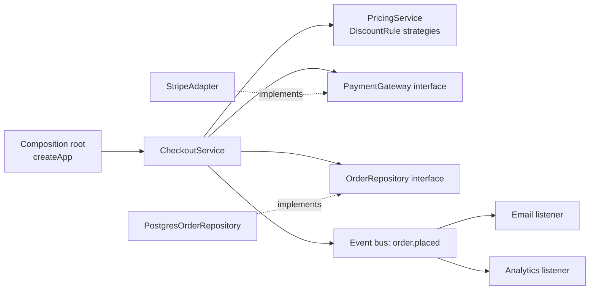
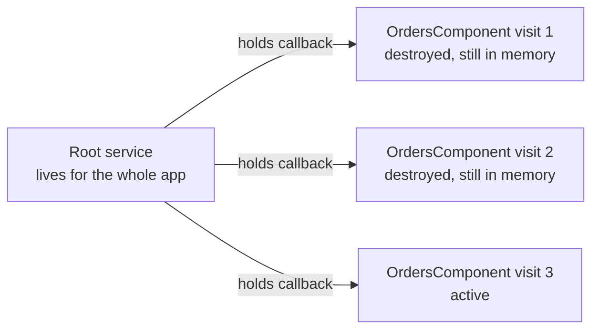
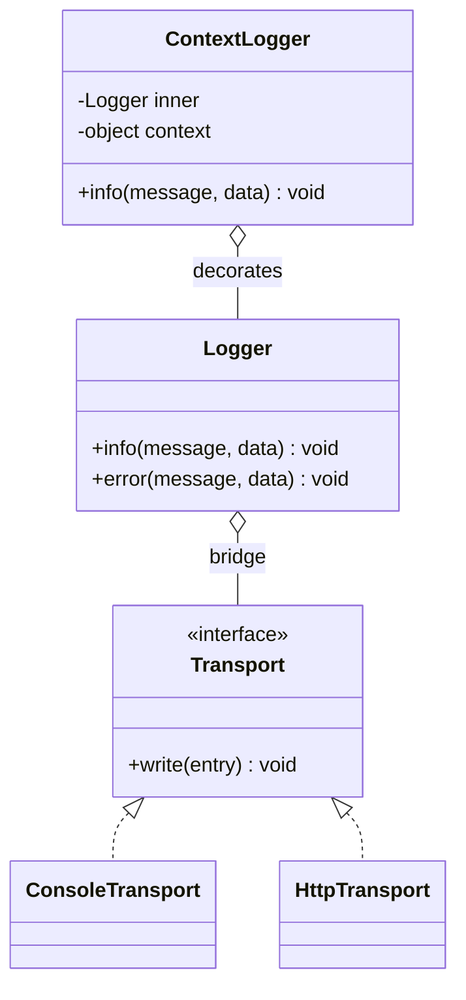

# OOP, SOLID and Design Patterns — Mixed Interview Questions

> This file is mixed and cross-topic practice for the whole OOP, SOLID and design patterns subject. Each topic document already has its own interview questions; use this file after you have studied the topics, and again right before interviews, to practice questions that combine several ideas.

## Table of contents

1. [All topic questions at a glance](#all-topic-questions-at-a-glance)
2. [Mixed and cross-topic questions](#mixed-and-cross-topic-questions)
3. [Rapid revision round](#rapid-revision-round)
4. [Summary](#summary)

---

## All topic questions at a glance

Every question below has a full answer in its topic document. Click a question to jump to it.

### OOP: The Four Pillars

[Open the document](01-oop-four-pillars.md)

- [Q1. What is object-oriented programming, and what are its four pillars?](01-oop-four-pillars.md#q1-what-is-object-oriented-programming-and-what-are-its-four-pillars)
- [Q2. What is the difference between encapsulation and abstraction?](01-oop-four-pillars.md#q2-what-is-the-difference-between-encapsulation-and-abstraction)
- [Q3. How can you make a property private in JavaScript? Compare the options.](01-oop-four-pillars.md#q3-how-can-you-make-a-property-private-in-javascript-compare-the-options)
- [Q4. Is TypeScript's `private` really private? What does this print?](01-oop-four-pillars.md#q4-is-typescripts-private-really-private-what-does-this-print)
- [Q5. What is polymorphism? What kinds exist, and which ones does JavaScript support?](01-oop-four-pillars.md#q5-what-is-polymorphism-what-kinds-exist-and-which-ones-does-javascript-support)
- [Q6. Does JavaScript support method overloading? What does this print?](01-oop-four-pillars.md#q6-does-javascript-support-method-overloading-what-does-this-print)
- [Q7. What does this print, and why?](01-oop-four-pillars.md#q7-what-does-this-print-and-why)
- [Q8. What does this print?](01-oop-four-pillars.md#q8-what-does-this-print)
- [Q9. Abstract class vs interface in TypeScript: when do you use each?](01-oop-four-pillars.md#q9-abstract-class-vs-interface-in-typescript-when-do-you-use-each)
- [Q10. Why can't you inject a TypeScript interface in Angular? What do you do instead?](01-oop-four-pillars.md#q10-why-cant-you-inject-a-typescript-interface-in-angular-what-do-you-do-instead)
- [Q11. Is JavaScript class-based or prototype-based? What does `class` really create?](01-oop-four-pillars.md#q11-is-javascript-class-based-or-prototype-based-what-does-class-really-create)
- [Q12. Find the bug: the team should never have more than 3 members.](01-oop-four-pillars.md#q12-find-the-bug-the-team-should-never-have-more-than-3-members)
- [Q13. Code review: how would you improve this?](01-oop-four-pillars.md#q13-code-review-how-would-you-improve-this)
- [Q14. Write a class `Temperature` that stores Celsius, exposes Fahrenheit as a computed property, and never allows a value below absolute zero (-273.15 °C).](01-oop-four-pillars.md#q14-write-a-class-temperature-that-stores-celsius-exposes-fahrenheit-as-a-computed-property-and-never-allows-a-value-below-absolute-zero--27315-c)
- [Q15. What is duck typing, and how does TypeScript's structural typing relate to it?](01-oop-four-pillars.md#q15-what-is-duck-typing-and-how-does-typescripts-structural-typing-relate-to-it)
- [Q16. When would you not use OOP? How do you decide between classes and functions?](01-oop-four-pillars.md#q16-when-would-you-not-use-oop-how-do-you-decide-between-classes-and-functions)
- [Q17. How does JavaScript decide which method to run when you call `obj.method()`?](01-oop-four-pillars.md#q17-how-does-javascript-decide-which-method-to-run-when-you-call-objmethod)
- [Q18. Are getters and setters always good encapsulation?](01-oop-four-pillars.md#q18-are-getters-and-setters-always-good-encapsulation)
- [Q19. Scenario: in an Angular app, a `UserState` object with public fields is changed directly by ten components. The UI sometimes shows stale data. How do you refactor it?](01-oop-four-pillars.md#q19-scenario-in-an-angular-app-a-userstate-object-with-public-fields-is-changed-directly-by-ten-components-the-ui-sometimes-shows-stale-data-how-do-you-refactor-it)
- [Q20. What is the "is-a" vs "has-a" test?](01-oop-four-pillars.md#q20-what-is-the-is-a-vs-has-a-test)

### Composition, Inheritance and Mixins

[Open the document](02-composition-inheritance-and-mixins.md)

- [Q1. What does "favor composition over inheritance" mean?](02-composition-inheritance-and-mixins.md#q1-what-does-favor-composition-over-inheritance-mean)
- [Q2. What is the fragile base class problem? Give an example.](02-composition-inheritance-and-mixins.md#q2-what-is-the-fragile-base-class-problem-give-an-example)
- [Q3. What does this print? (Subclassing `Set`)](02-composition-inheritance-and-mixins.md#q3-what-does-this-print-subclassing-set)
- [Q4. What is the gorilla–banana problem?](02-composition-inheritance-and-mixins.md#q4-what-is-the-gorillabanana-problem)
- [Q5. What is the diamond problem? Does JavaScript have it?](02-composition-inheritance-and-mixins.md#q5-what-is-the-diamond-problem-does-javascript-have-it)
- [Q6. What is a mixin, and what are the ways to write one in JavaScript?](02-composition-inheritance-and-mixins.md#q6-what-is-a-mixin-and-what-are-the-ways-to-write-one-in-javascript)
- [Q7. What does this print? (Mixin with a getter)](02-composition-inheritance-and-mixins.md#q7-what-does-this-print-mixin-with-a-getter)
- [Q8. What does this print? (Order of class mixins)](02-composition-inheritance-and-mixins.md#q8-what-does-this-print-order-of-class-mixins)
- [Q9. Composition vs aggregation vs delegation: what is the difference?](02-composition-inheritance-and-mixins.md#q9-composition-vs-aggregation-vs-delegation-what-is-the-difference)
- [Q10. Scenario: you have `Notification` subclasses for every channel and format: `EmailHtmlNotification`, `EmailTextNotification`, `SmsTextNotification`, `PushTextNotification`... Product now wants Slack, and a Markdown format. How do you redesign this?](02-composition-inheritance-and-mixins.md#q10-scenario-you-have-notification-subclasses-for-every-channel-and-format-emailhtmlnotification-emailtextnotification-smstextnotification-pushtextnotification-product-now-wants-slack-and-a-markdown-format-how-do-you-redesign-this)
- [Q11. When is inheritance the right choice?](02-composition-inheritance-and-mixins.md#q11-when-is-inheritance-the-right-choice)
- [Q12. How do you type a class mixin in TypeScript?](02-composition-inheritance-and-mixins.md#q12-how-do-you-type-a-class-mixin-in-typescript)
- [Q13. Why did React and Vue move away from mixins?](02-composition-inheritance-and-mixins.md#q13-why-did-react-and-vue-move-away-from-mixins)
- [Q14. Code review: what is wrong with this design?](02-composition-inheritance-and-mixins.md#q14-code-review-what-is-wrong-with-this-design)
- [Q15. Write a `withRetry` wrapper that adds retries to any object with an async `send(message)` method, without changing that object's class.](02-composition-inheritance-and-mixins.md#q15-write-a-withretry-wrapper-that-adds-retries-to-any-object-with-an-async-sendmessage-method-without-changing-that-objects-class)
- [Q16. How does composition make testing easier?](02-composition-inheritance-and-mixins.md#q16-how-does-composition-make-testing-easier)

### SOLID Principles

[Open the document](03-solid-principles.md)

- [Q1. What is SOLID? Explain each principle in one or two sentences.](03-solid-principles.md#q1-what-is-solid-explain-each-principle-in-one-or-two-sentences)
- [Q2. What does the Single Responsibility Principle really mean? Is it "a class should do one thing"?](03-solid-principles.md#q2-what-does-the-single-responsibility-principle-really-mean-is-it-a-class-should-do-one-thing)
- [Q3. Code review: which SOLID principles does this Express handler break, and how would you refactor it?](03-solid-principles.md#q3-code-review-which-solid-principles-does-this-express-handler-break-and-how-would-you-refactor-it)
- [Q4. Explain the Open/Closed Principle. Does it mean you should never modify existing code?](03-solid-principles.md#q4-explain-the-openclosed-principle-does-it-mean-you-should-never-modify-existing-code)
- [Q5. What does this print? What principle does it show?](03-solid-principles.md#q5-what-does-this-print-what-principle-does-it-show)
- [Q6. What exactly must a subtype preserve to satisfy LSP?](03-solid-principles.md#q6-what-exactly-must-a-subtype-preserve-to-satisfy-lsp)
- [Q7. Does TypeScript enforce the Liskov Substitution Principle?](03-solid-principles.md#q7-does-typescript-enforce-the-liskov-substitution-principle)
- [Q8. Design question: should `ReadOnlyList` extend `List`, or should `List` extend `ReadOnlyList`?](03-solid-principles.md#q8-design-question-should-readonlylist-extend-list-or-should-list-extend-readonlylist)
- [Q9. Find the problem and fix it.](03-solid-principles.md#q9-find-the-problem-and-fix-it)
- [Q10. Explain the Interface Segregation Principle with a real example.](03-solid-principles.md#q10-explain-the-interface-segregation-principle-with-a-real-example)
- [Q11. What is the difference between Dependency Inversion and Dependency Injection?](03-solid-principles.md#q11-what-is-the-difference-between-dependency-inversion-and-dependency-injection)
- [Q12. Scenario: Angular lets you add many HTTP interceptors. Which SOLID principles does this design follow?](03-solid-principles.md#q12-scenario-angular-lets-you-add-many-http-interceptors-which-solid-principles-does-this-design-follow)
- [Q13. Scenario: your company adds a new payment provider every few months, and each time the checkout code breaks somewhere. How do you redesign it?](03-solid-principles.md#q13-scenario-your-company-adds-a-new-payment-provider-every-few-months-and-each-time-the-checkout-code-breaks-somewhere-how-do-you-redesign-it)
- [Q14. Can following SOLID make code worse? Give an example.](03-solid-principles.md#q14-can-following-solid-make-code-worse-give-an-example)
- [Q15. How does SOLID help with unit testing?](03-solid-principles.md#q15-how-does-solid-help-with-unit-testing)
- [Q16. Do SOLID principles apply to React function components or to functional code?](03-solid-principles.md#q16-do-solid-principles-apply-to-react-function-components-or-to-functional-code)
- [Q17. Practical: this Angular component has too many responsibilities. Refactor it.](03-solid-principles.md#q17-practical-this-angular-component-has-too-many-responsibilities-refactor-it)
- [Q18. A teammate's test uses a fake repository that throws when an item is missing, but the real repository returns `null`. All tests pass. What is the problem?](03-solid-principles.md#q18-a-teammates-test-uses-a-fake-repository-that-throws-when-an-item-is-missing-but-the-real-repository-returns-null-all-tests-pass-what-is-the-problem)

### Coupling, Cohesion and Design Principles

[Open the document](04-coupling-cohesion-and-design-principles.md)

- [Q1. What are coupling and cohesion, and why do we want "high cohesion, low coupling"?](04-coupling-cohesion-and-design-principles.md#q1-what-are-coupling-and-cohesion-and-why-do-we-want-high-cohesion-low-coupling)
- [Q2. What kinds of coupling exist? Which are the worst?](04-coupling-cohesion-and-design-principles.md#q2-what-kinds-of-coupling-exist-which-are-the-worst)
- [Q3. Is loose coupling always good? Can you decouple too much?](04-coupling-cohesion-and-design-principles.md#q3-is-loose-coupling-always-good-can-you-decouple-too-much)
- [Q4. What does DRY really mean? When is duplication acceptable?](04-coupling-cohesion-and-design-principles.md#q4-what-does-dry-really-mean-when-is-duplication-acceptable)
- [Q5. What is "the wrong abstraction"? How do you get out of one?](04-coupling-cohesion-and-design-principles.md#q5-what-is-the-wrong-abstraction-how-do-you-get-out-of-one)
- [Q6. What is the difference between KISS and YAGNI?](04-coupling-cohesion-and-design-principles.md#q6-what-is-the-difference-between-kiss-and-yagni)
- [Q7. Code review: what principle does this break, and how would you fix it?](04-coupling-cohesion-and-design-principles.md#q7-code-review-what-principle-does-this-break-and-how-would-you-fix-it)
- [Q8. Refactor this using "tell, don't ask".](04-coupling-cohesion-and-design-principles.md#q8-refactor-this-using-tell-dont-ask)
- [Q9. What does this print? Which design principle does this API break?](04-coupling-cohesion-and-design-principles.md#q9-what-does-this-print-which-design-principle-does-this-api-break)
- [Q10. Find the code smells in this function.](04-coupling-cohesion-and-design-principles.md#q10-find-the-code-smells-in-this-function)
- [Q11. What is primitive obsession, and how do you fix it in TypeScript?](04-coupling-cohesion-and-design-principles.md#q11-what-is-primitive-obsession-and-how-do-you-fix-it-in-typescript)
- [Q12. What is the difference between shotgun surgery and divergent change?](04-coupling-cohesion-and-design-principles.md#q12-what-is-the-difference-between-shotgun-surgery-and-divergent-change)
- [Q13. How would you structure a large Angular 16 application for high cohesion and low coupling?](04-coupling-cohesion-and-design-principles.md#q13-how-would-you-structure-a-large-angular-16-application-for-high-cohesion-and-low-coupling)
- [Q14. Package by layer or package by feature for a Node.js backend?](04-coupling-cohesion-and-design-principles.md#q14-package-by-layer-or-package-by-feature-for-a-nodejs-backend)
- [Q15. What is temporal coupling? Find and fix it.](04-coupling-cohesion-and-design-principles.md#q15-what-is-temporal-coupling-find-and-fix-it)
- [Q16. Scenario: adding one field to the order model forces changes in 12 files. What do you do?](04-coupling-cohesion-and-design-principles.md#q16-scenario-adding-one-field-to-the-order-model-forces-changes-in-12-files-what-do-you-do)
- [Q17. How can you measure or visualize coupling in a JavaScript codebase?](04-coupling-cohesion-and-design-principles.md#q17-how-can-you-measure-or-visualize-coupling-in-a-javascript-codebase)

### Dependency Inversion and Dependency Injection

[Open the document](05-dependency-inversion-and-injection.md)

- [Q1. What is dependency injection, and why would you use it?](05-dependency-inversion-and-injection.md#q1-what-is-dependency-injection-and-why-would-you-use-it)
- [Q2. What is the difference between Dependency Inversion, Dependency Injection and Inversion of Control?](05-dependency-inversion-and-injection.md#q2-what-is-the-difference-between-dependency-inversion-dependency-injection-and-inversion-of-control)
- [Q3. What are the types of dependency injection? Which do you prefer and why?](05-dependency-inversion-and-injection.md#q3-what-are-the-types-of-dependency-injection-which-do-you-prefer-and-why)
- [Q4. What is a composition root?](05-dependency-inversion-and-injection.md#q4-what-is-a-composition-root)
- [Q5. How does a DI container resolve dependencies? Explain the internals.](05-dependency-inversion-and-injection.md#q5-how-does-a-di-container-resolve-dependencies-explain-the-internals)
- [Q6. Explain singleton, scoped and transient lifetimes. Give an example of each.](05-dependency-inversion-and-injection.md#q6-explain-singleton-scoped-and-transient-lifetimes-give-an-example-of-each)
- [Q7. What is a captive dependency, and why is it dangerous?](05-dependency-inversion-and-injection.md#q7-what-is-a-captive-dependency-and-why-is-it-dangerous)
- [Q8. How does DI improve testability? Show an example.](05-dependency-inversion-and-injection.md#q8-how-does-di-improve-testability-show-an-example)
- [Q9. What is the service locator pattern, and why is it considered an anti-pattern?](05-dependency-inversion-and-injection.md#q9-what-is-the-service-locator-pattern-and-why-is-it-considered-an-anti-pattern)
- [Q10. How does DI work in Angular? What is special about it?](05-dependency-inversion-and-injection.md#q10-how-does-di-work-in-angular-what-is-special-about-it)
- [Q11. What does `providedIn: 'root'` do, and how is it different from listing a service in a module's `providers`?](05-dependency-inversion-and-injection.md#q11-what-does-providedin-root-do-and-how-is-it-different-from-listing-a-service-in-a-modules-providers)
- [Q12. Why can't you inject an interface in Angular or NestJS, and what are the alternatives?](05-dependency-inversion-and-injection.md#q12-why-cant-you-inject-an-interface-in-angular-or-nestjs-and-what-are-the-alternatives)
- [Q13. How do you handle circular dependencies?](05-dependency-inversion-and-injection.md#q13-how-do-you-handle-circular-dependencies)
- [Q14. Output prediction: what does this print?](05-dependency-inversion-and-injection.md#q14-output-prediction-what-does-this-print)
- [Q15. Scenario: an Express app stores the logged-in user in a field of a shared service. Users report seeing other users' data. What is wrong, and how do you fix it?](05-dependency-inversion-and-injection.md#q15-scenario-an-express-app-stores-the-logged-in-user-in-a-field-of-a-shared-service-users-report-seeing-other-users-data-what-is-wrong-and-how-do-you-fix-it)
- [Q16. When would you choose manual DI over a DI container?](05-dependency-inversion-and-injection.md#q16-when-would-you-choose-manual-di-over-a-di-container)
- [Q17. Compare NestJS, InversifyJS, tsyringe and Awilix in one sentence each.](05-dependency-inversion-and-injection.md#q17-compare-nestjs-inversifyjs-tsyringe-and-awilix-in-one-sentence-each)
- [Q18. Code review: what is wrong with this Angular service?](05-dependency-inversion-and-injection.md#q18-code-review-what-is-wrong-with-this-angular-service)
- [Q19. What problems can decorators and `reflect-metadata` cause in DI setups?](05-dependency-inversion-and-injection.md#q19-what-problems-can-decorators-and-reflect-metadata-cause-in-di-setups)
- [Q20. Is it over-engineering to create an interface for every service just for DI?](05-dependency-inversion-and-injection.md#q20-is-it-over-engineering-to-create-an-interface-for-every-service-just-for-di)

### Creational Patterns

[Open the document](06-creational-patterns.md)

- [Q1. What is a design pattern, and what are the three GoF categories?](06-creational-patterns.md#q1-what-is-a-design-pattern-and-what-are-the-three-gof-categories)
- [Q2. What is the Singleton pattern, and why do some people call it an anti-pattern?](06-creational-patterns.md#q2-what-is-the-singleton-pattern-and-why-do-some-people-call-it-an-anti-pattern)
- [Q3. How do you implement a singleton in JavaScript and in TypeScript?](06-creational-patterns.md#q3-how-do-you-implement-a-singleton-in-javascript-and-in-typescript)
- [Q4. Is an ES module export always a singleton? When can you get two instances?](06-creational-patterns.md#q4-is-an-es-module-export-always-a-singleton-when-can-you-get-two-instances)
- [Q5. What does this singleton code print?](06-creational-patterns.md#q5-what-does-this-singleton-code-print)
- [Q6. How does Angular providedIn root relate to Singleton? When do you get two instances of a root service?](06-creational-patterns.md#q6-how-does-angular-providedin-root-relate-to-singleton-when-do-you-get-two-instances-of-a-root-service)
- [Q7. Find the bug: a singleton in a Node.js server](06-creational-patterns.md#q7-find-the-bug-a-singleton-in-a-nodejs-server)
- [Q8. Simple Factory vs Factory Method vs Abstract Factory: what is the difference?](06-creational-patterns.md#q8-simple-factory-vs-factory-method-vs-abstract-factory-what-is-the-difference)
- [Q9. Write a notification factory that new channels can extend without editing the factory.](06-creational-patterns.md#q9-write-a-notification-factory-that-new-channels-can-extend-without-editing-the-factory)
- [Q10. Factory function vs class constructor in JavaScript: when do you choose each?](06-creational-patterns.md#q10-factory-function-vs-class-constructor-in-javascript-when-do-you-choose-each)
- [Q11. When would you use an Abstract Factory? Give a real example.](06-creational-patterns.md#q11-when-would-you-use-an-abstract-factory-give-a-real-example)
- [Q12. Builder vs options object: when is a Builder worth it in JavaScript?](06-creational-patterns.md#q12-builder-vs-options-object-when-is-a-builder-worth-it-in-javascript)
- [Q13. What does this builder code print, and what is wrong with it?](06-creational-patterns.md#q13-what-does-this-builder-code-print-and-what-is-wrong-with-it)
- [Q14. How would you design a query builder that is safe against SQL injection?](06-creational-patterns.md#q14-how-would-you-design-a-query-builder-that-is-safe-against-sql-injection)
- [Q15. What is the Prototype pattern, and how is it different from JavaScript's prototypal inheritance?](06-creational-patterns.md#q15-what-is-the-prototype-pattern-and-how-is-it-different-from-javascripts-prototypal-inheritance)
- [Q16. What does this "clone" code print?](06-creational-patterns.md#q16-what-does-this-clone-code-print)
- [Q17. What are the risks of each cloning method in the Prototype pattern?](06-creational-patterns.md#q17-what-are-the-risks-of-each-cloning-method-in-the-prototype-pattern)
- [Q18. How do creational patterns make code easier to test?](06-creational-patterns.md#q18-how-do-creational-patterns-make-code-easier-to-test)
- [Q19. Your team wants every service to be a class with a static getInstance(). What do you say?](06-creational-patterns.md#q19-your-team-wants-every-service-to-be-a-class-with-a-static-getinstance-what-do-you-say)
- [Q20. When is an object pool worth it in JavaScript, and what are the risks?](06-creational-patterns.md#q20-when-is-an-object-pool-worth-it-in-javascript-and-what-are-the-risks)
- [Q21. How do you decide between `new`, a factory, a builder and an options object?](06-creational-patterns.md#q21-how-do-you-decide-between-new-a-factory-a-builder-and-an-options-object)

### Structural Patterns

[Open the document](07-structural-patterns.md)

- [Q1. What is the Adapter pattern? Give a real example.](07-structural-patterns.md#q1-what-is-the-adapter-pattern-give-a-real-example)
- [Q2. What is the difference between Adapter, Facade, Decorator and Proxy?](07-structural-patterns.md#q2-what-is-the-difference-between-adapter-facade-decorator-and-proxy)
- [Q3. Your company is switching payment providers next quarter. How do you design the code so the switch is small?](07-structural-patterns.md#q3-your-company-is-switching-payment-providers-next-quarter-how-do-you-design-the-code-so-the-switch-is-small)
- [Q4. Write a function that adapts a callback-style function into one that returns a promise.](07-structural-patterns.md#q4-write-a-function-that-adapts-a-callback-style-function-into-one-that-returns-a-promise)
- [Q5. Where should you map a legacy API response in an Angular app, and why?](07-structural-patterns.md#q5-where-should-you-map-a-legacy-api-response-in-an-angular-app-and-why)
- [Q6. What is a facade in an Angular app, and what are the trade-offs when it sits over NgRx?](07-structural-patterns.md#q6-what-is-a-facade-in-an-angular-app-and-what-are-the-trade-offs-when-it-sits-over-ngrx)
- [Q7. Decorator pattern vs inheritance: why prefer decorators for cross-cutting features?](07-structural-patterns.md#q7-decorator-pattern-vs-inheritance-why-prefer-decorators-for-cross-cutting-features)
- [Q8. Is Angular's @Component decorator an example of the Decorator pattern?](07-structural-patterns.md#q8-is-angulars-component-decorator-an-example-of-the-decorator-pattern)
- [Q9. What does this decorator stacking code print?](07-structural-patterns.md#q9-what-does-this-decorator-stacking-code-print)
- [Q10. Write a memoize function decorator. What can go wrong with it?](07-structural-patterns.md#q10-write-a-memoize-function-decorator-what-can-go-wrong-with-it)
- [Q11. Find the bug: a function decorator breaks a method](07-structural-patterns.md#q11-find-the-bug-a-function-decorator-breaks-a-method)
- [Q12. What is the JavaScript Proxy object, and what would you use it for?](07-structural-patterns.md#q12-what-is-the-javascript-proxy-object-and-what-would-you-use-it-for)
- [Q13. What does this Proxy code print?](07-structural-patterns.md#q13-what-does-this-proxy-code-print)
- [Q14. Why does this Proxy throw a TypeError, and how do you fix it?](07-structural-patterns.md#q14-why-does-this-proxy-throw-a-typeerror-and-how-do-you-fix-it)
- [Q15. Why did Vue 3 move from getters and setters to Proxy for reactivity?](07-structural-patterns.md#q15-why-did-vue-3-move-from-getters-and-setters-to-proxy-for-reactivity)
- [Q16. Can you use a Proxy in the frontend to enforce permissions?](07-structural-patterns.md#q16-can-you-use-a-proxy-in-the-frontend-to-enforce-permissions)
- [Q17. What is the Composite pattern, and how is the DOM an example of it?](07-structural-patterns.md#q17-what-is-the-composite-pattern-and-how-is-the-dom-an-example-of-it)
- [Q18. Your recursive tree function crashes with "Maximum call stack size exceeded". What could be wrong?](07-structural-patterns.md#q18-your-recursive-tree-function-crashes-with-maximum-call-stack-size-exceeded-what-could-be-wrong)
- [Q19. Explain the Bridge pattern using the class explosion problem.](07-structural-patterns.md#q19-explain-the-bridge-pattern-using-the-class-explosion-problem)
- [Q20. When does Flyweight help in a JavaScript app, and what is the main rule?](07-structural-patterns.md#q20-when-does-flyweight-help-in-a-javascript-app-and-what-is-the-main-rule)
- [Q21. Do wrappers like decorators and proxies hurt performance?](07-structural-patterns.md#q21-do-wrappers-like-decorators-and-proxies-hurt-performance)

### Behavioral Patterns

[Open the document](08-behavioral-patterns.md)

- [Q1. What is the Strategy pattern? Show it in JavaScript.](08-behavioral-patterns.md#q1-what-is-the-strategy-pattern-show-it-in-javascript)
- [Q2. Code review: how would you refactor this function?](08-behavioral-patterns.md#q2-code-review-how-would-you-refactor-this-function)
- [Q3. What is the difference between Strategy and State?](08-behavioral-patterns.md#q3-what-is-the-difference-between-strategy-and-state)
- [Q4. What is the difference between Strategy and Template Method?](08-behavioral-patterns.md#q4-what-is-the-difference-between-strategy-and-template-method)
- [Q5. What is the Observer pattern, and where do you see it in JavaScript?](08-behavioral-patterns.md#q5-what-is-the-observer-pattern-and-where-do-you-see-it-in-javascript)
- [Q6. What is the difference between Observer and Pub/Sub?](08-behavioral-patterns.md#q6-what-is-the-difference-between-observer-and-pubsub)
- [Q7. What does this EventEmitter code print?](08-behavioral-patterns.md#q7-what-does-this-eventemitter-code-print)
- [Q8. What happens when a listener throws inside EventEmitter?](08-behavioral-patterns.md#q8-what-happens-when-a-listener-throws-inside-eventemitter)
- [Q9. An Angular component subscribes to a service observable but never unsubscribes. What goes wrong, and how do you fix it?](08-behavioral-patterns.md#q9-an-angular-component-subscribes-to-a-service-observable-but-never-unsubscribes-what-goes-wrong-and-how-do-you-fix-it)
- [Q10. Implement a small EventEmitter with on, off, once and emit.](08-behavioral-patterns.md#q10-implement-a-small-eventemitter-with-on-off-once-and-emit)
- [Q11. What is the Command pattern, and how do you implement undo/redo with it?](08-behavioral-patterns.md#q11-what-is-the-command-pattern-and-how-do-you-implement-undoredo-with-it)
- [Q12. Should undo use Command or Memento?](08-behavioral-patterns.md#q12-should-undo-use-command-or-memento)
- [Q13. Model an order lifecycle so that invalid transitions are impossible.](08-behavioral-patterns.md#q13-model-an-order-lifecycle-so-that-invalid-transitions-are-impossible)
- [Q14. What is wrong with using isLoading, isError and data flags for UI state?](08-behavioral-patterns.md#q14-what-is-wrong-with-using-isloading-iserror-and-data-flags-for-ui-state)
- [Q15. How do Express middleware and Angular interceptors use Chain of Responsibility? What happens if you forget next()?](08-behavioral-patterns.md#q15-how-do-express-middleware-and-angular-interceptors-use-chain-of-responsibility-what-happens-if-you-forget-next)
- [Q16. What does this middleware chain print?](08-behavioral-patterns.md#q16-what-does-this-middleware-chain-print)
- [Q17. Mediator vs Observer, and Mediator vs Facade: what is the difference?](08-behavioral-patterns.md#q17-mediator-vs-observer-and-mediator-vs-facade-what-is-the-difference)
- [Q18. How do you make a custom class work with for...of, and why is that useful?](08-behavioral-patterns.md#q18-how-do-you-make-a-custom-class-work-with-forof-and-why-is-that-useful)
- [Q19. Where do you see the Template Method pattern in Node.js and Angular?](08-behavioral-patterns.md#q19-where-do-you-see-the-template-method-pattern-in-nodejs-and-angular)
- [Q20. What problem does the Visitor pattern solve, and why is it rare in everyday JavaScript?](08-behavioral-patterns.md#q20-what-problem-does-the-visitor-pattern-solve-and-why-is-it-rare-in-everyday-javascript)
- [Q21. Scenario: users can get notifications by email, SMS or push based on their preferences, new channels will be added later, and checkout must not get slower. Which patterns would you use?](08-behavioral-patterns.md#q21-scenario-users-can-get-notifications-by-email-sms-or-push-based-on-their-preferences-new-channels-will-be-added-later-and-checkout-must-not-get-slower-which-patterns-would-you-use)
- [Q22. What are the downsides of event-driven designs, and how do you keep them maintainable?](08-behavioral-patterns.md#q22-what-are-the-downsides-of-event-driven-designs-and-how-do-you-keep-them-maintainable)

### Patterns in Real JavaScript Apps

[Open the document](09-patterns-in-real-javascript-apps.md)

- [Q1. What is the module pattern, and why is it used less today?](09-patterns-in-real-javascript-apps.md#q1-what-is-the-module-pattern-and-why-is-it-used-less-today)
- [Q2. What does this revealing module code print?](09-patterns-in-real-javascript-apps.md#q2-what-does-this-revealing-module-code-print)
- [Q3. Implement a typed event bus. What would you watch out for?](09-patterns-in-real-javascript-apps.md#q3-implement-a-typed-event-bus-what-would-you-watch-out-for)
- [Q4. When would you avoid a global event bus in an Angular app?](09-patterns-in-real-javascript-apps.md#q4-when-would-you-avoid-a-global-event-bus-in-an-angular-app)
- [Q5. Implement an Express-style middleware runner.](09-patterns-in-real-javascript-apps.md#q5-implement-an-express-style-middleware-runner)
- [Q6. What is the difference between Express and Koa middleware?](09-patterns-in-real-javascript-apps.md#q6-what-is-the-difference-between-express-and-koa-middleware)
- [Q7. What is the Repository pattern, and how does it help testing?](09-patterns-in-real-javascript-apps.md#q7-what-is-the-repository-pattern-and-how-does-it-help-testing)
- [Q8. Code review: what is wrong with this controller?](09-patterns-in-real-javascript-apps.md#q8-code-review-what-is-wrong-with-this-controller)
- [Q9. Where should business logic live in a Node.js backend?](09-patterns-in-real-javascript-apps.md#q9-where-should-business-logic-live-in-a-nodejs-backend)
- [Q10. MVC vs MVP vs MVVM: which one is Angular?](09-patterns-in-real-javascript-apps.md#q10-mvc-vs-mvp-vs-mvvm-which-one-is-angular)
- [Q11. Explain Redux's unidirectional data flow, and implement a minimal store.](09-patterns-in-real-javascript-apps.md#q11-explain-reduxs-unidirectional-data-flow-and-implement-a-minimal-store)
- [Q12. Why must Redux reducers return new objects instead of mutating?](09-patterns-in-real-javascript-apps.md#q12-why-must-redux-reducers-return-new-objects-instead-of-mutating)
- [Q13. How would you design a plugin system so third parties can extend your app safely?](09-patterns-in-real-javascript-apps.md#q13-how-would-you-design-a-plugin-system-so-third-parties-can-extend-your-app-safely)
- [Q14. Which design patterns does Angular use?](09-patterns-in-real-javascript-apps.md#q14-which-design-patterns-does-angular-use)
- [Q15. How does Angular use the Strategy pattern through providers? Give an example.](09-patterns-in-real-javascript-apps.md#q15-how-does-angular-use-the-strategy-pattern-through-providers-give-an-example)
- [Q16. Which patterns can you find in Node.js core?](09-patterns-in-real-javascript-apps.md#q16-which-patterns-can-you-find-in-nodejs-core)
- [Q17. How do the main and renderer processes communicate in Electron, and which patterns are involved?](09-patterns-in-real-javascript-apps.md#q17-how-do-the-main-and-renderer-processes-communicate-in-electron-and-which-patterns-are-involved)
- [Q18. HOCs vs render props vs hooks in React: what is the difference?](09-patterns-in-real-javascript-apps.md#q18-hocs-vs-render-props-vs-hooks-in-react-what-is-the-difference)
- [Q19. What is the compound components pattern?](09-patterns-in-real-javascript-apps.md#q19-what-is-the-compound-components-pattern)
- [Q20. Name some anti-patterns. How do you recognize a god object?](09-patterns-in-real-javascript-apps.md#q20-name-some-anti-patterns-how-do-you-recognize-a-god-object)
- [Q21. How do you decide whether to introduce a design pattern?](09-patterns-in-real-javascript-apps.md#q21-how-do-you-decide-whether-to-introduce-a-design-pattern)
- [Q22. Tell me about a time you used a design pattern in a project.](09-patterns-in-real-javascript-apps.md#q22-tell-me-about-a-time-you-used-a-design-pattern-in-a-project)


---

## Mixed and cross-topic questions

These questions combine several topics of this subject, and sometimes connect to other subjects (Angular, Node.js, Electron, testing). Each one links to the topic documents it draws on. All JavaScript outputs were checked with Node.js 22.

### Q1. Design walkthrough: you must build a checkout service for a web shop. Show how OOP, SOLID and design patterns appear in your design.

**What the interviewer is checking:** whether you can use the vocabulary of the whole subject together, in a realistic design, instead of reciting each idea alone.

**Short spoken answer (30–60 seconds):**
> I'd start with the business rules, not the patterns. A `CheckoutService` coordinates the use case: price the cart, charge the payment, save the order, notify the customer. Each step lives in its own class, which is Single Responsibility. Pricing rules are strategies in a list, so a new promotion is a new strategy, which is Open/Closed. The service depends on interfaces it owns, like `PaymentGateway` and `OrderRepository`, which is Dependency Inversion, and the real Stripe adapter and Postgres repository are injected from a composition root. The Stripe SDK sits behind an adapter so its types and error codes do not leak. After the order is saved, the service publishes an `order.placed` event, and email and analytics subscribe, which is Observer. Every gateway passes the same contract tests, which protects Liskov substitution. And I keep it small: no interface for pure helpers, only at real boundaries.

**Detailed explanation:**

| Part of the design | Idea used | Why |
| --- | --- | --- |
| `Cart` with `#items`, `addItem()` that validates | Encapsulation | The cart protects its own rules |
| `CheckoutService` only coordinates | SRP | Pricing, payment and storage change for different reasons |
| `DiscountRule[]` passed to `PricingService` | OCP + Strategy | New promotions without editing the service |
| `PaymentGateway`, `OrderRepository` interfaces owned by the checkout module | DIP | Business code does not import Stripe or SQL |
| `StripeAdapter implements PaymentGateway` | Adapter | SDK details stay in one class |
| `createApp(config)` builds everything | DI, composition root | One place knows the concrete classes |
| `events.emit('order.placed', ...)` | Observer / Pub/Sub | Checkout does not know who reacts |
| Shared contract tests for every gateway | LSP | Every implementation keeps the same promises |

**Code or diagram:**



**Follow-up questions:**
- **Which part would you not abstract?** — Pure calculations (tax, rounding) and value objects like `Money`. They have no I/O, so I import and test them directly.
- **Where would you put the email call if it must not slow down checkout?** — Behind the event, in a queue processed by a worker, so a slow email provider never blocks the HTTP response.
- **What if the payment succeeds but saving the order fails?** — Use an idempotency key with the provider and a compensation step (refund) or an outbox pattern. Patterns do not remove the need for failure handling.

**Common mistakes:** listing patterns without a reason for each one; adding an interface for every class; forgetting failure handling between payment and storage.

**Where this is used in real projects:** every e-commerce or billing backend; the same shape appears in NestJS modules and in Angular feature services.

Draws on: [SOLID principles](03-solid-principles.md), [Dependency inversion and injection](05-dependency-inversion-and-injection.md), [Structural patterns](07-structural-patterns.md#adapter), [Behavioral patterns](08-behavioral-patterns.md#strategy).

### Q2. Output prediction: template method in a constructor, with an arrow-function field. What does this print?

```js
class Exporter {
  constructor(rows) {
    this.output = this.format(rows); // template method step called in the constructor
  }
  format(rows) {
    return rows.join(',');
  }
}

class PipeExporter extends Exporter {
  separator = ' | ';
  format = (rows) => rows.join(this.separator); // arrow-function class field
}

class TabExporter extends Exporter {
  separator = '\t';
  format(rows) {
    return rows.join(this.separator);
  }
}

console.log(new PipeExporter(['a', 'b']).output);
console.log(JSON.stringify(new TabExporter(['a', 'b']).output));
```

**What the interviewer is checking:** construction order with inheritance, the difference between prototype methods and instance fields, and why calling overridable methods in a constructor is dangerous.

**Answer (output):**

```text
a,b
"a,b"
```

**Short spoken answer (30–60 seconds):**
> Both print `a,b`, but for two different reasons. The parent constructor runs before the child's class fields are created. For `PipeExporter`, `format` is an arrow-function *field*, so it does not exist yet when the parent calls `this.format`. The lookup finds the parent's `format` on the prototype, which joins with a comma. For `TabExporter`, `format` is a normal method on the prototype, so the child's version does run, but `this.separator` is still `undefined`, and `join(undefined)` uses the default comma. So the child's customization is silently lost in both cases. The fix is to never call overridable methods from a constructor; call them later, for example in an `init()` or in Angular's `ngOnInit`.

**Step-by-step explanation:**
1. `new PipeExporter([...])` runs the implicit child constructor, which calls `super(rows)`.
2. Inside the parent constructor, `this` is already the child object, but no child fields exist yet.
3. `this.format` is looked up: there is no own property `format` yet, `PipeExporter.prototype` has no `format` method, so `Exporter.prototype.format` runs: `'a,b'`.
4. After `super()` returns, the fields `separator` and `format` are created, too late.
5. For `TabExporter`, `TabExporter.prototype.format` runs (dynamic dispatch), but `separator` is `undefined`. `Array.prototype.join(undefined)` uses `','`.

**Follow-up questions:**
- **How would you fix the design?** — Move the call out of the constructor (`export(rows)` called by the client), or pass the separator to the parent constructor, or use composition: `new Exporter(formatFn)`.
- **Does TypeScript catch this?** — No. It compiles fine. This is runtime construction order.

**Common mistakes:** answering `a | b` for the first line (forgetting that fields are created after `super()`), or expecting the tab character in the second line.

**Where this is used in real projects:** base components or base services that call a "setup" hook in the constructor; a common source of `undefined` bugs in Angular base classes.

Draws on: [OOP: the four pillars, Q7](01-oop-four-pillars.md#q7-what-does-this-print-and-why), [Behavioral patterns: Template Method](08-behavioral-patterns.md#template-method), [Composition, inheritance and mixins](02-composition-inheritance-and-mixins.md#q3-what-does-this-print-subclassing-set).

### Q3. Find the bug: a hand-written subject skips a listener. What does this print, and why?

```js
class Subject {
  listeners = [];
  subscribe(fn) {
    this.listeners.push(fn);
    return () => this.listeners.splice(this.listeners.indexOf(fn), 1);
  }
  notify(value) {
    this.listeners.forEach((fn) => fn(value)); // no copy of the array
  }
}

const price = new Subject();
const stop = price.subscribe((v) => { console.log('once:', v); stop(); });
price.subscribe((v) => console.log('badge:', v));
price.subscribe((v) => console.log('total:', v));

price.notify(10);
price.notify(20);
```

**What the interviewer is checking:** whether you know the classic Observer bug of changing the listener list while you loop over it.

**Answer (output):**

```text
once: 10
total: 10
badge: 20
total: 20
```

**Short spoken answer (30–60 seconds):**
> On the first notify, the badge listener is skipped. The first listener unsubscribes itself during the loop, and `splice` removes it from the same array that `forEach` is walking. Every element shifts one place to the left, so the badge listener moves into index 0, which was already visited, and `forEach` continues at index 1, which is now the total listener. The fix is to loop over a copy, `[...this.listeners]`, or to use a `Set`, which handles deletion during iteration correctly. Node's `EventEmitter` also copies its listener array before it emits.

**Step-by-step explanation:**
1. `listeners` is `[once, badge, total]`. `forEach` visits index 0: `once` runs and calls `stop()`.
2. `splice(0, 1)` changes the array to `[badge, total]`.
3. `forEach` moves on to index 1, which is now `total`. `badge` is never called for the value `10`.
4. On the second notify, the array is `[badge, total]`, so both run.

**Follow-up questions:**
- **What else should a production subject do?** — Return an unsubscribe function (it does), isolate errors with `try/catch` per listener, and document whether notification is synchronous.
- **Is `Set` iteration safe when you delete?** — Yes. Deleting a not-yet-visited entry means it is skipped; deleting the current one does not shift others. Copying is still the clearest choice.

**Common mistakes:** expecting all three listeners to run on the first notify; "fixing" it by unsubscribing with `setTimeout`.

**Where this is used in real projects:** custom stores, event buses, `once()` implementations, and any code where a listener removes itself.

Draws on: [Behavioral patterns: Observer](08-behavioral-patterns.md#observer), [Patterns in real JavaScript apps: Pub/Sub event bus](09-patterns-in-real-javascript-apps.md#pubsub-event-bus).

### Q4. Output prediction: a strategy that uses `this`. What does this print in an ES module?

```js
const discounts = {
  rate: 0.1,
  premium(total) {
    return total - total * this.rate;
  },
};

function checkout(total, strategy) {
  return strategy(total);
}

console.log(discounts.premium(100));
try {
  console.log(checkout(100, discounts.premium));
} catch (error) {
  console.log(error.constructor.name);
}
console.log(checkout(100, discounts.premium.bind(discounts)));
```

**What the interviewer is checking:** that you connect the Strategy pattern (passing behavior as a function) with the dynamic `this` rules of JavaScript.

**Answer (output, ES module or strict mode):**

```text
90
TypeError
90
```

In an old non-strict CommonJS script, the second line prints `NaN` instead, because `this` becomes the global object and `globalThis.rate` is `undefined`.

**Short spoken answer (30–60 seconds):**
> The first call works because it is called as `discounts.premium(...)`, so `this` is `discounts`. In the second call, I pass the method itself as a strategy, and `checkout` calls it as a plain function. In an ES module, code is strict, so `this` is `undefined`, and reading `this.rate` throws a `TypeError`. Binding it fixes it. The lesson for strategies in JavaScript: make them plain functions that receive everything as parameters, or close over their configuration, like `const premium = (rate) => (total) => total - total * rate`. Then they cannot lose `this`.

**Step-by-step explanation:**
1. `discounts.premium(100)`: method call, `this = discounts`, result `100 - 10 = 90`.
2. `checkout(100, discounts.premium)`: `strategy(total)` is a plain call. In strict code `this` is `undefined`. `undefined.rate` throws.
3. `bind(discounts)` creates a function with `this` fixed, so the result is `90`.

**Follow-up questions:**
- **Which is better for strategies: objects with methods or closures?** — Closures or pure functions for small strategies (no `this`). Classes when strategies need several methods or DI, and then pass the whole object, not a detached method.
- **Where else does this bug appear?** — `setTimeout(this.refresh, 1000)`, `addEventListener('click', this.save)`, and function decorators that call `fn(...args)` instead of `fn.apply(this, args)`.

**Common mistakes:** expecting `90` three times; thinking arrow functions in object literals would fix it (an arrow `premium` would read `this` from the module scope, which is `undefined`).

**Where this is used in real projects:** strategy maps for pricing, sorting and validation; callbacks passed to Angular or Node APIs.

Draws on: [OOP: the four pillars](01-oop-four-pillars.md#3-this-is-dynamic), [Behavioral patterns: Strategy](08-behavioral-patterns.md#strategy), [Structural patterns, Q11](07-structural-patterns.md#q11-find-the-bug-a-function-decorator-breaks-a-method).

### Q5. Find the bug: a memoize decorator for an async function. What does this print?

```js
function memoizeAsync(fn) {
  const cache = new Map();
  return (key) => {
    if (!cache.has(key)) cache.set(key, fn(key));
    return cache.get(key);
  };
}

let calls = 0;
const fetchRate = async (currency) => {
  calls += 1;
  if (calls === 1) throw new Error('timeout');
  return 1.08;
};

const getRate = memoizeAsync(fetchRate);
await getRate('EUR').catch((e) => console.log('first:', e.message));
await getRate('EUR').catch((e) => console.log('second:', e.message));
console.log('calls:', calls);
```

**What the interviewer is checking:** whether you can review a Decorator / caching Proxy and spot a production bug: a cached failure.

**Answer (output):**

```text
first: timeout
second: timeout
calls: 1
```

**Short spoken answer (30–60 seconds):**
> The decorator caches the promise, which is good, because parallel callers share one request. But it also caches a rejected promise. The first call times out, and that failed promise stays in the cache forever, so every later call gets the same error without even trying again. The fix is to delete the cache entry when the promise rejects, and usually to add an expiry time. The caching proxy in the structural patterns document does exactly that with a `.catch` that removes the key and rethrows.

**Step-by-step explanation:**
1. First call: the cache is empty, so `fetchRate('EUR')` runs (`calls = 1`), returns a promise that rejects, and the promise is stored.
2. Second call: `cache.has('EUR')` is true, so the same rejected promise is returned. `fetchRate` is not called again.
3. `calls` stays `1`.

**Code (fix):**

```js
function memoizeAsync(fn) {
  const cache = new Map();
  return (key) => {
    if (!cache.has(key)) {
      const promise = fn(key).catch((error) => {
        cache.delete(key); // never cache failures
        throw error;
      });
      cache.set(key, promise);
    }
    return cache.get(key);
  };
}
```

**Follow-up questions:**
- **Is this a Decorator or a Proxy?** — Either name works; it keeps the same interface. Call it a decorator if the intent is "add caching", a proxy if the intent is "control access to the real call". Say the intent.
- **What else is missing for production?** — A maximum size or expiry (otherwise memory grows), and a key strategy for complex arguments.

**Common mistakes:** saying the second call prints `1.08`; fixing it by not caching promises at all (then parallel calls send duplicate requests).

**Where this is used in real projects:** API clients, exchange-rate and config lookups, Angular services that cache HTTP results with `shareReplay`.

Draws on: [Structural patterns: Proxy](07-structural-patterns.md#example-a-caching-proxy-for-an-api-client-class-version), [Structural patterns, Q10](07-structural-patterns.md#q10-write-a-memoize-function-decorator-what-can-go-wrong-with-it).

### Q6. Output prediction: is a frozen config singleton really read-only?

```js
const config = Object.freeze({
  apiUrl: 'https://api.example.com',
  db: { host: 'db.internal', pool: 10 },
});

try {
  config.apiUrl = 'http://evil.example';
} catch (error) {
  console.log(error.constructor.name);
}
config.db.pool = 1;
console.log(config.apiUrl, config.db.pool, Object.isFrozen(config.db));
```

**What the interviewer is checking:** the difference between protecting a reference and protecting the whole object graph, applied to a module singleton.

**Answer (output, ES module or strict mode):**

```text
TypeError
https://api.example.com 1 false
```

**Short spoken answer (30–60 seconds):**
> `Object.freeze` is shallow. Writing to `config.apiUrl` throws a `TypeError` in strict code, so the top level is protected. But `config.db` is a separate object that is not frozen, so any module can change `config.db.pool`, and because the config is a shared module singleton, that change affects the whole app. This is the same idea as returning an internal array from a getter: the outer object is protected, the inner one is not. If I want a truly read-only config, I deep-freeze it at startup, or I keep it private and expose only getters that return copies.

**Step-by-step explanation:**
1. `Object.freeze` makes the outer object's own properties non-writable. ES modules run in strict mode, so the failed write throws.
2. `config.db` is just a reference to another object. Freezing the outer object does not freeze that object.
3. `config.db.pool = 1` succeeds. `Object.isFrozen(config.db)` is `false`.

**Follow-up questions:**
- **How do you deep-freeze?** — Recursively call `Object.freeze` on every nested object (only for plain data you own), or use `structuredClone` plus a freeze helper at startup.
- **TypeScript has `readonly`. Is that enough?** — It blocks writes at compile time only. At runtime the object is still mutable. `Readonly<T>` is also shallow unless you write a deep version.

**Common mistakes:** thinking `Object.freeze` or `const` makes nested data immutable; thinking `const config` prevents changes to the object (it only prevents reassigning the variable).

**Where this is used in real projects:** shared configuration modules, Redux/NgRx state (which must be treated as immutable), default option objects.

Draws on: [Creational patterns: Singleton](06-creational-patterns.md#singleton), [OOP: the four pillars, Q12](01-oop-four-pillars.md#q12-find-the-bug-the-team-should-never-have-more-than-3-members).

### Q7. Output prediction: `instanceof` with a class-expression mixin. What does this print?

```js
const Serializable = (Base) => class extends Base {
  serialize() { return JSON.stringify(this); }
};

class Entity { constructor(id) { this.id = id; } }
class User extends Serializable(Entity) {}

const user = new User(7);
console.log(user.serialize());
console.log(user instanceof Entity);
try {
  console.log(user instanceof Serializable);
} catch (error) {
  console.log(error.constructor.name + ': ' + error.message);
}
```

**What the interviewer is checking:** how mixins really build the prototype chain, and why you cannot check "has this ability" with `instanceof`.

**Answer (output):**

```text
{"id":7}
true
TypeError: Function has non-object prototype 'undefined' in instanceof check
```

**Short spoken answer (30–60 seconds):**
> The mixin is a function that returns a new anonymous class extending `Entity`, so `User`'s chain is `User`, then the anonymous mixin class, then `Entity`. `serialize` works and `user instanceof Entity` is true. But `Serializable` itself is not a class; it is an arrow function, and arrow functions have no `prototype` property. `instanceof` needs the right side's `prototype` object, so it throws a `TypeError`. Even with a normal function it would be false, because every call creates a new class. So to check an ability, I use duck typing, like `typeof obj.serialize === 'function'`, or a brand symbol, or composition with named parts.

**Step-by-step explanation:**
1. `Serializable(Entity)` returns a new class whose parent is `Entity`.
2. `User extends` that class. `new User(7)` runs `Entity`'s constructor, so `id` is `7`.
3. `serialize()` is found on the mixin class prototype: `{"id":7}`.
4. `user instanceof Serializable` reads `Serializable.prototype`. Arrow functions have none, so the engine throws.

**Follow-up questions:**
- **How could you support `instanceof` for a mixin?** — Add a `static [Symbol.hasInstance](obj)` to the mixin function that checks for a brand symbol set by the mixin class. It works, but duck typing is usually simpler.
- **What does TypeScript use for this?** — Structural typing: an object that has `serialize(): string` matches a `Serializable` interface, no `instanceof` needed.

**Common mistakes:** answering `false` for the third line; thinking mixins give multiple inheritance with `instanceof` support.

**Where this is used in real projects:** class mixins in Lit custom elements, TypeScript mixin helpers, and code that tries to type-check plugin objects at runtime.

Draws on: [Composition, inheritance and mixins: Mixins](02-composition-inheritance-and-mixins.md#mixins), [OOP: the four pillars: duck typing](01-oop-four-pillars.md#kind-4-duck-typing-structural-polymorphism).

### Q8. Output prediction: a singleton service that depends on a transient helper.

```js
class Container {
  #regs = new Map();
  #singletons = new Map();
  register(token, factory, lifetime = 'transient') { this.#regs.set(token, { factory, lifetime }); return this; }
  resolve(token) {
    const { factory, lifetime } = this.#regs.get(token);
    if (lifetime === 'singleton') {
      if (!this.#singletons.has(token)) this.#singletons.set(token, factory(this));
      return this.#singletons.get(token);
    }
    return factory(this);
  }
}

let ids = 0;
const c = new Container()
  .register('validator', () => ({ id: ++ids, errors: [] }))
  .register('orderService', (c) => ({ id: ++ids, validator: c.resolve('validator') }), 'singleton');

const s1 = c.resolve('orderService');
const s2 = c.resolve('orderService');
s1.validator.errors.push('qty must be > 0');
console.log(s1 === s2, s2.validator.errors.length, ids);
```

**What the interviewer is checking:** lifetimes and the captive dependency problem, shown with a transient instead of a scoped dependency.

**Answer (output):**

```text
true 1 2
```

**Short spoken answer (30–60 seconds):**
> `orderService` is a singleton, so both resolves return the same object, and the factory ran only once. During that one run, it resolved the transient `validator` once. "Transient" only means "new on every resolve", but nobody resolves it again, because the singleton keeps the first one forever. So the validator, which collects errors, is now shared by every request. The second caller sees the first caller's error. That is a captive dependency. The fix is to make the validator a method-local object (`new OrderValidator()` inside the method), inject a factory, or make the consumer as short-lived as its stateful dependency.

**Step-by-step explanation:**
1. First `resolve('orderService')`: not cached, so the factory runs. `++ids` gives the service the id `1`, then `resolve('validator')` creates the validator with the id `2`.
2. The service is cached. Second resolve returns the cached object, so `s1 === s2` and no new ids.
3. Both share one `errors` array, so its length is `1` after one push. `ids` is `2`.

**Follow-up questions:**
- **Why is this worse in Node.js?** — One process serves many users at the same time, so shared mutable state in a singleton leaks between concurrent requests.
- **How do real containers help?** — NestJS bubbles request scope up to consumers. Awilix has a `strict` option that throws on lifetime leaks, and .NET's container can validate scopes.

**Common mistakes:** thinking "transient" guarantees a fresh object for every request; storing request data in fields of a singleton.

**Where this is used in real projects:** NestJS, InversifyJS and Awilix setups; Angular root services that hold component-specific state by mistake.

Draws on: [Dependency inversion and injection: lifetimes](05-dependency-inversion-and-injection.md#the-captive-dependency-problem), [Creational patterns: Singleton](06-creational-patterns.md#problems-with-singletons).

### Q9. Find the bug: a logging Proxy that "disappears" after method chaining.

```js
class Account {
  #balance = 0;
  deposit(amount) { this.#balance += amount; return this; }
  get balance() { return this.#balance; }
}

const logged = new Proxy(new Account(), {
  get(target, property, receiver) {
    const value = Reflect.get(target, property, target);
    return typeof value === 'function' ? value.bind(target) : value;
  },
});

const result = logged.deposit(50).deposit(25);
console.log(logged.balance);
console.log(result === logged);
console.log(result instanceof Account);
```

**What the interviewer is checking:** deep understanding of the built-in `Proxy`: why you bind to the target for private fields, and what that costs.

**Answer (output):**

```text
75
false
true
```

**Short spoken answer (30–60 seconds):**
> Binding methods to the real target is the usual fix for private fields, because `#balance` only exists on the real object. The balance is correct, `75`. But `deposit` returns `this`, and `this` is now the real target, not the proxy. So `logged.deposit(50)` returns the raw account, and the second `.deposit(25)` is called directly on it, bypassing the proxy. If the proxy logged, checked permissions or tracked changes, the second call is invisible. For fluent APIs, the trap should return the proxy when a method returns the target: `const out = value.apply(target, args); return out === target ? receiver : out;`.

**Step-by-step explanation:**
1. `logged.deposit` goes through the `get` trap and returns `deposit` bound to the target.
2. `deposit(50)` updates `#balance` and returns `this`, which is the target.
3. `.deposit(25)` is a normal property read on the target. No trap runs.
4. `result` is the target, so `result === logged` is `false`, but it is an `Account`.

**Follow-up questions:**
- **Why not leave methods unbound?** — Then `this` is the proxy, and `this.#balance` throws "Cannot read private member #balance from an object whose class did not declare it".
- **Would a class-based Proxy pattern have this problem?** — A hand-written wrapper class that implements the same interface controls every return value explicitly, so you would notice and return the wrapper.

**Common mistakes:** saying `result === logged` is `true`; forgetting that the identity of the proxy and the target are different.

**Where this is used in real projects:** logging and permission proxies around services, Vue-style reactive wrappers, test spies.

Draws on: [Structural patterns: gotchas of the built-in Proxy](07-structural-patterns.md#gotchas-of-the-built-in-proxy), [OOP: the four pillars, Q3](01-oop-four-pillars.md#q3-how-can-you-make-a-property-private-in-javascript-compare-the-options).

### Q10. Production issue: an Angular app gets slower and uses more memory every time users open the orders page. Which concepts from this subject explain it, and how do you fix it?

**What the interviewer is checking:** connecting the Observer pattern, DI lifetimes and encapsulation to a real memory leak.

**Short spoken answer (30–60 seconds):**
> My first suspect is a lapsed listener. The orders component probably subscribes to an observable in a root service, which is a singleton that lives for the whole app. The subject keeps a reference to the subscriber callback, which closes over the component. When the user leaves the page, the component is destroyed but cannot be garbage collected, and its callback keeps running. Each visit adds one more subscription. I'd confirm it with a heap snapshot in DevTools: several detached `OrdersComponent` instances. The fix is to let the `async` pipe manage the subscription, or use `takeUntilDestroyed()` in Angular 16. I'd also check the service: it should expose a read-only observable and keep its subject private, so components cannot push values or keep extra references.

**Detailed explanation:**
- **Observer:** the subject holds strong references to its observers. Forgetting to unsubscribe keeps the observer alive. This is the lapsed listener problem.
- **Lifetimes:** a `providedIn: 'root'` service lives as long as the application, much longer than a component. A long-lived object holding a short-lived one is the same shape as a captive dependency.
- **Encapsulation:** a private `BehaviorSubject` with a public `asObservable()` keeps control of the state in one place.

**Code or diagram:**



**Follow-up questions:**
- **Do HTTP observables leak like this?** — Usually not, because `HttpClient` observables complete after one response. Subjects, `interval`, store selects and router events do not complete on their own.
- **How do you prevent it across a team?** — Prefer the `async` pipe, add a lint rule for manual subscriptions without cleanup, and review services that hand out subjects.

**Common mistakes:** blaming change detection first; adding `unsubscribe()` calls in some components but not where the subscription is created.

**Where this is used in real projects:** dashboards, long-running admin portals and Electron renderers where users open the same view many times.

Draws on: [Behavioral patterns, Q9](08-behavioral-patterns.md#q9-an-angular-component-subscribes-to-a-service-observable-but-never-unsubscribes-what-goes-wrong-and-how-do-you-fix-it), [Dependency inversion and injection: lifetimes](05-dependency-inversion-and-injection.md#lifetimes-singleton-scoped-and-transient), [OOP: the four pillars: encapsulation](01-oop-four-pillars.md#real-world-usage). Angular details: [RxJS](../06-angular-16/09-rxjs.md).

### Q11. Production issue: a Node.js service uses InversifyJS. A developer bound `UserContext` with `inRequestScope()` to hold the logged-in user. In production, users sometimes see each other's data. What went wrong?

**What the interviewer is checking:** precise knowledge of container scopes, and Node.js concurrency.

**Short spoken answer (30–60 seconds):**
> The name is misleading. In InversifyJS, "request scope" means one instance per `container.get()` call, so per resolution graph, not per HTTP request. If the services that use `UserContext` are singletons, or if the root container resolves the graph once and reuses it, every HTTP request shares the same `UserContext` object. Because one Node process handles many requests at the same time, a second request can overwrite the user while the first is still waiting on the database. The fix is a real per-HTTP-request scope: create a child container per request in middleware and resolve the request's services from it, or pass the user explicitly as a method parameter, or use `AsyncLocalStorage` for request context. I'd also add a test that runs two overlapping requests with different users.

**Detailed explanation:**
- **Lifetimes differ between containers.** NestJS `Scope.REQUEST` really is per HTTP request (and bubbles up to consumers). Inversify's `inRequestScope()` is per resolution. Awilix uses `createScope()` per request. Always check what "scoped" means in your library.
- **Concurrency:** Node.js runs JavaScript on one thread, but requests interleave at every `await`. Shared mutable state across `await` points is a race.

**Follow-up questions:**
- **How would you find this bug?** — Look for fields that store per-request data (`this.currentUser = ...`) and trace the lifetime of each object that holds them.
- **Is `AsyncLocalStorage` a DI replacement?** — No. It is ambient context, good for request IDs and logging context. Business dependencies should still be explicit.

**Common mistakes:** assuming single-threaded means "one request at a time"; assuming every container's "request scope" means the same thing.

**Where this is used in real projects:** multi-tenant APIs (current tenant), audit logging, authorization context.

Draws on: [Dependency inversion and injection: InversifyJS](05-dependency-inversion-and-injection.md#inversifyjs), [Dependency inversion and injection, Q15](05-dependency-inversion-and-injection.md#q15-scenario-an-express-app-stores-the-logged-in-user-in-a-field-of-a-shared-service-users-report-seeing-other-users-data-what-is-wrong-and-how-do-you-fix-it), [Creational patterns, Q7](06-creational-patterns.md#q7-find-the-bug-a-singleton-in-a-nodejs-server).

### Q12. Code review: every Angular component in your project extends a `BaseComponent` that injects five services, manages subscriptions, shows toasts and checks permissions. What do you say?

**What the interviewer is checking:** composition over inheritance, SRP and DI, applied to Angular.

**Short spoken answer (30–60 seconds):**
> This is the gorilla-banana problem. Each component extends the base class to get one or two helpers, but it inherits all five dependencies, all the subscriptions and every future change to the base. That makes the base class fragile: a change for one screen can break forty others. It also mixes several responsibilities: notifications, permissions and subscription cleanup change for different reasons. I'd replace it with composition: inject a `ToastService` or `PermissionService` only where it is needed, use the `async` pipe or `takeUntilDestroyed()` for cleanup, and use structural directives like `*appHasPermission` for template checks. I'd migrate one component at a time, keeping the base class until nothing extends it.

**Detailed explanation:**

| Problem | Principle | Composition-based fix |
| --- | --- | --- |
| Every component gets everything | Gorilla-banana, ISP | Inject only what you use |
| Changes in the base break children | Fragile base class | Small, independent services |
| One class with many reasons to change | SRP | One service per concern |
| Constructor must pass five services to `super()` | Coupling | `inject()` per component, no `super()` chain |
| Cleanup logic hidden in the parent | Least astonishment | `takeUntilDestroyed()` next to the subscription |

**Follow-up questions:**
- **Is an abstract base class ever fine in Angular?** — Yes, when it is small and shared code is real, for example an abstract `Logger` used as a DI token, or a base for a family of form controls with one stable contract.
- **What about host directives?** — Since Angular 15, `hostDirectives` lets you compose directive behavior onto a component, another composition tool.

**Common mistakes:** only saying "inheritance is bad"; replacing the base class with a mixin that has the same problems.

**Where this is used in real projects:** large enterprise Angular codebases often carry a `BaseComponent` from early days.

Draws on: [Composition, inheritance and mixins](02-composition-inheritance-and-mixins.md#problems-with-inheritance), [SOLID: SRP](03-solid-principles.md#s-single-responsibility-principle), [Coupling, cohesion and design principles](04-coupling-cohesion-and-design-principles.md#2-god-class).

### Q13. Decorator, Proxy, middleware and interceptor all add behavior around something. How do you choose between them?

**What the interviewer is checking:** whether you see the common idea (wrapping and delegation) and can still pick the right tool by intent and scope.

**Short spoken answer (30–60 seconds):**
> All four wrap a call and delegate to the next thing. I choose by scope and intent. A decorator wraps one object or function and adds behavior while keeping the same interface, like adding caching to a repository. A proxy also keeps the interface but controls access: lazy creation, permissions, remote calls. Middleware and interceptors are chains: they wrap every request that passes through a pipeline, so they are the right place for cross-cutting concerns that apply to all requests, like auth headers, logging or error mapping. So: one object and one concern, decorator; access control, proxy; every request through a framework, middleware or interceptor.

**Detailed explanation:**

| Tool | Wraps | Typical use | Pattern name |
| --- | --- | --- | --- |
| Decorator | One object or function | Caching, retries, metrics on a client | Decorator |
| Proxy | One object | Lazy loading, permission checks, remote objects | Proxy |
| Express/Koa middleware | Every HTTP request on a route or app | Auth, logging, rate limits, error handling | Chain of Responsibility |
| Angular interceptor | Every `HttpClient` request | Auth header, retry, error mapping | Chain of Responsibility |

The order of layers changes behavior in all four: logging outside a cache logs every call; logging inside it logs only misses.

**Follow-up questions:**
- **Where do TypeScript `@decorators` fit?** — They are a language feature. Angular's `@Component` attaches metadata, which is not the Decorator pattern. A method decorator that replaces a method with a wrapper does implement the pattern.
- **What is the main risk of all of them?** — Hidden behavior. Keep each layer small and named, and document the order.

**Common mistakes:** using a global middleware for something only one service needs; calling every wrapper a "decorator".

**Where this is used in real projects:** HTTP client layers, Express apps, Angular `HTTP_INTERCEPTORS`, NestJS interceptors and guards.

Draws on: [Structural patterns](07-structural-patterns.md#comparing-the-structural-patterns), [Behavioral patterns: Chain of Responsibility](08-behavioral-patterns.md#chain-of-responsibility), [Patterns in real JavaScript apps: middleware pipeline](09-patterns-in-real-javascript-apps.md#middleware-pipeline).

### Q14. Which design patterns support which SOLID principles? Give one example for each principle.

**What the interviewer is checking:** that you understand principles and patterns as two levels of the same thinking: goals and tools.

**Short spoken answer (30–60 seconds):**
> Principles are the goals; patterns are common ways to reach them. For Single Responsibility, a Facade or a service layer keeps orchestration separate from details. For Open/Closed, Strategy, Decorator, plugin registries and middleware let me add behavior without editing working code. Liskov is less a pattern and more a rule that every pattern relies on: a strategy or adapter must keep the interface's promises, which I protect with contract tests. For Interface Segregation, role interfaces and small preload APIs in Electron. And Dependency Inversion is supported by Adapter, Repository and dependency injection: the business layer owns the interface, and the adapter implements it.

**Detailed explanation:**

| Principle | Patterns and tools that help | Example |
| --- | --- | --- |
| SRP | Facade, service layer, Command | `CheckoutFacade` coordinates; each subsystem does one job |
| OCP | Strategy, Decorator, Chain, plugins, multi providers | New `DiscountRule` class; new `HTTP_INTERCEPTORS` entry |
| LSP | Contract tests for Strategy, Adapter, Repository | Every `PaymentGateway` adapter passes one shared suite |
| ISP | Role interfaces, Facade over a big API, `Pick<>` | `DocumentReader` instead of a fat `DocumentStore` |
| DIP | Adapter, Repository, DI, Abstract Factory | `OrderRepository` interface owned by the service layer |

**Follow-up questions:**
- **Can a pattern break a principle?** — Yes. A god Facade breaks SRP; a Template Method base class with many hooks can create a fragile hierarchy; a Singleton with `getInstance()` hides dependencies and works against DIP.
- **Which principle is most often over-applied with patterns?** — OCP: plugin systems and strategy registries for variations that never come (YAGNI).

**Common mistakes:** saying "Singleton supports SRP"; treating LSP as a pattern.

**Where this is used in real projects:** design reviews, where naming both the goal and the tool makes the discussion short.

Draws on: [SOLID principles](03-solid-principles.md#how-the-five-principles-work-together), [Creational patterns](06-creational-patterns.md), [Structural patterns](07-structural-patterns.md), [Behavioral patterns](08-behavioral-patterns.md).

### Q15. Senior trade-off: a colleague wants an interface, a factory and a DI token for every class in a new Node.js service "to follow SOLID". How do you respond?

**What the interviewer is checking:** balanced judgment between DIP/OCP and KISS/YAGNI, with a concrete rule instead of an opinion.

**Short spoken answer (30–60 seconds):**
> I agree with the goal, testable and changeable code, but not with doing it everywhere. An interface with one implementation forever adds a file and an extra jump without benefit. My rule is: abstract at boundaries. Anything that does I/O, the database, HTTP clients, email, payments, the file system, the clock and random IDs, gets an interface owned by the business layer, because that is what I replace in tests and what may really change. Pure functions and value objects I just import. Internal services can be injected as concrete classes and still be replaced in tests. Factories only when the type depends on runtime input. And when a second real implementation appears, refactoring to an interface takes minutes. That gives us SOLID where it pays and simple code everywhere else.

**Detailed explanation:**
- **DIP** is about the direction of dependencies at architectural boundaries, not about wrapping every class.
- **YAGNI** says not to build flexibility before it is needed. **KISS** says to keep the code that you do build simple.
- **Testability** comes mainly from injecting dependencies, which you can do with concrete classes too.

**Follow-up questions:**
- **How do you handle disagreement in a code review?** — Ask what concrete change the abstraction prepares for, and whether there is a second implementation today. Suggest adding it when that change arrives.
- **Which abstraction would you add on day one anyway?** — A `Clock` and an `IdGenerator`, because time and randomness make tests flaky.

**Common mistakes:** "SOLID is over-engineering" (too far the other way); no rule for where abstractions belong.

**Where this is used in real projects:** greenfield services, architecture guidelines, onboarding discussions.

Draws on: [SOLID: when SOLID goes too far](03-solid-principles.md#when-solid-goes-too-far), [Coupling, cohesion and design principles: YAGNI](04-coupling-cohesion-and-design-principles.md#yagni-you-arent-gonna-need-it), [Dependency inversion and injection: pitfalls](05-dependency-inversion-and-injection.md#1-over-abstraction).

### Q16. Debugging: unit tests pass when you run each file alone, but fail randomly when the whole suite runs. Which design problems do you look for?

**What the interviewer is checking:** recognizing hidden shared state (singletons, globals, module caches) as a test problem, and fixing it with design rather than hacks.

**Short spoken answer (30–60 seconds):**
> Order-dependent tests almost always mean shared mutable state. I look for module-level singletons, like an exported cache, a store object or a configured client, that tests change without resetting. I look for classes that call `getInstance()` or read globals like `process.env` deep inside. And I look for fakes that are shared between tests and keep recorded calls. The real fix is dependency injection: create a fresh instance per test and pass it in, so tests do not share anything. As short-term help, test runners can isolate modules, but I treat that as a patch. The same hidden state would also cause bugs in production, for example between concurrent requests.

**Detailed explanation:**
- In Jest and Vitest, each test **file** gets its own module registry, but tests **inside** one file share module singletons.
- `getInstance()` hides the dependency, so a test cannot replace it without patching.
- With constructor injection, each test is a small composition root: `new OrderService(new InMemoryRepo(), fakeClock)`.

**Code or diagram:**

```js
// ❌ Shared state between tests in the same file
const cartStore = { items: [] };
export const addToCart = (item) => cartStore.items.push(item);

// ✅ Fresh state per test: the store is created and passed in
export function createCart() {
  const items = [];
  return { add: (item) => items.push(item), count: () => items.length };
}
```

**Follow-up questions:**
- **Is a `reset()` method on the singleton a good fix?** — It works but is a smell: production code now has test-only API, and someone will forget to call it.
- **Why do tests pass alone but fail together?** — Alone, every module starts fresh. Together, earlier tests leave data behind in the shared instance.

**Common mistakes:** adding retries to flaky tests; running tests in a fixed order to "fix" them.

**Where this is used in real projects:** legacy Node services with module-level state, Angular tests that share a service instance outside `TestBed`.

Draws on: [Creational patterns: problems with singletons](06-creational-patterns.md#problems-with-singletons), [Dependency inversion and injection: DI for testability](05-dependency-inversion-and-injection.md#di-for-testability). Testing details: [Unit testing with Jest and Vitest](../10-testing-security-production/02-unit-testing-jest-and-vitest.md).

### Q17. Security: where can OOP features and design patterns give a false sense of security?

**What the interviewer is checking:** that you know which mechanisms protect data at runtime and which only help developers.

**Short spoken answer (30–60 seconds):**
> Several places. TypeScript `private` and `readonly` are compile-time only, so a "private" API key still appears in `JSON.stringify` and logs. Even `#private` does not hide anything from the user of a browser app, because they control the page; secrets belong on the server. A frontend Proxy or a state machine that blocks an action is only user experience; the server must check permissions and allowed transitions again. A singleton or a captive dependency on a server can leak one user's data to another. And an adapter or a query builder that concatenates values into SQL is an injection risk. On the other side, some patterns are real security boundaries: an Electron preload facade that exposes only a few validated functions, and adapters that validate and map untrusted input at the edge.

**Detailed explanation:**

| Mechanism | Real protection? | What to do |
| --- | --- | --- |
| TS `private` / `readonly` | No, compile time only | Never use it to hide secrets |
| `#private` in browser code | Protects against your own code, not the user | Keep secrets on the server |
| Frontend permission Proxy or hidden buttons | No | Authorize every request on the server |
| Singleton holding request data on a server | Creates a leak | Pass context explicitly, use request scopes |
| Query builder with placeholders | Yes | Never concatenate values; allow-list identifiers |
| Electron preload facade | Yes, if narrow | Expose specific functions, validate in the main process |

**Follow-up questions:**
- **What should an Electron preload expose?** — A few named functions (`saveDocument(text)`), never `ipcRenderer` itself, with `contextIsolation` and `sandbox` on and validation in the main process.
- **How do you stop a "private" field from appearing in logs?** — Use `#private`, implement `toJSON()` to choose what is serialized, and redact secrets in the logger.

**Common mistakes:** "the field is private, so the token is safe"; "the button is hidden, so users cannot delete".

**Where this is used in real projects:** code reviews of auth code, Electron security reviews, logging configuration.

Draws on: [OOP: the four pillars, Q4](01-oop-four-pillars.md#q4-is-typescripts-private-really-private-what-does-this-print), [Structural patterns, Q16](07-structural-patterns.md#q16-can-you-use-a-proxy-in-the-frontend-to-enforce-permissions), [Creational patterns, Q14](06-creational-patterns.md#q14-how-would-you-design-a-query-builder-that-is-safe-against-sql-injection), [Patterns in real JavaScript apps: Electron](09-patterns-in-real-javascript-apps.md#patterns-inside-electron). Security depth: [Electron security](../08-electron-desktop/04-electron-security.md).

### Q18. You inherit a 3,000-line `AppService` in a Node.js backend. How do you refactor it safely?

**What the interviewer is checking:** practical refactoring with cohesion, SRP, Facade and tests, without a risky big-bang rewrite.

**Short spoken answer (30–60 seconds):**
> First I protect behavior: I write characterization tests around the most used methods, so I know if I change what the code does. Then I look for cohesion: groups of methods that use the same fields and change for the same reason, like auth, orders and reporting. I extract one group at a time into its own service with constructor injection, and the old `AppService` method just forwards to the new service. So `AppService` becomes a temporary facade, and callers do not break. Over time I move callers to the new services directly and delete the forwarding methods. Each step is a small pull request with no feature changes mixed in. At the end there is no god class, and every new service can be tested with fakes.

**Detailed explanation:**
1. **Tests first:** characterization tests capture what the code does today.
2. **Find seams:** field groups used by method groups show hidden classes (the cohesion check).
3. **Extract Class + DI:** move a group into `OrderService`, inject it into `AppService`.
4. **Temporary facade:** `AppService.placeOrder()` forwards to `orderService.placeOrder()`.
5. **Move callers, delete forwarders.** Lint rules or a deprecation comment stop new code from using the old methods.

This is sometimes called the **strangler** approach: the new structure grows around the old code until the old code can be removed.

**Follow-up questions:**
- **What do you do with shared private helpers?** — Move them to the service that owns the knowledge, or to a small pure module if several services really need them.
- **How do you avoid circular dependencies between the new services?** — If two new services need each other, the shared part is a third service, or they communicate with events.

**Common mistakes:** rewriting everything at once; refactoring without tests; splitting by technical type ("all validators") instead of by responsibility.

**Where this is used in real projects:** almost every long-lived backend and Angular app has at least one god service.

Draws on: [Coupling, cohesion and design principles: code smells](04-coupling-cohesion-and-design-principles.md#code-smells-and-refactors), [Structural patterns: Facade](07-structural-patterns.md#facade), [Dependency inversion and injection: circular dependencies](05-dependency-inversion-and-injection.md#2-circular-dependencies).

### Q19. An Angular `OnPush` component does not update after `cartService.addItem()`. The service keeps a private `BehaviorSubject<Item[]>`. What is the likely bug, and which principles does the fix follow?

**What the interviewer is checking:** encapsulation plus immutability, and how reference comparison connects OOP design to Angular change detection.

**Short spoken answer (30–60 seconds):**
> The likely bug is that `addItem` mutates the current array, for example `this.items$.value.push(item)`, and then either does not call `next` or calls `next` with the same array. Subscribers that compare references, like `OnPush` inputs, `distinctUntilChanged` or memoized selectors, see the same reference and decide nothing changed. The fix is to emit a new array: `this.items$.next([...this.items$.value, item])`. The service already follows encapsulation by keeping the subject private; it should also expose only a read-only observable and treat its state as immutable, like a reducer does. That way all changes go through one method, and every change produces a new value that everyone can detect.

**Detailed explanation:**
- **Encapsulation:** a private subject and public methods mean only the service changes the state.
- **Immutability:** new objects for changed data make change detection cheap and reliable.
- **Redux idea:** a reducer returns a new state object; a service with a `BehaviorSubject` can follow the same rule.

**Code or diagram:**

```ts
// ❌ Mutation: same array reference
addItem(item: Item): void {
  this.items$.value.push(item);
  this.items$.next(this.items$.value);
}

// ✅ New array: subscribers see a new reference
addItem(item: Item): void {
  this.items$.next([...this.items$.value, item]);
}
```

**Follow-up questions:**
- **Why not expose the subject publicly?** — Any component could call `next()` and bypass validation, and you lose one place to debug state changes.
- **What changes with signals in newer Angular?** — The same rule applies: `signal.update(items => [...items, item])` produces a new value; mutating the array inside the signal does not notify readers.

**Common mistakes:** calling `ChangeDetectorRef.detectChanges()` everywhere instead of fixing the mutation.

**Where this is used in real projects:** every Angular app with service-based state, NgRx-free "store" services.

Draws on: [OOP: the four pillars, Q19](01-oop-four-pillars.md#q19-scenario-in-an-angular-app-a-userstate-object-with-public-fields-is-changed-directly-by-ten-components-the-ui-sometimes-shows-stale-data-how-do-you-refactor-it), [Patterns in real JavaScript apps, Q12](09-patterns-in-real-javascript-apps.md#q12-why-must-redux-reducers-return-new-objects-instead-of-mutating). Angular details: [Change detection and signals](../06-angular-16/10-change-detection-and-signals.md).

### Q20. How do you represent a contract at runtime in Angular, NestJS and InversifyJS, given that TypeScript interfaces disappear?

**What the interviewer is checking:** the link between abstraction (OOP), type erasure (TypeScript) and DI tokens (frameworks).

**Short spoken answer (30–60 seconds):**
> Interfaces are erased, so containers need a real value as the key. In Angular I use an abstract class when the contract has methods, because it is both the type and the token, or an `InjectionToken<T>` for config values and functions. In NestJS I use a string or symbol constant with `@Inject(TOKEN)`, or an abstract class. In InversifyJS the common style is symbols in a `TYPES` object with `@inject(TYPES.Mailer)`. In manual DI I do not need tokens at all: the composition root passes the object, and TypeScript checks the shape structurally. The rule is the same everywhere: keep tokens in one file, typed, never as scattered string literals.

**Detailed explanation:**

| Context | Runtime contract | Example |
| --- | --- | --- |
| Angular | Abstract class or `InjectionToken<T>` | `{ provide: Logger, useClass: ConsoleLogger }` |
| NestJS | String/symbol token or abstract class | `@Inject(ORDER_REPOSITORY)` |
| InversifyJS / tsyringe | Symbols or strings, plus decorators | `@inject(TYPES.Mailer)` |
| Manual DI | None needed | `new OrderService(repo)` |
| Runtime check of a shape | Type guard or schema validation | `isCancellable(value)` |

**Follow-up questions:**
- **Why does `emitDecoratorMetadata` not help with interfaces?** — It emits `Object` for an interface-typed parameter, because there is no runtime value to emit.
- **Abstract class or token in Angular?** — Abstract class for behavior contracts with methods; `InjectionToken` for configuration, primitives and functions.

**Common mistakes:** `constructor(private logger: ILogger)` with an interface and no token; string tokens with typos spread across files.

**Where this is used in real projects:** swapping implementations per environment, providing fakes in tests, plugin registries.

Draws on: [OOP: the four pillars, Q10](01-oop-four-pillars.md#q10-why-cant-you-inject-a-typescript-interface-in-angular-what-do-you-do-instead), [Dependency inversion and injection: tokens](05-dependency-inversion-and-injection.md#tokens-and-the-registry).

### Q21. Several implementations must behave the same: a real repository, an in-memory fake and a cached version. How do you guarantee it?

**What the interviewer is checking:** LSP applied to test doubles, adapters and decorators.

**Short spoken answer (30–60 seconds):**
> TypeScript only checks that the shapes match, not that the behavior matches. So I write one shared contract test suite for the interface, for example: `findById` returns `null` for a missing id, `save` then `findById` returns an equal copy, and saving twice updates instead of duplicating. Then I run that same suite against every implementation: the Postgres repository in integration tests, the in-memory fake, and the caching decorator wrapped around the fake. If a new implementation fails, it is not a valid substitute. This protects Liskov substitution and also keeps fakes honest, so unit tests do not pass against behavior that never happens in production.

**Code or diagram:**

```ts
interface UserRepository {
  findById(id: string): Promise<{ id: string; name: string } | null>;
  save(user: { id: string; name: string }): Promise<void>;
}

export async function userRepositoryContract(name: string, create: () => UserRepository) {
  const repo = create();
  const missing = await repo.findById('nope');
  await repo.save({ id: 'u1', name: 'Asha' });
  await repo.save({ id: 'u1', name: 'Asha Rao' }); // update, not duplicate
  const found = await repo.findById('u1');
  const ok = missing === null && found?.name === 'Asha Rao';
  console.log(`${name}: ${ok ? 'passes' : 'FAILS'}`);
}
```

**Follow-up questions:**
- **What about returned objects?** — The contract should say whether callers get copies. A fake that returns its internal object lets tests mutate stored data, which a real database never allows.
- **How does this help with adapters?** — Every payment or email adapter runs the same suite against the provider's sandbox or a recorded fake.

**Common mistakes:** "it compiles, so it is substitutable"; fakes that throw where the real implementation returns `null`.

**Where this is used in real projects:** repository layers, payment adapters, storage providers (local disk vs S3).

Draws on: [SOLID: TypeScript does not enforce LSP](03-solid-principles.md#typescript-does-not-enforce-lsp), [SOLID, Q18](03-solid-principles.md#q18-a-teammates-test-uses-a-fake-repository-that-throws-when-an-item-is-missing-but-the-real-repository-returns-null-all-tests-pass-what-is-the-problem), [Patterns in real JavaScript apps: repository](09-patterns-in-real-javascript-apps.md#repository-and-service-layer).

### Q22. In an Angular app, the product list, filters panel and cart summary must react to each other. Would you use direct calls, an event bus, a mediator (container component) or a store?

**What the interviewer is checking:** choosing between Observer, Pub/Sub, Mediator and unidirectional data flow, with coupling in mind.

**Short spoken answer (30–60 seconds):**
> It depends on how far apart the parts are and whether they share state. If they are siblings on one page, I'd use a container component as a mediator: the filters emit an `@Output`, the container updates the filter state and passes it down to the list with `@Input`. The rules live in one place and the children stay presentational. If the state is shared across routes, like the cart, I'd use a service with a private `BehaviorSubject`, or NgRx if the app already uses it, because a store also gives late subscribers the current value. I would not use a global event bus here: events have no current state, and it hides who depends on whom. An event bus fits fire-and-forget, app-wide events like "user logged out".

**Detailed explanation:**

| Option | Pattern | Good when | Risk |
| --- | --- | --- | --- |
| Direct method call | None | One consumer that needs a result | Tight coupling if overused |
| Container component | Mediator | Siblings on one page | God container if it grows |
| Service with `BehaviorSubject` | Observer | Shared state across components and routes | Mutation bugs if not immutable |
| NgRx store | Flux / Redux, Command-like actions | Large shared state, many teams | Boilerplate |
| Global event bus | Pub/Sub | Fire-and-forget app-wide events | Event spaghetti, no current value |

**Follow-up questions:**
- **How do you keep the container from becoming a god object?** — One container per feature or page, and move business rules into services.
- **What does "late subscriber" mean?** — A component created after the event was emitted. A `BehaviorSubject` or store gives it the current value; a plain event bus gives it nothing.

**Common mistakes:** a global event bus for state; children injecting each other.

**Where this is used in real projects:** product catalogs, dashboards with filters, multi-step forms.

Draws on: [Behavioral patterns: Mediator](08-behavioral-patterns.md#mediator), [Patterns in real JavaScript apps, Q4](09-patterns-in-real-javascript-apps.md#q4-when-would-you-avoid-a-global-event-bus-in-an-angular-app), [Coupling, cohesion and design principles: loose coupling is not zero coupling](04-coupling-cohesion-and-design-principles.md#loose-coupling-is-not-zero-coupling). Angular details: [State management and NgRx](../06-angular-16/11-state-management-and-ngrx.md).

### Q23. Many Node.js classes `extend EventEmitter`. Is that a good use of inheritance, or should you compose an emitter?

**What the interviewer is checking:** applying "is-a vs has-a" to a real platform class, with nuance.

**Short spoken answer (30–60 seconds):**
> Both are used, and the answer depends on the public interface. Extending `EventEmitter` is fine when the class truly is an event source and callers should use `on`, `once` and `off` on it directly, like a stream, a socket or a job runner; Node's own core classes do this. The cost is that the class inherits the whole emitter API, so any caller can also `emit` events or remove all listeners, and you can get name clashes with your own methods. If events are only a small part of the class, I compose: keep a private emitter and expose a narrow `onOrderPlaced(listener)` that returns an unsubscribe function. That is encapsulation and interface segregation, and it lets me change the event mechanism later.

**Code or diagram:**

```js
import { EventEmitter } from 'node:events';

class OrderService {
  #events = new EventEmitter(); // has-a emitter, private

  onOrderPlaced(listener) {
    this.#events.on('placed', listener);
    return () => this.#events.off('placed', listener);
  }

  place(order) {
    // ...save the order...
    this.#events.emit('placed', order); // only this class can emit
  }
}
```

**Follow-up questions:**
- **What must you remember either way?** — Listeners run synchronously, a throwing listener stops the rest, and an `'error'` event without a listener throws.
- **What about TypeScript typing?** — A composed emitter makes typed methods easy (`onOrderPlaced(listener: (order: Order) => void)`); typing every event of an inherited emitter needs extra generic helpers.

**Common mistakes:** "inheritance is always wrong"; or extending `EventEmitter` and letting outside code emit internal events.

**Where this is used in real projects:** Node services, Electron main-process modules, SDK clients that report progress.

Draws on: [Composition, inheritance and mixins: when inheritance is the right choice](02-composition-inheritance-and-mixins.md#when-inheritance-is-the-right-choice), [Behavioral patterns: EventEmitter](08-behavioral-patterns.md#observer-in-nodejs-eventemitter), [SOLID: ISP](03-solid-principles.md#i-interface-segregation-principle).

### Q24. A developer moves from Java to a TypeScript/Node.js team. What changes in how they should use OOP and design patterns?

**What the interviewer is checking:** understanding of JavaScript's prototype model, first-class functions and structural typing, and how they shrink patterns.

**Short spoken answer (30–60 seconds):**
> Several things. JavaScript is prototype-based, and `class` is syntax on top of prototypes, so `this` depends on how a function is called and methods lose `this` when passed as callbacks. TypeScript interfaces and `private` disappear at runtime, so DI needs tokens and real privacy needs `#private`. Typing is structural, so an object fits an interface if it has the right shape, without `implements`. Functions are values, so Strategy, Command and Observer listeners are often just functions, a Factory is a function and a Singleton is an exported module instance. There is no method overloading. And because Node serves many requests in one process, a singleton with request data is a real bug. So the advice is: use classes where state and lifecycle matter, functions for the rest, and keep patterns small.

**Detailed explanation:**

| Java habit | JavaScript/TypeScript equivalent |
| --- | --- |
| Strategy interface + classes | A function or a map of functions |
| `getInstance()` Singleton | Exported module instance, or DI singleton lifetime |
| Overloaded methods | One function that checks arguments, or TS overload signatures |
| `instanceof` interface checks | Duck typing, type guards, discriminated unions |
| `private` fields | `#private` for runtime privacy |
| Thread-per-request `ThreadLocal` | `AsyncLocalStorage`, or pass context explicitly |
| Deep class hierarchies | Composition, mixins only for small abilities |

**Follow-up questions:**
- **What stays the same?** — SOLID thinking, the vocabulary of patterns, layering into controller, service and repository, and the value of DI for tests.
- **What is the most common bug from Java habits?** — Detached methods losing `this`, and expecting interfaces to exist at runtime.

**Common mistakes:** saying JavaScript "has no OOP"; porting Java class hierarchies one to one.

**Where this is used in real projects:** mixed teams in enterprise companies, NestJS adoption by Java/C# developers.

Draws on: [OOP: the four pillars: JavaScript vs Java and C#](01-oop-four-pillars.md#oop-in-javascript-vs-java-and-c), [Creational patterns: what design patterns are](06-creational-patterns.md#what-design-patterns-are), [Behavioral patterns](08-behavioral-patterns.md#what-behavioral-patterns-solve).

### Q25. Design a small logging library for your company's Node.js services. Which patterns would you use?

**What the interviewer is checking:** combining several patterns in one coherent design, and knowing when each one earns its place.

**Short spoken answer (30–60 seconds):**
> I'd separate the "what" from the "where". The logger has levels and formatting; transports like console, file or an HTTP collector are a separate interface. That is the Bridge pattern, so any logger works with any transport. Formatting and redaction of secrets are small functions applied in order, like a pipeline or chain. Adding request context, like a request ID, is a decorator around the logger: `withContext(logger, { requestId })` returns a logger with the same interface. Each service gets the logger by injection from its composition root, not from a global `getInstance()`, so tests can pass a spy logger. Internally, request IDs can come from `AsyncLocalStorage`. And I'd keep it simple: no plugin system until a second team actually needs one.

**Code or diagram:**



**Follow-up questions:**
- **Why not a singleton logger?** — One instance is fine; global access is not. Create it once at startup and inject it, so tests and per-request context are easy.
- **What must the HTTP transport handle?** — Batching, retries with backoff, and never blocking or crashing the app when the collector is down.

**Common mistakes:** one huge `Logger` class with every transport inside (`if (target === 'file')`); logging secrets because redaction is optional.

**Where this is used in real projects:** winston (logger plus transports), pino (with transports and child loggers, which work like context decorators).

Draws on: [Structural patterns: Bridge](07-structural-patterns.md#bridge), [Structural patterns: Decorator](07-structural-patterns.md#decorator), [Creational patterns: a better way](06-creational-patterns.md#a-better-way-one-instance-passed-in). Observability: [Logging, monitoring and observability](../10-testing-security-production/08-logging-monitoring-and-observability.md).

### Q26. In an Electron app, where do the composition root, singletons and the Facade pattern live, and what is different from a web app?

**What the interviewer is checking:** applying DI and patterns across processes, with Electron's security model.

**Short spoken answer (30–60 seconds):**
> An Electron app has several JavaScript programs: one main process and one renderer per window, plus the preload scripts. Each has its own memory, so a module singleton is one per process, not one per app. The main process has its own composition root at startup, where I create services like a `WindowManager`, a settings store and an update service, and inject them into IPC handlers. The preload script is a facade and a security boundary: it exposes a few named functions with `contextBridge`, never `ipcRenderer` itself. The renderer, often an Angular or React app, has its own DI, and I hide the preload API behind an adapter service, so the same frontend can run on the web with a different implementation. The main process also acts as a mediator between windows.

**Detailed explanation:**
- **Singleton per process:** shared state across windows must live in the main process or be synchronized through IPC.
- **Abstract Factory or adapter in the renderer:** a `PlatformFactory` with web and desktop families keeps business code platform-agnostic.
- **App-level singleton:** `app.requestSingleInstanceLock()` keeps one running copy of the whole app.
- **Security:** `contextIsolation: true`, `sandbox: true`, `nodeIntegration: false`, and validation of every IPC message in the main process.

**Follow-up questions:**
- **Why validate in the main process if the preload already has a narrow API?** — A compromised renderer (for example through XSS) can call the exposed functions with any arguments.
- **How do you test main-process services?** — The same way as Node services: constructor injection with fakes for `fs`, dialogs and windows.

**Common mistakes:** assuming a singleton is shared between windows; exposing `ipcRenderer` "for convenience".

**Where this is used in real projects:** desktop editors, admin tools and offline-capable enterprise apps built with Electron.

Draws on: [Patterns in real JavaScript apps: Electron](09-patterns-in-real-javascript-apps.md#patterns-inside-electron), [Creational patterns: realistic Abstract Factory example](06-creational-patterns.md#realistic-example-one-app-for-web-and-desktop), [Creational patterns: when one instance is not really one](06-creational-patterns.md#when-one-instance-is-not-really-one). Electron depth: [IPC and preload scripts](../08-electron-desktop/03-ipc-and-preload-scripts.md).

### Q27. Performance: when do OOP and pattern choices actually affect speed or memory in JavaScript?

**What the interviewer is checking:** realistic performance reasoning instead of myths.

**Short spoken answer (30–60 seconds):**
> For most application code, design choices barely matter for speed, because network and database time dominate. They start to matter with many objects or hot loops. Class methods live once on the prototype, while factory functions with closures create new function objects per instance, which matters at hundreds of thousands of objects. Arrow-function class fields are also per instance. A built-in `Proxy` adds a trap call on every property access, which is slow in tight loops. Many small decorator layers add calls and longer stack traces. On the other side, patterns can save resources: Flyweight shares immutable data across many objects, object pools reuse expensive connections, and caching proxies avoid repeated network calls. So I write the clear version first and measure with a profiler before optimizing.

**Detailed explanation:**

| Choice | Cost | Matters when |
| --- | --- | --- |
| Closures per object vs prototype methods | Memory per instance | Very many instances |
| Arrow-function class fields | One function per instance | Many instances, or when subclasses expect to override |
| Built-in `Proxy` | Trap call per operation | Hot loops, large reactive data |
| Deep decorator chains | Extra calls, harder debugging | Very hot paths |
| Flyweight, object pool, cache | Saves memory or I/O | Large counts, expensive creation |

**Follow-up questions:**
- **How do engines make method calls fast?** — Hidden classes (shapes) and inline caches. Objects created the same way share a shape, so keep object shapes consistent.
- **What is the usual real fix for "too many objects" in a UI?** — Virtual scrolling: render only what is visible.

**Common mistakes:** "classes are slow"; "patterns always add overhead"; optimizing without measuring.

**Where this is used in real projects:** large data tables, maps with many markers, game loops, reactive state libraries.

Draws on: [OOP: the four pillars: closures](01-oop-four-pillars.md#way-2-closures-the-older-still-useful-way), [Structural patterns: Flyweight](07-structural-patterns.md#flyweight), [Structural patterns, Q21](07-structural-patterns.md#q21-do-wrappers-like-decorators-and-proxies-hurt-performance), [Creational patterns: object pool](06-creational-patterns.md#object-pool). Profiling: [Debugging and profiling](../10-testing-security-production/07-debugging-and-profiling.md).

### Q28. Rapid design round: for each situation, name the pattern or principle you would use and why, in one sentence.

**What the interviewer is checking:** fast recognition of problems, which is common in senior interviews as a warm-up.

**Short answer:**

| Situation | Choice | Why |
| --- | --- | --- |
| A vendor SDK uses callbacks and error codes | Adapter | Translate it once to your own promise-based interface |
| Five steps must run in order with rollback, from three callers | Facade | One `placeOrder()` owns the order and the rollback |
| Add retries to an HTTP client without editing it | Decorator | Same interface, extra behavior, stackable |
| Order status rules keep breaking | State / transition table | Invalid transitions are rejected in one place |
| A new discount type every month | Strategy (OCP) | New rule = new function or class, service unchanged |
| Undo in an editor | Command (or Memento for small state) | Actions become objects that can be reversed |
| Many listeners react to "user logged out" across features | Pub/Sub event bus | Publishers and subscribers do not know each other |
| A class has 9 injected dependencies | SRP | DI made the problem visible; split the class |
| Tests need a real database | DIP + DI | Depend on a repository interface and inject a fake |
| Two dimensions multiply classes (format × destination) | Bridge or composition | M + N classes instead of M × N |

**Common mistakes:** naming a pattern without the reason; picking a pattern when a function would do.

Draws on: [Creational patterns](06-creational-patterns.md#choosing-a-creational-pattern), [Structural patterns](07-structural-patterns.md#comparing-the-structural-patterns), [Behavioral patterns](08-behavioral-patterns.md#comparing-the-behavioral-patterns), [Patterns in real JavaScript apps: how to choose a pattern](09-patterns-in-real-javascript-apps.md#how-to-choose-a-pattern).

---

## Rapid revision round

Short questions with short answers, for the last hour before an interview. Each answer links to the document that explains it in depth.

### R1. What are the four pillars of OOP?
Encapsulation (hide state, protect rules), abstraction (show a simple interface), inheritance (reuse and extend a class, "is-a"), polymorphism (one call, many behaviors). [OOP: the four pillars](01-oop-four-pillars.md#the-four-pillars-at-a-glance)

### R2. Encapsulation vs abstraction in one line?
Abstraction decides *what* the outside sees; encapsulation hides and protects *the rest*. [OOP: the four pillars](01-oop-four-pillars.md#encapsulation-vs-abstraction)

### R3. Is TypeScript `private` private at runtime?
No. It is a compile-time check; the field still appears in `Object.keys` and `JSON.stringify`. Use `#private` for runtime privacy. [OOP: the four pillars, Q4](01-oop-four-pillars.md#q4-is-typescripts-private-really-private-what-does-this-print)

### R4. Can a subclass read the parent's `#private` field?
No. Private names are visible only inside the class body that declares them. Expose a method or use TS `protected`. [OOP: the four pillars, Q3](01-oop-four-pillars.md#q3-how-can-you-make-a-property-private-in-javascript-compare-the-options)

### R5. Does JavaScript have method overloading?
No. A second method with the same name replaces the first. TypeScript overload signatures still have one implementation. [OOP: the four pillars, Q6](01-oop-four-pillars.md#q6-does-javascript-support-method-overloading-what-does-this-print)

### R6. What does `class` create under the hood?
A constructor function; methods go on its `prototype`, and `extends` links the prototypes (and the constructors, for statics). [OOP: the four pillars, Q11](01-oop-four-pillars.md#q11-is-javascript-class-based-or-prototype-based-what-does-class-really-create)

### R7. Why is calling an overridable method in a constructor dangerous?
The parent constructor runs before the child's fields exist, so the child's method sees `undefined` fields. [OOP: the four pillars, Q7](01-oop-four-pillars.md#q7-what-does-this-print-and-why)

### R8. Interface vs abstract class in TypeScript?
An interface is a pure contract, erased at runtime, and a class can implement many. An abstract class has real code, exists at runtime, and a class can extend only one. [OOP: the four pillars](01-oop-four-pillars.md#abstract-class-vs-interface)

### R9. What is duck typing, and what is structural typing?
Duck typing: JavaScript only checks that the method exists when you call it. Structural typing: TypeScript checks the shape at compile time, without `implements`. [OOP: the four pillars, Q15](01-oop-four-pillars.md#q15-what-is-duck-typing-and-how-does-typescripts-structural-typing-relate-to-it)

### R10. What does "favor composition over inheritance" mean?
Start by building objects from parts you hold and delegate to; use inheritance only for a real, stable "is-a" or when a framework requires it. [Composition, inheritance and mixins, Q1](02-composition-inheritance-and-mixins.md#q1-what-does-favor-composition-over-inheritance-mean)

### R11. What is the fragile base class problem?
A change inside a parent breaks children that depended on how it works internally (for example which method calls which). [Composition, inheritance and mixins](02-composition-inheritance-and-mixins.md#1-the-fragile-base-class-problem)

### R12. What is the gorilla-banana problem?
You inherit to reuse one method and get the whole class, its dependencies and its parents too. [Composition, inheritance and mixins](02-composition-inheritance-and-mixins.md#2-the-gorillabanana-problem)

### R13. Does JavaScript have the diamond problem?
Not with `extends` (one prototype chain), but mixins can clash: with `Object.assign` the last one wins silently. [Composition, inheritance and mixins, Q5](02-composition-inheritance-and-mixins.md#q5-what-is-the-diamond-problem-does-javascript-have-it)

### R14. What is the getter trap with `Object.assign` mixins?
`Object.assign` runs getters once and copies the values. Use `Object.defineProperties` with `Object.getOwnPropertyDescriptors`. [Composition, inheritance and mixins, Q7](02-composition-inheritance-and-mixins.md#q7-what-does-this-print-mixin-with-a-getter)

### R15. Why did React and Vue move away from mixins?
Implicit dependencies, silent name clashes and snowballing complexity; hooks and composables are explicit function composition. [Composition, inheritance and mixins, Q13](02-composition-inheritance-and-mixins.md#q13-why-did-react-and-vue-move-away-from-mixins)

### R16. What does SRP really say?
A module should have one reason to change, meaning it answers to one actor (team). It does not mean "one method per class". [SOLID, Q2](03-solid-principles.md#q2-what-does-the-single-responsibility-principle-really-mean-is-it-a-class-should-do-one-thing)

### R17. What does OCP say, and does it forbid editing code?
Add behavior by adding code (strategies, plugins, interceptors). You still fix bugs and refactor; you cannot be closed against every change. [SOLID, Q4](03-solid-principles.md#q4-explain-the-openclosed-principle-does-it-mean-you-should-never-modify-existing-code)

### R18. Why does Square extending a mutable Rectangle break LSP?
Code that sets width and height independently gets the wrong area, because Square changes both. Types match, behavior does not. [SOLID, Q5](03-solid-principles.md#q5-what-does-this-print-what-principle-does-it-show)

### R19. What must a subtype preserve under LSP?
No stronger preconditions, no weaker postconditions, keep the invariants, no surprising new errors. [SOLID, Q6](03-solid-principles.md#q6-what-exactly-must-a-subtype-preserve-to-satisfy-lsp)

### R20. Does TypeScript enforce LSP?
No. It checks shapes, not behavior, and method parameters are checked bivariantly. Use contract tests. [SOLID, Q7](03-solid-principles.md#q7-does-typescript-enforce-the-liskov-substitution-principle)

### R21. Give a real ISP example from Angular.
Lifecycle hooks are separate tiny interfaces (`OnInit`, `OnDestroy`, ...), so a component implements only what it uses. [SOLID](03-solid-principles.md#real-world-examples-1)

### R22. DIP vs DI?
DIP is a principle about the direction of dependencies (business code owns the abstraction); DI is the technique of passing dependencies in. Injecting a concrete class is DI without DIP. [SOLID, Q11](03-solid-principles.md#q11-what-is-the-difference-between-dependency-inversion-and-dependency-injection)

### R23. What is coupling, and what is cohesion?
Coupling: how much a module depends on others. Cohesion: how well the things inside one module belong together. Aim for low coupling and high cohesion. [Coupling and cohesion, Q1](04-coupling-cohesion-and-design-principles.md#q1-what-are-coupling-and-cohesion-and-why-do-we-want-high-cohesion-low-coupling)

### R24. What is temporal coupling?
Calls must happen in a certain order (`init()` before `send()`) but the code does not enforce it. Make objects valid from construction. [Coupling and cohesion, Q15](04-coupling-cohesion-and-design-principles.md#q15-what-is-temporal-coupling-find-and-fix-it)

### R25. What does DRY really mean?
Do not duplicate *knowledge* (rules, decisions). Similar-looking code that changes for different reasons is not a DRY violation. [Coupling and cohesion, Q4](04-coupling-cohesion-and-design-principles.md#q4-what-does-dry-really-mean-when-is-duplication-acceptable)

### R26. KISS vs YAGNI?
KISS is about *how* you build (simply); YAGNI is about *whether* you build it at all (not before it is needed). [Coupling and cohesion, Q6](04-coupling-cohesion-and-design-principles.md#q6-what-is-the-difference-between-kiss-and-yagni)

### R27. What is the Law of Demeter?
Talk only to immediate friends; avoid chains like `order.getCustomer().getAddress().getCity()`. Fluent APIs are fine. [Coupling and cohesion, Q7](04-coupling-cohesion-and-design-principles.md#q7-code-review-what-principle-does-this-break-and-how-would-you-fix-it)

### R28. Shotgun surgery vs divergent change?
Shotgun surgery: one change touches many modules. Divergent change: one module changes for many different reasons. [Coupling and cohesion, Q12](04-coupling-cohesion-and-design-principles.md#q12-what-is-the-difference-between-shotgun-surgery-and-divergent-change)

### R29. What is dependency injection in one sentence?
A class receives its dependencies from outside instead of creating them, so they are visible and replaceable. [DI, Q1](05-dependency-inversion-and-injection.md#q1-what-is-dependency-injection-and-why-would-you-use-it)

### R30. IoC vs DI?
IoC is the general idea that a framework or caller controls the flow; DI is one form of it, for creating and choosing dependencies. [DI, Q2](05-dependency-inversion-and-injection.md#q2-what-is-the-difference-between-dependency-inversion-dependency-injection-and-inversion-of-control)

### R31. Which injection style is the default, and why?
Constructor injection: the object is always complete, and its dependencies are listed in one place. [DI, Q3](05-dependency-inversion-and-injection.md#q3-what-are-the-types-of-dependency-injection-which-do-you-prefer-and-why)

### R32. What is a composition root?
The one place, near the entry point, where concrete classes are created and wired together. [DI, Q4](05-dependency-inversion-and-injection.md#q4-what-is-a-composition-root)

### R33. Singleton, scoped and transient lifetimes?
Singleton: one per container. Scoped: one per scope (HTTP request, or component subtree in Angular). Transient: new on every resolve. [DI, Q6](05-dependency-inversion-and-injection.md#q6-explain-singleton-scoped-and-transient-lifetimes-give-an-example-of-each)

### R34. What is a captive dependency?
A longer-lived object holding a shorter-lived one, like a singleton holding request data; it can leak data between users. [DI, Q7](05-dependency-inversion-and-injection.md#q7-what-is-a-captive-dependency-and-why-is-it-dangerous)

### R35. Why is a service locator an anti-pattern?
Classes pull hidden dependencies from a global registry, so missing services fail late and tests share global state. [DI, Q9](05-dependency-inversion-and-injection.md#q9-what-is-the-service-locator-pattern-and-why-is-it-considered-an-anti-pattern)

### R36. What does `providedIn: 'root'` give you?
An app-wide, tree-shakable singleton in the root injector; component `providers` create per-component instances instead. [DI, Q11](05-dependency-inversion-and-injection.md#q11-what-does-providedin-root-do-and-how-is-it-different-from-listing-a-service-in-a-modules-providers)

### R37. Best fix for a circular dependency?
Extract the shared logic into a third service (or use events). `forwardRef` hides the cycle; use it only as a last resort. [DI, Q13](05-dependency-inversion-and-injection.md#q13-how-do-you-handle-circular-dependencies)

### R38. What are the three GoF pattern groups?
Creational (how objects are created), structural (how they are combined), behavioral (how they communicate). [Creational patterns, Q1](06-creational-patterns.md#q1-what-is-a-design-pattern-and-what-are-the-three-gof-categories)

### R39. Why is Singleton called an anti-pattern?
It mixes "one instance" (often fine) with "global access" (hidden dependencies, leaking tests, shared server state). Create once, inject. [Creational patterns, Q2](06-creational-patterns.md#q2-what-is-the-singleton-pattern-and-why-do-some-people-call-it-an-anti-pattern)

### R40. When can a module singleton exist twice?
Duplicate packages, different path spellings, ESM plus CommonJS copies, separate processes, workers, tabs and test files. [Creational patterns, Q4](06-creational-patterns.md#q4-is-an-es-module-export-always-a-singleton-when-can-you-get-two-instances)

### R41. Simple Factory vs Factory Method vs Abstract Factory?
One function that picks a class; a base-class hook that subclasses override; an object that creates a matching family of products. [Creational patterns, Q8](06-creational-patterns.md#q8-simple-factory-vs-factory-method-vs-abstract-factory-what-is-the-difference)

### R42. When is a Builder better than an options object?
When construction happens in steps or needs cross-field validation before the object exists; otherwise use an options object. [Creational patterns, Q12](06-creational-patterns.md#q12-builder-vs-options-object-when-is-a-builder-worth-it-in-javascript)

### R43. Prototype pattern vs JavaScript prototypes?
The pattern *copies* an object (`clone()`); JavaScript prototypes *delegate* lookups without copying. [Creational patterns, Q15](06-creational-patterns.md#q15-what-is-the-prototype-pattern-and-how-is-it-different-from-javascripts-prototypal-inheritance)

### R44. What does `structuredClone` lose?
The class (you get a plain object); functions and DOM nodes throw `DataCloneError`. [Creational patterns, Q17](06-creational-patterns.md#q17-what-are-the-risks-of-each-cloning-method-in-the-prototype-pattern)

### R45. Adapter, Facade, Decorator, Proxy in four words?
Adapter translates, facade simplifies, decorator adds, proxy controls. [Structural patterns, Q2](07-structural-patterns.md#q2-what-is-the-difference-between-adapter-facade-decorator-and-proxy)

### R46. Is Angular's `@Component` the Decorator pattern?
No. It is a language decorator that attaches metadata; it does not wrap the instance with the same interface. [Structural patterns, Q8](07-structural-patterns.md#q8-is-angulars-component-decorator-an-example-of-the-decorator-pattern)

### R47. Why does a built-in `Proxy` break classes with `#private` fields?
Methods run with `this` set to the proxy, and private fields exist only on the real object. Bind methods to the target. [Structural patterns, Q14](07-structural-patterns.md#q14-why-does-this-proxy-throw-a-typeerror-and-how-do-you-fix-it)

### R48. What must a Proxy `set` trap return?
`true` (or the `Reflect.set` result). Returning a falsy value throws a `TypeError` in strict mode. [Structural patterns, Q13](07-structural-patterns.md#q13-what-does-this-proxy-code-print)

### R49. When do you use Composite?
For trees where leaves and groups share one interface (file systems, menus, the DOM). Watch for cycles and very deep recursion. [Structural patterns, Q17](07-structural-patterns.md#q17-what-is-the-composite-pattern-and-how-is-the-dom-an-example-of-it)

### R50. Strategy vs State?
Strategy: the client picks an algorithm. State: the states move the object to the next state themselves. [Behavioral patterns, Q3](08-behavioral-patterns.md#q3-what-is-the-difference-between-strategy-and-state)

### R51. Strategy vs Template Method?
Strategy uses composition and swaps the whole algorithm at runtime; Template Method uses inheritance and fixes the steps. [Behavioral patterns, Q4](08-behavioral-patterns.md#q4-what-is-the-difference-between-strategy-and-template-method)

### R52. Observer vs Pub/Sub?
Observer: the subject keeps its listeners and calls them directly. Pub/Sub: a broker sits in the middle, and the sides do not know each other. [Behavioral patterns, Q6](08-behavioral-patterns.md#q6-what-is-the-difference-between-observer-and-pubsub)

### R53. Are `EventEmitter` listeners synchronous?
Yes, in registration order; a throwing listener stops the rest, and an `'error'` event with no listener throws. [Behavioral patterns, Q8](08-behavioral-patterns.md#q8-what-happens-when-a-listener-throws-inside-eventemitter)

### R54. How does undo/redo work with Command?
Two stacks: run pushes onto undo and clears redo; undo moves a command to redo; redo moves it back. [Behavioral patterns, Q11](08-behavioral-patterns.md#q11-what-is-the-command-pattern-and-how-do-you-implement-undoredo-with-it)

### R55. What happens if Express middleware neither responds nor calls `next()`?
The request hangs until it times out. Calling both causes "Cannot set headers after they are sent". [Behavioral patterns, Q15](08-behavioral-patterns.md#q15-how-do-express-middleware-and-angular-interceptors-use-chain-of-responsibility-what-happens-if-you-forget-next)

### R56. In what order do Angular interceptors run?
Requests go through them in the order provided; responses come back in reverse order (an onion). [Behavioral patterns: Angular HTTP interceptors](08-behavioral-patterns.md#example-angular-http-interceptors)

### R57. Why must Redux reducers not mutate state?
Change detection compares references; a mutated object keeps its reference, so updates are missed and time travel breaks. [Patterns in real apps, Q12](09-patterns-in-real-javascript-apps.md#q12-why-must-redux-reducers-return-new-objects-instead-of-mutating)

### R58. Which UI pattern is Angular usually called?
MVVM: the template is the view, the component class is the ViewModel, services and data are the model. [Patterns in real apps, Q10](09-patterns-in-real-javascript-apps.md#q10-mvc-vs-mvp-vs-mvvm-which-one-is-angular)

### R59. Express vs Koa middleware?
Express is mostly linear (`next()` and done); Koa is an onion (`await next()`, then code runs on the way back). [Patterns in real apps, Q6](09-patterns-in-real-javascript-apps.md#q6-what-is-the-difference-between-express-and-koa-middleware)

### R60. How should you answer "which patterns have you used?"
Tell a short story: problem, pattern, implementation, one concrete detail, result, trade-off. [Patterns in real apps](09-patterns-in-real-javascript-apps.md#how-to-talk-about-patterns-from-your-own-projects)

---

## Summary

- **Explain with a problem first.** Every principle and pattern in this subject is an answer to "code is hard to change or test". Name the pain, then the tool, then the trade-off.
- **JavaScript makes patterns smaller.** Strategy is often a function, Singleton an exported module, Factory a function, Iterator a generator. Show the small form, then say when the class form is worth it.
- **Runtime vs compile time comes up again and again.** TypeScript interfaces, `private` and `readonly` disappear at runtime; `#private`, abstract classes and DI tokens do not.
- **Composition over inheritance** is behind most patterns (Strategy, Decorator, Adapter, Bridge). Use inheritance for real "is-a" cases like `Error`, streams and `HTMLElement`.
- **SOLID and DI are about boundaries.** Abstract I/O (database, HTTP, email, clock), inject it from a composition root, and do not wrap pure code in interfaces.
- **Lifetimes and shared state cause real bugs.** Singletons and captive dependencies leak data between users on Node servers and between tests; pass per-request context explicitly.
- **Similar-looking patterns differ by intent.** Adapter/Facade/Decorator/Proxy, Strategy/State/Template Method, Observer/Pub/Sub/Mediator: compare them by interface and purpose.
- **Wrappers have order and identity effects.** Decorator order changes behavior, a `Proxy` is not the target, and listeners or caches can keep objects alive.
- **Know when not to use a pattern.** YAGNI, KISS and the rule of three are part of a senior answer, not an excuse to skip tests or security.
