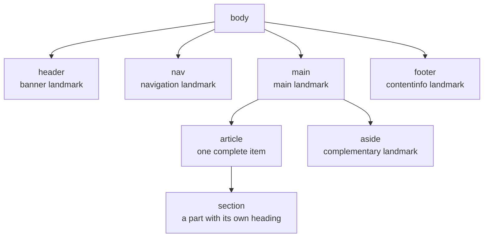
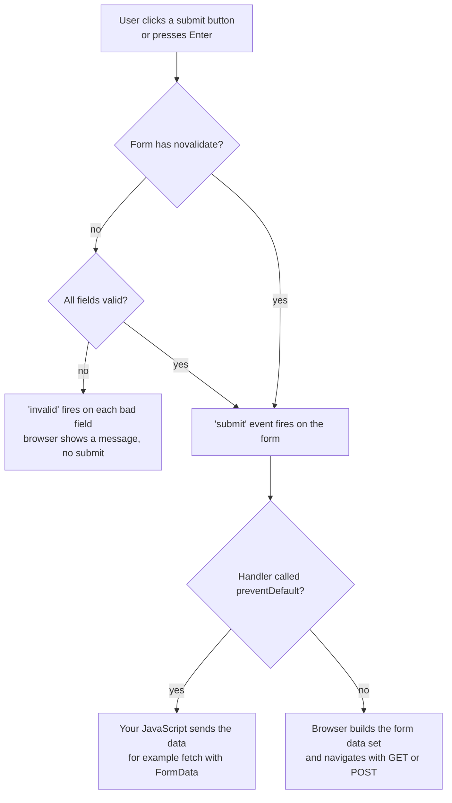
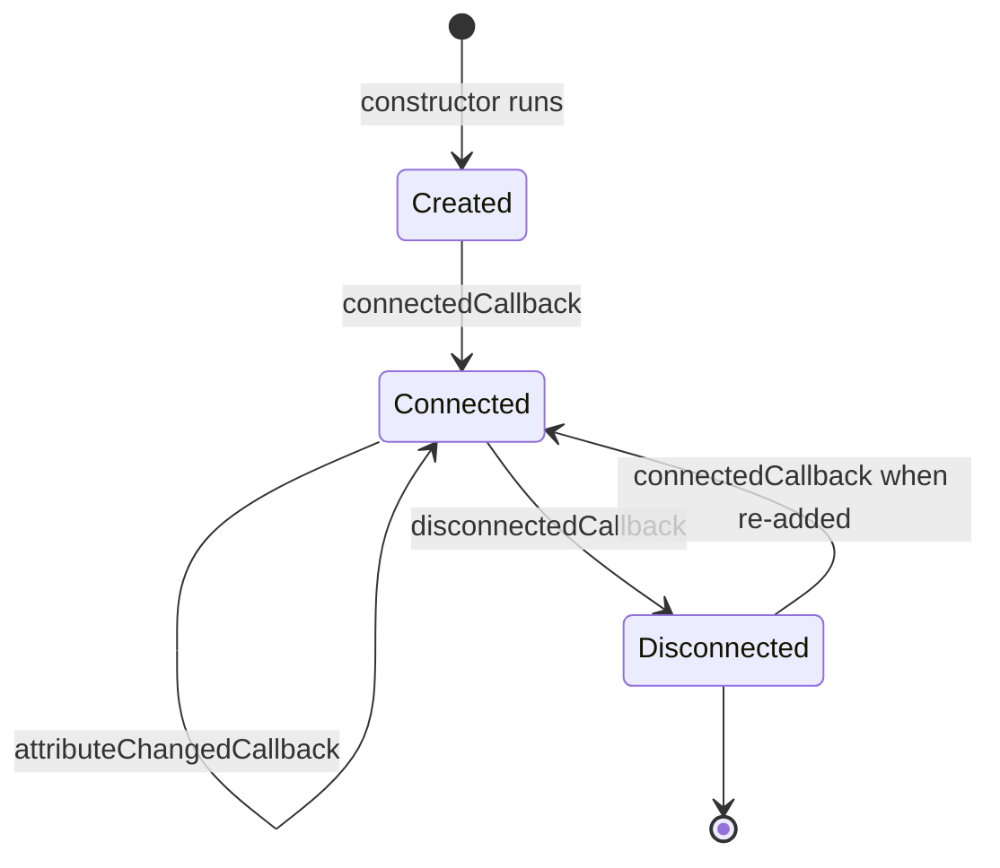

# HTML Semantics and Forms

> In this document you will learn how to write HTML that means something: correct structure, semantic elements, accessible forms, native validation, responsive images, meta tags and modern elements like `<template>` and `<dialog>`. Interviewers use HTML questions to see if you build pages that work for every user, for search engines and for the browser, not only pages that look right.

**Before this:** [Browser architecture and rendering](../01-cs-and-web-fundamentals/07-browser-architecture-and-rendering.md) · **Interview questions:** [jump to questions](#interview-questions)

## Table of contents

1. [How an HTML document is structured](#how-an-html-document-is-structured)
2. [Semantic HTML](#semantic-html)
3. [Headings and the document outline](#headings-and-the-document-outline)
4. [Block and inline elements](#block-and-inline-elements)
5. [Forms](#forms)
6. [Native form validation](#native-form-validation)
7. [Buttons and the default submit pitfall](#buttons-and-the-default-submit-pitfall)
8. [Images and responsive images](#images-and-responsive-images)
9. [Meta tags](#meta-tags)
10. [Script loading attributes](#script-loading-attributes)
11. [Data attributes](#data-attributes)
12. [Iframes and the sandbox attribute](#iframes-and-the-sandbox-attribute)
13. [Escaping and character entities](#escaping-and-character-entities)
14. [Template, dialog and web components](#template-dialog-and-web-components)
15. [How to explain semantic HTML in an interview](#how-to-explain-semantic-html-in-an-interview)
16. [Interview questions](#interview-questions)
17. [Summary](#summary)
18. [References](#references)

---

## How an HTML document is structured

**HTML** (HyperText Markup Language) describes the *content* and *meaning* of a page. CSS describes how it looks. JavaScript adds behavior.

The browser reads HTML text and turns it into the **DOM** (Document Object Model). The DOM is a tree of objects that JavaScript can read and change. You will learn the DOM in [DOM and events](./03-dom-and-events.md).

### The minimal correct page

```html
<!doctype html>
<html lang="en">
  <head>
    <meta charset="utf-8" />
    <meta name="viewport" content="width=device-width, initial-scale=1" />
    <title>Orders - Acme Shop</title>
    <link rel="stylesheet" href="/styles.css" />
    <script src="/app.js" defer></script>
  </head>
  <body>
    <h1>Your orders</h1>
  </body>
</html>
```

Each line has a job:

| Line | What it does |
|---|---|
| `<!doctype html>` | Tells the browser to use **standards mode**. Without it, the browser uses **quirks mode**, an old mode that copies bugs of 1990s browsers (for example a different box model). |
| `<html lang="en">` | The root element. `lang` tells screen readers which voice and pronunciation to use. It also helps translation tools and search engines. |
| `<head>` | Information *about* the page: title, character set, styles, scripts, meta tags. It is not shown as content. |
| `<meta charset="utf-8">` | The text encoding. It must appear in the first 1024 bytes of the file, so put it first in `<head>`. |
| `<meta name="viewport">` | Makes the page use the real device width on phones. Without it, mobile browsers render a ~980px-wide page and zoom it out. |
| `<title>` | Shown in the browser tab, bookmarks and search results. Screen readers read it first when the page opens. |
| `<body>` | Everything the user sees. |

### The browser forgives mistakes, but not always the way you expect

The HTML parser never throws an error. It fixes broken markup using rules from the HTML standard. This is helpful, but it can create a DOM that is different from what you wrote.

```html
<!-- What you wrote -->
<p>Hello <div>block</div> world</p>

<!-- What the browser builds (a <p> cannot contain a <div>) -->
<p>Hello </p><div>block</div> world<p></p>
```

The parser closes the `<p>` when it sees the `<div>`, and the final `</p>` creates a new empty paragraph. If your CSS or JavaScript expects the `<div>` inside the `<p>`, it breaks. Use the [W3C validator](https://validator.w3.org/) or your editor's HTML linting to catch this.

---

## Semantic HTML

### What it is

**Semantic HTML** means choosing the element that describes the *meaning* of the content, not only its look. A `<button>` says "this is a button". A `<div>` says nothing.

### Why it exists

Many programs read your HTML, not only human eyes:

- **Screen readers** and other assistive technology use the meaning to describe the page and to let users jump between parts.
- **Search engines** use headings, links and structure to understand the page.
- **Browsers** give semantic elements free behavior: a `<button>` is focusable and works with the keyboard; an `<a href>` opens in a new tab with a middle click; a `<form>` submits on Enter.
- **Other developers** read the code faster when `<nav>` says "navigation".

### Analogy

Think of a newspaper. Headlines, columns, photo captions and the table of contents all look different *and* have a clear job. A reader can scan it in seconds. A page made only of `<div>` elements is like a newspaper where every line uses the same font and size: the words are there, but nobody can find anything.

### The main semantic (landmark) elements

A **landmark** is a big region of the page that a screen reader user can jump to directly, like "go to main content" or "go to navigation".

| Element | Meaning | Landmark role (when it applies) |
|---|---|---|
| `<header>` | Introductory content for the page or for a section | `banner`, only when it is the page header (not inside `article`, `aside`, `main`, `nav` or `section`) |
| `<nav>` | A block of major navigation links | `navigation` |
| `<main>` | The main content of the page. Only one visible `<main>` per page. | `main` |
| `<article>` | A complete, self-contained item that makes sense alone: a blog post, a product card, a comment | `article` (not a landmark, but a meaningful role) |
| `<section>` | A themed part of a page or article, usually with its own heading | `region`, only when it has an accessible name (for example `aria-labelledby`) |
| `<aside>` | Content related to the main content but separate from it: sidebar, related links | `complementary` |
| `<footer>` | Footer for the page or a section: copyright, contact, related links | `contentinfo`, only when it is the page footer |
| `<search>` | A search or filter area (newer element, supported in all major browsers since 2023) | `search` |

Other useful semantic elements: `<figure>` and `<figcaption>` (an image or chart with a caption), `<time datetime="2026-10-18">` (a machine-readable date), `<address>` (contact info), `<mark>` (highlighted text), `<abbr title="...">`, `<details>` and `<summary>` (a native disclosure widget), `<ul>`/`<ol>`/`<li>` (lists), `<table>` with `<th scope>` (real tabular data).



### Example 1: div soup versus semantic markup

```html
<!-- ❌ Wrong: "div soup". It looks fine with CSS, but means nothing. -->
<div class="header">
  <div class="logo">Acme Shop</div>
  <div class="menu">
    <div class="link" onclick="go('/products')">Products</div>
    <div class="link" onclick="go('/orders')">Orders</div>
  </div>
</div>
<div class="content">
  <div class="title">Your orders</div>
</div>

<!-- ✅ Correct: the same layout, with meaning -->
<header>
  <a href="/" class="logo">Acme Shop</a>
  <nav aria-label="Main">
    <ul>
      <li><a href="/products">Products</a></li>
      <li><a href="/orders" aria-current="page">Orders</a></li>
    </ul>
  </nav>
</header>
<main>
  <h1>Your orders</h1>
</main>
```

What you gain with the second version, without writing any JavaScript:

- The links work with the keyboard (Tab and Enter), open in new tabs, and show the URL on hover.
- A screen reader user can say "jump to navigation" or "jump to main".
- `aria-current="page"` tells assistive technology which link is the current page.
- Search engines can follow the links.

### Example 2: article versus section versus div

```html
<main>
  <h1>Running shoes</h1>

  <!-- Each product card makes sense alone: article -->
  <article class="product-card">
    <h2>TrailRunner 3</h2>
    <p>Lightweight shoe for rough paths.</p>
    <p><data value="129.99">$129.99</data></p>
  </article>

  <!-- A themed part of the page with a heading: section -->
  <section aria-labelledby="reviews-heading">
    <h2 id="reviews-heading">Customer reviews</h2>
    <!-- Each review is self-contained: article -->
    <article>
      <h3>Great grip</h3>
      <p>Posted <time datetime="2026-09-02">2 September 2026</time></p>
    </article>
  </section>

  <!-- A wrapper only for layout: div is correct here -->
  <div class="two-column-grid">...</div>
</main>
```

A simple test:

- **Could you post it alone somewhere else** (RSS feed, another site) and it still makes sense? Use `<article>`.
- **Is it a group of related content with a heading?** Use `<section>`.
- **Is it only for styling or layout?** Use `<div>`. A `<div>` is not bad. It is the right choice when there is no meaning to express.

### Real-world usage

- In Angular, the app shell in `app.component.html` usually holds `<header>`, `<nav>`, `<main>` (containing `<router-outlet>`) and `<footer>`. Component templates use `<article>` for cards and `<section>` for page areas.
- An Angular component's host element (for example `<app-product-card>`) has no meaning by itself. Put semantic elements *inside* the template, or set a role on the host with `host: { role: 'article' }` when it fits.

### Advantages and disadvantages

| Advantages | Disadvantages |
|---|---|
| Free keyboard support, focus and behavior | Some native elements are harder to style (for example `<select>`, date inputs) |
| Better accessibility with no extra code | You must learn which element fits; wrong semantics can be worse than none |
| Better SEO and readable code | Landmark rules have small exceptions (header/footer inside sections) |

### Common mistakes

- Using `<div onclick>` or `<span onclick>` for buttons and links. They are not focusable and do not work with the keyboard.
- Using `<section>` everywhere as a "better div". A section without a heading usually should be a `<div>`.
- Using `<br>` to make space. Use CSS margin.
- Using `<table>` for layout. Tables are for tabular data only.
- Using a heading tag because of its size (`<h4>` because it "looks small"). Choose the heading by level, and style it with CSS.

### Best practices

- **Use the native element first.** It gives behavior and accessibility for free.
- **Use one `<main>` per page.** Screen reader users jump to it.
- **Label repeated landmarks.** If you have two `<nav>` elements, give each an `aria-label` ("Main", "Footer") so users can tell them apart.
- **Use `<a>` for navigation and `<button>` for actions.** A link goes somewhere. A button does something.

---

## Headings and the document outline

Headings `<h1>` to `<h6>` create the outline of the page. Screen reader users often navigate by headings: they open a list of all headings and jump to one. Sighted users scan headings too.

### Rules that matter

1. **Start with one `<h1>`** that describes the page ("Your orders"). More than one `<h1>` is allowed by HTML, but one is the clearest and most common recommendation.
2. **Do not skip levels going down.** After `<h2>`, the next sub-level is `<h3>`, not `<h4>`. Going back up (from `<h4>` to `<h2>`) is fine.
3. **Choose the level by structure, not by size.** Use CSS for the size.

```html
<!-- ❌ Wrong: levels chosen by font size -->
<h1>Acme Shop</h1>
<h4>Your orders</h4>      <!-- skipped h2 and h3 -->
<h2>Order #1001</h2>

<!-- ✅ Correct: levels follow the structure -->
<h1>Your orders</h1>
<h2>Order #1001</h2>
<h3>Items</h3>
<h3>Shipping</h3>
<h2>Order #1002</h2>
```

### The "outline algorithm" myth

Old HTML5 tutorials say that each `<section>` or `<article>` "resets" heading levels, so you can use `<h1>` everywhere. **No browser or screen reader ever implemented this**, and the HTML standard removed the outline algorithm in 2022. Today, an `<h1>` inside a `<section>` is still read as a level-1 heading. Always use the correct level yourself.

---

## Block and inline elements

The browser gives each element a default `display` value through its built-in stylesheet.

| | Block elements | Inline elements |
|---|---|---|
| Examples | `div`, `p`, `h1`-`h6`, `ul`, `li`, `section`, `form`, `table` | `span`, `a`, `strong`, `em`, `code`, `img`, `input`, `label` |
| Start on a new line? | Yes | No, they flow inside the text |
| Width | Fills the parent's width by default | Only as wide as the content |
| `width`/`height` work? | Yes | No (for non-replaced inline elements like `span`) |
| Vertical margin/padding | Pushes other content | Padding is painted but does not push lines apart; vertical margin is ignored |

`inline-block` is a mix: it flows in the line like text, but you can set width, height and vertical margin.

```html
<p>Price: <strong>$20</strong> <a href="/cart">Add to cart</a></p>
<!-- strong and a stay on the same line as the text -->
```

Two important points:

- "Block" and "inline" are **CSS display values**, not a fixed property of the tag. `display: block` on a `<span>` makes it behave like a block. See [CSS layout](./02-css-layout-and-responsive-design.md#display-types).
- HTML has **content models** that say what can go inside what. For example, `<p>` can contain only "phrasing content" (inline-level), which is why the `<div>` inside `<p>` example above breaks. In modern HTML, `<a>` may wrap block content (for example a whole card), as long as there is no interactive element (like a button) inside it.

`` and `<input>` are **replaced elements**. Their content comes from outside the CSS model (an image file, a browser control), so `width` and `height` work on them even though they are inline.

---

## Forms

A **form** collects input from the user and sends it somewhere. Forms are one of the most important parts of HTML for interviews because they mix semantics, accessibility, validation, security and JavaScript.

### A complete, accessible form

```html
<form action="/api/signup" method="post">
  <!-- 1. A visible label connected with for/id -->
  <label for="email">Email</label>
  <input id="email" name="email" type="email" autocomplete="email" required />

  <!-- 2. Hint text connected with aria-describedby -->
  <label for="password">Password</label>
  <input
    id="password"
    name="password"
    type="password"
    autocomplete="new-password"
    minlength="8"
    required
    aria-describedby="password-hint"
  />
  <p id="password-hint">At least 8 characters.</p>

  <!-- 3. A group of radio buttons: fieldset + legend -->
  <fieldset>
    <legend>Plan</legend>
    <label><input type="radio" name="plan" value="free" checked /> Free</label>
    <label><input type="radio" name="plan" value="pro" /> Pro</label>
  </fieldset>

  <!-- 4. A checkbox -->
  <label>
    <input type="checkbox" name="newsletter" value="yes" />
    Send me product news
  </label>

  <button type="submit">Create account</button>
</form>
```

### Labels

A **label** is the visible text that names a field. Connect it in one of two ways:

```html
<!-- Way 1: for + id (works anywhere in the page) -->
<label for="city">City</label>
<input id="city" name="city" />

<!-- Way 2: wrap the input (no id needed) -->
<label>City <input name="city" /></label>
```

Why labels matter:

- Screen readers read the label when the field gets focus. Without it, the user hears only "edit text".
- Clicking the label focuses the field (or toggles a checkbox). This gives a bigger click target, which helps everyone on touch screens.
- Voice-control users say "click City" to focus the field.

```html
<!-- ❌ Wrong: placeholder used as a label -->
<input name="city" placeholder="City" />
<!-- The text disappears when the user types, it often has low contrast,
     and some assistive tools do not treat it as a name. -->

<!-- ✅ Correct: a real label, placeholder only for an example value -->
<label for="city">City</label>
<input id="city" name="city" placeholder="For example: Pune" />
```

### Input types

Choosing the right `type` gives you the correct mobile keyboard, built-in validation and native pickers for free.

| Type | Use for | What you get |
|---|---|---|
| `text` | General text | Default |
| `email` | Email address | Email keyboard on phones, format validation |
| `password` | Passwords | Hidden characters, password manager support |
| `tel` | Phone numbers | Number pad on phones (no format validation, because formats differ by country) |
| `url` | Web addresses | URL keyboard, URL validation |
| `number` | Real quantities (amount, age) | Spinner, `min`/`max`/`step` validation. Do not use it for card numbers or ZIP codes; use `text` with `inputmode="numeric"` |
| `search` | Search boxes | Clear button in some browsers |
| `date`, `time`, `datetime-local`, `month`, `week` | Dates and times | Native pickers |
| `checkbox`, `radio` | Yes/no and one-of-many choices | |
| `range`, `color`, `file`, `hidden` | Slider, color picker, file upload, hidden value | |

Two more attributes help mobile users and password managers:

- **`autocomplete`** tells the browser what the field is: `name`, `email`, `street-address`, `postal-code`, `current-password`, `new-password`, `one-time-code`, `cc-number`. Browsers can then fill it automatically.
- **`inputmode`** chooses the on-screen keyboard without changing validation: `numeric`, `decimal`, `tel`, `email`, `url`, `search`.

### fieldset and legend

Use `<fieldset>` with a `<legend>` to group related fields, especially radio buttons and checkboxes. Screen readers announce the legend with each option: "Plan, group. Free, radio button, checked, 1 of 2".

A `<fieldset disabled>` disables every field inside it in one step. This is useful while a form is saving.

### The name attribute and what gets submitted

Only fields with a `name` are sent. The browser builds a list of name/value pairs called the **form data set**. Some rules surprise people:

| Field state | Is it sent? |
|---|---|
| No `name` attribute | No |
| `disabled` | No |
| `readonly` | Yes |
| Unchecked checkbox or radio | No (nothing is sent, not even "false") |
| Checked checkbox without `value` | Yes, with the value `"on"` |
| `<select multiple>` with 2 options selected | Yes, the same name appears twice |
| Buttons | Only the button that submitted the form, and only if it has a `name` |

### GET versus POST

The `method` attribute decides how the browser sends the data.

```html
<!-- GET: data goes into the URL -->
<form action="/search" method="get">
  <label for="q">Search products</label>
  <input id="q" name="q" type="search" />
  <button>Search</button>
</form>
<!-- Submitting "red shoes & socks" navigates to:
     /search?q=red+shoes+%26+socks -->
```

You can see the same encoding in JavaScript (this runs in Node.js too):

```js
const params = new URLSearchParams({ q: "red shoes & socks", page: "2" });
console.log(params.toString()); // q=red+shoes+%26+socks&page=2
```

| | GET | POST |
|---|---|---|
| Where the data goes | URL query string | Request body |
| Bookmarkable / shareable | Yes | No |
| Shows in browser history and server logs | Yes | No (body is not in the URL) |
| Size limit | Limited by URL length | Large bodies allowed |
| Meaning | Read something, no side effects | Create or change something |
| Typical use | Search, filters, pagination | Login, signup, checkout, upload |

Two more details:

- **`enctype`** decides the body format for POST. The default is `application/x-www-form-urlencoded`. File uploads need `enctype="multipart/form-data"`.
- POST does **not** make data secret. It only keeps it out of the URL. Only HTTPS protects data in transit. See [HTTP, HTTPS and TLS](../01-cs-and-web-fundamentals/05-http-https-and-tls.md).

### FormData: reading a form in JavaScript

In single-page apps you usually stop the normal submission and send the data with `fetch`. **`FormData`** reads all fields of a form using the same rules as the browser.

```html
<form id="profile-form">
  <input name="username" value="asha" />
  <input name="email" value="asha@example.com" disabled />
  <input name="nickname" value="ash" readonly />
  <input value="no-name-field" />
  <input type="checkbox" name="newsletter" value="yes" />
  <input type="checkbox" name="terms" value="accepted" checked />
  <select name="tags" multiple>
    <option value="js" selected>JS</option>
    <option value="ts" selected>TS</option>
    <option value="css">CSS</option>
  </select>
</form>
```

```js
const form = document.getElementById("profile-form");
const data = new FormData(form);

for (const [name, value] of data) {
  console.log(name, value);
}
// username asha
// nickname ash          <- readonly is sent
// terms accepted        <- only the checked checkbox
// tags js
// tags ts               <- multiple values, same name

console.log(data.getAll("tags"));        // ['js', 'ts']
console.log(Object.fromEntries(data));
// { username: 'asha', nickname: 'ash', terms: 'accepted', tags: 'ts' }
// ❗ Object.fromEntries keeps only the LAST value for a repeated name.
```

Notice what is missing: the disabled `email`, the field with no `name`, and the unchecked `newsletter`.

### A realistic submit handler

```js
const form = document.querySelector("#signup-form");
const status = document.querySelector("#form-status"); // <p role="status">

form.addEventListener("submit", async (event) => {
  event.preventDefault(); // stop the full-page navigation

  const submitButton = event.submitter; // the button that was used
  const fieldset = form.querySelector("fieldset");
  fieldset.disabled = true; // prevent double submit

  try {
    const response = await fetch(form.action, {
      method: form.method, // "post"
      body: new FormData(form), // sent as multipart/form-data
    });
    if (!response.ok) throw new Error(`HTTP ${response.status}`);
    status.textContent = "Account created.";
    form.reset();
  } catch (error) {
    status.textContent = "Could not create the account. Please try again.";
  } finally {
    fieldset.disabled = false;
    submitButton?.focus();
  }
});
```

Step by step:

1. The user clicks the submit button or presses Enter in a field.
2. The browser runs native validation. If a field is invalid, it stops here and shows a message (no `submit` event).
3. If all fields are valid, the `submit` event fires on the form.
4. `preventDefault()` stops the normal navigation.
5. `new FormData(form)` collects the fields. Note that the fieldset is disabled *after* this line runs, because disabled fields are not included.
6. `fetch` sends the data. When the body is a `FormData`, the browser sets the `Content-Type: multipart/form-data` header with the correct boundary. Do not set this header yourself.
7. The status paragraph with `role="status"` is announced by screen readers.

If your API expects JSON, convert carefully: `JSON.stringify(Object.fromEntries(new FormData(form)))` works only when no name repeats.

> **Angular note:** In Angular you usually do not read the DOM form directly. Reactive forms keep the values in a `FormGroup`, and you still put real `<label>`, `<fieldset>` and `type="submit"` in the template. See [Angular forms](../06-angular-16/07-forms.md).

### Submitting from JavaScript: submit() versus requestSubmit()

| Method | Runs validation? | Fires `submit` event? |
|---|---|---|
| `form.submit()` | No | No |
| `form.requestSubmit()` | Yes | Yes |

Use `requestSubmit()` when you trigger a submit from code (for example a keyboard shortcut). It behaves like a click on the submit button.



---

## Native form validation

### What it is

Browsers can check form fields before submission, with no JavaScript. You describe the rules with attributes. This is called **constraint validation**.

| Attribute | Rule | `validity` flag when broken |
|---|---|---|
| `required` | Must not be empty | `valueMissing` |
| `type="email"` / `type="url"` | Must match the format | `typeMismatch` |
| `pattern="[A-Z]{3}-[0-9]{3}"` | Must match the regular expression (the whole value) | `patternMismatch` |
| `minlength` / `maxlength` | Text length | `tooShort` / `tooLong` |
| `min` / `max` | Number or date range | `rangeUnderflow` / `rangeOverflow` |
| `step` | Allowed steps (for example `0.01`) | `stepMismatch` |
| (number input with text in it) | Browser could not parse the value | `badInput` |
| `setCustomValidity("message")` | Your own rule | `customError` |

Two details people miss:

- The `pattern` is matched against the **whole** value, as if it had `^` and `$` around it. `ABC-123x` fails the pattern above.
- An empty optional field is valid. `pattern`, `minlength` and `type="email"` do not complain about an empty field. Add `required` if the field must have a value.

### The constraint validation API

Every form field has these properties and methods:

```js
const email = document.querySelector("#email"); // <input type="email" required>

console.log(email.validity.valueMissing); // true  (empty and required)
console.log(email.validity.valid);        // false

email.value = "not-an-email";
console.log(email.validity.typeMismatch); // true
console.log(email.checkValidity());       // false, and fires an 'invalid' event

email.value = "asha@example.com";
console.log(email.validity.valid);        // true
```

| API | What it does |
|---|---|
| `field.validity` | A `ValidityState` object with the flags in the table above and `valid` |
| `field.validationMessage` | The message the browser would show (in the browser's language) |
| `field.checkValidity()` | Returns `true`/`false`. Fires `invalid` on the field if it fails |
| `field.reportValidity()` | Same, and also shows the browser's message bubble to the user |
| `field.setCustomValidity(msg)` | Marks the field invalid with your message. Pass `""` to make it valid again |
| `form.checkValidity()` / `form.reportValidity()` | Check all fields of the form |
| `novalidate` on `<form>` | Turns off the browser's automatic check and bubbles. The API still works |
| `formnovalidate` on a button | Skips validation for this button only (for example "Save draft") |

### Custom rules with setCustomValidity

```js
const password = document.querySelector("#password");
const confirmPassword = document.querySelector("#confirm-password");

confirmPassword.addEventListener("input", () => {
  if (confirmPassword.value !== password.value) {
    confirmPassword.setCustomValidity("Passwords do not match.");
  } else {
    confirmPassword.setCustomValidity(""); // ❗ you must clear it, or it stays invalid forever
  }
});
```

### Styling with :invalid and :user-invalid

```css
/* ❌ Problem: shows red borders as soon as the page loads,
   because empty required fields are already invalid */
input:invalid {
  border-color: crimson;
}

/* ✅ Better: only after the user has interacted with the field
   or tried to submit (supported in all major browsers since late 2023) */
input:user-invalid {
  border-color: crimson;
}
```

### Accessible custom error messages

The browser's bubbles are not styleable and disappear quickly. Many teams use `novalidate`, keep the validation API, and show their own messages. Make them accessible:

```html
<form id="signup-form" novalidate>
  <label for="signup-email">Email</label>
  <input
    id="signup-email"
    name="email"
    type="email"
    required
    aria-describedby="signup-email-error"
  />
  <p id="signup-email-error" class="error" hidden></p>
  <button type="submit">Sign up</button>
</form>
```

```js
const form = document.querySelector("#signup-form");

function showError(field) {
  const errorElement = document.getElementById(`${field.id}-error`);
  if (field.validity.valid) {
    field.removeAttribute("aria-invalid");
    errorElement.hidden = true;
    errorElement.textContent = "";
    return;
  }
  field.setAttribute("aria-invalid", "true");
  errorElement.hidden = false;
  if (field.validity.valueMissing) {
    errorElement.textContent = "Enter your email address.";
  } else if (field.validity.typeMismatch) {
    errorElement.textContent = "Enter an email like name@example.com.";
  }
}

form.addEventListener("submit", (event) => {
  // Inputs only: submit buttons also report willValidate === true, but have no error element
  const fields = [...form.elements].filter((el) => el instanceof HTMLInputElement && el.willValidate);
  fields.forEach(showError);

  const firstInvalid = fields.find((field) => !field.validity.valid);
  if (firstInvalid) {
    event.preventDefault();
    firstInvalid.focus(); // move the user to the first problem
  }
});
```

What makes it accessible:

- `aria-invalid="true"` tells the screen reader the field has an error.
- `aria-describedby` links the error text, so it is read when the field gets focus.
- Focus moves to the first invalid field, so keyboard and screen reader users find the problem.
- The message says how to fix it, not only "Invalid".

More on accessible errors in [Accessibility](./04-accessibility.md#accessible-forms-and-error-messages).

### Native validation is not security

Anyone can remove `required` with DevTools or send a request with `curl`. Native validation is a **user experience** feature. The server must validate everything again. See [Validation and error handling in Node.js](../07-nodejs-backend/08-validation-and-error-handling.md).

---

## Buttons and the default submit pitfall

A `<button>` has a `type` attribute with three values:

| Value | Behavior |
|---|---|
| `submit` | Submits the form it belongs to. **This is the default** when the button is inside a form and has no `type`. |
| `button` | Does nothing by default. Use it for JavaScript actions. |
| `reset` | Resets all fields to their initial values. Rarely useful; users click it by accident. |

### The classic bug

```html
<form id="order-form" action="/orders" method="post">
  <label for="qty">Quantity</label>
  <input id="qty" name="qty" type="number" value="1" />

  <!-- ❌ Wrong: no type, so this is a SUBMIT button -->
  <button id="increase">+1</button>

  <button>Place order</button>
</form>
```

```js
document.querySelector("#increase").addEventListener("click", () => {
  const qty = document.querySelector("#qty");
  qty.value = Number(qty.value) + 1;
  // The page reloads! The click also submitted the form.
});
```

The fix:

```html
<!-- ✅ Correct: say exactly what each button does -->
<button id="increase" type="button">+1</button>
<button type="submit">Place order</button>
```

Some people "fix" this with `event.preventDefault()` in the click handler. It works, but it hides the real problem. Set `type="button"`.

### Pressing Enter submits the form

When focus is in a text field and the user presses Enter, the browser performs **implicit submission**: it acts as if the form's first submit button was clicked. This is why you should use a real `<form>` with a submit button for search boxes and login forms, instead of listening for `keydown` Enter yourself.

### button versus a versus div

- `<button>`: does an action on this page (save, open a menu, delete). It works with Enter and Space.
- `<a href>`: goes to a URL. It works with Enter. It can be opened in a new tab and copied.
- `<div onclick>`: does not get focus, does not work with the keyboard, and has no role. Do not use it as a control. If you really must, see [Accessibility](./04-accessibility.md#accessible-custom-components) for everything you would have to add.

---

## Images and responsive images

### alt text

The `alt` attribute gives a text alternative for an image. Screen readers read it. It is shown when the image fails to load. Search engines use it.

```html
<!-- Informative image: describe what it shows, in context -->


<!-- Functional image (inside a link or button): describe the action -->
<a href="/"></a>

<!-- Decorative image: empty alt, so screen readers skip it -->


<!-- ❌ Wrong: no alt at all. Screen readers may read the file name. -->


<!-- ❌ Wrong: redundant words -->

```

### Prevent layout shift with width and height

```html

```

When `width` and `height` are present, the browser knows the **aspect ratio** before the image downloads, and reserves the space. Without them, the text below jumps down when the image arrives. This jump is measured as **CLS** (Cumulative Layout Shift), one of the Core Web Vitals. CSS like `img { max-width: 100%; height: auto; }` still makes the image responsive. See [Web performance](./05-web-performance-and-core-web-vitals.md).

### srcset and sizes: same image, different sizes

A phone does not need a 2400px-wide image. `srcset` lists several files, and the browser picks the best one.

```html
<!-- Width descriptors (w): the browser picks based on layout width and screen density -->

```

How the browser chooses:

1. It reads `sizes` from left to right. The first media condition that matches gives the image's display width. On a 400px-wide phone, `(max-width: 600px)` matches, so the image will be `100vw` = 400 CSS pixels wide.
2. It multiplies by the device pixel ratio. On a phone with ratio 2, it needs about 800 real pixels.
3. It picks the best candidate from `srcset`: `hero-800.jpg`.
4. `src` is the fallback for very old browsers.

For fixed-size images (like an avatar), use **density descriptors** instead:

```html

```

### picture: different formats or different crops

Use `<picture>` when you need **control**, not just a size choice:

```html
<!-- 1. Modern formats with a fallback -->
<picture>
  <source srcset="/img/hero.avif" type="image/avif" />
  <source srcset="/img/hero.webp" type="image/webp" />
  
</picture>

<!-- 2. Art direction: a different crop on small screens -->
<picture>
  <source media="(max-width: 600px)" srcset="/img/hero-square.jpg" />
  
</picture>
```

The browser uses the first `<source>` that matches (by `type` or `media`). The `` inside is required: it is the element that is actually displayed, and it holds `alt`, `width` and `height`.

| Need | Use |
|---|---|
| Same image, choose the right size | `` |
| Same image, choose the right file format | `<picture>` with `<source type>` |
| Different image or crop on different screens | `<picture>` with `<source media>` |

### Loading hints

```html
<!-- Below the fold: load only when the user scrolls near it -->


<!-- The main (LCP) image: never lazy; tell the browser it is important -->

```

- **`loading="lazy"`** delays the download until the image is close to the viewport. Supported in all major browsers. Do **not** use it for the largest image at the top of the page; it makes LCP slower.
- **`fetchpriority="high"`** raises the download priority (supported in all major browsers since 2024).
- **`decoding="async"`** lets the browser decode the image off the main path of rendering.

For custom lazy loading with `IntersectionObserver`, see [DOM and events](./03-dom-and-events.md#intersectionobserver).

---

## Meta tags

Meta tags live in `<head>`. They give information to browsers, search engines and social networks.

```html
<head>
  <!-- Browser -->
  <meta charset="utf-8" />
  <meta name="viewport" content="width=device-width, initial-scale=1" />
  <meta name="theme-color" content="#0f766e" />

  <!-- Search engines -->
  <title>TrailRunner 3 - Running Shoes | Acme Shop</title>
  <meta name="description" content="Lightweight trail running shoe with strong grip. Free delivery." />
  <link rel="canonical" href="https://shop.example.com/products/trailrunner-3" />
  <meta name="robots" content="index, follow" />

  <!-- Social sharing previews (Open Graph) -->
  <meta property="og:title" content="TrailRunner 3" />
  <meta property="og:description" content="Lightweight trail running shoe with strong grip." />
  <meta property="og:image" content="https://shop.example.com/img/trailrunner-3-share.jpg" />
  <meta property="og:url" content="https://shop.example.com/products/trailrunner-3" />
  <meta property="og:type" content="product" />
  <meta name="twitter:card" content="summary_large_image" />
</head>
```

| Tag | Why it matters |
|---|---|
| `charset` | Without it, special characters (é, ₹, emojis) can show as garbage. |
| `viewport` | Required for responsive design on phones. Do not add `maximum-scale=1` or `user-scalable=no`; they block zoom, which hurts users with low vision. |
| `title` | Search result headline, browser tab, first thing a screen reader reads. Make it unique per page. |
| `description` | Often used as the snippet under the search result. It does not directly change ranking. |
| `canonical` | Tells search engines which URL is the "real" one when the same content has several URLs (for example with tracking parameters). |
| `robots` | `noindex` keeps a page out of search results (for example a staging site or a thank-you page). |
| Open Graph (`og:*`) | The title, text and image shown when someone shares the link in chat apps and social networks. Note `property=`, not `name=`. |
| `theme-color` | Colors the browser UI on some mobile browsers. |

**Single-page apps and meta tags:** social network crawlers usually do not run JavaScript. If your Angular app sets the title with JavaScript only, the share preview shows the empty `index.html` values. That is one reason teams use server-side rendering or pre-rendering for public pages. See [Rendering strategies](./09-rendering-strategies-csr-ssr-ssg.md). In Angular, the `Title` and `Meta` services from `@angular/platform-browser` update these tags.

---

## Script loading attributes

How a `<script>` is loaded changes when the page becomes visible. The full explanation of parsing and rendering lives in [Browser architecture and rendering](../01-cs-and-web-fundamentals/07-browser-architecture-and-rendering.md). Here is the short version:

| Attribute | Download | Runs when | Order kept? |
|---|---|---|---|
| none (`<script src>` in head) | Blocks HTML parsing | Immediately, parsing waits | Yes |
| `defer` | In parallel with parsing | After the HTML is fully parsed, before `DOMContentLoaded` | Yes |
| `async` | In parallel with parsing | As soon as it is downloaded (parsing pauses then) | No |
| `type="module"` | In parallel, like `defer` by default | After parsing | Yes (add `async` to run as soon as ready) |

Rules of thumb:

- Use `defer` (or `type="module"`) for your app code. It does not block rendering and runs in order.
- Use `async` for independent scripts like analytics, where order does not matter.
- `defer` and `async` do nothing on inline scripts (except for modules).

Related `<link>` hints: `rel="preload"` (download an important file early), `rel="preconnect"` (open a connection to another origin early). See [Web performance](./05-web-performance-and-core-web-vitals.md).

---

## Data attributes

### What it is

A **data attribute** is any attribute that starts with `data-`. It stores your own small piece of information on an element, in valid HTML.

```html
<article
  id="product-card"
  class="product-card"
  data-product-id="42"
  data-in-stock="false"
  data-last-viewed-at="2026-01-01"
>
  ...
</article>
```

### Reading and writing with dataset

JavaScript reads them through `element.dataset`. Names change from **kebab-case** in HTML to **camelCase** in JavaScript.

```js
const card = document.getElementById("product-card");

console.log(card.dataset.productId);        // "42"  (a string!)
console.log(typeof card.dataset.productId); // string
console.log(card.dataset.inStock === false); // false, because the value is the string "false"
console.log(card.dataset.inStock === "false"); // true
console.log(card.dataset.lastViewedAt);     // "2026-01-01"

card.dataset.orderCount = 3; // the number is converted to the string "3"
// HTML now has: data-order-count="3"

delete card.dataset.lastViewedAt; // removes the attribute
```

### CSS can use them too

```css
.product-card[data-in-stock="false"] {
  opacity: 0.6;
}
```

### Real-world usage

- **Event delegation:** put `data-action="delete"` and `data-id="42"` on buttons, and one parent listener decides what to do. See [DOM and events](./03-dom-and-events.md#event-delegation).
- **Test selectors:** `data-testid="checkout-button"` gives tests a stable hook that does not change when CSS classes change.
- **Passing config to a script** from server-rendered HTML.

### Common mistakes

- Forgetting that values are always strings. `"false"` is truthy. Convert with `Number(...)` or compare to `"true"`.
- Storing large data or secrets. Everything in the HTML is visible to the user.
- Using them as your app's main state. Keep state in JavaScript (or Angular component state) and render it to the DOM.

---

## Iframes and the sandbox attribute

### What it is

An **`<iframe>`** embeds another web page inside your page: a video player, a map, a payment form, a preview of user content.

```html
<iframe
  src="https://www.youtube-nocookie.com/embed/VIDEO_ID"
  title="Product demo video"
  width="560"
  height="315"
  loading="lazy"
  allow="fullscreen; picture-in-picture"
  referrerpolicy="strict-origin-when-cross-origin"
></iframe>
```

- **`title`** is required for accessibility. Screen readers announce it so users know what the frame contains.
- **`loading="lazy"`** delays loading off-screen frames.
- **`allow`** gives the frame access to powerful features (camera, fullscreen, geolocation) through the Permissions Policy.

### Why sandbox exists

An iframe from another origin is already isolated by the **same-origin policy**: it cannot read your page's DOM or cookies. But it can still run scripts, open popups, submit forms and even navigate your whole tab to a phishing page. The **`sandbox`** attribute removes almost all abilities, and you add back only what you need.

```html
<!-- Everything blocked: no scripts, no forms, no popups,
     treated as a unique "opaque" origin -->
<iframe sandbox src="/user-content/preview/123" title="Post preview"></iframe>

<!-- Allow scripts and forms only -->
<iframe sandbox="allow-scripts allow-forms" src="https://widgets.example.net/poll" title="Poll"></iframe>
```

Common tokens:

| Token | Gives back |
|---|---|
| `allow-scripts` | Running JavaScript |
| `allow-forms` | Submitting forms |
| `allow-popups` | `window.open` and `target="_blank"` |
| `allow-modals` | `alert`, `confirm`, `prompt` |
| `allow-same-origin` | Keeps the frame's real origin (cookies, storage, same-origin access) |
| `allow-top-navigation-by-user-activation` | Navigating the top page, only after a user click |
| `allow-downloads` | Downloads |

### The dangerous combination

```html
<!-- ❌ Wrong: same-origin content with both tokens -->
<iframe sandbox="allow-scripts allow-same-origin" src="/uploads/user-page.html"></iframe>
```

If the framed page is from **your own origin** and has both `allow-scripts` and `allow-same-origin`, its script can reach `parent.document`, find the iframe element and remove the `sandbox` attribute. The sandbox is then useless. For untrusted user content, serve it from a **separate origin** (for example `usercontent.example.com`) and avoid this combination.

### Talking to an iframe safely: postMessage

```js
// Parent page sends a message to a known origin only
const frame = document.querySelector("#payment-frame");
frame.contentWindow.postMessage({ type: "set-amount", amount: 49.99 }, "https://pay.example.com");

// Parent page receives messages
window.addEventListener("message", (event) => {
  if (event.origin !== "https://pay.example.com") return; // ✅ always check the sender
  if (event.data?.type === "payment-complete") {
    showReceipt(event.data.orderId);
  }
});
```

```js
// ❌ Wrong: "*" sends the data to whatever page is in the frame right now,
// and a missing origin check accepts messages from any window
frame.contentWindow.postMessage({ token: authToken }, "*");
window.addEventListener("message", (event) => handle(event.data));
```

### Protecting your own page from being framed

To stop other sites from putting *your* page in an iframe (clickjacking), the server sends `Content-Security-Policy: frame-ancestors 'self'` (or the older `X-Frame-Options: DENY`). Details in [Web security](../10-testing-security-production/05-web-security-xss-csrf-cors-csp.md).

---

## Escaping and character entities

### What it is

Some characters have special meaning in HTML. `<` starts a tag. `&` starts an entity. `"` ends an attribute value. To show them as text, you write a **character entity** (also called a character reference).

| Character | Entity | Why |
|---|---|---|
| `<` | `&lt;` | Would start a tag |
| `>` | `&gt;` | Closes a tag (escape it for safety and clarity) |
| `&` | `&amp;` | Would start an entity |
| `"` | `&quot;` | Would end a double-quoted attribute |
| `'` | `&#39;` | Would end a single-quoted attribute |
| non-breaking space | `&nbsp;` | A space that does not allow a line break ("10&nbsp;km") |
| © | `&copy;` | Easier to type |

```html
<p>Use the &lt;button&gt; element, not &lt;div&gt;.</p>
<!-- Shows: Use the <button> element, not <div>. -->

<p>Tom &amp; Jerry</p>
<!-- Shows: Tom & Jerry -->
```

With `<meta charset="utf-8">`, you can type most characters (é, ₹, —) directly. You only *need* entities for the special characters above.

### Why escaping is a security topic

If you put user text into HTML without escaping, the user can inject tags and scripts. This is **XSS** (Cross-Site Scripting).

```js
const comment = '';

// ❌ Wrong: the string is parsed as HTML, the onerror script runs
commentBox.innerHTML = comment;

// ✅ Correct: the string is treated as plain text
commentBox.textContent = comment;
```

If you must build an HTML string (for example in a small template on the server), escape it first. This function runs in Node.js:

```js
function escapeHtml(text) {
  return String(text)
    .replaceAll("&", "&amp;") // must be first, or you would double-escape the others
    .replaceAll("<", "&lt;")
    .replaceAll(">", "&gt;")
    .replaceAll('"', "&quot;")
    .replaceAll("'", "&#39;");
}

console.log(escapeHtml(''));
// &lt;img src=x onerror=&quot;alert(1)&quot;&gt;
console.log(escapeHtml("Tom & Jerry"));
// Tom &amp; Jerry
```

Escaping for HTML text is **not** enough everywhere. Inside a URL (`href="javascript:..."`), inside a `<script>` block, or inside CSS, the rules are different. The safest rule: use framework bindings (Angular `{{ }}` and property bindings escape and sanitize for you), `textContent`, and `setAttribute` for plain values. For full XSS defense see [Web security](../10-testing-security-production/05-web-security-xss-csrf-cors-csp.md) and [Angular security](../06-angular-16/15-security.md).

---

## Template, dialog and web components

### The template element

**What it is:** `<template>` holds HTML that the browser parses but does **not** render. Its content is **inert**: images do not load, scripts do not run, it is not in the accessibility tree. You clone it from JavaScript when you need it.

```html
<template id="order-row-template">
  <li class="order-row">
    <span class="order-id"></span>
    <span class="order-total"></span>
  </li>
</template>
<ul id="order-list"></ul>
```

```js
const template = document.getElementById("order-row-template");
const list = document.getElementById("order-list");

const orders = [
  { id: "A-1001", total: 49.5 },
  { id: "A-1002", total: 12 },
];

for (const order of orders) {
  // template.content is a DocumentFragment; cloneNode(true) copies all children
  const row = template.content.cloneNode(true);
  row.querySelector(".order-id").textContent = order.id;
  row.querySelector(".order-total").textContent = `$${order.total.toFixed(2)}`;
  list.append(row);
}
```

**Why not a hidden `<div>`?** A hidden div is still in the DOM: its images download, `querySelector` finds its elements, IDs inside it can clash, and scripts inside it run. A template is truly inert. Angular's `<ng-template>` follows the same idea: it is not rendered until a directive like `*ngIf` creates a view from it.

### The dialog element

**What it is:** `<dialog>` is a native modal or non-modal popup. It has been supported in all major browsers since March 2022.

```html
<button type="button" id="open-delete-dialog">Delete order</button>

<dialog id="delete-dialog" aria-labelledby="delete-title">
  <h2 id="delete-title">Delete order A-1001?</h2>
  <p>This cannot be undone.</p>
  <form method="dialog">
    <button value="cancel" autofocus>Cancel</button>
    <button value="confirm">Delete</button>
  </form>
</dialog>
```

```js
const dialog = document.getElementById("delete-dialog");

document.getElementById("open-delete-dialog").addEventListener("click", () => {
  dialog.returnValue = ""; // reset: Escape does not change returnValue (see below)
  dialog.showModal(); // modal: blocks the rest of the page
});

dialog.addEventListener("close", () => {
  // returnValue is the value of the button that closed it.
  // Escape does NOT change it, so it keeps the old value. That is why we reset it before opening.
  if (dialog.returnValue === "confirm") {
    deleteOrder("A-1001");
  }
});
```

What `showModal()` gives you for free:

| Feature | Detail |
|---|---|
| Top layer | Shows above everything. No z-index fights. |
| Backdrop | Style it with `dialog::backdrop { background: rgb(0 0 0 / 0.5); }` |
| Inert page | Everything outside the dialog cannot be clicked or focused. |
| Focus moves in | Focus goes to the element with `autofocus`, or the first focusable element. |
| Escape closes it | Fires a `cancel` event, then `close`. |
| Focus returns | The HTML standard tells the browser to return focus to the element that was focused before. Current browsers do this, but test it. |
| `<form method="dialog">` | Submitting this form closes the dialog and sets `returnValue`. No request is sent. |

`dialog.show()` opens it **non-modal** (the page stays interactive, no backdrop, no Escape). `dialog.close("value")` closes it from code.

> **Newer features:** The `popover` attribute (supported in all major browsers since January 2025) makes lightweight popups like menus and tooltips with light-dismiss. The `closedby` attribute on `<dialog>` (for example `closedby="any"` to close on outside click) is newer and not yet in every browser; check support before using it.

For a full accessible modal (focus trap, labels, Angular CDK), see [Accessibility](./04-accessibility.md#modals-and-focus-traps).

### Web components

**What they are:** **Web components** are a set of browser standards for making your own reusable HTML elements that work in any framework or none:

1. **Custom elements:** define a new tag like `<user-badge>` with a JavaScript class.
2. **Shadow DOM:** a private DOM tree inside an element. Styles inside do not leak out, and page styles do not leak in.
3. **`<template>` and `<slot>`:** markup to clone, and places where the user's content goes.

```js
class UserBadge extends HTMLElement {
  // Attributes to watch for changes
  static observedAttributes = ["name", "status"];

  constructor() {
    super();
    // Create a private shadow tree
    this.attachShadow({ mode: "open" });
  }

  connectedCallback() {
    // Runs when the element is added to the page
    this.render();
  }

  attributeChangedCallback(name, oldValue, newValue) {
    // Runs when a watched attribute changes
    if (oldValue !== newValue) this.render();
  }

  disconnectedCallback() {
    // Runs when the element is removed: clean up timers and listeners here
  }

  render() {
    const name = this.getAttribute("name") ?? "Guest";
    const status = this.getAttribute("status") ?? "offline";
    this.shadowRoot.innerHTML = `
      <style>
        :host { display: inline-flex; gap: 0.5rem; align-items: center; }
        .dot { width: 0.5rem; height: 0.5rem; border-radius: 50%; background: gray; }
        :host([status="online"]) .dot { background: green; }
      </style>
      <span class="dot" aria-hidden="true"></span>
      <span class="name"></span>
      <slot></slot>
    `;
    // Insert user-controlled text safely, never inside the template string
    this.shadowRoot.querySelector(".name").textContent = `${name} (${status})`;
  }
}

// The name MUST contain a hyphen, so it never clashes with future HTML tags
customElements.define("user-badge", UserBadge);
```

```html
<user-badge name="Asha" status="online">
  <small>Admin</small>  <!-- goes into the <slot> -->
</user-badge>
```



Details about the lifecycle:

- `attributeChangedCallback` can run *before* `connectedCallback` when the element is created from HTML with attributes already set. Write `render()` so it can run at any time.
- `disconnectedCallback` is your cleanup place, like `ngOnDestroy` in Angular.
- `mode: "open"` lets outside code reach `element.shadowRoot`. `mode: "closed"` hides it, but it is not a security boundary.

Shadow DOM styling tools:

- `:host` styles the custom element itself, from inside.
- `::part(name)` lets the outside page style an inner element that has `part="name"`.
- CSS custom properties (variables) *do* pass into the shadow tree. This is the normal way to theme web components.
- Events from inside the shadow DOM are **retargeted**: outside listeners see the host element as `event.target`.

**When to use web components:**

| Good fit | Poor fit |
|---|---|
| A design system shared by Angular, React and plain pages | An app built entirely in one framework (use its components) |
| Widgets embedded in other people's sites | Complex forms (form integration needs extra work with `ElementInternals`) |
| Micro-frontends with different frameworks | Server-rendered pages that need content without JavaScript (declarative shadow DOM helps, but adds complexity) |

> **Angular note:** Angular can compile an Angular component into a custom element with `createCustomElement()` from `@angular/elements`. Angular can also use the browser's Shadow DOM for a component with `encapsulation: ViewEncapsulation.ShadowDom`. See [Components and templates](../06-angular-16/02-components-and-templates.md).

---

## How to explain semantic HTML in an interview

1. **Define it:** "Semantic HTML means I choose elements by what the content *is*, not how it looks. A button is a `<button>`, navigation is a `<nav>`, the main content is in `<main>`."
2. **Why it exists:** "Browsers, screen readers and search engines read the meaning. They give semantic elements behavior and roles for free."
3. **How it works:** "Each element maps to a role in the accessibility tree. `<nav>` becomes a navigation landmark. `<button>` is focusable and responds to Enter and Space. Headings build an outline that users can jump through."
4. **Small example:** "If I make a button from a `<div>`, I must add `tabindex`, a role, and key handlers for Enter and Space. With `<button type="button">` I get all of that for free."
5. **Where it is useful:** "Every page. In Angular I put landmarks in the app shell, use real labels in forms, and use `<a routerLink>` for navigation and `<button>` for actions."
6. **Trade-offs / gotchas:** "Some native controls are hard to style, so teams build custom ones. Then they must rebuild keyboard support and ARIA correctly. A `<div>` is still fine for pure layout."

---

## Interview questions

### Q1. What is semantic HTML, and why does it matter?

**What the interviewer is checking:** Whether you know that HTML carries meaning for machines (assistive technology, search engines, browsers), not only structure for styling.

**Short spoken answer (30–60 seconds):**
> Semantic HTML means using the element that matches the meaning of the content. I use `<button>` for actions, `<a>` for navigation, `<nav>`, `<main>`, `<header>` and `<footer>` for page regions, and headings in the right order. It matters because many things read the HTML, not just people. Screen readers use the roles to describe the page and to let users jump to the main content or between headings. Browsers give built-in behavior, like keyboard support on buttons and Enter-to-submit on forms. Search engines understand the page better. And the code is easier to read. A `<div>` is still fine when there is no meaning, for example a layout wrapper.

**Detailed explanation:**
Each semantic element has an implicit ARIA role that the browser exposes in the accessibility tree. `<nav>` maps to `navigation`, `<main>` to `main`, `<button>` to `button`, `<h2>` to `heading` level 2. Interactive elements also come with focus handling and keyboard behavior. When you use a generic element, you must add all of this yourself, and it is easy to forget a piece.

**Follow-up questions:**
- **Is `<div>` bad?** — No. A `<div>` has no meaning, which is exactly right for layout wrappers and styling hooks. The problem is using it for things that do have meaning, like buttons or lists.
- **What is a landmark?** — A large region of the page that assistive technology lets users jump to: banner, navigation, main, complementary, contentinfo, search, form and region. HTML elements create them automatically (`<main>` → main).
- **Does semantic HTML help SEO?** — It helps search engines understand the content: headings, links with good text, `<title>`, and structured content. It is one factor among many, not a magic ranking boost.

**Common mistakes:** Saying it is "only for SEO", or "only for clean code". Not mentioning accessibility and built-in behavior.

**Where this is used in real projects:** App shells (`<header>`, `<nav>`, `<main>`), cards as `<article>`, forms with labels, data tables with `<th>`.

---

### Q2. What is the difference between div, section and article?

**What the interviewer is checking:** Whether you can choose elements by meaning, with a clear rule.

**Short spoken answer (30–60 seconds):**
> A `<div>` has no meaning; I use it only for layout or styling. A `<section>` is a themed part of a page, and it should normally have a heading. An `<article>` is a self-contained piece that makes sense alone, like a blog post, a product card or a comment. My test is: could I take this piece and show it somewhere else on its own? If yes, it is an article. If it is a group of related content under a heading, it is a section. If it is just a box for CSS, it is a div. Also, a section becomes a "region" landmark only when it has an accessible name, for example with `aria-labelledby` pointing to its heading.

**Follow-up questions:**
- **Can an article contain sections, and a section contain articles?** — Yes, both. A blog post (`article`) can have sections for its parts. A "Latest posts" section can contain several articles.
- **Should every section have a heading?** — In practice, yes. If you have no heading for it, it is probably a `<div>`.

**Common mistakes:** Treating `<section>` as a "better div" and wrapping everything in it.

**Where this is used in real projects:** Product grids (articles), dashboard panels (sections with headings), comment threads (nested articles).

---

### Q3. A user clicks a "+1" button in a form and the page reloads. Why?

**What the interviewer is checking:** Knowledge of the default button type, and debugging skill.

**Short spoken answer (30–60 seconds):**
> A `<button>` inside a form defaults to `type="submit"`. So clicking the "+1" button runs the click handler and then also submits the form, which navigates and reloads the page. The fix is to write `type="button"` on any button that is not meant to submit. I write the type on every button explicitly, so the intent is clear. Calling `preventDefault()` in the click handler also stops it, but that hides the real cause, so I prefer the correct type.

**Code:**

```html
<!-- ❌ Wrong -->
<button id="increase">+1</button>
<!-- ✅ Correct -->
<button id="increase" type="button">+1</button>
```

**Follow-up questions:**
- **What happens when the user presses Enter in a text field of that form?** — Implicit submission: the browser clicks the form's *first* submit button. If the "+1" button is first and has no type, pressing Enter increases the quantity instead of placing the order. Another reason to set types.
- **Does a button outside a form submit anything?** — No, unless it has a `form="form-id"` attribute that links it to a form.
- **In Angular, does `(ngSubmit)` stop the reload?** — Yes. When `FormsModule` or `ReactiveFormsModule` is imported, Angular's form directive handles the `submit` event and the page does not navigate. But the "+1" button would still trigger `ngSubmit`, so you still need `type="button"`.

**Common mistakes:** Adding `return false` or `preventDefault` everywhere without understanding the default type.

**Where this is used in real projects:** Every form with extra buttons: quantity steppers, "show password" toggles, "add another address" buttons.

---

### Q4. What is the difference between GET and POST for form submission?

**What the interviewer is checking:** HTTP semantics and how forms map to requests.

**Short spoken answer (30–60 seconds):**
> With GET, the browser puts the form fields into the URL as a query string, like `/search?q=shoes`. The result can be bookmarked and shared, and it is meant for reading data without side effects, like search and filters. With POST, the fields go in the request body. I use it for actions that change something, like login, signup or checkout. POST is not encrypted by itself. It only keeps the data out of the URL, browser history and most logs. HTTPS is what protects the data. For file uploads I need POST with `enctype="multipart/form-data"`.

**Follow-up questions:**
- **Why should a login form never use GET?** — The password would appear in the URL. URLs end up in browser history, server and proxy logs, and the `Referer` header.
- **What happens if the user refreshes after a POST?** — The browser asks to resend the form, which can create a duplicate order. The common fix is the **Post/Redirect/Get** pattern: the server answers a POST with a redirect (303) to a GET page.
- **What is the default method?** — GET. And the default `action` is the current URL.

**Common mistakes:** Saying POST is "secure" or "encrypted".

**Where this is used in real projects:** Search pages and filter panels (GET, so the URL is shareable), all data-changing forms (POST, or `fetch` with POST/PUT/PATCH).

---

### Q5. How does native form validation work, and how do you show your own error messages?

**What the interviewer is checking:** Knowledge of the constraint validation API and accessible error handling.

**Short spoken answer (30–60 seconds):**
> I describe rules with attributes like `required`, `type="email"`, `pattern`, `minlength` and `min`. Before submitting, the browser checks them. If something fails, it fires an `invalid` event, shows a message and does not fire `submit`. From JavaScript I can read `field.validity` to see which rule failed, like `valueMissing` or `typeMismatch`, and call `checkValidity()` or `reportValidity()`. For custom rules, like "passwords must match", I call `setCustomValidity` with a message and clear it with an empty string. If I want my own styled messages, I add `novalidate` to the form, keep using the API, show the message in an element linked with `aria-describedby`, set `aria-invalid`, and move focus to the first invalid field. And I always validate again on the server.

**Detailed explanation:** See [Native form validation](#native-form-validation) above. Key points: empty optional fields are valid; `pattern` matches the whole value; `setCustomValidity` must be cleared; `:user-invalid` avoids red fields on page load.

**Follow-up questions:**
- **What is the difference between `checkValidity()` and `reportValidity()`?** — Both return a boolean and fire `invalid` on failing fields. `reportValidity()` also shows the browser's message to the user.
- **Why do red borders appear on page load with `:invalid`?** — Required fields are invalid while empty, before the user does anything. Use `:user-invalid` instead.
- **Does `minlength` fail when JavaScript sets a short value?** — No. `tooShort` and `tooLong` apply only to values the user edited, so `input.value = "abc"` does not make `tooShort` true.
- **Is client-side validation enough?** — Never. It is for user experience. Anyone can bypass it, so the server validates everything.

**Common mistakes:** Forgetting to clear `setCustomValidity("")`; relying on client validation for security; error messages that are not connected to the field.

**Where this is used in real projects:** Plain HTML forms, and also Angular: Angular adds `novalidate` to forms automatically and uses its own validators (`Validators.required`, `Validators.email`), but the accessibility rules for showing errors are the same.

---

### Q6. What does this code print?

```html
<form id="profile">
  <input name="username" value="asha" />
  <input name="email" value="asha@example.com" disabled />
  <input name="nickname" value="ash" readonly />
  <input value="no-name-field" />
  <input type="checkbox" name="newsletter" value="yes" />
  <input type="checkbox" name="terms" value="accepted" checked />
  <input type="radio" name="plan" value="free" />
  <input type="radio" name="plan" value="pro" checked />
</form>
<script>
  const data = new FormData(document.getElementById("profile"));
  console.log([...data.keys()].join(", "));
</script>
```

**Answer:**

```text
username, nickname, terms, plan
```

**Why, step by step:**

1. `username` has a name and is enabled: included.
2. `email` is `disabled`: disabled fields are never submitted.
3. `nickname` is `readonly`: readonly fields **are** submitted.
4. The field without `name` is skipped.
5. `newsletter` is not checked: unchecked checkboxes send nothing.
6. `terms` is checked: included with value `accepted`.
7. For the radio group `plan`, only the checked radio (`pro`) is included.

(Verified with jsdom, which follows the HTML standard's form data rules.)

**Follow-up questions:**
- **How do you send "false" for an unchecked checkbox?** — HTML does not. Either treat a missing field as false on the server, or add a hidden input with the same name before the checkbox and handle duplicates, or build the payload yourself in JavaScript (`checkbox.checked`).
- **How do you disable fields while saving but still send them?** — Read `new FormData(form)` first, then disable. Or use `readonly` for text fields.

---

### Q7. Why do form fields need labels? What are the ways to label a field?

**What the interviewer is checking:** Accessibility basics and accessible names.

**Short spoken answer (30–60 seconds):**
> A label gives the field its accessible name. When a screen reader focuses the field, it reads the label, so the user knows what to type. Clicking the label also focuses the field or toggles the checkbox, which gives a bigger target on touch screens. Voice-control users can say the label to focus the field. The best way is a visible `<label>` connected with `for` and the input's `id`, or a label that wraps the input. If there is truly no visible text, like a search icon button, I use `aria-label` or `aria-labelledby`. A placeholder is not a label, because it disappears when you type and often has poor contrast.

**Follow-up questions:**
- **When do you use fieldset and legend?** — For a group of related controls, especially radio buttons and checkboxes. The legend is the group's name, like the question "Plan", and each label names one option.
- **What is `aria-describedby` for?** — Extra description such as hints or error text. It is read after the name. It does not replace the label.

**Common mistakes:** Using only placeholders; using `<div>` text near the input with no connection; duplicate IDs breaking `for`.

**Where this is used in real projects:** Every form. In Angular templates, each `formControlName` input should still have a `<label for>`; the `@angular-eslint` template accessibility rules can flag missing labels.

---

### Q8. Explain srcset, sizes and the picture element. When do you use each?

**What the interviewer is checking:** Responsive images and performance awareness.

**Short spoken answer (30–60 seconds):**
> `srcset` gives the browser a list of the same image at different widths, like 400w, 800w and 1600w. `sizes` tells the browser how wide the image will be displayed at different screen sizes, for example full width on phones and half width on desktop. The browser combines that with the screen's pixel density and downloads the smallest file that looks sharp. I use `<picture>` when I need control: to offer modern formats like AVIF and WebP with a JPEG fallback, or to show a different crop on small screens, which is called art direction. I always include `width` and `height` on the image so the browser reserves space and the layout does not shift.

**Follow-up questions:**
- **What happens without `sizes`?** — With `w` descriptors, `sizes` defaults to `100vw`, so the browser assumes the image is full width and may download a much bigger file than needed.
- **Why is the `` inside `<picture>` required?** — It is the element that is actually displayed. `<source>` elements only provide candidate URLs. The `` also holds `alt`, `width` and `height`.
- **Should the hero image use `loading="lazy"`?** — No. Lazy loading delays the most important image and makes LCP worse. Use `fetchpriority="high"` for it instead.

**Common mistakes:** One huge image for all devices; lazy-loading the hero image; missing dimensions causing layout shift.

**Where this is used in real projects:** E-commerce product images, hero banners, CMS-driven content. Angular has `NgOptimizedImage` (the `ngSrc` directive, stable since Angular 15) that generates `srcset`, warns about missing dimensions and sets priority hints.

---

### Q9. How do you write good alt text?

**Short answer:** Describe the purpose of the image in its context, briefly. For an informative image, say what it shows that matters ("Bar chart: sales doubled in Q3"). For an image inside a link or button, describe the action or destination ("Acme Shop home"). For a decorative image, use `alt=""` so screen readers skip it. Never leave `alt` out completely, and do not start with "image of", because screen readers already say "image". Complex images like charts also need the data in text nearby or in a linked table.

---

### Q10. What is the difference between `defer`, `async` and `type="module"` on a script?

**Short answer:** All three download the script without blocking HTML parsing. `defer` runs scripts after the whole document is parsed, in the order they appear, before `DOMContentLoaded`. `async` runs each script as soon as it finishes downloading, in any order, which suits independent scripts like analytics. `type="module"` scripts are deferred by default and also run in strict mode with their own module scope. A plain `<script src>` in the head blocks parsing until it downloads and runs. Full details: [Browser architecture and rendering](../01-cs-and-web-fundamentals/07-browser-architecture-and-rendering.md).

---

### Q11. Which meta tags are important, and why?

**What the interviewer is checking:** Practical knowledge for mobile, SEO and sharing.

**Short spoken answer (30–60 seconds):**
> First, `charset="utf-8"`, placed at the top of the head so characters display correctly. Second, the viewport meta, `width=device-width, initial-scale=1`, without which phones render the page at a desktop width and zoom out. I never block zooming with `user-scalable=no`, because people with low vision need it. For search, a unique `<title>`, a meta description that is often used as the search snippet, and a canonical link when the same page has several URLs. For sharing in chat apps and social networks, the Open Graph tags like `og:title`, `og:image` and `og:url`. In a single-page app, I keep in mind that most share crawlers do not run JavaScript, so those tags need server-side rendering or pre-rendering to be correct per page.

**Follow-up questions:**
- **Does meta keywords help?** — Major search engines ignore it today.
- **How do you set the title in Angular?** — With the `Title` service, or the `title` property in route definitions (Angular 14+), optionally with a custom `TitleStrategy`.

**Common mistakes:** Same title on every page; blocking zoom; expecting client-rendered OG tags to work for crawlers.

---

### Q12. What are data attributes, and what should you watch out for?

**Short answer:** Attributes that start with `data-` store custom information on an element. JavaScript reads them with `element.dataset`, where `data-product-id` becomes `dataset.productId`. The values are always strings, so `data-in-stock="false"` is the truthy string `"false"`; convert it. They are useful for event delegation (`data-action`, `data-id`), CSS hooks and stable test selectors (`data-testid`). Do not store secrets or large data in them, because everything in the HTML is visible, and do not use them as the main application state.

```js
// <button data-action="delete" data-order-id="1001">
button.dataset.orderId;          // "1001" (string)
Number(button.dataset.orderId);  // 1001
```

---

### Q13. What does the iframe `sandbox` attribute do? What is the risk of `allow-scripts allow-same-origin`?

**What the interviewer is checking:** Browser security model knowledge.

**Short spoken answer (30–60 seconds):**
> An empty `sandbox` attribute removes almost every ability from the framed page: no scripts, no forms, no popups, no top-level navigation, and it gets a unique opaque origin, so it cannot use cookies or storage of its real origin. Then I add back only what I need with tokens like `allow-scripts` or `allow-forms`. The dangerous case is `allow-scripts` together with `allow-same-origin` when the content comes from my own origin. Then the script inside runs with my origin, can reach the parent document, and can simply remove the sandbox attribute from its own iframe. So for untrusted user content, I serve it from a separate domain and keep the sandbox strict.

**Follow-up questions:**
- **How do the parent and iframe talk safely?** — With `postMessage`. The sender passes an exact target origin instead of `"*"`, and the receiver checks `event.origin` and validates `event.data`.
- **How do you prevent your site from being framed?** — Server header `Content-Security-Policy: frame-ancestors 'self'` (or `X-Frame-Options`). This prevents clickjacking.
- **What else should every iframe have?** — A `title` for screen readers, and usually `loading="lazy"` if it is below the fold.

**Common mistakes:** Thinking the same-origin policy alone is enough; using `"*"` as postMessage target with sensitive data.

**Where this is used in real projects:** Previews of user-generated HTML, embedded third-party widgets, payment provider frames, Electron apps showing remote content.

---

### Q14. How do you safely display user-provided text in HTML?

**What the interviewer is checking:** XSS awareness at the HTML level.

**Short spoken answer (30–60 seconds):**
> I treat user text as text, never as HTML. In the DOM I use `textContent` or framework bindings. Angular's interpolation escapes values automatically, and its `[innerHTML]` binding sanitizes them. If I build an HTML string, I escape the special characters: ampersand first, then less-than, greater-than and both quotes. Escaping depends on the context though. Escaping for HTML text does not protect a URL in an `href`, because `javascript:` URLs are still dangerous, and it does not protect code inside a script block. If I truly need user HTML, like rich text comments, I use a well-tested sanitizer such as DOMPurify, and I add a Content Security Policy as a second layer.

**Code:** see the `escapeHtml` function in [Escaping and character entities](#escaping-and-character-entities).

**Follow-up questions:**
- **Why must `&` be replaced first?** — Otherwise the `&` inside the `&lt;` you just created would become `&amp;lt;`, and the text would show `&lt;` literally.
- **Is `innerText` safe?** — Assigning `innerText` sets text, not HTML, so it does not parse tags. `textContent` is still preferred because it is faster and does not depend on CSS layout.

**Common mistakes:** Writing a regex "sanitizer"; escaping only `<` and `>`; forgetting attribute contexts.

---

### Q15. What is the template element, and why use it instead of a hidden div?

**Short answer:** `<template>` contains HTML that is parsed but not rendered. Its content is inert: images do not load, scripts do not run, and `document.querySelector` does not find elements inside it. You clone `template.content` (a `DocumentFragment`) and insert the copy. A hidden `<div>` is a real part of the DOM, so its images load, its IDs can clash and its scripts run. Angular's `<ng-template>` and web component templates follow the same idea.

---

### Q16. When would you use the native dialog element instead of a custom modal?

**What the interviewer is checking:** Modern HTML knowledge and accessibility trade-offs.

**Short spoken answer (30–60 seconds):**
> I prefer the native `<dialog>` with `showModal()` for most modals now, because it gives a lot for free. It renders in the top layer, so there are no z-index problems. It makes the rest of the page inert, so users cannot click or tab to things behind it. It moves focus inside, closes on Escape with a `cancel` event, and returns focus to the element that opened it. A `<form method="dialog">` inside closes it and sets `returnValue`. I still give it an accessible name with `aria-labelledby` and test it with a keyboard and screen reader. A custom modal or a library like the Angular CDK dialog makes sense when I need features the native element does not give, or when the design system already provides one.

**Follow-up questions:**
- **What is the difference between `show()` and `showModal()`?** — `show()` opens it non-modal: no backdrop, the page stays interactive, Escape does not close it. `showModal()` is modal.
- **How do you style the dark overlay?** — With the `::backdrop` pseudo-element.
- **How do you know which button closed it?** — Read `dialog.returnValue` in the `close` event. Buttons inside a `method="dialog"` form set it to their `value`. Escape does **not** change it: it keeps its previous value. So reset it (`dialog.returnValue = ""`) before each `showModal()`, or a second opening closed with Escape would repeat the last action.

**Common mistakes:** Opening it with the `open` attribute (that makes it non-modal, with no focus management); no accessible name.

**Where this is used in real projects:** Confirm-delete dialogs, settings panels, image lightboxes.

---

### Q17. What are web components? Would you use them in an Angular project?

**What the interviewer is checking:** Understanding of browser-native components and architecture judgment.

**Short spoken answer (30–60 seconds):**
> Web components are browser standards for building reusable elements. Custom elements let me define a tag like `<user-badge>` with a class that extends `HTMLElement`, with lifecycle callbacks such as `connectedCallback` and `attributeChangedCallback`. Shadow DOM gives the element a private DOM tree, so its styles do not leak out and page styles do not leak in. Templates and slots handle the markup and the user's content. Their strength is that they work in any framework or none. Inside a pure Angular app I would use Angular components, because I get data binding, DI and change detection. I would use web components for a design system shared across Angular and React apps, or for widgets embedded on other sites. Angular can also export a component as a custom element with `@angular/elements`.

**Follow-up questions:**
- **Why must a custom element name contain a hyphen?** — So it can never clash with a current or future built-in HTML element.
- **Do global styles affect elements inside a shadow root?** — Normal selectors do not cross the boundary. Inherited properties (like `color` and `font-family`) and CSS custom properties do pass through, which is how theming works. `::part()` exposes chosen inner elements.
- **What happens to events from inside the shadow DOM?** — They are retargeted, so outside listeners see the host element as `event.target`. Custom events need `composed: true` to cross the shadow boundary.

**Common mistakes:** Thinking `mode: "closed"` is a security feature; putting user text into the shadow root with `innerHTML`.

**Where this is used in real projects:** Cross-framework design systems, embeddable widgets, micro-frontends.

---

### Q18. Scenario: you must build a signup form. Walk me through the HTML decisions.

**What the interviewer is checking:** Whether you can combine semantics, accessibility, validation, security and UX in one design.

**Short spoken answer (30–60 seconds):**
> I start with a real `<form>` and a `<button type="submit">`, so Enter works. Each field gets a visible `<label>` with `for` and `id`, the correct `type` like `email` and `password`, and an `autocomplete` value such as `email` and `new-password` so password managers work. Rules go in attributes: `required`, `minlength`, `type`. Hints are linked with `aria-describedby`. A radio group for the plan uses `<fieldset>` and `<legend>`. For errors, I use `novalidate`, check with the validation API on submit, show the message next to the field, set `aria-invalid`, and focus the first invalid field. While sending, I disable the fieldset to prevent double submit, and I show the result in a `role="status"` area. The server validates everything again, and the request goes over HTTPS with POST.

**Follow-up questions:**
- **Why `autocomplete="new-password"`?** — It tells password managers to suggest a new strong password instead of filling a saved one.
- **How do you prevent double submission?** — Disable the submit button or fieldset after reading the data, re-enable it in `finally`, and make the server endpoint idempotent if possible.

---

### Q19. Code review: what is wrong with this HTML?

```html
<div class="nav">
  <div onclick="location.href='/home'">Home</div>
</div>
<h3>Login</h3>
<form>
  <input type="text" placeholder="Email">
  <input type="password" placeholder="Password">
  
  <button onclick="login()">Login</button>
</form>
```

**Answer (the problems):**

1. The navigation is a `<div>` with a clickable `<div>`. It should be `<nav>` with `<a href="/home">`. The div is not focusable and does not work with the keyboard.
2. `<h3>` is the first heading. The page should start with an `<h1>` (or follow the page's real outline).
3. Inputs have placeholders instead of labels, and no `name`, so nothing would be submitted by a normal form post.
4. The email field uses `type="text"`; it should be `type="email"` with `autocomplete="email"` and `required`. The password needs `autocomplete="current-password"`.
5. The eye icon is an `` with `onclick`: not focusable, no `alt`. It should be `<button type="button" aria-label="Show password" aria-pressed="false">` with the icon inside.
6. The login button has no `type`, so it submits the form *and* runs `login()`, causing a page reload while the login request runs. Use `type="submit"` and handle the form's `submit` event with `preventDefault()`.
7. Inline `onclick` handlers also conflict with a strict Content Security Policy. Use `addEventListener`.

---

### Q20. Is it wrong to have more than one h1? Does a section "reset" heading levels?

**What the interviewer is checking:** Whether your knowledge is current, or based on old HTML5 tutorials.

**Short spoken answer (30–60 seconds):**
> HTML allows more than one `<h1>`, but I use one `<h1>` per page that names the page, because it gives the clearest outline for screen reader users. The idea that each `<section>` resets heading levels came from the HTML5 "outline algorithm". No browser or screen reader ever implemented it, and the HTML standard removed it in 2022. So an `<h1>` inside a section is still read as level 1. I choose heading levels by the real structure: h1 for the page, h2 for main sections, h3 inside those, without skipping levels on the way down. The visual size comes from CSS.

---

### Q21. What is the difference between `disabled` and `readonly`?

**Short answer:** A `readonly` field cannot be edited but can still be focused, selected and copied, and its value **is submitted**. A `disabled` field cannot be focused or edited, is usually shown greyed out, and is **not submitted**. `readonly` works only on text-like inputs and `<textarea>`; `disabled` works on all form controls, buttons and `<fieldset>`. Use `disabled` while saving, and `readonly` for values the user should see and send but not change. Disabled controls are skipped in the tab order, so make sure the user still understands why an action is unavailable.

---

### Q22. What DOM does the browser build when a div is placed inside a paragraph?

```html
<p>Hello <div>block</div> world</p>
```

**Answer:**

```html
<p>Hello </p><div>block</div> world<p></p>
```

**Why:** A `<p>` can only contain phrasing (inline-level) content. When the parser sees the `<div>` start tag, it automatically closes the open `<p>`. "world" is then plain text in the parent. The final `</p>` has no open `<p>` to close, so the standard says to create an empty `<p></p>`. (Verified with jsdom, which uses a spec-compliant HTML parser.) The lesson: the HTML parser never fails, it repairs, and the repaired DOM can break your CSS selectors and scripts. Validate your HTML.

---

## Summary

- Semantic HTML means choosing elements by meaning. It gives accessibility, keyboard behavior and SEO for free. A `<div>` is fine for pure layout.
- Landmarks (`header`, `nav`, `main`, `aside`, `footer`) let assistive technology users jump around. Use one `<main>`, and label repeated landmarks.
- Use one `<h1>` and do not skip heading levels. Sections do not reset heading levels.
- Every field needs a visible `<label>`. Placeholders are not labels. Group radios with `<fieldset>` and `<legend>`.
- Only enabled fields with a `name` are submitted. Unchecked checkboxes send nothing; `readonly` fields are sent; `disabled` fields are not.
- GET puts data in the URL (search, filters). POST puts it in the body (changes). Only HTTPS encrypts.
- Native validation (`required`, `type`, `pattern`, `setCustomValidity`, `validity`) improves UX, but the server must validate again.
- A `<button>` in a form defaults to `type="submit"`. Always write the type.
- Images need `alt` (empty for decoration), `width`/`height` to prevent layout shift, `srcset`/`sizes` for sizes, `<picture>` for formats and crops. Never lazy-load the hero image.
- Never insert user text with `innerHTML`. Use `textContent` or escape it. For iframes, use `sandbox` and check `event.origin` in `postMessage`.
- `<template>` is inert markup to clone. `<dialog>` with `showModal()` gives top layer, inert background, Escape and focus handling.
- Web components (custom elements + shadow DOM + slots) are framework-independent; use them for shared design systems and embeddable widgets.

## References

- [HTML Living Standard (WHATWG)](https://html.spec.whatwg.org/multipage/)
- [MDN: HTML elements reference](https://developer.mozilla.org/en-US/docs/Web/HTML/Reference/Elements)
- [MDN: Client-side form validation](https://developer.mozilla.org/en-US/docs/Learn_web_development/Extensions/Forms/Form_validation)
- [MDN: Constraint validation API](https://developer.mozilla.org/en-US/docs/Web/HTML/Guides/Constraint_validation)
- [MDN: FormData](https://developer.mozilla.org/en-US/docs/Web/API/FormData)
- [MDN: Responsive images](https://developer.mozilla.org/en-US/docs/Web/HTML/Guides/Responsive_images)
- [MDN: The dialog element](https://developer.mozilla.org/en-US/docs/Web/HTML/Reference/Elements/dialog)
- [MDN: :user-invalid](https://developer.mozilla.org/en-US/docs/Web/CSS/:user-invalid)
- [MDN: iframe sandbox](https://developer.mozilla.org/en-US/docs/Web/HTML/Reference/Elements/iframe#sandbox)
- [MDN: Using custom elements](https://developer.mozilla.org/en-US/docs/Web/API/Web_components/Using_custom_elements)
- [MDN: Using shadow DOM](https://developer.mozilla.org/en-US/docs/Web/API/Web_components/Using_shadow_DOM)
- [web.dev: The Popover API is now Baseline](https://web.dev/blog/popover-baseline)
- [W3C: HTML Accessibility API Mappings (implicit roles)](https://www.w3.org/TR/html-aam-1.0/)
- [The Open Graph protocol](https://ogp.me/)
- [W3C Markup Validation Service](https://validator.w3.org/)
