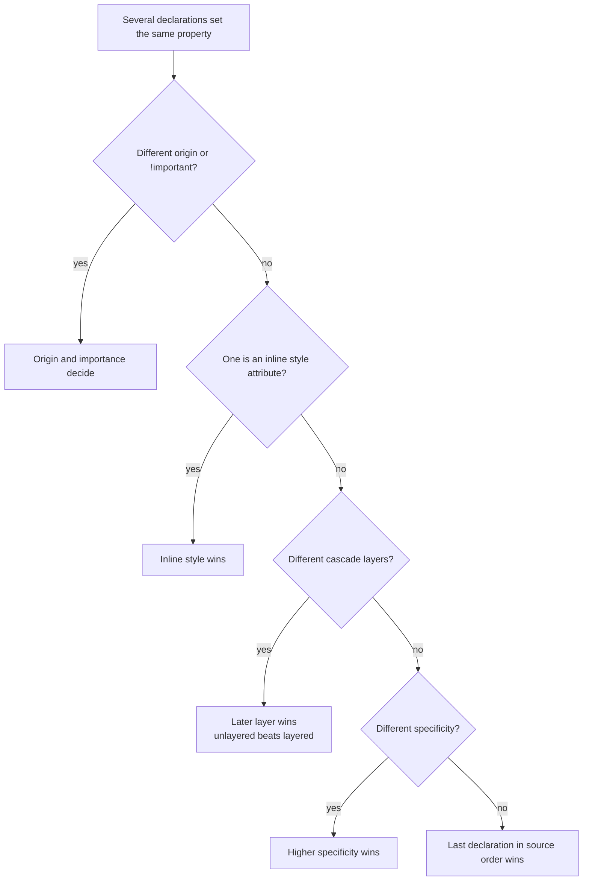
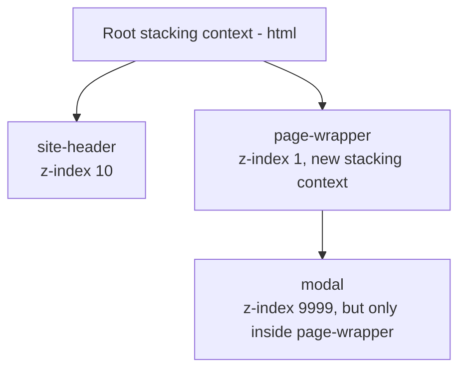
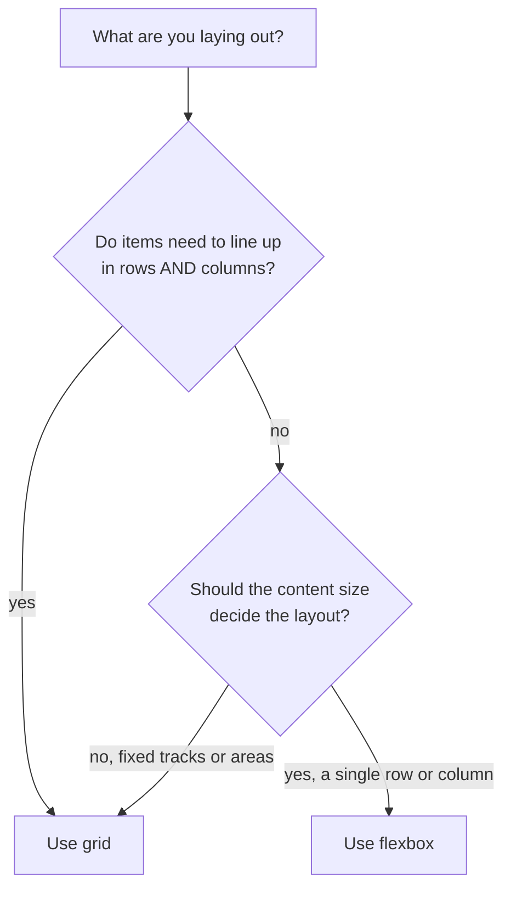
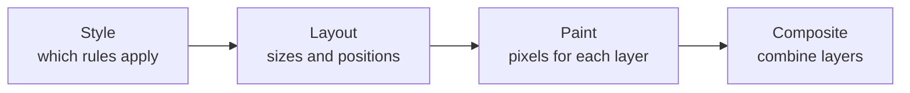

# CSS Layout and Responsive Design

> In this document you will learn how the browser decides which CSS rule wins, how boxes are sized and positioned, how to build layouts with flexbox and grid, and how to make pages work on every screen size. CSS questions in interviews test whether you understand the rules underneath, so that you can fix layout bugs quickly instead of guessing.

**Before this:** [HTML semantics and forms](./01-html-semantics-and-forms.md), [Browser architecture and rendering](../01-cs-and-web-fundamentals/07-browser-architecture-and-rendering.md) · **Interview questions:** [jump to questions](#interview-questions)

## Table of contents

1. [How the browser picks a value: the cascade](#how-the-browser-picks-a-value-the-cascade)
2. [Specificity](#specificity)
3. [Inheritance](#inheritance)
4. [The box model](#the-box-model)
5. [Display types](#display-types)
6. [Positioning](#positioning)
7. [Z-index and stacking contexts](#z-index-and-stacking-contexts)
8. [Flexbox](#flexbox)
9. [Grid](#grid)
10. [Flexbox or grid](#flexbox-or-grid)
11. [Centering techniques](#centering-techniques)
12. [CSS units](#css-units)
13. [Responsive design](#responsive-design)
14. [CSS custom properties](#css-custom-properties)
15. [Pseudo-classes and pseudo-elements](#pseudo-classes-and-pseudo-elements)
16. [Transitions, animations and performance](#transitions-animations-and-performance)
17. [CSS architecture: BEM, CSS Modules, CSS-in-JS and Tailwind](#css-architecture-bem-css-modules-css-in-js-and-tailwind)
18. [Angular view encapsulation](#angular-view-encapsulation)
19. [Modern CSS features and browser support](#modern-css-features-and-browser-support)
20. [How to explain the cascade in an interview](#how-to-explain-the-cascade-in-an-interview)
21. [Interview questions](#interview-questions)
22. [Summary](#summary)
23. [References](#references)

---

## How the browser picks a value: the cascade

### What it is

Many CSS rules can target the same element and set the same property. The **cascade** is the algorithm the browser uses to choose one winning value for each property of each element.

### Why it exists

CSS comes from many places: the browser's built-in styles, your stylesheets, third-party libraries, inline `style` attributes, sometimes user settings. The cascade gives a predictable answer to "which one wins?"

### Analogy

Think of a company deciding on a rule. First it asks *who* made the rule (CEO beats team lead). If two people at the same level disagree, it asks *how specific* each rule is ("all employees" versus "employees in the London office"). If that is also equal, the *latest* decision wins.

### How it works inside

For each property, the browser collects every declaration that applies. Then it sorts them using these steps, in order. It stops at the first step that finds a difference:

| Step | Question | Who wins |
|---|---|---|
| 1. Origin and importance | Where does the rule come from, and is it `!important`? | For normal rules: your (author) styles beat user styles, which beat browser defaults. For `!important` rules the order flips. |
| 2. Context | Is it from inside a shadow DOM tree? | Matters only with web components. |
| 3. Element-attached styles | Is it an inline `style="..."` attribute? | Inline styles beat any selector (unless the selector rule is `!important`). |
| 4. Cascade layers | Which `@layer` is it in? | Later layers beat earlier ones. Styles not in any layer beat all layers. |
| 5. Specificity | How specific is the selector? | Higher specificity wins. |
| 6. Order of appearance | Which comes last? | The last one in the source wins. |



### Example: source order

```css
.button { background: blue; }
.button { background: green; }
/* Same origin, same layer, same specificity: the later rule wins -> green */
```

### Example: !important and inline styles

```html
<style>
  .note { color: navy !important; }
</style>
<p class="note" style="color: crimson">Delivery is delayed.</p>
<!-- Text is navy: an !important author rule beats a normal inline style -->
```

`!important` puts a declaration into a higher group. Use it rarely: for utility classes that must always win (like `.visually-hidden`), or to override third-party inline styles you cannot change. If you use it to win a specificity fight, the next person needs another `!important`, and the stylesheet becomes hard to maintain.

### Cascade layers

**Cascade layers** (`@layer`, supported in all major browsers since 2022) let you decide the priority of whole groups of CSS, no matter how specific the selectors inside are.

```css
/* Declare the order once: later layers win */
@layer reset, vendor, components, utilities;

@layer vendor {
  /* High specificity inside a low layer */
  #app .datepicker button.day { color: gray; }
}

@layer components {
  .day { color: black; } /* wins: 'components' comes after 'vendor' */
}
```

This is very useful when a third-party library has very specific selectors. Put the library in an early layer, and your simple class selectors win.

---

## Specificity

### What it is

**Specificity** is a score for a selector. When two rules in the same origin and layer conflict, the one with the higher score wins.

### How to calculate it

Count three groups and write them as **(A, B, C)**:

| Group | What counts |
|---|---|
| **A** | ID selectors: `#cart` |
| **B** | Class selectors `.item`, attribute selectors `[type="email"]`, pseudo-classes `:hover`, `:nth-child(2)` |
| **C** | Type (element) selectors `p`, `button`, and pseudo-elements `::before` |
| Nothing (0) | The universal selector `*`, combinators (`>`, `+`, `~`, space), and `:where(...)` |

Special pseudo-classes:

- `:is(...)`, `:not(...)` and `:has(...)` take the specificity of their **most specific** argument.
- `:where(...)` always has specificity **zero**, no matter what is inside.

Compare scores from left to right, like version numbers. **A higher A always wins**, no matter how big B or C are. There is no "carry over": 11 classes do not beat 1 ID.

### Worked examples

| Selector | A (IDs) | B (classes, attributes, pseudo-classes) | C (types, pseudo-elements) | Score |
|---|---|---|---|---|
| `p` | 0 | 0 | 1 | (0,0,1) |
| `.price` | 0 | 1 | 0 | (0,1,0) |
| `p.price` | 0 | 1 | 1 | (0,1,1) |
| `#cart .item p` | 1 | 1 | 1 | (1,1,1) |
| `nav ul li a:hover` | 0 | 1 (`:hover`) | 4 | (0,1,4) |
| `a[href^="https"]` | 0 | 1 | 1 | (0,1,1) |
| `.card::before` | 0 | 1 | 1 (`::before`) | (0,1,1) |
| `ul > li + li` | 0 | 0 | 3 | (0,0,3) |
| `*` | 0 | 0 | 0 | (0,0,0) |
| `:is(#main, .content) p` | 1 (from `#main`) | 0 | 1 | (1,0,1) |
| `:where(#main, .content) p` | 0 | 0 | 1 | (0,0,1) |
| `button:not(.primary, #save)` | 1 (from `#save`) | 0 | 1 | (1,0,1) |
| `.a.b.c.d.e.f.g.h.i.j.k` | 0 | 11 | 0 | (0,11,0) — still loses to `#single` (1,0,0) |

Where do inline styles fit? In older explanations, an inline style is shown as a fourth, bigger column (1,0,0,0). In the current specification, inline styles are not part of specificity at all; they win one step earlier in the cascade (step 3 in the table above). The practical result is the same: an inline style beats any selector, unless that selector's declaration is `!important`.

### A full example, step by step

```html
<style>
  #checkout .btn { color: red; }                         /* (1,1,0) */
  .page .btn.primary { color: green; }                   /* (0,3,0) */
  button.btn { color: blue; }                            /* (0,1,1) */
  :where(#checkout) .btn.primary.large { color: orange; } /* (0,3,0) */
</style>
<div id="checkout" class="page">
  <button class="btn primary large">Pay</button>
</div>
```

The button is **red** (verified in Chrome).

1. All four rules match the button, all are normal author styles in no layer.
2. Compare the A column first. Only `#checkout .btn` has an ID (A = 1). It wins immediately.
3. The `:where(#checkout)` rule contains an ID, but `:where()` makes it count as zero.
4. If the first rule did not exist, two rules would tie at (0,3,0), and the later one (orange) would win by source order.

### Why `:where()` is useful

Library and reset authors use `:where()` to write default styles that are easy to override:

```css
/* A design system's default: specificity (0,0,0) + (0,0,1) = (0,0,1) */
:where(.ds-button) span { font-weight: 600; }

/* Any app class easily overrides it */
.checkout-label { font-weight: 400; }
```

### Best practices for specificity

- **Keep specificity low and flat.** Prefer single class selectors (`.order-card__title`). They are easy to override.
- **Avoid IDs in CSS.** Use IDs for anchors, labels and JavaScript, not for styling. One ID beats any number of classes.
- **Avoid long descendant chains** like `.page .sidebar ul li a`. They are slow to read and fragile when the HTML changes.
- **Use `@layer` and `:where()`** to manage priority for resets and third-party CSS, instead of `!important`.

---

## Inheritance

### What it is

**Inheritance** means some properties pass from a parent element to its children automatically, when the child has no value of its own.

```html
<article style="color: darkslategray; font-family: Georgia, serif; border: 1px solid gray">
  <h2>Order shipped</h2>
  <p>Your package is on the way.</p>
</article>
<!-- h2 and p get the color and font-family (inherited),
     but they do NOT get the border (not inherited) -->
```

| Usually inherited (text-related) | Not inherited (box-related) |
|---|---|
| `color`, `font-family`, `font-size`, `font-weight`, `line-height`, `text-align`, `letter-spacing`, `white-space`, `visibility`, `cursor`, `list-style`, `direction` | `margin`, `padding`, `border`, `background`, `width`, `height`, `display`, `position`, `overflow`, `opacity`, `transform` |

The rule of thumb: text styles are inherited, so you can set the font once on `body`. Box styles are not, because a border on every child would be a mess.

### Keywords that control inheritance

| Keyword | Meaning |
|---|---|
| `inherit` | Take the parent's computed value, even for non-inherited properties |
| `initial` | Use the property's initial value from the specification (for `display`, that is `inline`, not `block`!) |
| `unset` | `inherit` for inherited properties, `initial` for the others |
| `revert` | Go back to the browser's default style for this element |

```css
/* Make a button use the surrounding text style */
button.link-style {
  font: inherit;
  color: inherit;
  background: none;
  border: none;
}
```

Form controls (`button`, `input`, `select`, `textarea`) do not inherit `font` by default in most browsers. That is why CSS resets often include `font: inherit` for them.

---

## The box model

### What it is

Every element is drawn as a rectangular **box** made of four layers, from inside to outside:

1. **Content**: the text or image.
2. **Padding**: space inside the border. It shows the element's background.
3. **Border**: the line around the padding.
4. **Margin**: space outside the border. It is always transparent and separates the box from its neighbors.

```text
+------------------- margin -------------------+
|  +--------------- border ----------------+   |
|  |  +----------- padding ------------+   |   |
|  |  |          content               |   |   |
|  |  +--------------------------------+   |   |
|  +---------------------------------------+   |
+----------------------------------------------+
```

### content-box versus border-box

The `box-sizing` property decides what `width` and `height` mean.

```css
.card {
  width: 300px;
  padding: 20px;
  border: 5px solid black;
}
```

| `box-sizing` | What `width: 300px` means | Visible width (border to border) | Content width |
|---|---|---|---|
| `content-box` (the default) | Width of the content only | 300 + 2×20 + 2×5 = **350px** | 300px |
| `border-box` | Width including padding and border | **300px** | 300 − 40 − 10 = 250px |

Margin is never included in either case.

`content-box` causes surprises: you set `width: 100%` and add padding, and the element overflows its parent. That is why almost every modern project starts with:

```css
*,
*::before,
*::after {
  box-sizing: border-box;
}
```

### Margin collapsing

**Margin collapsing** is a rule from normal block layout: when two vertical margins touch, they combine into one margin, equal to the larger of the two (for positive margins).

```css
.title { margin-bottom: 30px; }
.subtitle { margin-top: 20px; }
/* In normal block flow, the gap between them is 30px, not 50px */
```

When it happens and when it does not:

| Situation | Collapses? |
|---|---|
| Two block siblings, bottom margin meets top margin | Yes |
| Parent and its first child's top margin, with no padding, border or content between them | Yes (the child's margin "leaks" out of the parent) |
| An empty block with top and bottom margins | Yes (its own margins collapse together) |
| Horizontal margins | Never |
| Children of a flex or grid container | Never (in a flex column, the same example gives a 50px gap; verified in Chrome) |
| Parent with padding, border, or `display: flow-root` between the margins | No |

The common bug: you add `margin-top` to the first child of a card, and the whole card moves down instead. Fix it by adding padding to the parent, or `display: flow-root` on the parent, or by using `gap` in a flex or grid layout instead of margins.

---

## Display types

The `display` property sets how a box takes part in layout. It has two sides: the **outer** type (how the box behaves among its siblings) and the **inner** type (how it lays out its children).

| Value | Outer behavior | Inner layout |
|---|---|---|
| `block` | Starts on a new line, takes full width | Normal flow |
| `inline` | Flows with text; `width`/`height` ignored | Normal flow |
| `inline-block` | Flows with text, but accepts `width`, `height`, vertical margin | Normal flow |
| `flex` / `inline-flex` | Block-level / inline-level | Flexbox for children |
| `grid` / `inline-grid` | Block-level / inline-level | Grid for children |
| `flow-root` | Block-level | Normal flow, and creates a new **block formatting context** (contains floats, stops margin collapse with children) |
| `none` | Not rendered at all; takes no space; removed from the accessibility tree | |
| `contents` | The element's own box disappears; its children act as children of its parent | |

Notes:

- `display: none` hides the element from everyone, including screen readers.
- `display: contents` is useful to make grandchildren take part in a parent's grid. Be careful on semantic elements like `<button>`, `<ul>` or `<table>`: some browsers had bugs that removed their meaning from the accessibility tree. Test with a screen reader.
- Modern CSS also allows the two-keyword syntax, like `display: inline flex`. The one-word values are still the common style.

### Hiding things: which method to use

| Method | Visible? | Takes space? | Clickable / focusable? | Read by screen readers? |
|---|---|---|---|---|
| `display: none` | No | No | No | No |
| `visibility: hidden` | No | Yes | No | No |
| `opacity: 0` | No | Yes | **Yes** (still clickable and focusable!) | Yes |
| `hidden` attribute | No (it applies `display: none`) | No | No | No |
| `.visually-hidden` class (see below) | No | No | Yes, if focusable | **Yes** |

The **visually hidden** pattern hides text from the eyes but keeps it for screen readers, for example extra text for an icon button:

```css
.visually-hidden {
  position: absolute !important;
  width: 1px !important;
  height: 1px !important;
  padding: 0 !important;
  margin: -1px !important;
  overflow: hidden !important;
  clip: rect(0, 0, 0, 0) !important;
  white-space: nowrap !important;
  border: 0 !important;
}
```

More in [Accessibility](./04-accessibility.md).

---

## Positioning

The `position` property decides how an element is placed, and what `top`, `right`, `bottom`, `left` (or `inset`) mean.

| Value | In normal flow? | Offsets are relative to | Typical use |
|---|---|---|---|
| `static` (default) | Yes | Offsets are ignored | Normal content |
| `relative` | Yes (its original space is kept) | Its own normal position | Small nudges; making a parent the reference for absolute children |
| `absolute` | No (removed, others fill the space) | The nearest **positioned** ancestor (any `position` except `static`) | Badges, dropdowns, icons inside inputs |
| `fixed` | No | The viewport (usually) | Sticky headers, chat buttons, toasts |
| `sticky` | Yes, until it sticks | Its nearest scrolling ancestor, while inside its parent | Table headers, section titles, sidebars |

### Example: a badge on an icon

```html
<button class="cart-button" type="button" aria-label="Cart, 3 items">
  <svg aria-hidden="true" width="24" height="24"><!-- cart icon --></svg>
  <span class="badge" aria-hidden="true">3</span>
</button>
```

```css
.cart-button {
  position: relative; /* the reference box for the badge */
}

.badge {
  position: absolute;
  top: -6px;
  right: -6px; /* measured from the button's edges, not the page */
}
```

If you forget `position: relative` on the button, the badge looks for the next positioned ancestor. If there is none, it positions itself relative to the initial containing block (the page), and appears in a corner of the screen.

### The containing block surprises

The box that `absolute` and `fixed` elements use as a reference is called the **containing block**. Two surprises:

1. **`fixed` is not always relative to the viewport.** If any ancestor has `transform`, `filter`, `perspective`, `contain: paint` or `will-change: transform`, that ancestor becomes the containing block. A "fixed" modal inside an animated card then moves and gets clipped with the card. This is one reason modals are rendered at the end of `<body>` (Angular CDK Overlay does this) or in the top layer with `<dialog>`.
2. **Percentages** on `top`/`left`/`width` of an absolute element are relative to the containing block's padding box.

### Sticky positioning

```css
.table-header th {
  position: sticky;
  top: 0; /* required: the threshold where it starts sticking */
  background: white; /* otherwise rows show through */
}
```

Why sticky "does not work", in order of how common the cause is:

1. No threshold: you forgot `top` (or `bottom`, `left`, `right`).
2. An ancestor between the element and the scrolling area has `overflow: hidden`, `auto` or `scroll`. That ancestor becomes the scroll container, so the element sticks inside it, and if it does not scroll, nothing happens. (`overflow: clip` does not create a scroll container, so it is safe.)
3. The parent is not taller than the sticky element. A sticky element can only move inside its parent. If the parent ends, the element scrolls away with it.
4. In a flex row, the sticky item is stretched to the full height of the container (`align-items: stretch`), so there is no room to move. Add `align-self: flex-start`.

---

## Z-index and stacking contexts

### What it is

`z-index` controls which element appears in front when elements overlap. A higher value is closer to the user.

`z-index` only works on **positioned elements** (`relative`, `absolute`, `fixed`, `sticky`) and on **flex and grid items**. On a normal static block it does nothing.

### Stacking contexts

A **stacking context** is a group of elements that are layered together as one unit. `z-index` values are compared **only inside the same stacking context**.

Analogy: each stacking context is a sheet of paper. You can order drawings on one sheet (z-index inside it). But a drawing on a lower sheet can never appear above a higher sheet, no matter what number you write on it.

An element creates a new stacking context when, among others, it has:

- `position: relative` or `absolute` **with** a `z-index` other than `auto`
- `position: fixed` or `sticky` (always)
- A flex or grid item with a `z-index` other than `auto`
- `opacity` less than 1
- `transform`, `filter`, `perspective`, `clip-path` or `mask` other than `none`
- `isolation: isolate`
- `mix-blend-mode` other than `normal`
- `will-change` naming one of these properties
- `contain: layout`, `paint`, `strict` or `content`; `container-type: size` or `inline-size`
- The root element (`<html>`) is the first stacking context.

### The classic bug: "z-index: 9999 does not work"

```html
<header class="site-header">Header</header>
<div class="page-wrapper">
  <div class="modal">Modal</div>
</div>
```

```css
.site-header {
  position: relative;
  z-index: 10;
}

.page-wrapper {
  position: relative;
  z-index: 1; /* creates a stacking context */
}

.modal {
  position: fixed;
  top: 0;
  left: 0;
  z-index: 9999; /* only compared to things inside .page-wrapper */
}
```

The modal appears **behind** the header (verified in Chrome).



Step by step:

1. In the root context, the browser compares the header (10) with the wrapper (1). The header is in front.
2. The modal's 9999 is compared only with the wrapper's other children.
3. The whole wrapper, modal included, is painted as one layer at level 1, below the header.

Fixes:

- Move the modal out of the wrapper, to the end of `<body>` (a **portal**). Angular CDK Overlay and Material dialogs do this.
- Use `<dialog>` with `showModal()`. It renders in the **top layer**, above every stacking context.
- Remove the unnecessary stacking context (for example, the `z-index` on the wrapper, or a `transform`).
- Keep a small z-index scale in variables (`--z-dropdown: 100; --z-modal: 1000;`) instead of random large numbers.

### Painting order inside one stacking context

From back to front:

1. The background and border of the element that forms the context
2. Children with negative `z-index`
3. Normal block children (not positioned)
4. Floats
5. Inline content (text)
6. Positioned children with `z-index: auto` or `0`
7. Positioned children with positive `z-index`

`isolation: isolate` is a clean way to create a stacking context on purpose, for example so that a component's internal `z-index: -1` decoration stays inside the component.

---

## Flexbox

### What it is

**Flexbox** is a one-dimensional layout system. It places items in a row or in a column, and it distributes the free space between them.

### The two axes

- The **main axis** is the direction items flow: horizontal for `flex-direction: row` (default), vertical for `column`.
- The **cross axis** is perpendicular to it.

| Property (on container) | Works along | What it does |
|---|---|---|
| `flex-direction` | | `row`, `row-reverse`, `column`, `column-reverse` |
| `justify-content` | Main axis | Distributes space: `flex-start`, `center`, `space-between`, `space-around`, `space-evenly`, `flex-end` |
| `align-items` | Cross axis | Aligns items in their line: `stretch` (default), `flex-start`, `center`, `flex-end`, `baseline` |
| `flex-wrap` | | `nowrap` (default) or `wrap` onto new lines |
| `align-content` | Cross axis | Distributes space between *lines* (only with wrapping) |
| `gap` | Both | Space between items (supported in all major browsers since 2021) |

| Property (on item) | What it does |
|---|---|
| `flex-grow` | How much of the **extra** space the item takes (default `0`) |
| `flex-shrink` | How much the item gives up when there is **not enough** space (default `1`) |
| `flex-basis` | The starting size before growing or shrinking (default `auto`, which means "use `width`, or the content size") |
| `align-self` | Overrides `align-items` for one item |
| `order` | Changes the visual order (see the accessibility warning below) |

### The flex shorthand

| Shorthand | Means | Behavior |
|---|---|---|
| `flex: initial` (the default) | `0 1 auto` | Do not grow; may shrink; start from content/width |
| `flex: 1` | `1 1 0%` | Grow and shrink; start from 0, so items become **equal** size |
| `flex: auto` | `1 1 auto` | Grow and shrink; start from content, so **bigger content gets more space** |
| `flex: none` | `0 0 auto` | Fixed: never grow or shrink |
| `flex: 0 0 240px` | | A fixed 240px column |

In Chrome, two items with `flex: 1` in a 600px row are both 300px wide even if one has much more text. With `flex: auto`, the item with longer text becomes wider (about 213px and 387px in the test).

### How grow is calculated

```css
.row { display: flex; width: 600px; }
.row > div { flex-basis: 100px; }
.a { flex-grow: 1; }
.b { flex-grow: 2; }
.c { flex-grow: 3; }
```

1. Sum of bases: 3 × 100 = 300px.
2. Free space: 600 − 300 = 300px.
3. Total grow factors: 1 + 2 + 3 = 6. One share = 300 / 6 = 50px.
4. Final widths: a = 100 + 50 = **150px**, b = 100 + 100 = **200px**, c = 100 + 150 = **250px** (verified in Chrome).

### How shrink is calculated

Shrinking is weighted by `flex-shrink × flex-basis`, so bigger items shrink more.

```css
.row { display: flex; width: 400px; }
.row > div { flex-basis: 300px; flex-grow: 0; }
.a { flex-shrink: 1; }
.b { flex-shrink: 3; }
```

1. Sum of bases: 600px. Overflow: 600 − 400 = 200px.
2. Weights: a = 1 × 300 = 300, b = 3 × 300 = 900. Total 1200.
3. a shrinks by 200 × 300/1200 = 50px → **250px**. b shrinks by 200 × 900/1200 = 150px → **150px** (verified in Chrome).

### The min-width: auto trap

Flex items have `min-width: auto` by default. This means **an item will not shrink below the width of its content**. Long words, URLs, `white-space: nowrap` text or wide tables then overflow the container.

```html
<div class="product-row">
  <div class="info">
    <p class="title">A very long product name that does not fit at all in this row</p>
  </div>
  <button type="button">Buy</button>
</div>
```

```css
.product-row { display: flex; gap: 8px; width: 300px; }
.info { flex: 1; }
.title { white-space: nowrap; overflow: hidden; text-overflow: ellipsis; }
```

```css
/* ❌ The ellipsis never appears: .info refuses to shrink below the text width,
   and the Buy button is pushed outside the row */

/* ✅ Allow the flex item to shrink below its content size */
.info { flex: 1; min-width: 0; }
```

In the Chrome test, `.info` was 379px wide (overflowing the 300px row) without the fix, and 253px with `min-width: 0`. In a column direction, the same problem uses `min-height: 0`.

### Common flexbox layouts

```css
/* 1. Navbar: logo on the left, links on the right */
.navbar { display: flex; align-items: center; gap: 1rem; }
.navbar .links { margin-left: auto; } /* auto margin takes all free space */

/* 2. Sticky footer: footer stays at the bottom on short pages */
body { min-height: 100dvh; display: flex; flex-direction: column; margin: 0; }
main { flex: 1; }

/* 3. Media object: avatar + text */
.comment { display: flex; gap: 0.75rem; align-items: flex-start; }
.comment img { flex: none; width: 48px; height: 48px; }
.comment .body { flex: 1; min-width: 0; }

/* 4. Equal-height cards in a row (stretch is the default) */
.card-row { display: flex; gap: 1rem; }
.card-row > .card { flex: 1; display: flex; flex-direction: column; }
.card-row > .card .actions { margin-top: auto; } /* buttons stick to the bottom */
```

### Accessibility warning: order and row-reverse

`order`, `row-reverse` and `column-reverse` change only the **visual** order. Keyboard Tab order and screen readers still follow the **HTML** order. If the visual order and the DOM order differ, keyboard users see focus jump around. Change the HTML order instead when the order has meaning.

---

## Grid

### What it is

**CSS Grid** is a two-dimensional layout system. You define rows **and** columns, and place items into the cells.

### Core ideas

```css
.dashboard {
  display: grid;
  grid-template-columns: 240px 1fr 1fr; /* 3 columns */
  grid-template-rows: auto 1fr auto;    /* 3 rows */
  gap: 1rem;
}
```

| Concept | Meaning |
|---|---|
| **Track** | One row or one column |
| **`fr`** | A fraction of the free space. `1fr 2fr` gives the second column twice the free space of the first. |
| **`repeat(3, 1fr)`** | Three equal columns |
| **`minmax(200px, 1fr)`** | At least 200px, at most one fraction |
| **Line numbers** | Lines between tracks are numbered from 1. `grid-column: 1 / -1` spans from the first to the last line (full width). |
| **`span 2`** | Take two tracks: `grid-column: span 2` |
| **Implicit grid** | Extra items create new rows automatically; size them with `grid-auto-rows` |

### Template areas: a readable page layout

```css
.app-layout {
  display: grid;
  min-height: 100dvh;
  grid-template-columns: 240px 1fr;
  grid-template-rows: auto 1fr auto;
  grid-template-areas:
    "header  header"
    "sidebar main"
    "footer  footer";
}

.app-header  { grid-area: header; }
.app-sidebar { grid-area: sidebar; }
.app-main    { grid-area: main; }
.app-footer  { grid-area: footer; }

/* Mobile: one column, sidebar moves below main */
@media (max-width: 768px) {
  .app-layout {
    grid-template-columns: 1fr;
    grid-template-areas:
      "header"
      "main"
      "sidebar"
      "footer";
  }
}
```

The same reading-order warning as flexbox applies: grid placement does not change the DOM order.

### Responsive cards without media queries: auto-fit and minmax

```css
.product-grid {
  display: grid;
  grid-template-columns: repeat(auto-fit, minmax(200px, 1fr));
  gap: 1rem;
}
```

This means: "make as many columns as fit, each at least 200px; then stretch them to fill the row". On a phone you get one column, on a laptop four or five, without a single media query.

### auto-fill versus auto-fit

Both create as many tracks as fit. The difference shows when there are **fewer items than tracks**:

| | Container 1000px, `minmax(200px, 1fr)`, only 2 items |
|---|---|
| `auto-fill` | Keeps 5 tracks of 200px; the 3 empty tracks still take space. Items are **200px** wide. |
| `auto-fit` | Collapses the empty tracks to 0; the 2 items stretch to **500px** each. |

(Both results verified in Chrome.) Use `auto-fill` when you want items to keep a consistent size, and `auto-fit` when you want items to fill the row.

### The 1fr overflow trap

`1fr` really means `minmax(auto, 1fr)`. The `auto` minimum stops the column from becoming smaller than its content. A long line of code or a wide table makes the whole column wider than the container.

```css
/* ❌ A <pre> with a long line inside a cell pushes the column to ~677px in a 300px grid */
.layout { display: grid; grid-template-columns: 1fr 100px; }

/* ✅ Allow the column to shrink; the <pre> then scrolls inside it */
.layout { display: grid; grid-template-columns: minmax(0, 1fr) 100px; }
```

### Subgrid

`grid-template-columns: subgrid` (supported in all major browsers since 2023) lets a nested grid reuse the parent's tracks. Use it to align titles, text and buttons across a row of cards, even when their content lengths differ.

---

## Flexbox or grid

| Question | Flexbox | Grid |
|---|---|---|
| Dimensions | One (a row *or* a column) | Two (rows *and* columns) |
| Who decides size | Content first ("how big are the items?") | Layout first ("what are the tracks?") |
| Good for | Navbars, toolbars, button groups, centering, a list of tags that wraps, media objects | Page layouts, dashboards, card grids, forms with aligned labels, anything aligned in both directions |
| Wrapping | Each wrapped line is independent; columns do not line up | Items always line up in columns |



They work well together: grid for the page skeleton, flexbox inside each component.

---

## Centering techniques

"How do you center a div?" is a classic question. The right answer depends on *what* and *in which direction*.

```css
/* 1. Grid: the shortest way to center both ways */
.parent { display: grid; place-items: center; }

/* 2. Flexbox: center both ways */
.parent { display: flex; justify-content: center; align-items: center; }

/* 3. Auto margins: horizontal centering of a block with a width */
.container { max-width: 1200px; margin-inline: auto; }

/* 4. Auto margins inside flex: center both ways, item by item */
.parent { display: flex; }
.child { margin: auto; }

/* 5. Absolute + transform: overlay content, unknown size */
.parent { position: relative; }
.child {
  position: absolute;
  top: 50%;
  left: 50%;
  transform: translate(-50%, -50%);
}

/* 6. Absolute + inset + auto margins: known size */
.child {
  position: absolute;
  inset: 0;
  margin: auto;
  width: 300px;
  height: 200px;
}

/* 7. Inline content (text, inline images) inside a block */
.parent { text-align: center; }

/* 8. Vertical centering in a normal block (newer, supported in all major browsers since 2024) */
.parent { align-content: center; }
```

| Situation | Best choice |
|---|---|
| One item, center both ways | Grid `place-items: center` or flexbox |
| Page container with max width | `margin-inline: auto` |
| Overlay or tooltip on top of something | Absolute + transform |
| Text | `text-align: center` |

One detail about technique 5: `transform: translate(-50%, -50%)` can put an element on half pixels, which can make text slightly blurry. Grid and flex centering do not have this problem.

---

## CSS units

### Absolute and relative units

| Unit | Relative to | Use for |
|---|---|---|
| `px` | A CSS pixel (not a physical pixel; on high-density screens 1px = several device pixels) | Borders, shadows, small fixed details |
| `em` | The element's own `font-size` (when used in `font-size`, the **parent's** font size) | Padding and margins that should grow with the text of the component |
| `rem` | The root (`<html>`) font size, 16px by default in browsers | Font sizes, spacing scale |
| `%` | Depends on the property (see below) | Fluid widths |
| `vw` / `vh` | 1% of the viewport width / height | Full-screen sections |
| `dvh` / `svh` / `lvh` | Dynamic / small / large viewport height (supported in all major browsers since late 2022) | Full-height layouts on mobile |
| `ch` | The width of the "0" character | Readable line length: `max-width: 65ch` |
| `fr` | A share of free space in a grid | Grid tracks |
| `cqi` / `cqw` | 1% of a container's inline size / width (container queries) | Component-relative sizing |

### em compounding

```css
html { font-size: 16px; }
.parent { font-size: 1.25em; padding: 1em; }
.child { font-size: 1.25em; padding: 1em; }
.child-rem { font-size: 1.25rem; padding: 1rem; }
```

```html
<div class="parent">
  <div class="child">em child</div>
  <div class="child-rem">rem child</div>
</div>
```

| Element | font-size | padding |
|---|---|---|
| `.parent` | 16 × 1.25 = **20px** | 1em = **20px** (its own font size) |
| `.child` | 20 × 1.25 = **25px** (compounds!) | 1em = **25px** |
| `.child-rem` | 16 × 1.25 = **20px** (always from root) | 1rem = **16px** |

(All values verified in Chrome.) With `em`, nested elements multiply their sizes. Nested lists with `font-size: 0.9em` get smaller at each level. `rem` avoids this.

### Why use rem for font sizes

Users can change the default font size in browser settings (for example from 16px to 24px) because they have low vision. Font sizes in `rem` follow that setting. Font sizes in `px` ignore it. Browser zoom scales both, but the font-size setting only works with relative units.

```css
/* ❌ Ignores the user's font-size preference */
body { font-size: 14px; }
/* ✅ Respects it */
body { font-size: 0.875rem; }
```

### Percentages depend on the property

| Property | `%` is relative to |
|---|---|
| `width`, `left`, `right` | The containing block's width |
| `height`, `top`, `bottom` | The containing block's height (only works if that height is definite) |
| `padding` and `margin` (**all four sides**) | The containing block's **width**, even for top and bottom |
| `font-size` | The parent's font size |
| `transform: translate()` | The element's **own** size |
| `line-height` (as `%`) | The element's font size |

The padding rule surprises people: `padding-top: 50%` inside a 400px-wide parent is 200px, even if the parent is only 100px tall (verified in Chrome). Before `aspect-ratio` existed, this was the "padding hack" for responsive video boxes. Today, use `aspect-ratio: 16 / 9`.

`height: 100%` fails when the parent's height is `auto`, because there is nothing to take a percentage of. Use flexbox, grid or viewport units instead.

### The 100vh problem on mobile

On mobile browsers, the address bar appears and disappears while scrolling. `100vh` is based on the **largest** viewport (address bar hidden), so a `height: 100vh` hero is taller than the visible area when the bar is shown, and the bottom is cut off.

```css
.hero {
  min-height: 100vh;  /* fallback for very old browsers */
  min-height: 100dvh; /* follows the real visible height as the bar moves */
}
```

- `svh`: the smallest viewport (bar visible). Stable, never jumps.
- `lvh`: the largest viewport (bar hidden), same as `vh`.
- `dvh`: changes as the bar moves. Accurate, but can cause small layout jumps while scrolling.

---

## Responsive design

### What it is

**Responsive design** means one website adapts its layout to any screen size and input type: phone, tablet, laptop, large monitor, touch or mouse.

Ingredients:

1. The viewport meta tag (see [HTML meta tags](./01-html-semantics-and-forms.md#meta-tags)).
2. Fluid layouts: flexbox, grid, `%`, `fr`, `max-width` instead of fixed widths.
3. Flexible media: `img { max-width: 100%; height: auto; }` and responsive images.
4. Media queries and container queries for bigger changes.
5. Fluid typography with `clamp()`.

### Mobile-first

**Mobile-first** means you write the base CSS for small screens, then add `min-width` media queries for bigger screens.

```css
/* Base: phones, one column */
.product-list {
  display: grid;
  gap: 1rem;
}

/* Tablets and up */
@media (min-width: 640px) {
  .product-list { grid-template-columns: repeat(2, 1fr); }
}

/* Desktops and up */
@media (min-width: 1024px) {
  .product-list { grid-template-columns: repeat(4, 1fr); }
}
```

Why mobile-first:

- The small-screen layout is usually the simplest (one column). Adding complexity is easier than removing it.
- Phones, which are often the slowest devices, do not need to parse and override the desktop rules.
- It forces you to decide what content really matters.

**Choose breakpoints by content, not by device.** Resize the browser and add a breakpoint where the layout starts to look bad. Device sizes change every year.

### Useful media features

```css
/* Range syntax (supported in all major browsers since 2023) */
@media (width >= 768px) { ... }
@media (400px <= width < 768px) { ... }

/* Input type: real hover only on devices that can hover */
@media (hover: hover) and (pointer: fine) {
  .card:hover { box-shadow: 0 4px 12px rgb(0 0 0 / 0.15); }
}

/* User preferences */
@media (prefers-reduced-motion: reduce) {
  *, *::before, *::after {
    animation-duration: 0.01ms !important;
    transition-duration: 0.01ms !important;
    scroll-behavior: auto !important;
  }
}
@media (prefers-color-scheme: dark) {
  :root { --surface: #111827; --text: #f9fafb; }
}
```

JavaScript can read media queries too:

```js
const desktopQuery = window.matchMedia("(min-width: 1024px)");
console.log(desktopQuery.matches); // true or false right now

desktopQuery.addEventListener("change", (event) => {
  console.log(event.matches ? "desktop layout" : "mobile layout");
});
```

> In Angular, the CDK `BreakpointObserver` (`@angular/cdk/layout`) wraps `matchMedia` in an Observable.

### Container queries

A media query asks "how wide is the **screen**?". A **container query** asks "how wide is the **box I am in**?". This matters for reusable components: the same product card may sit in a wide main area or in a narrow sidebar on the same screen.

```css
/* 1. Mark the parent as a query container */
.card-slot {
  container-type: inline-size;
  container-name: card-slot;
}

/* 2. Base card: stacked layout */
.product-card {
  display: grid;
  gap: 0.5rem;
}

/* 3. When the container (not the screen) is at least 420px wide */
@container card-slot (min-width: 420px) {
  .product-card {
    grid-template-columns: 140px 1fr; /* image beside the text */
  }
}

/* Container query units: 5% of the container's inline size */
.product-card h3 {
  font-size: clamp(1rem, 4cqi, 1.5rem);
}
```

Size container queries have been supported in all major browsers since February 2023. **Style** container queries (`@container style(--theme: dark)`) are newer and not yet in every major browser; check support before relying on them.

Note: a query container cannot size itself from its content in the queried direction (that would be a loop), so `container-type: inline-size` elements get their width from their parent.

### Fluid typography with clamp()

`clamp(minimum, preferred, maximum)` returns the preferred value, but never below the minimum or above the maximum.

```css
h1 {
  /* At least 1.75rem, at most 3rem, grows smoothly with the viewport in between */
  font-size: clamp(1.75rem, 1.2rem + 2.5vw, 3rem);
}
```

How it behaves: on a 320px phone, `1.2rem + 2.5vw` = 19.2 + 8 = 27.2px, which is below 28px (1.75rem), so the result is 28px. On a 1440px screen it is 19.2 + 36 = 55.2px, above 48px (3rem), so the result is 48px. In between, it grows smoothly.

Always include a `rem` part in the preferred value. A pure `vw` value (`font-size: 4vw`) does not grow when the user zooms or increases the font size, which fails accessibility requirements for text resizing.

`min()` and `max()` are useful too:

```css
.container {
  width: min(100% - 2rem, 1200px); /* full width with 1rem side space, but max 1200px */
  margin-inline: auto;
}
```

### Logical properties

**Logical properties** describe directions by writing flow instead of physical sides: `margin-inline` (left and right in English), `padding-block` (top and bottom), `inset-inline-start` (left in English, right in Arabic). They make right-to-left languages work without separate CSS.

```css
.alert { padding-block: 0.75rem; padding-inline: 1rem; border-inline-start: 4px solid orange; }
```

---

## CSS custom properties

### What it is

**CSS custom properties** (also called **CSS variables**) are properties you name yourself, starting with `--`. You read them with `var()`.

```css
:root {
  --color-brand: #0f766e;
  --space-md: 1rem;
  --radius: 8px;
}

.button {
  background: var(--color-brand);
  padding: var(--space-md);
  border-radius: var(--radius);
  color: var(--button-text, white); /* white is the fallback if --button-text is not set */
}
```

### Why they are different from Sass variables

| | Sass/Less variables (`$brand`) | CSS custom properties (`--brand`) |
|---|---|---|
| When resolved | At build time; they disappear from the output | At runtime, in the browser |
| Cascade and inheritance | No | Yes: set on a parent, children inherit; override in any selector |
| Change with JavaScript | No | Yes: `element.style.setProperty("--brand", "red")` |
| Change in media queries | Only by generating more CSS | Yes, just redefine them |
| Cross shadow DOM boundaries | No | Yes (inherited), which makes them perfect for theming web components |

### Theming example (light and dark)

```css
:root {
  --surface: #ffffff;
  --text: #111827;
  --brand: #0f766e;
}

:root[data-theme="dark"] {
  --surface: #111827;
  --text: #f9fafb;
  --brand: #5eead4;
}

body {
  background: var(--surface);
  color: var(--text);
}
```

```js
// Toggle the theme: every element that uses the variables updates at once
const themeToggle = document.querySelector("#theme-toggle");
themeToggle.addEventListener("click", () => {
  const root = document.documentElement;
  root.dataset.theme = root.dataset.theme === "dark" ? "light" : "dark";
});
```

### Component-level variables

```css
.badge {
  --badge-bg: #e5e7eb;
  --badge-text: #111827;
  background: var(--badge-bg);
  color: var(--badge-text);
}

.badge--danger {
  --badge-bg: #fee2e2; /* only changes the variable, not the rules */
  --badge-text: #991b1b;
}
```

### Things to know

- Custom property names are **case-sensitive**: `--Brand` and `--brand` are different.
- If a variable holds a value that is invalid for the property where you use it (for example `--size: red; width: var(--size)`), the declaration does not fall back to the previous rule. The property behaves as if set to `unset`. This is called "invalid at computed-value time".
- Normal custom properties cannot be animated smoothly, because the browser does not know their type. `@property` (supported in all major browsers since 2024) registers a typed property (`syntax: "<color>"`), which can then be transitioned.

---

## Pseudo-classes and pseudo-elements

### The difference

- A **pseudo-class** (one colon, `:hover`) selects an element in a certain **state** or **position**.
- A **pseudo-element** (two colons, `::before`) styles a **part** of an element, or adds a virtual element.

### Useful pseudo-classes

| Group | Pseudo-classes |
|---|---|
| User action | `:hover`, `:active`, `:focus`, `:focus-visible` (focus from keyboard, not mouse), `:focus-within` (the element or a child has focus) |
| Form state | `:checked`, `:disabled`, `:required`, `:invalid`, `:user-invalid`, `:placeholder-shown` |
| Structure | `:first-child`, `:last-child`, `:nth-child(2n+1)`, `:nth-of-type()`, `:only-child`, `:empty`, `:root` |
| Logic | `:not()`, `:is()`, `:where()`, `:has()` |
| Other | `:target` (matches the URL `#hash`), `:visited` (limited styling for privacy) |

```css
/* Zebra rows */
tbody tr:nth-child(even) { background: #f9fafb; }

/* Show a focus ring for keyboard users, not for mouse clicks */
button:focus-visible { outline: 3px solid var(--brand); outline-offset: 2px; }

/* Highlight the whole form group when its input has focus */
.form-group:focus-within { border-color: var(--brand); }

/* Every item except the last gets a divider */
.menu li:not(:last-child) { border-bottom: 1px solid #e5e7eb; }

/* :nth-child with a selector (count only .visible items) */
.item:nth-child(odd of .visible) { background: #f3f4f6; }
```

`:nth-child(n)` counts **all** siblings, whatever their type. `:nth-of-type(n)` counts only siblings of the same tag. `p:nth-child(2)` matches a `<p>` only if it is the second child of its parent; if the first child is an `<h2>`, the first paragraph *is* the second child.

### :has() — the "parent selector"

`:has()` (supported in all major browsers since December 2023) selects an element **based on what it contains** or what follows it.

```css
/* A card that contains an image gets a different layout */
.card:has(img) { grid-template-columns: 120px 1fr; }

/* A form group with an invalid input shows a red label */
.form-group:has(input:user-invalid) label { color: crimson; }

/* Disable page scrolling while a modal dialog is open */
body:has(dialog[open]) { overflow: hidden; }

/* A heading directly followed by a paragraph */
h2:has(+ p) { margin-bottom: 0.25rem; }
```

Before `:has()`, these cases needed JavaScript to add a class to the parent.

### Pseudo-elements

```css
/* A required-field marker */
label.required::after {
  content: " *";
  color: crimson;
}

/* Custom list markers */
li::marker { color: var(--brand); }

/* Style placeholder text (keep enough contrast) */
input::placeholder { color: #6b7280; }

/* Text selection color */
::selection { background: #99f6e4; }

/* The overlay behind a modal <dialog> */
dialog::backdrop { background: rgb(0 0 0 / 0.5); }
```

Rules:

- `::before` and `::after` need a `content` property (even `content: ""`) to appear.
- They do not work on **replaced elements** like `` and `<input>`, because those have no child content box.
- Do not put important information in `content`. Screen reader support for generated content varies, and users cannot select or copy it.

---

## Transitions, animations and performance

### Transitions

A **transition** animates a property from its old value to a new value when it changes (for example on hover or when a class is added).

```css
.button {
  background: var(--brand);
  transform: translateY(0);
  transition: background-color 150ms ease, transform 150ms ease;
}

.button:hover {
  background: #115e59;
  transform: translateY(-2px);
}
```

Avoid `transition: all`. It animates properties you did not expect (like `width` when content changes), and can hurt performance.

### Keyframe animations

An **animation** runs a sequence defined by `@keyframes`, with no state change needed.

```css
@keyframes spin {
  from { transform: rotate(0deg); }
  to { transform: rotate(360deg); }
}

.spinner {
  animation: spin 1s linear infinite;
}

@media (prefers-reduced-motion: reduce) {
  .spinner { animation-duration: 3s; } /* slower, or replace with a static indicator */
}
```

### Why some properties are cheap to animate and others are expensive

To draw a frame, the browser runs a pipeline. The full pipeline is explained in [Browser architecture and rendering](../01-cs-and-web-fundamentals/07-browser-architecture-and-rendering.md). In short:



| You animate | Pipeline work every frame | Cost |
|---|---|---|
| `width`, `height`, `top`, `left`, `margin`, `padding`, `font-size` | Layout → Paint → Composite | **Expensive**: positions of other elements may change too |
| `color`, `background-color`, `box-shadow`, `border-radius` | Paint → Composite | Medium |
| `transform`, `opacity` | Composite only (when the element is on its own layer) | **Cheap**: often handled by the GPU on the compositor thread, so it stays smooth even when JavaScript is busy |

```css
/* ❌ Animating left: layout on every frame */
.drawer { position: fixed; left: -300px; transition: left 300ms; }
.drawer.open { left: 0; }

/* ✅ Animating transform: composite only */
.drawer { position: fixed; left: 0; transform: translateX(-100%); transition: transform 300ms; }
.drawer.open { transform: translateX(0); }
```

`will-change: transform` asks the browser to prepare a separate layer in advance. Use it only on elements that are about to animate, and not on many elements: each layer costs GPU memory.

For more on runtime performance and layout thrashing, see [Web performance](./05-web-performance-and-core-web-vitals.md).

---

## CSS architecture: BEM, CSS Modules, CSS-in-JS and Tailwind

### Why architecture is needed

All normal CSS is **global**. A `.title` rule written for the product page also changes every other `.title` in the app. In a big team, this causes "fix one page, break another" bugs, and people become afraid to delete CSS. Each approach below solves this in a different way.

### BEM (naming convention)

**BEM** (Block, Element, Modifier) is a naming rule. No tools are needed.

```css
.product-card { }                  /* Block: a standalone component */
.product-card__title { }           /* Element: a part of the block (two underscores) */
.product-card__price { }
.product-card--featured { }        /* Modifier: a variant (two dashes) */
.product-card__price--discounted { }
```

```html
<article class="product-card product-card--featured">
  <h3 class="product-card__title">TrailRunner 3</h3>
  <p class="product-card__price product-card__price--discounted">$99</p>
</article>
```

Every selector is a single class, so specificity stays flat at (0,1,0) and overrides are predictable.

### CSS Modules (build-time scoping)

With **CSS Modules**, you write normal CSS in a `*.module.css` file. The build tool renames each class to a unique name, so it cannot clash.

```css
/* ProductCard.module.css */
.title { font-weight: 600; }
.price { color: var(--brand); }
```

```js
// ProductCard.jsx (React example)
import styles from "./ProductCard.module.css";

export function ProductCard({ product }) {
  return <h3 className={styles.title}>{product.name}</h3>;
  // Rendered as something like: <h3 class="ProductCard_title__x7k2a">
}
```

### CSS-in-JS

**CSS-in-JS** libraries (for example styled-components and Emotion) let you write styles inside JavaScript, often next to the component, with values from props.

```js
import styled from "styled-components";

const PriceTag = styled.span`
  color: ${(props) => (props.discounted ? "crimson" : "inherit")};
  font-weight: 600;
`;
// <PriceTag discounted>$99</PriceTag>
```

**Runtime** CSS-in-JS generates and inserts styles while the app runs. That costs JavaScript time, makes server rendering more complex, and does not fit well with React Server Components. **Zero-runtime** libraries (for example vanilla-extract, Linaria, Panda CSS) keep the JavaScript authoring style but extract static CSS files at build time.

### Utility-first CSS (Tailwind)

**Utility-first** CSS gives you many tiny single-purpose classes, and you compose them in the markup. Tailwind CSS is the most popular tool for this (version 4, released in January 2025, moved configuration into CSS).

```html
<article class="grid gap-2 rounded-lg border p-4 shadow-sm md:grid-cols-[140px_1fr]">
  <h3 class="text-lg font-semibold">TrailRunner 3</h3>
  <p class="text-teal-700">$99</p>
</article>
```

The build scans your templates and outputs only the classes you used, so the final CSS stays small.

### Comparison

| | BEM | CSS Modules | CSS-in-JS (runtime) | Tailwind (utility-first) |
|---|---|---|---|---|
| How scoping works | Naming discipline | Build renames classes | Generated unique classes | No scoping needed: utilities are reused, not customized |
| Tooling | None | Bundler support | A library and bundler setup | Build plugin |
| Runtime cost | None | None | Yes (style generation in JS) | None |
| Dynamic styles from data | CSS variables or modifier classes | CSS variables or extra classes | Very easy (props) | Conditional classes, CSS variables |
| Main strength | Simple, works everywhere | Real isolation with plain CSS | Co-location and dynamic theming | Speed, consistency through a design scale, no naming |
| Main weakness | Long names; relies on discipline | Needs a build; global theming needs variables | Bundle and runtime cost; SSR complexity | Long class lists in markup; team must learn the vocabulary |

How to choose:

- **Angular apps** already have component style scoping (next section), so teams usually combine component styles with global design tokens (CSS variables) and sometimes BEM-like names. Tailwind also works well with Angular.
- **React apps** commonly use CSS Modules or Tailwind today. Runtime CSS-in-JS has become less popular because of its performance cost.
- **Design systems** usually publish CSS variables (design tokens), so every approach can consume them.

---

## Angular view encapsulation

Angular scopes component styles by default. Full details live in [Angular components and templates](../06-angular-16/02-components-and-templates.md). Here is how it connects to the CSS concepts above.

```ts
import { Component, ViewEncapsulation } from '@angular/core';

@Component({
  selector: 'app-product-card',
  template: `<h3 class="title">{{ product.name }}</h3>`,
  styles: [`
    :host { display: block; border: 1px solid #e5e7eb; }
    :host(.featured) { border-color: gold; }
    .title { font-weight: 600; }
  `],
  encapsulation: ViewEncapsulation.Emulated, // the default; you normally leave this out
})
export class ProductCardComponent {
  product = { name: 'TrailRunner 3' };
}
```

| Mode | How it works | Effect |
|---|---|---|
| `Emulated` (default) | Angular adds attributes like `_nghost-abc-c12` to the host and `_ngcontent-abc-c12` to template elements, and rewrites `.title` to `.title[_ngcontent-abc-c12]` | Component styles apply only inside this component. Global styles still apply inside it. |
| `ShadowDom` | Uses a real shadow root (browser Shadow DOM) | True isolation: global styles do not enter (except inherited properties and CSS variables) |
| `None` | Styles are added globally, unchanged | Rules affect the whole app; use careful class names |

Selectors you will see:

- **`:host`** styles the component's own element (`<app-product-card>`). Custom host elements are `display: inline` by default, like any unknown element, so `:host { display: block; }` is common.
- **`:host(.featured)`** styles the host when it has a class.
- **`:host-context(.dark-theme)`** styles the component when any ancestor has that class.
- **`::ng-deep`** turns off scoping for the rest of the selector, so a parent can style a child component's internals. It is **deprecated** (though still supported in Angular 16). If you must use it, always prefix it with `:host` so it does not leak globally: `:host ::ng-deep .mat-mdc-form-field { ... }`. Better options: CSS custom properties exposed by the child, a global stylesheet for third-party overrides, or inputs on the child component.

The attribute-based scoping adds one attribute selector to each rule, so `.title` becomes specificity (0,2,0). This usually does not matter, but it explains why a global `.title` rule may lose to a component rule.

---

## Modern CSS features and browser support

**Baseline** is a label from the web-features project (shown on MDN and web.dev). A feature is "Baseline newly available" when it works in the latest Chrome, Edge, Firefox and Safari, and "widely available" about 30 months later. Use it to decide whether you can use a feature without a fallback.

| Feature | What it does | Support in all major browsers |
|---|---|---|
| Flexbox `gap` | Spacing between flex items | Since 2021 |
| `aspect-ratio` | Fixed width-to-height ratio | Since 2021 |
| Cascade layers `@layer` | Control priority of groups of styles | Since 2022 |
| `:focus-visible` | Focus styles for keyboard users | Since 2022 |
| `dvh` / `svh` / `lvh` | Mobile-correct viewport heights | Since late 2022 |
| Size container queries | Style by container width | Since February 2023 |
| Media query range syntax | `@media (width >= 768px)` | Since 2023 |
| Subgrid | Nested grids share parent tracks | Since 2023 |
| `:has()` | Select by descendants or following siblings | Since December 2023 |
| Native CSS nesting | Nest rules without Sass | Since December 2023 |
| `@property` | Typed, animatable custom properties | Since 2024 |
| `@scope` | Limit styles to a DOM subtree | Since December 2025 (newly available; check your browser support targets) |
| Style container queries, anchor positioning | Query custom property values; position a popup relative to another element | Not in every major browser yet; check support |

### Native CSS nesting

```css
.product-card {
  padding: 1rem;

  & .title {          /* .product-card .title */
    font-weight: 600;
  }

  &:hover {           /* .product-card:hover */
    box-shadow: 0 2px 8px rgb(0 0 0 / 0.1);
  }

  &.featured {        /* .product-card.featured */
    border-color: gold;
  }

  @media (min-width: 768px) {
    padding: 1.5rem;  /* media queries can be nested too */
  }
}
```

Differences from Sass you should know:

- `&` is a real selector reference, but you cannot build new class names by joining strings. Sass `&__title` (BEM) does **not** work in native CSS.
- Nested selectors behave like `:is()`, so their specificity can differ from the Sass output in edge cases.
- The first browser versions in 2023 required `&` before a type selector (like `& p`). Current browsers accept `p` directly. Writing `&` always is the safest habit.

### Progressive enhancement with @supports

When a feature is not supported everywhere you need, write a working base style first, then improve it where supported:

```css
.card-list { display: flex; flex-wrap: wrap; gap: 1rem; } /* works everywhere */

@supports (grid-template-columns: subgrid) {
  .card { display: grid; grid-row: span 3; grid-template-rows: subgrid; }
}
```

---

## How to explain the cascade in an interview

1. **Define it:** "The cascade is the algorithm the browser uses to choose one value when several rules set the same property on an element."
2. **Why it exists:** "CSS comes from the browser defaults, our stylesheets, libraries and inline styles. The cascade makes the result predictable."
3. **How it works:** "It compares in order: origin and importance first, then inline styles, then cascade layers, then specificity, and finally source order. Specificity counts IDs first, then classes, attributes and pseudo-classes, then element types. One ID beats any number of classes."
4. **Small example:** "`#checkout .btn` is (1,1,0), so it beats `.page .btn.primary` at (0,3,0), even though the second has more classes. If two rules tie, the later one wins."
5. **Where it is useful:** "When a style 'does not apply', I open DevTools, look at the struck-through declarations in the Styles panel, and the cascade tells me exactly why. It also guides architecture: I keep selectors to one class, so overrides stay easy."
6. **Trade-offs / gotchas:** "`!important` flips the order and starts specificity wars. `:where()` has zero specificity, and `:is()` takes its strongest argument. For third-party CSS, `@layer` is cleaner than writing ever more specific selectors."

---

## Interview questions

### Q1. What is the cascade, and how does the browser decide which rule wins?

**What the interviewer is checking:** Whether you know the full order (not only "specificity"), and can use it to debug.

**Short spoken answer (30–60 seconds):**
> The cascade is how the browser picks one value when several declarations set the same property on the same element. It compares them in a fixed order and stops at the first difference. First origin and importance: my author styles beat the browser defaults, and `!important` declarations jump above normal ones. Then inline `style` attributes beat selector rules. Then cascade layers: later layers win, and styles outside any layer beat layered ones. Then specificity: IDs, then classes, attributes and pseudo-classes, then element types. And if everything is equal, the rule that comes last in the source wins. In practice I debug this in the DevTools Styles panel, where losing declarations are struck through.

**Detailed explanation:** See [How the browser picks a value](#how-the-browser-picks-a-value-the-cascade). Note that inheritance is a separate mechanism. It only applies when **no** rule sets the property on the element at all. A direct rule with tiny specificity, even `* { color: black }`, beats an inherited value from a parent with an ID selector.

**Follow-up questions:**
- **Does an inherited value have any specificity?** — No. Inherited values are used only when no declaration targets the element. So `#main { color: red }` on the parent loses to `p { color: blue }` on the child.
- **Where does `!important` in a user stylesheet stand?** — For important declarations the origin order flips: user `!important` beats author `!important`. This lets users with special needs force readable styles.
- **What problem do cascade layers solve?** — They let you set priority by group instead of by selector strength. A third-party library in an earlier layer loses to your simple classes, even if the library uses IDs.

**Common mistakes:** Saying "specificity decides everything"; forgetting source order; thinking inherited values compete with direct rules.

**Where this is used in real projects:** Debugging overrides of Angular Material or Bootstrap styles, organizing resets and utilities with `@layer`.

---

### Q2. How is specificity calculated? Give examples.

**What the interviewer is checking:** Exact calculation, including `:is()`, `:where()`, `:not()` and pseudo-elements.

**Short spoken answer (30–60 seconds):**
> I count three numbers. A is the number of ID selectors. B is the number of classes, attribute selectors and pseudo-classes. C is the number of element types and pseudo-elements. The universal selector and combinators count nothing. I compare A first, then B, then C, so one ID beats any number of classes. For example `#cart .item p` is (1,1,1) and `.page .btn.primary` is (0,3,0), so the first wins. `:is()` and `:not()` take the specificity of their most specific argument, and `:where()` always counts as zero, which is why libraries use it for easy-to-override defaults. Inline styles are above all selectors.

**Code:**

```css
a[href^="https"]:hover        /* (0,2,1) */
.card::before                 /* (0,1,1) */
:is(#main, .content) p        /* (1,0,1) */
:where(#main, .content) p     /* (0,0,1) */
button:not(.primary, #save)   /* (1,0,1) */
```

**Follow-up questions:**
- **Do 11 classes beat 1 ID?** — No. The columns never carry over. (0,11,0) loses to (1,0,0). Verified in Chrome.
- **What is the specificity of `*`?** — (0,0,0). It still beats an inherited value, because it is a direct match.
- **Is `[id="cart"]` the same as `#cart`?** — No. An attribute selector counts in column B, so `[id="cart"]` is (0,1,0), while `#cart` is (1,0,0). Some teams use this trick to keep specificity low.

**Common mistakes:** Treating specificity as one decimal number ("10 classes = 1 ID"); forgetting that pseudo-elements count as types; not knowing `:where()`.

---

### Q3. What color is the "Pay" button?

```html
<style>
  #checkout .btn { color: red; }
  .page .btn.primary { color: green; }
  button.btn { color: blue; }
  :where(#checkout) .btn.primary.large { color: orange; }
</style>
<div id="checkout" class="page">
  <button class="btn primary large">Pay</button>
</div>
```

**Answer:** Red (verified in Chrome).

**Why, step by step:**

1. Scores: `#checkout .btn` = (1,1,0); `.page .btn.primary` = (0,3,0); `button.btn` = (0,1,1); `:where(#checkout) .btn.primary.large` = (0,3,0) because `:where()` counts as zero.
2. Only the first rule has an ID, so it wins in column A.
3. **Twist:** if we change the rule to `button.btn { color: blue !important; }`, the button becomes blue, because importance is checked before specificity.
4. **Second twist:** without the first rule, green and orange tie at (0,3,0), and orange wins because it comes later.

---

### Q4. What is the difference between content-box and border-box?

**What the interviewer is checking:** Box model basics and why modern CSS resets set `border-box`.

**Short spoken answer (30–60 seconds):**
> It changes what `width` and `height` measure. With the default, `content-box`, the width is only the content, and padding and border are added on top. So `width: 300px` with 20px padding and a 5px border is 350px wide on screen. With `border-box`, the width includes padding and border, so the element is exactly 300px and the content area shrinks to 250px. Margin is never included in either. Almost every project sets `box-sizing: border-box` on all elements, because then `width: 100%` plus padding does not overflow, and sizes are easier to reason about.

**Follow-up questions:**
- **Why use `*, *::before, *::after` in the reset?** — Pseudo-elements are not matched by `*` alone, and they also have boxes.
- **What is margin collapsing?** — In normal block flow, touching vertical margins combine into the larger one. A 30px bottom margin next to a 20px top margin gives a 30px gap, not 50px. It does not happen in flex or grid containers.

**Common mistakes:** Saying margin is included in `border-box`.

---

### Q5. Explain the position values.

**What the interviewer is checking:** Normal flow, containing blocks and common gotchas.

**Short spoken answer (30–60 seconds):**
> `static` is the default: the element is in normal flow and `top` or `left` are ignored. `relative` keeps the element in the flow but lets me shift it from its normal position; it is also commonly used to become the reference box for absolute children. `absolute` removes the element from the flow and positions it relative to the nearest ancestor that is not static. `fixed` positions it relative to the viewport, so it stays in place while scrolling, unless an ancestor has a `transform` or `filter`, which then becomes the reference. `sticky` behaves like relative until a scroll threshold such as `top: 0`, and then sticks inside its scroll container, but only while its parent is still visible.

**Follow-up questions:**
- **My `position: fixed` header scrolls away inside a card. Why?** — An ancestor probably has `transform`, `filter`, `perspective`, `will-change: transform` or `contain: paint`. That ancestor becomes the containing block for fixed elements.
- **Does an absolute element affect the layout of its siblings?** — No. It is removed from flow, so siblings act as if it does not exist.

---

### Q6. Debugging: a dropdown has `z-index: 9999` but still appears behind the header. Why?

**What the interviewer is checking:** Understanding of stacking contexts, the real cause of most z-index bugs.

**Short spoken answer (30–60 seconds):**
> z-index values are only compared inside the same stacking context. Most likely an ancestor of the dropdown creates its own stacking context, for example with `position: relative` and a `z-index`, or with `transform`, `opacity` below 1, or `filter`. If that ancestor sits at a lower level than the header in the parent context, everything inside it, even with 9999, is painted below the header. I find the ancestor in DevTools by checking each parent for those properties. To fix it, I either remove the unnecessary stacking context, raise the ancestor instead of the child, or render the dropdown outside, at the body level, like Angular CDK Overlay does. For modals I prefer `<dialog>`, which uses the top layer.

**Code or diagram:** See the example and diagram in [Z-index and stacking contexts](#z-index-and-stacking-contexts).

**Follow-up questions:**
- **Name things that create a stacking context.** — Positioned element with non-auto z-index, fixed or sticky position, flex or grid item with z-index, `opacity < 1`, `transform`, `filter`, `isolation: isolate`, `will-change` for those, `contain: paint`.
- **Does `z-index` work on a static element?** — No, unless it is a flex or grid item.
- **Why is `isolation: isolate` useful?** — It creates a stacking context with no other side effects, so a component's internal z-index values cannot interfere with the rest of the page.

**Common mistakes:** Increasing the number further (99999); not knowing that `transform` creates a stacking context.

**Where this is used in real projects:** Dropdowns inside cards with hover animations, tooltips inside tables with sticky headers, modals inside transformed containers.

---

### Q7. When do you use flexbox and when do you use grid?

**What the interviewer is checking:** Judgment, not just knowledge of properties.

**Short spoken answer (30–60 seconds):**
> Flexbox is one-dimensional: it lays items out in a row or a column and shares free space based on the content. I use it for navbars, toolbars, button groups, tags that wrap, and centering. Grid is two-dimensional: I define rows and columns first, and items align in both directions. I use it for page layouts, dashboards, card grids and forms where labels line up. A quick test: if wrapped items need to line up in columns, grid; if each line can do its own thing, flexbox. In real apps I mix them: grid for the page skeleton, flexbox inside components.

**Follow-up questions:**
- **Can you build a card grid with flexbox?** — Yes, with `flex-wrap` and fixed bases, but the last row behaves differently (items stretch or leave gaps), and columns do not truly align. Grid with `repeat(auto-fill, minmax(...))` does it in one line.
- **What is `gap`?** — Space between items in flex and grid. Better than margins because it does not add space at the outer edges.

---

### Q8. What does `flex: 1` mean? What widths do these items get?

```css
.row { display: flex; width: 600px; }
.row > div { flex-basis: 100px; }
.a { flex-grow: 1; } .b { flex-grow: 2; } .c { flex-grow: 3; }
```

**Answer:** a = 150px, b = 200px, c = 250px (verified in Chrome).

**Explanation:**

1. Bases add up to 300px, so free space is 300px.
2. Grow factors add up to 6, so one share is 50px.
3. Each item gets basis + its shares: 100 + 50, 100 + 100, 100 + 150.

`flex: 1` is short for `flex: 1 1 0%`: grow 1, shrink 1, basis 0. Because the basis is 0, all free space is shared by grow factors, so items with `flex: 1` become **equal** width regardless of content. `flex: auto` (`1 1 auto`) starts from the content size, so items with more content end up wider.

**Follow-up questions:**
- **How does shrinking work?** — Shrinking is weighted by `flex-shrink × flex-basis`. Two 300px items in a 400px row with shrink 1 and 3 end up 250px and 150px.
- **What is the default `flex` value?** — `0 1 auto`: items do not grow, can shrink, and start from their content or width.

---

### Q9. How do you center an element horizontally and vertically?

**What the interviewer is checking:** That you know several techniques and choose based on the situation.

**Short spoken answer (30–60 seconds):**
> My default is grid on the parent with `place-items: center`, or flexbox with `justify-content: center` and `align-items: center`. For a page container with a max width I use `margin-inline: auto`. For an overlay with unknown size on top of something, I use `position: absolute`, `top: 50%`, `left: 50%` and `transform: translate(-50%, -50%)`, knowing it can land on half pixels and blur text a little. For text I use `text-align: center`. And newer browsers also support `align-content: center` directly on a normal block.

**Code:** see [Centering techniques](#centering-techniques).

**Follow-up questions:**
- **Why does `margin: auto` not center vertically in normal flow?** — In block layout, auto vertical margins compute to 0. In a flex or grid container, auto margins take free space in both directions, so `margin: auto` centers.

---

### Q10. What is the difference between em, rem and px? What font sizes do these elements get?

```css
html { font-size: 16px; }
.parent { font-size: 1.25em; }
.child { font-size: 1.25em; padding: 1em; }
.child-rem { font-size: 1.25rem; padding: 1rem; }
```

**Answer:** `.parent` 20px. `.child` 25px with 25px padding. `.child-rem` 20px with 16px padding (verified in Chrome).

**Short spoken answer (30–60 seconds):**
> `px` is a fixed CSS pixel. `rem` is relative to the root font size, which is 16px by default, so it is predictable everywhere. `em` is relative to the element's own font size, and for the `font-size` property itself, to the parent's font size. That means `em` compounds when nested: a child with 1.25em inside a 20px parent becomes 25px. I use `rem` for font sizes and the spacing scale, because it respects the user's browser font-size setting. I use `em` for things that should scale with the component's own text, like button padding or icon size. I use `px` for borders and fine details.

**Follow-up questions:**
- **Why not set `html { font-size: 62.5% }` so that 1rem = 10px?** — It works and still respects user settings (it is relative), but every component must then set its own font size, and third-party components that assume 16px look tiny. Many teams just use a rem scale with 16px.
- **What is `em` relative to inside a media query?** — The browser's initial font size (usually 16px), not the `html` font size you set.

---

### Q11. What is the difference between auto-fill and auto-fit in grid?

**Short answer:** Both create as many columns as fit, for example with `repeat(auto-fill, minmax(200px, 1fr))`. The difference appears when there are fewer items than columns. `auto-fill` keeps the empty columns, so items keep their minimum size (in a 1000px container with two items, each item is 200px). `auto-fit` collapses the empty columns to zero, so the items stretch (each item is 500px). Both results verified in Chrome. Use `auto-fill` for a consistent card size, `auto-fit` to fill the row.

---

### Q12. What is mobile-first? What is the difference between media queries and container queries?

**What the interviewer is checking:** Responsive strategy and modern component-based thinking.

**Short spoken answer (30–60 seconds):**
> Mobile-first means I write the base styles for small screens and add `min-width` media queries to enhance the layout for bigger screens. The small layout is usually the simplest, so I add complexity instead of undoing it, and phones do not parse styles only to override them. I choose breakpoints where the content starts to look bad, not by device names. Media queries look at the viewport. Container queries look at the size of a parent container. That matters for reusable components: a product card can be in a wide main area and in a narrow sidebar on the same screen, and with `container-type: inline-size` on the parent plus an `@container` rule, the card adapts to its own space. Size container queries work in all major browsers since 2023.

**Follow-up questions:**
- **Can a container query style the container itself?** — No. It styles descendants of the container. The container's size cannot depend on its own query result, otherwise there would be a loop.
- **What else can media queries detect?** — Input capabilities (`hover`, `pointer`), user preferences (`prefers-reduced-motion`, `prefers-color-scheme`, `prefers-contrast`), orientation and resolution.

**Common mistakes:** Breakpoints like "iPhone" or "iPad"; hover effects that also trigger on touch devices without `@media (hover: hover)`.

---

### Q13. Why does `height: 100vh` cut off content on phones, and how do you fix it?

**Short answer:** On mobile browsers the address bar shows and hides while scrolling. `100vh` uses the largest viewport (bar hidden), so when the bar is visible, a `100vh` section is taller than the visible area and its bottom is hidden. Use the newer viewport units: `100dvh` follows the real visible height (it can change while scrolling), `100svh` is the smallest viewport (stable), `100lvh` is the largest. Keep `100vh` before it as a fallback for very old browsers.

```css
.hero { min-height: 100vh; min-height: 100dvh; }
```

---

### Q14. What are CSS custom properties, and how are they different from Sass variables?

**What the interviewer is checking:** Runtime versus build-time, and using variables for theming.

**Short spoken answer (30–60 seconds):**
> Custom properties are properties I define myself, like `--brand-color`, and read with `var(--brand-color, fallback)`. Sass variables are replaced at build time and disappear from the output. Custom properties live in the browser at runtime. They follow the cascade and inheritance, so I can set them on `:root` and override them in a component, a media query, or a `[data-theme="dark"]` selector. JavaScript can change them with `style.setProperty`, and everything that uses them updates at once. They also pass into shadow DOM, which makes them the standard way to theme web components and design systems. In practice I use them for design tokens like colors, spacing and radius.

**Follow-up questions:**
- **What happens if the variable's value is invalid for the property?** — The declaration does not fall back to an earlier rule. The property acts as `unset` ("invalid at computed-value time"). In the Chrome test, `width: var(--size)` with `--size: red` made the width `auto`, ignoring an earlier `width: 50px`.
- **Can you transition a custom property?** — Not smoothly by default, because the browser does not know its type. Register it with `@property` and a `syntax` like `"<color>"` to animate it.
- **Can you use a custom property inside a media query condition?** — No. `@media (min-width: var(--bp))` does not work. Media conditions are evaluated without element context.

**Where this is used in real projects:** Dark mode, white-label themes per customer, Angular Material theming (M3 themes expose many CSS variables), component variants.

---

### Q15. What is the difference between a pseudo-class and a pseudo-element?

**Short answer:** A pseudo-class (single colon) selects an existing element in a particular state or position: `:hover`, `:focus-visible`, `:nth-child(2)`, `:checked`, `:has()`. A pseudo-element (double colon) targets a part of an element or creates a virtual one: `::before`, `::after`, `::placeholder`, `::marker`, `::selection`, `::backdrop`. `::before` and `::after` need a `content` value and do not work on replaced elements like `` or `<input>`. Pseudo-classes count in specificity column B, pseudo-elements in column C.

---

### Q16. Which CSS properties are cheap to animate, and why?

**What the interviewer is checking:** Understanding of the rendering pipeline and smooth 60fps animation.

**Short spoken answer (30–60 seconds):**
> `transform` and `opacity` are the cheap ones. When an element is on its own compositor layer, changing them only needs the composite step: the browser moves or fades an already painted layer, often on the GPU and on the compositor thread, so the animation stays smooth even if JavaScript is busy. Properties like `width`, `height`, `top`, `left` or `margin` change geometry, so the browser must redo layout for the element and possibly its neighbors, then paint, on every frame. Colors and shadows skip layout but still need paint. So I animate a drawer with `transform: translateX()` instead of `left`, and I respect `prefers-reduced-motion`.

**Follow-up questions:**
- **What does `will-change` do, and why not put it everywhere?** — It hints that a property will change, so the browser can create a layer in advance. Each layer costs memory, so too many layers make performance worse. Add it just before an animation, or only on elements that animate often.
- **How do you check an animation's performance?** — DevTools Performance panel: look for long frames, layout and paint events during the animation. The Rendering tab can highlight paint flashing and layer borders.
- **How do you animate height to "auto"?** — Classic options: animate `max-height`, use `transform: scaleY` (with content distortion), use the `grid-template-rows: 0fr` to `1fr` trick, or the Web Animations API with measured heights. Newer browsers add `interpolate-size: allow-keywords`, which is not yet in every major browser.

**Common mistakes:** `transition: all`; animating `box-shadow` on many elements; ignoring reduced-motion settings.

---

### Q17. What is the difference between `display: none`, `visibility: hidden` and `opacity: 0`?

**What the interviewer is checking:** Layout, interaction and accessibility effects of hiding.

**Short spoken answer (30–60 seconds):**
> `display: none` removes the element from layout completely: no space, not clickable, and screen readers ignore it. `visibility: hidden` hides it but keeps its space; it is also not clickable and not read by screen readers, and a child can even be made visible again with `visibility: visible`. `opacity: 0` only makes it transparent: it keeps its space and is still clickable, focusable and read by screen readers, which can be a real bug, like an invisible button catching clicks. If I want to hide something visually but keep it for screen readers, like the text of an icon-only button, I use a visually-hidden class instead.

**Follow-up questions:**
- **Which of them can be transitioned?** — `opacity` animates smoothly. `visibility` can be transitioned as a discrete step (often combined with opacity so the element becomes non-interactive at the end). `display` was not animatable traditionally; newer browsers support `transition-behavior: allow-discrete` with `@starting-style` for this.
- **What does the `hidden` attribute do?** — It applies `display: none` through the browser stylesheet. Any author rule that sets `display` (for example `display: flex` on a class) overrides it, a common bug. Many resets add `[hidden] { display: none !important; }`.

---

### Q18. Compare BEM, CSS Modules, CSS-in-JS and Tailwind. What would you pick?

**What the interviewer is checking:** Senior-level trade-off thinking about maintainability, performance and team workflow.

**Short spoken answer (30–60 seconds):**
> All of them solve the problem that CSS is global. BEM is just a naming convention, block, element, modifier, with single-class selectors; it needs no tools but relies on team discipline. CSS Modules scope class names at build time, so I write plain CSS with real isolation. Runtime CSS-in-JS puts styles in JavaScript with props, which is flexible, but it costs runtime work, complicates server rendering, and has fallen out of favor; zero-runtime versions fix that. Tailwind gives utility classes from a design scale: very fast to build with and consistent, but the markup gets long and the team must agree to it. In Angular, component styles are already scoped by emulated encapsulation, so I would use component SCSS plus global CSS-variable design tokens, and Tailwind if the team likes it. The most important thing is one consistent approach and shared tokens.

**Follow-up questions:**
- **How does Tailwind keep CSS small?** — The build scans the templates and generates only the utility classes that appear in them.
- **What breaks Tailwind's class detection?** — Building class names dynamically from strings (`"text-" + color`). The scanner cannot see them. Use full class names in a map.

---

### Q19. How does Angular's view encapsulation work? What is `::ng-deep`?

**What the interviewer is checking:** Angular-specific CSS knowledge that affects daily work.

**Short spoken answer (30–60 seconds):**
> By default Angular uses emulated encapsulation. At build time it rewrites the component's CSS selectors to include a unique attribute, like `.title[_ngcontent-abc-c12]`, and adds that attribute to the elements in the component's template. So component styles do not leak out, but global styles can still reach in. `:host` styles the component's own element, `:host-context` reacts to an ancestor class. The `ShadowDom` mode uses a real shadow root for full isolation, and `None` makes the styles global. `::ng-deep` disables the scoping for the rest of the selector so a parent can style a child component's insides. It is deprecated but still works; if I must use it, I write `:host ::ng-deep` so it stays limited to my component. I prefer CSS variables or global theme files for overriding library components.

**Follow-up questions:**
- **Why does my component's root element ignore `width`?** — Custom host elements are inline by default. Add `:host { display: block; }`.
- **Why does a parent component's style not apply to a child component?** — Because the parent's rule includes the parent's `_ngcontent` attribute, and the child's internal elements have the child's attribute instead. Only the child's host element carries the parent's content attribute, so a parent can style the host element, not its insides.

More: [Angular components and templates](../06-angular-16/02-components-and-templates.md).

---

### Q20. What is the gap between these two boxes?

```html
<div style="margin-bottom: 30px; height: 10px"></div>
<div style="margin-top: 20px; height: 10px"></div>
```

**Answer:** 30px in normal block flow. If the parent is `display: flex; flex-direction: column`, the gap is 50px (both verified in Chrome).

**Explanation:** In block layout, adjacent vertical margins collapse to the larger value (30px). Flex and grid items never collapse margins, so they add up. Margin collapsing also happens between a parent and its first or last child when there is no padding, border or content between them. That is why a child's `margin-top` sometimes moves the whole parent down. Fix it with padding on the parent, `display: flow-root`, or by using flex/grid with `gap`.

---

### Q21. Debugging: text-overflow ellipsis does not work inside a flex row, and the button is pushed out. Why?

**What the interviewer is checking:** Knowledge of the `min-width: auto` default for flex items, a common real bug.

**Short spoken answer (30–60 seconds):**
> Flex items have `min-width: auto` by default, which means they refuse to shrink below the size of their content. A long `nowrap` title inside the flex item makes the item as wide as the full text, so it overflows the row and pushes the button out, and the ellipsis on the inner element never triggers because its parent never gets narrow. The fix is `min-width: 0` on the flex item, so it can shrink and the inner element can clip with an ellipsis. In a column layout the same thing happens with `min-height`, and in grid, `1fr` is really `minmax(auto, 1fr)`, so I use `minmax(0, 1fr)`.

**Code:**

```css
.product-row { display: flex; }
.info { flex: 1; min-width: 0; } /* ✅ the fix */
.title { white-space: nowrap; overflow: hidden; text-overflow: ellipsis; }
```

In the Chrome test, the item measured 379px in a 300px row without the fix and 253px with it.

---

### Q22. What can you do with `:has()`?

**Short answer:** `:has()` selects an element based on its descendants or the elements after it. It is often called the "parent selector". Examples: `.card:has(img)` for cards with images, `.field:has(input:user-invalid) label { color: crimson }` for error labels, `body:has(dialog[open]) { overflow: hidden }` to stop background scrolling, `h2:has(+ p)` for a heading followed by a paragraph. It replaces JavaScript that used to add classes to parents. It has been supported in all major browsers since December 2023. Its specificity is the specificity of its most specific argument. Use it with care on very large pages, since broad selectors like `*:has(...)` make the browser do more matching work when the DOM changes.

---

### Q23. Scenario: build the layout for an admin dashboard (header, collapsible sidebar, main area with a grid of widgets). How do you approach it?

**What the interviewer is checking:** Ability to combine grid, flexbox, responsive design and accessibility in a real design.

**Short spoken answer (30–60 seconds):**
> I use semantic landmarks first: `<header>`, `<nav>` for the sidebar, `<main>`. The outer skeleton is a CSS grid with template areas, header across the top, sidebar and main below, with `min-height: 100dvh`. The sidebar width is a CSS variable, so collapsing it just changes `--sidebar-width` from 240px to 64px, and a button with `aria-expanded` toggles it. On small screens, a media query switches to one column and the sidebar becomes an off-canvas drawer, animated with `transform` for performance. Inside main, the widgets use `repeat(auto-fill, minmax(280px, 1fr))` so they reflow without breakpoints, and each widget uses container queries to adapt its own content to its width. Inside the widgets I use flexbox for toolbars. I use `minmax(0, 1fr)` for the main column so wide tables scroll inside their widget instead of breaking the layout.

**Code:**

```css
.dashboard {
  --sidebar-width: 240px;
  display: grid;
  min-height: 100dvh;
  grid-template-columns: var(--sidebar-width) minmax(0, 1fr);
  grid-template-rows: auto 1fr;
  grid-template-areas:
    "header header"
    "sidebar main";
}
.dashboard.is-collapsed { --sidebar-width: 64px; }

.widgets {
  display: grid;
  grid-template-columns: repeat(auto-fill, minmax(280px, 1fr));
  gap: 1rem;
}
.widget { container-type: inline-size; }

@media (max-width: 768px) {
  .dashboard {
    grid-template-columns: minmax(0, 1fr);
    grid-template-areas: "header" "main";
  }
  .sidebar {
    position: fixed;
    inset-block: 0;
    inset-inline-start: 0;
    width: 280px;
    transform: translateX(-100%);
    transition: transform 200ms ease;
  }
  .sidebar.is-open { transform: translateX(0); }
}
```

**Follow-up questions:**
- **How do you keep the off-canvas sidebar accessible?** — When closed, hide it from keyboard and screen readers (`visibility: hidden` after the transition, or the `inert` attribute); when open on mobile, treat it like a modal: move focus into it, close on Escape, and return focus to the toggle button.

---

### Q24. Debugging: `position: sticky` does not stick. What do you check?

**Short answer:** Check these in order:

1. A threshold like `top: 0` is set.
2. No ancestor between the element and the scrolling area has `overflow: hidden`, `auto` or `scroll`. Such an ancestor becomes the scroll container. (`overflow: clip` is safe.)
3. The parent is taller than the sticky element. A sticky element can only move inside its parent.
4. In a flex row, the item is not stretched to full height. Add `align-self: flex-start`.

Also check that a sticky table header has a background so rows do not show through it.

---

## Summary

- The cascade picks a winner in this order: origin and importance, inline styles, cascade layers, specificity, source order. Inheritance applies only when no rule targets the element.
- Specificity is (IDs, classes/attributes/pseudo-classes, types/pseudo-elements). One ID beats any number of classes. `:where()` is zero; `:is()`, `:not()` and `:has()` take their strongest argument.
- Use `box-sizing: border-box` everywhere. Vertical margins collapse in block flow, not in flex or grid.
- `absolute` is relative to the nearest positioned ancestor; `fixed` to the viewport unless an ancestor has a `transform` or `filter`; `sticky` needs a threshold and no scrolling ancestor in between.
- z-index compares only within a stacking context. `transform`, `opacity < 1` and positioned elements with z-index create new contexts. Use portals, `<dialog>` or `isolation: isolate`.
- Flexbox is one-dimensional and content-first; grid is two-dimensional and layout-first. `flex: 1` = `1 1 0%`. Use `min-width: 0` and `minmax(0, 1fr)` to stop content from forcing overflow.
- `repeat(auto-fill/auto-fit, minmax(200px, 1fr))` builds responsive grids without media queries.
- Use `rem` for font sizes (respects user settings), `em` for component-relative spacing, `dvh` instead of `vh` for full-height mobile layouts.
- Mobile-first with `min-width` media queries; container queries for reusable components; `clamp()` with a `rem` part for fluid type.
- Custom properties are runtime, cascading and inheritable: ideal for theming and design tokens.
- Animate `transform` and `opacity`; avoid animating layout properties; respect `prefers-reduced-motion`.
- Angular scopes component styles with emulated encapsulation; avoid `::ng-deep` (deprecated) and prefer CSS variables for theming child components.

## References

- [MDN: Introducing the CSS cascade](https://developer.mozilla.org/en-US/docs/Web/CSS/Guides/Cascade/Introduction)
- [MDN: Specificity](https://developer.mozilla.org/en-US/docs/Web/CSS/Guides/Cascade/Specificity)
- [W3C: CSS Cascading and Inheritance Level 5](https://www.w3.org/TR/css-cascade-5/)
- [MDN: The box model](https://developer.mozilla.org/en-US/docs/Learn_web_development/Core/Styling_basics/Box_model)
- [MDN: Stacking context](https://developer.mozilla.org/en-US/docs/Web/CSS/Guides/Positioned_layout/Stacking_context)
- [MDN: Flexbox](https://developer.mozilla.org/en-US/docs/Learn_web_development/Core/CSS_layout/Flexbox)
- [MDN: CSS grid layout](https://developer.mozilla.org/en-US/docs/Web/CSS/Guides/Grid_layout)
- [MDN: CSS container queries](https://developer.mozilla.org/en-US/docs/Web/CSS/Guides/Containment/Container_queries)
- [MDN: Using CSS custom properties](https://developer.mozilla.org/en-US/docs/Web/CSS/Guides/Cascading_variables/Using_custom_properties)
- [MDN: :has()](https://developer.mozilla.org/en-US/docs/Web/CSS/:has)
- [MDN: CSS nesting](https://developer.mozilla.org/en-US/docs/Web/CSS/Guides/Nesting)
- [web.dev: Baseline](https://web.dev/baseline)
- [web.dev: New to the web platform in December 2025 (@scope Baseline)](https://web.dev/blog/web-platform-12-2025)
- [web.dev: Animations and performance](https://web.dev/articles/animations-guide)
- [Angular: View encapsulation (v16 docs)](https://v16.angular.io/guide/view-encapsulation)
- [Angular: Component styles (v16 docs)](https://v16.angular.io/guide/component-styles)
