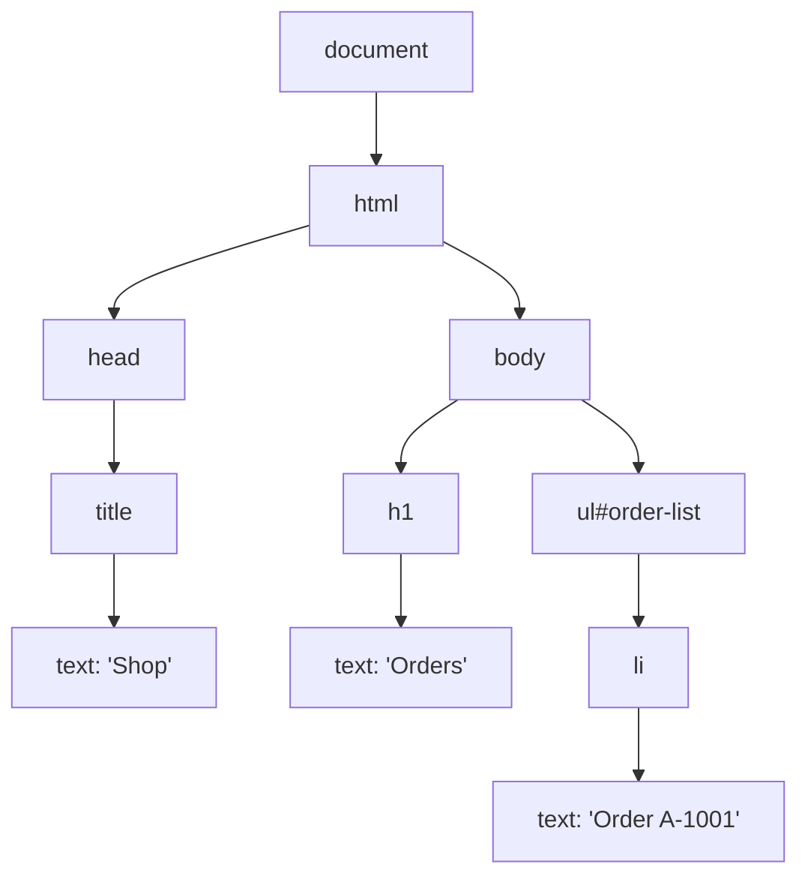
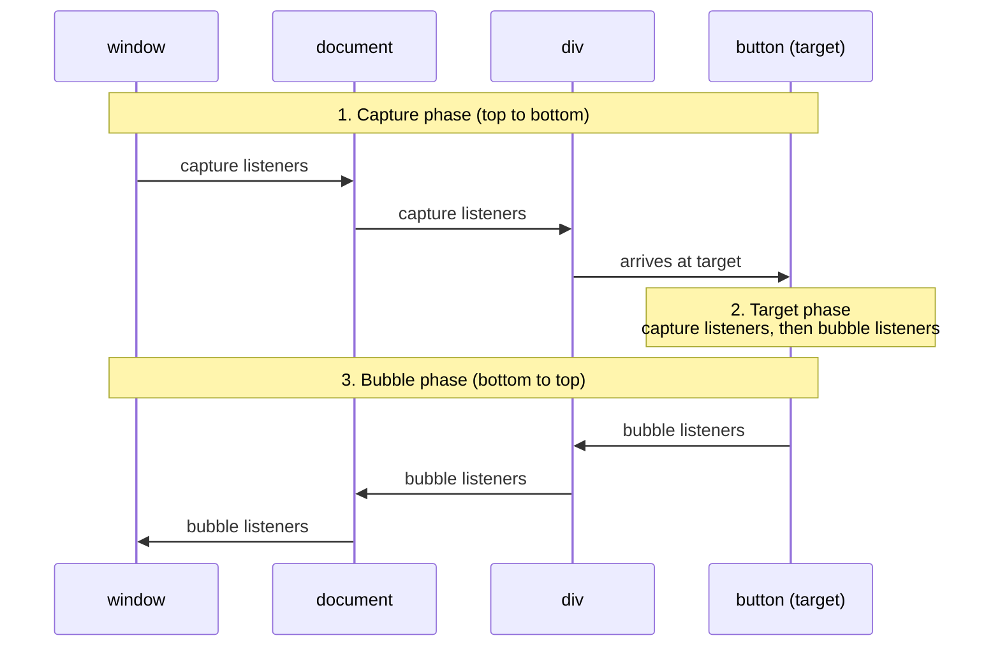
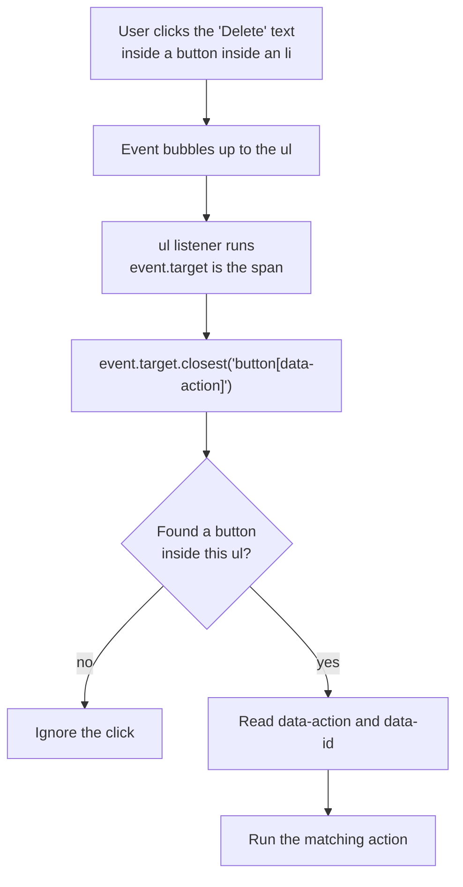

# DOM and Events

> In this document you will learn how JavaScript reads and changes a web page through the DOM, how browser events travel through the page, and how to use event delegation and observers in real applications. Interviewers use these topics to check that you understand what frameworks like Angular and React do for you underneath, and that you can write safe, fast DOM code without a framework.

**Before this:** [HTML semantics and forms](./01-html-semantics-and-forms.md), [The event loop](../02-javascript/16-event-loop.md) · **Interview questions:** [jump to questions](#interview-questions)

## Table of contents

1. [What the DOM is](#what-the-dom-is)
2. [Nodes and elements](#nodes-and-elements)
3. [Selecting elements](#selecting-elements)
4. [Traversing the DOM](#traversing-the-dom)
5. [Creating, inserting and removing elements](#creating-inserting-and-removing-elements)
6. [innerHTML, textContent and innerText](#innerhtml-textcontent-and-innertext)
7. [Attributes and properties](#attributes-and-properties)
8. [classList, dataset and style](#classlist-dataset-and-style)
9. [Events and addEventListener](#events-and-addeventlistener)
10. [The event object](#the-event-object)
11. [Event propagation: capture, target and bubble](#event-propagation-capture-target-and-bubble)
12. [stopPropagation, stopImmediatePropagation and preventDefault](#stoppropagation-stopimmediatepropagation-and-preventdefault)
13. [Event delegation](#event-delegation)
14. [Custom events](#custom-events)
15. [Keyboard, mouse, pointer and focus events](#keyboard-mouse-pointer-and-focus-events)
16. [Removing event listeners](#removing-event-listeners)
17. [Observers](#observers)
18. [DOM performance](#dom-performance)
19. [Example: a todo list with event delegation](#example-a-todo-list-with-event-delegation)
20. [How to explain event delegation in an interview](#how-to-explain-event-delegation-in-an-interview)
21. [Interview questions](#interview-questions)
22. [Summary](#summary)
23. [References](#references)

---

## What the DOM is

### What it is

The **DOM** (Document Object Model) is the browser's live, in-memory model of the page. When the browser reads HTML, it builds a **tree of objects**. Each tag becomes an object. JavaScript can read this tree and change it, and the browser updates the screen to match.

```html
<!doctype html>
<html lang="en">
  <head><title>Shop</title></head>
  <body>
    <h1>Orders</h1>
    <ul id="order-list">
      <li>Order A-1001</li>
    </ul>
  </body>
</html>
```



### Why it exists

HTML is just text. To make a page interactive (open a menu, add an item to a cart, show an error), a program needs objects it can change. The DOM gives JavaScript that interface.

### Important distinctions

- **The DOM is not the HTML source.** The source is the text the server sent. The DOM is what the browser built from it, after fixing errors and after your scripts changed it. "View source" shows the source; the DevTools Elements panel shows the DOM.
- **The DOM is not JavaScript.** It is a **browser API** defined by the WHATWG DOM and HTML standards. JavaScript (ECMAScript) has no `document`. Node.js has no DOM either, unless you use a library like jsdom (used by Jest's `jsdom` test environment).
- **The DOM is not the pixels.** Changing the DOM does not repaint the screen immediately. The browser collects changes and renders at the next frame. The rendering pipeline is explained in [Browser architecture and rendering](../01-cs-and-web-fundamentals/07-browser-architecture-and-rendering.md).

### Analogy

The HTML file is like an architect's printed plan. The DOM is the actual building constructed from the plan. You can add a wall or move a door in the building (the DOM) without changing the old printed plan (the source file).

---

## Nodes and elements

Everything in the DOM tree is a **node**. An **element** is one kind of node: the kind made from a tag.

| Node type | `nodeType` | Example |
|---|---|---|
| Element | `1` (`Node.ELEMENT_NODE`) | `<li>`, `<div>` |
| Text | `3` (`Node.TEXT_NODE`) | The text inside a tag, **including whitespace and line breaks** |
| Comment | `8` | `<!-- note -->` |
| Document | `9` | `document` |
| DocumentFragment | `11` | A lightweight container (see below) |

This matters because whitespace between tags becomes text nodes:

```html
<ul id="menu">
  <li>Home</li>
  <li>Orders</li>
</ul>
```

```js
const menu = document.getElementById("menu");
console.log(menu.childNodes.length);      // 5  (text, li, text, li, text)
console.log(menu.children.length);        // 2  (only the elements)
console.log(menu.firstChild.nodeName);    // "#text" (the line break before the first li)
console.log(menu.firstElementChild.textContent); // "Home"
```

The class hierarchy explains which methods each object has: `EventTarget` → `Node` → `Element` → `HTMLElement` → `HTMLInputElement`. For example, `addEventListener` comes from `EventTarget`, `appendChild` from `Node`, `querySelector` and `classList` from `Element`, and `value` from `HTMLInputElement`.

---

## Selecting elements

| Method | Returns | Live or static? |
|---|---|---|
| `document.getElementById("cart")` | One element or `null` | — |
| `element.querySelector(".item")` | The **first** match or `null` | — |
| `element.querySelectorAll(".item")` | `NodeList` of all matches | **Static** (a snapshot) |
| `element.getElementsByClassName("item")` | `HTMLCollection` | **Live** (updates automatically) |
| `element.getElementsByTagName("li")` | `HTMLCollection` | **Live** |
| `element.closest(".card")` | The element itself or the nearest ancestor that matches, or `null` | — |
| `element.matches(".btn.primary")` | `true` / `false` | — |

```js
const cart = document.getElementById("cart");
const firstItem = document.querySelector("#cart .item");
const allItems = document.querySelectorAll("#cart .item");
const saveButton = document.querySelector('button[type="submit"]');

// Search inside an element, not the whole document (faster, fewer surprises)
const totals = cart.querySelectorAll(".item-total");
```

### Always handle null

```js
// ❌ Wrong: crashes with "Cannot read properties of null" if the element is missing
document.querySelector("#promo-banner").classList.add("visible");

// ✅ Correct: check, or use optional chaining when missing is acceptable
const banner = document.querySelector("#promo-banner");
if (banner) banner.classList.add("visible");
// or
document.querySelector("#promo-banner")?.classList.add("visible");
```

A very common reason for `null` is running the script **before** the HTML is parsed. Use `<script defer>` or `type="module"`, or wait for `DOMContentLoaded`.

### Live versus static collections

A **live** collection updates itself whenever the DOM changes. A **static** collection is a snapshot from the moment you asked.

```html
<p class="highlight">a</p>
<p class="highlight">b</p>
<p class="highlight">c</p>
<p class="highlight">d</p>
```

```js
const live = document.getElementsByClassName("highlight");
const snapshot = document.querySelectorAll(".highlight");

// ❌ Bug: removing the class shrinks the live collection while we loop
for (let i = 0; i < live.length; i++) {
  live[i].classList.remove("highlight");
}
console.log(live.length);     // 2  (two paragraphs were skipped!)
console.log(snapshot.length); // 4  (the snapshot never changes)
```

Step by step:

1. `i = 0`: remove the class from "a". The live list is now [b, c, d].
2. `i = 1`: `live[1]` is "c" (not "b"). Remove it. The list is now [b, d].
3. `i = 2`: `2 < live.length` (2) is false. The loop ends. "b" and "d" still have the class.

```js
// ✅ Correct: loop over a static list
document.querySelectorAll(".highlight").forEach((p) => p.classList.remove("highlight"));
// or convert the live collection first: [...live].forEach(...)
```

Notes:

- `NodeList` has `forEach`. `HTMLCollection` does not; use `Array.from()` or spread.
- `element.childNodes` is a live `NodeList`; `element.children` is a live `HTMLCollection`.

---

## Traversing the DOM

**Traversal** means moving from one node to related nodes.

| Goal | Elements only (usually what you want) | All nodes (includes text and comments) |
|---|---|---|
| Parent | `parentElement` | `parentNode` |
| Children | `children` | `childNodes` |
| First / last child | `firstElementChild` / `lastElementChild` | `firstChild` / `lastChild` |
| Next / previous sibling | `nextElementSibling` / `previousElementSibling` | `nextSibling` / `previousSibling` |
| Nearest matching ancestor | `closest(selector)` | — |

```js
// From a clicked "Remove" button, find the row and its data
const removeButton = document.querySelector(".cart-row .remove");
const row = removeButton.closest(".cart-row");            // the row element
const productName = row.querySelector(".name").textContent;
const nextRow = row.nextElementSibling;                  // the next row, or null
```

Prefer `closest()` and `querySelector()` over chains like `button.parentElement.parentElement.firstElementChild`. Chains break as soon as someone adds a wrapper `<div>`.

---

## Creating, inserting and removing elements

### Creating

```js
const item = document.createElement("li");
item.className = "order-item";
item.textContent = "Order A-1002"; // safe: text, not HTML
item.dataset.orderId = "A-1002";
```

### Inserting

| Method | Where | Accepts strings? | Returns |
|---|---|---|---|
| `parent.append(...nodes)` | End of parent | Yes (as text) | `undefined` |
| `parent.prepend(...nodes)` | Start of parent | Yes | `undefined` |
| `node.before(...nodes)` / `node.after(...nodes)` | Next to a node | Yes | `undefined` |
| `node.replaceWith(...nodes)` | Replace a node | Yes | `undefined` |
| `parent.replaceChildren(...nodes)` | Replace all children (or clear with no arguments) | Yes | `undefined` |
| `parent.appendChild(node)` | End of parent (older API) | No, one node only | The appended node |
| `parent.insertBefore(newNode, referenceNode)` | Before a child (older API) | No | The inserted node |

```js
const list = document.getElementById("order-list");
list.append(item);                          // add at the end
list.prepend(document.createElement("li")); // add at the start
list.append("Plain text", document.createElement("hr")); // several nodes and text at once
list.replaceChildren();                     // remove all children
```

### Inserting HTML at a position: insertAdjacentHTML

```js
const card = document.getElementById("card");
card.insertAdjacentHTML("beforebegin", "<p>before the card</p>");
card.insertAdjacentHTML("afterbegin", "<p>first child of the card</p>");
card.insertAdjacentHTML("beforeend", "<p>last child of the card</p>");
card.insertAdjacentHTML("afterend", "<p>after the card</p>");
```

```text
<p>before the card</p>          <- beforebegin
<div id="card">
  <p>first child of the card</p> <- afterbegin
  ...existing children...
  <p>last child of the card</p>  <- beforeend
</div>
<p>after the card</p>           <- afterend
```

Unlike `innerHTML +=`, it does not destroy and recreate the existing children, so their event listeners and state survive. But it **parses HTML**, so it has the same XSS risk as `innerHTML`. Never pass user data to it. There is also `insertAdjacentText` and `insertAdjacentElement`, which are safe.

### Moving: inserting an existing node moves it

A node can only be in one place. If you append a node that is already in the document, it is **moved**, not copied.

```js
const first = list.firstElementChild;
list.append(first); // the first item is now the last item; the count does not change
```

### DocumentFragment: build off-screen, insert once

A **DocumentFragment** is a lightweight container that is not part of the page. You add many nodes to it, then insert it once. When you insert a fragment, its **children move** into the target and the fragment becomes empty.

```js
const products = [
  { id: 1, name: "TrailRunner 3" },
  { id: 2, name: "City Walker" },
  { id: 3, name: "Rain Jacket" },
];

const fragment = document.createDocumentFragment();
for (const product of products) {
  const li = document.createElement("li");
  li.textContent = product.name;
  li.dataset.productId = product.id;
  fragment.append(li);
}

console.log(fragment.childNodes.length); // 3
productList.append(fragment);            // one insertion into the live page
console.log(fragment.childNodes.length); // 0 (the children moved)
```

Modern browsers already batch DOM changes until the next frame, so a fragment is not a big speed win for simple appends. Its real value: one insertion point, and no partial UI if building fails halfway. `append(...nodes)` with many arguments gives a similar result.

### cloneNode and template

```js
const original = document.querySelector(".product-card");
const shallowCopy = original.cloneNode();   // only the element, no children
const deepCopy = original.cloneNode(true);  // the element and all descendants
```

`cloneNode` copies attributes and children, but **not** event listeners added with `addEventListener`, and not JavaScript properties you set on the object. Combine it with `<template>` (see [HTML semantics](./01-html-semantics-and-forms.md#template-dialog-and-web-components)) to render lists of repeated markup.

### Removing

```js
item.remove();                // modern: remove this node
list.removeChild(item);       // older: the parent removes a child
list.replaceChildren();       // remove all children
```

A removed node still exists in memory while any variable refers to it. If you keep references in long-lived objects (arrays, Maps, closures in global listeners), the browser cannot free them. These are called **detached DOM nodes**, a common memory leak. See [Memory management](../02-javascript/19-memory-management-and-garbage-collection.md).

---

## innerHTML, textContent and innerText

| Property | Reads | Writes | Speed | XSS risk on write |
|---|---|---|---|---|
| `innerHTML` | The HTML markup inside the element, as a string | Parses the string as HTML and replaces all children | Slowest (parsing) | **Yes** |
| `textContent` | All text of all descendants, including hidden elements and `<script>` text | Replaces all children with one text node | Fast | No |
| `innerText` | Only the text **as rendered**: respects CSS (`display: none` hidden), line breaks | Replaces children with text (and `<br>` for line breaks) | Slow on read: needs layout | No |
| `outerHTML` | The element itself plus its content | Replaces the element itself | | Yes |

```html
<div id="message">Hello <span style="display:none">secret</span><script>var x = 1</script>  world</div>
```

```js
const message = document.getElementById("message");
console.log(message.textContent); // "Hello secretvar x = 1  world"
console.log(message.innerText);   // "Hello world"   (rendered text only; browser behavior)
console.log(message.innerHTML);   // 'Hello <span style="display:none">secret</span><script>var x = 1</script>  world'
```

(Verified in Chrome. `innerText` depends on layout, so it is not available in jsdom.)

### The XSS risk

```js
const productReview = '';

// ❌ Wrong: the browser parses the string, creates the , the image fails, onerror runs
reviewElement.innerHTML = productReview;

// ✅ Correct: shown as plain text
reviewElement.textContent = productReview;
```

Note: a `<script>` tag inserted with `innerHTML` does **not** run, but event handler attributes like `onerror` do. So "there is no script tag" does not mean "safe".

Rules:

- Use `textContent` for text. It is the default choice.
- Use `innerHTML` only with HTML you fully control (a static string in your code), or with HTML cleaned by a well-tested sanitizer such as DOMPurify.
- `innerHTML += "..."` re-parses **all** the existing content, destroys existing nodes (their listeners and input values are lost), and creates new ones. Use `append` or `insertAdjacentHTML` instead.
- In Angular, use `{{ }}` interpolation for text. Angular's `[innerHTML]` binding sanitizes values automatically. See [Angular security](../06-angular-16/15-security.md) and [Web security](../10-testing-security-production/05-web-security-xss-csrf-cors-csp.md).

---

## Attributes and properties

### What they are

- An **attribute** is written in the HTML: `<input value="old@example.com">`. It is always a string. You read it with `getAttribute`.
- A **property** is a field on the JavaScript object: `input.value`. It can be any type (string, boolean, number, object).

For most standard attributes, the browser creates a matching property and keeps them in sync. But not always, and not in both directions.

### The value example

```html
<input id="email" value="old@example.com" />
```

```js
const email = document.getElementById("email");

email.value = "new@example.com";        // the user types, or code sets the property
console.log(email.value);               // "new@example.com"   (current value)
console.log(email.getAttribute("value")); // "old@example.com"  (initial value, unchanged)
console.log(email.defaultValue);        // "old@example.com"  (the property that reflects the attribute)

email.setAttribute("value", "changed@example.com");
console.log(email.value);               // "new@example.com"   (the field was already edited, so it keeps its value)
```

The `value` **attribute** is the **initial** (default) value. The `value` **property** is the **current** value. After the field has been changed, setting the attribute does not change what the user sees. This is why `form.reset()` can restore the original values: it copies the attributes back.

### More differences

```js
// href: the property is the full resolved URL; the attribute is what you wrote
// <a id="link" href="/orders?page=2">   on page https://shop.example.com/products/
link.href;                 // "https://shop.example.com/orders?page=2"
link.getAttribute("href"); // "/orders?page=2"

// checked: the property is a boolean and is the current state
// <input id="agree" type="checkbox" checked>
agree.checked = false;
agree.checked;                  // false
agree.hasAttribute("checked");  // true  (the attribute still says "initially checked")

// Boolean attributes: presence means true, even with the value "false"
// <button disabled="false">  -> the button IS disabled
button.disabled = false;        // ✅ correct way to enable it
button.removeAttribute("disabled"); // also correct
```

| Attribute | Property | Note |
|---|---|---|
| `class` | `className` (string) / `classList` (object) | `class` is a reserved word in old JavaScript |
| `for` (on label) | `htmlFor` | |
| `value` | `defaultValue` (attribute), `value` (current) | |
| `checked` | `defaultChecked` (attribute), `checked` (current) | |
| `data-user-id` | `dataset.userId` | |
| `aria-expanded` | `ariaExpanded` (newer reflection) | Using `setAttribute` is the most common style |
| Custom `my-thing="x"` | none | Use `getAttribute` |

Rule of thumb: use **properties** for current state (`value`, `checked`, `disabled`), and **attributes** for things that only exist as attributes (ARIA, custom attributes) or when you need the original HTML value.

> **Angular connection:** `[value]="x"` is a **property** binding. To bind an attribute that has no property (like ARIA or `colspan` on some elements), Angular uses `[attr.aria-label]="label"`. This is the same attribute versus property distinction.

---

## classList, dataset and style

### classList

```js
const panel = document.querySelector(".panel");
panel.classList.add("is-open", "is-highlighted");
panel.classList.remove("is-highlighted");
panel.classList.toggle("is-open");               // add if missing, remove if present
panel.classList.toggle("is-open", isMenuOpen);   // force: add if true, remove if false
panel.classList.replace("theme-light", "theme-dark");
console.log(panel.classList.contains("is-open"));
```

Prefer toggling classes over setting many inline styles. The CSS stays in stylesheets, where it can use media queries, transitions and themes.

### dataset

```js
// <button data-action="delete" data-order-id="A-1001">
button.dataset.action;   // "delete"
button.dataset.orderId;  // "A-1001"  (kebab-case becomes camelCase)
button.dataset.status = "pending"; // adds data-status="pending"
```

Values are always strings. More in [HTML data attributes](./01-html-semantics-and-forms.md#data-attributes).

### style and getComputedStyle

```js
const toast = document.querySelector(".toast");

// Writes inline styles (highest priority except !important)
toast.style.transform = "translateY(0)";
toast.style.backgroundColor = "seagreen";         // camelCase in JavaScript
toast.style.setProperty("--toast-accent", "gold"); // custom properties need setProperty

// element.style shows ONLY inline styles, not styles from CSS files
console.log(toast.style.color); // "" if color comes from a stylesheet

// The final value after the cascade:
console.log(getComputedStyle(toast).color); // for example "rgb(17, 24, 39)"
```

`getComputedStyle` may force the browser to recalculate styles (and layout for geometry properties), so avoid calling it inside loops that also write styles. See [DOM performance](#dom-performance).

---

## Events and addEventListener

### What an event is

An **event** is a signal that something happened: the user clicked, a key was pressed, an image finished loading, a form was submitted. Your code **listens** for an event and runs a function, called a **listener** or **handler**, when it happens.

Events are part of the browser (DOM) API. The listener does not run at the moment of the click. The browser puts a task in its queue, and the event loop runs your listener when the call stack is free. See [The event loop](../02-javascript/16-event-loop.md).

### addEventListener

```js
const saveButton = document.querySelector("#save-order");

function handleSave(event) {
  console.log("Saving order...", event.type); // "Saving order... click"
}

saveButton.addEventListener("click", handleSave);
```

The full signature is `target.addEventListener(type, listener, options)`. The options object:

| Option | Default | Meaning |
|---|---|---|
| `capture` | `false` | Run during the capture phase instead of the bubble phase (see propagation below) |
| `once` | `false` | Remove the listener automatically after it runs one time |
| `passive` | `false`* | Promise that you will **not** call `preventDefault()`. The browser can then scroll immediately, without waiting for your code |
| `signal` | none | An `AbortSignal`. When it is aborted, the listener is removed |

\* Browsers other than Safari treat `wheel`, `mousewheel`, `touchstart` and `touchmove` listeners on `window`, `document` and `body` as passive by default.

A third argument of `true` or `false` (instead of an object) means `capture`.

```js
// Runs once, then removes itself
dialogOpenButton.addEventListener("click", loadDialogContent, { once: true });

// Passive: smooth scrolling on touch devices
window.addEventListener("touchmove", trackGesture, { passive: true });

// Many listeners removed with one call
const controller = new AbortController();
window.addEventListener("resize", onResize, { signal: controller.signal });
window.addEventListener("keydown", onKeydown, { signal: controller.signal });
controller.abort(); // both listeners are gone
```

In a passive listener, `preventDefault()` is ignored (the browser logs a warning in the console). In the Chrome test, a cancelable `wheel` event handled by a passive listener had `defaultPrevented === false`, while a normal listener made it `true`.

### Other ways to attach handlers, and why addEventListener is preferred

```html
<!-- 1. Inline HTML attribute: avoid -->
<button onclick="saveOrder()">Save</button>
```

```js
// 2. Event handler property: only ONE handler per event
saveButton.onclick = () => console.log("first");
saveButton.onclick = () => console.log("second"); // replaces the first

// 3. addEventListener: many handlers, options, capture, easy removal
saveButton.addEventListener("click", () => console.log("A"));
saveButton.addEventListener("click", () => console.log("B")); // both run, in order
```

Inline attributes mix HTML and code, run in the global scope, and are blocked by a strict **Content Security Policy** (which forbids inline scripts). Handler properties allow only one handler. `addEventListener` has none of these problems.

Two more facts:

- Adding the **same function** for the same event type and the same capture flag twice has **no effect**. The listener is registered once.
- Inside a normal `function` listener, `this` is the element the listener is attached to (`event.currentTarget`). Inside an arrow function, `this` comes from the surrounding code. Using `event.currentTarget` is clearer in both cases. See [this, call, apply and bind](../02-javascript/06-this-call-apply-bind.md).

---

## The event object

Every listener receives an **event object** with information about what happened.

| Property / method | Meaning |
|---|---|
| `type` | `"click"`, `"keydown"`, ... |
| `target` | The element where the event started (the deepest element, for example the `<span>` inside a button) |
| `currentTarget` | The element whose listener is running right now (the element you called `addEventListener` on) |
| `eventPhase` | `1` capture, `2` at target, `3` bubble |
| `bubbles` / `cancelable` | Whether the event bubbles; whether `preventDefault()` can cancel its default action |
| `defaultPrevented` | Whether someone called `preventDefault()` |
| `isTrusted` | `true` if the user caused it, `false` if code created it with `dispatchEvent` or `.click()` |
| `timeStamp` | When the event was created |
| `composedPath()` | The array of objects the event travels through, from target to window |
| `preventDefault()`, `stopPropagation()`, `stopImmediatePropagation()` | See below |

Event types add their own properties: `MouseEvent` has `clientX`, `button`; `KeyboardEvent` has `key`, `code`; `InputEvent` has `data`; `SubmitEvent` has `submitter`.

### target versus currentTarget

```html
<ul id="order-list">
  <li><button data-order-id="7"><span>Delete</span></button></li>
</ul>
```

```js
document.getElementById("order-list").addEventListener("click", (event) => {
  console.log(event.target.tagName);       // "SPAN"  (the user clicked the text)
  console.log(event.currentTarget.id);     // "order-list" (the listener's element)
  console.log(event.target.closest("button")?.dataset.orderId); // "7"
});
```

This difference is the base of event delegation: `target` is *what was clicked*, `currentTarget` is *who is listening*.

`currentTarget` is only set while the listener runs. If you `console.log(event)` and expand it later in DevTools, it shows `currentTarget: null`, because the dispatch has finished. Read it inside the listener.

---

## Event propagation: capture, target and bubble

### What it is

When you click a button inside a list inside the page, you have clicked **all** of them: the button, the list item, the list, the body, the document. **Propagation** is the path the event travels so that listeners on all these ancestors get a chance to react.

The path has three phases:

1. **Capture phase:** from `window` down through each ancestor to the target's parent.
2. **Target phase:** at the target element itself.
3. **Bubble phase:** from the target's parent back up to `window`.

By default, `addEventListener` listens in the **bubble** phase. Pass `{ capture: true }` to listen in the capture phase.



### Example: the full order

```html
<div id="outer">
  <div id="inner">
    <button id="save">Save</button>
  </div>
</div>
```

```js
const outer = document.getElementById("outer");
const inner = document.getElementById("inner");
const save = document.getElementById("save");

window.addEventListener("click", () => console.log("window capture"), true);
document.addEventListener("click", () => console.log("document capture"), true);
outer.addEventListener("click", () => console.log("outer capture"), true);
outer.addEventListener("click", () => console.log("outer bubble"));
inner.addEventListener("click", () => console.log("inner bubble"));
save.addEventListener("click", () => console.log("button bubble"));
save.addEventListener("click", () => console.log("button capture"), true); // registered last!
document.addEventListener("click", () => console.log("document bubble"));
window.addEventListener("click", () => console.log("window bubble"));

save.click();
```

```text
window capture
document capture
outer capture
button capture
button bubble
inner bubble
outer bubble
document bubble
window bubble
```

(Verified in Chrome and jsdom.) Notes:

- `inner` has only a bubble listener, so it does nothing in the capture phase.
- **At the target**, capture listeners run before bubble listeners, even though "button capture" was registered after "button bubble". This is the current DOM standard (Chrome changed to it in version 89). Very old explanations say target listeners run purely in registration order.

### Why have two phases?

- **Bubble** is what you normally want: a parent reacts to events from its children (event delegation).
- **Capture** lets an ancestor see the event **first**, before the target. Uses: closing a dropdown when the user clicks anywhere else, analytics that must see every click even if a child stops propagation, or blocking clicks during a loading state.

### Not all events bubble

| Does not bubble | Bubbling alternative |
|---|---|
| `focus`, `blur` | `focusin`, `focusout` |
| `mouseenter`, `mouseleave` | `mouseover`, `mouseout` |
| `load`, `error` on images and scripts | Use capture on an ancestor: `document.addEventListener("error", handler, true)` |
| `scroll` on an element | Listen on the scrolling element itself (or use capture) |
| `invalid` on form fields | Use capture on the form |

Non-bubbling events still go through the **capture** phase. That is why a capture listener on an ancestor can see them.

---

## stopPropagation, stopImmediatePropagation and preventDefault

These three methods solve **different** problems. Mixing them up is a common interview mistake.

| Method | What it stops | What still happens |
|---|---|---|
| `event.stopPropagation()` | The event moving to **other elements** | Other listeners **on the current element** still run; the default action still happens |
| `event.stopImmediatePropagation()` | Other elements **and** the remaining listeners on the current element | The default action still happens |
| `event.preventDefault()` | The browser's **default action** (follow a link, submit a form, toggle a checkbox, open the context menu, type a character) | Propagation continues normally |

```js
// parent has a click listener that logs "parent"
button.addEventListener("click", (event) => {
  console.log("first");
  event.stopPropagation();
});
button.addEventListener("click", () => console.log("second"));
button.click();
// first
// second         <- same element: still runs
// ("parent" is NOT logged)

// With stopImmediatePropagation() instead:
// first           <- "second" and "parent" are both skipped
```

(Both verified in jsdom.)

```js
// preventDefault: stop the link navigation, handle it in JavaScript (a simple client-side router)
document.querySelector("nav").addEventListener("click", (event) => {
  const link = event.target.closest("a[data-internal]");
  if (!link) return;
  event.preventDefault(); // do not load a new page
  history.pushState({}, "", link.href);
  renderRoute(link.pathname);
});
```

Details:

- `preventDefault()` only works if `event.cancelable` is `true`. For example, `scroll` cannot be canceled (cancel `wheel` or `touchmove` instead, without `passive`).
- `return false` inside an `addEventListener` callback does **nothing**. Inside an `onclick` property handler it prevents the default. In jQuery it does both `preventDefault` and `stopPropagation`. This confuses many people; call the methods explicitly.
- `dispatchEvent()` returns `false` if a listener canceled a cancelable event.

### Why stopPropagation is often a bad idea

```js
// ❌ A "quick fix": stop the click so the dropdown's document listener does not close it
menuButton.addEventListener("click", (event) => {
  event.stopPropagation();
  toggleMenu();
});
```

This breaks every other code that listens higher up: analytics, other dropdowns that should close, delegated handlers, framework handlers. A better pattern checks *where* the click happened:

```js
// ✅ Close the menu when the click is outside of it
document.addEventListener("click", (event) => {
  if (!menu.contains(event.target) && !menuButton.contains(event.target)) {
    closeMenu();
  }
});
```

---

## Event delegation

### What it is

**Event delegation** means you attach **one** listener to a common ancestor instead of one listener to each child. When an event bubbles up from a child, the ancestor's listener checks *which* child it came from and acts.

### Why it exists

- A list with 1,000 rows would need 1,000 listeners (or 3,000 for edit, delete and select buttons). One listener uses less memory and less setup time.
- Rows added later (new todos, loaded pages of results) work automatically. No need to attach listeners to each new element.
- Cleanup is simple: remove one listener, or remove the container.

### Analogy

Instead of giving every apartment in a building its own mail carrier, the building has one front desk. All mail arrives at the desk, and the desk reads the apartment number and delivers it.

### How it works



### Implementation

```html
<ul id="cart-items">
  <li data-id="p1">
    TrailRunner 3
    <button type="button" data-action="increase" aria-label="Increase quantity of TrailRunner 3">+</button>
    <button type="button" data-action="remove"><span class="icon" aria-hidden="true">&times;</span> Remove</button>
  </li>
  <!-- more rows, added and removed at runtime -->
</ul>
```

```js
const cartList = document.getElementById("cart-items");

const actions = {
  increase(productId) { cartService.increase(productId); },
  remove(productId) { cartService.remove(productId); },
};

cartList.addEventListener("click", (event) => {
  // 1. Find the button, even if the click landed on the icon span inside it
  const button = event.target.closest("button[data-action]");

  // 2. Ignore clicks outside buttons, and buttons outside this list
  if (!button || !cartList.contains(button)) return;

  // 3. Read the data and run the action
  const productId = button.closest("li").dataset.id;
  actions[button.dataset.action]?.(productId);
});
```

Why each line matters:

- **`closest()` instead of `event.target.matches()`**: the user often clicks a child (an icon, a `<span>`, a `<strong>`), so `event.target` is not the button. `closest()` walks up from the target (including the target itself).
- **`cartList.contains(button)`**: `closest()` can walk *above* the container. If the whole list sits inside another element that also matches the selector, you would act on the wrong element. This check keeps the match inside your container.
- **A map of actions**: avoids a long `if/else` chain, and makes adding an action easy.

A reusable helper:

```js
function delegate(container, eventType, selector, handler, options) {
  const listener = (event) => {
    const match = event.target.closest(selector);
    if (match && container.contains(match)) {
      handler.call(match, event, match);
    }
  };
  container.addEventListener(eventType, listener, options);
  return () => container.removeEventListener(eventType, listener, options); // cleanup function
}

const stop = delegate(cartList, "click", "button[data-action='remove']", (event, button) => {
  console.log("remove", button.closest("li").dataset.id);
});
// later: stop();
```

### Limitations

- Works only for events that **bubble**. For focus, delegate with `focusin`/`focusout`.
- If a child calls `stopPropagation()`, the parent never hears the event.
- For very frequent events (`mousemove`, `pointermove`, `scroll`), the parent runs its matching logic for every movement over every child. Measure; sometimes direct listeners or throttling are better.
- The `event.target` can be a **text node** in rare cases (old browsers, some synthetic events). `closest` only exists on elements, so defensive code checks `event.target instanceof Element`.

### Real-world usage

- **Frameworks:** React attaches its event listeners at the root container (since React 17) and dispatches to components itself: event delegation at framework level. Angular attaches listeners directly to the elements in templates (through its renderer), so delegation in Angular is a manual optimization for very large lists.
- **jQuery:** `$(list).on("click", ".item", handler)` is delegation.
- **Plain JavaScript widgets:** data tables, menus, todo lists, comment threads.

---

## Custom events

### What they are

You can create and send your own events with **`CustomEvent`** and **`dispatchEvent`**. They use the same listener system as built-in events, and can carry data in `detail`.

```js
// A product card announces that the user wants to add it to the cart
const addButton = document.querySelector("#add-to-cart");
const cartWidget = document.querySelector("#cart-widget");

document.addEventListener("cart:add", (event) => {
  console.log("Cart heard:", event.detail.productId);
});

addButton.addEventListener("click", () => {
  const cartEvent = new CustomEvent("cart:add", {
    detail: { productId: 42, quantity: 1 },
    bubbles: true,     // ❗ default is false: without it, ancestors never hear it
    cancelable: true,  // allow listeners to call preventDefault()
    composed: false,   // true lets it cross shadow DOM boundaries (web components)
  });
  const notCanceled = addButton.dispatchEvent(cartEvent);
  if (!notCanceled) console.log("A listener canceled the add");
});
```

### dispatchEvent is synchronous

```js
button.addEventListener("cart:add", (e) => console.log("button heard", e.detail.productId));
cart.addEventListener("cart:add", (e) => console.log("cart heard", e.detail.productId)); // cart is the parent

console.log("before dispatch");
button.dispatchEvent(new CustomEvent("cart:add", { detail: { productId: 42 } }));
console.log("after non-bubbling dispatch");
button.dispatchEvent(new CustomEvent("cart:add", { detail: { productId: 43 }, bubbles: true }));
console.log("after bubbling dispatch");
```

```text
before dispatch
button heard 42
after non-bubbling dispatch
button heard 43
cart heard 43
after bubbling dispatch
```

(Verified in jsdom.) `dispatchEvent` runs all listeners **immediately**, before it returns. It is not queued like a user click. And the first event did not reach `cart` because `bubbles` defaults to `false`.

### When to use custom events

- Communication between independent parts of a plain JavaScript page (a widget tells the page "filter changed").
- **Web components** use them to send events to the outside (`composed: true` to leave the shadow root).
- Namespacing the name (`cart:add`, `filters:change`) avoids clashes with built-in events.

> **Angular note:** Angular's `@Output()` with `EventEmitter` is **not** a DOM event. It does not bubble, and only the direct parent template can listen to it with `(itemAdded)="..."`. Angular Elements (`@angular/elements`) turns outputs into real DOM custom events when the component is used as a web component.

---

## Keyboard, mouse, pointer and focus events

### Keyboard events

| Event | When |
|---|---|
| `keydown` | A key is pressed. Repeats while held (`event.repeat` is `true`). Can be canceled. |
| `keyup` | A key is released |
| `keypress` | **Deprecated.** Do not use. |

```js
searchInput.addEventListener("keydown", (event) => {
  if (event.isComposing) return; // the user is typing with an IME (for example Chinese or Japanese input)

  if (event.key === "Escape") {
    clearSearch();
  } else if (event.key === "ArrowDown") {
    event.preventDefault(); // stop the cursor or page from moving
    highlightNextSuggestion();
  } else if (event.key === "Enter") {
    selectHighlightedSuggestion();
  }
});

// Keyboard shortcut: Ctrl+S (Windows/Linux) or Cmd+S (macOS)
document.addEventListener("keydown", (event) => {
  if ((event.ctrlKey || event.metaKey) && event.key.toLowerCase() === "s") {
    event.preventDefault(); // stop the browser's "Save page" dialog
    saveDraft();
  }
});
```

`event.key` versus `event.code`:

- **`key`** is the character or key *meaning*: `"a"`, `"A"`, `"Enter"`, `"ArrowDown"`. It changes with keyboard layout and Shift. Use it for text and most shortcuts.
- **`code`** is the *physical* key position: `"KeyA"` is the key where "A" sits on a US keyboard, even on a French keyboard where it types "Q". Use it for games (WASD movement).
- `keyCode` and `which` are deprecated numbers. Do not use them in new code.

### Mouse events

| Event | Bubbles? | Note |
|---|---|---|
| `click` | Yes | Also fires for keyboard activation of buttons and links (Enter, Space) |
| `dblclick`, `contextmenu` | Yes | |
| `mousedown`, `mouseup`, `mousemove` | Yes | |
| `mouseover`, `mouseout` | Yes | Also fire when moving between child elements |
| `mouseenter`, `mouseleave` | **No** | Fire only when entering/leaving the element itself; simpler for hover effects |

Coordinates: `clientX/clientY` (relative to the viewport), `pageX/pageY` (relative to the document, including scroll), `offsetX/offsetY` (relative to the target element).

`click` is the right event for "activate" actions, because it also works with the keyboard on native buttons. `mousedown` does not.

### Pointer events

**Pointer events** (`pointerdown`, `pointermove`, `pointerup`, `pointercancel`, `pointerenter`, `pointerleave`) are one API for mouse, touch and pen. `event.pointerType` tells you which (`"mouse"`, `"touch"`, `"pen"`). They are the modern choice for dragging, drawing and gestures.

```js
slider.addEventListener("pointerdown", (event) => {
  slider.setPointerCapture(event.pointerId); // keep receiving moves even outside the slider
  startDrag(event.clientX);
});
slider.addEventListener("pointermove", (event) => {
  if (slider.hasPointerCapture(event.pointerId)) updateDrag(event.clientX);
});
slider.addEventListener("pointerup", endDrag);
slider.addEventListener("pointercancel", endDrag); // the browser took over (for example to scroll)
```

Add CSS `touch-action: none` on the draggable element so touch drags do not scroll the page. Remember that drag-only interactions need a keyboard alternative for accessibility (WCAG 2.2 "Dragging Movements").

### Focus events

| Event | Bubbles? |
|---|---|
| `focus`, `blur` | No |
| `focusin`, `focusout` | Yes (use these for delegation) |

`event.relatedTarget` tells you where focus came from (`focusin`) or where it is going (`focusout`). `document.activeElement` is the element that has focus now.

```js
// Close a dropdown when focus leaves it completely (keyboard users tab away)
dropdown.addEventListener("focusout", (event) => {
  if (!dropdown.contains(event.relatedTarget)) closeDropdown();
});
```

### Form and page events

| Event | When |
|---|---|
| `input` | Every change of an input's value (each keystroke, paste, autofill) |
| `change` | When the change is committed: on blur for text fields, immediately for checkboxes, radios and selects |
| `submit` | On the form, when it is submitted (see [Forms](./01-html-semantics-and-forms.md#forms)) |
| `DOMContentLoaded` | On `document`, when the HTML is parsed and deferred scripts have run. Images may still be loading. |
| `load` | On `window`, when everything (images, styles, iframes) has loaded |
| `visibilitychange` | On `document`, when the tab is hidden or shown. Pause polling or videos here. |
| `beforeunload` | Before leaving the page. Use only to warn about unsaved changes. |

---

## Removing event listeners

To remove a listener, `removeEventListener` must receive **the same function reference** and the **same capture flag** that were used to add it.

```js
// ❌ Wrong: a new arrow function is a different function. Nothing is removed.
button.addEventListener("click", () => saveDraft());
button.removeEventListener("click", () => saveDraft());

// ❌ Wrong: bind() creates a NEW function every time
button.addEventListener("click", this.handleClick.bind(this));
button.removeEventListener("click", this.handleClick.bind(this));

// ❌ Wrong: capture flag does not match
button.addEventListener("click", onClick, true);
button.removeEventListener("click", onClick);        // not removed

// ✅ Correct: keep the reference
const boundHandleClick = this.handleClick.bind(this);
button.addEventListener("click", boundHandleClick);
button.removeEventListener("click", boundHandleClick);

// ✅ Correct: matching capture flag
button.removeEventListener("click", onClick, { capture: true });
```

(The capture mismatch was verified in jsdom: the listener kept running until it was removed with `capture: true`.) Only `capture` matters for matching; `once` and `passive` do not.

### Modern cleanup with AbortController

```js
class ProductSearch {
  #controller = new AbortController();

  constructor(input, resultsList) {
    const { signal } = this.#controller;
    input.addEventListener("input", (e) => this.search(e.target.value), { signal });
    window.addEventListener("resize", () => this.layout(), { signal });
    document.addEventListener("keydown", (e) => this.onKey(e), { signal });
  }

  destroy() {
    this.#controller.abort(); // removes all three listeners; arrow functions are fine here
  }
}
```

### Why cleanup matters: memory leaks in SPAs

In a single-page app, components are created and destroyed many times without a page reload. A listener on `window` or `document` keeps its function alive, and that function's closure keeps the component and its DOM nodes alive. After visiting a page 20 times, you have 20 listeners running and 20 copies of the component in memory.

> **Angular:** Template bindings like `(click)="save()"` and `@HostListener` are removed automatically when the component is destroyed. Listeners you add yourself (`addEventListener`, `Renderer2.listen`, RxJS `fromEvent`) must be cleaned up in `ngOnDestroy`: call the function returned by `Renderer2.listen`, abort a controller, or end the RxJS subscription (`takeUntil`, or `takeUntilDestroyed` from `@angular/core/rxjs-interop`, which is a developer preview in Angular 16 and stable since Angular 19).

---

## Observers

Observers are browser APIs that **tell you when something changes**, instead of you checking again and again. They are more efficient than old approaches like listening to every `scroll` event and measuring elements.

| Observer | Tells you when... | Typical use |
|---|---|---|
| `IntersectionObserver` | An element enters or leaves the viewport (or another scroll container) | Lazy loading, infinite scroll, "seen" analytics, pausing off-screen videos |
| `MutationObserver` | The DOM tree changes (children, attributes, text) | Reacting to changes made by third-party code, editors, auto-saving |
| `ResizeObserver` | An element's size changes | Charts that redraw, components that adapt to their own size, auto-growing text areas |

### IntersectionObserver

#### Why it exists

The old way to know if an element is visible was a `scroll` listener that called `getBoundingClientRect()` on every scroll event. That runs on the main thread many times per second and forces layout. `IntersectionObserver` lets the browser compute visibility itself, efficiently, and calls you only when the visibility actually changes.

#### Lazy-loading images

```html


```

```js
const imageObserver = new IntersectionObserver(
  (entries, observer) => {
    for (const entry of entries) {
      if (!entry.isIntersecting) continue;
      const img = entry.target;
      img.src = img.dataset.src;   // start the download
      img.classList.remove("lazy");
      observer.unobserve(img);     // done with this image: stop watching it
    }
  },
  {
    root: null,            // null = the browser viewport
    rootMargin: "200px 0px", // start loading 200px BEFORE the image scrolls into view
    threshold: 0,          // call back as soon as any pixel is inside
  }
);

document.querySelectorAll("img.lazy").forEach((img) => imageObserver.observe(img));
```

For simple images, the native attribute `loading="lazy"` does the same with no JavaScript. Use `IntersectionObserver` when you need control: background images, custom placeholders, components, or analytics.

#### Infinite scroll with a sentinel

A **sentinel** is an empty element at the end of the list. When it becomes visible, you load the next page.

```html
<ul id="product-list"></ul>
<div id="load-more-sentinel" aria-hidden="true"></div>
<p id="list-status" role="status"></p>
```

```js
const list = document.getElementById("product-list");
const sentinel = document.getElementById("load-more-sentinel");
const status = document.getElementById("list-status");
let nextPage = 1;
let isLoading = false;

const sentinelObserver = new IntersectionObserver(async ([entry]) => {
  if (!entry.isIntersecting || isLoading) return;
  isLoading = true;
  status.textContent = "Loading more products...";
  try {
    const { items, hasMore } = await fetchProducts(nextPage++);
    list.append(...items.map(createProductItem));
    status.textContent = `${list.children.length} products loaded.`;
    if (!hasMore) sentinelObserver.disconnect();
  } catch {
    status.textContent = "Could not load more products.";
  } finally {
    isLoading = false;
  }
});

sentinelObserver.observe(sentinel);
```

Accessibility note: infinite scroll can trap keyboard users (they can never reach the footer) and confuses screen reader users. Offer a "Load more" button as well, or as an alternative, and announce new content in a live region as above.

#### Options and entry fields

| Option | Meaning |
|---|---|
| `root` | The scroll container to compare against; `null` means the viewport |
| `rootMargin` | Grows or shrinks the root box, like CSS margin (`"200px"` to start early) |
| `threshold` | A number or array between 0 and 1: how much of the target must be visible to trigger (`[0, 0.5, 1]` triggers at 0%, 50% and 100%) |

| Entry field | Meaning |
|---|---|
| `isIntersecting` | Whether the target is now inside the root (by the threshold) |
| `intersectionRatio` | How much is visible, from 0 to 1 |
| `target` | The observed element |
| `boundingClientRect`, `intersectionRect`, `rootBounds` | Geometry, already computed (no extra layout needed) |

The callback runs once right after you call `observe()`, with the current state. It runs asynchronously, as part of the browser's rendering steps, not synchronously during scrolling.

### MutationObserver

```js
const chatMessages = document.getElementById("chat-messages");

const messageObserver = new MutationObserver((mutations) => {
  for (const mutation of mutations) {
    if (mutation.type === "childList" && mutation.addedNodes.length > 0) {
      chatMessages.scrollTop = chatMessages.scrollHeight; // keep the newest message visible
    }
  }
});

messageObserver.observe(chatMessages, {
  childList: true,   // children added or removed
  subtree: false,    // true = also watch all descendants
  attributes: false, // attribute changes (use attributeFilter: ["class"] to limit)
  characterData: false, // text node content changes
});

// later
messageObserver.disconnect();
```

How it works:

- Changes are collected and delivered **in a batch**, as a **microtask** after the current script finishes. If you add 100 nodes in a loop, you get one callback with 100 records, not 100 callbacks.
- If your callback changes the same part of the DOM it observes, you can cause an endless loop. Check what changed, or disconnect while you make your own changes.
- Watching `document.body` with `subtree: true` and doing heavy work for every change can slow the page. Observe the smallest element you can.

MutationObserver replaced the old "Mutation Events" (`DOMNodeInserted` and similar), which were slow and are removed from modern browsers.

In applications that render with a framework, you rarely need MutationObserver for your own code, because you already know when you change the DOM. It is useful when **other** code changes the DOM: third-party widgets, browser extensions, rich text editors.

### ResizeObserver

```js
const chartContainer = document.getElementById("sales-chart");

const resizeObserver = new ResizeObserver((entries) => {
  for (const entry of entries) {
    const width = entry.contentBoxSize[0].inlineSize;
    salesChart.resize(width); // redraw the chart to fit its container
  }
});

resizeObserver.observe(chartContainer);
// later: resizeObserver.unobserve(chartContainer) or resizeObserver.disconnect()
```

Why not the `window` `resize` event? Because an element can change size without the window changing: a sidebar collapses, a panel opens, content loads, a grid reflows. `ResizeObserver` reports the element's real size changes.

If your callback changes sizes in a way that triggers another resize in the same frame, the browser stops and reports "ResizeObserver loop completed with undelivered notifications". The page keeps working, but it is a sign of a resize loop. Avoid changing the observed element's size inside the callback, or defer the change with `requestAnimationFrame`.

For pure styling based on an element's size, prefer CSS container queries (see [CSS layout](./02-css-layout-and-responsive-design.md#container-queries)). Use `ResizeObserver` when JavaScript must react, like redrawing a canvas chart.

---

## DOM performance

The DOM is fast enough for most apps. Performance problems usually come from a few patterns.

### 1. Layout thrashing (forced synchronous layout)

If you **write** a style and then **read** a geometry value (`offsetHeight`, `getBoundingClientRect()`), the browser must calculate layout immediately. Doing write, read, write, read in a loop forces many layouts in one frame. This is **layout thrashing**. The fix is to do all reads first, then all writes:

```js
// ✅ All reads first, then all writes -> one layout
const heights = cards.map((card) => card.offsetHeight); // reads
cards.forEach((card, i) => {
  card.style.height = `${heights[i] + 10}px`;           // writes
});
```

The full explanation, with the wrong version and how to spot it in DevTools, is in [Web performance: layout thrashing](./05-web-performance-and-core-web-vitals.md#layout-thrashing). The rendering pipeline itself is in [Browser architecture and rendering](../01-cs-and-web-fundamentals/07-browser-architecture-and-rendering.md).

### 2. Too many separate insertions and innerHTML re-parsing

```js
// ❌ Slow and unsafe: re-parses the whole list on every iteration, destroys existing nodes
for (const product of products) {
  list.innerHTML += `<li>${product.name}</li>`;
}

// ✅ Build nodes once, insert once, text inserted safely
list.replaceChildren(
  ...products.map((product) => {
    const li = document.createElement("li");
    li.textContent = product.name;
    return li;
  })
);
```

### 3. Other rules

- **Change classes, not many inline styles.** One class change lets the browser recalculate once.
- **Use `requestAnimationFrame` for visual updates** driven by JavaScript (animations, positioning). It runs right before the next frame is drawn.
- **Debounce or throttle** handlers for `input`, `scroll` and `resize`. See [Debounce, throttle and performance](../02-javascript/20-debounce-throttle-and-performance.md).
- **Use passive listeners** for `touchmove` and `wheel` when you do not call `preventDefault()`.
- **Use event delegation** for large lists.
- **Do not render what the user cannot see:** paginate, virtualize long lists (render only visible rows), or use CSS `content-visibility: auto` to skip rendering work for off-screen sections (supported in all major browsers since 2024).
- **Keep the DOM small.** Very large DOMs (many thousands of nodes) make style calculation and layout slower for every change.

More techniques and measurement: [Web performance and Core Web Vitals](./05-web-performance-and-core-web-vitals.md).

---

## Example: a todo list with event delegation

This example combines many ideas from this document: a real `<form>` for adding, one delegated listener for toggling and deleting, safe text insertion, `<template>`, a live region for announcements, and state kept in JavaScript (the DOM is rendered *from* the state). The complete runnable page is [examples/event-delegation.html](./examples/event-delegation.html).

```html
<form id="todo-form">
  <label for="todo-title">New task</label>
  <input id="todo-title" name="title" required maxlength="120" autocomplete="off" />
  <button type="submit">Add</button>
</form>

<ul id="todo-list" aria-label="Tasks"></ul>
<p id="todo-status" role="status"></p>

<template id="todo-item-template">
  <li class="todo-item">
    <label>
      <input type="checkbox" data-action="toggle" />
      <span class="todo-title"></span>
    </label>
    <button type="button" data-action="delete">Delete</button>
  </li>
</template>
```

```js
const form = document.getElementById("todo-form");
const titleInput = document.getElementById("todo-title");
const list = document.getElementById("todo-list");
const status = document.getElementById("todo-status");
const template = document.getElementById("todo-item-template");

let todos = [];        // the single source of truth
let nextId = 1;

function render() {
  const items = todos.map((todo) => {
    const item = template.content.firstElementChild.cloneNode(true);
    item.dataset.id = String(todo.id);
    item.classList.toggle("is-done", todo.done);
    item.querySelector(".todo-title").textContent = todo.title; // safe: text only
    item.querySelector('[data-action="toggle"]').checked = todo.done;
    item.querySelector('[data-action="delete"]').setAttribute("aria-label", `Delete ${todo.title}`);
    return item;
  });
  list.replaceChildren(...items);
}

function announce(message) {
  status.textContent = message; // role="status" is read by screen readers
}

// 1. Adding: the form's submit event (works with Enter and the button)
form.addEventListener("submit", (event) => {
  event.preventDefault();
  const title = titleInput.value.trim();
  if (!title) return;
  todos = [...todos, { id: nextId++, title, done: false }];
  render();
  form.reset();
  titleInput.focus();
  announce(`Added "${title}". ${todos.length} tasks.`);
});

// 2. Toggling: ONE delegated 'change' listener for all checkboxes
list.addEventListener("change", (event) => {
  const checkbox = event.target.closest('input[data-action="toggle"]');
  if (!checkbox || !list.contains(checkbox)) return;
  const id = Number(checkbox.closest("li").dataset.id);
  todos = todos.map((todo) => (todo.id === id ? { ...todo, done: checkbox.checked } : todo));
  render();
  list.querySelector(`li[data-id="${id}"] input`).focus(); // keep focus after re-render
});

// 3. Deleting: ONE delegated 'click' listener for all delete buttons
list.addEventListener("click", (event) => {
  const button = event.target.closest('button[data-action="delete"]');
  if (!button || !list.contains(button)) return;
  const item = button.closest("li");
  const id = Number(item.dataset.id);
  const removed = todos.find((todo) => todo.id === id);
  todos = todos.filter((todo) => todo.id !== id);
  render();
  titleInput.focus(); // the focused button no longer exists, so move focus somewhere sensible
  announce(`Deleted "${removed.title}". ${todos.length} tasks left.`);
});
```

Walkthrough of a delete:

1. The user clicks "Delete" on the second task. The `click` event starts at the `<button>`.
2. It bubbles up: `li` → `ul#todo-list`. The `ul` has the delegated listener.
3. `event.target.closest('button[data-action="delete"]')` finds the button. `list.contains(button)` is true.
4. The `li`'s `data-id` gives the task id. The state array is updated immutably.
5. `render()` rebuilds the list from the state with `replaceChildren`.
6. Focus moves to the input, because the button that had focus was removed. Without this, focus would fall back to `<body>`, and a keyboard user would lose their place.
7. The live region announces the result.

Notice that tasks added later work automatically: no listener is attached per item. Also notice a trade-off: re-rendering the whole list is simple and fine for small lists. For large lists you would update only the changed `li`, which is what frameworks like Angular and React do for you with change detection and keys.

---

## How to explain event delegation in an interview

1. **Define it:** "Event delegation means I put one listener on a parent element instead of a listener on every child, and use the event's target to find out which child was involved."
2. **Why it exists:** "Many listeners cost memory and setup time, and elements added later would need new listeners. With delegation, one listener handles current and future children."
3. **How it works:** "It relies on bubbling. A click on a button travels up through its ancestors. The parent's listener receives it, then I call `event.target.closest('[data-action]')` to find the actual button, check that it is inside my container, and read its data attributes."
4. **Small example:** "In a todo list, one click listener on the `ul` handles every Delete button. I store the id in `data-id` on the `li`, so the handler knows which task to remove. New tasks work without extra code."
5. **Where it is useful:** "Long lists, tables, menus, anything rendered dynamically. React even does this at the root for all events."
6. **Trade-offs / gotchas:** "It only works for events that bubble, so for focus I use `focusin`. A child calling `stopPropagation` breaks it. I use `closest` instead of checking `event.target` directly, because the click often lands on an icon inside the button."

---

## Interview questions

### Q1. What is the DOM?

**What the interviewer is checking:** Whether you separate the DOM from HTML source, from JavaScript, and from rendering.

**Short spoken answer (30–60 seconds):**
> The DOM is the browser's live object model of the page. The browser parses the HTML and builds a tree of nodes: element nodes for tags, text nodes for text, and the `document` at the top. JavaScript uses this tree through browser APIs like `querySelector`, `append` and `addEventListener` to read and change the page. It is not the same as the HTML source, because the parser fixes errors and scripts change it later. It is not part of JavaScript itself; it is a web API, which is why Node.js has no `document`. And changing it does not paint immediately: the browser batches changes and renders at the next frame.

**Follow-up questions:**
- **What is the difference between a node and an element?** — Every item in the tree is a node. An element is a node made from a tag (`nodeType` 1). Text, comments and the document are nodes but not elements. That is why `childNodes` includes whitespace text nodes and `children` does not.
- **What is the virtual DOM?** — A JavaScript object copy of the UI used by libraries like React. They compare the new and old copies and apply the minimum real DOM changes. It is a library technique, not a browser feature, and not automatically faster than careful direct DOM updates.
- **How do you test DOM code in Node.js?** — With jsdom (for example Jest's `jsdom` environment), which implements the DOM in JavaScript. It has no layout, so things like `innerText` or `getBoundingClientRect` sizes are not real.

**Common mistakes:** Saying the DOM is "the HTML"; saying it is part of JavaScript.

**Where this is used in real projects:** Every framework renders to the DOM; DevTools Elements panel shows it; testing libraries query it.

---

### Q2. Explain event propagation.

**What the interviewer is checking:** The three phases, default phase of listeners, and practical use.

**Short spoken answer (30–60 seconds):**
> When an event happens on an element, it travels in three phases. In the capture phase it goes from `window` down through the ancestors to the target's parent. Then the target phase, at the element itself. Then the bubble phase, back up from the parent to `window`. `addEventListener` listens in the bubble phase by default; passing `capture: true` listens on the way down. Bubbling is what makes event delegation possible, because a parent hears events from all its children. Capture is useful when an ancestor must see the event first, like closing popups on outside clicks or analytics. Some events, like `focus`, `blur`, `mouseenter` and `load` on images, do not bubble, but they still go through capture.

**Follow-up questions:**
- **At the target, which listeners run first?** — Capture listeners, then bubble listeners. This is the current standard (Chrome 89 and later); old browsers used registration order at the target.
- **How do you delegate focus events?** — Use `focusin` and `focusout`, which bubble, or a capture listener for `focus`.
- **What does `event.composedPath()` return?** — The list of objects the event travels through, from target to window, including nodes inside open shadow roots.

**Common mistakes:** Saying capture is the default; thinking `stopPropagation` prevents the default action.

---

### Q3. What does this print when the button is clicked?

```js
window.addEventListener("click", () => console.log("window capture"), true);
outer.addEventListener("click", () => console.log("outer capture"), true);
outer.addEventListener("click", () => console.log("outer bubble"));
inner.addEventListener("click", () => console.log("inner bubble"));
button.addEventListener("click", () => console.log("button bubble"));
button.addEventListener("click", () => console.log("button capture"), true);
window.addEventListener("click", () => console.log("window bubble"));
// HTML: <div id="outer"><div id="inner"><button id="button">Go</button></div></div>
button.click();
```

**Answer:**

```text
window capture
outer capture
button capture
button bubble
inner bubble
outer bubble
window bubble
```

**Why, step by step:**

1. Capture phase from the top: `window` capture, then `outer` capture. `inner` has no capture listener.
2. At the target: capture listeners first ("button capture"), then bubble listeners ("button bubble"), even though the capture listener was registered later.
3. Bubble phase upward: `inner`, `outer`, `window`.

(Verified in Chrome and jsdom.)

---

### Q4. What is the difference between stopPropagation, stopImmediatePropagation and preventDefault?

**What the interviewer is checking:** That you do not confuse propagation with default actions.

**Short spoken answer (30–60 seconds):**
> They solve different problems. `preventDefault` cancels the browser's default action for a cancelable event, like following a link, submitting a form or toggling a checkbox, but the event still propagates. `stopPropagation` stops the event from reaching other elements, but other listeners on the current element still run, and the default action still happens. `stopImmediatePropagation` also stops the remaining listeners on the current element. I use `preventDefault` often, for example on form submit in a single-page app. I avoid `stopPropagation`, because it silently breaks other code higher up, like delegated handlers or analytics. To close a menu on outside clicks, I check `menu.contains(event.target)` instead.

**Follow-up questions:**
- **Does `return false` work in `addEventListener`?** — No. It only prevents the default in `on`-property handlers (like `onclick`), and in jQuery it also stops propagation. Call the methods explicitly.
- **Can you prevent scrolling with `preventDefault` on a scroll event?** — No, `scroll` is not cancelable. Cancel `wheel` or `touchmove` with a non-passive listener, or use CSS like `overflow: hidden`.
- **How do you know if a listener canceled an event you dispatched?** — `dispatchEvent` returns `false`, and `event.defaultPrevented` is `true` (the event must be created with `cancelable: true`).

---

### Q5. What is event delegation? Implement it.

**What the interviewer is checking:** Understanding of bubbling plus a correct, robust implementation.

**Short spoken answer (30–60 seconds):**
> Event delegation is putting one listener on a common parent instead of many listeners on the children. It works because events bubble. In the parent's listener I use `event.target.closest(selector)` to find the element I care about, because the click may land on an icon inside the button. Then I check that the match is inside the container, and act on it, usually reading a `data-` attribute for the id or action. The benefits are fewer listeners, automatic support for elements added later, and easy cleanup. The limits are that the event must bubble, and a child calling `stopPropagation` will break it.

**Code:**

```js
function delegate(container, eventType, selector, handler) {
  function listener(event) {
    if (!(event.target instanceof Element)) return;
    const match = event.target.closest(selector);
    if (match && container.contains(match)) {
      handler.call(match, event, match);
    }
  }
  container.addEventListener(eventType, listener);
  return () => container.removeEventListener(eventType, listener);
}

// Usage
const removeListener = delegate(document.getElementById("order-list"), "click", "button[data-action='cancel']",
  (event, button) => cancelOrder(button.closest("li").dataset.orderId));
```

**Follow-up questions:**
- **Why not `event.target.matches(selector)`?** — If the user clicks a `<span>` or `<svg>` inside the button, `target` is that child and `matches` fails. `closest` checks the target and its ancestors.
- **Why the `container.contains(match)` check?** — `closest` can climb above the container and match an outer element with the same selector.
- **Does React use delegation?** — Yes. Since React 17 it attaches listeners to the root container and dispatches to components itself.

**Common mistakes:** Using `matches` on `target`; forgetting non-bubbling events; attaching the delegated listener to `document` for everything (works, but makes cleanup and ownership unclear).

**Where this is used in real projects:** Data tables with row actions, menus, comment lists, any list rendered from data.

---

### Q6. What is the difference between event.target and event.currentTarget?

**Short answer:** `target` is the element where the event started, the deepest element that was clicked (for example the `<span>` inside a button). `currentTarget` is the element whose listener is running now, the one you called `addEventListener` on. In delegation, `currentTarget` is the container and `target` is the child. `currentTarget` is only available during dispatch, so logging the event and expanding it later in DevTools shows `null`. In a normal `function` listener, `this` equals `currentTarget`.

---

### Q7. innerHTML, textContent or innerText: which do you use and why?

**What the interviewer is checking:** Security (XSS) and performance awareness.

**Short spoken answer (30–60 seconds):**
> For setting text, I use `textContent`. It sets plain text, so any HTML in the string is shown as characters and not parsed, which prevents XSS, and it is fast. `innerHTML` parses a string as HTML, so if any part comes from a user or an API, an attacker can inject something like an image with an `onerror` handler. I only use it with markup I fully control, or after sanitizing with something like DOMPurify. `innerText` returns the text as it is rendered: it ignores hidden elements and applies line breaks, but reading it needs layout, so it is slower. I use it only when I really need the visible text, for example copying what the user sees.

**Follow-up questions:**
- **A `<script>` inserted with `innerHTML` does not run. So is it safe?** — No. Event handler attributes like `onerror` and `onload` run, and `javascript:` URLs work when clicked.
- **Why is `innerHTML +=` in a loop bad?** — It serializes and re-parses all existing content each time, which is slow, and destroys the existing nodes, so their listeners and input values are lost.
- **How does Angular protect you?** — Interpolation sets text. `[innerHTML]` goes through Angular's sanitizer, which removes dangerous content. `bypassSecurityTrustHtml` turns that off, so it needs a careful review.

---

### Q8. What does this print? (attributes versus properties)

```html
<input id="email" value="old@example.com" />
<input id="agree" type="checkbox" checked />
```

```js
const email = document.getElementById("email");
email.value = "new@example.com";
console.log(email.value, email.getAttribute("value"));

const agree = document.getElementById("agree");
agree.checked = false;
console.log(agree.checked, agree.hasAttribute("checked"));
```

**Answer:**

```text
new@example.com old@example.com
false true
```

**Explanation:** The `value` and `checked` **attributes** hold the initial (default) state from the HTML. The **properties** hold the current state. Changing the property does not change the attribute. `getAttribute("value")` still returns the original, which is also available as `email.defaultValue` and is what `form.reset()` restores. (Verified in jsdom.)

**Follow-up questions:**
- **What does `<button disabled="false">` do?** — The button is disabled. For boolean attributes, presence means true. Use `button.disabled = false` or `removeAttribute("disabled")`.
- **Why does Angular have `[attr.aria-label]`?** — Normal bindings set properties. ARIA attributes and some others have no matching property (or one that does not reflect), so Angular needs an explicit attribute binding.

---

### Q9. Find the bug: why are only some paragraphs updated?

```js
const items = document.getElementsByClassName("highlight"); // 4 paragraphs
for (let i = 0; i < items.length; i++) {
  items[i].classList.remove("highlight");
}
```

**Answer:** `getElementsByClassName` returns a **live** `HTMLCollection`. Removing the class removes the element from the collection immediately, so the indexes shift and every second element is skipped. Only 2 of 4 paragraphs are updated (verified in jsdom). Fix: loop over a static list, `document.querySelectorAll(".highlight").forEach(...)`, or copy first with `[...items]`, or loop backwards.

---

### Q10. Debugging: removeEventListener does not remove the listener. What are the possible causes?

**What the interviewer is checking:** Function identity and listener matching rules.

**Short spoken answer (30–60 seconds):**
> `removeEventListener` must get exactly the same function reference, the same event type and the same capture flag. The most common bug is passing a new arrow function or a new `bind()` result, which looks identical but is a different function object, so nothing matches. The second is a capture mismatch: added with `capture: true`, removed without it. A third is calling it on a different element than the one you added to. The fix is to store the function in a variable or class field, or better, use an `AbortController` and pass its `signal` when adding; then `controller.abort()` removes everything at once, even arrow functions. For one-time handlers, `{ once: true }` removes itself.

**Follow-up questions:**
- **Do `once` or `passive` need to match when removing?** — No, only `capture` is part of the match.
- **What happens if you add the same function twice?** — The second call is ignored; it runs once per event (verified in jsdom).

---

### Q11. What are passive event listeners, and why do they matter?

**What the interviewer is checking:** Scroll performance knowledge.

**Short spoken answer (30–60 seconds):**
> With `{ passive: true }`, I promise the browser that my listener will not call `preventDefault`. For touch and wheel events, the browser normally has to wait for my JavaScript to finish before it can scroll, in case I cancel the scroll. If the main thread is busy, scrolling feels stuck. With a passive listener, the browser scrolls immediately on the compositor thread and runs my code in parallel. If I call `preventDefault` inside a passive listener, it is ignored, with a console warning. Chrome and Firefox already make `touchstart`, `touchmove` and `wheel` listeners on `window`, `document` and `body` passive by default. So when I need to block scrolling, for example in a custom drag gesture, I must set `passive: false` explicitly, or better, use the CSS `touch-action` property.

---

### Q12. How do you create and dispatch a custom event? What does this print?

```js
// <div id="cart"><button id="add">Add</button></div>
add.addEventListener("cart:add", (e) => console.log("button heard", e.detail.id));
cart.addEventListener("cart:add", (e) => console.log("cart heard", e.detail.id));
console.log("before");
add.dispatchEvent(new CustomEvent("cart:add", { detail: { id: 1 } }));
console.log("after");
```

**Answer:**

```text
before
button heard 1
after
```

**Explanation:** `CustomEvent` defaults to `bubbles: false`, so the parent `cart` never hears it. And `dispatchEvent` is synchronous: listeners run before `dispatchEvent` returns, so "button heard" comes before "after". With `{ bubbles: true }`, "cart heard 1" would be printed right after "button heard 1", still before "after". (Verified in jsdom.)

**Follow-up questions:**
- **What is `composed`?** — With `composed: true`, the event can cross a shadow DOM boundary to reach listeners outside a web component.
- **Is Angular's `EventEmitter` a DOM event?** — No. `@Output` events do not bubble and are only heard by the parent template binding.

---

### Q13. What is the order of logs here? Does it change if a real user clicks?

```js
button.addEventListener("click", () => {
  Promise.resolve().then(() => console.log("microtask 1"));
  console.log("listener 1");
});
button.addEventListener("click", () => {
  Promise.resolve().then(() => console.log("microtask 2"));
  console.log("listener 2");
});
button.click();
console.log("after click()");
```

**What the interviewer is checking:** Deep event loop understanding: when microtasks run.

**Answer for `button.click()` from code:**

```text
listener 1
listener 2
after click()
microtask 1
microtask 2
```

**Answer when a real user clicks:**

```text
listener 1
microtask 1
listener 2
microtask 2
```

**Why:**

1. Microtasks run whenever the JavaScript call stack becomes empty.
2. With `button.click()`, your script is still on the stack while both listeners run (`click()` dispatches synchronously). The stack is never empty between listeners, so both microtasks wait until the script finishes, after "after click()". (Verified in jsdom.)
3. With a real user click, the browser calls each listener from its own event-dispatch code. After listener 1 returns, the JavaScript stack is empty, so the microtask queue is processed before listener 2 is called. This is browser behavior defined by the HTML standard ("clean up after running script").

**Where this matters:** Tests that call `.click()` can behave differently from real users when listeners depend on promise timing. See [The event loop](../02-javascript/16-event-loop.md).

---

### Q14. How would you implement lazy loading or infinite scroll?

**What the interviewer is checking:** Knowledge of `IntersectionObserver` versus scroll listeners.

**Short spoken answer (30–60 seconds):**
> For images, I first use the native `loading="lazy"` attribute, which needs no JavaScript. When I need control, I use `IntersectionObserver`. I observe each image, keep the real URL in `data-src`, and when the entry `isIntersecting`, I set `src` and unobserve it. A `rootMargin` like 200px starts loading a little before the image becomes visible. For infinite scroll, I put a sentinel element after the list and observe it. When it becomes visible, I load the next page, append the items, and disconnect when there is nothing more. I guard against double loading with a flag. This is better than a scroll listener with `getBoundingClientRect`, which runs constantly on the main thread and forces layout. For accessibility, I add a "Load more" button and announce new results in a live region.

**Code:** see [IntersectionObserver](#intersectionobserver).

**Follow-up questions:**
- **Why not lazy load the first visible image?** — It delays the Largest Contentful Paint. Load above-the-fold images eagerly, with `fetchpriority="high"` for the main one.
- **What problems does infinite scroll create?** — The footer becomes unreachable, the scroll position is lost on back navigation, the DOM grows without limit (combine with virtualization), and screen reader users miss new content.

---

### Q15. Compare IntersectionObserver, MutationObserver and ResizeObserver.

**Short answer:** All three let the browser notify you instead of you polling. `IntersectionObserver` reports visibility changes of elements relative to the viewport or a container (lazy loading, infinite scroll, impression tracking). `MutationObserver` reports DOM changes, child nodes, attributes and text, delivered in batches as microtasks (reacting to third-party DOM changes). `ResizeObserver` reports element size changes, even when the window size did not change (redrawing charts, adapting components). Always `unobserve` or `disconnect` when the component is destroyed.

---

### Q16. What is layout thrashing, and how do you avoid it?

**What the interviewer is checking:** Rendering performance and the read/write pattern.

**Short spoken answer (30–60 seconds):**
> Layout thrashing is when code alternates writing styles and reading layout values in a loop, for example setting a height and then reading `offsetHeight` of the next element. Each read after a write forces the browser to calculate layout synchronously, right now, instead of once per frame. With a hundred elements that can mean a hundred layouts in one frame, and the page janks. The fix is to batch: do all the reads first, store the values, then do all the writes. For visual updates I use `requestAnimationFrame`, and I prefer toggling classes over many inline style changes. In the DevTools Performance panel, forced layouts show up as purple layout blocks with a warning.

**Follow-up questions:**
- **Which properties force layout when read?** — Geometry values: `offsetWidth/Height/Top`, `clientWidth`, `scrollTop`, `getBoundingClientRect()`, `getComputedStyle()` for layout-dependent values, `innerText`, and `focus()` in some cases.
- **Does a single write followed by one read cause a problem?** — One forced layout is normal. It becomes a problem when it repeats many times per frame.

A find-the-bug version of this question is in [Web performance Q9](./05-web-performance-and-core-web-vitals.md#q9-find-the-bug-this-code-makes-resizing-very-slow).

---

### Q17. Scenario: you must display 10,000 rows from an API. How do you keep the page fast?

**What the interviewer is checking:** Practical DOM performance and UX trade-offs.

**Short spoken answer (30–60 seconds):**
> First I ask if the user really needs 10,000 rows at once. Usually pagination or server-side filtering solves it, and it is the simplest. If it must be one scrolling list, I use virtualization: render only the rows visible in the viewport plus a small buffer, and reuse them as the user scrolls, so the DOM stays at maybe 50 rows. In Angular I would use the CDK virtual scroll viewport. I build rows without `innerHTML` concatenation, insert them in one batch, use one delegated listener for row actions instead of thousands, and `trackBy` in Angular so rows are not recreated. I make sure the text is inserted safely, and I keep sorting and filtering off the main thread or on the server if they are heavy. I measure with the Performance panel before and after.

**Follow-up questions:**
- **What are the downsides of virtualization?** — Browser find-in-page cannot see rows that are not rendered, screen readers see only part of the list, row heights must be known or measured, and it adds complexity.
- **What does `content-visibility: auto` do?** — It lets the browser skip rendering work for off-screen sections while keeping them in the DOM, so find-in-page and accessibility still work. It helps, but it does not reduce the DOM node count.

The virtualization math and library choices are in [Web performance: large DOM and list virtualization](./05-web-performance-and-core-web-vitals.md#large-dom-and-list-virtualization).

---

### Q18. What is the difference between DOMContentLoaded and load?

**Short answer:** `DOMContentLoaded` fires on `document` when the HTML is fully parsed and all `defer` and module scripts have run. Stylesheets, images and iframes may still be loading. `load` fires on `window` when everything, including images, styles and iframes, has finished loading. Use `DOMContentLoaded` (or simply `defer`) to start your app; use `load` only when you truly need all resources, for example measuring final image sizes. If a script runs after the event already fired, the listener never runs, so check `document.readyState` first in libraries.

---

### Q19. Which events do not bubble, and how do you still handle them on a parent?

**Short answer:** `focus`, `blur`, `mouseenter`, `mouseleave`, `load` and `error` on images and scripts, `scroll` on elements, media events like `play`, and `invalid`. They still go through the capture phase, so a parent can listen with `{ capture: true }`. Many have bubbling twins: `focusin`/`focusout` for focus, `mouseover`/`mouseout` for hover. Example: to show a "broken image" placeholder for any image on the page, use `document.addEventListener("error", handler, true)` and check `event.target.tagName === "IMG"`.

---

### Q20. Scenario: your single-page app gets slower every time the user opens and closes a page. What do you suspect?

**What the interviewer is checking:** Memory leak debugging related to DOM and listeners.

**Short spoken answer (30–60 seconds):**
> I suspect listeners or observers that are not cleaned up. If a component adds a listener to `window` or `document`, or starts an `IntersectionObserver`, `setInterval` or RxJS subscription, and never removes it, then every visit adds another copy. Those listeners keep the old component and its detached DOM nodes alive through closures, so memory grows and handlers run many times. To confirm, I take heap snapshots in DevTools before and after opening the page a few times, and search for "Detached" elements, or use the Memory panel's allocation timeline. To fix, I remove listeners in `ngOnDestroy` or the framework's cleanup, preferably with an `AbortController` for listeners, `disconnect()` for observers, and `takeUntil` or `takeUntilDestroyed` for RxJS.

**Follow-up questions:**
- **Does removing a DOM element remove its listeners?** — The listeners are attached to the element, so when nothing else references the element, both are garbage collected. The problem is listeners on long-lived targets (window, document, services) that reference the removed element.

---

### Q21. Code review: what is wrong with this code?

```js
const comments = await fetch("/api/comments").then((r) => r.json());
for (var i = 0; i < comments.length; i++) {
  document.getElementById("comments").innerHTML +=
    `<li>${comments[i].author}: ${comments[i].text} <button onclick="like(${i})">Like</button></li>`;
  document.querySelectorAll("#comments button")[i].addEventListener("click", function () {
    console.log("liked", comments[i].id);
  });
}
```

**Answer (the problems):**

1. **XSS:** user-controlled `author` and `text` are inserted with `innerHTML`. Use `createElement` and `textContent`.
2. **`innerHTML +=` in a loop:** re-parses everything on every iteration (slow) and **destroys the listeners** added in earlier iterations, because old buttons are replaced by new ones.
3. **`var` in the loop with a closure:** by the time a click happens, `i` equals `comments.length`, so `comments[i]` is `undefined` and `.id` throws. `let` creates a new binding per iteration. See [Closures](../02-javascript/05-closures.md).
4. **Inline `onclick` plus `addEventListener`:** two handlers, and the inline one is blocked by a strict Content Security Policy.
5. **One listener per button:** use one delegated listener on the list with `data-id`.
6. **No `response.ok` check** before `json()`.
7. **Missing null check** for `#comments`, and the query runs on each iteration.

**A better version:**

```js
const response = await fetch("/api/comments");
if (!response.ok) throw new Error(`HTTP ${response.status}`);
const comments = await response.json();

const list = document.getElementById("comments");
list.replaceChildren(
  ...comments.map((comment) => {
    const li = document.createElement("li");
    li.dataset.id = comment.id;
    li.textContent = `${comment.author}: ${comment.text} `;
    const likeButton = document.createElement("button");
    likeButton.type = "button";
    likeButton.dataset.action = "like";
    likeButton.textContent = "Like";
    li.append(likeButton);
    return li;
  })
);

list.addEventListener("click", (event) => {
  const button = event.target.closest('button[data-action="like"]');
  if (button && list.contains(button)) likeComment(button.closest("li").dataset.id);
});
```

---

### Q22. What is the difference between event.key and event.code?

**Short answer:** `key` is the value of the key in the current layout and modifier state: `"a"`, `"A"`, `"Enter"`, `"Escape"`, `"ArrowDown"`. `code` is the physical key position, independent of layout: `"KeyA"`, `"Enter"`, `"ArrowDown"`. Use `key` for text input and shortcuts based on letters (Ctrl+S), and `code` when the physical position matters, like WASD game controls. `keyCode` and `which` are deprecated. Check `event.isComposing` to ignore keys during IME text composition.

---

### Q23. Why use pointer events instead of mouse and touch events?

**Short answer:** Pointer events (`pointerdown`, `pointermove`, `pointerup`, `pointercancel`) give one model for mouse, touch and pen, with `pointerType`, pressure and `pointerId` for multi-touch. You write one set of handlers instead of duplicating mouse and touch logic, and avoid the emulated mouse events that follow touch. `setPointerCapture` keeps events coming to the element during a drag even if the pointer leaves it. Use CSS `touch-action` to tell the browser which gestures it should handle (for example `touch-action: none` on a drawing canvas). Always provide a keyboard alternative for drag interactions.

---

### Q24. How does Angular handle DOM events compared to plain JavaScript?

**Short answer:** In a template, `(click)="save()"` makes Angular add a listener to that element through its renderer and remove it automatically when the view is destroyed. `$event` is the native event object. `@HostListener('window:resize', ['$event'])` listens on the host element or on global targets, also with automatic cleanup. In Angular 16, zone.js patches `addEventListener`, so after any handler runs, Angular runs change detection. For very frequent events (`scroll`, `mousemove`) you can listen outside the Angular zone with `NgZone.runOutsideAngular` to avoid running change detection on every event. Direct DOM access should go through `ElementRef` and `Renderer2`, and is rarely needed. See [Change detection](../06-angular-16/10-change-detection-and-signals.md).

---

## Summary

- The DOM is the browser's live tree of nodes built from HTML. It is a web API, not JavaScript, and not the pixels on screen.
- `childNodes` includes text nodes; `children` only elements. `getElementsBy*` return live collections; `querySelectorAll` returns a static `NodeList`.
- Build elements with `createElement`, `textContent` and `append`/`replaceChildren`. Inserting an existing node moves it. `cloneNode` does not copy listeners.
- Use `textContent` for text. `innerHTML` and `insertAdjacentHTML` parse HTML and cause XSS with untrusted data.
- Attributes hold the initial HTML state; properties hold the current state (`value`, `checked`).
- Events travel capture → target → bubble. Listeners default to bubble. At the target, capture listeners run first.
- `preventDefault` cancels the default action; `stopPropagation` stops travel to other elements; `stopImmediatePropagation` also stops other listeners on the same element.
- Event delegation: one listener on a parent, `event.target.closest(selector)` plus a `contains` check. Works for dynamic children; needs bubbling events.
- `CustomEvent` defaults to `bubbles: false`; `dispatchEvent` runs listeners synchronously.
- Remove listeners with the same function and capture flag, or use `AbortController` signals. Uncleaned listeners on `window`/`document` leak memory in SPAs.
- Use `IntersectionObserver` for lazy loading and infinite scroll, `MutationObserver` for DOM changes, `ResizeObserver` for element size changes.
- Avoid layout thrashing: batch reads, then writes. Use passive listeners, delegation, debouncing and virtualization for large UIs.

## References

- [WHATWG DOM Standard](https://dom.spec.whatwg.org/)
- [MDN: Introduction to the DOM](https://developer.mozilla.org/en-US/docs/Web/API/Document_Object_Model/Introduction)
- [MDN: EventTarget.addEventListener()](https://developer.mozilla.org/en-US/docs/Web/API/EventTarget/addEventListener)
- [MDN: Event bubbling](https://developer.mozilla.org/en-US/docs/Learn_web_development/Core/Scripting/Event_bubbling)
- [MDN: Event.composedPath()](https://developer.mozilla.org/en-US/docs/Web/API/Event/composedPath)
- [MDN: CustomEvent](https://developer.mozilla.org/en-US/docs/Web/API/CustomEvent)
- [MDN: Element.innerHTML (security considerations)](https://developer.mozilla.org/en-US/docs/Web/API/Element/innerHTML)
- [MDN: HTMLElement.innerText](https://developer.mozilla.org/en-US/docs/Web/API/HTMLElement/innerText)
- [MDN: Intersection Observer API](https://developer.mozilla.org/en-US/docs/Web/API/Intersection_Observer_API)
- [MDN: MutationObserver](https://developer.mozilla.org/en-US/docs/Web/API/MutationObserver)
- [MDN: ResizeObserver](https://developer.mozilla.org/en-US/docs/Web/API/ResizeObserver)
- [MDN: Pointer events](https://developer.mozilla.org/en-US/docs/Web/API/Pointer_events)
- [Chrome for Developers: Capture event listeners at the target (Chrome 89)](https://developer.chrome.com/blog/new-in-chrome-89)
- [web.dev: Avoid large, complex layouts and layout thrashing](https://web.dev/articles/avoid-large-complex-layouts-and-layout-thrashing)
- [HTML Standard: Event loops and microtask checkpoints](https://html.spec.whatwg.org/multipage/webappapis.html#event-loops)
