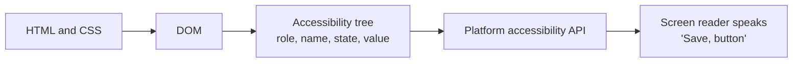
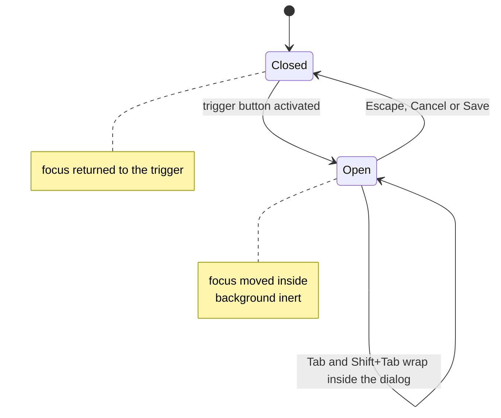

# Accessibility

> In this document you will learn how to build web interfaces that everyone can use, including people who use a keyboard only, screen readers, zoom or voice control. You will learn WCAG, semantic HTML, ARIA, focus management, accessible forms, testing tools and the Angular CDK helpers. Interviewers ask about accessibility to see if you build production-quality UI and know the legal and practical risks of ignoring it.

**Before this:** [HTML semantics and forms](./01-html-semantics-and-forms.md), [DOM and events](./03-dom-and-events.md) · **Interview questions:** [jump to questions](#interview-questions)

## Table of contents

1. [What accessibility is and why it matters](#what-accessibility-is-and-why-it-matters)
2. [How assistive technology reads a page](#how-assistive-technology-reads-a-page)
3. [WCAG: principles and levels](#wcag-principles-and-levels)
4. [Semantic HTML first](#semantic-html-first)
5. [ARIA: roles, states and properties](#aria-roles-states-and-properties)
6. [Accessible names and descriptions](#accessible-names-and-descriptions)
7. [Keyboard navigation and focus](#keyboard-navigation-and-focus)
8. [Modals and focus traps](#modals-and-focus-traps)
9. [Focus management in single-page apps](#focus-management-in-single-page-apps)
10. [Live regions](#live-regions)
11. [Color and contrast](#color-and-contrast)
12. [Accessible forms and error messages](#accessible-forms-and-error-messages)
13. [Images and media](#images-and-media)
14. [Accessible custom components](#accessible-custom-components)
15. [Testing accessibility](#testing-accessibility)
16. [Angular CDK accessibility tools](#angular-cdk-accessibility-tools)
17. [How to explain accessibility in an interview](#how-to-explain-accessibility-in-an-interview)
18. [Interview questions](#interview-questions)
19. [Summary](#summary)
20. [References](#references)

---

## What accessibility is and why it matters

### What it is

**Accessibility** (often written **a11y**: "a", 11 letters, "y") means designing and building websites so that people with disabilities can perceive, understand, navigate and interact with them.

Who benefits:

| Group | Examples | What they need |
|---|---|---|
| Blind and low-vision users | Screen readers, screen magnifiers, 200–400% zoom | Text alternatives, correct structure, enough contrast, layouts that reflow |
| Motor disabilities | Keyboard only, switch devices, voice control | Everything usable without a mouse, big enough targets, no time pressure |
| Deaf and hard-of-hearing users | | Captions and transcripts |
| Cognitive and learning disabilities | Dyslexia, ADHD, memory issues | Clear language, consistent navigation, helpful errors, no surprise changes |
| Temporary and situational limits | Broken arm, bright sunlight, holding a baby, slow network | The same things as above |

### Why it matters

- **Users:** a large part of the population has some disability, and everyone ages. An inaccessible checkout loses real customers.
- **Legal:** many countries require it. Examples: the Americans with Disabilities Act (ADA) and Section 508 in the US, the European Accessibility Act (applies from 28 June 2025) and the EN 301 549 standard in the EU. Most of these point to **WCAG level AA** as the measure. Companies are sued over inaccessible websites.
- **Quality and SEO:** accessible markup is also cleaner, works better with automated tools and search engines, and is easier to test (testing tools find elements by role and label, just like screen readers).
- **Everyone benefits:** captions help in noisy places, keyboard shortcuts help power users, good contrast helps in sunlight. This is called the **curb-cut effect**.

---

## How assistive technology reads a page

A **screen reader** (NVDA, JAWS, VoiceOver, TalkBack, Narrator) does not look at pixels. It reads the **accessibility tree**, a simplified version of the DOM that the browser builds for assistive technology.



Each node in the accessibility tree has:

| Property | Example | Comes from |
|---|---|---|
| **Role** | button, link, heading level 2, checkbox, navigation | The element (`<button>`) or `role` attribute |
| **Name** | "Save order" | Text content, `<label>`, `alt`, `aria-label`, `aria-labelledby` |
| **State** | checked, expanded, disabled, selected | Native state (`checked`) or ARIA (`aria-expanded`) |
| **Value** | "42" in a slider or the text in an input | The control |
| **Description** | "Must be 8 characters or more" | `aria-describedby` |

So for a screen reader, `<div class="btn">Save</div>` is just the text "Save", while `<button>Save</button>` is "Save, button", and the user knows they can press it.

You can see the accessibility tree in Chrome DevTools (Elements panel, Accessibility tab) and Firefox DevTools (Accessibility panel).

Screen reader users navigate in many ways: by headings (H key in NVDA/JAWS), by landmarks, by links, by form fields, or by reading line by line. Good structure makes all of these fast.

---

## WCAG: principles and levels

**WCAG** (Web Content Accessibility Guidelines) is the international standard from the W3C. **WCAG 2.2** is the current version (published October 2023). It adds criteria to 2.1, which added to 2.0. A newer major version, WCAG 3, is still in draft and not used for compliance.

### The four principles: POUR

| Principle | Meaning | Examples |
|---|---|---|
| **Perceivable** | Users can see or hear the content in some way | Alt text, captions, enough contrast, content that reflows at 400% zoom, not using color alone |
| **Operable** | Users can use all controls | Keyboard access, no keyboard traps, enough time, no flashing content, visible focus, skip links, big enough targets |
| **Understandable** | Users can understand the content and the UI | Page language set, predictable navigation, clear labels and error messages |
| **Robust** | Works with current and future tools | Valid, semantic markup; correct name, role and value for custom controls |

### Conformance levels

| Level | Meaning | Example criteria |
|---|---|---|
| **A** | The minimum. Without these, some users cannot use the site at all. | Text alternatives (1.1.1), keyboard access (2.1.1), no keyboard trap (2.1.2), page title (2.4.2), name/role/value (4.1.2) |
| **AA** | The usual legal and company target. Includes all of A. | Contrast 4.5:1 (1.4.3), text resize to 200% (1.4.4), reflow (1.4.10), focus visible (2.4.7), consistent navigation (3.2.3), error suggestions (3.3.3), target size minimum 24×24 px (2.5.8, new in 2.2) |
| **AAA** | The highest. Not required for whole sites, because some content cannot meet it. | Contrast 7:1 (1.4.6), sign language for video (1.2.6) |

### What WCAG 2.2 added

- **2.4.11 Focus Not Obscured (Minimum), AA:** a focused element must not be completely hidden by sticky headers, cookie banners or chat widgets.
- **2.5.7 Dragging Movements, AA:** anything done by dragging must also be possible with simple clicks (for example arrow buttons for reordering).
- **2.5.8 Target Size (Minimum), AA:** pointer targets at least 24×24 CSS pixels, or enough space around them.
- **3.2.6 Consistent Help, A:** help links (contact, chat) stay in the same place across pages.
- **3.3.7 Redundant Entry, A:** do not ask for the same information twice in one process (offer "same as shipping address").
- **3.3.8 Accessible Authentication (Minimum), AA:** login must not require a cognitive test such as remembering or transcribing, unless there is an alternative. Allowing paste and password managers helps meet it.
- Also new at AAA: 2.4.12, 2.4.13 and 3.3.9. The old criterion 4.1.1 Parsing was removed.

---

## Semantic HTML first

The most effective accessibility technique is to use the right native HTML element. You get role, name, keyboard behavior and states for free. See [HTML semantics](./01-html-semantics-and-forms.md#semantic-html).

```html
<!-- ❌ Wrong: a div pretending to be a button -->
<div class="btn" onclick="placeOrder()">Place order</div>

<!-- ✅ Correct -->
<button type="button" class="btn">Place order</button>
```

What the native `<button>` gives that the `<div>` does not:

| Feature | `<button>` | `<div onclick>` |
|---|---|---|
| Reachable with Tab | Yes | No |
| Activates with Enter and Space | Yes | No |
| Announced as "button" | Yes | No |
| Supports `disabled` | Yes | No |
| Works with voice control ("click Place order") | Yes | Often no |
| Submits forms when needed | Yes | No |

The checklist of semantic basics:

- `<html lang="en">` so screen readers use the right pronunciation.
- A unique, descriptive `<title>` for each page.
- Landmarks: `<header>`, `<nav>`, `<main>`, `<footer>`.
- One `<h1>`, then headings in order.
- Lists as `<ul>`/`<ol>`, data tables with `<th scope="col">` and `<caption>`.
- `<a href>` for navigation, `<button>` for actions.
- `<label>` for every form field.

---

## ARIA: roles, states and properties

### What it is

**ARIA** (Accessible Rich Internet Applications, the W3C WAI-ARIA standard) is a set of HTML attributes that change how elements appear in the accessibility tree.

| Kind | Examples | Purpose |
|---|---|---|
| **Roles** | `role="dialog"`, `role="tab"`, `role="alert"`, `role="navigation"` | What the element is |
| **States** | `aria-expanded="true"`, `aria-checked`, `aria-selected`, `aria-pressed`, `aria-disabled`, `aria-invalid`, `aria-current` | Current condition; they change at runtime |
| **Properties** | `aria-label`, `aria-labelledby`, `aria-describedby`, `aria-controls`, `aria-live`, `aria-hidden`, `aria-haspopup`, `aria-required` | Relationships and characteristics |

### ARIA changes only the accessibility tree

This is the most important fact about ARIA: **it changes what assistive technology hears, not what the element does**. `role="button"` makes a screen reader say "button", but it does not make the element focusable or respond to Enter or Space. You must add all behavior yourself.

### The rules of ARIA

The W3C "Using ARIA" guide gives five rules. The first is the famous one:

1. **The first rule of ARIA: do not use ARIA if a native HTML element or attribute gives you the semantics and behavior you need.** Use `<button>`, not `<div role="button">`.
2. **Do not change native semantics** unless you really have to. Do not write `<h2 role="tab">`; put the heading inside the tab, or the tab inside the heading.
3. **All interactive ARIA controls must be usable with the keyboard.**
4. **Do not use `role="presentation"` or `aria-hidden="true"` on a focusable element.** Users would tab to something that is invisible to their screen reader.
5. **All interactive elements must have an accessible name.**

The often-repeated summary: "No ARIA is better than bad ARIA." The yearly WebAIM Million survey of home pages has found more detected errors on pages that use ARIA than on pages without it, because ARIA is easy to misuse.

### Common, useful ARIA

```html
<!-- Disclosure (show/hide) button -->
<button type="button" aria-expanded="false" aria-controls="filters-panel">Filters</button>
<div id="filters-panel" hidden>...</div>

<!-- Toggle button -->
<button type="button" aria-pressed="false">Bold</button>

<!-- Current page in navigation -->
<a href="/orders" aria-current="page">Orders</a>

<!-- Icon-only button -->
<button type="button" aria-label="Close dialog">
  <svg aria-hidden="true" focusable="false" width="16" height="16"><!-- x icon --></svg>
</button>

<!-- Decorative icon next to text: hide the icon, keep the text -->
<button type="button"><svg aria-hidden="true">...</svg> Download invoice</button>
```

```js
// Keep the ARIA state in sync with the real state
const filtersButton = document.querySelector('[aria-controls="filters-panel"]');
const filtersPanel = document.getElementById("filters-panel");

filtersButton.addEventListener("click", () => {
  const isOpen = filtersButton.getAttribute("aria-expanded") === "true";
  filtersButton.setAttribute("aria-expanded", String(!isOpen));
  filtersPanel.hidden = isOpen;
});
```

### aria-hidden, hidden and inert

| Tool | Effect |
|---|---|
| `hidden` attribute / `display: none` | Hidden from everyone: eyes, keyboard, screen readers |
| `aria-hidden="true"` | Hidden from screen readers only. Still visible and still focusable (so never put it on focusable content) |
| `inert` attribute | The element and its children cannot be focused or clicked, and are hidden from assistive technology, but still visible (supported in all major browsers since 2023). Use it for background content behind a custom modal or a closed off-canvas menu. |

---

## Accessible names and descriptions

### What an accessible name is

The **accessible name** is what a screen reader announces to identify a control: "Search, edit text", "Save, button". Every interactive element needs one.

### Where the name comes from (simplified order)

The browser computes it with the "accessible name computation" algorithm. In priority order:

1. **`aria-labelledby`**: the text of the referenced element(s). Highest priority.
2. **`aria-label`**: a string you provide.
3. **Native label**: `<label>` for inputs, `alt` for images, `<caption>` for tables, `<legend>` for fieldsets.
4. **Content**: the text inside, for roles that take their name from content (buttons, links, headings).
5. **`title`** attribute: last resort. Avoid relying on it; it is not shown to keyboard or touch users.

`placeholder` is used by some browsers as a fallback name, but never rely on it.

```html
<!-- 1. Visible label (best) -->
<label for="search">Search products</label>
<input id="search" type="search" />

<!-- 2. aria-labelledby: reuse visible text, even several pieces -->
<h2 id="billing-title">Billing address</h2>
<section aria-labelledby="billing-title">...</section>

<!-- Combining: "Delete" + "Invoice 1042" -->
<span id="invoice-1042">Invoice 1042</span>
<button id="del-1042" aria-labelledby="del-1042 invoice-1042">Delete</button>

<!-- 3. aria-label: when no visible text exists -->
<button type="button" aria-label="Close"><svg aria-hidden="true">...</svg></button>

<!-- Description: extra help, read after the name -->
<label for="new-password">Password</label>
<input id="new-password" type="password" aria-describedby="password-rules" />
<p id="password-rules">At least 12 characters.</p>
<!-- Announced: "Password, edit text, protected. At least 12 characters." -->
```

### Rules

- **Prefer visible labels.** Everyone benefits from them, and voice-control users say what they see.
- **The accessible name should contain the visible text** (WCAG 2.5.3 Label in Name). If a button shows "Send", do not set `aria-label="Submit form"`; a voice-control user saying "click Send" would fail.
- **`aria-label` overrides content.** `<button aria-label="Close">Cancel</button>` is announced "Close", which hides "Cancel" from screen reader users.
- **`aria-label` does not work on every element.** On generic elements like `<div>` and `<span>` without a role, it is not reliably announced.
- **Repeated links need unique names.** Ten "Read more" links are useless in a screen reader's links list. Use "Read more about TrailRunner 3", or hide extra words visually with a visually-hidden class.

---

## Keyboard navigation and focus

### Why it matters

Many users never use a mouse: blind users, people with motor disabilities, power users. WCAG 2.1.1 (level A) requires that **all functionality is available from a keyboard**.

### The keys users expect

| Key | Expected behavior |
|---|---|
| Tab / Shift+Tab | Move to the next / previous focusable element |
| Enter | Activate links and buttons; submit forms |
| Space | Activate buttons; toggle checkboxes; scroll the page |
| Arrow keys | Move inside a widget: radio groups, tabs, menus, listboxes, sliders |
| Escape | Close dialogs, menus, popups |
| Home / End | First / last item in a list or widget |

### Tab order and tabindex

The **tab order** follows the DOM order of focusable elements: links with `href`, buttons, form fields, elements with `tabindex="0"`, and some others.

| Value | Meaning | Use |
|---|---|---|
| `tabindex="0"` | Focusable, in normal DOM order | A custom interactive widget made from a non-interactive element (only when you cannot use a native element) |
| `tabindex="-1"` | Not in the Tab order, but focusable from JavaScript with `.focus()` | Headings or containers you move focus to (after route changes, error summaries), items in a roving tabindex widget |
| `tabindex="1"` or higher | Jumps ahead of everything else in the order | **Avoid.** It creates a confusing order and is very hard to maintain |

Keep the DOM order the same as the visual order. CSS `order`, `flex-direction: row-reverse` and grid placement change only the visual order, so focus would jump around.

### Visible focus

WCAG 2.4.7 (AA) requires a visible focus indicator.

```css
/* ❌ Wrong: removes focus visibility for everyone */
*:focus { outline: none; }

/* ✅ Correct: a clear ring for keyboard users; mouse clicks do not show it */
:focus-visible {
  outline: 3px solid #1d4ed8;
  outline-offset: 2px;
}
```

`:focus-visible` matches when the browser thinks a focus ring is useful, mainly for keyboard focus. It solves the old complaint "designers do not want rings on mouse click" without hurting keyboard users. Make the ring contrast at least 3:1 against the background.

### Skip links

A **skip link** is the first focusable element on the page. It lets keyboard users jump past the repeated header and navigation, straight to the main content (WCAG 2.4.1 Bypass Blocks).

```html
<body>
  <a class="skip-link" href="#main-content">Skip to main content</a>
  <header>...long navigation...</header>
  <main id="main-content" tabindex="-1">...</main>
</body>
```

```css
.skip-link {
  position: absolute;
  left: 1rem;
  top: -100px; /* off-screen until focused */
}
.skip-link:focus {
  top: 1rem; /* appears when a keyboard user presses Tab */
}
```

`tabindex="-1"` on `<main>` makes sure focus really moves there in all browsers, so the next Tab continues from the main content.

### Roving tabindex

For composite widgets (toolbars, tab lists, radio-like groups, grids), the whole widget should be **one Tab stop**, and the arrow keys move inside it. With **roving tabindex**, the active item has `tabindex="0"` and all others have `tabindex="-1"`. Arrow keys move the `0` to the next item and focus it.

```html
<div role="toolbar" aria-label="Text formatting" id="format-toolbar">
  <button type="button" tabindex="0" aria-pressed="false">Bold</button>
  <button type="button" tabindex="-1" aria-pressed="false">Italic</button>
  <button type="button" tabindex="-1" aria-pressed="false">Underline</button>
</div>
```

```js
const toolbar = document.getElementById("format-toolbar");
const buttons = [...toolbar.querySelectorAll("button")];

toolbar.addEventListener("keydown", (event) => {
  const currentIndex = buttons.indexOf(document.activeElement);
  if (currentIndex === -1) return;

  let nextIndex = null;
  if (event.key === "ArrowRight") nextIndex = (currentIndex + 1) % buttons.length;
  if (event.key === "ArrowLeft") nextIndex = (currentIndex - 1 + buttons.length) % buttons.length;
  if (event.key === "Home") nextIndex = 0;
  if (event.key === "End") nextIndex = buttons.length - 1;
  if (nextIndex === null) return;

  event.preventDefault();
  buttons[currentIndex].tabIndex = -1;
  buttons[nextIndex].tabIndex = 0;
  buttons[nextIndex].focus();
});
```

The alternative is **`aria-activedescendant`**: focus stays on the container (or an input), and the attribute points to the id of the "active" child. It is used in comboboxes, where focus must stay in the text input while the user moves through suggestions.

---

## Modals and focus traps

A modal dialog must:

1. Have `role="dialog"` (or `alertdialog`), `aria-modal="true"` and an accessible name (`aria-labelledby` pointing to its title).
2. Move focus **into** the dialog when it opens (to the first useful control, or the title).
3. **Keep focus inside** while it is open: Tab from the last element goes to the first, Shift+Tab from the first goes to the last. This is a **focus trap**. (This is allowed, unlike a keyboard trap, because the user can always close the dialog.)
4. Make the background **inert**, so screen readers and clicks cannot reach it.
5. Close with **Escape**.
6. Return focus to the element that opened it when it closes.



### The native way: `<dialog>` with showModal()

`showModal()` does steps 1–5 for you: the `dialog` role, top layer, inert background (so focus and clicks cannot reach the page behind), Escape to close, and initial focus. Browsers also restore focus to the previously focused element on close, as the HTML standard requires. Test it, and restore focus yourself if your target browsers do not.

```html
<button type="button" id="open-address-dialog">Edit address</button>

<dialog id="address-dialog" aria-labelledby="address-dialog-title">
  <h2 id="address-dialog-title">Edit shipping address</h2>
  <form method="dialog">
    <label for="street">Street</label>
    <input id="street" name="street" autocomplete="street-address" />
    <button value="cancel" formnovalidate>Cancel</button>
    <button value="save">Save</button>
  </form>
</dialog>
```

```js
const openButton = document.getElementById("open-address-dialog");
const dialog = document.getElementById("address-dialog");

openButton.addEventListener("click", () => {
  dialog.returnValue = ""; // Escape keeps the old returnValue, so reset it on every open
  dialog.showModal();
});
dialog.addEventListener("close", () => {
  openButton.focus(); // explicit, in case the browser did not restore focus
  if (dialog.returnValue === "save") saveAddress();
});
```

With a native modal dialog, Tab can still move from the dialog to the browser's own interface (address bar), which is expected and fine. Focus never reaches the page behind the dialog.

### A custom modal with a manual focus trap

When you cannot use `<dialog>` (for example inside an existing design system), you must build all six behaviors yourself:

```js
const FOCUSABLE = 'a[href], button:not([disabled]), input:not([disabled]), select:not([disabled]), textarea:not([disabled]), [tabindex]:not([tabindex="-1"])';

function openModal(modal, appRoot) {
  const previouslyFocused = document.activeElement;
  const controller = new AbortController();

  modal.hidden = false;
  appRoot.inert = true; // background: not focusable, not clickable, hidden from screen readers

  const focusables = () => [...modal.querySelectorAll(FOCUSABLE)];
  focusables()[0]?.focus();

  modal.addEventListener("keydown", (event) => {
    if (event.key === "Escape") {
      close();
      return;
    }
    if (event.key !== "Tab") return;
    const items = focusables();
    const first = items[0];
    const last = items[items.length - 1];
    if (event.shiftKey && document.activeElement === first) {
      event.preventDefault();
      last.focus();
    } else if (!event.shiftKey && document.activeElement === last) {
      event.preventDefault();
      first.focus();
    }
  }, { signal: controller.signal });

  function close() {
    modal.hidden = true;
    appRoot.inert = false;
    controller.abort();          // remove the listeners
    previouslyFocused?.focus();  // return focus
  }

  return close;
}
```

```html
<div id="app-root">...the page...</div>
<div id="confirm-modal" role="dialog" aria-modal="true" aria-labelledby="confirm-title" hidden>
  <h2 id="confirm-title">Cancel this order?</h2>
  <button type="button">Keep order</button>
  <button type="button">Cancel order</button>
</div>
```

The modal must be **outside** the element you make inert, otherwise the modal becomes inert too. That is one reason libraries render modals at the end of `<body>`. In Angular, `MatDialog` and the CDK `Dialog` do all of this for you, including the focus trap (see [Angular CDK accessibility tools](#angular-cdk-accessibility-tools)).

---

## Focus management in single-page apps

### The problem

In a classic website, clicking a link loads a new page. The browser resets focus to the top, and the screen reader announces the new page title. In a **single-page app** (SPA), the router only swaps part of the DOM. Nothing is announced. Focus stays on the link that was clicked, which may not even exist anymore (then focus falls back to `<body>`). A screen reader user does not know that anything changed.

### The solution

After each route change:

1. **Update `document.title`** to describe the new page.
2. **Move focus** to the new page's main heading (with `tabindex="-1"`) or to the `<main>` element.
3. Optionally **announce** the new page in a live region.

```js
// Plain JavaScript router idea
function onRouteChanged(pageTitle) {
  document.title = `${pageTitle} - Acme Shop`;
  const heading = document.querySelector("main h1");
  if (heading) {
    heading.setAttribute("tabindex", "-1"); // focusable from code, not in Tab order
    heading.focus();
  }
}
```

### Angular 16 example

```ts
import { Component, ElementRef, OnDestroy, OnInit } from '@angular/core';
import { NavigationEnd, Router } from '@angular/router';
import { filter, skip, Subscription } from 'rxjs';

@Component({
  selector: 'app-root',
  template: `
    <a class="skip-link" href="#main-content">Skip to main content</a>
    <app-header></app-header>
    <main id="main-content" tabindex="-1" #main>
      <router-outlet></router-outlet>
    </main>
  `,
})
export class AppComponent implements OnInit, OnDestroy {
  private subscription?: Subscription;

  constructor(private router: Router, private host: ElementRef<HTMLElement>) {}

  ngOnInit(): void {
    this.subscription = this.router.events
      .pipe(
        filter((event): event is NavigationEnd => event instanceof NavigationEnd),
        skip(1), // do not move focus on the first page load
      )
      .subscribe(() => {
        // Wait one tick so the new route's template is rendered
        setTimeout(() => {
          const main = this.host.nativeElement.querySelector<HTMLElement>('#main-content');
          const heading = main?.querySelector<HTMLElement>('h1');
          if (heading) {
            heading.setAttribute('tabindex', '-1');
            heading.focus();
          } else {
            main?.focus();
          }
        });
      });
  }

  ngOnDestroy(): void {
    this.subscription?.unsubscribe();
  }
}
```

The page title can come from the `title` property in each route (available since Angular 14), which the router sets automatically:

```ts
const routes: Routes = [
  { path: 'orders', component: OrdersPageComponent, title: 'Your orders - Acme Shop' },
];
```

Do not move focus on the **first** page load (the browser handles that), and do not move focus for small in-page changes like filters, where an announcement is better (see live regions). More on the router: [Angular routing](../06-angular-16/06-routing-guards-and-lazy-loading.md).

---

## Live regions

### What they are

A **live region** is an element whose content changes are announced by screen readers automatically, **without moving focus**. Use it for status messages: "Item added to cart", "3 results found", "Saving...", "Saved".

| Markup | Politeness | Use for |
|---|---|---|
| `role="status"` (implicit `aria-live="polite"`) | Waits until the user is idle | Most messages: results counts, "saved", progress |
| `aria-live="polite"` | Same | Same |
| `role="alert"` (implicit `aria-live="assertive"`) | Interrupts the user immediately | Urgent errors only: "Session expires in 1 minute", "Payment failed" |
| `aria-live="off"` | Not announced | |

Useful extra attributes: `aria-atomic="true"` (read the whole region, not only the changed part), `aria-busy="true"` (wait, content is being updated).

### How to use them correctly

```html
<!-- ✅ The region exists (empty) when the page loads -->
<p id="cart-status" role="status" class="visually-hidden"></p>
```

```js
function announce(message) {
  const region = document.getElementById("cart-status");
  region.textContent = "";              // clear first, so the same message is announced again
  setTimeout(() => {
    region.textContent = message;       // the change is what gets announced
  }, 100);
}

addToCartButton.addEventListener("click", async () => {
  await cartService.add(productId);
  announce("TrailRunner 3 added to cart. Cart has 3 items.");
});
```

Rules:

- **The region must already be in the DOM** before its content changes. Screen readers watch existing regions. Inserting a new element with `role="alert"` *and* text at the same time is not announced reliably everywhere.
- **Change the text** to trigger the announcement. Repeating the same text may not be announced; clearing it first helps.
- **Use `assertive`/`alert` rarely.** Interrupting the user for non-urgent messages is very annoying.
- **Do not put a whole changing page section in a live region** (like a list that updates). Announce a short summary instead.
- Toast notifications that disappear after a few seconds also need enough time to be read (WCAG 2.2.1 Timing Adjustable) and should not contain the only way to do an action.

In Angular, the CDK `LiveAnnouncer` manages a live region for you.

---

## Color and contrast

### Contrast ratios

**Contrast ratio** compares the brightness of text and its background, from 1:1 (same color) to 21:1 (black on white).

| Content | AA (the usual target) | AAA |
|---|---|---|
| Normal text | **4.5:1** | 7:1 |
| Large text (at least 24px regular, or about 18.66px bold) | **3:1** | 4.5:1 |
| UI components and graphics: input borders, icons, focus rings, chart lines (WCAG 1.4.11) | **3:1** | |
| Disabled controls and pure decoration | No requirement | |

Examples: `#767676` grey on white is about 4.5:1 and just passes AA for normal text. `#999999` on white is about 2.8:1 and fails. Light grey placeholder text is a very common failure.

Check contrast with the DevTools color picker (it shows the ratio and AA/AAA badges), Lighthouse or axe.

### Do not use color alone

WCAG 1.4.1: color must not be the **only** way to show information. About 1 in 12 men has some form of color vision deficiency, and screen readers do not announce colors.

```html
<!-- ❌ Wrong: only the red border shows the error -->
<input id="email" class="error-border" />

<!-- ✅ Correct: icon + text + programmatic state -->
<input id="email" aria-invalid="true" aria-describedby="email-error" />
<p id="email-error" class="error"><svg aria-hidden="true">...</svg> Enter a valid email address.</p>
```

Other examples: links inside text should be underlined (not only colored); charts should use patterns, labels or different shapes in addition to colors; required fields need text or a symbol explained in the form, not only a red label.

### Respect user settings

- `prefers-reduced-motion`: reduce or remove animations for users who get dizzy from motion.
- `prefers-color-scheme`: offer a dark theme, and check contrast in both themes.
- `forced-colors: active` (Windows High Contrast / Contrast Themes): the browser replaces your colors. Do not depend on `background-image` or `box-shadow` for important information, and use real borders or `outline` for focus, because those stay visible.
- **Zoom and text size:** the layout must work at 200% text size and reflow to one column at 400% zoom (320 CSS pixels wide) without horizontal scrolling. Use `rem` and flexible layouts. See [CSS units](./02-css-layout-and-responsive-design.md#css-units).

---

## Accessible forms and error messages

Forms are where accessibility failures cost the most: a user who cannot complete checkout or signup is completely blocked. The HTML basics (labels, fieldset, input types, autocomplete) are in [HTML forms](./01-html-semantics-and-forms.md#forms). Here are the accessibility rules for errors and help text.

### The checklist

1. **Every field has a visible `<label>`** connected with `for`/`id`.
2. **Required fields** are marked in text ("required") or with a symbol explained at the top ("* means required"), plus the `required` attribute (which also sets the required state for screen readers).
3. **Hints** (format, rules) are visible before the user types, connected with `aria-describedby`.
4. **Use `autocomplete`** values so browsers can fill personal data (WCAG 1.3.5 Identify Input Purpose).
5. **Error messages:**
   - say what is wrong **and** how to fix it ("Enter a date in the format DD/MM/YYYY", not "Invalid");
   - are shown as text next to the field, connected with `aria-describedby`;
   - set `aria-invalid="true"` on the field;
   - are not shown only in color.
6. **On submit with errors**, move focus to the first invalid field, or to an **error summary** at the top with links to each field.
7. **Do not clear the form** when there is an error.
8. **Do not validate aggressively while typing.** Showing "invalid email" after the first letter is noise for screen reader users. Validate on blur or submit, and remove the error as soon as it is fixed.

### Error summary pattern

```html
<div id="error-summary" role="alert" tabindex="-1" hidden>
  <h2>There are 2 problems with your form</h2>
  <ul>
    <li><a href="#email">Enter your email address</a></li>
    <li><a href="#password">Password must be at least 12 characters</a></li>
  </ul>
</div>
```

```js
function showErrorSummary(errors) {
  const summary = document.getElementById("error-summary");
  const list = summary.querySelector("ul");
  list.replaceChildren(
    ...errors.map(({ fieldId, message }) => {
      const li = document.createElement("li");
      const link = document.createElement("a");
      link.href = `#${fieldId}`;
      link.textContent = message; // safe text
      li.append(link);
      return li;
    })
  );
  summary.querySelector("h2").textContent =
    `There ${errors.length === 1 ? "is 1 problem" : `are ${errors.length} problems`} with your form`;
  summary.hidden = false;
  summary.focus(); // users hear the summary and can follow the links to each field
}
```

Clicking a link like `href="#email"` moves focus to that field in modern browsers, so users can jump straight to the problem.

### Angular example (Angular 16 reactive forms)

```html
<form [formGroup]="signupForm" (ngSubmit)="submit()" novalidate>
  <label for="signup-email">Email (required)</label>
  <input
    id="signup-email"
    type="email"
    formControlName="email"
    autocomplete="email"
    [attr.aria-invalid]="showEmailError ? 'true' : null"
    [attr.aria-describedby]="showEmailError ? 'signup-email-error' : null"
  />
  <p id="signup-email-error" class="error" *ngIf="showEmailError">
    Enter an email address like name&#64;example.com.
  </p>

  <button type="submit">Create account</button>
</form>
```

```ts
get showEmailError(): boolean {
  const control = this.signupForm.controls.email;
  return control.invalid && (control.touched || this.submitted);
}
```

`[attr.aria-invalid]` with `null` removes the attribute when there is no error. `&#64;` is the HTML entity for `@`; it avoids confusion with Angular's newer template block syntax, and is required inside templates in Angular 17+ where `@` starts a control flow block. See [Angular forms](../06-angular-16/07-forms.md).

---

## Images and media

### Alt text

The rules are in [HTML images](./01-html-semantics-and-forms.md#images-and-responsive-images): describe the meaning in context; empty `alt=""` for decorative images; describe the action for linked images.

More cases:

| Image | What to do |
|---|---|
| Inline SVG icon next to text | `aria-hidden="true"` on the SVG |
| Inline SVG icon alone in a button | `aria-label` on the button, `aria-hidden="true"` on the SVG |
| Meaningful inline SVG (a logo, a diagram) | `role="img"` and `aria-label` on the `<svg>`, or a `<title>` inside it |
| Chart or complex diagram | Short `alt` ("Monthly sales chart"), plus the data as a table or text nearby |
| Image of text | Avoid. Use real text styled with CSS (WCAG 1.4.5) |
| CSS background image with meaning | Add the information as text too; background images have no alt |

### Video and audio

- **Captions** for prerecorded video with speech (WCAG 1.2.2, level A). Use `<track kind="captions">`.
- **Transcripts** for audio-only content such as podcasts.
- **Audio description** of important visual information for video (AA).
- **No autoplay with sound.** If audio plays automatically for more than 3 seconds, users must be able to stop it (1.4.2).
- **No flashing** more than 3 times per second (2.3.1), because it can cause seizures.
- Provide **pause controls** for anything that moves for more than 5 seconds: carousels, animated banners (2.2.2).

```html
<video controls width="640" height="360">
  <source src="/media/product-demo.mp4" type="video/mp4" />
  <track kind="captions" src="/media/product-demo.en.vtt" srclang="en" label="English" default />
</video>
```

---

## Accessible custom components

### When native is not enough

Sometimes a design needs a widget HTML does not have (tabs, a combobox with suggestions, a tree), or a native control that cannot be styled enough. Then you must provide the same things a native element gives:

1. **Role** (`role="tab"`, `role="combobox"`, ...)
2. **Accessible name**
3. **States** kept in sync (`aria-selected`, `aria-expanded`, ...)
4. **Keyboard support** that matches the expected pattern
5. **Focus management** (what gets focus, visible focus)

The **WAI-ARIA Authoring Practices Guide (APG)** from the W3C describes the expected roles, states and keys for each common pattern, with examples. Follow it instead of inventing behavior.

### What a div button needs (and why you should not build it)

```html
<!-- ❌ Not accessible -->
<div class="btn" onclick="save()">Save</div>

<!-- Still worse than <button>, but at least usable -->
<div class="btn" role="button" tabindex="0" id="save-div">Save</div>
```

```js
const fakeButton = document.getElementById("save-div");
fakeButton.addEventListener("click", save);
fakeButton.addEventListener("keydown", (event) => {
  if (event.key === "Enter") {
    event.preventDefault();
    save();
  }
  if (event.key === " ") {
    event.preventDefault(); // stop the page from scrolling
  }
});
fakeButton.addEventListener("keyup", (event) => {
  if (event.key === " ") save(); // native buttons activate Space on key release
});
// ...and still no disabled support, no form submission, no Windows High Contrast styling
```

Compare: `<button type="button" class="btn">Save</button>` and one click listener. This is the best argument for semantic HTML.

### Tabs (simplified pattern)

```html
<div role="tablist" aria-label="Product information">
  <button role="tab" id="tab-details" aria-selected="true" aria-controls="panel-details" tabindex="0">Details</button>
  <button role="tab" id="tab-reviews" aria-selected="false" aria-controls="panel-reviews" tabindex="-1">Reviews</button>
</div>
<div role="tabpanel" id="panel-details" aria-labelledby="tab-details" tabindex="0">...</div>
<div role="tabpanel" id="panel-reviews" aria-labelledby="tab-reviews" tabindex="0" hidden>...</div>
```

Keyboard: Tab moves into the tab list (to the selected tab), Left/Right arrows move between tabs (roving tabindex), Tab again moves into the panel. Selecting a tab sets `aria-selected="true"` on it, `false` on the others, and shows its panel.

### Combobox (autocomplete) basics

A **combobox** is a text input with a popup list of suggestions. It is one of the hardest patterns. The ARIA 1.2 pattern:

```html
<label for="city-input">City</label>
<input
  id="city-input"
  type="text"
  role="combobox"
  aria-autocomplete="list"
  aria-expanded="true"
  aria-controls="city-listbox"
  aria-activedescendant="city-option-2"
/>
<ul id="city-listbox" role="listbox" aria-label="Cities">
  <li id="city-option-1" role="option" aria-selected="false">Pune</li>
  <li id="city-option-2" role="option" aria-selected="true">Paris</li>
</ul>
<p role="status" class="visually-hidden">2 suggestions available.</p>
```

Key points:

- **Focus stays in the input** so the user can keep typing. `aria-activedescendant` points to the highlighted option, so the screen reader announces it.
- Down/Up arrows move the highlight; Enter selects; Escape closes the list (and a second Escape may clear the input).
- `aria-expanded` reflects whether the list is open.
- A polite live region announces the number of results.

Building a combobox correctly is a lot of work. In practice, use a tested component: Angular Material `mat-autocomplete`, the CDK, or the native `<datalist>` for simple cases (with limited styling).

### Native elements that solve common cases

| Need | Native option |
|---|---|
| Show/hide section | `<details>` and `<summary>` |
| Modal | `<dialog>` with `showModal()` |
| Simple popup menu or tooltip-like popup | `popover` attribute (all major browsers since January 2025) |
| Slider | `<input type="range">` |
| Progress | `<progress>`, `<meter>` |
| Suggestions | `<datalist>` |

---

## Testing accessibility

No single tool finds everything. Automated tools find roughly the clearly detectable problems (missing alt, missing labels, low contrast, invalid ARIA). Many problems need a human: is the alt text meaningful? Is the focus order logical? Does the screen reader announcement make sense?

### 1. Automated tools

| Tool | How you use it |
|---|---|
| **axe DevTools** browser extension (axe-core by Deque) | Scan a page in DevTools; shows issues with the WCAG criterion and how to fix |
| **Lighthouse** (Chrome DevTools) | Accessibility score and list of failed audits (it runs a subset of axe rules) |
| **WAVE** (WebAIM) | Visual overlay of issues on the page |
| **axe-core in tests** | `@axe-core/playwright` in end-to-end tests, `jest-axe` in unit and component tests |
| **Linters** | `eslint-plugin-jsx-a11y` for React; `@angular-eslint` template accessibility rules (alt text, label association, valid ARIA, click events with key events) for Angular |

```js
// Playwright + axe example (end-to-end test)
import { test, expect } from "@playwright/test";
import AxeBuilder from "@axe-core/playwright";

test("checkout page has no detectable accessibility violations", async ({ page }) => {
  await page.goto("/checkout");
  const results = await new AxeBuilder({ page }).withTags(["wcag2a", "wcag2aa", "wcag22aa"]).analyze();
  expect(results.violations).toEqual([]);
});
```

Also use **role-based queries** in tests: `page.getByRole("button", { name: "Place order" })` (Playwright) or `getByRole` (Testing Library). If a test cannot find a button by its role and name, a screen reader user cannot find it either. See [Component and E2E testing](../06-angular-16/14-testing.md).

### 2. Keyboard-only testing (do this for every feature)

Put the mouse away and check:

- Can you reach every control with Tab, in a logical order?
- Is the focus always visible?
- Do Enter, Space, arrows and Escape work as expected?
- Can you open **and close** every menu and dialog? Is focus returned afterwards?
- Is there any place where focus gets stuck, or disappears (focus on a hidden element)?
- Is a focused element ever hidden behind a sticky header (WCAG 2.4.11)?

### 3. Screen reader testing

| Screen reader | Platform | Cost |
|---|---|---|
| **NVDA** | Windows | Free |
| **JAWS** | Windows | Paid |
| **Narrator** | Windows | Built in |
| **VoiceOver** | macOS, iOS, iPadOS | Built in (Cmd+F5 on macOS) |
| **TalkBack** | Android | Built in |

Common pairs for testing: NVDA with Firefox or Chrome, VoiceOver with Safari. Listen for: the page title on load, landmarks and headings lists, names and roles of controls, state changes ("expanded", "checked"), and announcements of dynamic updates.

### 4. Other manual checks

- Zoom to 200% and 400%: does the content reflow without horizontal scrolling?
- Windows Contrast Themes / `forced-colors`: are focus and buttons still visible?
- `prefers-reduced-motion`: are animations reduced?
- DevTools Accessibility pane: check the computed name and role of tricky elements.

### 5. Make it part of the process

Add accessibility to the definition of done, run axe in CI, include keyboard checks in code review, and use a design system whose components are already accessible. Fixing accessibility at the end is much more expensive than building it in.

---

## Angular CDK accessibility tools

The Angular Component Dev Kit (`@angular/cdk`) includes an `a11y` package. In Angular 16, its directives are not standalone, so you import **`A11yModule`** (in an NgModule, or in the `imports` of a standalone component).

```ts
import { A11yModule } from '@angular/cdk/a11y';
```

### FocusTrap: cdkTrapFocus

```ts
import { Component, EventEmitter, Output } from '@angular/core';
import { A11yModule } from '@angular/cdk/a11y';

@Component({
  selector: 'app-confirm-panel',
  standalone: true,
  imports: [A11yModule],
  template: `
    <div
      role="dialog"
      aria-modal="true"
      aria-labelledby="confirm-title"
      cdkTrapFocus
      [cdkTrapFocusAutoCapture]="true"
      (keydown.escape)="closed.emit()"
    >
      <h2 id="confirm-title">Delete this report?</h2>
      <button type="button" (click)="closed.emit()" cdkFocusInitial>Cancel</button>
      <button type="button" (click)="confirmDelete()">Delete</button>
    </div>
  `,
})
export class ConfirmPanelComponent {
  @Output() closed = new EventEmitter<void>();

  confirmDelete(): void {
    // delete, then close
    this.closed.emit();
  }
}
```

- `cdkTrapFocus` keeps **Tab** focus inside the element (it does not stop mouse clicks outside).
- `[cdkTrapFocusAutoCapture]="true"` moves focus into the region when it appears, and **restores focus** to the previously focused element when the region is destroyed.
- `cdkFocusInitial` marks the element that receives the initial focus. `cdkFocusRegionStart` and `cdkFocusRegionEnd` can limit the trap boundaries.
- For full modal dialogs, prefer `MatDialog` (Angular Material) or `Dialog` from `@angular/cdk/dialog`. They render in an overlay at the end of `<body>`, trap focus, close on Escape, return focus, and set ARIA attributes.

### LiveAnnouncer

```ts
import { Component } from '@angular/core';
import { LiveAnnouncer } from '@angular/cdk/a11y';

@Component({
  selector: 'app-cart-button',
  template: `<button type="button" (click)="add()">Add to cart</button>`,
})
export class CartButtonComponent {
  constructor(private liveAnnouncer: LiveAnnouncer) {}

  add(): void {
    // ...add the item
    this.liveAnnouncer.announce('TrailRunner 3 added to cart', 'polite');
  }
}
```

`announce(message, politeness?, duration?)` returns a `Promise<void>`. Politeness is `'polite'` (default) or `'assertive'`. The service creates and manages one hidden live region for the whole app, which avoids the "region must exist first" problem. There is also a `cdkAriaLive` directive to make an element a live region from the template.

### Other CDK a11y tools

| Tool | What it does |
|---|---|
| `FocusMonitor` | Tells you **how** an element got focus: `'keyboard'`, `'mouse'`, `'touch'`, `'program'`. Adds classes like `cdk-keyboard-focused`. Call `stopMonitoring` on destroy. |
| `ListKeyManager`, `FocusKeyManager`, `ActiveDescendantKeyManager` | Arrow-key navigation for lists, menus and listboxes. `FocusKeyManager` moves real focus (roving tabindex); `ActiveDescendantKeyManager` uses `aria-activedescendant`. |
| `InteractivityChecker` | Checks if an element is focusable, tabbable, visible or disabled |
| `cdk-visually-hidden` class | Visually hidden but readable by screen readers. Include the styles with `@include cdk.a11y-visually-hidden();` (Angular Material includes it automatically) |
| `HighContrastModeDetector` | Detects Windows high contrast mode |

Angular Material components (buttons, menus, dialogs, autocomplete, tabs, select) are built with these tools and follow the APG patterns, which is a strong reason to use a mature component library instead of building complex widgets yourself.

---

## How to explain accessibility in an interview

1. **Define it:** "Accessibility means people with disabilities can use the product: blind users with screen readers, keyboard-only users, people with low vision who zoom, deaf users who need captions, and people with cognitive disabilities."
2. **Why it exists:** "It is a large group of real users, it is a legal requirement in many places, usually WCAG 2.1 or 2.2 level AA, and it improves quality for everyone."
3. **How it works:** "Screen readers read the accessibility tree, built from the DOM. Each element has a role, a name and a state. Semantic HTML fills those in correctly. ARIA can add or change them, but it only changes what is announced, not behavior."
4. **Small example:** "A `<div onclick>` is invisible to keyboard users and announced as plain text. A `<button>` is focusable, works with Enter and Space and is announced as a button. For an icon-only button I add an `aria-label`."
5. **Where it is useful:** "Forms with labels and linked error messages, modals that trap and return focus, moving focus to the heading after an SPA route change, live regions for 'item added' messages, and contrast of at least 4.5 to 1."
6. **Trade-offs / gotchas:** "Bad ARIA is worse than none. Automated tools like axe catch only part of the problems, so I also test with the keyboard and a screen reader. Building custom widgets correctly is expensive, so I prefer native elements or a tested library like Angular Material and the CDK."

---

## Interview questions

### Q1. What is web accessibility, and why does it matter?

**What the interviewer is checking:** Whether you see accessibility as part of engineering quality, and know who it serves and the legal context.

**Short spoken answer (30–60 seconds):**
> Accessibility means people with disabilities can use the product: blind people using screen readers, people who use only a keyboard or a switch device, people with low vision who zoom or need high contrast, deaf people who need captions, and people with cognitive disabilities who need clear and predictable interfaces. It matters first because these are real users and customers. Second, it is a legal requirement in many places; laws like the ADA in the US or the European Accessibility Act usually point to WCAG level AA. And third, it improves the product for everyone, like captions in a noisy train or keyboard shortcuts for power users. I treat it as part of the definition of done, not a later fix.

**Follow-up questions:**
- **What standard do you follow?** — WCAG 2.2 level AA, which includes everything in 2.1 and 2.0 at levels A and AA.
- **Is accessibility only about blind users?** — No. Keyboard access, contrast, zoom, captions, motion and cognitive load affect many more people, including temporary and situational disabilities.

**Common mistakes:** Saying "we add it at the end"; thinking an accessibility overlay widget solves compliance (overlays do not fix the underlying markup and are widely criticized by disabled users).

**Where this is used in real projects:** Public websites, government and banking apps, enterprise products sold to customers who require accessibility conformance reports (VPATs).

---

### Q2. Explain the WCAG POUR principles and the conformance levels.

**What the interviewer is checking:** Knowledge of the standard and a realistic target.

**Short spoken answer (30–60 seconds):**
> WCAG is organized around four principles. Perceivable: users can see or hear the content, so text alternatives, captions and enough contrast. Operable: users can use everything, so keyboard access, enough time, no flashing, visible focus. Understandable: clear language, predictable behavior, helpful error messages. Robust: correct markup so assistive technologies can interpret it, which means correct name, role and value for every control. Each success criterion has a level. A is the minimum, AA is the normal legal and business target and includes A, and AAA is the strictest, not expected for whole sites. The current version is 2.2, which added things like a minimum target size of 24 by 24 pixels and making sure focused elements are not hidden by sticky headers.

**Follow-up questions:**
- **Name some AA criteria.** — Contrast 4.5:1 for normal text and 3:1 for large text, text resizable to 200%, reflow at 320px width, visible focus, consistent navigation, error suggestions, target size minimum.
- **What did WCAG 2.2 remove?** — 4.1.1 Parsing, because modern browsers and assistive technology handle markup errors consistently.

---

### Q3. What is ARIA, and what is the first rule of ARIA?

**What the interviewer is checking:** That you know ARIA changes semantics, not behavior, and should be a last resort.

**Short spoken answer (30–60 seconds):**
> ARIA is a set of attributes that change how elements appear in the accessibility tree: roles like `dialog` or `tab`, states like `aria-expanded` or `aria-checked`, and properties like `aria-label` or `aria-describedby`. The important thing is that it only changes what assistive technology announces. It does not add keyboard support, focus or behavior. That is why the first rule of ARIA is: if a native HTML element already has the semantics and behavior you need, use it instead of ARIA. A `<button>` beats a `div` with `role="button"`. I use ARIA for what HTML cannot express, like `aria-expanded` on a disclosure button, `aria-live` regions, or the roles in a tabs widget. And I keep states in sync with the UI, because wrong ARIA is worse than no ARIA.

**Follow-up questions:**
- **What does `aria-hidden="true"` do, and what is the danger?** — It removes the element and its children from the accessibility tree, but it stays visible and focusable. If it contains focusable elements, keyboard users land on things the screen reader cannot describe. Use `inert` or `hidden` instead when content should be fully unavailable.
- **What is the difference between `aria-label` and `aria-labelledby`?** — `aria-label` is a string in the attribute. `aria-labelledby` points to the id(s) of visible elements whose text becomes the name, and it has the highest priority. `aria-labelledby` is preferred when visible text exists, because it stays in sync and translates with the page.
- **What does `role="presentation"` do?** — Removes the element's own semantics (for example a layout table), but not its content. Never use it on focusable elements.

**Common mistakes:** Adding `role="button"` without keyboard handling; using `aria-label` on a `<div>` with no role; leaving `aria-expanded` stale.

---

### Q4. How is an element's accessible name calculated?

**Short answer:** Simplified priority: `aria-labelledby` (text of the referenced elements) → `aria-label` → native labeling (`<label>` for inputs, `alt` for images, `<legend>`, `<caption>`) → the element's text content for roles that allow it (buttons, links, headings) → `title` as a last resort. `aria-describedby` gives a separate description, read after the name. Practical rules: prefer visible labels; the name should include the visible text (WCAG 2.5.3) so voice-control users can say it; check the computed name in the DevTools Accessibility pane.

```html
<!-- Name: "Delete Invoice 1042" -->
<span id="inv">Invoice 1042</span>
<button id="del" aria-labelledby="del inv">Delete</button>
```

---

### Q5. How do you make a site fully usable with the keyboard?

**What the interviewer is checking:** Practical keyboard support knowledge: tab order, tabindex, focus visibility, widget patterns.

**Short spoken answer (30–60 seconds):**
> First, I use native interactive elements, links, buttons and form fields, because they are focusable and handle Enter and Space automatically. I keep the DOM order the same as the visual order, so Tab moves logically, and I never use positive tabindex values. `tabindex="0"` makes a custom widget focusable, and `tabindex="-1"` makes something focusable only from code, like a heading I move focus to. Focus must always be visible, so I style `:focus-visible` instead of removing outlines. I add a skip link to jump past navigation. Composite widgets like tabs or toolbars are one Tab stop with arrow-key navigation, using roving tabindex. Escape closes menus and dialogs, and focus returns to the trigger. Then I test it by unplugging the mouse.

**Follow-up questions:**
- **Why is `tabindex="5"` bad?** — It moves the element ahead of all elements with `tabindex="0"` or none, creating an order that does not match the page and is very hard to maintain.
- **What is a keyboard trap?** — A place where focus enters and cannot leave with the keyboard, for example some embedded players or custom widgets. WCAG 2.1.2 forbids it. A modal's focus trap is allowed because Escape or a close button lets the user leave.
- **What is the difference between roving tabindex and `aria-activedescendant`?** — Roving tabindex moves real DOM focus between items. `aria-activedescendant` keeps focus on the container or input and points to the active item's id; it is used when focus must stay in an input, like a combobox.

---

### Q6. How do you build an accessible modal dialog?

**What the interviewer is checking:** A complete mental checklist, and knowledge of native `<dialog>` and libraries.

**Short spoken answer (30–60 seconds):**
> A modal needs six things. A dialog role with `aria-modal` and an accessible name from its title. Focus moves into the dialog when it opens. Focus is trapped inside while it is open. The background is inert, so screen readers and the mouse cannot reach it. Escape closes it. And focus returns to the button that opened it when it closes. Today I first use the native `<dialog>` element with `showModal()`, which gives the role, the top layer, the inert background and Escape for free, and I still give it `aria-labelledby` and check focus return. In Angular I use `MatDialog` or the CDK Dialog, which handle the focus trap and focus restoration. If I build one myself, I use the `inert` attribute on the app root and a keydown handler that wraps Tab and Shift+Tab.

**Code:** see [Modals and focus traps](#modals-and-focus-traps).

**Follow-up questions:**
- **Where should initial focus go?** — To the first meaningful control. For a destructive confirmation, to the safe option (Cancel). For a long dialog with text, to the title or the dialog itself, so the user can read from the top.
- **What if the dialog content is longer than the screen?** — The dialog must scroll, and users must still reach every control with Tab. Put `tabindex="-1"` on the scrollable region or let initial focus go to the top.

**Common mistakes:** Forgetting focus return; leaving the background reachable by screen readers; no accessible name; closing only on outside click.

---

### Q7. In a single-page app, what accessibility problem appears on route changes, and how do you fix it?

**What the interviewer is checking:** SPA-specific accessibility knowledge.

**Short spoken answer (30–60 seconds):**
> In a normal website, a new page load resets focus and the screen reader announces the new title. In an SPA, the router only swaps content, so nothing is announced and focus stays on the old link or falls back to the body. A screen reader user does not know the page changed, and a keyboard user has to tab from the top again or is somewhere random. The fix is: after each navigation, update `document.title`, and move focus to the new page's `h1` with `tabindex="-1"`, or to the main element. Optionally announce the page in a live region. In Angular 16, I set the `title` on each route, and I listen for `NavigationEnd` in the app component to move focus, skipping the first load.

**Follow-up questions:**
- **Should focus move when filters update a list?** — No. Small in-page updates should keep focus where the user is and announce the result count in a polite live region instead.

---

### Q8. What are live regions, and when do you use polite versus assertive?

**What the interviewer is checking:** Announcing dynamic content without stealing focus.

**Short spoken answer (30–60 seconds):**
> A live region is an element whose content changes are announced by screen readers automatically, without moving focus. I use `role="status"`, which is polite, for most messages: "item added to cart", "12 results", "saved". The screen reader waits until the user pauses. I use `role="alert"`, which is assertive, only for urgent problems, because it interrupts whatever the user is doing. Two practical rules: the region must already exist in the DOM before I change its text, otherwise it may not be announced, and I change the text to a short summary instead of making a big section live. In Angular, the CDK `LiveAnnouncer` service handles this for me.

**Follow-up questions:**
- **The same message is not announced twice. Why?** — The content did not change. Clear the region first, then set the text after a short delay.
- **What does `aria-atomic="true"` do?** — Reads the whole region when part of it changes, instead of only the changed part.

---

### Q9. What contrast ratios does WCAG require?

**Short answer:** For level AA: at least 4.5:1 for normal text, 3:1 for large text (24px regular or about 18.66px bold and larger), and 3:1 for user interface components and meaningful graphics (input borders, icons, focus indicators, chart lines). AAA requires 7:1 and 4.5:1. Disabled controls and decoration have no requirement. For example, `#767676` on white is 4.54:1 (passes AA), `#999999` on white is 2.85:1 (fails). Also never use color alone to show meaning: add text, icons or patterns.

---

### Q10. How do you make form errors accessible?

**What the interviewer is checking:** Practical, complete form accessibility.

**Short spoken answer (30–60 seconds):**
> Every field has a visible label. Required fields are marked in text and with the `required` attribute. Hints are visible and linked with `aria-describedby`. When validation fails, I show a text message next to the field that says how to fix it, not just "invalid". I link it with `aria-describedby` and set `aria-invalid="true"`. I do not rely on red color alone. On submit, I move focus to the first invalid field, or to an error summary at the top with links to each field, so screen reader and keyboard users find the problems. I do not validate on every keystroke, and I keep the user's input. In Angular I bind `[attr.aria-invalid]` and `[attr.aria-describedby]` based on the control's state.

**Code:** see [Accessible forms and error messages](#accessible-forms-and-error-messages).

**Follow-up questions:**
- **Is the browser's native validation bubble accessible?** — It is announced by most screen readers, but it disappears quickly, cannot be styled, and its wording is generic. Many teams use `novalidate` with custom accessible messages.

---

### Q11. Code review: what accessibility problems do you see?

```html
<div class="header">
  
  <div class="menu-icon" onclick="toggleMenu()"><i class="icon-burger"></i></div>
</div>
<div class="content">
  <div class="title">Checkout</div>
  <input type="text" placeholder="Card number" style="outline: none">
  <span style="color: red">Invalid</span>
  <div class="btn" onclick="pay()">Pay now</div>
</div>
```

**Answer (the problems):**

1. No landmarks: use `<header>`, `<nav>`, `<main>`.
2. Logo image without `alt` (should be `alt="Acme Shop"`, and a link to the home page).
3. Menu toggle is a `<div>` with only an icon: not focusable, no role, no name, no `aria-expanded`. Use `<button type="button" aria-expanded="false" aria-controls="main-menu" aria-label="Menu">` with the icon `aria-hidden="true"`.
4. "Checkout" is a `<div>`, not a heading. Use `<h1>`.
5. The input has no label (placeholder only), no `name`, no `autocomplete="cc-number"`, and `inputmode="numeric"` would help.
6. `outline: none` removes the focus indicator.
7. The error is red text only, not linked to the field, and says only "Invalid". Use `aria-describedby`, `aria-invalid`, an icon or text cue, and a helpful message.
8. "Pay now" is a `<div>`: use `<button type="submit">` inside a `<form>`.

---

### Q12. A button shows only an icon. How do you make it accessible?

**Short answer:** Use a real `<button type="button">`, give it an accessible name with `aria-label="Close dialog"` (or visually hidden text inside it), and hide the icon from assistive technology with `aria-hidden="true"` (and `focusable="false"` on inline SVGs for old browsers). Make sure the target is at least 24×24 CSS pixels (WCAG 2.2 AA), and add a visible tooltip for sighted users if the icon meaning is not obvious. If it toggles something, add `aria-pressed` or `aria-expanded`.

---

### Q13. How do you test accessibility?

**What the interviewer is checking:** That you know automated tools have limits, and have a realistic process.

**Short spoken answer (30–60 seconds):**
> I combine three levels. Automated checks: axe in the browser and in tests, for example `@axe-core/playwright` in end-to-end tests and lint rules for templates, plus Lighthouse. They catch things like missing labels, missing alt text, invalid ARIA and low contrast, but only part of all issues. Then manual keyboard testing for every feature: can I reach and operate everything, is focus visible and logical, do dialogs trap and return focus. Then screen reader testing for important flows, usually NVDA with Chrome or Firefox on Windows, and VoiceOver with Safari on Mac, listening for names, roles, states and announcements. I also check 200% and 400% zoom and reduced motion. And I write tests with role-based queries like `getByRole`, so tests fail when accessibility breaks.

**Follow-up questions:**
- **Why can't automated tools find everything?** — They cannot judge meaning: whether alt text describes the image, whether the focus order is logical, whether an error message is helpful, or whether a custom widget behaves as expected.
- **What does a Lighthouse score of 100 mean?** — Only that the automated audits passed. The page can still be unusable with a keyboard or screen reader.

---

### Q14. What is a skip link, and how do you implement it?

**Short answer:** A link that is the first focusable element on the page and jumps to the main content, so keyboard users do not have to tab through the whole header and navigation on every page (WCAG 2.4.1). It is usually visually hidden until it receives focus. Implementation: `<a class="skip-link" href="#main-content">Skip to main content</a>` at the start of `<body>`, `<main id="main-content" tabindex="-1">`, and CSS that moves the link on-screen on `:focus`. The `tabindex="-1"` on main makes sure focus actually moves there, so the next Tab continues inside the main content.

---

### Q15. How would you build an accessible autocomplete (combobox)?

**What the interviewer is checking:** Knowledge of a complex ARIA pattern and good judgment about building versus reusing.

**Short spoken answer (30–60 seconds):**
> I follow the ARIA Authoring Practices combobox pattern. The text input gets `role="combobox"`, `aria-expanded` for whether the list is open, `aria-controls` pointing to the list, and `aria-autocomplete="list"`. The suggestions are a `role="listbox"` with `role="option"` items. Focus stays in the input so the user can keep typing, and as they press the arrow keys I update `aria-activedescendant` to the id of the highlighted option and mark it with `aria-selected`. Enter selects, Escape closes. A polite live region announces "5 suggestions available". I debounce the requests and handle the loading and empty states. But honestly, it is hard to get right across screen readers, so in a real Angular project I would use Material's `mat-autocomplete`, which already implements this.

**Follow-up questions:**
- **Why not move real focus into the list?** — The user would lose their place in the text field and could not keep typing. `aria-activedescendant` gives the screen reader the active option while focus stays in the input.
- **What about `<datalist>`?** — It is native and accessible for simple suggestions, but has limited styling and behavior control.

---

### Q16. What is the difference between hiding content with `display: none`, `aria-hidden`, `inert` and a visually-hidden class?

**Short answer:** `display: none` (or `hidden`) hides from everyone. `aria-hidden="true"` hides only from screen readers; the content stays visible and focusable, so never use it on focusable content. `inert` keeps content visible but makes it non-focusable, non-clickable and hidden from assistive technology (good for the page behind a custom modal or a closed off-canvas menu). A visually-hidden class hides content from the eyes but keeps it for screen readers (extra text for icon buttons, live regions, skip links until focused).

---

### Q17. How does the Angular CDK help with accessibility?

**What the interviewer is checking:** Angular-specific tooling knowledge (Angular 16).

**Short spoken answer (30–60 seconds):**
> The `@angular/cdk/a11y` package gives tested building blocks. In Angular 16 I import `A11yModule`. `cdkTrapFocus` keeps Tab focus inside an element, and with `cdkTrapFocusAutoCapture` it moves focus in when it appears and restores focus when it is destroyed. `LiveAnnouncer` is a service with `announce(message, politeness)` that manages a hidden live region for the whole app. `FocusMonitor` tells me if focus came from keyboard, mouse, touch or code. The key managers, `FocusKeyManager` and `ActiveDescendantKeyManager`, handle arrow-key navigation in lists and menus. There is also a `cdk-visually-hidden` class. Angular Material and the CDK Dialog use all of this internally, so their dialogs, menus and autocomplete are accessible by default.

**Follow-up questions:**
- **Does `cdkTrapFocus` block mouse clicks outside?** — No, it only manages Tab and Shift+Tab focus. The dialog overlay and backdrop handle clicks.
- **Why must you call `stopMonitoring` with `FocusMonitor`?** — It adds listeners; without cleanup in `ngOnDestroy` you leak them.

---

### Q18. Scenario: a product manager wants a carousel that auto-rotates every 3 seconds on the home page. What do you say?

**What the interviewer is checking:** Applying accessibility to product decisions and offering solutions, not just objections.

**Short spoken answer (30–60 seconds):**
> I would explain the risks and offer an accessible version. Auto-rotating content is hard to read for people who read slowly or use magnifiers, it can be distracting for people with attention disorders, and screen reader users may get changing content under them. WCAG requires a way to pause, stop or hide moving content that lasts more than 5 seconds. So I would propose: no auto-rotation, or rotation that stops on hover and focus with a visible pause button, respect for `prefers-reduced-motion`, slide controls that are real buttons with labels like "Next slide", each slide with a heading and real text instead of text in images, and a live region set to off while rotating. I would also mention that later slides get few views, so a static hero may serve the business better.

---

### Q19. Which WCAG 2.2 additions affect frontend developers most?

**Short answer:** Focus Not Obscured (2.4.11, AA): sticky headers, cookie banners and chat widgets must not completely cover the focused element; use `scroll-padding-top` for sticky headers. Target Size Minimum (2.5.8, AA): pointer targets at least 24×24 CSS pixels or with enough spacing. Dragging Movements (2.5.7, AA): provide a click or keyboard alternative to drag and drop. Accessible Authentication (3.3.8, AA): do not block paste or password managers, and do not require puzzles without an alternative. Redundant Entry (3.3.7, A): do not ask for the same data twice in a process. Consistent Help (3.2.6, A): keep help links in the same place.

---

### Q20. Is it enough to add `role="button"` and `tabindex="0"` to a div?

**Short answer:** No. That gives the right role and makes it focusable, but it still does not activate with Enter or Space (you must handle `keydown`/`keyup`, and prevent Space from scrolling), it has no `disabled` behavior, does not submit forms, and may not render correctly in forced-colors mode. You are reimplementing `<button>` badly. Use `<button type="button">` and reset its styles with CSS (`background: none; border: none; font: inherit;`) if the design needs it.

---

## Summary

- Accessibility lets people with visual, motor, hearing and cognitive disabilities use your product. It is also a legal requirement in many places (usually WCAG 2.1/2.2 AA).
- Screen readers read the accessibility tree: role, name, state, value and description of each element.
- WCAG 2.2 is the current standard: POUR principles; levels A, AA (the usual target) and AAA.
- Semantic HTML first: native elements give role, name, keyboard behavior and states for free.
- ARIA changes only what is announced, never behavior. First rule: do not use ARIA if native HTML works. Never hide focusable content with `aria-hidden`.
- Every control needs an accessible name; prefer visible labels and `aria-labelledby`; the name should contain the visible text.
- Everything must work with the keyboard: logical DOM order, no positive tabindex, visible `:focus-visible` styles, skip links, roving tabindex for composite widgets.
- Modals: name, initial focus, focus trap, inert background, Escape, focus return. Prefer `<dialog>` or `MatDialog`/CDK Dialog.
- In SPAs, move focus to the new page heading and update the title after route changes.
- Use live regions (`role="status"`, rarely `role="alert"`) for dynamic messages; the region must exist before its text changes.
- Contrast 4.5:1 for text, 3:1 for large text and UI parts; never use color alone.
- Accessible errors: text next to the field, `aria-describedby`, `aria-invalid`, focus the first error or a summary.
- Test with axe and lint rules, then the keyboard, then a screen reader (NVDA, VoiceOver). In Angular 16, use the CDK `A11yModule` (`cdkTrapFocus`, `LiveAnnouncer`, `FocusMonitor`, key managers).

## References

- [W3C: Web Content Accessibility Guidelines (WCAG) 2.2](https://www.w3.org/TR/WCAG22/)
- [W3C WAI: What's new in WCAG 2.2](https://www.w3.org/WAI/standards-guidelines/wcag/new-in-22/)
- [W3C WAI: Introduction to web accessibility](https://www.w3.org/WAI/fundamentals/accessibility-intro/)
- [W3C: Using ARIA (rules of ARIA use)](https://www.w3.org/TR/using-aria/)
- [W3C WAI-ARIA Authoring Practices Guide (APG)](https://www.w3.org/WAI/ARIA/apg/)
- [W3C: Accessible Name and Description Computation](https://www.w3.org/TR/accname-1.2/)
- [MDN: Accessibility](https://developer.mozilla.org/en-US/docs/Web/Accessibility)
- [MDN: ARIA live regions](https://developer.mozilla.org/en-US/docs/Web/Accessibility/ARIA/Guides/Live_regions)
- [MDN: inert](https://developer.mozilla.org/en-US/docs/Web/HTML/Reference/Global_attributes/inert)
- [web.dev: Learn Accessibility](https://web.dev/learn/accessibility)
- [WebAIM: Contrast checker](https://webaim.org/resources/contrastchecker/)
- [European Commission: European Accessibility Act](https://commission.europa.eu/strategy-and-policy/policies/justice-and-fundamental-rights/disability/union-equality-strategy-rights-persons-disabilities-2021-2030/european-accessibility-act_en)
- [Angular CDK a11y documentation source (v16)](https://github.com/angular/components/blob/16.2.x/src/cdk/a11y/a11y.md)
- [axe-core (Deque)](https://github.com/dequelabs/axe-core)
- [WebAIM Million report (ARIA usage and errors)](https://webaim.org/projects/million/)
