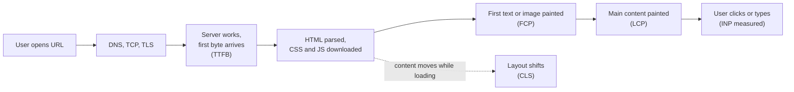
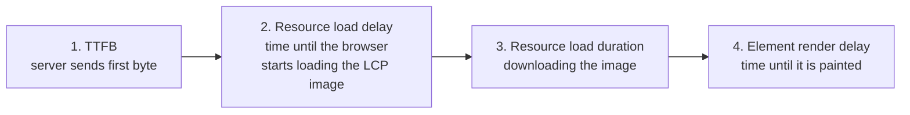
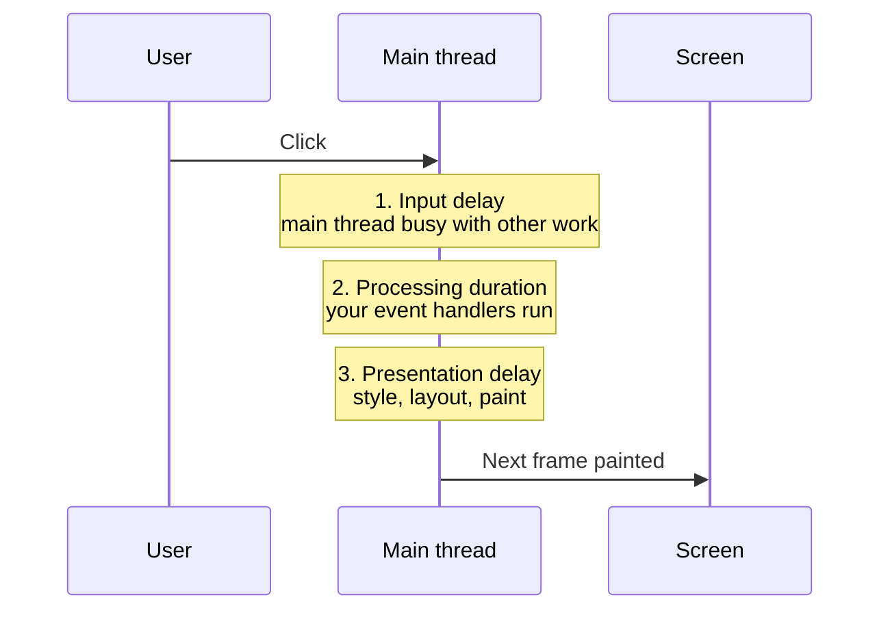
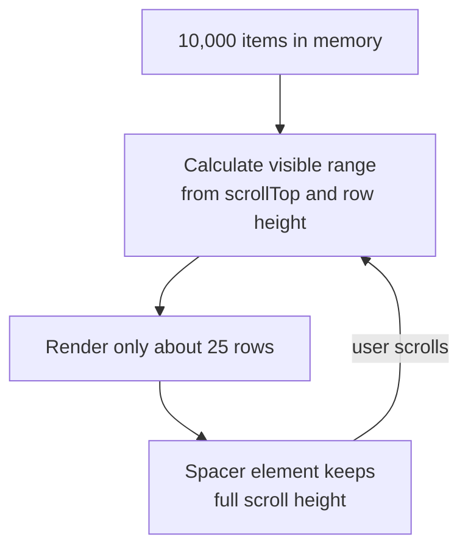
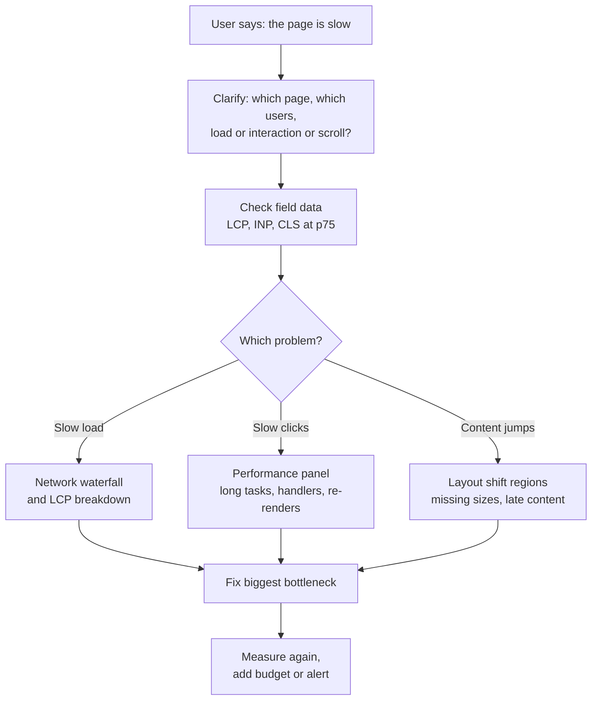

# Web Performance and Core Web Vitals

> In this document you will learn how to measure and improve the speed of a web page: how fast it loads, how fast it reacts to the user, and how stable it looks while loading. "The page is slow, what do you do?" is a classic interview question for frontend and full-stack roles, and this document gives you a clear method to answer it.

**Before this:** [Browser architecture and rendering](../01-cs-and-web-fundamentals/07-browser-architecture-and-rendering.md) · [HTTP, HTTPS and TLS](../01-cs-and-web-fundamentals/05-http-https-and-tls.md) · [Event loop](../02-javascript/16-event-loop.md) · **Interview questions:** [jump to the interview section](#interview-questions)

## Table of contents

1. [Why performance matters](#why-performance-matters)
2. [Where the time goes when a page loads](#where-the-time-goes-when-a-page-loads)
3. [Core Web Vitals overview](#core-web-vitals-overview)
4. [LCP Largest Contentful Paint](#lcp-largest-contentful-paint)
5. [INP Interaction to Next Paint](#inp-interaction-to-next-paint)
6. [CLS Cumulative Layout Shift](#cls-cumulative-layout-shift)
7. [Other metrics TTFB FCP and TBT](#other-metrics-ttfb-fcp-and-tbt)
8. [Lab data vs field data](#lab-data-vs-field-data)
9. [Loading performance](#loading-performance)
10. [Runtime performance](#runtime-performance)
11. [Memory and performance](#memory-and-performance)
12. [Measuring with Chrome DevTools](#measuring-with-chrome-devtools)
13. [Performance budgets and monitoring](#performance-budgets-and-monitoring)
14. [A practical performance checklist](#a-practical-performance-checklist)
15. [Angular specifics](#angular-specifics)
16. [How to explain this in an interview](#how-to-explain-this-in-an-interview)
17. [Interview questions](#interview-questions)
18. [Summary](#summary)
19. [References](#references)

---

## Why performance matters

**Web performance** means how quickly a page shows useful content and how quickly it responds when the user does something.

Performance is not only "load time". Users feel three different things:

| What the user feels | Question in the user's head | Main metric |
| --- | --- | --- |
| Loading | "Is anything happening? Can I see the main content?" | LCP |
| Responsiveness | "I clicked. Why did nothing happen?" | INP |
| Visual stability | "The button moved and I clicked the wrong thing!" | CLS |

Why companies care:

- **Users leave slow pages.** If a page shows a blank screen for several seconds, many people close the tab.
- **Business results.** Faster checkout, search and product pages usually mean more completed orders and sign-ups. (Each company measures its own numbers. Do not quote random statistics in an interview.)
- **Search ranking.** Google uses Core Web Vitals as part of its page experience signals. Good content still matters more, but a slow page can lose against a similar fast page.
- **Real devices are slow.** Your laptop is fast. Many users have a mid-range phone with a slow CPU and an unstable mobile network. A JavaScript bundle that parses in 100 ms on your laptop can take 500 ms or more on a cheap phone.
- **Cost.** Big pages cost users mobile data and cost you CDN bandwidth.

The most important rule of performance work: **measure first, then optimize.** Guessing wastes time. You fix the biggest measured problem first.

---

## Where the time goes when a page loads

You need a mental picture of the loading timeline. The details of parsing, layout and painting are in [Browser architecture and rendering](../01-cs-and-web-fundamentals/07-browser-architecture-and-rendering.md). Here is the short version, with the metrics placed on the timeline.



Step by step:

1. **Connection.** The browser finds the server IP (DNS), opens a TCP connection and does the TLS handshake for HTTPS.
2. **Server time.** The server builds the HTML (or reads it from a cache) and sends the first byte. The time until this point is **TTFB** (Time to First Byte).
3. **Parsing.** The browser parses HTML into the DOM. It finds CSS, scripts, images and fonts and starts downloading them.
4. **Render-blocking resources.** CSS blocks rendering. The browser will not paint until it has the CSS, because it does not want to show unstyled content. Normal `<script>` tags (without `defer` or `async`) block HTML parsing.
5. **First paint.** The browser paints the first text or image. This is **FCP** (First Contentful Paint).
6. **Main content.** The biggest image or text block in the viewport is painted. This is **LCP**.
7. **Interaction.** The user clicks, taps and types. If the main thread is busy running JavaScript, the page reacts late. This is what **INP** measures.
8. **Stability.** During all of this, late images, ads or fonts can push content around. This is **CLS**.

So a slow page is slow in one (or more) of these places: the network and server, render-blocking resources, too much JavaScript, heavy images, or a busy main thread. Your job is to find which one.

---

## Core Web Vitals overview

**Core Web Vitals** are three metrics chosen by Google to describe the real user experience of a page: loading, responsiveness and visual stability.

| Metric | What it measures | Good | Needs improvement | Poor |
| --- | --- | --- | --- | --- |
| **LCP** Largest Contentful Paint | When the main content becomes visible | ≤ 2.5 s | 2.5 s – 4 s | > 4 s |
| **INP** Interaction to Next Paint | How fast the page reacts to clicks, taps and key presses | ≤ 200 ms | 200 ms – 500 ms | > 500 ms |
| **CLS** Cumulative Layout Shift | How much visible content moves unexpectedly | ≤ 0.1 | 0.1 – 0.25 | > 0.25 |

Important details:

- **They are field metrics.** They are meant to be measured on real users' devices, not only on your machine.
- **75th percentile.** A page "passes" a metric when at least 75% of page visits are in the "good" range. Mobile and desktop are judged separately. Why the 75th percentile? The average hides slow users. The 75th percentile means "most users, including many on slower devices, have a good experience".
- **INP replaced FID.** INP became a Core Web Vital on **March 12, 2024**. It replaced **FID** (First Input Delay). FID only measured the *delay before the first interaction's handler started*. INP measures the *full time* of *all* interactions until the next paint. FID is retired, and the `web-vitals` library removed `onFID()` in version 5.
- **The set can change.** Google reviews the metrics over time. That is why FID was replaced. The fundamentals (load fast, respond fast, do not move content) stay the same.

### Analogy

Think of a restaurant:

- **LCP** is how long until your main dish arrives at the table.
- **INP** is how long the waiter takes to react each time you call them, for the whole evening (not just the first time).
- **CLS** is the table being moved while you eat, so you knock over your glass.

---

## LCP Largest Contentful Paint

### What it is

**LCP** is the time from the start of navigation until the **largest image or text block visible in the viewport** is painted.

It is a good approximation of "when did the user see the main content?" On a product page that is usually the product photo. On a blog it is usually the heading or first paragraph.

### Which elements count

- `` elements (the first frame for animated images).
- `<image>` elements inside an `<svg>`.
- `<video>` elements (the poster image or first frame).
- Elements with a background image loaded with `url()`.
- Block-level elements that contain text.

The browser ignores some elements that are probably not "content": elements with `opacity: 0`, elements that cover the full viewport (probably a background), and low-detail placeholder images.

The LCP element can change while the page loads. First the heading is the largest, then a big image loads and becomes the new LCP candidate. The browser stops looking for new candidates when the user first interacts with the page (tap, click, scroll or key press).

### The four parts of LCP

The best way to fix LCP is to split it into four parts and find which part is large.



| Part | What it means | Typical causes when it is large | Fixes |
| --- | --- | --- | --- |
| TTFB | Server time and network | Slow backend, no caching, far away server, redirects | CDN, server caching, faster queries, fewer redirects, SSR caching |
| Resource load delay | The image is discovered late | Image added by JavaScript, image in CSS `background-image`, `loading="lazy"` on the hero image | Put the image in the HTML, `<link rel="preload">`, `fetchpriority="high"`, never lazy-load the LCP image |
| Resource load duration | The file is big or slow | Huge JPEG, wrong size for the device, no CDN | AVIF/WebP, responsive `srcset`, compress, CDN |
| Element render delay | The image is ready but not painted | Render-blocking CSS/JS, client-side rendering waits for the JS bundle, fonts hide text | Defer JS, inline critical CSS, SSR, `font-display` |

### Code examples

**Simple: the hero image done wrong and right.**

```html
<!-- ❌ Wrong: LCP image lazy-loaded, no size, discovered late -->


<!-- ❌ Wrong: LCP image hidden inside CSS. The browser finds it only after the CSS is downloaded and parsed. -->
<div class="hero" style="background-image: url('/img/hero.jpg')"></div>

<!-- ✅ Correct: in the HTML, high priority, modern format, correct size, dimensions set -->

```

**A twist: the LCP image is in CSS or added by JavaScript.** Sometimes you cannot change that quickly. Then tell the browser about the image early with a preload in the `<head>`:

```html
<head>
  <link
    rel="preload"
    as="image"
    href="/img/hero-1200.avif"
    imagesrcset="/img/hero-600.avif 600w, /img/hero-1200.avif 1200w"
    imagesizes="100vw"
    fetchpriority="high"
  >
</head>
```

**Realistic: a client-side rendered app.** In a pure client-side rendered app (a typical Angular or React SPA), the HTML is almost empty. The LCP element is created only after the JavaScript bundle downloads, parses and runs, and often after an API call returns:

```text
HTML (empty) → download main.js (500 KB) → parse and run → call /api/products → render product image → download image → paint
```

Every arrow adds time. Ways to shorten it:

- Make the bundle smaller (code splitting, see [Loading performance](#loading-performance)).
- Start the API call earlier (do not wait for a deeply nested component to ask for data).
- Use server-side rendering or static generation so the HTML already contains the content. See [Rendering strategies](./09-rendering-strategies-csr-ssr-ssg.md).

### Measuring LCP in the browser

The browser reports LCP candidates through the `PerformanceObserver` API (a browser API, not part of JavaScript itself):

```js
// Browser only. Logs each new LCP candidate.
const observer = new PerformanceObserver((list) => {
  const entries = list.getEntries();
  const lastEntry = entries[entries.length - 1]; // the current LCP candidate
  console.log('LCP candidate at', Math.round(lastEntry.startTime), 'ms', lastEntry.element);
});

observer.observe({ type: 'largest-contentful-paint', buffered: true });
// buffered: true also gives you entries that happened before this code ran
```

In real projects you usually use the `web-vitals` library instead, because it handles many edge cases (background tabs, back/forward cache, when to stop). See [Lab data vs field data](#lab-data-vs-field-data).

---

## INP Interaction to Next Paint

### What it is

**INP** measures how quickly the page responds to user interactions. For each click, tap or key press, it measures the time from the user's action until the browser **paints the next frame** that shows a response.

INP looks at **all** interactions during the whole page visit and reports one of the slowest. (For pages with many interactions, it ignores one extreme outlier for every 50 interactions, so one random hiccup does not ruin the score.)

What counts as an interaction:

- Mouse click
- Tap on a touchscreen
- Key press on a physical or on-screen keyboard

What does **not** count: hovering and scrolling.

### Why it exists

Users hate when they click and nothing happens. The old metric, FID, only measured the first interaction, and only the waiting time before the event handler started. A page could have a great FID and still freeze for one second every time you open a menu. INP catches that.

### The three phases of an interaction



1. **Input delay.** The user clicked, but the main thread is busy with something else (a long task, a timer, a script that is loading). The event waits in line.
2. **Processing duration.** Your event handlers (`click`, `keydown`, `input`, framework code, state updates) run.
3. **Presentation delay.** The browser recalculates styles, does layout, paints and composites the new frame. A huge DOM or big layout change makes this slow.

INP = input delay + processing duration + presentation delay.

### How to improve INP

| Phase that is slow | What to do |
| --- | --- |
| Input delay | Break up long tasks so the main thread is free more often. Load less JavaScript at startup. Delay third-party scripts. |
| Processing duration | Do less work in the handler. Show feedback first, do heavy work after. Move heavy computation to a Web Worker. Debounce expensive input handlers. |
| Presentation delay | Keep the DOM smaller. Avoid layout thrashing. Virtualize long lists. Use `content-visibility: auto` for off-screen sections. Update only the part of the UI that changed. |

The details and code for long tasks, Web Workers, layout thrashing and virtualization are in [Runtime performance](#runtime-performance).

### Code example: show feedback first

A user clicks "Generate report". The handler does 400 ms of work. The user sees nothing for 400 ms and clicks again.

```js
// ❌ Wrong: the browser cannot paint "Generating..." until the heavy work finishes
generateButton.addEventListener('click', () => {
  statusEl.textContent = 'Generating...';
  const report = buildReport(salesData); // 400 ms of blocking work
  renderReport(report);
});

// ✅ Better: update the UI, give the browser a chance to paint, then do the heavy work
generateButton.addEventListener('click', async () => {
  statusEl.textContent = 'Generating...';
  generateButton.disabled = true;

  await yieldToMain(); // the browser can paint the new text now

  const report = buildReport(salesData);
  renderReport(report);
  generateButton.disabled = false;
});

function yieldToMain() {
  // scheduler.yield() exists in Chromium-based browsers. Fall back to setTimeout elsewhere.
  if (globalThis.scheduler?.yield) return scheduler.yield();
  return new Promise((resolve) => setTimeout(resolve, 0));
}
```

What changed: the handler ends quickly. The browser paints "Generating..." (so the interaction gets a fast "next paint"). The heavy work continues in a new task. Even better: move `buildReport` to a Web Worker so the main thread never blocks.

> **Important:** `await Promise.resolve()` does **not** let the browser paint. Promise callbacks are microtasks, and the browser runs all microtasks before it renders. You need a new task (`setTimeout`, `scheduler.yield()`, `MessageChannel`) to give the browser a rendering opportunity. See [Q8](#q8-output-prediction-does-await-promiseresolve-let-the-browser-paint).

---

## CLS Cumulative Layout Shift

### What it is

A **layout shift** happens when a visible element changes its position between two frames without the user causing it. **CLS** measures how much the page content jumps around.

Classic example: you are about to tap "Cancel", an ad loads above it, the content moves down, and you tap "Buy" instead.

### How it is calculated

Each unexpected layout shift gets a score:

```text
layout shift score = impact fraction × distance fraction
```

- **Impact fraction:** how much of the viewport the moving element affects (its area before plus after, as a fraction of the viewport).
- **Distance fraction:** how far it moved, as a fraction of the viewport height (or width, whichever is bigger).

Worked example: an element takes the top 50% of the viewport. It moves down by 25% of the viewport height.

- Before: it covers 0%–50%. After: it covers 25%–75%. Together it touched 0%–75%, so impact fraction = 0.75.
- It moved 25% of the viewport height, so distance fraction = 0.25.
- Score = 0.75 × 0.25 = 0.1875. That one shift alone is already "needs improvement".

```js
function layoutShiftScore(impactFraction, distanceFraction) {
  return impactFraction * distanceFraction;
}
console.log(layoutShiftScore(0.75, 0.25)); // 0.1875
```

Shifts are grouped into **session windows**: shifts that happen less than 1 second apart, for at most 5 seconds. CLS is the score of the **worst window** during the page visit. This keeps long-lived pages (like a single-page app open all day) from getting an ever-growing score.

**Expected shifts do not count.** Shifts that happen within 500 ms after a user input (click, tap, key press) are excluded. If the user clicks "Show more" and content expands, that is expected.

### Common causes and fixes

| Cause | Fix |
| --- | --- |
| Images and videos without size | Always set `width` and `height` attributes (or CSS `aspect-ratio`). The browser then reserves the space before the image loads. |
| Ads, embeds and iframes that load late | Reserve space with a fixed `min-height` container. |
| Content injected above existing content (cookie banners, "new version" bars, promo strips) | Insert below the fold, or use an overlay (`position: fixed`) that does not push content, or reserve the space from the start. |
| Web fonts that swap and change text size | Preload key fonts, use `font-display: optional`, or adjust the fallback font with `size-adjust` so both fonts take the same space. |
| Animating `top`, `left`, `width`, `height`, `margin` | Animate `transform` instead. Transforms do not cause layout shifts. |
| Skeleton loaders with a different size than the real content | Make the skeleton the same size as the final content. |

### Code examples

```html
<!-- ❌ Wrong: no dimensions. Height is 0 until the image loads, then everything below jumps. -->


<!-- ✅ Correct: the browser computes the aspect ratio from width and height and reserves space -->

```

```css
/* Responsive images keep the reserved ratio when you also set height: auto */
img {
  max-width: 100%;
  height: auto;
}

/* Reserve space for an ad slot or embed that loads later */
.ad-slot {
  min-height: 250px;
}

/* For an element without width/height attributes (for example a video container) */
.video-wrapper {
  aspect-ratio: 16 / 9;
}
```

**Realistic example: a "new message" banner in an Angular or React app.**

```css
/* ❌ Wrong: the banner is inserted at the top of the page flow and pushes everything down */
.banner {
  position: static;
}

/* ✅ Correct: the banner floats on top and does not move other content */
.banner {
  position: fixed;
  top: 0;
  left: 0;
  right: 0;
}
```

---

## Other metrics TTFB FCP and TBT

These are not Core Web Vitals, but they help you **diagnose** problems.

| Metric | What it measures | Good | Poor | Field or lab |
| --- | --- | --- | --- | --- |
| **TTFB** Time to First Byte | Time from the request until the first byte of the response. Includes redirects, DNS, connection, TLS and server time. | ≤ 0.8 s | > 1.8 s | Both |
| **FCP** First Contentful Paint | When the first text or image is painted | ≤ 1.8 s | > 3 s | Both |
| **TBT** Total Blocking Time | Sum of the "blocking" part of every long task during loading | Lighthouse treats about 200 ms or less as good on mobile | | Lab only |
| **Speed Index** | How quickly the visible area fills in during load | | | Lab only |

### TTFB

A high TTFB slows down everything after it, including FCP and LCP. Causes: slow database queries, no server cache, a server far from the user, too many redirects, slow server-side rendering. Fixes: CDN, caching (HTML at the edge when possible), faster backend code, fewer redirects. Remember: TTFB is a "rough guide", not a goal on its own. A server-rendered page can have a higher TTFB than a static file and still have a better LCP.

### FCP

FCP tells you when the user first sees *something*. A slow FCP usually means a slow TTFB or render-blocking CSS and JavaScript.

### TBT

A **long task** is any task on the main thread that takes more than **50 ms**. During a long task, the page cannot respond to input.

**TBT** adds up the part of each long task that is over 50 ms, during page load. It is the lab metric that best predicts INP problems, because both are about a busy main thread.

```js
function totalBlockingTime(taskDurations) {
  return taskDurations
    .map((ms) => Math.max(0, ms - 50)) // only the part above 50 ms "blocks"
    .reduce((sum, ms) => sum + ms, 0);
}

console.log(totalBlockingTime([70, 120, 30, 250])); // 290  (20 + 70 + 0 + 200)
console.log(totalBlockingTime([40, 45, 50]));       // 0    (no task is over 50 ms)
```

Notice: three tasks of 40–50 ms block nothing, but one 250 ms task blocks 200 ms. Many small tasks are much better than one big task. This is the key idea behind "break up long tasks".

---

## Lab data vs field data

There are two ways to measure performance. You need both.

| | Lab data | Field data (RUM) |
| --- | --- | --- |
| What it is | A test run in a controlled environment | Data from real users' browsers |
| Tools | Lighthouse, Chrome DevTools, WebPageTest | CrUX, the `web-vitals` library, RUM tools (Datadog, New Relic, Sentry, etc.) |
| Device and network | One simulated device and network | Every real device, network and location |
| Interactions | Usually none (just page load) | Real clicks and typing, so INP is real |
| Good for | Debugging, comparing before/after, CI checks | Knowing the real user experience, finding problems you cannot reproduce |
| Weakness | May not match real users | Harder to debug; needs traffic; data arrives slowly |

**RUM** means Real User Monitoring: you collect performance data from real users' browsers and send it to your server or a monitoring service.

### The main tools

- **Lighthouse.** Runs a page load in a simulated mid-range phone with throttled network and CPU. Gives a score from 0 to 100 and a list of suggestions. Built into Chrome DevTools, also available as a CLI and in CI (Lighthouse CI). It cannot measure INP during load (there is no user), so it uses TBT as a proxy.
- **PageSpeed Insights.** A Google web page that shows **both**: field data from CrUX (if your site has enough traffic) and a Lighthouse lab run.
- **CrUX (Chrome User Experience Report).** A public dataset of real Chrome users' experiences (from users who opted in). It is reported over a rolling 28-day window. Google Search Console's Core Web Vitals report uses this data. Data comes only from Chrome.
- **`web-vitals` library.** A small JavaScript library from the Chrome team that measures LCP, INP, CLS, FCP and TTFB in your users' browsers, the same way Chrome reports them.

### Why can Lighthouse say 95 while real users are slow?

- Lighthouse tests one device and one network. Your real users may be on older phones.
- Lighthouse does not click anything, so it cannot see slow interactions (INP).
- Lighthouse usually tests a cold first visit to one URL. Real users visit logged-in pages, with personalized data, ads and A/B tests.
- The opposite also happens: field data can be better than lab data, because real users often have cached files and faster devices than the simulated phone.

**Rule:** use field data to find *what* is slow for real users. Use lab tools to find *why* and to test fixes.

### Collecting field data with the web-vitals library

```js
import { onCLS, onINP, onLCP, onFCP, onTTFB } from 'web-vitals';

function sendToAnalytics(metric) {
  const body = JSON.stringify({
    name: metric.name,     // 'LCP', 'INP', 'CLS', ...
    value: metric.value,   // milliseconds (CLS has no unit)
    rating: metric.rating, // 'good' | 'needs-improvement' | 'poor'
    id: metric.id,         // unique per page load, to de-duplicate
    page: location.pathname,
  });

  // sendBeacon is designed to send small data even while the page is closing
  if (!navigator.sendBeacon('/analytics/vitals', body)) {
    fetch('/analytics/vitals', { method: 'POST', body, keepalive: true });
  }
}

onCLS(sendToAnalytics);
onINP(sendToAnalytics);
onLCP(sendToAnalytics);
onFCP(sendToAnalytics);
onTTFB(sendToAnalytics);
```

Notes:

- CLS and INP can change during the whole visit, so the library reports them when the page is hidden or closed. That is why `sendBeacon` (or `fetch` with `keepalive`) is used.
- There is an **attribution build** (`import { onINP } from 'web-vitals/attribution'`) that also tells you *which element* and *which phase* caused a bad score. This is very helpful for debugging INP and LCP in production.
- On your server or dashboard, look at the **75th percentile per page type** (home, product, checkout), split by mobile and desktop. Averages hide problems.

---

## Loading performance

Loading performance is about getting the important bytes to the user quickly and not making the browser wait for unimportant bytes. Think of it as three questions:

1. **Send less.** Can we send fewer bytes? (compression, smaller images, less JavaScript)
2. **Send it sooner.** Can the important things start downloading earlier? (preload, preconnect, priorities, CDN)
3. **Do not block.** Can the browser show content without waiting for everything? (defer JS, critical CSS, lazy loading)

### Render-blocking CSS and critical CSS

CSS is **render-blocking**: the browser does not paint until it has downloaded and parsed all CSS in the `<head>`. A big stylesheet for the whole app delays the first paint, even if the first screen needs only a small part of it.

**Critical CSS** is the small amount of CSS needed to style the content visible on the first screen ("above the fold"). The idea:

1. Inline the critical CSS directly in a `<style>` tag in the `<head>`.
2. Load the rest of the CSS without blocking rendering.

```html
<head>
  <!-- 1. Critical CSS inline: no extra request before first paint -->
  <style>
    body { margin: 0; font-family: system-ui, sans-serif; }
    .header { height: 64px; background: #0b5394; color: #fff; }
    .hero { min-height: 60vh; }
  </style>

  <!-- 2. Full stylesheet loaded without blocking render -->
  <link rel="preload" href="/styles.css" as="style" onload="this.onload=null; this.rel='stylesheet'">
  <noscript><link rel="stylesheet" href="/styles.css"></noscript>
</head>
```

Tools can extract critical CSS for you. The Angular CLI inlines critical CSS automatically in production builds (see [Angular specifics](#angular-specifics)).

Trade-off: inlined CSS is not cached separately, so it is sent with every HTML page. Keep it small.

### Loading JavaScript without blocking

A normal `<script src>` in the `<head>` stops HTML parsing until the script is downloaded and executed. Use the `defer`, `async` or `type="module"` attributes. The full explanation of how parsing works is in [Browser architecture and rendering](../01-cs-and-web-fundamentals/07-browser-architecture-and-rendering.md); this is the summary you need for performance:

| Attribute | Blocks HTML parsing? | When does it run? | Order kept? | Use for |
| --- | --- | --- | --- | --- |
| none | Yes | Immediately when downloaded | Yes | Almost never in the `<head>` |
| `defer` | No | After HTML is parsed, before `DOMContentLoaded` | Yes | Your app scripts |
| `async` | No (only pauses while it executes) | As soon as it is downloaded | No | Independent scripts like analytics |
| `type="module"` | No | Like `defer` by default | Yes | Modern ES module code |

```html
<!-- ❌ Wrong: blocks parsing of everything below it -->
<script src="/js/app.js"></script>

<!-- ✅ Correct: downloads in parallel, runs after parsing -->
<script src="/js/app.js" defer></script>

<!-- ✅ Independent third-party analytics -->
<script src="https://analytics.example.com/tag.js" async></script>
```

### Code splitting and lazy loading

**Code splitting** means breaking one big JavaScript bundle into smaller files (chunks) that are loaded only when needed. **Lazy loading** means loading something (code, images, data) only when it is about to be used.

Why: the user opening the home page should not download the code for the admin settings page, the chart editor and the PDF exporter.

**Simple: load a heavy feature on demand with dynamic `import()`.**

```js
// The chart editor code is NOT in the main bundle.
// The bundler creates a separate chunk for it.
openEditorButton.addEventListener('click', async () => {
  const { openChartEditor } = await import('./chart-editor.js');
  openChartEditor(document.querySelector('#editor-root'));
});
```

**Realistic: route-level splitting.** This is the most common and most effective split. Each page (route) becomes its own chunk.

```ts
// Angular 16: lazy-load a feature module or a standalone component per route
const routes: Routes = [
  { path: '', component: HomeComponent },
  { path: 'reports', loadChildren: () => import('./reports/reports.module').then((m) => m.ReportsModule) },
  { path: 'settings', loadComponent: () => import('./settings/settings.component').then((m) => m.SettingsComponent) },
];
```

```js
// React: lazy-load a page component
const ReportsPage = React.lazy(() => import('./pages/ReportsPage.js'));
```

What to split:

- Routes (pages).
- Heavy components that are not visible at first: modals, rich text editors, charts, maps, date pickers.
- Big libraries used by only one feature (PDF generation, Excel export).

Trade-offs:

- Too many tiny chunks create many requests and a "waterfall" (chunk A loads, then discovers it needs chunk B).
- The user waits when they open the lazy feature for the first time. Fix this with **prefetching**: download the chunk in the background when the browser is idle or when the user hovers over the link. Angular has preloading strategies for this (see [Angular specifics](#angular-specifics)).

How bundlers create chunks and how tree shaking works is in [Build tools and bundlers](./10-build-tools-and-bundlers.md).

### Images

Images are often the largest bytes on a page. The HTML attributes (`srcset`, `sizes`, `<picture>`, `alt`) are explained in [HTML semantics and forms](./01-html-semantics-and-forms.md). Here are the performance rules.

**1. Use modern formats.**

| Format | Use for | Notes |
| --- | --- | --- |
| AVIF | Photos | Usually the smallest files. Supported by all modern browsers. |
| WebP | Photos and images with transparency | Very well supported. Good fallback for AVIF. |
| JPEG | Photos (fallback) | Universal support. |
| PNG | Screenshots, images needing lossless quality | Often big for photos. |
| SVG | Icons, logos, simple illustrations | Vector, tiny, sharp at every size. |

```html
<picture>
  <source srcset="/img/team.avif" type="image/avif">
  <source srcset="/img/team.webp" type="image/webp">
  
</picture>
```

**2. Serve the right size.** Do not send a 3000-pixel-wide image to a 400-pixel-wide phone screen. Use `srcset` and `sizes` so the browser chooses.

**3. Lazy-load images below the fold.** `loading="lazy"` tells the browser to download the image only when it gets close to the viewport.

```html
<!-- Product grid far down the page -->

```

**4. Never lazy-load the LCP image.** Give it `fetchpriority="high"` instead (see [LCP](#lcp-largest-contentful-paint)). `fetchpriority` works on ``, `<link>` and `<script>` and has been supported in all major browsers since late 2024.

**5. Always set `width` and `height`** to avoid layout shifts (see [CLS](#cls-cumulative-layout-shift)).

**6. Use an image CDN** (or a build step) that resizes, compresses and converts images automatically.

### Fonts

Web fonts cause two classic problems:

- **FOIT (Flash of Invisible Text):** the text is hidden until the font downloads. Bad for LCP when the LCP element is text.
- **FOUT (Flash of Unstyled Text):** the text shows in a fallback font, then switches. This can cause layout shift if the fonts have different sizes.

The `font-display` descriptor controls this behavior:

| Value | Behavior | Good for |
| --- | --- | --- |
| `block` | Hide text for a short time (about 3 s), then show fallback | Icon fonts (rarely a good choice for text) |
| `swap` | Show fallback immediately, swap to the web font whenever it arrives | Brand fonts where the look matters |
| `fallback` | Very short hide period, short swap period, then keep the fallback | A middle ground |
| `optional` | Very short hide period, use the web font only if it is already available (often from cache) | Best for CLS and LCP; the font may appear only on the next visit |

```css
@font-face {
  font-family: 'Inter';
  src: url('/fonts/inter-var.woff2') format('woff2');
  font-weight: 100 900; /* one variable font file instead of many weights */
  font-display: swap;
}

/* Make the fallback font take the same space as the web font to reduce layout shift */
@font-face {
  font-family: 'Inter Fallback';
  src: local('Arial');
  size-adjust: 107%;
}

body {
  font-family: 'Inter', 'Inter Fallback', sans-serif;
}
```

```html
<!-- Preload the one font used above the fold. crossorigin is required for fonts, even on the same origin. -->
<link rel="preload" href="/fonts/inter-var.woff2" as="font" type="font/woff2" crossorigin>
```

More font rules:

- Use **WOFF2** (best compression).
- Load fewer fonts and weights. A variable font can replace several files.
- **Subset** the font (only the characters you need, for example Latin only).
- Self-hosting avoids an extra connection to another domain. If you use a font service, add `preconnect` to its domain.
- Consider the system font stack (`system-ui`) for app UIs. It costs zero bytes.

### Resource hints

**Resource hints** are `<link>` tags that tell the browser about work it will need to do soon.

| Hint | What it does | Use when |
| --- | --- | --- |
| `preconnect` | Opens the connection (DNS + TCP + TLS) to another origin early | You will definitely load something important from that origin soon (API, font host, image CDN) |
| `dns-prefetch` | Only does the DNS lookup | Cheaper fallback for origins that may be used |
| `preload` | Downloads a specific resource for the **current** page with high priority | A critical resource the browser discovers late (LCP image in CSS, font, critical script) |
| `modulepreload` | Like preload, for ES modules (can also parse them early) | Critical module chunks |
| `prefetch` | Downloads a resource with low priority for a **future** navigation | The next page the user will probably visit |

```html
<head>
  <link rel="preconnect" href="https://api.shop.example.com">
  <link rel="preconnect" href="https://images.shop.example.com">
  <link rel="dns-prefetch" href="https://analytics.example.com">

  <link rel="preload" href="/fonts/inter-var.woff2" as="font" type="font/woff2" crossorigin>
  <link rel="modulepreload" href="/js/product-page.js">

  <link rel="prefetch" href="/js/checkout-page.js">
</head>
```

Warnings:

- Every preload competes for bandwidth with other resources. If you preload ten things, nothing is a priority any more.
- A preloaded resource that is not used within a few seconds triggers a console warning. Remove unused preloads.
- Too many `preconnect` hints waste connections. Keep it to the few most important origins.

Chromium-based browsers also support the **Speculation Rules API**, which can prefetch or even prerender a whole next page. It is a progressive enhancement: other browsers ignore it.

### Compression

Text resources (HTML, CSS, JavaScript, JSON, SVG) compress very well. The server compresses them, and the browser decompresses them.

- **gzip:** supported everywhere.
- **Brotli (`br`):** usually smaller than gzip for text. Supported by all modern browsers over HTTPS. Best used with pre-compressed static files at build time (highest quality level).
- **Zstandard (`zstd`):** a newer option that some modern browsers now accept. Keep gzip or Brotli as the safe default.

```text
Request:   Accept-Encoding: gzip, deflate, br, zstd
Response:  Content-Encoding: br
```

Do not compress images, videos or fonts with gzip or Brotli. JPEG, PNG, WebP, AVIF and WOFF2 are already compressed.

**Compression is not the same as minification.** Minification removes spaces, comments and shortens names at build time. Compression encodes the bytes on the network. You do both.

### CDN

A **CDN** (Content Delivery Network) is a network of servers in many locations. It keeps copies of your files close to users. A user in Mumbai gets files from a server in India instead of one in the US.

Benefits:

- Lower latency (shorter physical distance, faster TTFB).
- Less load on your origin server.
- Often includes compression, HTTP/2 and HTTP/3, image optimization and protection against traffic spikes.

You put static assets (JS, CSS, images, fonts) on a CDN. Many teams also cache HTML or API responses at the CDN edge when the content is public. Caching strategy across layers is covered in [Caching strategies and invalidation](../09-system-design/03-caching-strategies-and-invalidation.md).

### HTTP caching for static assets

The fastest request is the one you never make. The browser can keep files in its **HTTP cache** and reuse them. The server controls this with the `Cache-Control` header. The header itself is explained in [HTTP, HTTPS and TLS](../01-cs-and-web-fundamentals/05-http-https-and-tls.md). The standard frontend pattern is:

| File | Example | Cache-Control | Why |
| --- | --- | --- | --- |
| Static assets with a content hash in the name | `main.3f9a1c.js`, `styles.8b2e44.css` | `public, max-age=31536000, immutable` | The name changes when the content changes, so the old file can be cached for a year |
| HTML entry page | `index.html` | `no-cache` | "Store it, but ask the server every time if it changed" (uses `ETag` and `304 Not Modified`) |
| Personal API data | `/api/me` | `private, no-store` or a short `max-age` | Must not be stored in shared caches |

How it works step by step:

1. The build tool adds a **content hash** to each file name: `main.3f9a1c.js`.
2. `index.html` refers to `main.3f9a1c.js`.
3. You deploy a new version. The code changed, so the file is now `main.a77d02.js`.
4. The browser revalidates `index.html` (because of `no-cache`), gets the new HTML, sees the new file name, and downloads only the changed file.
5. Unchanged files keep their old names and still come from the cache.

This is called **cache busting**. It gives you long caching *and* instant updates.

```text
# ❌ Wrong: long cache on a file name that never changes
/app.js            Cache-Control: max-age=31536000
# Users keep running old code for up to a year after you deploy.

# ✅ Correct
/app.3f9a1c.js     Cache-Control: public, max-age=31536000, immutable
/index.html        Cache-Control: no-cache
```

A **service worker** can add an extra cache layer that you control with JavaScript (offline support, PWA). Angular has `@angular/service-worker` for this.

Also keep your pages eligible for the **back/forward cache (bfcache)**. When a user presses Back, the browser can restore the whole page from memory instantly. Pages that use an `unload` event listener are often excluded, so use `pagehide` or `visibilitychange` instead.

### Keep the JavaScript bundle small

JavaScript is the most "expensive" byte. An image of 200 KB only needs to be decoded. A script of 200 KB must be downloaded, parsed, compiled and executed on the main thread, which delays interactivity.

Practical rules:

- **Analyze the bundle.** Use a bundle analyzer (`source-map-explorer`, `webpack-bundle-analyzer`, or a Rollup/Vite visualizer plugin) to see which libraries are big.
- **Replace heavy libraries.** For example, use the built-in `Intl` APIs or a small date library instead of a large date library. Import only the functions you use (`lodash-es` per function instead of the whole of `lodash`).
- **Tree shaking** removes unused exports at build time. It only works well with ES modules and side-effect-free code. See [Build tools and bundlers](./10-build-tools-and-bundlers.md).
- **Ship modern JavaScript.** Do not transpile to old ES5 if your users have modern browsers. Old syntax plus polyfills is bigger and slower.
- **Set bundle budgets** so the build fails or warns when the bundle grows (see [Performance budgets and monitoring](#performance-budgets-and-monitoring)).

### Third-party scripts

Analytics, tag managers, chat widgets, A/B testing tools and ads often cost more than your own code. They add network requests, long tasks and layout shifts.

- Make a list of every third-party script and its owner. Remove what nobody uses.
- Load them with `async` or `defer`, or after the page is loaded or after user interaction.
- Use a **facade** for heavy embeds: show a static preview (for example a thumbnail of a video with a play button) and load the real embed only when the user clicks.
- Reserve space for embeds to avoid CLS.
- Watch out for A/B testing scripts that hide the page until they run. They directly delay FCP and LCP.

---

## Runtime performance

Runtime performance is about what happens **after** the page loads: scrolling, typing, clicking, animations. It mostly decides INP and how "smooth" the app feels.

### The main thread and the frame budget

The browser's **main thread** does most of the work: running your JavaScript, calculating styles, layout, painting, and handling user input. It can do only one thing at a time.

Screens usually refresh 60 times per second. That gives the browser about **16.7 ms per frame**. If your JavaScript runs for 200 ms, the browser misses about 12 frames. Animations stutter and clicks wait.

How the event loop decides when rendering can happen is explained in [Event loop](../02-javascript/16-event-loop.md). The short version: the browser can render **between tasks**, never in the middle of one.

### Long tasks and how to break them up

A **long task** is a task that runs longer than 50 ms. While it runs, input events wait (input delay).

Typical long tasks:

- Parsing and executing a big JavaScript bundle at startup.
- Processing a big array (filtering, sorting, formatting 50,000 rows).
- Rendering a large component tree after a state change.
- JSON parsing of a huge API response.

**Fix 1: do less.** Avoid work that is not needed right now. Paginate data. Render only visible rows.

**Fix 2: break the work into chunks and yield to the main thread.** Between chunks, the browser can handle clicks and paint.

```js
function yieldToMain() {
  if (globalThis.scheduler?.yield) return scheduler.yield();
  return new Promise((resolve) => setTimeout(resolve, 0));
}

async function processInChunks(items, processItem, budgetMs = 50) {
  let lastYield = performance.now();

  for (const item of items) {
    processItem(item);

    // After about 50 ms of work, give the browser a turn
    if (performance.now() - lastYield > budgetMs) {
      await yieldToMain();
      lastYield = performance.now();
    }
  }
}

// Usage
await processInChunks(orders, (order) => {
  order.totalFormatted = currencyFormatter.format(order.total);
});
```

Step by step:

1. The loop processes items until about 50 ms have passed.
2. `await yieldToMain()` ends the current task. The rest of the function continues in a **new task**.
3. Before that new task runs, the browser can handle waiting clicks and key presses, and paint a frame.
4. The loop continues where it stopped.

You can check this yourself in Node.js: queue a `setTimeout` callback before starting the loop. With chunking, the timer callback runs in the middle of the loop. Without chunking, it runs only after the whole loop finishes.

About `scheduler.yield()`: it is part of the Prioritized Task Scheduling API. It is supported in Chromium-based browsers (Chrome, Edge) but not yet in all browsers, so you always need the `setTimeout` fallback. Its advantage: the rest of your work continues *before* other less important queued tasks, so your work does not get stuck at the back of the line.

**Fix 3: move the work off the main thread** with a Web Worker (next section).

### Web Workers

A **Web Worker** runs JavaScript in a separate background thread. It has its own event loop and cannot block the main thread.

What a worker can do: heavy computation, parsing, sorting and filtering big data, image processing, `fetch`, IndexedDB.

What a worker **cannot** do: access the DOM, `window` or `document`. It talks to the page only by sending messages.

```js
// main.js (runs on the main thread)
const worker = new Worker(new URL('./report.worker.js', import.meta.url), { type: 'module' });

worker.addEventListener('message', (event) => {
  renderReport(event.data); // receive the result
});

generateButton.addEventListener('click', () => {
  statusEl.textContent = 'Generating...';
  worker.postMessage({ sales: salesData, year: 2026 }); // send the input
});
```

```js
// report.worker.js (runs in a background thread)
self.addEventListener('message', (event) => {
  const { sales, year } = event.data;
  const report = buildReport(sales, year); // heavy work, does not block the page
  self.postMessage(report);
});
```

How data travels: `postMessage` **copies** the data with the structured clone algorithm. Copying a huge object takes time too. For big binary data (`ArrayBuffer`), you can **transfer** it instead of copying: `worker.postMessage(buffer, [buffer])`. After the transfer, the main thread can no longer use that buffer.

When to use a worker:

- Work that takes more than about 50–100 ms and does not need the DOM.
- Examples: CSV/Excel parsing, search indexing, encryption, image filters, complex chart calculations.

When not to use one: small tasks (the message overhead is larger than the work), or work that mostly touches the DOM.

In Angular, `ng generate web-worker <name>` sets up a worker with the correct build configuration.

### Debounce and throttle

Some events fire very often: `input`, `scroll`, `resize`, `mousemove`. Running expensive code on every event wastes the main thread.

- **Debounce:** run the function only after the events **stop** for a given time. Example: search-as-you-type sends a request 300 ms after the user stops typing.
- **Throttle:** run the function **at most once** per time period. Example: update a "back to top" button at most every 100 ms while scrolling.

```js
searchInput.addEventListener('input', debounce((event) => {
  searchProducts(event.target.value);
}, 300));
```

How `debounce` and `throttle` work inside, and how to write them, is in [Debounce, throttle and performance](../02-javascript/20-debounce-throttle-and-performance.md).

For scroll-based logic (lazy loading, infinite scroll, "is this element visible?"), prefer `IntersectionObserver` over scroll listeners. It does not run your code on every scroll event. See [DOM and events](./03-dom-and-events.md).

### Layout thrashing

When you change the DOM or styles, the browser marks the layout as "dirty". When you then **read** a layout property (`offsetHeight`, `offsetTop`, `getBoundingClientRect()`, `scrollTop`, `clientWidth`, `getComputedStyle()`), the browser must calculate the layout immediately to give you a correct answer. This is called a **forced synchronous layout** (or forced reflow).

**Layout thrashing** is when you do this in a loop: write, read, write, read. The browser recalculates layout on every iteration.

```js
// ❌ Wrong: read and write mixed in a loop. Layout is recalculated for every card.
for (const card of cards) {
  const width = container.offsetWidth; // READ (forces layout because the previous write made it dirty)
  card.style.width = `${width / 3}px`; // WRITE (makes layout dirty again)
}

// ✅ Correct: read once, then write
const width = container.offsetWidth; // one READ
for (const card of cards) {
  card.style.width = `${width / 3}px`; // only WRITES, layout is calculated once later
}
```

Rules:

- Batch reads first, then writes.
- Do visual updates inside `requestAnimationFrame` so they happen right before the next frame.
- Prefer changing a CSS class over setting many inline styles one by one.
- When adding many elements, build them in a `DocumentFragment` and insert once (see [DOM and events](./03-dom-and-events.md)).

The browser side of layout and paint is in [Browser architecture and rendering](../01-cs-and-web-fundamentals/07-browser-architecture-and-rendering.md).

### Animate transform and opacity

Changing `width`, `height`, `top`, `left` or `margin` triggers **layout** (and then paint) on every frame. Changing `color` or `background` triggers **paint**. Changing `transform` and `opacity` can often be handled by the **compositor** alone, which can run off the main thread and is very cheap.

```css
/* ❌ Wrong: animates left, causes layout on every frame */
.drawer {
  position: absolute;
  left: -300px;
  transition: left 300ms ease;
}
.drawer.open {
  left: 0;
}

/* ✅ Correct: animates transform, the compositor moves it */
.drawer {
  transform: translateX(-100%);
  transition: transform 300ms ease;
}
.drawer.open {
  transform: translateX(0);
}
```

`will-change: transform` tells the browser to prepare a separate layer in advance. Use it only on elements that really animate, and not on hundreds of elements, because each layer uses memory.

Also respect users who prefer less motion:

```css
@media (prefers-reduced-motion: reduce) {
  .drawer { transition: none; }
}
```

### Large DOM and list virtualization

A large DOM (thousands of elements) makes style calculation, layout and memory use expensive. Rendering a table with 10,000 rows can freeze the page for seconds.

**List virtualization** (also called windowing) means rendering **only the rows that are visible** in the viewport, plus a few extra above and below (the "overscan"). As the user scrolls, the same few DOM rows are reused with new data. A tall spacer element keeps the scrollbar correct.



The core calculation is simple:

```js
function getVisibleRange({ scrollTop, viewportHeight, rowHeight, totalRows, overscan = 5 }) {
  const first = Math.floor(scrollTop / rowHeight);
  const visibleCount = Math.ceil(viewportHeight / rowHeight);
  const start = Math.max(0, first - overscan);
  const end = Math.min(totalRows - 1, first + visibleCount + overscan);
  return {
    start,
    end,
    offsetY: start * rowHeight,         // move the rendered rows down to the right place
    totalHeight: totalRows * rowHeight, // height of the spacer, so the scrollbar is right
  };
}

console.log(getVisibleRange({ scrollTop: 0, viewportHeight: 600, rowHeight: 40, totalRows: 10000 }));
// { start: 0, end: 20, offsetY: 0, totalHeight: 400000 }

console.log(getVisibleRange({ scrollTop: 20000, viewportHeight: 600, rowHeight: 40, totalRows: 10000 }));
// { start: 495, end: 520, offsetY: 19800, totalHeight: 400000 }
```

So instead of 10,000 rows, the DOM has about 21 to 26 rows at any time.

In real projects, use a library: **Angular CDK** `<cdk-virtual-scroll-viewport>`, **TanStack Virtual**, or `react-window`.

Trade-offs of virtualization:

- Browser find-in-page (Ctrl+F) cannot find rows that are not rendered.
- Screen readers see only the rendered rows; tables need correct ARIA (`aria-rowcount`, `aria-rowindex`). See [Accessibility](./04-accessibility.md).
- Rows with different heights are harder to handle.
- Keyboard focus can be lost when a focused row is recycled.

Alternatives: **pagination** (often simpler and better for business tables), "load more", or CSS `content-visibility: auto`. That property lets the browser skip rendering work for off-screen sections while keeping them in the DOM (searchable and accessible). It is supported in all major browsers since 2024.

```css
.feed-item {
  content-visibility: auto;
  contain-intrinsic-size: auto 300px; /* estimated height so the scrollbar does not jump */
}
```

### Memoization

**Memoization** means caching the result of a pure function so that calling it again with the same input returns the saved result instead of calculating again.

```js
function memoize(fn) {
  const cache = new Map();
  return function (arg) {
    if (cache.has(arg)) return cache.get(arg);
    const result = fn(arg);
    cache.set(arg, result);
    return result;
  };
}

let calls = 0;
const slowSquare = (n) => { calls++; return n * n; };
const fastSquare = memoize(slowSquare);

console.log(fastSquare(9)); // 81
console.log(fastSquare(9)); // 81 (from the cache)
console.log(calls);         // 1  -> the real function ran only once
```

In frameworks you use memoization to avoid recalculating derived data on every render: Angular **pure pipes** and `computed()` signals, React `useMemo` (see [React essentials](./08-react-essentials.md)).

When memoization hurts:

- The function is cheap. The cache lookup costs about as much as the work.
- The inputs are always different. The cache only grows and uses memory.
- The function is not pure (depends on time, random values or outside state). The cached result becomes wrong.

### Avoid unnecessary re-rendering

Frameworks re-render components when state changes. Re-rendering too much is a common cause of slow interactions in SPAs. The fixes are framework-specific:

- Angular: `OnPush` change detection, `trackBy` in `*ngFor`, pure pipes instead of method calls in templates, running non-UI work outside the Angular zone. See [Change detection and signals](../06-angular-16/10-change-detection-and-signals.md).
- React: correct keys, state kept close to where it is used, `React.memo`, `useMemo`/`useCallback` when they help. See [React essentials](./08-react-essentials.md).

---

## Memory and performance

Memory problems become performance problems. When a page uses more and more memory, the garbage collector runs more often (short pauses), the tab becomes slow, and on phones the browser may kill the tab.

Typical **memory leaks** in frontend apps:

- Event listeners added to `window` or `document` and never removed when a component is destroyed.
- `setInterval` timers that keep running after the user leaves the page.
- RxJS subscriptions that are never unsubscribed (Angular).
- Detached DOM nodes: removed from the page but still referenced from a JavaScript variable or cache.
- Caches (`Map`, arrays) that only grow.

```js
// ❌ Wrong: the listener (and everything it references) lives forever
function mountPriceTicker(element) {
  window.addEventListener('resize', () => layoutTicker(element));
}

// ✅ Correct: return a cleanup function and call it when the component is removed
function mountPriceTicker(element) {
  const controller = new AbortController();
  window.addEventListener('resize', () => layoutTicker(element), { signal: controller.signal });
  return () => controller.abort(); // removes the listener
}
```

How garbage collection works and how to find leaks with heap snapshots is in [Memory management and garbage collection](../02-javascript/19-memory-management-and-garbage-collection.md).

---

## Measuring with Chrome DevTools

### Performance panel step by step

1. Open the page in an **incognito window** (extensions add noise).
2. Open DevTools → **Performance** panel. Recent Chrome versions show live LCP, CLS and INP values for your local session on the panel's start screen.
3. Set **CPU throttling** (for example 4x or 6x slowdown) to simulate a mid-range phone. Set **network throttling** if you are testing loading.
4. To test **loading**: click "Record and reload". To test an **interaction**: click "Record", do the slow action (open a menu, type in search), then stop.
5. Read the recording:
   - **Main track:** a flame chart of everything the main thread did. Long tasks have a red triangle in the corner.
   - **Interactions track:** each click or key press with its duration. Click a slow interaction to see its input delay, processing time and presentation delay.
   - **Layout shifts track:** shows when and which elements shifted.
   - **Network track:** when each file was downloaded.
6. Click a long task and use the **Bottom-Up** or **Call Tree** tab to find which functions took the most time.
7. Fix the biggest problem, record again, and compare.

### Other DevTools panels

| Panel | Use it for |
| --- | --- |
| **Network** | The waterfall: what loads, in which order, how big, how long. Check `Cache-Control`, compression (`Content-Encoding`), priorities, and requests that block others. |
| **Lighthouse** | A quick lab audit with concrete suggestions. |
| **Coverage** (Ctrl+Shift+P → "Show Coverage") | How much of each JS and CSS file was actually used. Large unused parts are candidates for code splitting. |
| **Memory** | Heap snapshots and allocation timelines to find leaks. |
| **Performance monitor** | Live charts of CPU usage, JS heap size, DOM nodes and layouts per second. |
| **Rendering** drawer | "Paint flashing" and "Layout shift regions" highlight what repaints and what shifts. |

### Measuring your own code

```js
// The User Timing API works in browsers and in Node.js
performance.mark('filter-start');
const visibleOrders = filterOrders(allOrders, filters);
performance.mark('filter-end');
performance.measure('filter orders', 'filter-start', 'filter-end');
// In the browser, the measure appears in the Performance panel "Timings" track
```

---

## Performance budgets and monitoring

Performance gets worse slowly. Every sprint adds a library, a script or a bigger image. A **performance budget** is a limit that the team agrees on and checks automatically.

Types of budgets:

- **Size budgets:** "The initial JavaScript must stay under 300 KB compressed."
- **Metric budgets:** "LCP at the 75th percentile must stay under 2.5 s on mobile."
- **Lighthouse score budgets:** "Performance score must be at least 90 in CI."

How teams enforce them:

1. **Build-time budgets.** The Angular CLI has `budgets` in `angular.json` that warn or fail the build when bundles grow. Other tools can check sizes in CI.
2. **Lighthouse CI** runs Lighthouse on every pull request and fails when scores or metrics get worse.
3. **RUM dashboards and alerts.** Track the 75th percentile of LCP, INP and CLS per page type from the `web-vitals` data. Alert on regressions after a deploy.
4. **Code review.** Ask "how big is this new dependency?" before adding it.

The default budgets in a new Angular 16 project (`angular.json`, inside the production configuration):

```json
"budgets": [
  { "type": "initial", "maximumWarning": "500kb", "maximumError": "1mb" },
  { "type": "anyComponentStyle", "maximumWarning": "2kb", "maximumError": "4kb" }
]
```

---

## A practical performance checklist

**Measure**

- Field data (CrUX or `web-vitals` RUM) for LCP, INP and CLS at the 75th percentile, mobile and desktop separately.
- Lab tests with CPU throttling for debugging.

**Server and network**

- TTFB under about 0.8 s: CDN, server caching, few redirects.
- Brotli or gzip for text files.
- Hashed static files with `Cache-Control: public, max-age=31536000, immutable`; HTML with `no-cache`.
- HTTP/2 or HTTP/3.

**Critical path**

- No render-blocking scripts in the `<head>` (`defer`, `async`, `type="module"`).
- Small critical CSS inlined, rest loaded without blocking.
- `preconnect` to critical third-party origins; `preload` only for truly critical, late-discovered files.

**Images and fonts**

- LCP image in the HTML, `fetchpriority="high"`, never lazy.
- AVIF/WebP, responsive `srcset`, correct sizes.
- `width` and `height` on every image and video.
- `loading="lazy"` for below-the-fold images.
- WOFF2, few font files, `font-display`, preload the main font.

**JavaScript**

- Route-level code splitting; heavy features loaded on demand.
- Bundle analyzed; heavy or unused libraries removed.
- Bundle budgets in CI.
- Third-party scripts reviewed and delayed.

**Runtime**

- No long tasks over 50 ms in common interactions; heavy work chunked or in a Web Worker.
- Feedback shown immediately on click.
- Long lists paginated or virtualized.
- Animations use `transform` and `opacity`.
- No layout thrashing in loops.
- Listeners, timers and subscriptions cleaned up.

**Stability**

- Space reserved for images, ads, embeds and late content.
- Banners and toasts overlay instead of pushing content.

---

## Angular specifics

Angular performance is covered in depth in [Angular performance](../06-angular-16/12-performance.md). Here is how the general ideas from this document map to Angular 16:

| General idea | Angular 16 tool |
| --- | --- |
| Route-level code splitting | `loadChildren` and `loadComponent` in routes |
| Prefetch lazy routes | Preloading strategies (`PreloadAllModules` or a custom strategy) |
| Optimized images and LCP | `NgOptimizedImage` directive (`ngSrc`, `priority`, required `width`/`height` or `fill`) |
| Critical CSS | Inlined automatically in production builds (`optimization.styles.inlineCritical`) |
| Bundle budgets | `budgets` in `angular.json` |
| Fewer re-renders | `ChangeDetectionStrategy.OnPush`, `trackBy`, pure pipes, signals (developer preview in v16) |
| Long lists | `@angular/cdk/scrolling` virtual scroll |
| Off-main-thread work | `ng generate web-worker` |
| Work that should not trigger change detection | `NgZone.runOutsideAngular()` |
| Faster LCP with server HTML | Angular Universal SSR, hydration (developer preview in v16). See [Rendering strategies](./09-rendering-strategies-csr-ssr-ssg.md) |

> **Newer Angular (17+):** deferrable views (`@defer`) lazy-load parts of a template with built-in triggers (on viewport, on idle, on interaction). Angular 17+ also uses the esbuild-based application builder by default, which builds faster. See [Angular 16 vs newer versions](../06-angular-16/16-angular-16-vs-newer-versions.md).

---

## How to explain this in an interview

Use this structure when someone asks "What are Core Web Vitals?" or "How do you make a page fast?"

1. **Define it:** "Core Web Vitals are three user-centric metrics: LCP for loading, INP for responsiveness and CLS for visual stability. Good means LCP under 2.5 seconds, INP under 200 milliseconds and CLS under 0.1, measured at the 75th percentile of real users."
2. **Why it exists:** "Older metrics like the load event did not match what users feel. These three describe what users notice: when the main content appears, whether the page reacts when they click, and whether things jump around."
3. **How it works:** "The browser reports them through performance APIs. LCP is when the biggest visible image or text block is painted. INP is one of the slowest interactions, from the click to the next paint. CLS adds up unexpected layout shifts in the worst session window."
4. **Small example:** "On a product page, the hero photo is the LCP element. If it is lazy-loaded or hidden in CSS, the browser finds it late. I put it in the HTML with `fetchpriority="high"`, a modern format and the right size, and I set width and height so nothing shifts."
5. **Where it is useful:** "I collect the metrics from real users with the `web-vitals` library, look at the 75th percentile per page type, and use Lighthouse and the Performance panel to debug. Budgets in CI stop regressions."
6. **Trade-offs / gotchas:** "Lab and field data often disagree. Lighthouse can't measure INP because nobody clicks, so I use TBT as a lab proxy. And I always measure before optimizing, because the biggest problem is often not where I expect."

---

## Interview questions

### Q1. What are Core Web Vitals, and what are the thresholds?

**What the interviewer is checking:** Do you know the three current metrics (with INP, not FID), what each one means for the user, the thresholds, and that they are measured on real users at the 75th percentile?

**Short spoken answer (30–60 seconds):**
> "Core Web Vitals are three metrics from Google that describe real user experience. LCP, Largest Contentful Paint, is loading: when the biggest image or text block in the viewport is painted. Good is 2.5 seconds or less. INP, Interaction to Next Paint, is responsiveness: how long it takes from a click, tap or key press until the next frame is painted. Good is 200 milliseconds or less. CLS, Cumulative Layout Shift, is visual stability: how much content jumps around unexpectedly. Good is 0.1 or less. They're judged at the 75th percentile of real page visits, separately for mobile and desktop. INP replaced FID in March 2024."

**Detailed explanation:**
- "Needs improvement" is LCP up to 4 s, INP up to 500 ms, CLS up to 0.25. Above that is "poor".
- The 75th percentile means at least 75% of visits must be "good". Averages would hide the slow users.
- They are *field* metrics. Lab tools can estimate LCP and CLS, but INP needs real interactions.
- Supporting metrics (TTFB, FCP, TBT) are not Core Web Vitals but help diagnose problems.

**Follow-up questions:**
- **Why the 75th percentile and not the average?** — The average can look fine while a quarter of users have a terrible experience. The 75th percentile is a balance: it covers most users, including many on slower devices, but is not ruined by a few extreme outliers.
- **Are Core Web Vitals a ranking factor?** — Google uses them as part of its page experience signals. Relevant content matters more, but between similar pages, a better experience can help.
- **Can you measure them in Safari and Firefox?** — Browser support for the underlying APIs has been growing, but historically some (like INP) were Chromium-only, and CrUX data only comes from Chrome users. That is one reason to also look at your own RUM data.

**Common mistakes:** Saying FID instead of INP. Saying "Lighthouse score" is a Core Web Vital. Forgetting the 75th percentile. Mixing up FCP and LCP.

**Where this is used in real projects:** Performance dashboards, Search Console reports, release checks, and SEO discussions with product teams.

### Q2. What is LCP and how do you improve it?

**What the interviewer is checking:** Can you break LCP into parts and pick the right fix instead of listing random tips?

**Short spoken answer (30–60 seconds):**
> "LCP is the time until the largest visible image or text block is painted. To improve it, I first find the LCP element in DevTools and then split LCP into four parts: TTFB, resource load delay, resource load duration and render delay. If TTFB is high, I fix the server or add a CDN and caching. If the load delay is high, the image is discovered late, maybe it's in CSS, added by JavaScript or lazy-loaded, so I put it in the HTML with `fetchpriority="high"` or preload it. If the download is slow, I use AVIF or WebP and responsive sizes. If render delay is high, I remove render-blocking CSS and JavaScript, or use SSR so the content doesn't wait for the bundle."

**Detailed explanation:** See [LCP Largest Contentful Paint](#lcp-largest-contentful-paint). The key insight is that "make the image smaller" only fixes one of four parts. Many slow LCPs are caused by late discovery or client-side rendering, not by file size.

**Follow-up questions:**
- **Your LCP element is a heading, not an image. What could slow it down?** — Render-blocking CSS, a web font hiding the text (`font-display: block`), a slow TTFB, or client-side rendering where the heading appears only after JavaScript runs.
- **Why should you never lazy-load the LCP image?** — `loading="lazy"` makes the browser wait until layout to decide whether the image is near the viewport, so the download starts late. The LCP image is always visible at load, so it should load as early as possible.
- **What does `fetchpriority="high"` do?** — It is a hint that raises the download priority of that resource compared to others, so the browser fetches the hero image before less important images.

**Common mistakes:** Only talking about image compression. Recommending `preload` for everything. Not knowing that SPAs often have a slow LCP because content waits for JavaScript and API calls.

**Where this is used in real projects:** Landing pages, product detail pages, news articles: anything where the first screen sells the page.

### Q3. What is INP and why did it replace FID?

**What the interviewer is checking:** Understanding of the three phases of an interaction and why the old metric was not enough.

**Short spoken answer (30–60 seconds):**
> "INP measures responsiveness. For every click, tap and key press during the whole visit, it measures the time from the input until the next frame is painted, and it reports one of the worst ones. Each interaction has three phases: input delay, while the main thread is busy with other work; processing time, while my event handlers run; and presentation delay, while the browser does style, layout and paint. FID only measured the input delay of the first interaction. A page could have great FID but freeze every time you open a filter panel. INP catches all of that, so it replaced FID as a Core Web Vital in March 2024."

**Detailed explanation:** See [INP Interaction to Next Paint](#inp-interaction-to-next-paint). Improve INP by breaking up long tasks (less input delay), doing less work in handlers or moving it to a worker (less processing), and keeping DOM updates small (less presentation delay).

**Follow-up questions:**
- **Do scrolling and hovering count for INP?** — No. Only clicks, taps and key presses.
- **How do you find which interaction is slow in production?** — Use the `web-vitals` attribution build. It reports the target element, the interaction type and the time spent in each phase. Then reproduce it locally in the Performance panel with CPU throttling.
- **Can Lighthouse measure INP?** — Not in a normal page-load audit, because there is no user interaction. TBT is the lab proxy. Lighthouse "timespan" mode or the DevTools Performance panel can measure interactions you perform yourself.

**Common mistakes:** Thinking INP is the average interaction time. Thinking it only measures the first interaction. Not mentioning the paint (the metric ends at the next frame, not when the handler ends).

**Where this is used in real projects:** Complex SPAs: dashboards, data tables with filters, rich editors, search with autocomplete.

### Q4. What causes layout shifts and how do you fix them?

**What the interviewer is checking:** Practical knowledge of CLS causes and fixes, and the "expected shift" rule.

**Short spoken answer (30–60 seconds):**
> "A layout shift is when visible content moves without the user causing it. The common causes are images or videos without width and height, ads and embeds that load late without reserved space, banners injected at the top of the page, and web fonts that swap and change text size. The fixes are to always set width and height or `aspect-ratio`, reserve space with `min-height` for late content, show banners as overlays instead of pushing content, and use `font-display: optional` or a size-adjusted fallback font. Shifts within 500 milliseconds after a user input don't count, because the user expects them."

**Detailed explanation:** The score of one shift is impact fraction × distance fraction. CLS takes the worst "session window" (shifts less than 1 s apart, max 5 s). See [CLS Cumulative Layout Shift](#cls-cumulative-layout-shift).

**Follow-up questions:**
- **Does animating with `transform` cause layout shifts?** — No. Transforms don't change layout, so they don't count as layout shifts. Animating `top` or `margin` does.
- **A skeleton loader is shown, then the real content is taller. Is that a problem?** — Yes, the content below moves. The skeleton should have the same size as the final content.
- **Can CLS happen after the page has loaded?** — Yes. CLS is measured during the whole visit. A lazy-loaded image without dimensions or a late "chat with us" widget can shift content minutes later.

**Common mistakes:** Thinking CLS only happens during loading. Not knowing that the `width`/`height` attributes still work with responsive CSS (`height: auto`).

**Where this is used in real projects:** News sites with ads, e-commerce product grids, cookie banners, notification bars in SPAs.

### Q5. Lighthouse gives a score of 95, but real-user data says the page is slow. How is that possible?

**What the interviewer is checking:** Do you understand lab vs field data?

**Short spoken answer (30–60 seconds):**
> "Lighthouse is a lab test: one simulated device, one network, a cold page load, and nobody clicking. Real users have older phones, slow networks, logged-in pages with more data, ads and A/B tests, and they interact with the page. So Lighthouse can't see slow interactions at all, and it may not test the pages users actually visit. I'd trust the field data for *what* is slow, look at which pages and devices are bad at the 75th percentile, and then reproduce those conditions in DevTools with CPU throttling to find *why*."

**Detailed explanation:** See [Lab data vs field data](#lab-data-vs-field-data). Also, CrUX is a 28-day rolling window, so a fix shows up in CrUX slowly; your own RUM data shows it faster.

**Follow-up questions:**
- **Can it be the other way around: bad Lighthouse but good field data?** — Yes. Real users may have fast devices and warm caches, while Lighthouse simulates a mid-range phone on a slow network.
- **How would you collect field data yourself?** — Use the `web-vitals` library, send each metric with `sendBeacon` to an endpoint, store it with page type and device type, and chart the 75th percentile.

**Common mistakes:** Treating the Lighthouse score as the goal. Not knowing what CrUX is.

**Where this is used in real projects:** Explaining to managers why "we have 95 in Lighthouse" does not mean users are happy.

### Q6. The page is slow. How do you investigate?

**What the interviewer is checking:** A structured method: clarify, measure, find the bottleneck, fix, verify. Not a random list of tips.

**Short spoken answer (30–60 seconds):**
> "First I clarify what 'slow' means: slow to load, slow when clicking, or janky when scrolling, and for which users, pages and devices. Then I look at field data to confirm it and see which metric is bad. Then I reproduce it in DevTools with CPU and network throttling. For slow loading, I check the network waterfall and the LCP breakdown: server time, late-discovered resources, big files, render-blocking CSS and JavaScript. For slow interactions, I record in the Performance panel and look for long tasks, heavy handlers, layout thrashing and big re-renders. I fix the biggest bottleneck first, measure again, and add a budget or monitoring so it doesn't come back."

**Code or diagram:**



**Detailed explanation:** Typical findings by area:

| Area | What you look for | Typical fix |
| --- | --- | --- |
| Server | High TTFB | Caching, CDN, faster queries |
| Network | Huge files, no compression, no caching, long request chains | Brotli, hashed long-cache assets, preload, fewer chained requests |
| JavaScript | Big bundle, long parse/compile, long tasks | Code splitting, removing libraries, deferring third parties |
| Rendering | Layout thrashing, huge DOM, big re-renders | Batch reads/writes, virtualization, `OnPush`/memo |
| Data | Too much data fetched or processed on the client | Server-side pagination, filtering on the server |
| Memory | Growing heap, slow over time | Fix leaks (listeners, intervals, subscriptions) |

**Follow-up questions:**
- **It's slow only for some users. What do you check?** — Segment the field data by device type, country, browser, page type and logged-in status. Often it is low-end Android devices, a specific region far from the server, or users with large accounts (lots of data).
- **It gets slower the longer the app is open. What do you suspect?** — A memory leak or growing DOM. Use the Performance monitor and Memory panel heap snapshots, compare snapshots over time and look for detached DOM nodes and growing arrays.
- **What do you do if the bottleneck is the backend?** — Show it with data (TTFB, API timings in the waterfall, server logs), then work with the backend team on caching, indexes or pagination. On the frontend, show cached or skeleton content and avoid waterfalls of dependent requests.

**Common mistakes:** Jumping straight to "add lazy loading and memoization" without measuring. Testing only on a fast laptop. Optimizing something that is 2% of the problem.

**Where this is used in real projects:** Every performance ticket. In interviews, this method also works for "the API is slow" and "the Electron app is slow".

### Q7. What is a long task, and how do you break one up?

**What the interviewer is checking:** Main-thread model, why 50 ms, and practical yielding techniques.

**Short spoken answer (30–60 seconds):**
> "A long task is any task on the main thread longer than 50 milliseconds. While it runs, the browser can't respond to input or paint, so it hurts INP and makes the page feel frozen. To fix it, I first try to do less work, like paginating or rendering only visible rows. If the work is needed, I split it into chunks and yield between them with `setTimeout` or `scheduler.yield()` where it's supported, so the browser can handle input and paint between chunks. If the work doesn't need the DOM, I move it to a Web Worker."

**Detailed explanation:** See [Long tasks and how to break them up](#long-tasks-and-how-to-break-them-up). The 50 ms number comes from the idea that a response within about 100 ms feels instant; if tasks are at most 50 ms, a new input waits at most about 50 ms before its handler starts, leaving time for the handler and paint.

**Follow-up questions:**
- **Why not just use `await Promise.resolve()` to yield?** — Promise callbacks are microtasks. The browser runs all microtasks before it renders or handles the next input, so it does not yield. See [Q8](#q8-output-prediction-does-await-promiseresolve-let-the-browser-paint).
- **What is the advantage of `scheduler.yield()` over `setTimeout(0)`?** — The continuation is scheduled with priority, so your remaining work runs before other queued, less important tasks. Also, nested `setTimeout` calls can be clamped to a minimum delay of about 4 ms after several levels.
- **How do you find long tasks in production?** — The Long Tasks API and the newer Long Animation Frames API (Chromium) via `PerformanceObserver`, or the INP attribution data from `web-vitals`.

**Common mistakes:** Using `requestIdleCallback` for urgent work (it may run very late). Chunking work that should simply not be done on the client.

**Where this is used in real projects:** Formatting large tables, client-side search over thousands of items, initializing heavy widgets after page load.

### Q8. Output prediction: does await Promise.resolve() let the browser paint?

```js
console.log('1: click handler starts');
setTimeout(() => console.log('4: setTimeout callback'), 0);
Promise.resolve().then(() => console.log('3: microtask'));
console.log('2: click handler ends');
```

**What does this print, and where could the browser paint?**

**Answer (verified with Node.js):**

```text
1: click handler starts
2: click handler ends
3: microtask
4: setTimeout callback
```

**Step by step:**

1. The synchronous code runs first: it prints `1` and `2`. The `setTimeout` callback goes to the task queue. The `then` callback goes to the microtask queue.
2. When the synchronous code ends, the engine **empties the microtask queue** right away. It prints `3`.
3. Only now (in a browser) is there a **rendering opportunity**. The browser may paint here.
4. Then the next task runs: it prints `4`.

So a microtask runs **before** the browser can paint. If you write `statusEl.textContent = 'Saving...'; await Promise.resolve(); heavyWork();`, the heavy work still runs before the paint, and the user never sees "Saving...". To let the browser paint, you need a new task (`setTimeout`, `MessageChannel`, `scheduler.yield()`).

The print order is the same in Node.js and browsers. The rendering step exists only in the browser. The full model is in [Event loop](../02-javascript/16-event-loop.md).

**Follow-up questions:**
- **Where does `requestAnimationFrame` run in this picture?** — In the browser's rendering step, right before style, layout and paint of the next frame. Use it for visual updates, not for yielding heavy work.
- **Does `setTimeout(fn, 0)` guarantee a paint before `fn`?** — No. It gives the browser a *chance* to render. The browser renders only when a new frame is due (often every 16.7 ms), so sometimes `fn` runs before the next paint. It still lets input events be handled.

### Q9. Find the bug: this code makes resizing very slow

```js
function equalizeCardHeights(cards) {
  for (const card of cards) {
    card.style.height = 'auto';
    const height = card.offsetHeight;
    card.style.height = `${Math.max(height, 200)}px`;
  }
}
window.addEventListener('resize', () => equalizeCardHeights(document.querySelectorAll('.card')));
```

**What the interviewer is checking:** Recognizing layout thrashing and fixing it.

**Short spoken answer (30–60 seconds):**
> "This is layout thrashing. Inside the loop, it writes a style, then reads `offsetHeight`, which forces the browser to recalculate layout immediately, then writes again. For 100 cards that's 100 forced layouts, and it runs on every resize event. I'd separate the phases: first reset all heights, then read all heights in one pass, then write all heights in one pass. I'd also throttle the resize handler or wrap it in `requestAnimationFrame`, or better, use CSS like grid or flexbox with `align-items: stretch` so I don't need JavaScript at all."

**Code:**

```js
// ✅ Correct: write all, read all, write all
function equalizeCardHeights(cards) {
  const list = [...cards];
  list.forEach((card) => { card.style.height = 'auto'; });              // writes
  const heights = list.map((card) => card.offsetHeight);                // one layout, then reads
  list.forEach((card, i) => { card.style.height = `${Math.max(heights[i], 200)}px`; }); // writes
}

let frameRequested = false;
window.addEventListener('resize', () => {
  if (frameRequested) return;
  frameRequested = true;
  requestAnimationFrame(() => {
    frameRequested = false;
    equalizeCardHeights(document.querySelectorAll('.card'));
  });
});
```

**Follow-up questions:**
- **Which properties force layout when read?** — `offsetWidth/Height/Top/Left`, `clientWidth/Height`, `scrollTop/Height`, `getBoundingClientRect()`, `getComputedStyle()` values that depend on layout, and `innerText`.
- **How do you see this in DevTools?** — The Performance panel shows purple "Layout" blocks with a warning "Forced reflow" and points to the line of JavaScript that caused it.

**Common mistakes:** Only adding debounce. That reduces how often it runs, but each run still thrashes.

**Where this is used in real projects:** Masonry layouts, sticky headers, tooltips and dropdown positioning, charts that measure their container.

### Q10. What is the difference between `async`, `defer` and `type="module"` scripts?

**Short answer:** All three download without blocking HTML parsing. `defer` scripts run after parsing finishes, in document order, before `DOMContentLoaded`. `async` scripts run as soon as they are downloaded, in any order, and pause parsing while they execute. Module scripts behave like `defer` by default (you can add `async` to a module too). Use `defer` or modules for app code that needs the DOM and a stable order, and `async` for independent scripts such as analytics. See [Loading JavaScript without blocking](#loading-javascript-without-blocking).

**Follow-up:** **Why not put scripts at the end of `<body>` instead?** — That also avoids blocking, but the browser discovers and starts downloading the script only after parsing the whole HTML. With `defer` in the `<head>`, the download starts early and runs in parallel with parsing.

### Q11. What is the difference between `preload`, `prefetch` and `preconnect`?

**What the interviewer is checking:** Current page vs future page, and the cost of overusing hints.

**Short spoken answer (30–60 seconds):**
> "`preconnect` only warms up a connection to another origin: DNS, TCP and TLS, so the first real request there is faster. `preload` downloads a specific file for the current page with high priority, for something critical that the browser would discover late, like a font or an LCP image referenced in CSS. `prefetch` downloads a file with low priority for a future navigation, like the next page's JavaScript chunk. The gotcha is that preloads compete for bandwidth, so if you preload too much, you slow down the really important things."

**Follow-up questions:**
- **Why does a font preload need `crossorigin`?** — Fonts are always fetched in CORS mode. Without `crossorigin`, the preloaded file doesn't match the real request, so the browser downloads the font twice.
- **What is `dns-prefetch` for?** — A cheaper hint that only resolves DNS. It is useful for many origins that might be used, where a full `preconnect` would waste connections.

**Common mistakes:** Using `prefetch` for current-page resources. Preloading every image.

**Where this is used in real projects:** Preconnect to the API and image CDN; preload the main font; prefetch the checkout chunk from the cart page.

### Q12. How do you cache static assets, and how do users get new code after a deploy?

**What the interviewer is checking:** Cache-Control knowledge and the content-hash pattern.

**Short spoken answer (30–60 seconds):**
> "I use content-hashed file names for JS, CSS and images, like `main.3f9a1c.js`, and serve them with `Cache-Control: public, max-age=31536000, immutable`, so the browser keeps them for a year without asking. The HTML file is served with `no-cache`, so the browser always revalidates it with an ETag. When I deploy, changed files get new hashes, the new HTML points to them, and the browser downloads only what changed. Unchanged chunks stay cached. This is called cache busting."

**Follow-up questions:**
- **What's the difference between `no-cache` and `no-store`?** — `no-cache` allows storing but requires revalidation before each use. `no-store` means do not store the response at all (for sensitive data).
- **A user has the old `index.html` open and clicks a lazy route after you deploy. The old chunk is deleted from the server. What happens?** — The dynamic import fails with a "chunk load error". Fixes: keep old assets on the CDN for a while after deploys, catch chunk-load errors and reload the page, or show a "new version available" prompt (Angular's service worker has `SwUpdate` for this).

**Common mistakes:** Long cache times on non-hashed file names. Caching `index.html` for a long time.

**Where this is used in real projects:** Every production SPA deployment (Angular CLI and Vite add hashes by default in production builds).

### Q13. How do you decide what to code-split?

**What the interviewer is checking:** Practical judgment, not "split everything".

**Short spoken answer (30–60 seconds):**
> "I start with routes, because each page is a natural boundary and users visit only some of them. Then I look for heavy features that aren't needed for the first screen: rich text editors, charts, maps, PDF or Excel export, admin tools, and load them with dynamic import when the user needs them. I use a bundle analyzer and the Coverage tab to find big unused code. I avoid splitting too finely, because many tiny chunks create request waterfalls, and I prefetch likely next chunks when the browser is idle so the user doesn't wait."

**Follow-up questions:**
- **What's the downside of lazy loading a feature?** — The first use waits for a network request. Use prefetching, show a loading state, and handle chunk-load failures.
- **How does a bundler know where to split?** — Every dynamic `import()` becomes a split point. Shared dependencies can be put in common chunks. See [Build tools and bundlers](./10-build-tools-and-bundlers.md).

**Common mistakes:** Lazy-loading tiny components. Lazy-loading the content needed for LCP.

**Where this is used in real projects:** Angular `loadChildren`/`loadComponent`, React `lazy`, Vue async components.

### Q14. How would you show a table with 10,000 rows?

**What the interviewer is checking:** Pagination vs virtualization trade-offs, including accessibility.

**Short spoken answer (30–60 seconds):**
> "First I'd ask whether the user really needs all 10,000 rows on the screen. Usually server-side pagination, filtering and sorting is the best answer: the browser gets 50 rows, and the server does the heavy work. If the product needs one continuous scrollable list, I'd use virtualization: render only the visible rows plus a small overscan, reuse them while scrolling, and keep a spacer for the full height. In Angular I'd use the CDK virtual scroll. The trade-offs are that find-in-page doesn't see hidden rows, screen readers need correct ARIA row counts, and variable row heights are harder."

**Detailed explanation:** See [Large DOM and list virtualization](#large-dom-and-list-virtualization). Also consider: stable `trackBy`/keys, avoiding heavy cell components, and doing sorting/filtering in a worker or on the server.

**Follow-up questions:**
- **What is overscan?** — Extra rows rendered above and below the visible area so the user doesn't see blank space while scrolling fast.
- **Virtualization vs `content-visibility: auto`?** — `content-visibility` keeps all elements in the DOM but skips rendering work for off-screen ones. It is simpler and keeps find-in-page and accessibility, but memory and DOM size are still large. Virtualization keeps the DOM small.

**Common mistakes:** Loading all 10,000 rows from the API and filtering in the browser when the data is server-owned. Forgetting keyboard and screen-reader users.

**Where this is used in real projects:** Admin portals, logs viewers, analytics tables, chat histories. See also [Case study: analytics dashboard and large tables](../09-system-design/09-case-study-analytics-dashboard-and-large-tables.md).

### Q15. When would you use a Web Worker, and what are its limits?

**What the interviewer is checking:** Threads in the browser, message passing, costs.

**Short spoken answer (30–60 seconds):**
> "A Web Worker runs JavaScript on a background thread, so heavy computation doesn't block the main thread. I'd use one for CPU-heavy work that doesn't need the DOM, like parsing a big CSV, building a search index, image processing or complex calculations for charts. The limits are that workers can't touch the DOM or `window`, they communicate only with `postMessage`, and the data is copied with structured clone, which has a cost for big objects. For big binary data I can transfer an ArrayBuffer instead of copying it."

**Follow-up questions:**
- **Is a worker a fix for slow rendering?** — No. Rendering happens on the main thread. Workers help with computation before rendering.
- **What can't be sent through `postMessage`?** — Functions, DOM nodes and some other objects cannot be cloned. Class instances lose their prototype (they arrive as plain objects).
- **Worker vs Service Worker?** — A Web Worker is for computation for one page. A Service Worker is a network proxy for your origin: caching, offline support, push notifications. It has no DOM access either.

**Common mistakes:** Sending huge objects back and forth on every keystroke, which can be slower than doing the work on the main thread.

**Where this is used in real projects:** Spreadsheet-like apps, file import wizards, code editors (syntax checking), map and chart libraries.

### Q16. Why should you animate `transform` and `opacity` instead of `top`, `left` or `width`?

**Short answer:** Changing `top`, `left` or `width` triggers layout and paint on every frame, on the main thread. `transform` and `opacity` can usually be handled by the compositor without layout or paint, often on a separate thread, so the animation stays smooth even when the main thread is busy. They also don't cause layout shifts. Use `will-change` only on elements that really animate, because each extra layer uses memory, and respect `prefers-reduced-motion`.

### Q17. How do you optimize images on a website?

**What the interviewer is checking:** A complete, prioritized answer.

**Short spoken answer (30–60 seconds):**
> "I use modern formats, AVIF or WebP with a fallback, and serve the right size for each screen with `srcset` and `sizes`. I set width and height on every image to avoid layout shifts. Images below the fold get `loading="lazy"`, but the LCP image is never lazy: it's in the HTML with `fetchpriority="high"`. I use SVG for icons and logos. And I use an image CDN or a build step to resize and compress automatically, so developers can't accidentally upload a 5 MB photo."

**Follow-up questions:**
- **What is `sizes` for?** — It tells the browser how wide the image will be displayed (for example `(max-width: 600px) 100vw, 33vw`) before CSS is loaded, so it can choose the right file from `srcset`.
- **Why are base64 inline images often a bad idea?** — They make the HTML or CSS bigger, block rendering, can't be cached separately and are about 33% larger than the binary file. They are acceptable only for tiny images.

**Common mistakes:** Lazy-loading everything, including the hero. Using one huge image for all devices.

**Where this is used in real projects:** E-commerce catalogs, marketing pages, user-uploaded content (profile photos), Angular `NgOptimizedImage`.

### Q18. What is `font-display` and which value would you choose?

**Short answer:** `font-display` controls what the browser shows while a web font is loading. The values:

- `block` hides text for a while. This is bad for LCP.
- `swap` shows the fallback font immediately and swaps later. Text is visible fast, but the layout may shift.
- `fallback` is a short compromise between the two.
- `optional` uses the web font only if it arrives almost immediately. This is best for CLS and LCP. Often the font then comes from the cache on the next page.

For a content site I usually choose `swap` with a size-adjusted fallback font, or `optional` when stability matters most. I also preload the main WOFF2 font and limit the number of font files.

### Q19. Calculate the Total Blocking Time

During page load, the main thread runs tasks of 70 ms, 120 ms, 30 ms and 250 ms. What is the TBT?

**Answer:** 290 ms. Only the part of each task above 50 ms counts: 20 + 70 + 0 + 200 = 290.

```js
const tbt = [70, 120, 30, 250].map((ms) => Math.max(0, ms - 50)).reduce((a, b) => a + b, 0);
console.log(tbt); // 290
```

**Follow-up:** **Why does splitting the 250 ms task into five 50 ms tasks help?** — Each 50 ms task contributes 0 blocking time, so TBT drops by 200 ms, and the browser can handle input between the tasks. The total work is the same, but the page stays responsive.

### Q20. How do you prevent performance regressions in a team?

**What the interviewer is checking:** Senior-level thinking: process and automation, not heroics.

**Short spoken answer (30–60 seconds):**
> "Performance gets worse slowly, one dependency or image at a time, so I make it visible and automatic. I set bundle budgets in the build, for example Angular's budgets in `angular.json`, so the build warns or fails when bundles grow. I run Lighthouse CI on pull requests for key pages. In production, I collect Core Web Vitals with the `web-vitals` library and track the 75th percentile per page type, with alerts after deploys. And in code review we ask what a new dependency costs. When something regresses, we can see which release caused it."

**Follow-up questions:**
- **What do you do when a product feature needs a big library?** — Measure its cost, look for a smaller alternative, lazy-load it only where it's used, and update the budget consciously with the team instead of silently.
- **Lighthouse CI results are noisy. How do you handle that?** — Run several times and use the median, use fixed throttling settings, compare against a baseline, and set thresholds with some tolerance.

**Common mistakes:** One-time "performance sprints" with no follow-up monitoring.

**Where this is used in real projects:** CI pipelines, release dashboards, engineering quality goals.

### Q21. Scenario: marketing added a chat widget and a tag manager, and LCP and INP got worse. What do you do?

**What the interviewer is checking:** Handling third-party scripts with data and diplomacy.

**Short spoken answer (30–60 seconds):**
> "First I'd measure the impact: compare field data before and after, and record a trace to see the scripts' network cost and long tasks. Then I'd make them cheaper without removing the business value: load them with `async` or after the page has loaded, use a facade for the chat widget so the real widget loads only when the user clicks the chat button, reserve space so nothing shifts, and remove unused tags from the tag manager. I'd show the numbers to the marketing team and agree on a process for adding new tags."

**Follow-up questions:**
- **How can you see the cost of third-party code in DevTools?** — The Performance panel can group activity by third party, and the Network panel can filter by domain. You can also block a request URL in DevTools and measure the page without it.

**Where this is used in real projects:** Almost every commercial website.

### Q22. When does memoization help, and when does it hurt?

**Short answer:** It helps when a pure function is expensive and is called often with the same inputs: formatting large lists, computing derived data, filtering in a component that re-renders often. It hurts when the function is cheap (the cache check costs as much), when inputs are always different (the cache grows and wastes memory), or when the function is not pure (stale results). In Angular, pure pipes and `computed()` signals are memoization. In React, `useMemo`. Always measure first. See [Memoization](#memoization).

### Q23. How do SSR and CSR affect Core Web Vitals?

**Short answer:** SSR sends HTML with content, so FCP and LCP are usually faster because the browser does not wait for the JavaScript bundle and API calls. But SSR can increase TTFB (the server works before sending), and hydration adds JavaScript work that can hurt INP early in the page's life. CSR has a fast, cacheable TTFB but slow LCP on slow devices. Static generation gives the best TTFB and LCP for content that does not change per user. Full comparison in [Rendering strategies](./09-rendering-strategies-csr-ssr-ssg.md).

---

## Summary

- Performance has three user-facing parts: loading (**LCP**), responsiveness (**INP**) and visual stability (**CLS**). Good is ≤ 2.5 s, ≤ 200 ms and ≤ 0.1, measured at the **75th percentile** of real users.
- INP replaced FID on March 12, 2024. INP covers all interactions and ends at the next paint.
- Fix LCP by finding which part is slow: TTFB, late discovery, download size or render delay. Never lazy-load the LCP image.
- Fix INP by keeping the main thread free: break up long tasks, yield with a new task (not a microtask), use Web Workers, keep DOM updates small.
- Fix CLS by reserving space: `width`/`height` on media, `min-height` for late content, overlays for banners, careful font loading.
- Use **field data** (CrUX, `web-vitals`) to know what is slow and **lab tools** (Lighthouse, DevTools) to know why.
- Loading: inline critical CSS, `defer` scripts, split code by route, modern image formats, resource hints used sparingly, Brotli, CDN, hashed files with long caching.
- Runtime: avoid layout thrashing, animate `transform`/`opacity`, virtualize or paginate long lists, memoize only expensive pure work.
- Memory leaks (listeners, timers, subscriptions) slowly turn into performance problems.
- Measure first, fix the biggest bottleneck, measure again, then protect the result with budgets and monitoring.

## References

- web.dev — Web Vitals: https://web.dev/articles/vitals
- web.dev — Defining the Core Web Vitals metrics thresholds: https://web.dev/articles/defining-core-web-vitals-thresholds
- web.dev — Largest Contentful Paint (LCP): https://web.dev/articles/lcp and Optimize LCP: https://web.dev/articles/optimize-lcp
- web.dev — Interaction to Next Paint (INP): https://web.dev/articles/inp and Optimize INP: https://web.dev/articles/optimize-inp
- web.dev — INP becomes a Core Web Vital on March 12: https://web.dev/blog/inp-cwv-march-12
- web.dev — Cumulative Layout Shift (CLS): https://web.dev/articles/cls
- web.dev — Time to First Byte (TTFB): https://web.dev/articles/ttfb
- web.dev — Optimize long tasks: https://web.dev/articles/optimize-long-tasks
- web.dev — Avoid large, complex layouts and layout thrashing: https://web.dev/articles/avoid-large-complex-layouts-and-layout-thrashing
- web.dev — Back/forward cache: https://web.dev/articles/bfcache
- GoogleChrome web-vitals library: https://github.com/GoogleChrome/web-vitals
- Chrome for Developers — Lighthouse overview: https://developer.chrome.com/docs/lighthouse/overview
- Chrome for Developers — Analyze runtime performance (Performance panel): https://developer.chrome.com/docs/devtools/performance
- Chrome UX Report (CrUX): https://developer.chrome.com/docs/crux
- MDN — `fetchpriority` attribute: https://developer.mozilla.org/en-US/docs/Web/HTML/Reference/Attributes/fetchpriority
- MDN — `content-visibility`: https://developer.mozilla.org/en-US/docs/Web/CSS/content-visibility
- MDN — `Scheduler.yield()`: https://developer.mozilla.org/en-US/docs/Web/API/Scheduler/yield
- MDN — Web Workers API: https://developer.mozilla.org/en-US/docs/Web/API/Web_Workers_API
- MDN — HTTP caching: https://developer.mozilla.org/en-US/docs/Web/HTTP/Guides/Caching
- MDN — `font-display`: https://developer.mozilla.org/en-US/docs/Web/CSS/@font-face/font-display
- Angular (v16) — Image optimization (`NgOptimizedImage`): https://v16.angular.io/guide/image-directive
