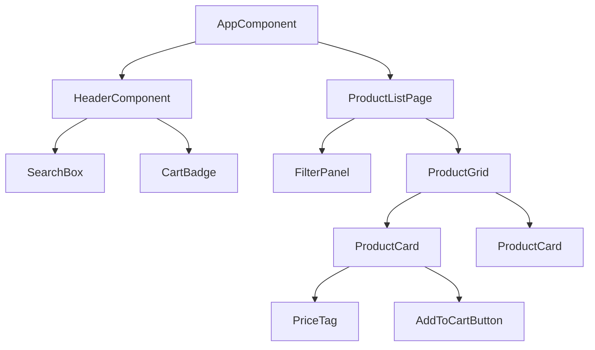
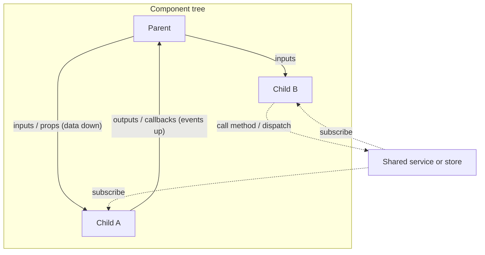
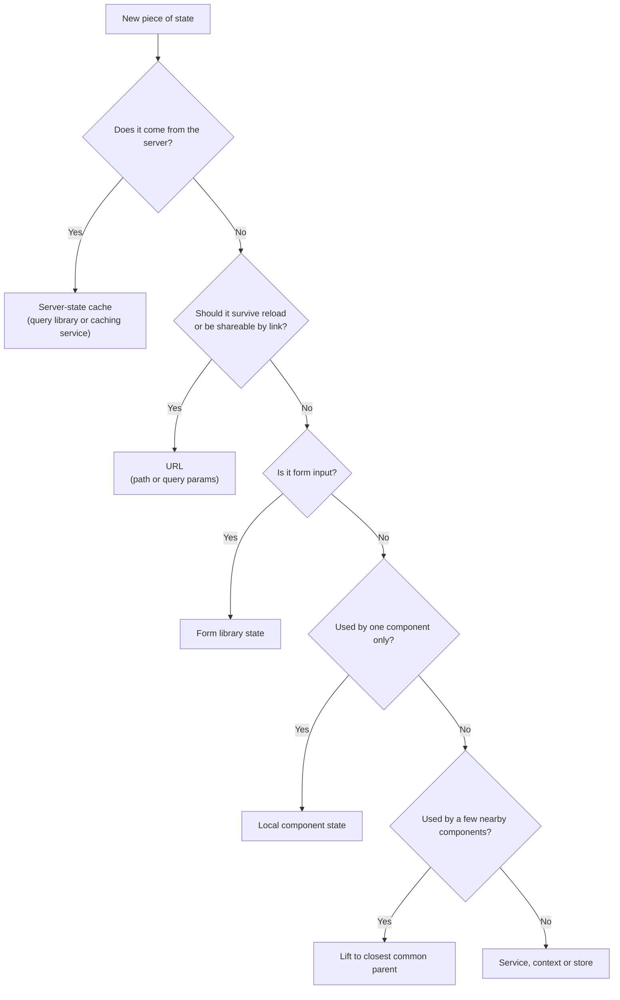
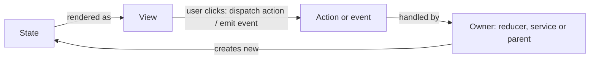

# Components and State Management

> In this document you will learn how to split a user interface into good components, how components talk to each other, and where each piece of data (state) should live. Questions like "how do sibling components communicate?", "when do you need NgRx or Redux?" and "what is derived state?" test exactly these ideas, in any framework.

**Before this:** [DOM and events](./03-dom-and-events.md) · [Objects and copying](../02-javascript/07-objects-and-copying.md) · [Functions and functional programming](../02-javascript/04-functions-and-functional-programming.md) · **Interview questions:** [jump to the interview section](#interview-questions)

## Table of contents

1. [What component-based architecture is](#what-component-based-architecture-is)
2. [Designing reusable components](#designing-reusable-components)
3. [Presentational and container components](#presentational-and-container-components)
4. [Component communication patterns](#component-communication-patterns)
5. [Kinds of state](#kinds-of-state)
6. [State ownership and lifting state up](#state-ownership-and-lifting-state-up)
7. [Single source of truth](#single-source-of-truth)
8. [Derived state](#derived-state)
9. [Immutability](#immutability)
10. [Unidirectional data flow](#unidirectional-data-flow)
11. [Build a tiny store to understand stores](#build-a-tiny-store-to-understand-stores)
12. [When a store is worth it](#when-a-store-is-worth-it)
13. [Server state and server-state libraries](#server-state-and-server-state-libraries)
14. [Design systems and component libraries](#design-systems-and-component-libraries)
15. [Common mistakes](#common-mistakes)
16. [Best practices](#best-practices)
17. [How to explain this in an interview](#how-to-explain-this-in-an-interview)
18. [Interview questions](#interview-questions)
19. [Summary](#summary)
20. [References](#references)

The ideas here are framework-independent. Examples use **Angular 16** (the main framework in this repository), **React** where it makes the idea clearer, and **plain JavaScript** when you should be able to run the code yourself.

---

## What component-based architecture is

### What it is

A **component** is a self-contained piece of UI. It has:

- a **template** (what it shows),
- **logic** (how it reacts),
- **styles** (how it looks),
- and a **public API**: the data it receives (inputs or props) and the events it sends out (outputs or callbacks).

**Component-based architecture** means you build the whole app as a **tree of components**. Small components (button, avatar, price tag) are combined into bigger ones (product card), which are combined into pages (product list page), which are combined into the app.



### Why it exists

Before components, big pages were often one huge HTML file plus one huge script that changed the DOM from many places. Problems:

- Nobody knew which code changed which part of the page.
- You could not reuse a piece of UI without copying it.
- A change in one place broke something far away.

Components solve this by giving each piece of UI **clear boundaries**: its own template, logic and styles, and a small public API.

### Analogy

Components are like **LEGO bricks**. Each brick has a standard shape for connecting (its inputs and outputs). You do not need to know how a brick is made inside to use it. You build big things from small bricks.

Where the analogy breaks: LEGO bricks have no state. Real components often hold data and change over time, and deciding *which* component holds *which* data is the hard part. That is what most of this document is about.

### Benefits and costs

| Benefits | Costs |
| --- | --- |
| Reuse: one `ProductCard` used on many pages | Designing good component APIs takes skill |
| Easier to understand: each piece is small | Many small files to navigate |
| Easier to test in isolation | Data must be passed between components (communication overhead) |
| Teams can own different parts | Too much abstraction too early makes code harder to change |
| Styles can be scoped to a component | |

---

## Designing reusable components

A reusable component is like a function: it takes inputs, produces output, and does not secretly depend on the outside world.

### Inputs (props)

**Inputs** (Angular `@Input()`) or **props** (React) are the data a parent gives to a child.

Rules:

- The child should **treat inputs as read-only**. The parent owns that data.
- Keep the number of inputs small. Ten boolean flags is a sign the component does too much.
- Give sensible defaults.
- Mark truly required inputs as required.

```ts
// Angular 16: required inputs are new in v16
import { Component, EventEmitter, Input, Output } from '@angular/core';

@Component({
  selector: 'app-quantity-picker',
  template: `
    <button type="button" (click)="change(-1)" [disabled]="value <= min" aria-label="Decrease quantity">-</button>
    <span aria-live="polite">{{ value }}</span>
    <button type="button" (click)="change(1)" [disabled]="value >= max" aria-label="Increase quantity">+</button>
  `,
})
export class QuantityPickerComponent {
  @Input({ required: true }) value!: number; // compile error in the parent template if missing
  @Input() min = 1;
  @Input() max = 10;
  @Output() valueChange = new EventEmitter<number>();

  change(delta: number): void {
    const next = Math.min(this.max, Math.max(this.min, this.value + delta));
    if (next !== this.value) {
      this.valueChange.emit(next); // ask the parent to change the value
    }
  }
}
```

Notice: the component **does not change `this.value` itself**. It tells the parent "the user wants this new value", and the parent decides. This is called a **controlled component**: the parent controls the value. Because the names follow the pattern `value` + `valueChange`, the parent can use Angular's two-way binding syntax:

```html
<!-- Parent template -->
<app-quantity-picker [(value)]="cartLine.quantity" [max]="product.stock"></app-quantity-picker>

<!-- The line above is short for: -->
<app-quantity-picker
  [value]="cartLine.quantity"
  (valueChange)="cartLine.quantity = $event"
  [max]="product.stock">
</app-quantity-picker>
```

The same component in React:

```jsx
function QuantityPicker({ value, min = 1, max = 10, onChange }) {
  const change = (delta) => {
    const next = Math.min(max, Math.max(min, value + delta));
    if (next !== value) onChange(next);
  };
  return (
    <div>
      <button type="button" onClick={() => change(-1)} disabled={value <= min} aria-label="Decrease quantity">-</button>
      <span aria-live="polite">{value}</span>
      <button type="button" onClick={() => change(1)} disabled={value >= max} aria-label="Increase quantity">+</button>
    </div>
  );
}
```

### Outputs (events)

**Outputs** (Angular `@Output()` with `EventEmitter`) or **callback props** (React `onChange`, `onSelect`) are how a child tells its parent that something happened.

Rules:

- Name events after **what happened**, not what the parent should do: `selected`, `deleted`, `valueChange`, not `updateDatabase`.
- Send useful data with the event (the selected item, the new value), not the whole internal state.
- The child should not know what the parent does with the event. That keeps it reusable.

```ts
// ❌ Wrong: the reusable card knows about the cart service and routing
export class ProductCardComponent {
  constructor(private cartService: CartService, private router: Router) {}
  add() {
    this.cartService.add(this.product);
    this.router.navigate(['/cart']);
  }
}

// ✅ Correct: the card only reports what happened; the page decides what to do
export class ProductCardComponent {
  @Input({ required: true }) product!: Product;
  @Output() addToCart = new EventEmitter<Product>();
}
```

Now the same card works on the product page (add and stay), in a wishlist (add and remove from wishlist) and in Storybook (log the event).

### Content projection and slots

Sometimes a component should provide the **frame** and let the parent decide the **content**. Examples: card, modal, tabs, layout. This is called **content projection** in Angular (`<ng-content>`) and **children** or **slots** in React, Vue and Web Components.

```ts
// Angular: a card with three slots
@Component({
  selector: 'app-card',
  template: `
    <article class="card">
      <header class="card__header"><ng-content select="[card-title]"></ng-content></header>
      <div class="card__body"><ng-content></ng-content></div>
      <footer class="card__footer"><ng-content select="[card-actions]"></ng-content></footer>
    </article>
  `,
})
export class CardComponent {}
```

```html
<!-- Usage: the parent decides what goes in each slot -->
<app-card>
  <h2 card-title>Order #1042</h2>
  <p>3 items, total 120 EUR</p>
  <div card-actions>
    <button type="button" (click)="track(order)">Track order</button>
  </div>
</app-card>
```

```jsx
// React: children plus "slot" props
function Card({ title, actions, children }) {
  return (
    <article className="card">
      <header className="card__header">{title}</header>
      <div className="card__body">{children}</div>
      <footer className="card__footer">{actions}</footer>
    </article>
  );
}

<Card title={<h2>Order #1042</h2>} actions={<button type="button">Track order</button>}>
  <p>3 items, total 120 EUR</p>
</Card>
```

More about templates and projection in Angular: [Components and templates](../06-angular-16/02-components-and-templates.md).

### Composition over configuration

There are two ways to make a component flexible:

- **Configuration:** add more inputs. `showIcon`, `iconPosition`, `showCloseButton`, `headerColor`, `footerAlignment`...
- **Composition:** let the parent pass in smaller pieces (slots, child components).

```html
<!-- ❌ Configuration explosion: every new design needs a new input -->
<app-dialog
  title="Delete file?"
  [showIcon]="true"
  icon="warning"
  [showCancel]="true"
  cancelText="Keep it"
  confirmText="Delete"
  confirmColor="red"
  [showCheckbox]="true"
  checkboxText="Don't ask again">
</app-dialog>

<!-- ✅ Composition: the dialog provides structure, the parent provides content -->
<app-dialog>
  <h2 dialog-title><app-icon name="warning"></app-icon> Delete file?</h2>
  <p>This cannot be undone.</p>
  <label><input type="checkbox" [(ngModel)]="dontAskAgain"> Don't ask again</label>
  <div dialog-actions>
    <button type="button" (click)="close()">Keep it</button>
    <button type="button" class="danger" (click)="delete()">Delete</button>
  </div>
</app-dialog>
```

Composition keeps the component small and lets each use case build what it needs.

### Rules for a good component API

1. **One clear job.** If you need the word "and" to describe it ("shows the list *and* loads data *and* handles routing"), split it.
2. **Data in through inputs, events out through outputs.** No hidden global dependencies in reusable components.
3. **Do not mutate inputs.** Emit an event and let the owner change the data.
4. **Small API, good defaults.** Prefer composition over many flags.
5. **Accessible by default.** Real `<button>` elements, labels, keyboard support, focus management. See [Accessibility](./04-accessibility.md).
6. **Style hooks, not style overrides.** Offer CSS custom properties or variants (`size="small"`) instead of forcing users to override internal classes.
7. **Document and show examples** (for example in Storybook).

---

## Presentational and container components

### What it is

A common way to split components is by responsibility:

| | Presentational (dumb) component | Container (smart) component |
| --- | --- | --- |
| Job | Shows data and reports user actions | Gets data, holds state, handles actions |
| Gets data from | Inputs only | Services, store, router, HTTP |
| Talks back through | Outputs (events) | Calls services, dispatches actions |
| Knows about the app? | No: reusable anywhere | Yes: specific to one feature or page |
| Easy to test? | Very: give inputs, check output | Needs mocks of services |
| Example | `ProductCard`, `OrderTable`, `UserAvatar` | `ProductListPage`, `CheckoutPage` |

### Why it exists

It separates **how things look** from **how things work**. Presentational components can be reused, tested and shown in a component catalog without a backend. Business logic sits in fewer places, so it is easier to find and change.

### Example

```ts
// Container: knows where data comes from
@Component({
  selector: 'app-product-list-page',
  template: `
    <app-filter-panel [filters]="filters" (filtersChange)="onFiltersChange($event)"></app-filter-panel>

    <p *ngIf="loading">Loading products...</p>
    <app-product-grid
      *ngIf="!loading"
      [products]="products"
      (addToCart)="onAddToCart($event)">
    </app-product-grid>
  `,
})
export class ProductListPageComponent implements OnInit {
  products: Product[] = [];
  filters: ProductFilters = { category: 'all', maxPrice: null };
  loading = false;

  constructor(private productApi: ProductApi, private cart: CartService) {}

  ngOnInit(): void {
    this.load();
  }

  onFiltersChange(filters: ProductFilters): void {
    this.filters = filters;
    this.load();
  }

  onAddToCart(product: Product): void {
    this.cart.add(product);
  }

  private load(): void {
    this.loading = true;
    this.productApi.search(this.filters).subscribe((products) => {
      this.products = products;
      this.loading = false;
    });
  }
}
```

```ts
// Presentational: only inputs and outputs
@Component({
  selector: 'app-product-grid',
  changeDetection: ChangeDetectionStrategy.OnPush,
  template: `
    <ul class="grid">
      <li *ngFor="let product of products; trackBy: trackById">
        <app-product-card [product]="product" (addToCart)="addToCart.emit($event)"></app-product-card>
      </li>
    </ul>
  `,
})
export class ProductGridComponent {
  @Input({ required: true }) products!: Product[];
  @Output() addToCart = new EventEmitter<Product>();
  trackById = (_: number, product: Product) => product.id;
}
```

(A real page also needs error handling and request cancellation. See [API integration and data fetching](./07-api-integration-and-data-fetching.md).)

### Trade-offs

- **Good:** reuse, simple tests, clear place for logic, presentational components work well with `OnPush` because they depend only on inputs.
- **Bad when taken too far:** passing data through many layers of dumb components ("prop drilling", see below), or creating a container for every tiny component. The split is a guideline, not a law. In React, hooks reduced the need for strict container components because logic can live in custom hooks.

---

## Component communication patterns

Components need to share data and react to each other. There are several ways, each with a different "reach".



### 1. Parent to child: inputs

The parent passes data down: `[product]="selectedProduct"`. Simple and explicit. Use it by default.

### 2. Child to parent: outputs or callbacks

The child emits an event: `(selected)="onSelect($event)"`. The parent reacts.

### 3. Siblings: through the shared parent

Two siblings do not talk directly. The parent owns the shared state, passes it down to both and listens to events from both. This is **lifting state up** (next sections).

```html
<!-- Parent template: the list and the details panel are siblings -->
<app-order-list [orders]="orders" (selected)="selectedOrder = $event"></app-order-list>
<app-order-details [order]="selectedOrder"></app-order-details>
```

### 4. Distant components: a shared service (Angular) or context (React)

When components are far apart in the tree (the header cart badge and the product page "Add to cart" button), passing data through every layer is painful. Put the shared state in a **service** that both inject.

```ts
// Angular 16: a simple state service with RxJS
import { Injectable } from '@angular/core';
import { BehaviorSubject, map } from 'rxjs';

export interface CartItem { id: string; name: string; price: number; qty: number; }

@Injectable({ providedIn: 'root' })
export class CartService {
  private readonly itemsSubject = new BehaviorSubject<CartItem[]>([]);

  // Read-only stream for components
  readonly items$ = this.itemsSubject.asObservable();
  readonly count$ = this.items$.pipe(map((items) => items.reduce((n, item) => n + item.qty, 0)));

  add(product: { id: string; name: string; price: number }): void {
    const items = this.itemsSubject.value;
    const existing = items.find((item) => item.id === product.id);
    const next = existing
      ? items.map((item) => (item.id === product.id ? { ...item, qty: item.qty + 1 } : item))
      : [...items, { ...product, qty: 1 }];
    this.itemsSubject.next(next); // new array, never mutate
  }
}
```

```ts
// Header badge, far away from the product page
@Component({
  selector: 'app-cart-badge',
  template: `<a routerLink="/cart">Cart ({{ count$ | async }})</a>`,
})
export class CartBadgeComponent {
  count$ = this.cart.count$;
  constructor(private cart: CartService) {}
}
```

In React, the equivalent is **context** (`useContext`) combined with state, or a small store library. See [React essentials](./08-react-essentials.md). Angular DI details are in [Angular dependency injection](../06-angular-16/05-dependency-injection.md).

### 5. Global store

A **store** (NgRx, Redux, Zustand, Pinia) is one central place for shared app state with strict rules for how it changes. Covered in [When a store is worth it](#when-a-store-is-worth-it).

### 6. Event bus

An **event bus** is an object where any code can `emit` a named event and any other code can `on` (listen to) it. It is the publish/subscribe pattern (see [Behavioral patterns](../04-oop-solid-design-patterns/08-behavioral-patterns.md)).

```js
function createEventBus() {
  const handlers = new Map();
  return {
    on(event, handler) {
      if (!handlers.has(event)) handlers.set(event, new Set());
      handlers.get(event).add(handler);
      return () => handlers.get(event).delete(handler); // unsubscribe function
    },
    emit(event, payload) {
      handlers.get(event)?.forEach((handler) => handler(payload));
    },
  };
}

const bus = createEventBus();
const stopCartCleanup = bus.on('user:loggedOut', (p) => console.log('clear cart for', p.userId));
bus.on('user:loggedOut', () => console.log('close websocket'));

bus.emit('user:loggedOut', { userId: 42 });
// clear cart for 42
// close websocket

stopCartCleanup();
bus.emit('user:loggedOut', { userId: 43 });
// close websocket
```

An event bus is flexible, but it **hides the data flow**: when you read the code that emits, you cannot see who reacts. Use it only for true "fire and forget" app-wide events (logout, theme changed), not for normal data sharing.

### Choosing a pattern

| Pattern | Reach | Pros | Cons | Use when |
| --- | --- | --- | --- | --- |
| Inputs / outputs | Parent and direct child | Explicit, easy to follow, easy to test | Painful through many layers | Default choice |
| Shared parent (lift state) | Siblings | Single owner, explicit | Parent grows; drilling if deep | Two or three nearby components share data |
| Service / context | Any component below the provider | No drilling; can hold logic | Hidden dependency; can become a "god service" | Feature-level or app-level shared state |
| Global store | Whole app | Predictable updates, devtools, time-travel debugging, clear patterns | Boilerplate, learning curve | Large app, many features sharing complex state |
| Event bus | Whole app | Very loose coupling | Hard to trace, easy to leak listeners, no current value | Rare app-wide notifications |

---

## Kinds of state

**State** is any data that can change over time and affects what the UI shows. Not all state is the same. Choosing the right "home" for each kind is the most important state-management decision.

| Kind of state | Examples | Who owns it | Best home |
| --- | --- | --- | --- |
| **Local UI state** | Is the dropdown open? Which tab is active? Hover, input text before submit | One component | Component field, `useState`, signal in the component |
| **Shared app (client) state** | Logged-in user, theme, cart, feature flags, selected workspace | The frontend app | Service, context, or store |
| **Server state (cache)** | Product list, order details, user profile from the API | **The server.** The frontend only has a copy. | Server-state cache (TanStack Query, a caching service, NgRx entity with care) |
| **URL state** | Current page, search query, filters, sort, selected item id | The URL | Router (path and query params) |
| **Form state** | Field values, validation errors, dirty/touched | The form | Form library (Angular reactive forms, React Hook Form) |
| **Persistent / session state** | "Remember me" settings, draft text, recently viewed | The browser | `localStorage`, `sessionStorage`, IndexedDB (synced into memory) |

### Why the difference matters

- **Server state is not really yours.** Another user can change it. It can become outdated ("stale"). You must think about loading, errors, caching, refetching and invalidation. Treating server data like normal client state (copying it into a store and forgetting about it) is a major source of bugs: stale lists after an edit, duplicated loading logic, inconsistent copies.
- **URL state must survive a page reload and be shareable.** If a user filters orders by "status = open" and sends the link to a colleague, the colleague should see the same filtered list. If the filter lives only in a component variable, the link loses it.
- **Local UI state should stay local.** Putting "is this dropdown open?" into a global store adds noise and makes every component depend on the store.

### URL state example

```js
// Plain browser JavaScript: read and write filters in the query string
const params = new URLSearchParams(location.search); // "?status=open&page=2"
const status = params.get('status') ?? 'all';
const page = Number(params.get('page') ?? '1');

function updateFilters(next) {
  const params = new URLSearchParams(location.search);
  params.set('status', next.status);
  params.set('page', '1'); // reset paging when filters change
  history.replaceState(null, '', `?${params}`); // update the URL without reloading
}
```

```ts
// Angular 16: the URL is the source of truth for the filters
@Component({ /* ... */ })
export class OrdersPageComponent {
  // Filters are derived from the URL
  readonly filters$ = this.route.queryParamMap.pipe(
    map((params) => ({
      status: params.get('status') ?? 'all',
      page: Number(params.get('page') ?? '1'),
    })),
  );

  // Orders are loaded whenever the filters change; switchMap cancels the previous request
  readonly orders$ = this.filters$.pipe(switchMap((filters) => this.orderApi.search(filters)));

  constructor(private route: ActivatedRoute, private router: Router, private orderApi: OrderApi) {}

  onStatusChange(status: string): void {
    // Change the URL; the streams above react to it
    this.router.navigate([], { queryParams: { status, page: 1 }, queryParamsHandling: 'merge' });
  }
}
```

The pattern "URL → filters → request → view" means the back button, reload and shared links all work automatically.

### Decision flowchart: where should this state live?



---

## State ownership and lifting state up

### What it is

Every piece of state should have **one owner**: one component or service that holds it and is allowed to change it. Others receive it as read-only data and ask the owner to change it.

**Lifting state up** means: when two components need the same state, move that state to their **closest common parent**. The parent passes the value down as inputs and receives changes as events.

### Example step by step

A temperature converter: one input for Celsius, one for Fahrenheit. When you type in one, the other must update.

**Step 1: the problem.** Each input component has its own state. They do not know about each other.

```text
CelsiusInput  (state: celsius)       FahrenheitInput  (state: fahrenheit)
      ↑ no connection between them ↑
```

**Step 2: lift the state.** The parent owns one value (Celsius). It computes Fahrenheit from it. Each input receives its value and reports changes.

```ts
// Angular 16 parent
@Component({
  selector: 'app-temperature-converter',
  template: `
    <app-temperature-input label="Celsius" [value]="celsius" (valueChange)="celsius = $event"></app-temperature-input>
    <app-temperature-input label="Fahrenheit" [value]="toFahrenheit(celsius)" (valueChange)="celsius = toCelsius($event)"></app-temperature-input>
  `,
})
export class TemperatureConverterComponent {
  celsius = 20; // the single owner of the state
  toFahrenheit = (c: number) => Math.round((c * 9) / 5 + 32);
  toCelsius = (f: number) => Math.round(((f - 32) * 5) / 9);
}
```

```jsx
// React parent: same idea
function TemperatureConverter() {
  const [celsius, setCelsius] = useState(20); // single owner
  const fahrenheit = Math.round((celsius * 9) / 5 + 32); // derived, not stored
  return (
    <>
      <TemperatureInput label="Celsius" value={celsius} onChange={setCelsius} />
      <TemperatureInput label="Fahrenheit" value={fahrenheit} onChange={(f) => setCelsius(Math.round(((f - 32) * 5) / 9))} />
    </>
  );
}
```

(In a real Angular template, prefer a pure pipe over calling a method so it is not recalculated on every change detection run. It is shown inline here to keep the example short.)

**Step 3: notice what you did not store.** Fahrenheit is not a second piece of state. It is **derived** from Celsius. There is no way for the two values to disagree.

### How high should you lift?

Only as high as needed: the **closest** common parent. Lifting everything to the root (or into a global store) makes every change re-render more and makes the root component huge.

### Prop drilling

When you lift state high, you may need to pass it through several components that do not use it, just to reach a deep child. This is called **prop drilling** (or input drilling).

```text
Page (owns user) → Layout → Sidebar → Menu → UserMenu (uses user)
         Layout, Sidebar and Menu only pass "user" along.
```

Two or three levels are fine and very explicit. When it gets deeper, options are:

- **Composition:** pass the already-built child as content (`<ng-content>` / `children`), so middle layers do not need the data.
- **A service or context** for that state.
- **A store** if many unrelated features need it.

---

## Single source of truth

**Single source of truth** means every piece of data is stored in **exactly one place**. Everything else reads from there or derives from it.

Why: when the same data lives in two places, the copies drift apart. Classic bug:

```text
1. The product list page loads products into its component state.
2. The header "favorites" counter keeps its own copy of the favorite product ids.
3. The user un-favorites a product on the list page.
4. The list updates. The header counter does not. Now the UI shows two different truths.
```

Fix: store favorites in one place (for example a `FavoritesService` or a store slice). The list and the header both read from it.

Where the single source of truth usually is:

| Data | Source of truth |
| --- | --- |
| Data owned by the backend | The server; the frontend cache is a managed copy with a refresh policy |
| Filters, page, selected id | The URL |
| Session-wide client data (user, theme, cart) | One service or store slice |
| Form values while editing | The form model |

---

## Derived state

### What it is

**Derived state** is any value that you can **calculate** from other state. Examples: the cart total (from items), the number of unread messages (from messages), the filtered list (from the list plus the filter text), "is the form valid?" (from the field values).

The rule: **do not store derived state. Compute it.**

### Why

If you store it, you must remember to update it every time the source changes. One day someone forgets.

```js
// ❌ Wrong: total is stored next to items and goes stale
const cart = { items: [{ price: 10, qty: 2 }], total: 20 };
cart.items.push({ price: 5, qty: 1 }); // someone adds an item...
console.log(cart.total); // 20  -> wrong! should be 25

// ✅ Correct: compute it from the source
const getTotal = (items) => items.reduce((sum, item) => sum + item.price * item.qty, 0);
console.log(getTotal(cart.items)); // 25
```

### But what about performance?

Computing a total of 10 items on every render is nothing. For expensive calculations (filtering and sorting 20,000 rows), **memoize** the calculation: recompute only when the inputs change. Every framework has a tool for this:

| Framework | Memoized derived state |
| --- | --- |
| Angular 16 | Pure pipes; RxJS `map` + `combineLatest`; `computed()` signals (developer preview in v16) |
| NgRx | Selectors with `createSelector` (memoized) |
| React | Compute during render; `useMemo` for expensive cases |
| Redux | `createSelector` from Reselect / Redux Toolkit |

Here is how a memoized selector works inside, in plain JavaScript:

```js
function createSelector(inputSelector, compute) {
  let lastInput;
  let lastResult;
  let hasRun = false;
  return (state) => {
    const input = inputSelector(state);
    if (hasRun && input === lastInput) return lastResult; // same input reference: reuse result
    hasRun = true;
    lastInput = input;
    lastResult = compute(input);
    return lastResult;
  };
}

let computeCount = 0;
const selectDoneTodos = createSelector(
  (state) => state.todos,
  (todos) => { computeCount++; return todos.filter((t) => t.done); },
);

const s1 = { todos: [{ id: 1, done: true }, { id: 2, done: false }], filter: 'all' };
const a = selectDoneTodos(s1);

const s2 = { ...s1, filter: 'done' };  // a different part of state changed; todos array is the same
const b = selectDoneTodos(s2);
console.log(a === b, computeCount);     // true 1  -> not recomputed, same result object

const s3 = { ...s2, todos: [...s2.todos, { id: 3, done: true }] }; // todos changed (new array)
console.log(selectDoneTodos(s3).length, computeCount); // 2 2  -> recomputed once
```

This only works because the state is **immutable**: "the todos changed" is the same as "the todos array is a new object". That is the next topic.

### Angular signals example (developer preview in v16)

```ts
import { Injectable, computed, signal } from '@angular/core';

@Injectable({ providedIn: 'root' })
export class CartStore {
  private readonly items = signal<CartItem[]>([]);

  readonly allItems = this.items.asReadonly();
  readonly count = computed(() => this.items().reduce((n, item) => n + item.qty, 0));
  readonly total = computed(() => this.items().reduce((sum, item) => sum + item.price * item.qty, 0));

  add(product: { id: string; name: string; price: number }): void {
    this.items.update((items) => {
      const existing = items.find((item) => item.id === product.id);
      return existing
        ? items.map((item) => (item.id === product.id ? { ...item, qty: item.qty + 1 } : item))
        : [...items, { ...product, qty: 1 }];
    });
  }
}
```

`count` and `total` are derived and memoized: they recalculate only when `items` changes. In v16, signals also had a `mutate()` method; it was removed in Angular 17, so prefer `update()` with a new array as shown. More in [Change detection and signals](../06-angular-16/10-change-detection-and-signals.md).

---

## Immutability

### What it is

**Immutable update** means you never change an existing state object. Instead, you create a **new object** with the change, and keep the old one untouched.

```js
// Mutable update: change the object in place
state.todos[0].done = true;

// Immutable update: create new objects along the path that changed
const nextState = {
  ...state,
  todos: state.todos.map((todo) => (todo.id === 1 ? { ...todo, done: true } : todo)),
};
```

### Why it matters in UI code

1. **Cheap change detection.** If every change creates a new object, "did it change?" becomes a fast reference check (`oldState !== newState`) instead of a deep comparison. Angular `OnPush`, React re-render bail-outs, `React.memo`, memoized selectors and signals' equality checks all rely on this.
2. **Predictability.** Nobody can change your data behind your back. A function that receives state cannot secretly modify it.
3. **History.** You can keep old states for undo/redo and time-travel debugging.
4. **Fewer shared-reference bugs.** Two components holding "the same" object will not affect each other unexpectedly.

### The bug immutability prevents

```js
const state = { todos: [{ id: 1, title: 'Write docs', done: false }] };
const oldState = state;

state.todos[0].done = true; // mutation
console.log(oldState === state); // true -> a reference check says "nothing changed"
```

An `OnPush` component or a `React.memo` component receiving `state.todos` would **not update**, because the reference did not change. The user clicks the checkbox and nothing happens on screen. This is one of the most common bugs when moving to `OnPush`.

### How to update immutably

| Change | Immutable code |
| --- | --- |
| Add item | `[...items, newItem]` |
| Remove item | `items.filter((i) => i.id !== id)` |
| Update item | `items.map((i) => (i.id === id ? { ...i, qty: 2 } : i))` |
| Update a nested field | `{ ...user, address: { ...user.address, city: 'Pune' } }` |
| Sort without mutating | `items.toSorted(byPrice)` (ES2023) or `[...items].sort(byPrice)` |
| Deep copy (rarely needed) | `structuredClone(obj)` |

The spread operator makes a **shallow copy**: nested objects are still shared.

```js
const user = { name: 'Asha', address: { city: 'Pune' } };
const copy = { ...user };
copy.address.city = 'Delhi';
console.log(user.address.city); // 'Delhi' -> the original changed too!

const deepCopy = structuredClone(user);
deepCopy.address.city = 'Mumbai';
console.log(user.address.city); // 'Delhi' -> the original is safe this time
```

Details of shallow vs deep copy are in [Objects and copying](../02-javascript/07-objects-and-copying.md).

Libraries such as **Immer** (used inside Redux Toolkit) let you write code that *looks* like mutation on a draft, and they produce a new immutable object for you. NgRx reducers are usually written with spread syntax.

### Trade-offs

- Creating new objects costs some memory and CPU. For normal UI state it is negligible; structural sharing (unchanged parts are reused) keeps it cheap.
- Deeply nested state makes immutable updates verbose. Keep state **flat** (normalize lists into `{ ids: [], entities: {} }` when needed; NgRx Entity and Redux Toolkit's `createEntityAdapter` do this).

---

## Unidirectional data flow

### What it is

**Unidirectional data flow** (one-way data flow) means data moves in **one direction**:

1. State is passed **down** to the view.
2. The view sends **events/actions up** when the user does something.
3. The state owner changes the state.
4. The new state flows down again.

The view never changes the state directly.



### Why it exists

With two-way flow everywhere (any component can change any shared data), you get loops and mysteries: A changes B, B changes C, C changes A. When a value is wrong, you cannot tell who changed it.

With one-way flow:

- There is one place where each state changes, so bugs are easier to find.
- You can log every action and see exactly how the state evolved (Redux DevTools / NgRx Store DevTools).
- Rendering is a pure function of state: same state, same UI.

### Angular note

Angular templates have two-way binding syntax (`[(ngModel)]`, `[(value)]`), but it is only **sugar** for "input down + event up". The data flow is still one-way under the hood. In development mode, Angular's change detection also checks that a child did not change parent data during rendering (the `ExpressionChangedAfterItHasBeenCheckedError`), which protects one-way flow. React has no two-way binding at all: you pass a value and an `onChange` callback.

---

## Build a tiny store to understand stores

Store libraries look complex, but the core idea fits in 20 lines. Building it helps you explain Redux and NgRx in interviews.

The idea:

- **State:** one object.
- **Action:** a plain object that describes *what happened*: `{ type: 'cart/itemAdded', item }`.
- **Reducer:** a **pure function** `(state, action) => newState`. It never mutates and has no side effects.
- **Store:** holds the state, lets you `dispatch` actions and `subscribe` to changes.
- **Selector:** a function that reads or derives data from the state.

```js
function createStore(reducer, initialState) {
  let state = initialState;
  const listeners = new Set();

  return {
    getState: () => state,
    dispatch(action) {
      state = reducer(state, action);               // the only way state changes
      listeners.forEach((listener) => listener(state));
    },
    subscribe(listener) {
      listeners.add(listener);
      return () => listeners.delete(listener);      // unsubscribe
    },
  };
}

const initialCart = { items: [], couponCode: null };

function cartReducer(state, action) {
  switch (action.type) {
    case 'cart/itemAdded': {
      const existing = state.items.find((i) => i.id === action.item.id);
      if (existing) {
        return {
          ...state,
          items: state.items.map((i) => (i.id === action.item.id ? { ...i, qty: i.qty + 1 } : i)),
        };
      }
      return { ...state, items: [...state.items, { ...action.item, qty: 1 }] };
    }
    case 'cart/itemRemoved':
      return { ...state, items: state.items.filter((i) => i.id !== action.id) };
    case 'cart/couponApplied':
      return { ...state, couponCode: action.code };
    default:
      return state; // unknown action: return the SAME state object
  }
}

// Selectors: derived data
const selectItemCount = (state) => state.items.reduce((sum, i) => sum + i.qty, 0);
const selectTotal = (state) => state.items.reduce((sum, i) => sum + i.price * i.qty, 0);

const store = createStore(cartReducer, initialCart);
const unsubscribe = store.subscribe((state) =>
  console.log('items:', selectItemCount(state), 'total:', selectTotal(state)),
);

store.dispatch({ type: 'cart/itemAdded', item: { id: 'p1', name: 'Mouse', price: 25 } });
// items: 1 total: 25
store.dispatch({ type: 'cart/itemAdded', item: { id: 'p1', name: 'Mouse', price: 25 } });
// items: 2 total: 50
store.dispatch({ type: 'cart/itemAdded', item: { id: 'p2', name: 'Keyboard', price: 70 } });
// items: 3 total: 120
store.dispatch({ type: 'cart/itemRemoved', id: 'p1' });
// items: 1 total: 70

unsubscribe();
store.dispatch({ type: 'cart/couponApplied', code: 'SAVE10' }); // no log: we unsubscribed
console.log(store.getState().couponCode); // 'SAVE10'

const before = store.getState();
store.dispatch({ type: 'unknown' });
console.log(before === store.getState()); // true -> nothing changed, same reference
```

What real libraries add on top:

| Feature | Redux Toolkit | NgRx |
| --- | --- | --- |
| Less boilerplate | `createSlice` | `createActionGroup`, `createReducer`, `createFeature` |
| Immutable updates | Immer built in | Spread syntax (or helpers) |
| Memoized selectors | `createSelector` | `createSelector`, `createFeatureSelector` |
| Side effects (API calls) | Thunks, listeners, RTK Query | Effects (`@ngrx/effects`, built on RxJS) |
| DevTools / time travel | Redux DevTools | NgRx Store DevTools (uses Redux DevTools) |
| Entity collections | `createEntityAdapter` | `@ngrx/entity` |

NgRx in Angular is covered in depth in [State management and NgRx](../06-angular-16/11-state-management-and-ngrx.md).

---

## When a store is worth it

A global store is a tool, not a requirement. Many apps are better without one.

### Signs you probably do NOT need a global store

- Most state is local UI state or server data.
- Shared state is small: the current user, theme, a cart.
- One team works on the app, and features rarely share data.
- You find yourself creating actions, reducers, effects and selectors just to load one list and show it on one page.

For these apps, **component state + a few services (or React context/hooks) + a server-state cache** is simpler and enough.

### Signs a store may help

- Many features read and update the **same client state** (for example a complex editor, a trading screen, a multi-step workflow with many panels).
- State changes come from **many sources**: user actions, WebSocket messages, timers, other tabs.
- You need **traceability**: "which action changed this?", time-travel debugging, action logs for bug reports.
- A **large team** needs one consistent pattern so that every feature handles state the same way.
- You need features like undo/redo, optimistic updates with rollback across many screens, or offline queues.

### The options

| Option | What it is | Good for | Watch out for |
| --- | --- | --- | --- |
| Component state | Fields in a component, `useState`, signals in a component | Local UI state | Lifting when it must be shared |
| Service with RxJS `BehaviorSubject` (Angular) | A singleton service exposing observables and methods | Feature or app state in small-to-medium Angular apps | Keep subjects private; expose read-only streams; avoid "god services" |
| Service with signals (Angular 16 developer preview, stable in 17+) | Same idea with `signal()` and `computed()` | Simple synchronous shared state, derived values | In v16 the API was still a developer preview |
| NgRx Store | Redux pattern for Angular with RxJS: actions, reducers, selectors, effects | Large Angular apps with complex shared state and many teams | Boilerplate; overkill for simple CRUD |
| NgRx ComponentStore / SignalStore | Lighter, local or feature stores | Feature-level state without a global store | SignalStore is newer (Angular 17+ era) |
| Redux Toolkit | Modern, official way to use Redux | Large React apps, existing Redux codebases | Still more ceremony than simpler tools |
| Zustand, Jotai | Small store libraries for React | Simple global state in React with little boilerplate | Fewer conventions in large teams |
| React context + `useReducer` | Built-in React tools | Small shared state (theme, auth) | Every consumer re-renders when the context value changes |

### A good rule

Ask in this order:

1. Can it be **local**? Keep it local.
2. Is it **server data**? Use a server-state cache, not a hand-written global store.
3. Is it **URL** or **form** state? Use the router or the form library.
4. Is it shared by a **few nearby** components? Lift it up.
5. Is it shared across **features**? Use a service (or context).
6. Is the shared client state **large, complex and changed from many places**, or do you need strong conventions and tooling for a big team? Then use a store.

---

## Server state and server-state libraries

### What makes server state special

**Server state** is data that lives on the server and that your frontend only *borrows*: products, orders, users, comments. It is different from client state:

- It is **asynchronous**: you must fetch it and handle loading and errors.
- It can **change without you knowing** (other users, background jobs).
- It can be **stale**: your copy is a snapshot from some time ago.
- Many components may need the **same data**: you should not fetch it ten times.
- After you **change** it (a mutation), related cached data must be refreshed (**invalidation**).

Writing all of this by hand in every component (or in NgRx actions and effects for every endpoint) creates a lot of repeated code: `loading`, `error`, `data` flags, refetch logic and cache rules.

### The server-state library idea

**Server-state libraries** such as **TanStack Query** (React, Vue, Solid, Svelte, and an Angular adapter), **SWR** (React), **RTK Query** (Redux Toolkit) and **Apollo Client** (GraphQL) handle this for you. The ideas behind them are worth knowing even if you never use them:

| Idea | Meaning |
| --- | --- |
| **Query key** | A unique key for a piece of data, like `['orders', { status: 'open', page: 2 }]`. Same key = same cache entry, shared by all components. |
| **Caching** | Fetched data is stored by key and reused. |
| **De-duplication** | If ten components ask for the same key at the same time, only one request is sent. |
| **Stale time** | How long data is considered fresh. Fresh data is served from cache with no request. |
| **Stale-while-revalidate** | Show cached (stale) data immediately, refetch in the background, update the UI when new data arrives. |
| **Background refetch** | Refetch on window focus, on reconnect, or at an interval. |
| **Invalidation** | After a mutation (for example "create order"), mark related keys (`['orders']`) as stale so they refetch. |
| **Garbage collection** | Remove cache entries that no component has used for a while. |
| **Retries** | Retry failed requests with backoff. |

For example, TanStack Query's defaults (v5): data is stale immediately (`staleTime` 0), so it refetches in the background when a component mounts or the window regains focus; unused data is removed after 5 minutes (`gcTime`); failed queries are retried 3 times with exponential backoff.

```jsx
// React with TanStack Query
import { useQuery, useMutation, useQueryClient } from '@tanstack/react-query';

function OpenOrders() {
  const { data, isPending, isError, error } = useQuery({
    queryKey: ['orders', { status: 'open' }],
    queryFn: () => fetch('/api/orders?status=open').then((r) => {
      if (!r.ok) throw new Error(`HTTP ${r.status}`);
      return r.json();
    }),
    staleTime: 30_000, // treat data as fresh for 30 seconds
  });

  if (isPending) return <p>Loading orders...</p>;
  if (isError) return <p role="alert">Could not load orders: {error.message}</p>;
  return <OrderTable orders={data} />;
}

function CancelOrderButton({ orderId }) {
  const queryClient = useQueryClient();
  const mutation = useMutation({
    mutationFn: () => fetch(`/api/orders/${orderId}/cancel`, { method: 'POST' }),
    onSuccess: () => queryClient.invalidateQueries({ queryKey: ['orders'] }), // refetch every orders list
  });
  return <button type="button" onClick={() => mutation.mutate()} disabled={mutation.isPending}>Cancel</button>;
}
```

### Angular 16 options for server state

Angular 16 has no built-in server-state cache. Common approaches:

- A **data service** that caches observables per key with `shareReplay`, plus explicit invalidation after mutations.
- **NgRx** with entity adapters and effects (powerful, but you build the caching rules yourself).
- The TanStack Query Angular adapter (a newer, separate package; check its requirements against your Angular version).

The hand-written approach (caching, de-duplication, stale-while-revalidate, invalidation) is shown step by step in [API integration and data fetching](./07-api-integration-and-data-fetching.md). The RxJS operators are in [RxJS](../06-angular-16/09-rxjs.md).

### The key lesson

Split your state into **server state** (managed by a cache with fetch, refresh and invalidation rules) and **client state** (owned by your app). Once server data is handled by a cache, the remaining client state is often small enough that you do not need a big global store.

---

## Design systems and component libraries

### What they are

- A **component library** is a set of reusable UI components: buttons, inputs, dialogs, tables, tabs. Examples: Angular Material, PrimeNG, MUI, Chakra UI.
- A **design system** is bigger. It is the shared language between design and engineering. It includes:
  - **Design tokens:** named values for colors, spacing, font sizes, radii, shadows (`--color-primary`, `--space-4`).
  - **Components** built with those tokens.
  - **Patterns and guidelines:** when to use a dialog vs a page, how to write error messages, how forms are laid out.
  - **Accessibility rules** built into the components.
  - **Documentation** with live examples (for example in Storybook).

### Why companies build them

- **Consistency:** every team's buttons, forms and dialogs look and behave the same.
- **Speed:** teams compose pages from ready parts instead of rebuilding a date picker.
- **Quality:** accessibility and edge cases are solved once, in one place.
- **Easier redesigns:** change a token (the primary color) and the whole product updates.

### Design tokens example

```css
/* tokens.css: one place for design decisions */
:root {
  --color-primary: #0b5394;
  --color-danger: #b42318;
  --space-2: 8px;
  --space-4: 16px;
  --radius-md: 6px;
  --font-size-body: 1rem;
}

[data-theme='dark'] {
  --color-primary: #6fa8dc;
}

/* components use tokens, never raw values */
.button {
  padding: var(--space-2) var(--space-4);
  border-radius: var(--radius-md);
  background: var(--color-primary);
  font-size: var(--font-size-body);
}
.button--danger {
  background: var(--color-danger);
}
```

### What makes a good design-system component

- A small, stable API with variants (`variant="primary" | "secondary" | "danger"`, `size="small" | "medium"`).
- Accessible by default: correct roles, keyboard support, focus styles, labels.
- Composable (slots/content projection) rather than configured with dozens of flags.
- Themeable through tokens or CSS custom properties.
- Versioned with semantic versioning and a changelog, because many apps depend on it. Breaking changes need migration notes.
- Tested: unit tests, visual regression tests, accessibility checks.

In Angular, the **Angular CDK** (`@angular/cdk`) provides unstyled behavior primitives (overlay, a11y focus trap, drag and drop, virtual scroll, table) that you can use to build your own design system, while **Angular Material** is Google's styled implementation on top of it.

Building UI libraries for many teams and micro-frontends is discussed in [Frontend architecture at scale](../09-system-design/05-frontend-architecture-at-scale.md).

---

## Common mistakes

1. **Putting everything in a global store.** Dropdown open flags, form drafts and server lists all in one store. The store becomes a dumping ground, every change touches global code, and performance suffers.
2. **Copying server data into many places.** Each page keeps its own copy of "the current user" or "the product list". After an update, some copies are stale.
3. **Storing derived state.** Keeping `total`, `filteredItems` or `isValid` next to the source data and forgetting to update them.
4. **Mutating state.** `this.items.push(item)` with `OnPush` or `React.memo`: the UI does not update. Or mutating an input object, which secretly changes the parent's data.
5. **Mutating inputs in the child.** The child changes `this.product.price` directly. Now the parent's data changed without the parent knowing.
6. **Smart components everywhere.** Reusable components that inject services, call APIs and navigate. They cannot be reused or tested easily.
7. **Huge components.** One 1,500-line page component with all the logic. Split by responsibility.
8. **Event bus for normal data flow.** Data moves invisibly; nobody knows who listens; listeners leak.
9. **Filters only in component state.** Reload loses the filters, the back button does not work and links cannot be shared.
10. **Not unsubscribing** from long-lived streams in components (Angular: use the `async` pipe or `takeUntilDestroyed`, added in v16 as a developer preview and stable since v19).
11. **Over-abstracting early.** Building a "generic configurable everything component" before you have two real use cases.

---

## Best practices

1. **Keep state as local as possible, and lift only as far as needed.** Less global state means fewer surprises and fewer re-renders.
2. **One owner per piece of state.** Others read it and request changes through events or methods. Debugging is easier because only one place changes it.
3. **Separate server state from client state.** Use a cache with clear refresh and invalidation rules for server data.
4. **Put shareable view state in the URL.** Filters, sort, page and selected tab. You get reload, back button and deep links for free.
5. **Derive, do not duplicate.** Compute totals and filtered lists from the source; memoize when expensive.
6. **Update immutably.** It makes change detection cheap and correct, and enables time-travel and undo.
7. **Expose read-only state from services.** Keep `BehaviorSubject` or writable signals private; expose `asObservable()` or `asReadonly()` plus methods for changes. Nobody can change state from outside without going through your rules.
8. **Design components like functions.** Clear inputs, clear outputs, no hidden dependencies in reusable components.
9. **Prefer composition over configuration.** Slots and child components instead of boolean flags.
10. **Make reusable components accessible from the start.** Fixing accessibility later in 50 places is much harder than once in the component.
11. **Choose a store for real reasons** (complex shared state, many update sources, team conventions, tooling), not because "big apps use Redux".

---

## How to explain this in an interview

Use this when asked "How do you manage state in a frontend app?"

1. **Define it:** "State is any data that changes over time and affects the UI. I split it into kinds: local UI state, shared client state, server state, URL state and form state."
2. **Why it exists:** "Each kind has different rules. Server data can go stale and needs caching and invalidation. URL state must survive reload and be shareable. Local UI state should stay inside one component."
3. **How it works:** "Each piece of state has one owner. Data flows down to the view, events flow up, and the owner creates new state immutably. Derived values like totals are computed, not stored."
4. **Small example:** "On an orders page, the filters live in the URL query params, the orders list comes from a cached API request keyed by those filters, the 'row expanded' flag is local component state, and the logged-in user is in a shared service."
5. **Where it is useful:** "This keeps components reusable, makes OnPush or memoization work correctly, and avoids stale copies of the same data."
6. **Trade-offs / gotchas:** "A global store like NgRx gives strong conventions and great tooling, but it adds boilerplate. I'd use it when lots of client state is shared across features and changed from many places. For simpler apps, services or context plus a server-state cache are enough."

---

## Interview questions

### Q1. What is component-based architecture, and what makes a component reusable?

**What the interviewer is checking:** Do you understand components as units with a public API, and can you name concrete design rules?

**Short spoken answer (30–60 seconds):**
> "Component-based architecture means building the UI as a tree of self-contained pieces. Each component has its own template, logic and styles, and a public API: inputs for data coming in and outputs for events going out. A component is reusable when it behaves like a pure function: it gets everything it needs through inputs, reports what happened through events, and doesn't secretly depend on global services, routing or a specific API. It should have one clear job, a small API with good defaults, and use composition, like content projection, instead of a long list of configuration flags. And it should be accessible by default."

**Detailed explanation:** See [Designing reusable components](#designing-reusable-components). The test for reusability: can you put it in Storybook or a unit test with just inputs, without mocking half the app?

**Follow-up questions:**
- **How do you know a component is too big?** — It needs "and" to describe its job, it has many unrelated inputs, its tests need many mocks, or different parts change for different reasons. Split it by responsibility.
- **What is a controlled component?** — A component whose value is owned by the parent. It receives the value as an input and emits a change event instead of changing the value itself. Example: a quantity picker with `[value]` and `(valueChange)`.
- **When is it too early to make something reusable?** — When you have only one use case. Wait for the second or third real use so you know what actually varies.

**Common mistakes:** Saying "reusable means it has many options". Making every component inject services.

**Where this is used in real projects:** Shared UI libraries, design systems, feature modules that compose shared components.

### Q2. What is the difference between presentational and container components?

**What the interviewer is checking:** Separation of concerns and its trade-offs.

**Short spoken answer (30–60 seconds):**
> "A presentational, or dumb, component only displays data it gets through inputs and emits events for user actions. It doesn't know where data comes from. A container, or smart, component gets data from services, the store or the router, holds the state, and handles the events by calling services. For example, `ProductListPage` is a container that loads products and handles 'add to cart', and `ProductGrid` and `ProductCard` are presentational. The benefit is reuse and easy testing of the presentational parts, and one clear place for logic. Presentational components also work nicely with OnPush. The risk is going too far and drilling inputs through many layers."

**Follow-up questions:**
- **Why do presentational components work well with `OnPush`?** — Their output depends only on their inputs, and `OnPush` re-checks a component when an input reference changes or an event happens inside it. With immutable inputs, that is exactly when they need to update.
- **Do hooks make this pattern obsolete in React?** — Partly. Logic can move into custom hooks, so you don't need a wrapper container component. The underlying idea, separating UI from data logic, is still useful.

**Common mistakes:** Believing presentational components must have no state at all. Local UI state (is the menu open?) is fine.

**Where this is used in real projects:** Page/feature components in Angular apps with shared UI components; NgRx apps where containers select from the store and dispatch actions.

### Q3. How do components communicate? How do two sibling components share data?

**What the interviewer is checking:** Knowing the options and choosing based on distance and complexity.

**Short spoken answer (30–60 seconds):**
> "Parent to child uses inputs or props. Child to parent uses outputs or callback props. For siblings, the simplest way is to lift the shared state to their closest common parent: the parent owns it, passes it down to both and listens to events from both. If the components are far apart in the tree, I use a shared service in Angular, or context in React, that exposes the state as an observable or signal plus methods to change it. For large apps with complex shared state, a store like NgRx. I'd avoid an event bus for normal data sharing because it hides who reacts to what."

**Code or diagram:** See [Component communication patterns](#component-communication-patterns) for the diagram and the `CartService` example.

**Follow-up questions:**
- **Can you use `@ViewChild` to call a child method?** — Yes, the parent can get a reference to the child and call its public methods. It is useful for imperative actions like `focus()` or `open()`, but it couples the parent to the child's internals. Prefer inputs for data.
- **Why `BehaviorSubject` and not `Subject` in a state service?** — A `BehaviorSubject` holds the current value and gives it immediately to new subscribers. A plain `Subject` only delivers future values, so a component that subscribes late would see nothing until the next change.
- **Why expose `asObservable()` instead of the subject?** — So components can't call `next()` and change the state from outside. All changes go through the service's methods, which keeps one owner.

**Common mistakes:** Making siblings reference each other directly. Using `localStorage` to "share" state between components.

**Where this is used in real projects:** List/detail layouts, header cart badges, notification centers.

### Q4. What kinds of state exist in a frontend app, and where do you keep each?

**What the interviewer is checking:** The most important state-management insight: different kinds of state need different homes.

**Short spoken answer (30–60 seconds):**
> "I separate five kinds. Local UI state, like whether a dropdown is open, stays in the component. Shared client state, like the logged-in user, theme or cart, goes into a service, context or store. Server state, like product lists and order details, is really owned by the backend, so I keep it in a cache with rules for refetching and invalidation. URL state, like filters, sort and page, goes into the router query params so reload, back button and shared links work. And form state stays in the form library, like Angular reactive forms. Most bugs I've seen come from mixing these, for example copying server data into a store and forgetting to refresh it."

**Detailed explanation:** See [Kinds of state](#kinds-of-state) and the decision flowchart.

**Follow-up questions:**
- **Where would you keep a draft of a long form so it survives a reload?** — The form library owns it while editing, and I'd save it to `localStorage` or IndexedDB (debounced) and restore it on load. Clear it after a successful submit. Never store sensitive data like passwords there.
- **Is the selected row in a table local state or URL state?** — It depends on whether it should be shareable. If a user should be able to send a link to "order 1042 open in the side panel", put the id in the URL. Otherwise local state is fine.

**Common mistakes:** Treating all state the same. Putting everything into one global store.

**Where this is used in real projects:** Every SPA. This is the first decision in any frontend system design.

### Q5. What does "lifting state up" mean? When would you do it?

**What the interviewer is checking:** State ownership and understanding the cost of lifting too high.

**Short spoken answer (30–60 seconds):**
> "Lifting state up means moving state from a child component to the closest common parent when more than one component needs it. The parent becomes the single owner, passes the value down as inputs, and children ask for changes with events. For example, a temperature converter with Celsius and Fahrenheit inputs: the parent keeps one Celsius value, derives Fahrenheit, and both inputs stay in sync. I lift only as high as needed, because lifting to the root makes the root huge, causes more re-rendering and leads to prop drilling."

**Code:** See [State ownership and lifting state up](#state-ownership-and-lifting-state-up).

**Follow-up questions:**
- **What is prop drilling, and how do you avoid it?** — Passing data through components that don't use it to reach a deep child. Avoid it with composition (pass the built child as content), or a service/context for that data, or a store when many features need it.
- **What's the opposite of lifting state up?** — Pushing state down (colocation): if only one child uses some state, move it into that child so the parent stays simple and re-renders less.

**Common mistakes:** Keeping two copies in sync with events instead of having one owner.

**Where this is used in real projects:** Master/detail views, filter panels and result lists, multi-step wizards.

### Q6. What is derived state, and why shouldn't you store it?

**What the interviewer is checking:** Single source of truth and memoization.

**Short spoken answer (30–60 seconds):**
> "Derived state is anything you can calculate from other state, like a cart total from cart items, or a filtered list from the full list and the search text. I don't store it, because then I'd have two sources of truth that must be kept in sync, and sooner or later someone updates the items and forgets the total. Instead I compute it when needed. If the calculation is expensive, I memoize it so it only recomputes when the inputs change: pure pipes, `computed()` signals or NgRx selectors in Angular, `useMemo` in React."

**Code:** See [Derived state](#derived-state) (including the memoized `createSelector`, verified with Node.js).

**Follow-up questions:**
- **Why does memoization depend on immutability?** — Memoized selectors usually compare input references. If you mutate an array in place, the reference stays the same, the selector thinks nothing changed and returns an old result.
- **Is it ever OK to store derived data?** — Yes, when it is expensive and comes from the server (for example a precomputed report total), or when you deliberately cache it with clear invalidation. Then the server or the cache is the source of truth.

**Common mistakes:** Copying input data into local state in a child and then updating it with `ngOnChanges` or `useEffect`, which creates stale copies.

**Where this is used in real projects:** Totals, counts, badges, filtered and sorted tables, validation flags.

### Q7. Why is immutability important in frontend state management?

**What the interviewer is checking:** The practical reason (cheap and correct change detection), not just "functional programming is nice".

**Short spoken answer (30–60 seconds):**
> "Immutability means I never change existing state objects. I create new ones with the change. The main practical reason is change detection: if every change creates a new object, checking 'did this change?' is just a reference comparison. Angular OnPush, React.memo, memoized selectors and signals all rely on that. If I mutate an array with `push`, the reference stays the same and the UI may not update. It also makes code more predictable, because no function can secretly change shared data, and it enables undo and time-travel debugging. The cost is a little extra object creation, which is usually negligible thanks to structural sharing."

**Follow-up questions:**
- **Is `{ ...obj }` a deep copy?** — No, it is shallow. Nested objects are still shared. Copy each level you change, or use `structuredClone` for a real deep copy (rarely needed for state updates).
- **How does Immer let you "mutate"?** — You change a draft proxy; Immer records the changes and produces a new immutable object, reusing unchanged parts.
- **What does `Object.freeze` do here?** — It makes an object's own properties read-only (shallowly). Some libraries freeze state in development to catch accidental mutations.

**Common mistakes:** Saying immutability is "faster" in general. It makes *change checks* fast; creating copies costs a little.

**Where this is used in real projects:** NgRx and Redux reducers, OnPush components, signals, undo stacks.

### Q8. Output prediction: what does this print?

```js
const state = { user: { name: 'Asha' }, theme: 'light' };

function renameUser(s, name) {
  s.user.name = name;
  return s;
}

const next = renameUser(state, 'Ravi');
console.log(next === state);
console.log(next.user === state.user);
console.log(state.user.name);
```

**Answer (verified with Node.js):**

```text
true
true
Ravi
```

**Step by step:**

1. `renameUser` receives a reference to the same object as `state`.
2. It changes `s.user.name` in place, so the original object changes.
3. It returns the same reference, so `next === state` is `true`, and `next.user === state.user` is `true`.
4. `state.user.name` is now `'Ravi'`. The "old" state was destroyed.

**Why it matters:** an `OnPush` component or a memoized selector comparing references would conclude "nothing changed" and not update the UI. The immutable version:

```js
function renameUser(s, name) {
  return { ...s, user: { ...s.user, name } };
}
// next === state -> false, next.user === state.user -> false, state.user.name stays 'Asha'
```

### Q9. What is unidirectional data flow?

**What the interviewer is checking:** Understanding of predictable state changes and how frameworks implement them.

**Short spoken answer (30–60 seconds):**
> "Unidirectional data flow means data moves in one direction: state flows down into the view, the view sends events or actions up, the owner of the state creates a new state, and that flows down again. The view never changes shared state directly. The benefit is predictability: there's one place where each piece of state changes, so when something is wrong I know where to look, and with a store I can even log every action. In Angular, two-way binding like `[(ngModel)]` is just shorthand for an input plus an output, so the flow is still one-way. React doesn't have two-way binding at all."

**Follow-up questions:**
- **What is `ExpressionChangedAfterItHasBeenCheckedError`?** — In development mode, Angular runs a second check after change detection. If a binding's value changed during the first pass (for example a child changed parent data in a lifecycle hook), Angular throws this error, because it breaks the one-way flow. See [Change detection and signals](../06-angular-16/10-change-detection-and-signals.md).
- **How does Redux enforce one-way flow?** — State can only change by dispatching an action that a pure reducer handles. Components read state through selectors.

**Common mistakes:** Saying Angular "uses two-way data flow" because of `[(ngModel)]`.

**Where this is used in real projects:** Every modern framework; stores like NgRx and Redux make it explicit.

### Q10. When would you introduce a global store like NgRx or Redux, and when would you avoid it?

**What the interviewer is checking:** Senior judgment and trade-offs, not loyalty to a library.

**Short spoken answer (30–60 seconds):**
> "I'd introduce a store when there's a lot of client state shared across features and changed from many sources, like user actions, WebSocket messages and timers, or when a large team needs one consistent pattern and good tooling like action logs and time-travel debugging. I'd avoid it when most state is local or server data. In that case, services or context plus a server-state cache are simpler. A store for simple CRUD screens adds actions, reducers, effects and selectors for every list, which slows the team down. I also don't put local UI state or form drafts in the store."

**Detailed explanation:** See [When a store is worth it](#when-a-store-is-worth-it).

**Follow-up questions:**
- **What does NgRx add compared to a service with a `BehaviorSubject`?** — Strict conventions (actions, pure reducers), effects for side effects, memoized selectors, entity helpers, devtools with action history and time travel. A service is simpler and has less ceremony but fewer guarantees.
- **How would you migrate an app that put everything in the store?** — Move server data to a caching layer, move local UI state back into components, move filters into the URL, and keep only true shared client state in the store. Do it feature by feature.

**Common mistakes:** "Big apps always need Redux." Or "stores are always bad."

**Where this is used in real projects:** Enterprise Angular apps often use NgRx; many React apps moved from Redux to server-state libraries plus small stores.

### Q11. What is the difference between server state and client state? What does a library like TanStack Query do?

**What the interviewer is checking:** Modern state-management thinking.

**Short spoken answer (30–60 seconds):**
> "Client state is owned by the frontend: the theme, an open modal, a cart before checkout. Server state is owned by the backend: products, orders, users. The frontend only has a cached copy that can become stale. Server state needs fetching, loading and error states, caching, de-duplication, background refetching and invalidation after mutations. Libraries like TanStack Query do this for you: you describe data with a query key and a fetch function, and the library caches it by key, shares it between components, refetches when it's stale, retries failures, and lets you invalidate keys after a mutation. Once server state is handled that way, the remaining client state is usually small."

**Follow-up questions:**
- **What does `staleTime` mean?** — How long fetched data counts as fresh. While fresh, the library serves it from the cache without a request. In TanStack Query v5 the default is 0, so data is considered stale immediately and is refetched in the background on triggers like mount or window focus.
- **What is invalidation?** — Marking cached data as outdated after you know it changed, for example after "cancel order", so it refetches. The query key structure (`['orders', filters]`) lets you invalidate all order lists at once.
- **How would you do this in Angular 16 without a library?** — A data service that caches observables per key with `shareReplay`, tracks timestamps for freshness, and clears or refreshes the cache after mutations. See [API integration and data fetching](./07-api-integration-and-data-fetching.md).

**Common mistakes:** Storing API responses in a global store with no refresh policy.

**Where this is used in real projects:** Dashboards, admin portals, any app with lists and detail pages.

### Q12. What is prop drilling? How do you avoid it?

**Short answer:** Prop drilling is passing data through several components that don't use it, only so a deeply nested child can get it. Two or three levels are fine, because it is explicit. For deeper cases: use **composition** (the parent passes the finished child component as content, so the middle layers never see the data), a **service** (Angular) or **context** (React) for that data, or a **store** when many unrelated features need it. Don't jump to a global store just to avoid passing one input through two components.

### Q13. What are the pros and cons of an event bus?

**Short answer:** An event bus (publish/subscribe) lets any code emit a named event and any other code listen to it, without knowing about each other. Pros: very loose coupling, easy to broadcast app-wide events like "user logged out" or "theme changed". Cons: the data flow becomes invisible (you can't see who reacts when you read the emitting code), there's no current value for late subscribers, event names are stringly typed, and forgotten listeners leak memory. Use it rarely, for true fire-and-forget notifications; use inputs, services or a store for normal data. See the example in [Component communication patterns](#component-communication-patterns).

### Q14. Code review: what is wrong with this component?

```ts
@Component({
  selector: 'app-user-card',
  template: `
    <div (click)="select()">
      
      <span>{{ user.firstName + ' ' + user.lastName }}</span>
      <span>{{ getOrderCount() }} orders</span>
    </div>
  `,
})
export class UserCardComponent {
  @Input() user: any;
  orders: Order[] = [];

  constructor(private http: HttpClient, private router: Router) {}

  ngOnInit() {
    this.http.get<Order[]>(`/api/users/${this.user.id}/orders`).subscribe((o) => (this.orders = o));
  }

  getOrderCount() {
    return this.orders.filter((o) => o.status !== 'cancelled').length;
  }

  select() {
    this.user.selected = true;
    this.router.navigate(['/users', this.user.id]);
  }
}
```

**What the interviewer is checking:** Applying component design rules, immutability, accessibility and performance in a review.

**Short spoken answer (30–60 seconds):**
> "This card is supposed to be a small reusable UI piece, but it does too much. It fetches data itself, so a list of 50 cards sends 50 requests; the parent should load the data, ideally with the count from the API. It mutates its input with `this.user.selected = true`, which secretly changes the parent's data and won't trigger OnPush updates. It navigates by itself instead of emitting a `selected` event. The input is typed `any`. A method call in the template runs a filter on every change detection. And it's not accessible: a clickable `div` instead of a button or link, and the image has no `alt`. The subscription also isn't cleaned up, though HTTP completes, so that one is minor."

**Improved version:**

```ts
@Component({
  selector: 'app-user-card',
  changeDetection: ChangeDetectionStrategy.OnPush,
  template: `
    <button type="button" class="user-card" (click)="selected.emit(user)">
      
      <span>{{ user.fullName }}</span>
      <span>{{ activeOrderCount }} orders</span>
    </button>
  `,
})
export class UserCardComponent {
  @Input({ required: true }) user!: UserSummary;   // typed, required
  @Input() activeOrderCount = 0;                   // data comes from the parent
  @Output() selected = new EventEmitter<UserSummary>(); // parent decides what "select" means
}
```

(The image has empty `alt=""` because the name is already shown next to it, so the image is decorative. If it were the only identifier, it would need a meaningful `alt`.)

**Follow-up questions:**
- **Where should the order count come from?** — Ideally the API returns it with the user list (one request). Otherwise the parent loads it once for all users.
- **Why is a method call in the template a problem?** — Angular calls it on every change detection run for this component. Cheap methods are fine, but filtering arrays on every run wastes time. Use a precomputed value, a pure pipe or a `computed()` signal.

**Where this is used in real projects:** Everyday code review.

### Q15. Design the API of a reusable modal dialog component.

**What the interviewer is checking:** Practical component design: inputs, outputs, slots, accessibility, controlled vs uncontrolled.

**Short spoken answer (30–60 seconds):**
> "I'd make it controlled: an `open` input and a `closed` output with a reason like 'escape', 'backdrop' or 'action', so the parent owns whether it's open. Content goes through slots: a title slot, a body slot and an actions slot, instead of many text inputs. A few options: size, and whether clicking the backdrop closes it. Accessibility is built in: role dialog with `aria-modal`, labelled by the title, focus moves into the dialog on open, focus is trapped inside, Escape closes it, and focus returns to the element that opened it. I'd build it on the native `<dialog>` element or on Angular CDK's overlay and focus trap rather than writing all of that from scratch."

**Code:**

```html
<app-dialog [open]="showDeleteDialog" size="small" (closed)="onDialogClosed($event)">
  <h2 dialog-title>Delete project?</h2>
  <p>All 12 reports in this project will be deleted.</p>
  <div dialog-actions>
    <button type="button" (click)="showDeleteDialog = false">Cancel</button>
    <button type="button" class="danger" (click)="deleteProject()">Delete</button>
  </div>
</app-dialog>
```

**Follow-up questions:**
- **Why controlled and not a `show()` method?** — Controlled state fits one-way data flow: the parent's state says whether it is open, so it can't get out of sync. A service-based API (`dialog.open(Component)`, like Angular Material's `MatDialog`) is also common for dialogs opened from code; it returns a reference with an `afterClosed()` observable.
- **How do you handle focus?** — Save `document.activeElement` on open, move focus to the first focusable element or the title, trap Tab inside, and restore focus on close. See [Accessibility](./04-accessibility.md).

**Common mistakes:** Forgetting focus management and Escape. Making the dialog fetch its own data.

**Where this is used in real projects:** Confirmations, forms in dialogs, design-system components.

### Q16. Write a minimal store with `dispatch`, `subscribe` and `getState`.

**Short answer:**

```js
function createStore(reducer, initialState) {
  let state = initialState;
  const listeners = new Set();
  return {
    getState: () => state,
    dispatch(action) {
      state = reducer(state, action);
      listeners.forEach((listener) => listener(state));
    },
    subscribe(listener) {
      listeners.add(listener);
      return () => listeners.delete(listener);
    },
  };
}
```

The full runnable example with a cart reducer and selectors is in [Build a tiny store to understand stores](#build-a-tiny-store-to-understand-stores). Mention that the reducer must be pure and return the same object for unknown actions, and that real libraries add memoized selectors, middleware or effects for side effects, and devtools.

**Follow-up:** **How would you notify a listener only when the part of the state it cares about changes?** — Subscribe with a selector and compare the previous and new selected values:

```js
function select(store, selector, onChange) {
  let last = selector(store.getState());
  onChange(last);
  return store.subscribe((state) => {
    const value = selector(state);
    if (value !== last) {
      last = value;
      onChange(value);
    }
  });
}
// select(store, (s) => s.theme, applyTheme) -> applyTheme runs only when theme changes
```

This is the same idea as NgRx `select` + `distinctUntilChanged`.

### Q17. Scenario: users complain that the filters on the orders page reset when they reload or press Back. How do you fix it?

**What the interviewer is checking:** URL as state.

**Short spoken answer (30–60 seconds):**
> "The filters are probably kept only in component state, so they're lost on reload and the browser history doesn't know about them. I'd make the URL the source of truth: filters, sort and page go into query params. When the user changes a filter, I navigate with the new query params. The component reads the query params as a stream, maps them to a filter object and loads data with `switchMap`, which also cancels outdated requests. Then reload, Back and Forward, and shared links all work automatically. I'd also reset the page to 1 when filters change, and validate the params, because users can type anything in the URL."

**Code:** See the `OrdersPageComponent` example in [Kinds of state](#kinds-of-state).

**Follow-up questions:**
- **`router.navigate` with `replaceUrl` or not?** — For typing in a search box, use `replaceUrl: true` (or debounce) so every keystroke doesn't create a history entry. For deliberate filter changes, a new history entry is useful so Back undoes the filter.
- **What should never go in the URL?** — Secrets, tokens and personal data, because URLs are stored in history, logs and referrer headers.

**Where this is used in real projects:** Search pages, admin tables, analytics dashboards.

### Q18. What is a design system, and how is it different from a component library?

**What the interviewer is checking:** Awareness of how UI is scaled across teams.

**Short spoken answer (30–60 seconds):**
> "A component library is a set of reusable UI components like buttons, inputs and dialogs. A design system is broader: it's the shared language between design and engineering. It includes design tokens for colors, spacing and typography, the components built from those tokens, guidelines for patterns like forms and error messages, accessibility rules, and documentation with live examples. The value is consistency, speed, and solving accessibility and edge cases once. The challenges are governance and versioning, because many apps depend on it, so breaking changes need semantic versioning and migration guides."

**Follow-up questions:**
- **What are design tokens?** — Named design decisions, like `--color-primary` or `--space-4`, stored in one place and used by all components. Changing a token updates the whole product, and themes (dark mode) can swap token values.
- **Build or buy?** — Start with an existing library (Angular Material, or the CDK for unstyled behavior) when it fits your design. Build your own when brand and UX requirements are very specific and you have the team to maintain it.

**Where this is used in real projects:** Companies with several products or many teams; micro-frontend setups that need a consistent look.

### Q19. In Angular 16, would you use RxJS, signals or NgRx for shared state?

**Short answer:** For async streams and events (HTTP, WebSockets, user input over time), RxJS is the right tool. For simple synchronous shared state and derived values, a service with signals (`signal`, `computed`) is very readable, but in Angular 16 signals were a **developer preview**, so many teams used a service with `BehaviorSubject` instead and converted with `toSignal`/`toObservable` from `@angular/core/rxjs-interop` where useful. NgRx is for large apps that need strict conventions, effects and devtools. They can be combined. See [RxJS](../06-angular-16/09-rxjs.md), [Change detection and signals](../06-angular-16/10-change-detection-and-signals.md) and [State management and NgRx](../06-angular-16/11-state-management-and-ngrx.md).

### Q20. How do you keep a global store from becoming a dumping ground?

**What the interviewer is checking:** Senior-level experience with maintaining state architecture over time.

**Short spoken answer (30–60 seconds):**
> "I set clear rules for what belongs in the store: only shared client state that several features need. Server data goes through a caching layer with invalidation, local UI state stays in components, filters go into the URL and form drafts stay in forms. I organize the store by feature, with each feature owning its slice and exposing selectors as its public API, so other features don't read its internal shape. I keep state normalized and derive everything else with memoized selectors. And in code review I ask, 'who else needs this state?' If the answer is nobody, it doesn't go in the store."

**Follow-up questions:**
- **Why normalize state?** — Storing entities by id (`{ ids, entities }`) avoids duplicate copies of the same object in several lists, makes updates simple and keeps lookups fast.
- **How do features share data without depending on each other's internals?** — Through public selectors or a facade service per feature, and by communicating with actions instead of reaching into another slice.

**Where this is used in real projects:** Long-lived enterprise apps with many teams. See also [Enterprise architecture](../06-angular-16/13-enterprise-architecture.md).

---

## Summary

- A **component** is a self-contained UI piece with a public API: inputs/props in, outputs/events out. Good components have one job, a small API and no hidden dependencies.
- Prefer **composition** (content projection, slots) over many configuration flags.
- **Presentational** components display data and emit events; **container** components fetch data and handle actions. Use the split as a guideline, not a law.
- Communication: inputs down, outputs up, lift state for siblings, services/context for distant components, a store for complex app-wide state, and an event bus only for rare broadcast events.
- Separate the **kinds of state**: local UI, shared client, server (cache), URL and form. Each has a different best home.
- Every piece of state has **one owner**. Lift state only to the closest common parent.
- Keep a **single source of truth**. Do not store **derived state**; compute it and memoize when expensive.
- Update state **immutably** so reference checks (OnPush, memo, selectors, signals) work and nobody changes data behind your back.
- **Unidirectional data flow**: state down, events up, the owner creates new state.
- A global store (NgRx, Redux Toolkit) is worth it for large, shared, frequently changing client state and big teams. Server data belongs in a **server-state cache** with invalidation.
- A **design system** = tokens + accessible components + guidelines + docs, versioned like a product.

## References

- Angular (v16) — Component interaction: https://v16.angular.io/guide/component-interaction
- Angular (v16) — Content projection: https://v16.angular.io/guide/content-projection
- Angular (v16) — Signals (developer preview): https://v16.angular.io/guide/signals
- React — Sharing State Between Components: https://react.dev/learn/sharing-state-between-components
- React — Choosing the State Structure: https://react.dev/learn/choosing-the-state-structure
- React — Passing Data Deeply with Context: https://react.dev/learn/passing-data-deeply-with-context
- Redux — Fundamentals and style guide: https://redux.js.org/style-guide/ and https://redux.js.org/tutorials/fundamentals/part-1-overview
- NgRx — Store guide: https://ngrx.io/guide/store
- TanStack Query — Important Defaults: https://tanstack.com/query/latest/docs/framework/react/guides/important-defaults
- MDN — `structuredClone()`: https://developer.mozilla.org/en-US/docs/Web/API/Window/structuredClone
- MDN — `URLSearchParams`: https://developer.mozilla.org/en-US/docs/Web/API/URLSearchParams
- Angular CDK: https://material.angular.io/cdk/categories
