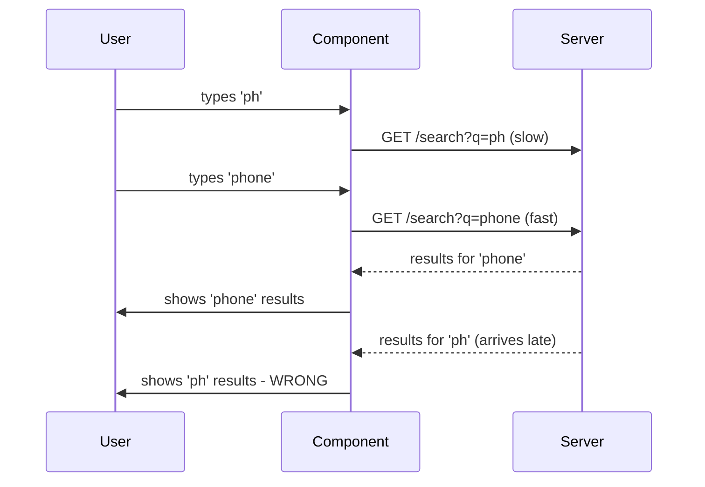
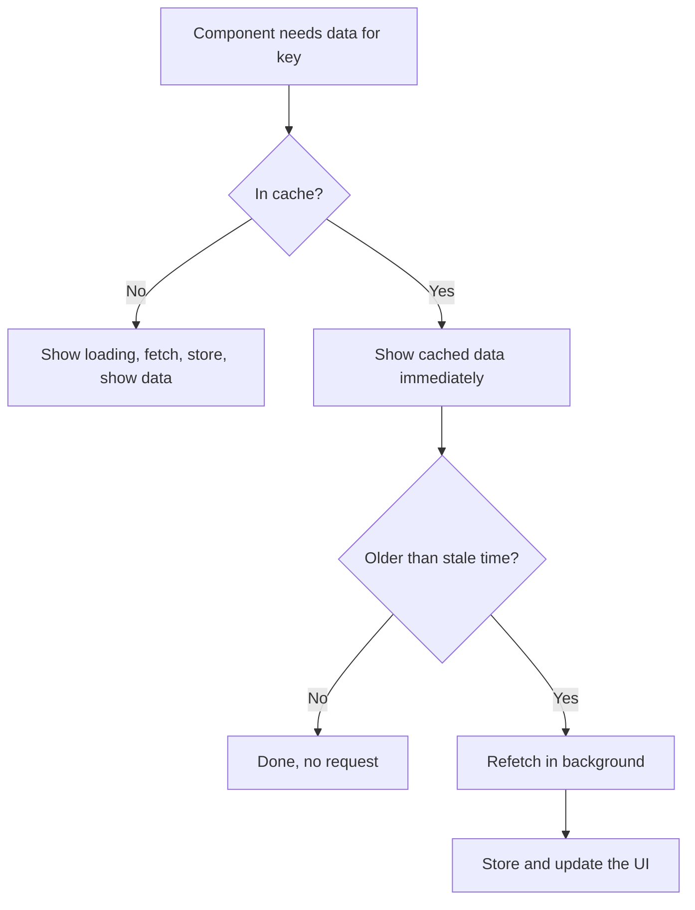
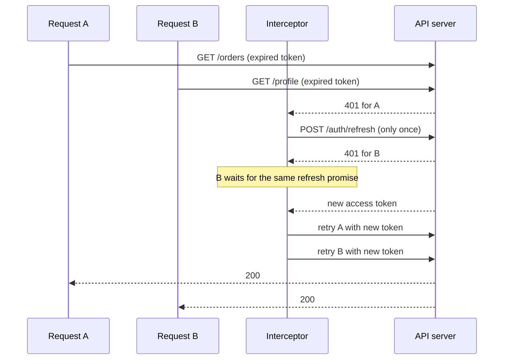
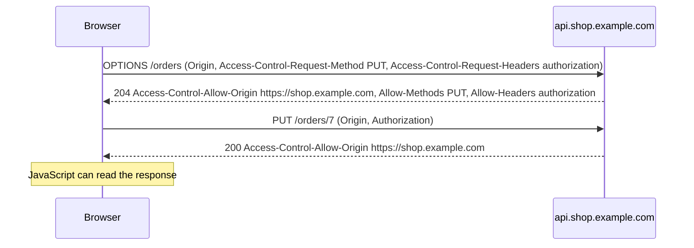
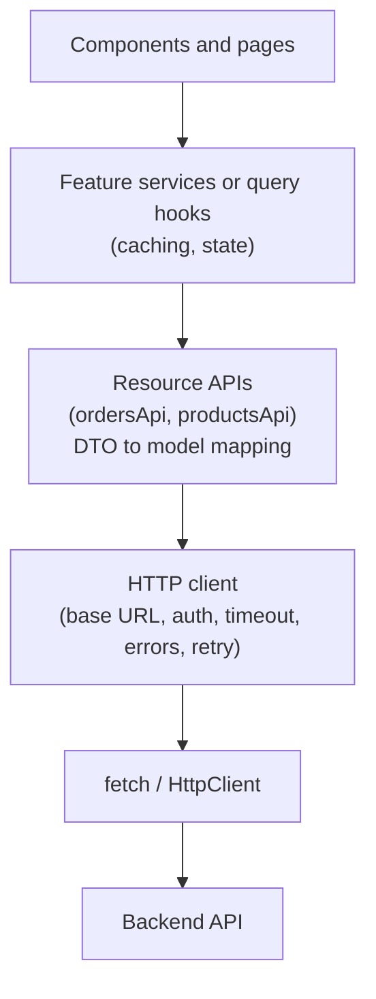

# API Integration and Data Fetching

> In this document you will learn how a frontend talks to a backend in a reliable way: how to call APIs, handle every kind of error, cancel and retry requests, avoid race conditions, cache data, update the UI optimistically, paginate, receive real-time updates, upload files and handle authentication tokens. These topics come up in frontend interviews as questions ("does `fetch` reject on a 404?"), as machine-coding tasks ("build a search box") and in system design.

**Before this:** [Callbacks and promises](../02-javascript/17-callbacks-and-promises.md) · [Async and await](../02-javascript/18-async-await.md) · [HTTP, HTTPS and TLS](../01-cs-and-web-fundamentals/05-http-https-and-tls.md) · [Components and state management](./06-components-and-state-management.md) · **Interview questions:** [jump to the interview section](#interview-questions)

## Table of contents

1. [The fetch API basics](#the-fetch-api-basics)
2. [Network errors vs HTTP errors](#network-errors-vs-http-errors)
3. [fetch vs axios vs Angular HttpClient](#fetch-vs-axios-vs-angular-httpclient)
4. [Modeling request state](#modeling-request-state)
5. [Timeouts and cancellation with AbortController](#timeouts-and-cancellation-with-abortcontroller)
6. [Retries with exponential backoff](#retries-with-exponential-backoff)
7. [Race conditions and the latest request wins](#race-conditions-and-the-latest-request-wins)
8. [Request de-duplication](#request-de-duplication)
9. [Client-side caching and stale-while-revalidate](#client-side-caching-and-stale-while-revalidate)
10. [Optimistic updates with rollback](#optimistic-updates-with-rollback)
11. [Pagination and infinite scroll](#pagination-and-infinite-scroll)
12. [Real-time updates polling SSE and WebSockets](#real-time-updates-polling-sse-and-websockets)
13. [File uploads with progress](#file-uploads-with-progress)
14. [Auth tokens and the refresh flow](#auth-tokens-and-the-refresh-flow)
15. [CORS errors from the frontend point of view](#cors-errors-from-the-frontend-point-of-view)
16. [Error handling and error UX](#error-handling-and-error-ux)
17. [Building an API layer and a typed API client](#building-an-api-layer-and-a-typed-api-client)
18. [How to explain this in an interview](#how-to-explain-this-in-an-interview)
19. [Interview questions](#interview-questions)
20. [Summary](#summary)
21. [References](#references)

> **Where the code runs.** `fetch`, `AbortController`, `URL`, `URLSearchParams` and `FormData` are browser APIs, and Node.js 18+ also provides them globally. The JavaScript examples in this document that do not touch the DOM were run with Node.js 22 against a small local test server. `XMLHttpRequest`, `EventSource` and `IntersectionObserver` are browser-only.

---

## The fetch API basics

**`fetch()`** is the built-in browser API for making HTTP requests. It returns a **promise** that resolves to a `Response` object.

### A simple GET request

```js
const response = await fetch('/api/products/1');
console.log(response.status); // 200
console.log(response.ok);     // true  (true for any status from 200 to 299)
const product = await response.json(); // read and parse the body (also a promise)
console.log(product);         // { id: 1, name: 'Mouse' }
```

Two `await`s, two steps:

1. `await fetch(...)` waits until the **response headers** arrive. You now know the status and headers.
2. `await response.json()` waits until the **whole body** is downloaded and parses it as JSON.

The body can be read only **once**. Choose the method that matches the content: `response.json()`, `response.text()`, `response.blob()` (files), `response.arrayBuffer()` (binary) or `response.formData()`. If you need to read it twice, use `response.clone()` first.

### Query parameters

Never build query strings by hand. Values with spaces, `&` or `#` break the URL. Use `URLSearchParams`, which encodes them correctly:

```js
const params = new URLSearchParams({ q: 'red shoes & bags', page: 2 });
const response = await fetch(`/api/products?${params}`);
// request URL: /api/products?q=red+shoes+%26+bags&page=2
```

Or use the `URL` object:

```js
const url = new URL('/api/products', 'https://shop.example.com');
url.searchParams.set('category', 'shoes');
url.searchParams.set('sort', 'price');
await fetch(url); // https://shop.example.com/api/products?category=shoes&sort=price
```

### Sending data: POST, PUT, PATCH, DELETE

```js
const response = await fetch('/api/orders', {
  method: 'POST',
  headers: {
    'Content-Type': 'application/json', // tell the server the body is JSON
    Accept: 'application/json',         // tell the server we want JSON back
  },
  body: JSON.stringify({ productId: 'p1', quantity: 2 }), // fetch does NOT stringify for you
});
const createdOrder = await response.json();
```

```js
// ❌ Wrong: passing an object as the body
await fetch('/api/orders', { method: 'POST', body: { productId: 'p1' } });
// The body becomes the string "[object Object]".

// ✅ Correct
await fetch('/api/orders', {
  method: 'POST',
  headers: { 'Content-Type': 'application/json' },
  body: JSON.stringify({ productId: 'p1' }),
});
```

### Useful fetch options

| Option | Example | What it does |
| --- | --- | --- |
| `method` | `'PATCH'` | HTTP method (default `GET`) |
| `headers` | `{ Authorization: 'Bearer ...' }` | Request headers |
| `body` | `JSON.stringify(data)`, `FormData`, `Blob` | Request body (not allowed on GET) |
| `signal` | `controller.signal` | Lets you cancel the request (see [Timeouts and cancellation](#timeouts-and-cancellation-with-abortcontroller)) |
| `credentials` | `'include'` | Send cookies to other origins too (default `'same-origin'`) |
| `cache` | `'no-store'` | How to use the browser HTTP cache for this request |
| `keepalive` | `true` | Let the request finish even if the page is closing (small payloads, like analytics) |

### Reading headers

```js
const response = await fetch('/api/orders?page=1');
const total = response.headers.get('X-Total-Count'); // header names are case-insensitive
const type = response.headers.get('Content-Type');   // 'application/json; charset=utf-8'
```

For cross-origin requests, JavaScript can read only a few "safe" response headers unless the server lists others in `Access-Control-Expose-Headers`. This often surprises people when a custom header like `X-Total-Count` is `null` in the browser but visible in the Network panel.

---

## Network errors vs HTTP errors

This is the most important `fetch` detail for interviews.

**`fetch` only rejects (throws) when the request could not be completed at all.** A response with status 404 or 500 is still a *successful* fetch: the server answered. The promise resolves, and `response.ok` is `false`.

| Situation | What `fetch` does |
| --- | --- |
| 200 OK | Resolves, `ok: true` |
| 404 Not Found, 401, 500, 503... | **Resolves**, `ok: false` |
| No internet, DNS failure, server down, connection refused | Rejects with `TypeError` |
| Blocked by CORS | Rejects with `TypeError` (no details for JavaScript, details only in the console) |
| Aborted with an `AbortController` | Rejects with `AbortError` (a `DOMException`) |
| Timed out with `AbortSignal.timeout()` | Rejects with `TimeoutError` (a `DOMException`) |

```js
async function loadProduct(id) {
  try {
    const response = await fetch(`/api/products/${id}`);
    console.log('status:', response.status, 'ok:', response.ok);
    const data = await response.json();
    console.log('data:', data);
  } catch (error) {
    console.log('caught:', error.message);
  }
}

await loadProduct(999);
// status: 404 ok: false
// data: { message: 'Product not found' }
// (nothing is "caught": the 404 is not an exception)
```

The message of the network `TypeError` depends on the environment: Chrome says "Failed to fetch", Firefox says "NetworkError when attempting to fetch resource.", Node.js says "fetch failed". Do not depend on the text.

### The fix: check `response.ok` and throw your own error

```js
class HttpError extends Error {
  constructor(status, body) {
    super(`HTTP ${status}`);
    this.name = 'HttpError';
    this.status = status;
    this.body = body; // the server's error details, if any
  }
}

async function request(url, options = {}) {
  const response = await fetch(url, {
    ...options,
    headers: { Accept: 'application/json', ...options.headers },
  });

  // Read the body safely: errors are not always JSON (proxies return HTML error pages)
  const isJson = response.headers.get('content-type')?.includes('application/json');
  const body = isJson ? await response.json() : await response.text();

  if (!response.ok) {
    throw new HttpError(response.status, body); // now 4xx/5xx become exceptions
  }
  return body;
}

try {
  await request('/api/products/999');
} catch (error) {
  if (error instanceof HttpError && error.status === 404) {
    showMessage('This product no longer exists.');
  } else {
    showMessage('Something went wrong. Please try again.');
  }
}
// with the 404 from above: error.name 'HttpError', error.status 404, error.body.message 'Product not found'
```

Now your code can treat all failures in one `catch`, and it still knows the difference:

- `HttpError` with a status → the server answered with an error (maybe your bug, maybe a validation error, maybe the server is down).
- `TypeError` → the request never completed (offline, DNS, CORS, server unreachable).
- `AbortError` / `TimeoutError` → cancelled or timed out.

Also watch out for **204 No Content**: there is no body, so `response.json()` throws. Check for 204 before parsing.

---

## fetch vs axios vs Angular HttpClient

| Feature | `fetch` | axios | Angular `HttpClient` |
| --- | --- | --- | --- |
| Built in | Yes (browser, Node 18+) | No (library) | Yes (Angular) |
| Return type | Promise | Promise | Observable (cold: no request until you subscribe) |
| Throws on 4xx/5xx | **No** (check `ok`) | Yes (configurable with `validateStatus`) | Yes (error notification with `HttpErrorResponse`) |
| JSON | Manual `JSON.stringify` / `response.json()` | Automatic | Automatic |
| Interceptors | No (write a wrapper) | Yes | Yes (class-based, and functional since v15) |
| Cancellation | `AbortController` | `AbortController` (`signal`) | Unsubscribe (and `switchMap` cancels automatically) |
| Timeout | `AbortSignal.timeout()` | `timeout` option (default 0 = none) | RxJS `timeout()` operator |
| Upload progress | No (use XHR) | Yes, in the browser (`onUploadProgress`, uses XHR) | Yes (`reportProgress: true`) |
| Retry | Write it yourself | Plugin or wrapper | RxJS `retry()` operator |
| Testing | Mock `fetch` | Mock adapter | `HttpTestingController` |

How to choose:

- **Angular app:** use `HttpClient`. It integrates with DI, interceptors, RxJS and testing tools. See [HttpClient and interceptors](../06-angular-16/08-httpclient-and-interceptors.md).
- **Small app or library:** `fetch` plus a small wrapper (like `request()` above) is enough and adds no dependency.
- **React/Vue app wanting interceptors and progress without writing them:** axios is a reasonable choice. Many teams use `fetch` + a server-state library instead.

Whatever you choose, **wrap it in your own API layer** so components do not depend on the library directly (see [Building an API layer](#building-an-api-layer-and-a-typed-api-client)).

---

## Modeling request state

Every request has a lifecycle. The UI must show something for each step.

| State | What the user should see |
| --- | --- |
| Idle | Nothing yet, or an instruction ("Search for a product") |
| Loading | A spinner or skeleton; keep the old data if you are refreshing |
| Success with data | The data |
| Success but empty | A helpful empty state ("No orders yet. Create your first order.") |
| Error | A clear message and a way to recover (Retry button) |

### The boolean-flags problem

```js
// ❌ Wrong: independent flags allow impossible combinations
let isLoading = false;
let error = null;
let data = null;
// What does isLoading === true AND error !== null mean? Old error still showing while loading?
// Easy to forget to reset one of them.
```

### Use a discriminated union

A **discriminated union** is a type with a shared field (here `status`) that tells which variant you have. TypeScript then knows which other fields exist. (More in [Unions, narrowing and type guards](../03-typescript/03-unions-narrowing-and-type-guards.md).)

```ts
type RequestState<T> =
  | { status: 'idle' }
  | { status: 'loading' }
  | { status: 'success'; data: T }
  | { status: 'error'; error: string };

interface Order { id: string; total: number; }

function renderOrders(state: RequestState<Order[]>): string {
  switch (state.status) {
    case 'idle':
      return 'Search for orders to begin.';
    case 'loading':
      return 'Loading orders...';
    case 'error':
      return `Could not load orders: ${state.error}`;
    case 'success':
      return state.data.length === 0
        ? 'No orders found.' // the empty state is a kind of success
        : state.data.map((o) => `${o.id}: ${o.total}`).join('\n');
    default: {
      const unreachable: never = state; // compile error if you add a status and forget to handle it
      return unreachable;
    }
  }
}
```

Benefits:

- Impossible states cannot be represented (no "loading with an error and data").
- You cannot read `state.data` unless `status === 'success'`. The compiler checks it.
- Adding a new state forces you to handle it everywhere (the `never` check).

### Refreshing without hiding data

When the user refreshes a list that is already shown, replacing it with a big spinner is annoying. Keep the old data and show a small indicator:

```ts
type ListState<T> =
  | { status: 'loading' }                                  // first load, nothing to show
  | { status: 'success'; data: T; refreshing: boolean }    // data shown, maybe refreshing
  | { status: 'error'; error: string; staleData?: T };     // show the error, keep old data if we have it
```

The same idea is shown in Angular with the `async` pipe in [HttpClient and interceptors](../06-angular-16/08-httpclient-and-interceptors.md), and with React hooks in [React essentials](./08-react-essentials.md).

---

## Timeouts and cancellation with AbortController

### Why you need them

- **Timeouts:** `fetch` has no default timeout. On a bad mobile connection, a request can hang for a very long time while the user stares at a spinner.
- **Cancellation:** if the user leaves the page, changes the search text or closes a dialog, the old request is no longer needed. Without cancellation, its response may arrive later and update the wrong UI (see [Race conditions](#race-conditions-and-the-latest-request-wins)), and it wastes bandwidth.

### AbortController and AbortSignal.timeout() in short

Quick reminder (the full explanation is in [Async and await: cancellation with AbortController](../02-javascript/18-async-await.md#cancellation-with-abortcontroller)):

- `new AbortController()` gives you a `signal`. Pass it to `fetch`. Calling `controller.abort()` cancels the request, and the `fetch` promise rejects with an error named `AbortError`.
- `AbortSignal.timeout(ms)` gives a signal that aborts by itself after `ms` milliseconds. The error is named `TimeoutError`.
- In the UI, treat `AbortError` as "not a real error" (do not show an error message). Treat `TimeoutError` as a real failure with a friendly message.

```js
try {
  const response = await fetch('/api/slow-report', { signal: AbortSignal.timeout(5000) });
  // ... check response.ok
} catch (error) {
  if (error.name === 'AbortError') return; // user cancelled: stay quiet
  if (error.name === 'TimeoutError') showMessage('The server is taking too long. Please try again.');
  else throw error;
}
```

### Combining a user cancel and a timeout with AbortSignal.any()

```js
async function request(url, { timeoutMs = 10_000, signal, ...options } = {}) {
  const timeoutSignal = AbortSignal.timeout(timeoutMs);
  // Abort when EITHER the caller aborts OR the timeout fires
  const combined = signal ? AbortSignal.any([signal, timeoutSignal]) : timeoutSignal;
  const response = await fetch(url, { ...options, signal: combined });
  // ... check response.ok as before
  return response;
}

// Tested results:
// request('/api/slow', { timeoutMs: 200 })      -> rejects with name 'TimeoutError'
// request('/api/slow', { signal }) + abort()    -> rejects with name 'AbortError'
```

`AbortSignal.timeout()` and `AbortSignal.any()` are supported in all modern browsers (`any()` since 2024) and in Node.js (`timeout()` since 17.3, `any()` since 20.3). For older browsers, use `setTimeout(() => controller.abort(), ms)` and clear the timer when the request finishes.

### Cancelling on component destroy

```js
// Plain JavaScript component pattern
function mountOrdersWidget(element) {
  const controller = new AbortController();
  fetch('/api/orders', { signal: controller.signal })
    .then((r) => r.json())
    .then((orders) => renderOrders(element, orders))
    .catch((error) => {
      if (error.name !== 'AbortError') renderError(element, error);
    });
  return () => controller.abort(); // call this when the widget is removed
}
```

- **Angular:** unsubscribing from an `HttpClient` observable cancels the request. The `async` pipe and `takeUntilDestroyed()` (developer preview in v16, stable since v19) unsubscribe automatically.
- **React:** abort in the `useEffect` cleanup function (see [React essentials](./08-react-essentials.md)).

**Important:** cancelling a request in the browser does not undo work on the server. If you abort a `POST /orders`, the server may still create the order. Cancellation is safe for reads; for writes you need idempotency (next section).

---

## Retries with exponential backoff

### When to retry

Some failures are **temporary**: a network blip, a server restarting, a rate limit. Retrying can turn a failure into a success. Other failures will **never** succeed on retry: a 400 validation error, a 401, a 404.

| Failure | Retry? | Why |
| --- | --- | --- |
| Network error (`TypeError`), timeout | Yes | Often temporary |
| 408 Request Timeout | Yes | Temporary |
| 429 Too Many Requests | Yes, but respect the `Retry-After` header | The server asks you to slow down |
| 500, 502, 503, 504 | Yes (a few times) | Often temporary server or gateway problems |
| 400, 401, 403, 404, 409, 422 | No | The request itself is wrong or not allowed; retrying gives the same answer |
| `AbortError` | No | The user or your code cancelled it on purpose |

**Idempotency matters.** An operation is **idempotent** if doing it twice has the same effect as doing it once. `GET`, `PUT` and `DELETE` are idempotent by definition. `POST` usually is not: retrying "create payment" after a timeout might charge twice, because the first request may have succeeded on the server. Only retry non-idempotent requests if the API supports an **idempotency key** (a unique id you send with the request so the server can detect duplicates). See [REST API design](../07-nodejs-backend/07-rest-api-design.md).

### Exponential backoff and jitter

- **Exponential backoff:** wait longer after each failure: 300 ms, 600 ms, 1200 ms, 2400 ms... This gives a struggling server time to recover.
- **Jitter:** add randomness to the delay. Without it, thousands of clients that failed at the same moment all retry at the same moment, and hit the server in waves (the "thundering herd").
- **Cap:** set a maximum delay and a maximum number of attempts.

```js
const sleep = (ms) => new Promise((resolve) => setTimeout(resolve, ms));

function isRetryable(error) {
  if (error.name === 'AbortError') return false; // cancelled on purpose
  if (error instanceof HttpError) {
    return error.status === 408 || error.status === 429 || error.status >= 500;
  }
  return true; // network errors and timeouts
}

async function withRetry(fn, { retries = 3, baseDelayMs = 300, maxDelayMs = 5000 } = {}) {
  for (let attempt = 0; ; attempt++) {
    try {
      return await fn();
    } catch (error) {
      if (attempt >= retries || !isRetryable(error)) throw error;
      const exponential = Math.min(maxDelayMs, baseDelayMs * 2 ** attempt); // 300, 600, 1200, ...
      const delay = Math.random() * exponential; // "full jitter": random between 0 and the exponential value
      await sleep(delay);
    }
  }
}

// Usage
const report = await withRetry(() => request('/api/reports/daily'));
```

Tested against a local server that returns 503 twice and then 200:

```text
attempt 1 failed (HTTP 503), retrying
attempt 2 failed (HTTP 503), retrying
{ ok: true }
```

And a 404 was thrown immediately, without retries.

Step by step for the 503 case:

1. Attempt 0 fails with 503. It is retryable and `0 < 3`, so wait a random time up to 300 ms.
2. Attempt 1 fails with 503. Wait a random time up to 600 ms.
3. Attempt 2 succeeds. Return the result.

Good practices:

- Retry only **reads** and **idempotent** writes by default.
- Respect `Retry-After` for 429 and 503 when the server sends it.
- Show the user what is happening when retries take long ("Reconnecting...").
- Do not retry in several layers at once (browser code, service worker, API gateway): the retries multiply.

In Angular, the RxJS `retry({ count: 3, delay: (error, retryCount) => timer(...) })` operator implements the same idea. See [RxJS](../06-angular-16/09-rxjs.md).

---

## Race conditions and the latest request wins

### The problem

A user types "ph" in a search box, then quickly "phone". Two requests go out. The responses can arrive in **any order**. If the "ph" response is slower, it arrives **last** and overwrites the correct "phone" results.

The async/await side of this problem (why promises finish in any order) is in [Async and await: race conditions and stale responses](../02-javascript/18-async-await.md#race-conditions-and-stale-responses). This section focuses on the UI patterns and the Angular version.



This was reproduced with a local server where `q=ph` takes 300 ms and `q=phone` takes 50 ms. The naive code printed:

```text
naive render phone
naive render ph      <- the old response overwrote the new one
```

### Fix 1: cancel the previous request (best)

```js
let currentController = null;

async function search(query) {
  currentController?.abort();              // cancel the previous request
  currentController = new AbortController();

  try {
    const data = await request(`/api/search?q=${encodeURIComponent(query)}`, {
      signal: currentController.signal,
    });
    renderResults(data);
  } catch (error) {
    if (error.name === 'AbortError') return; // expected: a newer search replaced this one
    renderError(error);
  }
}
```

Tested output with the same slow/fast server:

```text
cancelled ph
render results for phone
```

### Fix 2: ignore stale responses (when you cannot cancel)

```js
let latestRequestId = 0;

async function search(query) {
  const requestId = ++latestRequestId;
  const data = await request(`/api/search?q=${encodeURIComponent(query)}`);
  if (requestId !== latestRequestId) return; // a newer request started: ignore this response
  renderResults(data);
}
```

### Fix 3: RxJS `switchMap` (Angular)

`switchMap` unsubscribes from the previous inner observable when a new value arrives. With `HttpClient`, unsubscribing cancels the HTTP request. This is exactly "latest wins":

```ts
this.results$ = this.searchControl.valueChanges.pipe(
  debounceTime(300),           // wait until the user pauses typing
  distinctUntilChanged(),      // skip if the text did not change
  switchMap((query) => this.productApi.search(query)), // cancel the previous search
);
```

Combine "latest wins" with **debouncing** (fewer requests, see [Debounce, throttle and performance](../02-javascript/20-debounce-throttle-and-performance.md)). Debounce alone does **not** fix the race: two requests can still overlap if the user pauses, types again, and the network is slow.

Other places races happen: switching tabs quickly (tab A data arrives after tab B is selected), navigating between detail pages (`/orders/1` → `/orders/2`), and double-clicking a submit button (disable the button while submitting).

---

## Request de-duplication

### The problem

On page load, the header, the sidebar and the profile card all need the current user. Each calls `GET /api/me`. That is three identical requests at the same time.

### The fix: share the in-flight promise

Keep a map of requests that are currently running. If a request with the same key is already running, return the same promise.

```js
const inFlight = new Map();

function dedupe(key, fetcher) {
  if (inFlight.has(key)) return inFlight.get(key);
  const promise = fetcher().finally(() => inFlight.delete(key)); // remove when done (success or error)
  inFlight.set(key, promise);
  return promise;
}

// Three components ask at the same time
const [a, b, c] = await Promise.all([
  dedupe('user:me', () => request('/api/me')),
  dedupe('user:me', () => request('/api/me')),
  dedupe('user:me', () => request('/api/me')),
]);
// Tested with a counter: only 1 network call; a, b and c are the same object.
```

Notes:

- The entry is deleted when the request finishes, so a later call fetches fresh data. (Keeping results longer is **caching**, the next section.)
- Only de-duplicate **reads** (GET). Two identical POSTs might be two intended actions (or one double-click you should prevent in the UI).
- Use a key that includes everything that changes the response: URL, query params, and maybe the user or tenant.

In Angular, `shareReplay({ bufferSize: 1, refCount: true })` on a shared observable gives similar behavior. Server-state libraries de-duplicate by query key automatically.

---

## Client-side caching and stale-while-revalidate

### Why cache on the client

- Instant UI when the user comes back to a page they already visited.
- Fewer requests, less server load.
- Data shared between components without each one fetching.

But cached data can be **stale** (outdated). Every cache needs answers to three questions:

1. **Key:** what identifies the data? (`orders?status=open&page=2`)
2. **Freshness:** how long is it OK to show without refetching? (a stale time / TTL)
3. **Invalidation:** when do we throw it away early? (after a mutation, on logout, on tenant switch)

### Layers of caching

| Layer | Controlled by | Example |
| --- | --- | --- |
| Browser HTTP cache | Server headers (`Cache-Control`, `ETag`) | Static files, public API responses |
| Service worker cache | Your service worker code | Offline support, PWA |
| In-memory app cache | Your JavaScript (or a server-state library) | API data reused between pages and components |
| Persistent storage | `localStorage`, IndexedDB | Offline data, drafts |

This section is about the in-memory app cache. Cross-layer caching strategy is covered in [Caching strategies and invalidation](../09-system-design/03-caching-strategies-and-invalidation.md).

### Stale-while-revalidate

**Stale-while-revalidate (SWR)** means: if you have cached data, **show it immediately** (even if it might be old), **refetch in the background**, and **update the UI** when fresh data arrives. The user sees something instantly and gets fresh data a moment later.



A small implementation (it also de-duplicates, and accepts a fake clock so it can be tested):

```js
function createQueryCache({ staleTimeMs = 30_000, now = () => Date.now() } = {}) {
  const entries = new Map(); // key -> { data, fetchedAt, promise }

  async function revalidate(key, fetcher) {
    const entry = entries.get(key) ?? {};
    if (entry.promise) return entry.promise; // already fetching: share it
    entry.promise = fetcher()
      .then((data) => {
        entries.set(key, { data, fetchedAt: now() });
        return data;
      })
      .finally(() => {
        const current = entries.get(key);
        if (current) delete current.promise;
      });
    entries.set(key, entry);
    return entry.promise;
  }

  return {
    // onData can be called twice: first with cached data, then with fresh data
    async get(key, fetcher, onData) {
      const entry = entries.get(key);
      if (entry && 'data' in entry) {
        const isStale = now() - entry.fetchedAt > staleTimeMs;
        onData(entry.data, { stale: isStale });
        if (!isStale) return; // fresh: no request at all
      }
      const data = await revalidate(key, fetcher);
      onData(data, { stale: false });
    },
    invalidate(prefix) {
      for (const key of entries.keys()) {
        if (key.startsWith(prefix)) entries.delete(key);
      }
    },
  };
}
```

Tested step by step with a fake clock and stale time of 1000 ms (the server's data version changes between calls):

```text
time 0     get -> no cache: fetch           -> render orders v1
time 500   get -> cached and fresh          -> render orders v1 (no request)
time 2000  get -> cached but stale          -> render orders v1 (stale), then render orders v2
invalidate('orders'), then get              -> no cache: fetch -> render orders v3
```

### Invalidation after mutations

After the user changes data, any cached data that includes it is wrong. Options, from simplest to most precise:

1. **Invalidate and refetch:** after "cancel order", invalidate all keys starting with `orders`. Simple and safe.
2. **Update the cache from the response:** the `PATCH` response contains the updated order; write it into the detail cache and into lists that contain it. Fewer requests, more code.
3. **Optimistic update:** change the cache before the server answers (next section).

Also invalidate on events that change *who* is asking: **logout** (clear everything, otherwise the next user may see the previous user's data) and **tenant or workspace switch**. Include the tenant in the cache key.

---

## Optimistic updates with rollback

### What it is

An **optimistic update** changes the UI **immediately**, as if the server request already succeeded. If the request fails, you **roll back** to the previous state and tell the user.

Why: the app feels instant. Clicking "like" or "add to favorites" and waiting 500 ms for a spinner feels slow.

### Code example

```js
async function toggleFavorite(state, productId, api, render) {
  const previous = state.favorites;                 // 1. remember the old state
  const isFavorite = previous.includes(productId);

  state.favorites = isFavorite                      // 2. update the UI immediately (immutably)
    ? previous.filter((id) => id !== productId)
    : [...previous, productId];
  render(state.favorites);

  try {
    await api(productId, !isFavorite);              // 3. tell the server
  } catch (error) {
    state.favorites = previous;                     // 4. failed: roll back
    render(state.favorites);
    showToast('Could not update favorites. Please try again.');
  }
}
```

Tested output (first call succeeds, second call fails):

```text
favorites: ["p1","p2"]          <- p2 added, server OK
favorites: ["p1","p2","p3"]     <- p3 added immediately
favorites: ["p1","p2"]          <- server failed: rolled back
toast: Could not update favorites. Please try again.
```

### When to use and when not to

| Good for optimistic updates | Better to wait for the server (pessimistic) |
| --- | --- |
| Likes, favorites, toggles, reordering, marking as read | Payments, orders, bookings, money transfers |
| High success rate, easy to undo | The server may reject for business reasons (stock, limits) |
| Low cost if the user briefly sees a wrong state | Wrong state would cause real harm or confusion |

### Pitfalls

- **Rollback to the right state.** If two optimistic updates overlap and the first fails, restoring the snapshot from before the first update also throws away the second one. More robust: undo only the specific change (remove `p3` instead of restoring the whole list), or refetch from the server after an error.
- **Server-generated values.** For a new item, use a temporary client id, then replace it with the real id from the response.
- **Keep the user informed** on failure. A silent rollback looks like a bug.

---

## Pagination and infinite scroll

Large lists must be loaded in pages. Two main styles:

### Offset pagination

```text
GET /api/orders?page=3&pageSize=20        (or ?offset=40&limit=20)
→ { items: [...20 orders], total: 1243 }
```

- **Pros:** simple; you can jump to any page ("page 37"); easy to show "page 3 of 63".
- **Cons:** if items are added or removed while the user pages, they see **duplicates or skip items** (an insert at the top shifts every item one position). Large offsets are slow on many databases (the database still walks through all skipped rows). Counting `total` can be expensive.

### Cursor pagination

```text
GET /api/orders?limit=20
→ { items: [...], nextCursor: "eyJpZCI6MTAyMH0" }

GET /api/orders?limit=20&cursor=eyJpZCI6MTAyMH0
→ { items: [...], nextCursor: null }      // null = no more pages
```

The **cursor** is an opaque string from the server that marks "where you stopped" (often an encoded id or timestamp of the last item).

- **Pros:** stable when data changes (no duplicates or skips); fast on large tables (uses an index: `WHERE id < :lastId`); perfect for feeds and infinite scroll.
- **Cons:** cannot jump to an arbitrary page; total count is usually not available; the frontend must treat the cursor as opaque.

| | Offset | Cursor |
| --- | --- | --- |
| Jump to page N | Yes | No |
| Stable with inserts/deletes | No | Yes |
| Performance on deep pages | Gets slower | Stays fast |
| Best for | Admin tables with page numbers, small datasets | Feeds, timelines, infinite scroll, large datasets |

Server-side details are in [REST API design](../07-nodejs-backend/07-rest-api-design.md).

### Reading all pages with an async generator

```js
async function* fetchAllOrders(limit = 50) {
  let cursor = null;
  do {
    const params = new URLSearchParams({ limit: String(limit) });
    if (cursor) params.set('cursor', cursor);
    const page = await request(`/api/orders?${params}`);
    yield page.items;
    cursor = page.nextCursor;
  } while (cursor);
}

for await (const items of fetchAllOrders(3)) {
  console.log('page:', items.map((o) => o.id).join(','));
}
// Tested with 7 fake orders and limit 3:
// page: 1,2,3
// page: 4,5,6
// page: 7
```

(Async generators are explained in [Iterators and generators](../02-javascript/13-iterators-and-generators.md).)

### Infinite scroll with IntersectionObserver

**Infinite scroll** loads the next page automatically when the user scrolls near the end of the list. Use an `IntersectionObserver` on a "sentinel" element at the bottom instead of listening to every `scroll` event. (Observers are explained in [DOM and events](./03-dom-and-events.md).)

```html
<ul id="feed"></ul>
<div id="sentinel" aria-hidden="true"></div>
<p id="feed-status" role="status"></p>
<button id="load-more" type="button" hidden>Load more</button>
```

```js
const feed = document.querySelector('#feed');
const sentinel = document.querySelector('#sentinel');
const status = document.querySelector('#feed-status');

let nextCursor = undefined; // undefined = first page not loaded yet; null = no more pages
let loading = false;

async function loadNextPage() {
  if (loading || nextCursor === null) return; // guard: no parallel loads, stop at the end
  loading = true;
  status.textContent = 'Loading more posts...';
  try {
    const params = new URLSearchParams({ limit: '20' });
    if (nextCursor) params.set('cursor', nextCursor);
    const page = await request(`/api/posts?${params}`);

    const fragment = document.createDocumentFragment();
    for (const post of page.items) {
      const li = document.createElement('li');
      li.textContent = post.title; // textContent, never innerHTML with server data
      fragment.append(li);
    }
    feed.append(fragment);

    nextCursor = page.nextCursor;
    status.textContent = nextCursor === null ? 'You have reached the end.' : '';
    if (nextCursor === null) observer.disconnect();
  } catch (error) {
    status.textContent = 'Could not load more posts.';
    document.querySelector('#load-more').hidden = false; // manual fallback for retry
  } finally {
    loading = false;
  }
}

const observer = new IntersectionObserver(
  (entries) => {
    if (entries[0].isIntersecting) loadNextPage();
  },
  { rootMargin: '400px' }, // start loading 400px before the sentinel is visible
);
observer.observe(sentinel);
document.querySelector('#load-more').addEventListener('click', loadNextPage);
```

Infinite scroll trade-offs:

- Users cannot reach the footer; keyboard and screen-reader users may struggle. A **"Load more" button** is often more accessible. See [Accessibility](./04-accessibility.md).
- The DOM grows without limit. For very long feeds, combine with virtualization (see [Web performance](./05-web-performance-and-core-web-vitals.md#large-dom-and-list-virtualization)).
- Restoring the scroll position after the user opens an item and presses Back needs extra work (keep the loaded pages in a cache and restore the position).

---

## Real-time updates polling SSE and WebSockets

Sometimes the server has new data and the client should know quickly: new chat messages, order status, notifications, live prices.

| Technique | How it works | Direction | Pros | Cons | Good for |
| --- | --- | --- | --- | --- | --- |
| **Short polling** | Client asks every N seconds | Client → server | Simplest; works everywhere; plain HTTP and caching | Delay up to N seconds; many useless requests | Dashboards refreshed every 30–60 s, job status |
| **Long polling** | Client asks; server holds the request open until there is news (or a timeout), then the client asks again | Server → client (simulated) | Near real-time over plain HTTP | Many held connections on the server; more complex | Fallback when SSE/WebSockets are not possible |
| **Server-Sent Events (SSE)** | One long HTTP response that streams text events | Server → client only | Built-in auto-reconnect with `Last-Event-ID`; plain HTTP; simple | One direction; text only; the `EventSource` API cannot set custom headers | Notifications, live feeds, progress updates, streaming AI responses |
| **WebSockets** | A persistent two-way connection after an HTTP upgrade | Both directions | Low latency, both directions, binary support | You build reconnection, heartbeats and resync; stateful servers are harder to scale; proxies may need config | Chat, collaborative editing, multiplayer, trading |

Protocol details and system-level trade-offs are in [API styles and real-time communication](../09-system-design/04-api-styles-and-real-time-communication.md).

### Polling done right

```js
function startPolling(fetchStatus, onData, intervalMs = 10_000) {
  let timerId = null;
  let stopped = false;

  async function tick() {
    if (document.visibilityState === 'visible') {
      try {
        onData(await fetchStatus());
      } catch (error) {
        console.warn('Polling failed, will try again', error);
      }
    }
    if (!stopped) timerId = setTimeout(tick, intervalMs); // schedule the NEXT poll after this one finished
  }

  tick();
  return () => { stopped = true; clearTimeout(timerId); };
}
```

Why `setTimeout` in a loop instead of `setInterval`: with `setInterval`, if a request takes longer than the interval, requests pile up and overlap. The loop waits for each request to finish. It also skips polling while the tab is hidden, which saves battery and server load.

### Server-Sent Events

```js
const events = new EventSource('/api/notifications/stream', { withCredentials: true });

events.addEventListener('message', (event) => {
  const notification = JSON.parse(event.data);
  showNotification(notification);
});

events.addEventListener('order-status', (event) => { // custom named event from the server
  updateOrderStatus(JSON.parse(event.data));
});

events.addEventListener('error', () => {
  // The browser reconnects automatically. Show a "reconnecting" indicator if needed.
});

// Later: events.close();
```

Because `EventSource` cannot send an `Authorization` header, SSE usually authenticates with cookies. (Alternatively, read an SSE stream with `fetch` and parse it yourself.)

### WebSockets with reconnection

```js
function connectLive(url, onMessage) {
  let socket;
  let attempt = 0;
  let closedByUser = false;

  function open() {
    socket = new WebSocket(url);

    socket.addEventListener('open', () => {
      attempt = 0;
      resyncFromHttp(); // we may have missed events while disconnected
    });

    socket.addEventListener('message', (event) => onMessage(JSON.parse(event.data)));

    socket.addEventListener('close', () => {
      if (closedByUser) return;
      const delay = Math.min(30_000, 1000 * 2 ** attempt) * Math.random(); // backoff with jitter
      attempt++;
      setTimeout(open, delay);
    });
  }

  open();
  return {
    send: (data) => socket.readyState === WebSocket.OPEN && socket.send(JSON.stringify(data)),
    close: () => { closedByUser = true; socket.close(); },
  };
}
```

Real-time rules:

- **Resync after reconnect.** Messages sent while the client was offline are lost. Fetch the current state over HTTP (or ask for events since the last id).
- **De-duplicate and order** events with ids or version numbers. An event can arrive twice or out of order.
- **Heartbeats** (ping messages) detect dead connections that never fire `close`.
- **Authenticate** the connection (cookie or a short-lived token sent in the first message), and re-authenticate when tokens expire.
- **Validate** incoming messages like any other untrusted input.

---

## File uploads with progress

### Basic upload with FormData

```html
<form id="upload-form">
  <label for="file">Invoice (PDF, max 10 MB)</label>
  <input id="file" name="file" type="file" accept="application/pdf" required>
  <button type="submit">Upload</button>
  <progress id="progress" max="100" value="0" hidden></progress>
  <p id="upload-status" role="status"></p>
</form>
```

```js
const form = document.querySelector('#upload-form');

form.addEventListener('submit', async (event) => {
  event.preventDefault();
  const file = form.elements.file.files[0];

  // Validate on the client for fast feedback (the server must validate again!)
  if (file.size > 10 * 1024 * 1024) {
    document.querySelector('#upload-status').textContent = 'The file is larger than 10 MB.';
    return;
  }

  const formData = new FormData();
  formData.append('file', file);
  formData.append('customerId', '42');

  const response = await fetch('/api/invoices', {
    method: 'POST',
    body: formData, // do NOT set Content-Type yourself: the browser adds multipart/form-data with the boundary
  });
  if (!response.ok) throw new HttpError(response.status, await response.text());
});
```

```js
// ❌ Wrong: setting the header manually removes the multipart boundary, and the server cannot parse the body
fetch('/api/invoices', { method: 'POST', headers: { 'Content-Type': 'multipart/form-data' }, body: formData });
```

### Upload progress

`fetch` does **not** report upload progress. (Streaming request bodies with `fetch` exist in Chromium-based browsers, but they need HTTP/2 or newer and are not widely usable for this.) For a progress bar, use **`XMLHttpRequest`**, which has `upload.onprogress`:

```js
function uploadWithProgress(url, formData, onProgress, signal) {
  return new Promise((resolve, reject) => {
    const xhr = new XMLHttpRequest();
    xhr.open('POST', url);

    xhr.upload.addEventListener('progress', (event) => {
      if (event.lengthComputable) {
        onProgress(Math.round((event.loaded / event.total) * 100));
      }
    });

    xhr.addEventListener('load', () => {
      if (xhr.status >= 200 && xhr.status < 300) resolve(JSON.parse(xhr.responseText || 'null'));
      else reject(new HttpError(xhr.status, xhr.responseText));
    });
    xhr.addEventListener('error', () => reject(new TypeError('Network error')));
    xhr.addEventListener('abort', () => reject(new DOMException('Upload cancelled', 'AbortError')));

    signal?.addEventListener('abort', () => xhr.abort());
    xhr.send(formData);
  });
}

// Usage
const progressEl = document.querySelector('#progress');
progressEl.hidden = false;
await uploadWithProgress('/api/invoices', formData, (percent) => {
  progressEl.value = percent;
});
```

- **axios** (in the browser) offers `onUploadProgress`, built on XHR.
- **Angular `HttpClient`**: `this.http.post(url, formData, { reportProgress: true, observe: 'events' })` emits `HttpEventType.UploadProgress` events.

**Download progress** *is* possible with `fetch`: read `response.body` as a stream and compare received bytes with the `Content-Length` header.

### Large files

For big files (videos, backups):

- **Upload directly to object storage** (for example S3) with a **pre-signed URL** from your backend. Your API server does not have to carry the bytes.
- **Chunked / resumable uploads:** split the file into parts (for example 5–10 MB), upload parts separately, retry failed parts, and resume after a network drop.
- Always validate type and size on the **server** too. The `accept` attribute and client checks are only for user experience.

The full design is in [Case study: file upload service](../09-system-design/14-case-study-file-upload-service.md).

---

## Auth tokens and the refresh flow

How authentication works on the server is in [Authentication and authorization](../07-nodejs-backend/09-authentication-and-authorization.md), and the architecture (SSO, OIDC) is in [Auth architecture and multi-tenancy](../09-system-design/06-auth-architecture-and-multi-tenancy.md). Here we look at what the **frontend** does.

### Two common approaches

| | Session cookie | Bearer token (often a JWT) |
| --- | --- | --- |
| How the request is authenticated | The browser sends an `HttpOnly` cookie automatically | Your code adds `Authorization: Bearer <token>` |
| Frontend code needed | Almost none (`credentials: 'include'` for cross-origin) | Attach the header, refresh expired tokens |
| XSS risk | JavaScript cannot read an `HttpOnly` cookie | A token readable by JavaScript can be stolen by injected script |
| CSRF risk | Yes: cookies are sent automatically. Needs `SameSite` and/or CSRF tokens | No: the header is not added automatically |
| Works for mobile apps / third parties | Less convenient | Yes |

### Where should the frontend keep tokens?

| Storage | Readable by JavaScript? | Survives reload? | Main risk |
| --- | --- | --- | --- |
| `localStorage` / `sessionStorage` | Yes | Yes / per tab | Any XSS can read and send the token elsewhere |
| JavaScript memory (a variable) | Yes, but only while the page is open | No | XSS can still use it while the page is open, but cannot easily steal it for later |
| `HttpOnly; Secure; SameSite` cookie | **No** | Yes | CSRF (mitigated by `SameSite` and CSRF tokens) |

A common, balanced pattern for single-page apps:

- The **refresh token** lives in an `HttpOnly`, `Secure`, `SameSite` cookie that only the refresh endpoint receives.
- The **access token** is short-lived (for example 5–15 minutes) and kept **in memory**.
- On page load, the app calls the refresh endpoint to get a new access token.

Many teams go one step further with a **Backend-for-Frontend (BFF)**: the browser only has a session cookie, and the BFF server keeps the tokens and adds them to API calls. No token is ever visible to JavaScript.

No storage choice fixes XSS. If an attacker can run JavaScript in your page, they can make requests as the user. Preventing XSS comes first: see [Web security: XSS, CSRF, CORS, CSP](../10-testing-security-production/05-web-security-xss-csrf-cors-csp.md) and [Secure auth, secrets and dependencies](../10-testing-security-production/06-secure-auth-secrets-and-dependencies.md).

### Attaching the token: the interceptor idea

You do not want every API call to remember to add the header. An **interceptor** is a central function that every request passes through. It can add headers, handle errors, log, and refresh tokens.

`fetch` has no interceptors, but a wrapper function does the same job:

```js
let accessToken = null; // kept in memory

async function authFetch(url, options = {}) {
  const headers = new Headers(options.headers);
  if (accessToken) headers.set('Authorization', `Bearer ${accessToken}`);
  return fetch(url, { ...options, headers });
}
```

In Angular, `HttpClient` interceptors do this. Angular 16 supports class-based interceptors (`HTTP_INTERCEPTORS`) and functional interceptors (`provideHttpClient(withInterceptors([...]))`, available since v15). See [HttpClient and interceptors](../06-angular-16/08-httpclient-and-interceptors.md).

**Security rule:** only attach the token to **your own API origin**. An interceptor that adds the token to every request would leak it to third-party URLs (analytics, CDNs, external APIs).

### The refresh flow and the concurrency problem

When the access token expires, the API returns **401 Unauthorized**. The client should:

1. Call the refresh endpoint to get a new access token.
2. Retry the original request with the new token.
3. If the refresh itself fails, log the user out (redirect to login).

The tricky part: the dashboard fires **five requests at the same time**, and all five get 401. A naive interceptor would call the refresh endpoint **five times**. With refresh-token rotation (each refresh token can be used only once), the second refresh fails and the user gets logged out randomly.

The fix is a **single-flight refresh**: the first 401 starts the refresh; all other requests wait for the same refresh promise.



```js
let accessToken = null;
let refreshPromise = null; // shared while a refresh is running

async function refreshAccessToken() {
  const response = await fetch('/api/auth/refresh', { method: 'POST', credentials: 'include' });
  if (!response.ok) throw new HttpError(response.status, null);
  const { accessToken: newToken } = await response.json();
  accessToken = newToken;
  return newToken;
}

function getFreshToken() {
  // Start a refresh only if none is running; everyone else reuses the same promise
  refreshPromise ??= refreshAccessToken().finally(() => { refreshPromise = null; });
  return refreshPromise;
}

async function apiFetch(url, options = {}) {
  const send = () => fetch(url, {
    ...options,
    headers: { ...options.headers, ...(accessToken ? { Authorization: `Bearer ${accessToken}` } : {}) },
  });

  const response = await send();

  if (response.status === 401 && !options.isRetry) {
    try {
      await getFreshToken(); // all parallel 401s wait for the same refresh
    } catch {
      redirectToLogin(); // refresh failed: the session is really over
      throw new HttpError(401, null);
    }
    return apiFetch(url, { ...options, isRetry: true }); // retry once with the new token
  }
  return response;
}
```

Step by step for five parallel requests with an expired token:

1. All five requests are sent with the old token. All five get 401.
2. The first one to arrive calls `getFreshToken()`. `refreshPromise` is empty, so it starts `refreshAccessToken()` and stores the promise.
3. The other four call `getFreshToken()` too. `refreshPromise` already exists, so they get the same promise. No new refresh request is sent.
4. The refresh finishes. `accessToken` now holds the new token, and `refreshPromise` is cleared in `finally`.
5. All five requests are retried once (`isRetry: true`) with the new token. The `isRetry` flag stops an endless loop if the server keeps answering 401.

(In real code, keep `isRetry` out of the options you pass to `fetch`, for example by using a separate parameter.)

This code was tested with five parallel requests against a mocked `fetch`: all five ended with status 200, and the refresh endpoint was called **exactly once**.

Other details:

- Do not try to refresh when the failing request **is** the refresh call itself.
- Some apps refresh **proactively** a little before the token expires (they know `exp` from the token). This avoids most 401s, but you still need the reactive path.
- When the user logs out in one tab, other tabs should notice (a `storage` event or `BroadcastChannel` message) and clear their state.

---

## CORS errors from the frontend point of view

### What you see

In the browser console:

```text
Access to fetch at 'https://api.shop.example.com/orders' from origin 'https://shop.example.com'
has been blocked by CORS policy: No 'Access-Control-Allow-Origin' header is present on the requested resource.
```

In your JavaScript, `fetch` rejects with a plain `TypeError` ("Failed to fetch"). For security reasons, your code gets **no details**: it cannot even tell a CORS error from a network error. The details are only in the console.

### What it means

The **same-origin policy** stops JavaScript on one origin (scheme + host + port) from reading responses from another origin. **CORS** (Cross-Origin Resource Sharing) is how a **server** says "this other origin is allowed to read my responses", using response headers like `Access-Control-Allow-Origin`. The basics of origins are in [Browser storage and web security basics](../01-cs-and-web-fundamentals/08-browser-storage-and-web-security-basics.md); the full mechanism and its security use are in [Web security: XSS, CSRF, CORS, CSP](../10-testing-security-production/05-web-security-xss-csrf-cors-csp.md).

Key facts for a frontend developer:

1. **CORS is enforced by the browser, and fixed on the server.** You cannot fix a real CORS error from frontend code. Adding `Access-Control-Allow-Origin` to your *request* does nothing; it is a *response* header.
2. The request often **did reach the server**. The browser just refuses to give the response to your JavaScript. (So a "blocked" POST may still have created data.)
3. **Preflight.** For requests that are not "simple" (for example `Content-Type: application/json`, an `Authorization` header, or methods like `PUT`/`DELETE`), the browser first sends an `OPTIONS` request to ask permission. The server must answer it with the right `Access-Control-Allow-Methods` and `Access-Control-Allow-Headers`.
4. **Credentials.** With `credentials: 'include'` (cookies), the server must reply with `Access-Control-Allow-Credentials: true` and a **specific** origin, not `*`.
5. Tools like Postman or `curl` do not enforce CORS. "It works in Postman" does not mean CORS is configured.



### How to debug and fix

1. Open the **Network** panel. Is there an `OPTIONS` request? What did it return? Which `Access-Control-*` headers are missing?
2. Ask the backend team to allow your origin, methods and headers (or fix it yourself in the API's CORS configuration).
3. In **local development**, avoid CORS completely with a **dev-server proxy**: the browser calls `http://localhost:4200/api/...` (same origin), and the dev server forwards it to the real API.

```json
// Angular: proxy.conf.json, used with "ng serve --proxy-config proxy.conf.json"
{
  "/api": {
    "target": "http://localhost:3000",
    "secure": false,
    "changeOrigin": true
  }
}
```

```js
// Vite: vite.config.js
export default {
  server: {
    proxy: {
      '/api': { target: 'http://localhost:3000', changeOrigin: true },
    },
  },
};
```

In production, serving the frontend and API from the **same origin** (for example through a reverse proxy: `shop.example.com` and `shop.example.com/api`) removes CORS entirely.

```js
// ❌ Wrong "fixes"
fetch(url, { mode: 'no-cors' });
// The request is sent, but the response becomes "opaque": status 0, no body you can read. Useless for APIs.

fetch(url, { headers: { 'Access-Control-Allow-Origin': '*' } });
// A response header added to a request: no effect (and it may even trigger a preflight).
```

---

## Error handling and error UX

Good error handling has two parts: **technical** (catch, classify, log) and **user experience** (what the user sees and can do).

### Classify errors

| Kind | Example | What to show | What to do |
| --- | --- | --- | --- |
| Offline / network | `TypeError`, `navigator.onLine === false` | "You seem to be offline. We'll retry when you're back." | Retry when the `online` event fires; keep cached data visible |
| Timeout | `TimeoutError` | "This is taking longer than usual." | Offer Retry |
| Validation (400, 422) | Email already used | Show messages **next to the fields** | Let the user fix and resubmit |
| Unauthenticated (401) | Session expired | Refresh silently, or "Please sign in again" | Refresh flow, then redirect to login (remember where they were) |
| Forbidden (403) | No permission | "You don't have access to this report." | Hide actions the user cannot do (but the server still enforces it) |
| Not found (404) | Deleted item | "This order no longer exists." | Link back to the list |
| Conflict (409, 412) | Someone else edited the record | "This record was changed by someone else." | Show the latest version, let the user reapply changes |
| Rate limited (429) | Too many requests | "Too many attempts. Try again in a minute." | Back off, respect `Retry-After` |
| Server error (5xx) | Bug or outage | "Something went wrong on our side." | Retry with backoff; log with a correlation id |

### Error UX rules

- **Say what happened and what the user can do.** "Could not save your changes. Check your connection and try again." Not "Error 500" or "Something went wrong" alone.
- **Never lose user input.** If saving a long form fails, keep the values in the form.
- **Keep showing existing data** when a refresh fails, with a small "Could not refresh" note, instead of replacing the whole page with an error.
- **Inline errors for inline actions, page-level errors for page loads, toasts for background actions.** A toast that disappears after 3 seconds is a bad place for an error the user must act on.
- **Offer a recovery action:** Retry, Go back, Sign in again, Contact support (with an error id).
- **Accessible errors:** use `role="alert"` or a live region so screen readers announce them, and connect field errors with `aria-describedby`. See [Accessibility](./04-accessibility.md).
- **Do not show raw server messages or stack traces** to users. They can confuse users and leak internal details.

### Log errors with context

```js
function reportError(error, context) {
  const payload = {
    message: error.message,
    name: error.name,
    status: error.status,               // for HttpError
    correlationId: context.correlationId, // the same id is sent to the server in a header
    url: context.url,
    page: location.pathname,
    time: new Date().toISOString(),
  };
  navigator.sendBeacon('/api/client-errors', JSON.stringify(payload));
}
```

A **correlation id** (for example sent as an `X-Request-Id` header and shown in the error message) lets support and backend developers find the exact request in server logs. Never log tokens, passwords or full personal data. More in [Logging, monitoring and observability](../10-testing-security-production/08-logging-monitoring-and-observability.md).

---

## Building an API layer and a typed API client

### Why a separate API layer

If components call `fetch` directly, then:

- Base URLs, headers, auth, error handling and retries are repeated everywhere.
- Changing the backend (a renamed field, a new version) means editing many components.
- Components are hard to test because they depend on the network.

An **API layer** puts all of this in one place. Components ask for data in business terms (`ordersApi.list({ status: 'open' })`) and receive clean, typed objects.



| Layer | Responsibility |
| --- | --- |
| HTTP client | Base URL, headers, auth token, timeout, JSON, turning 4xx/5xx into typed errors, retry policy, correlation id |
| Resource API | One function per endpoint; builds URLs and query params; maps server **DTOs** to frontend **models** |
| Feature service / query hooks | Caching, de-duplication, invalidation, state for components |
| Components | Show state, call feature functions, no HTTP details |

A **DTO** (Data Transfer Object) is the exact shape the server sends (for example `total_cents`, `created_at` as a string). A **model** is the shape your UI wants (`total` as a number of currency units, `createdAt` as a `Date`). Mapping in one place protects your UI from backend naming and format changes.

### A typed API client in TypeScript

```ts
export class HttpError extends Error {
  constructor(public readonly status: number, public readonly body: unknown) {
    super(`HTTP ${status}`);
    this.name = 'HttpError';
  }
}

type Query = Record<string, string | number | boolean | undefined>;

interface RequestOptions extends Omit<RequestInit, 'body'> {
  query?: Query;
  body?: unknown;
  timeoutMs?: number;
}

export function createApiClient(baseUrl: string, getToken: () => string | null) {
  async function request<T>(method: string, path: string, options: RequestOptions = {}): Promise<T> {
    const { query, body, timeoutMs = 10_000, headers, signal, ...rest } = options;

    const url = new URL(path, baseUrl);
    for (const [key, value] of Object.entries(query ?? {})) {
      if (value !== undefined) url.searchParams.set(key, String(value));
    }

    const token = getToken();
    const timeout = AbortSignal.timeout(timeoutMs);

    const response = await fetch(url, {
      ...rest,
      method,
      signal: signal ? AbortSignal.any([signal, timeout]) : timeout,
      headers: {
        Accept: 'application/json',
        ...(body !== undefined ? { 'Content-Type': 'application/json' } : {}),
        ...(token ? { Authorization: `Bearer ${token}` } : {}),
        ...headers,
      },
      body: body !== undefined ? JSON.stringify(body) : undefined,
    });

    if (response.status === 204) return undefined as T;

    const isJson = response.headers.get('content-type')?.includes('application/json');
    const data: unknown = isJson ? await response.json() : await response.text();
    if (!response.ok) throw new HttpError(response.status, data);
    return data as T; // see the note about runtime validation below
  }

  return {
    get: <T>(path: string, options?: RequestOptions) => request<T>('GET', path, options),
    post: <T>(path: string, body: unknown, options?: RequestOptions) => request<T>('POST', path, { ...options, body }),
    put: <T>(path: string, body: unknown, options?: RequestOptions) => request<T>('PUT', path, { ...options, body }),
    delete: <T = void>(path: string, options?: RequestOptions) => request<T>('DELETE', path, options),
  };
}
```

```ts
// Resource API: DTOs from the server, models for the UI
interface OrderDto {
  order_id: string;
  total_cents: number;
  created_at: string;
  status: 'OPEN' | 'SHIPPED' | 'CANCELLED';
}

export interface OrderModel {
  id: string;
  total: number;
  createdAt: Date;
  status: 'open' | 'shipped' | 'cancelled';
}

interface Page<T> { items: T[]; nextCursor: string | null; }

function toOrder(dto: OrderDto): OrderModel {
  return {
    id: dto.order_id,
    total: dto.total_cents / 100,
    createdAt: new Date(dto.created_at),
    status: dto.status.toLowerCase() as OrderModel['status'],
  };
}

export function createOrdersApi(api: ReturnType<typeof createApiClient>) {
  return {
    async list(params: { status?: string; cursor?: string; limit?: number }, signal?: AbortSignal): Promise<Page<OrderModel>> {
      const page = await api.get<Page<OrderDto>>('/orders', { query: params, signal });
      return { items: page.items.map(toOrder), nextCursor: page.nextCursor };
    },
    async cancel(id: string): Promise<OrderModel> {
      return toOrder(await api.post<OrderDto>(`/orders/${encodeURIComponent(id)}/cancel`, {}));
    },
  };
}

// Wiring it up once
const api = createApiClient('https://api.shop.example.com', () => authStore.accessToken);
export const ordersApi = createOrdersApi(api);

// In a component or feature service:
// const { items, nextCursor } = await ordersApi.list({ status: 'open', limit: 20 }, controller.signal);
```

This code compiles with `tsc --strict` (TypeScript 5.9, DOM types).

### Runtime validation

The generic `request<T>()` only **tells** TypeScript what the data looks like. TypeScript types disappear at runtime: if the server sends `total_cents: "12.50"` (a string) or omits a field, nothing stops it, and the bug appears far away in the UI. For important data, **validate responses at runtime** with a schema library (for example Zod) at the API layer, and turn invalid data into a clear error. See [Runtime validation and type-safe APIs](../03-typescript/11-runtime-validation-and-type-safe-apis.md).

You can also **generate** the DTO types and client functions from an OpenAPI specification or GraphQL schema, so the frontend types stay in sync with the backend.

### In Angular

The same layering in Angular 16: an `ApiClient` service (or interceptors on `HttpClient`) for the cross-cutting concerns, one injectable service per resource (`OrdersApi`) that maps DTOs to models with RxJS `map`, and feature services or a store for caching and state. Testing uses `HttpClientTestingModule` and `HttpTestingController`. See [HttpClient and interceptors](../06-angular-16/08-httpclient-and-interceptors.md).

---

## How to explain this in an interview

Use this when asked "How do you handle API calls in a frontend app?"

1. **Define it:** "I treat data fetching as a layer of its own: an HTTP client that handles base URL, auth, timeouts and errors; resource APIs that map server DTOs to UI models; and a caching layer that components use."
2. **Why it exists:** "Network calls fail in many ways and are slow and unordered. If every component calls `fetch` directly, error handling, retries, auth and caching get duplicated and inconsistent."
3. **How it works:** "The client checks `response.ok`, because `fetch` only rejects on network errors, and throws a typed `HttpError` for 4xx and 5xx. Every request has a timeout through `AbortSignal`. Reads are retried with exponential backoff and jitter. Search-style requests cancel the previous one so the latest wins."
4. **Small example:** "For a search box: debounce the input, cancel the previous request with an `AbortController` or `switchMap`, show loading, empty, error and success states, and cache results per query."
5. **Where it is useful:** "The same layer handles token refresh with a single shared refresh promise, invalidates cached lists after mutations, and logs errors with a correlation id."
6. **Trade-offs / gotchas:** "Optimistic updates feel fast but need rollback, so I use them only for low-risk actions. I don't retry non-idempotent POSTs without an idempotency key. And TypeScript types don't validate responses at runtime, so I validate critical data."

---

## Interview questions

### Q1. Output prediction: does `fetch` reject on a 404?

```js
async function loadProduct(id) {
  try {
    const response = await fetch(`/api/products/${id}`); // server returns 404 with a JSON body
    console.log('status:', response.status, 'ok:', response.ok);
    const data = await response.json();
    console.log('data:', data);
  } catch (error) {
    console.log('caught:', error.message);
  }
}
await loadProduct(999);
```

**Answer (verified with Node.js 22 against a local server):**

```text
status: 404 ok: false
data: { message: 'Product not found' }
```

Nothing is caught.

**Step by step:**

1. The server answers with status 404. The request completed, so the `fetch` promise **resolves** with a `Response`.
2. `response.ok` is `false` because 404 is outside 200–299.
3. The body is valid JSON, so `response.json()` resolves too.
4. No exception is thrown, so the `catch` block never runs.

`fetch` rejects only when the request cannot complete: network failure, DNS error, CORS block, abort or timeout. Always check `response.ok` (or `status`) and throw your own error. See [Network errors vs HTTP errors](#network-errors-vs-http-errors).

**Follow-up questions:**
- **What if the 404 body were an HTML page?** — `response.json()` would reject with a `SyntaxError`, which *would* be caught, with a confusing message about JSON parsing. That is why the helper checks the `Content-Type` before parsing.
- **Does axios behave the same?** — No. axios rejects for statuses outside 2xx by default (configurable with `validateStatus`). Angular `HttpClient` also emits an error for 4xx/5xx.

### Q2. How do you handle errors properly with `fetch`?

**What the interviewer is checking:** The full error model: network vs HTTP vs abort, safe parsing, and a central place for handling.

**Short spoken answer (30–60 seconds):**
> "I wrap `fetch` in one helper. It sends the request with a timeout signal, then checks `response.ok`, because `fetch` doesn't reject on 4xx or 5xx. I read the body based on the content type, since error pages aren't always JSON, and handle 204 with no body. If the status isn't OK, I throw an `HttpError` with the status and the server's error body. So in the caller I can tell three cases apart: an `HttpError` with a status, a `TypeError` for network or CORS problems, and an `AbortError` or `TimeoutError` for cancellation. Then the UI shows the right message: field errors for 422, sign-in for 401, retry for network problems and 5xx."

**Code:** See the `request()` helper in [Network errors vs HTTP errors](#network-errors-vs-http-errors).

**Follow-up questions:**
- **Should an `AbortError` show an error message?** — Usually not. It means your code cancelled the request on purpose (new search, component destroyed). Ignore it silently.
- **How do you detect offline?** — A `TypeError` from `fetch` plus `navigator.onLine === false` is a good hint. Listen to the `online` and `offline` events to retry when the connection returns. `navigator.onLine === true` does not guarantee the internet works, only that there is a network connection.

**Common mistakes:** Only `try/catch` without checking `ok`. Calling `response.json()` on every response.

**Where this is used in real projects:** The base HTTP client of every app.

### Q3. Compare `fetch`, axios and Angular `HttpClient`.

**What the interviewer is checking:** Practical differences and reasons to choose.

**Short spoken answer (30–60 seconds):**
> "`fetch` is built into browsers and Node. It's promise-based and minimal: it doesn't throw on HTTP errors, doesn't serialize JSON for you, has no interceptors and no upload progress, so you usually wrap it. axios is a library with automatic JSON, rejects on non-2xx, interceptors, timeouts and upload progress in the browser. Angular's `HttpClient` is observable-based and integrated with DI: it has interceptors, typed responses, progress events, easy cancellation by unsubscribing, RxJS operators like `retry` and `switchMap`, and a great testing module. In Angular I use `HttpClient`; elsewhere I often use `fetch` with a small wrapper."

**Follow-up questions:**
- **Why is `HttpClient` observable "cold"?** — Nothing is sent until you subscribe, and each subscription sends a new request. Two `async` pipes on the same observable mean two requests, unless you share it (`shareReplay`).
- **How do you cancel an axios request?** — Pass an `AbortController` signal in the config (`{ signal }`). The older `CancelToken` API is deprecated.

**Where this is used in real projects:** Choosing the HTTP layer at project start; migrating from one library to another.

### Q4. How do you model loading, error, empty and success states?

**What the interviewer is checking:** UI state design and TypeScript skills.

**Short spoken answer (30–60 seconds):**
> "Instead of separate booleans like `isLoading`, `error` and `data`, which allow impossible combinations, I use a discriminated union with a `status` field: idle, loading, success with data, and error with a message. TypeScript then only lets me read `data` in the success case, and an exhaustive switch with a `never` check makes sure I handle every state. Empty is a success with an empty list, and I show a helpful empty state for it. For refreshing, I keep showing the old data with a small indicator rather than a full spinner."

**Code:** See [Modeling request state](#modeling-request-state).

**Follow-up questions:**
- **Why is the empty state important?** — An empty table with no message looks broken. A good empty state explains why it is empty and what to do ("No orders match these filters. Clear filters").
- **How do you avoid a flashing spinner for fast requests?** — Show the spinner only after a short delay (for example 200–300 ms), or use skeletons that match the layout.

**Common mistakes:** Forgetting the empty and error states entirely. Clearing the data on every refresh.

**Where this is used in real projects:** Every list, detail page and dashboard widget.

### Q5. How do you add a timeout to `fetch` and cancel requests?

**What the interviewer is checking:** `AbortController` knowledge and where cancellation matters.

**Short spoken answer (30–60 seconds):**
> "`fetch` has no built-in timeout, so I use an abort signal. `AbortSignal.timeout(5000)` gives a signal that aborts after five seconds, and `fetch` then rejects with a `TimeoutError`. For user cancellation, I create an `AbortController`, pass its signal, and call `abort()` when the user leaves, closes the dialog or starts a newer search; then `fetch` rejects with an `AbortError`, which I ignore in the UI. To have both, I combine signals with `AbortSignal.any`. One important point: aborting doesn't undo the work on the server, so for writes I still need idempotency."

**Follow-up questions:**
- **How did people do timeouts before `AbortSignal.timeout`?** — `const id = setTimeout(() => controller.abort(), ms)` and `clearTimeout(id)` in a `finally` block.
- **Can one controller cancel several requests?** — Yes. Pass the same signal to all of them; one `abort()` cancels them all. Useful when leaving a page.

**Where this is used in real projects:** Search boxes, page navigation, long reports, component cleanup.

### Q6. Implement retry with exponential backoff. Which requests should be retried?

**What the interviewer is checking:** A correct implementation and judgment about idempotency.

**Short spoken answer (30–60 seconds):**
> "I retry only temporary failures: network errors, timeouts, 408, 429 and 5xx. I never retry 4xx errors like 400, 401, 403 or 404, because the same request will fail again, and I never retry aborts. The delay grows exponentially, like 300, 600, 1200 milliseconds, with a cap, and I add random jitter so many clients don't retry at the same moment. I limit the number of attempts. And I only retry idempotent requests, GET, PUT and DELETE, unless a POST has an idempotency key, because retrying a 'create payment' after a timeout could charge twice."

**Code:** See `withRetry` and `isRetryable` in [Retries with exponential backoff](#retries-with-exponential-backoff). Without jitter the delays for attempts 0–4 with a 300 ms base and a 5000 ms cap are 300, 600, 1200, 2400 and 4800 ms.

**Follow-up questions:**
- **What is the thundering herd problem?** — When a server recovers from an outage, all clients retry at exactly the same intervals and overload it again. Jitter spreads the retries out.
- **What should you do with a 429?** — Wait at least as long as the `Retry-After` header says, and slow down further requests.
- **Where else can retries happen, and why does that matter?** — In service workers, API gateways, SDKs and backend services. Retries in several layers multiply (3 × 3 × 3 = 27 attempts), so decide which layer retries.

**Common mistakes:** Retrying everything, including 400 and POST. Fixed delays without jitter. Infinite retries.

**Where this is used in real projects:** Flaky mobile networks, rate-limited third-party APIs, server deployments.

### Q7. Scenario: in a search box, sometimes the results don't match the text the user typed. Why, and how do you fix it?

**What the interviewer is checking:** Recognizing a race condition and knowing several fixes.

**Short spoken answer (30–60 seconds):**
> "That's a race condition. Each keystroke, or each debounced pause, sends a request, and responses can come back in any order. If the request for 'ph' is slower than the one for 'phone', it arrives last and overwrites the correct results. The best fix is to cancel the previous request when a new one starts, with an `AbortController`, or `switchMap` in RxJS, which unsubscribes and cancels automatically. If I can't cancel, I give each request an increasing id and ignore any response that isn't from the latest request. I'd also debounce the input to send fewer requests, but debounce alone doesn't fix the race."

**Code or diagram:** See the sequence diagram and code in [Race conditions and the latest request wins](#race-conditions-and-the-latest-request-wins).

**Follow-up questions:**
- **Why doesn't debounce alone fix it?** — It reduces the number of requests, but two requests can still overlap when the user pauses, types again, and the first response is slow.
- **In React, how does this look?** — In `useEffect`, start the request with an `AbortController` (or an `ignore` flag) and abort in the cleanup function, which React runs before the next effect. See [React essentials](./08-react-essentials.md).
- **Which RxJS operator would be wrong here, and why?** — `mergeMap` keeps all requests and emits every response, so the late one still wins. `concatMap` waits for each request in order, which is slow. `exhaustMap` ignores new searches while one is running. `switchMap` is right for search.

**Where this is used in real projects:** Autocomplete, filters, tabs, master-detail navigation. See [Case study: autocomplete search](../09-system-design/11-case-study-autocomplete-search.md).

### Q8. Write a function that de-duplicates identical in-flight requests.

**Short answer:** Keep a `Map` from request key to the pending promise. If the key exists, return the existing promise; otherwise start the request, store the promise, and remove it in `finally` so later calls fetch fresh data.

```js
const inFlight = new Map();
function dedupe(key, fetcher) {
  if (inFlight.has(key)) return inFlight.get(key);
  const promise = fetcher().finally(() => inFlight.delete(key));
  inFlight.set(key, promise);
  return promise;
}
```

Tested: three parallel calls with the same key made one network call and received the same object. Only de-duplicate reads, and include everything that changes the response (query params, user, tenant) in the key.

**Follow-up:** **What happens if the request fails?** — All callers receive the same rejection, and `finally` removes the entry, so the next call can try again.

### Q9. What is stale-while-revalidate?

**What the interviewer is checking:** Caching strategy and UX thinking.

**Short spoken answer (30–60 seconds):**
> "Stale-while-revalidate means that when cached data exists, I show it immediately, even if it may be outdated, and at the same time fetch fresh data in the background. When the fresh data arrives, I update the cache and the UI. The user gets an instant screen instead of a spinner, and the data becomes correct a moment later. A stale time decides how long data counts as fresh; while it's fresh, there's no request at all. The same name is also used for an HTTP `Cache-Control` directive that does the same thing at the HTTP cache level."

**Code:** See `createQueryCache` in [Client-side caching and stale-while-revalidate](#client-side-caching-and-stale-while-revalidate).

**Follow-up questions:**
- **When is showing stale data a bad idea?** — For data where old values cause wrong decisions: account balances, stock availability at checkout, permissions. Show a loading state or a clear "updated X seconds ago" label.
- **What is the HTTP version?** — `Cache-Control: max-age=60, stale-while-revalidate=300` lets the browser or CDN use a stale response for up to 300 s after it expires while it revalidates in the background.

**Where this is used in real projects:** Dashboards, lists users return to, TanStack Query and SWR libraries.

### Q10. How do you keep cached data correct after the user changes something?

**What the interviewer is checking:** Cache invalidation strategies.

**Short spoken answer (30–60 seconds):**
> "After a successful mutation, I either invalidate the affected cache entries so they refetch, or update them directly from the server's response. Invalidation is the simplest and safest: after cancelling an order, I invalidate every key that starts with 'orders', so all order lists refetch. Updating from the response saves requests but needs more code to find every list that contains the item. I also clear caches on logout and include the tenant or user in cache keys, so one user never sees another user's data. For very interactive actions, I combine this with optimistic updates."

**Follow-up questions:**
- **Why structure cache keys hierarchically, like `['orders', { status: 'open' }]`?** — So you can invalidate at different levels: one exact list, or all lists of orders at once.
- **What about changes made by other users?** — Use a stale time, refetch on window focus, polling, or push updates through SSE/WebSockets that invalidate the related keys.

**Common mistakes:** Forgetting to clear the cache on logout. Caching per URL without the tenant.

**Where this is used in real projects:** Admin portals, e-commerce carts, any CRUD app.

### Q11. What are optimistic updates? When would you avoid them?

**What the interviewer is checking:** UX trade-offs and correct rollback.

**Short spoken answer (30–60 seconds):**
> "An optimistic update changes the UI immediately, as if the server already said yes, and sends the request in the background. If the request fails, I roll back to the previous state and tell the user. It makes actions like likes, favorites, toggles or reordering feel instant. I avoid it when failure is likely or costly: payments, orders, bookings, or when the server may reject for business reasons like stock limits. There, I show a pending state and wait for the server. The tricky parts are rolling back correctly when several updates overlap, and replacing temporary ids with real ones."

**Code:** See [Optimistic updates with rollback](#optimistic-updates-with-rollback) (tested output included).

**Follow-up questions:**
- **How do you roll back safely when two optimistic updates overlap?** — Undo only the specific change instead of restoring a whole snapshot, or refetch the authoritative state from the server after a failure.
- **How does Angular/NgRx do this?** — Dispatch an action that updates the state immediately; an effect calls the API and dispatches a success or a failure action; the reducer for the failure action reverts the change.

**Where this is used in real projects:** Social features, todo lists, kanban boards, chat message sending ("sending..." then "sent").

### Q12. Offset vs cursor pagination: what are the trade-offs?

**What the interviewer is checking:** Understanding of data consistency and database cost, from the frontend's perspective.

**Short spoken answer (30–60 seconds):**
> "Offset pagination uses page and page size, like `?page=3&pageSize=20`. It's simple, supports jumping to any page and showing 'page 3 of 50'. But if items are added or deleted while the user pages, items shift, so they see duplicates or miss items, and deep offsets get slow in the database. Cursor pagination returns an opaque `nextCursor` that points after the last item. It's stable when data changes and stays fast on large tables, which makes it ideal for feeds and infinite scroll, but you can't jump to page 37 and you usually don't get a total count. For an admin table with page numbers I'd use offset; for a feed or infinite scroll, cursor."

**Follow-up questions:**
- **Why must the frontend treat the cursor as opaque?** — The server may change what it encodes (an id, a timestamp, a sort key). If the frontend builds or parses cursors, the server can't change it without breaking clients.
- **What does the server need for stable cursor pagination?** — A stable, unique sort order (for example `created_at` plus `id` as a tie-breaker) and an index on it.

**Where this is used in real projects:** Tables, feeds, chat history, search results.

### Q13. Implement infinite scroll.

**What the interviewer is checking:** A correct, efficient implementation with edge cases.

**Short spoken answer (30–60 seconds):**
> "I put a sentinel element after the list and watch it with an `IntersectionObserver` with a `rootMargin`, so loading starts a bit before the user reaches the end. When it intersects, I load the next page with the cursor from the last response. I guard against parallel loads with a `loading` flag, stop when `nextCursor` is null and disconnect the observer, append items with a document fragment and `textContent`, and handle errors with a retry button. I'd also announce loading for screen readers, and for very long lists combine it with virtualization."

**Code:** See [Infinite scroll with IntersectionObserver](#infinite-scroll-with-intersectionobserver).

**Follow-up questions:**
- **Why not a scroll event listener?** — It fires very often on the main thread and needs layout reads (`scrollTop`, `getBoundingClientRect`) on each event. `IntersectionObserver` is asynchronous and efficient.
- **What accessibility problems does infinite scroll have?** — The footer becomes unreachable, keyboard users may get trapped, and screen-reader users lose their place. A "Load more" button is often the better default.

**Where this is used in real projects:** Social feeds, product listings, image galleries. See [Case study: news feed with infinite scroll](../09-system-design/12-case-study-news-feed-infinite-scroll.md).

### Q14. Polling, Server-Sent Events or WebSockets: how do you choose?

**What the interviewer is checking:** Matching the technique to the requirement.

**Short spoken answer (30–60 seconds):**
> "It depends on how real-time it must be and the direction of data. If updates every 30 seconds are fine, polling is the simplest and works with normal HTTP caching and infrastructure. If the server needs to push updates to the client, but the client doesn't need to stream back, SSE is great: it's plain HTTP, the browser reconnects automatically, and it's perfect for notifications or progress. If I need low-latency two-way communication, like chat or collaborative editing, I use WebSockets, but then I must build reconnection with backoff, heartbeats, re-authentication and a resync after reconnecting, and the servers become stateful."

**Follow-up questions:**
- **What do you do after a WebSocket reconnects?** — Fetch the current state over HTTP, or request events since the last received id, because messages sent while disconnected are lost. De-duplicate events by id.
- **Why use a `setTimeout` loop instead of `setInterval` for polling?** — So a slow request never overlaps the next one, and you can change the delay (for example back off on errors or pause when the tab is hidden).
- **SSE limitations?** — One direction only, text only, and the `EventSource` API can't set custom headers like `Authorization`. With HTTP/1.1, browsers also limit the number of open connections per origin, which HTTP/2 avoids.

**Where this is used in real projects:** Notifications (SSE), chat (WebSockets), order status (polling or SSE). See [Case study: real-time chat and notifications](../09-system-design/10-case-study-real-time-chat-and-notifications.md).

### Q15. How do you upload a file with a progress bar?

**What the interviewer is checking:** FormData, the fetch limitation, and production concerns.

**Short spoken answer (30–60 seconds):**
> "I put the file into a `FormData` object and send it as the body, without setting `Content-Type` myself, because the browser must add the multipart boundary. `fetch` doesn't report upload progress, so for a progress bar I use `XMLHttpRequest` and its `upload.onprogress` event, or a library built on it like axios, or `HttpClient` with `reportProgress` in Angular. I validate size and type on the client for quick feedback, but the server validates again. For large files, I upload directly to storage with a pre-signed URL and use chunked, resumable uploads so a network drop doesn't restart everything."

**Code:** See [File uploads with progress](#file-uploads-with-progress).

**Follow-up questions:**
- **Why not set `Content-Type: multipart/form-data` manually?** — The header needs a `boundary` parameter that the browser generates. Without it, the server can't split the body into parts.
- **Can you show download progress with `fetch`?** — Yes. Read `response.body` with a reader, add up the chunk sizes and compare with `Content-Length`.

**Where this is used in real projects:** Profile photos, document management, data import screens.

### Q16. Where should a single-page app store authentication tokens?

**What the interviewer is checking:** Security trade-offs, not a one-word answer.

**Short spoken answer (30–60 seconds):**
> "There's no perfect place, so it's a trade-off between XSS and CSRF risk. `localStorage` is easy, but any XSS can read the token and send it to an attacker. An `HttpOnly`, `Secure`, `SameSite` cookie can't be read by JavaScript at all, so it's safer against token theft, but because cookies are sent automatically, I need CSRF protection. A common pattern is a refresh token in an `HttpOnly` cookie and a short-lived access token kept only in memory. Even better for many apps is a backend-for-frontend, where the browser only has a session cookie and tokens never reach JavaScript. And whatever I choose, preventing XSS is still the most important defense."

**Follow-up questions:**
- **Does an `HttpOnly` cookie fully protect you from XSS?** — No. An attacker running script in your page can still send requests as the user while the page is open. It only prevents stealing the token for later use elsewhere.
- **What does `SameSite=Lax` do?** — The cookie is not sent on most cross-site requests (like a form POST from another site), which blocks most CSRF attacks, while still being sent when the user follows a normal link to your site.

**Where this is used in real projects:** Every SPA login design. See [Secure auth, secrets and dependencies](../10-testing-security-production/06-secure-auth-secrets-and-dependencies.md).

### Q17. Several requests fail with 401 at the same time because the access token expired. How do you refresh the token correctly?

**What the interviewer is checking:** Concurrency handling in interceptors.

**Short spoken answer (30–60 seconds):**
> "The interceptor must refresh only once. When the first 401 arrives, it starts the refresh and stores the refresh promise. Any other request that gets a 401 while that promise exists just waits for the same promise. When it resolves, every request is retried once with the new token. If the refresh fails, I clear the session and redirect to login. I also mark retried requests so a second 401 doesn't loop forever, I never try to refresh when the refresh call itself fails, and I only attach the token to my own API's origin."

**Code or diagram:** See the sequence diagram and code in [Auth tokens and the refresh flow](#auth-tokens-and-the-refresh-flow). Tested: five parallel requests, one refresh call.

**Follow-up questions:**
- **Why is refreshing several times harmful?** — With refresh-token rotation, each refresh token works only once. The second parallel refresh uses an already-used token, fails, and logs the user out (some servers even treat reuse as theft and revoke the whole session).
- **How do you do this in Angular?** — In an interceptor, catch 401 with `catchError`, share the refresh with a `BehaviorSubject` or a shared observable (`shareReplay`), and `switchMap` to retry the original request with the new token.

**Where this is used in real projects:** Any app using short-lived access tokens.

### Q18. You see a CORS error in the console. What does it mean, and how do you fix it?

**What the interviewer is checking:** Understanding that CORS is a browser rule configured on the server.

**Short spoken answer (30–60 seconds):**
> "It means the browser blocked my JavaScript from reading a response from another origin, because the server didn't send the right `Access-Control-Allow-*` headers. The request often reached the server; the browser just hides the response. It's not something I can fix in frontend code: the server must allow my origin, and for non-simple requests, like JSON bodies or an `Authorization` header, it must also answer the preflight `OPTIONS` request with the allowed methods and headers. With cookies, it must return my exact origin and `Allow-Credentials: true`. In development I avoid it with the dev-server proxy, and in production often by serving the API on the same origin."

**Follow-up questions:**
- **Why does it work in Postman but not in the browser?** — CORS is enforced only by browsers, to protect users. Postman and `curl` don't apply the same-origin policy.
- **Does CORS protect my API from attackers?** — No. It controls which websites' JavaScript can read responses in a user's browser. Anyone can still call the API directly. Use authentication and authorization on the server.
- **What does `mode: 'no-cors'` do?** — It sends the request but gives you an opaque response you can't read (status 0, no body). It doesn't "fix" anything for APIs.

**Where this is used in real projects:** Frontend and API on different domains, local development, third-party APIs.

### Q19. How would you design the API layer of a large frontend app?

**What the interviewer is checking:** Architecture: separation of concerns, typing, testability.

**Short spoken answer (30–60 seconds):**
> "I'd build it in layers. At the bottom, one HTTP client that handles the base URL, auth header, timeouts, JSON, turning error statuses into typed errors, a retry policy for safe requests, and a correlation id. On top of it, one small API module per resource, like orders or products, with a function per endpoint that builds the URL and maps server DTOs to the models the UI uses. Then a caching layer, a server-state library or feature services, that handles de-duplication, stale times and invalidation. Components only call those feature functions. I'd generate types from the OpenAPI spec and validate critical responses at runtime, and test each layer separately."

**Code or diagram:** See [Building an API layer and a typed API client](#building-an-api-layer-and-a-typed-api-client).

**Follow-up questions:**
- **Why map DTOs to models?** — So backend naming and format changes (snake_case, cents, ISO strings) are handled in one place, and the UI works with convenient types like `Date` and numbers.
- **How do you test it?** — Unit-test mapping functions as pure functions; test the HTTP client with a mocked `fetch` or a mock server (for example MSW); in Angular use `HttpTestingController`.

**Where this is used in real projects:** Every medium-to-large SPA; shared API packages in monorepos.

### Q20. Output prediction: `Promise.all` vs `Promise.allSettled` for a dashboard

```js
const delay = (ms, value, fail) =>
  new Promise((resolve, reject) => setTimeout(() => (fail ? reject(new Error(value)) : resolve(value)), ms));

try {
  const [user, orders, stats] = await Promise.all([
    delay(30, 'user'),
    delay(10, 'orders failed', true),
    delay(20, 'stats'),
  ]);
  console.log('all:', user, orders, stats);
} catch (e) {
  console.log('all rejected:', e.message);
}

const results = await Promise.allSettled([
  delay(30, 'user'),
  delay(10, 'orders failed', true),
  delay(20, 'stats'),
]);
console.log(results.map((r) => (r.status === 'fulfilled' ? r.value : `error: ${r.reason.message}`)));
```

**Answer (verified with Node.js):**

```text
all rejected: orders failed
[ 'user', 'error: orders failed', 'stats' ]
```

**Explanation:** `Promise.all` rejects as soon as **one** promise rejects (after 10 ms here), and you lose the other results. `Promise.allSettled` waits for all of them and tells you which succeeded. For a dashboard with independent widgets, `allSettled` (or separate requests per widget) lets you show the user and stats widgets and an error only in the orders widget. Note that `Promise.all` does not cancel the other requests; they keep running. More in [Callbacks and promises](../02-javascript/17-callbacks-and-promises.md).

### Q21. What makes a good error message in the UI?

**Short answer:** It says what happened in plain words, what the user can do next, and keeps their work. "We couldn't save your changes because the connection dropped. Your changes are still here. Try again." Show it where the problem is (next to the field, in the widget that failed), make it accessible (`role="alert"` or a live region), offer a recovery action (Retry, Sign in again), and include a support reference id for unexpected errors. Don't show raw status codes, stack traces or server internals. See [Error handling and error UX](#error-handling-and-error-ux).

### Q22. Why validate API responses at runtime if you already use TypeScript?

**Short answer:** TypeScript types are erased at compile time. `request<Order>()` is only a promise to the compiler, not a check. If the backend changes a field name, sends `null` or a string instead of a number, the code compiles and fails later in an unrelated component, which is hard to debug. Validating at the API boundary with a schema (for example Zod) turns that into one clear error at the right place, and you can report it. Validate critical or external data; for internal, generated, versioned APIs, generated types plus contract tests may be enough. See [Runtime validation and type-safe APIs](../03-typescript/11-runtime-validation-and-type-safe-apis.md).

---

## Summary

- `fetch` resolves for any HTTP response, including 404 and 500. It rejects only for network errors, CORS blocks, aborts and timeouts. Always check `response.ok` and throw a typed `HttpError`.
- Wrap HTTP in one client: base URL, headers, auth, timeout, safe body parsing (204, non-JSON errors), typed errors and retry policy. Components should never call `fetch` directly.
- Model request state as a discriminated union (idle, loading, success, error) and design empty and refreshing states.
- Use `AbortController` and `AbortSignal.timeout()`/`any()` for cancellation and timeouts. Aborting does not undo server work.
- Retry only temporary failures (network, timeout, 408, 429, 5xx) and only idempotent requests, with exponential backoff, jitter and a cap.
- Prevent race conditions: cancel the previous request or ignore stale responses (`switchMap` in RxJS). Debounce reduces requests but does not fix races.
- De-duplicate in-flight reads, cache with clear keys and stale times, use stale-while-revalidate, and invalidate after mutations, on logout and on tenant switch.
- Optimistic updates make low-risk actions instant; always roll back and inform on failure.
- Offset pagination supports page numbers; cursor pagination is stable and fast for feeds and infinite scroll (`IntersectionObserver` + guards).
- Polling, SSE and WebSockets fit different real-time needs; reconnect with backoff and resync after reconnecting.
- Upload with `FormData` (no manual `Content-Type`); use XHR for upload progress; pre-signed URLs and chunks for big files.
- Refresh tokens with a single shared refresh promise; attach tokens only to your API; prefer `HttpOnly` cookies or a BFF over `localStorage`.
- CORS errors are fixed on the server (or avoided with a same-origin proxy), never with frontend headers or `no-cors`.

## References

- MDN — Using the Fetch API: https://developer.mozilla.org/en-US/docs/Web/API/Fetch_API/Using_Fetch
- MDN — `Response.ok`: https://developer.mozilla.org/en-US/docs/Web/API/Response/ok
- MDN — `AbortController`: https://developer.mozilla.org/en-US/docs/Web/API/AbortController
- MDN — `AbortSignal.timeout()`: https://developer.mozilla.org/en-US/docs/Web/API/AbortSignal/timeout_static
- MDN — `AbortSignal.any()`: https://developer.mozilla.org/en-US/docs/Web/API/AbortSignal/any_static
- MDN — `FormData`: https://developer.mozilla.org/en-US/docs/Web/API/FormData
- MDN — `XMLHttpRequest.upload`: https://developer.mozilla.org/en-US/docs/Web/API/XMLHttpRequest/upload
- MDN — Using server-sent events: https://developer.mozilla.org/en-US/docs/Web/API/Server-sent_events/Using_server-sent_events
- MDN — WebSocket API: https://developer.mozilla.org/en-US/docs/Web/API/WebSockets_API
- MDN — Intersection Observer API: https://developer.mozilla.org/en-US/docs/Web/API/Intersection_Observer_API
- MDN — Cross-Origin Resource Sharing (CORS): https://developer.mozilla.org/en-US/docs/Web/HTTP/Guides/CORS
- MDN — `Cache-Control` (including `stale-while-revalidate`): https://developer.mozilla.org/en-US/docs/Web/HTTP/Reference/Headers/Cache-Control
- MDN — Idempotent: https://developer.mozilla.org/en-US/docs/Glossary/Idempotent
- Angular (v16) — HttpClient guide: https://v16.angular.io/guide/http
- Angular (v16) — Proxying to a backend server: https://v16.angular.io/guide/build#proxying-to-a-backend-server
- Vite — Server options (`server.proxy`): https://vite.dev/config/server-options
- axios documentation: https://axios-http.com/docs/intro
- TanStack Query — Important Defaults: https://tanstack.com/query/latest/docs/framework/react/guides/important-defaults
- OWASP — HTML5 Security Cheat Sheet (local storage): https://cheatsheetseries.owasp.org/cheatsheets/HTML5_Security_Cheat_Sheet.html
