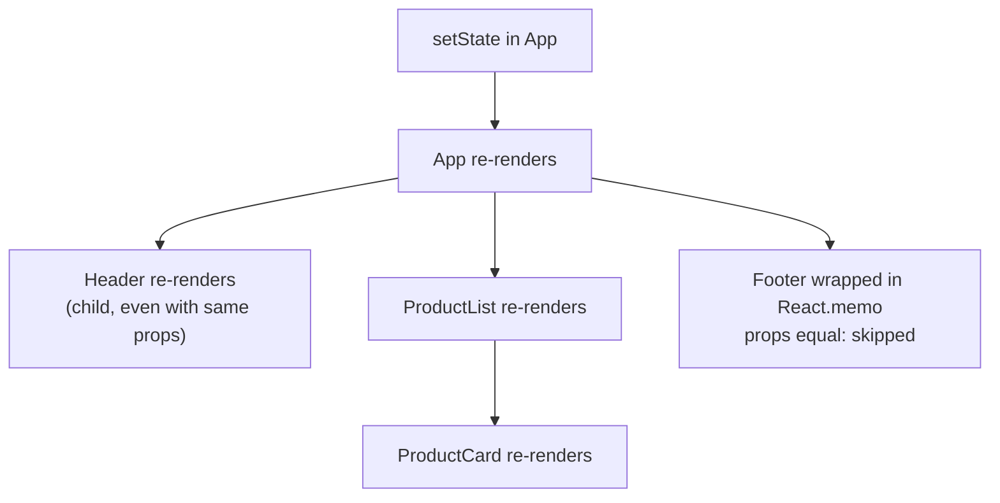
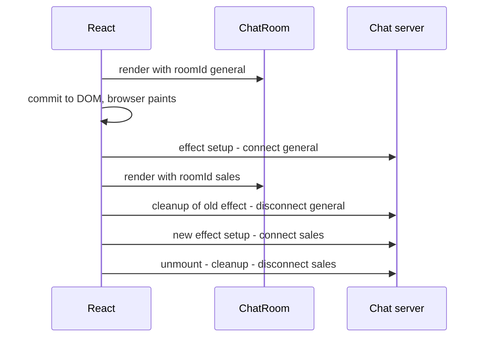

# React Essentials

> In this document you will learn the core ideas of React: components, JSX, props, state, rendering, keys, effects, refs, memoization, context, custom hooks and the newest features of React 18 and 19. Angular is the main framework in this repository, but many companies use React, and frontend interviews often ask React questions even for Angular roles. Knowing both also helps you explain *why* frameworks work the way they do.

**Before this:** [Closures](../02-javascript/05-closures.md) · [Components and state management](./06-components-and-state-management.md) · [DOM and events](./03-dom-and-events.md) · **Interview questions:** [jump to the interview section](#interview-questions)

## Table of contents

1. [What React is and the core mental model](#what-react-is-and-the-core-mental-model)
2. [JSX](#jsx)
3. [Function components and props](#function-components-and-props)
4. [State with useState](#state-with-usestate)
5. [Rendering and re-rendering rules](#rendering-and-re-rendering-rules)
6. [Lists keys and reconciliation](#lists-keys-and-reconciliation)
7. [Conditional rendering](#conditional-rendering)
8. [Events and forms controlled vs uncontrolled inputs](#events-and-forms-controlled-vs-uncontrolled-inputs)
9. [useEffect](#useeffect)
10. [useRef](#useref)
11. [useMemo useCallback and React.memo](#usememo-usecallback-and-reactmemo)
12. [useContext](#usecontext)
13. [Custom hooks and the rules of hooks](#custom-hooks-and-the-rules-of-hooks)
14. [Lifting state up in React](#lifting-state-up-in-react)
15. [Stale closures in hooks](#stale-closures-in-hooks)
16. [Data fetching patterns](#data-fetching-patterns)
17. [React 18 automatic batching and transitions](#react-18-automatic-batching-and-transitions)
18. [React 19 highlights](#react-19-highlights)
19. [React vs Angular](#react-vs-angular)
20. [How to explain this in an interview](#how-to-explain-this-in-an-interview)
21. [Interview questions](#interview-questions)
22. [Summary](#summary)
23. [References](#references)

> **Versions.** Examples use React 18/19 function components and hooks. Class components still exist in older code, but new code uses functions and hooks. Features that are new in React 19 (released December 2024) or 19.2 (October 2025) are labeled. React code needs a browser and a build tool, so it was not executed here; the pure JavaScript models of React behavior in this document were run with Node.js.

---

## What React is and the core mental model

### What it is

**React** is a JavaScript library for building user interfaces from **components**. It is a library, not a full framework: routing, data fetching and forms come from other libraries or from a framework built on React (Next.js, React Router in framework mode, Remix-style setups, Expo for mobile).

### The core idea: UI = f(state)

In React, you do not change the DOM by hand. You write a function that **describes** what the UI should look like for the current data. When the data (state) changes, React calls your function again and updates the DOM to match the new description.

```jsx
function Greeting({ name }) {
  return <h1>Hello, {name}!</h1>;
}
```

Compare with plain DOM code:

```js
// Imperative: you tell the browser each step
const h1 = document.createElement('h1');
h1.textContent = `Hello, ${name}!`;
container.append(h1);
// ...and later you must remember to update h1.textContent when name changes
```

React is **declarative**: you say *what* you want, and React figures out *how* to update the DOM.

### Analogy

React is like a GPS. You tell it the destination (the UI for the current state). You do not give turn-by-turn instructions. If something changes (the state), it recalculates the route (re-renders) and gives only the needed changes (DOM updates).

Where the analogy breaks: React recalculates only the components affected by the change, not the whole app, and only the differences are written to the DOM.

### How it works inside (short version)

1. Your component returns **React elements**: plain JavaScript objects that describe UI (`{ type: 'h1', props: { children: 'Hello' } }`). This tree of objects is often called the **virtual DOM**.
2. When state changes, React calls the affected components again and gets a new tree.
3. React **compares** the new tree with the previous one (**reconciliation**).
4. React applies the minimal changes to the real DOM (the **commit** phase).

React's internal engine (called **Fiber**) can split rendering work into pieces and pause it, which enables the concurrent features of React 18 (transitions).

---

## JSX

### What it is

**JSX** is a syntax extension that lets you write HTML-like markup inside JavaScript. It is not HTML and not a string. A compiler (Babel, esbuild, SWC, TypeScript) turns it into JavaScript function calls.

```jsx
const element = <h1 className="title">Hello</h1>;

// compiles to (modern "automatic" JSX runtime):
import { jsx as _jsx } from 'react/jsx-runtime';
const element = _jsx('h1', { className: 'title', children: 'Hello' });
```

### JSX rules

| Rule | Example |
| --- | --- |
| Return one root element (or a Fragment) | `<>...</>` or `<Fragment>` |
| Close every tag | ``, `<input />` |
| `className` instead of `class` | `<div className="card">` |
| `htmlFor` instead of `for` | `<label htmlFor="email">` |
| camelCase attributes and events | `onClick`, `tabIndex`, `aria-*` and `data-*` stay as they are |
| JavaScript expressions in `{}` | `{user.name}`, `{items.length}`, `{formatPrice(total)}` |
| `style` takes an object | `style={{ fontSize: 14, marginTop: '1rem' }}` |
| Components start with a capital letter | `<ProductCard />` (lowercase means an HTML tag) |

```jsx
function ProductCard({ product }) {
  const isOnSale = product.salePrice < product.price;
  return (
    <>
      <h2 className="product-title">{product.name}</h2>
      <p>
        {isOnSale ? <s>{product.price} EUR</s> : null} {product.salePrice} EUR
      </p>
      <label htmlFor={`qty-${product.id}`}>Quantity</label>
      <input id={`qty-${product.id}`} type="number" min={1} defaultValue={1} />
    </>
  );
}
```

### JSX escapes values (XSS protection)

Values inside `{}` are **escaped**: React inserts them as text, not HTML. This protects you from XSS by default.

```jsx
const comment = '';
<p>{comment}</p> // shows the text literally, no script runs ✅

// ❌ Dangerous: bypasses the protection. Only with trusted or sanitized HTML.
<p dangerouslySetInnerHTML={{ __html: comment }} />
```

Also be careful with URLs from users: `<a href={userUrl}>` with a `javascript:` URL is dangerous. See [Web security: XSS, CSRF, CORS, CSP](../10-testing-security-production/05-web-security-xss-csrf-cors-csp.md).

---

## Function components and props

### What it is

A **function component** is a JavaScript function that receives **props** (an object of inputs) and returns JSX.

```jsx
function Avatar({ user, size = 48 }) {   // destructuring with a default value
  return ;
}

// Usage: props are passed like attributes
<Avatar user={currentUser} size={32} />
```

### Props rules

- **Props are read-only.** A component must never change its props. React components must act like pure functions with respect to their props.
- Any value can be a prop: strings, numbers, objects, arrays, functions, JSX.
- **`children`** is a special prop: whatever you put between the opening and closing tags.

```jsx
function Panel({ title, children }) {
  return (
    <section className="panel">
      <h2>{title}</h2>
      {children}
    </section>
  );
}

<Panel title="Shipping address">
  <AddressForm />
</Panel>
```

- **Functions as props** are how children talk to parents (like Angular `@Output`):

```jsx
function DeleteButton({ onDelete }) {
  return <button type="button" onClick={onDelete}>Delete</button>;
}

<DeleteButton onDelete={() => removeItem(item.id)} />
```

```jsx
// ❌ Wrong: mutating props
function PriceTag({ product }) {
  product.price = product.price * 0.9; // changes the parent's object!
  return <span>{product.price}</span>;
}

// ✅ Correct: compute a new value
function PriceTag({ product }) {
  const discounted = product.price * 0.9;
  return <span>{discounted}</span>;
}
```

### Components must be pure during render

Rendering must only **calculate** JSX. It must not change outside variables, make API calls, or touch the DOM. Side effects belong in event handlers or effects. React may call your component more than once (for example in Strict Mode, or when a render is interrupted), so side effects in render cause bugs.

---

## State with useState

### What it is

**State** is data that a component remembers between renders and that, when changed, makes React re-render the component.

```jsx
import { useState } from 'react';

function Counter() {
  const [count, setCount] = useState(0); // [current value, setter function]
  return (
    <button type="button" onClick={() => setCount(count + 1)}>
      Clicked {count} times
    </button>
  );
}
```

Why not a normal variable? A local variable is recreated on every render (it starts at 0 again), and changing it does not tell React to re-render. `useState` solves both.

### Setting state does not change the variable immediately

The setter **schedules** a re-render with the new value. Inside the current render, `count` is a constant: a snapshot.

```jsx
function Counter() {
  const [count, setCount] = useState(0);

  function handleClick() {
    setCount(count + 1);
    console.log(count); // still 0 in this render (the old snapshot)
  }
  // ...
}
```

### Updater functions

If the next state depends on the previous state, pass a **function** to the setter. React calls it with the latest pending value.

```jsx
function handleClick() {
  setCount(count + 1);
  setCount(count + 1);
  setCount(count + 1);
  // count was 0 in this render, so all three say "set to 1" -> result: 1
}

function handleClickCorrect() {
  setCount((c) => c + 1);
  setCount((c) => c + 1);
  setCount((c) => c + 1);
  // each updater gets the result of the previous one -> result: 3
}
```

How React processes the queue of updates can be modeled in plain JavaScript (this model follows the explanation in the React docs and was run with Node.js):

```js
function processQueue(baseState, queue) {
  let state = baseState;
  for (const update of queue) {
    state = typeof update === 'function' ? update(state) : update; // value = replace, function = update
  }
  return state;
}

const count = 0;
console.log(processQueue(count, [count + 1, count + 1, count + 1]));          // 1
console.log(processQueue(count, [(c) => c + 1, (c) => c + 1, (c) => c + 1])); // 3
console.log(processQueue(count, [count + 5, (c) => c + 1]));                  // 6
console.log(processQueue(count, [count + 5, (c) => c + 1, 42]));              // 42
```

### Objects and arrays: update immutably

React decides whether state changed by comparing with `Object.is`. If you mutate an object and set the same object, React sees no change.

```jsx
const [cart, setCart] = useState({ items: [], coupon: null });

// ❌ Wrong: mutation, same reference -> React may skip the re-render
cart.items.push(newItem);
setCart(cart);

// ✅ Correct: new objects
setCart((prev) => ({ ...prev, items: [...prev.items, newItem] }));

// Update one item
setCart((prev) => ({
  ...prev,
  items: prev.items.map((item) => (item.id === id ? { ...item, qty: item.qty + 1 } : item)),
}));
```

Why immutability matters is explained in [Components and state management](./06-components-and-state-management.md#immutability).

### Lazy initial state

```jsx
// ❌ readDraftFromStorage() runs on EVERY render (the result is ignored after the first)
const [draft, setDraft] = useState(readDraftFromStorage());

// ✅ Pass a function: React calls it only on the first render
const [draft, setDraft] = useState(() => readDraftFromStorage());
```

### useReducer for complex state

When several state values change together, or the next state depends on many rules, `useReducer` keeps the logic in one pure function (the same reducer idea as Redux):

```jsx
function cartReducer(state, action) {
  switch (action.type) {
    case 'added':
      return { ...state, items: [...state.items, { ...action.item, qty: 1 }] };
    case 'removed':
      return { ...state, items: state.items.filter((i) => i.id !== action.id) };
    default:
      return state;
  }
}

function Cart() {
  const [state, dispatch] = useReducer(cartReducer, { items: [] });
  return <button type="button" onClick={() => dispatch({ type: 'added', item: demoItem })}>Add</button>;
}
```

---

## Rendering and re-rendering rules

### Render vs commit

- **Render:** React calls your component function to get JSX. This is pure calculation.
- **Commit:** React applies the differences to the DOM.

A re-render does **not** mean the DOM changes. If the JSX is the same, React commits nothing.

### When does a component re-render?

1. **Its own state changes** (a setter is called with a different value).
2. **Its parent re-renders.** By default, all children re-render too, **even if their props did not change**.
3. **A context it uses changes.**

A common wrong belief is "a component re-renders when its props change". The real rule is: it re-renders when its *parent* re-renders (which usually also means new props). `React.memo` changes this: a memoized component skips re-rendering when its props are shallowly equal.



### Setting the same value

If you call `setCount(5)` while `count` is already 5, React compares with `Object.is` and skips re-rendering the children. (React may still call the component itself once before bailing out, so do not rely on "the function is never called".)

`Object.is` compares references for objects: `Object.is({ a: 1 }, { a: 1 })` is `false`. That is why new objects always count as "changed".

### Rendering is cheap; unnecessary work is not

Re-rendering a few components is normally fast. Performance problems appear when:

- a big tree re-renders on every keystroke,
- a component does expensive calculations during render,
- a list of thousands of items re-renders.

Fixes: keep state close to where it is used (so fewer components re-render), split components, memoize (`React.memo`, `useMemo`), virtualize long lists. See [Web performance](./05-web-performance-and-core-web-vitals.md#runtime-performance).

---

## Lists keys and reconciliation

### Rendering lists

```jsx
function OrderList({ orders }) {
  return (
    <ul>
      {orders.map((order) => (
        <li key={order.id}>
          #{order.id}: {order.total} EUR
        </li>
      ))}
    </ul>
  );
}
```

### What a key is

A **key** is a stable, unique identifier for each item in a list, among its siblings. React uses keys to match items between the old and new render: "this `<li>` is the same order as before; it just moved."

### How reconciliation works

React compares the old and new trees with a few simple rules (this keeps the comparison fast, roughly linear in the number of elements):

1. **Different element type at the same position** (`<div>` → `<section>`, or `<ProductCard>` → `<ProductRow>`): React destroys the old subtree (including all its state) and creates a new one.
2. **Same type at the same position:** React keeps the DOM node and component instance (and its state) and only updates changed props.
3. **Lists:** React matches children by **key**. Same key = same item (update and maybe move it). New key = create. Missing key = remove.

### Why index as key is a problem

```jsx
// ❌ Risky: index as key
{todos.map((todo, index) => <TodoItem key={index} todo={todo} />)}
```

If you insert an item at the top, every item's index shifts. React thinks item 0 is still "item 0", so it reuses the wrong component instance. State inside items (an input's text, a checkbox, an "editing" flag) stays at the old position and appears next to the wrong todo.

Step by step:

1. List: `[Buy milk (key 0), Pay rent (key 1)]`. The user types a note into the input of "Buy milk".
2. A new todo "Call mom" is added at the top: `[Call mom (key 0), Buy milk (key 1), Pay rent (key 2)]`.
3. React sees key 0 still exists, so it keeps the component instance with the typed note, and gives it the props of "Call mom".
4. The typed note now appears next to "Call mom". Bug.

With `key={todo.id}`, React knows "Buy milk" moved, and the state moves with it.

Index keys are acceptable only when the list is static (never reordered, filtered or inserted into) and items have no state.

Also do not use `Math.random()` or `crypto.randomUUID()` *during render* as a key: a new key every render means React recreates every item every time (slow, and state is lost).

### Using a key to reset state

Because a new key means "a different component", you can use a key to **reset** a component's state on purpose:

```jsx
// When the selected user changes, the form starts fresh (no leftover typed values)
<EditUserForm key={selectedUser.id} user={selectedUser} />
```

---

## Conditional rendering

```jsx
function OrdersPanel({ status, orders, error }) {
  if (status === 'loading') return <Spinner />;           // early return
  if (status === 'error') return <ErrorMessage error={error} />;

  return (
    <div>
      {orders.length === 0 ? <EmptyState /> : <OrderTable orders={orders} />}  {/* ternary */}
      {orders.length > 0 && <ExportButton orders={orders} />}                   {/* && */}
    </div>
  );
}
```

### The `&&` with zero pitfall

```jsx
// ❌ Wrong: when items.length is 0, React renders the number "0" on the screen
{items.length && <ItemList items={items} />}

// ✅ Correct: use a real boolean
{items.length > 0 && <ItemList items={items} />}
```

Why: `0 && anything` evaluates to `0`, and React renders numbers. (`false`, `null` and `undefined` render nothing.) This was checked in Node.js: `[].length && 'LIST'` is `0`, while `[].length > 0 && 'LIST'` is `false`.

---

## Events and forms controlled vs uncontrolled inputs

### Event handlers

```jsx
function SaveButton({ onSave }) {
  function handleClick(event) {
    event.stopPropagation(); // React passes a SyntheticEvent with the usual methods
    onSave();
  }
  return <button type="button" onClick={handleClick}>Save</button>;
}

// ❌ Wrong: calls the function during render
<button onClick={onSave()}>Save</button>

// ✅ Correct: pass the function (or an arrow function)
<button onClick={onSave}>Save</button>
<button onClick={() => onSave(order.id)}>Save</button>
```

React attaches event listeners at the root container and dispatches them to your handlers (event delegation). The event object is a cross-browser wrapper around the native event (`event.nativeEvent` gives the original).

### Controlled inputs

A **controlled input** gets its value from React state, and every change goes through `onChange`. React state is the single source of truth.

```jsx
function SignupForm({ onSubmit }) {
  const [email, setEmail] = useState('');
  const [error, setError] = useState('');

  function handleSubmit(event) {
    event.preventDefault(); // stop the browser's full-page form submission
    if (!email.includes('@')) {
      setError('Enter a valid email address.');
      return;
    }
    onSubmit({ email });
  }

  return (
    <form onSubmit={handleSubmit} noValidate>
      <label htmlFor="email">Email</label>
      <input
        id="email"
        type="email"
        value={email}                                  // value comes from state
        onChange={(e) => setEmail(e.target.value)}     // every keystroke updates state
        aria-invalid={error ? 'true' : undefined}
        aria-describedby={error ? 'email-error' : undefined}
      />
      {error && <p id="email-error" role="alert">{error}</p>}
      <button type="submit">Sign up</button>
    </form>
  );
}
```

Pros: you can validate, format or restrict input on every keystroke, and the value is always available in state. Cons: a re-render on every keystroke (fine for most forms; large forms may need care).

```jsx
// ❌ Wrong: value without onChange -> the input is read-only (React warns)
<input value={email} />
```

### Uncontrolled inputs

An **uncontrolled input** keeps its own value in the DOM. You read it when you need it (on submit), with a ref or `FormData`.

```jsx
function SearchForm({ onSearch }) {
  function handleSubmit(event) {
    event.preventDefault();
    const formData = new FormData(event.currentTarget);
    onSearch(formData.get('query'));
  }
  return (
    <form onSubmit={handleSubmit}>
      <input name="query" defaultValue="" aria-label="Search products" /> {/* defaultValue, not value */}
      <button type="submit">Search</button>
    </form>
  );
}
```

| | Controlled | Uncontrolled |
| --- | --- | --- |
| Source of truth | React state | The DOM |
| Set initial value | `value` | `defaultValue` / `defaultChecked` |
| Read value | From state, any time | Ref or `FormData`, usually on submit |
| Instant validation and formatting | Easy | Harder |
| Re-renders while typing | Yes | No |
| Typical use | Interactive forms, dependent fields | Simple forms, file inputs (`<input type="file">` is always uncontrolled) |

Form libraries such as React Hook Form use uncontrolled inputs internally for performance. React 19 also adds form **Actions** (see [React 19 highlights](#react-19-highlights)).

---

## useEffect

### What it is

**`useEffect`** lets a component **synchronize with something outside React**: a network request, a subscription, a timer, the browser DOM API, a third-party widget, `document.title`.

```jsx
useEffect(() => {
  // setup: runs after React has committed the render to the screen
  return () => {
    // cleanup: runs before the next setup and when the component is removed
  };
}, [dependencies]);
```

### The dependency array

| Dependency array | When the effect runs |
| --- | --- |
| Not given | After **every** render |
| `[]` | Once after the first render (mount); cleanup on unmount |
| `[roomId, theme]` | After the first render, and again whenever `roomId` or `theme` changed (compared with `Object.is`) |

**Rule:** every reactive value used inside the effect (props, state, and variables or functions declared in the component) must be in the dependency array. The `react-hooks/exhaustive-deps` ESLint rule checks this. Do not silence it; fix the code instead.

### Example: subscribe and clean up

```jsx
function ChatRoom({ roomId }) {
  const [messages, setMessages] = useState([]);

  useEffect(() => {
    const connection = createConnection(roomId);
    connection.on('message', (msg) => setMessages((prev) => [...prev, msg]));
    connection.connect();

    return () => connection.disconnect(); // cleanup: leave the old room
  }, [roomId]); // re-run when the room changes

  return <MessageList messages={messages} />;
}
```



Step by step when `roomId` changes from `"general"` to `"sales"`:

1. React re-renders `ChatRoom` with the new prop and commits it.
2. React runs the **cleanup of the previous effect**: disconnects from `"general"`.
3. React runs the **new setup**: connects to `"sales"`.
4. When the component is removed, the cleanup runs one last time: disconnects from `"sales"`.

### Strict Mode runs effects twice in development

In development, when your app is wrapped in `<StrictMode>`, React mounts each component, **unmounts it, and mounts it again** right away. So you see setup → cleanup → setup. React does this on purpose, to reveal effects that are missing a cleanup. It does **not** happen in production builds.

If the double run breaks something (two connections, two analytics events, a duplicated item), the effect is missing a correct cleanup. Fix the cleanup; do not remove Strict Mode. Strict Mode also calls component functions, state initializers and reducers twice in development to find impure code.

### Common useEffect mistakes

**1. Missing dependencies (stale values).**

```jsx
// ❌ Wrong: uses `query` but does not list it. The effect keeps the first query forever.
useEffect(() => {
  fetchResults(query).then(setResults);
}, []);
```

**2. Object or function dependencies that change every render (infinite loops).**

```jsx
// ❌ Wrong: `options` is a new object on every render, so the effect runs after every render
function Products({ category }) {
  const options = { category, limit: 20 };
  useEffect(() => {
    fetchProducts(options).then(setProducts); // setProducts causes a re-render -> new options -> effect again...
  }, [options]);
}

// ✅ Correct: depend on primitive values, create the object inside the effect
useEffect(() => {
  fetchProducts({ category, limit: 20 }).then(setProducts);
}, [category]);
```

**3. Using an effect to compute derived state.**

```jsx
// ❌ Wrong: extra render, extra state, can get out of sync
const [fullName, setFullName] = useState('');
useEffect(() => {
  setFullName(`${firstName} ${lastName}`);
}, [firstName, lastName]);

// ✅ Correct: calculate during render
const fullName = `${firstName} ${lastName}`;
```

**4. Using an effect for event logic.** "When the user clicks Buy, send an analytics event" belongs in the click handler, not in an effect that watches some state.

**5. Fetching without handling races or unmounts.** See [Data fetching patterns](#data-fetching-patterns).

The React docs summarize this as "You might not need an effect": effects are for synchronizing with **external systems**. If there is no external system, you probably do not need one.

### useEffect vs useLayoutEffect

`useEffect` runs **after** the browser paints, so it does not block the screen. `useLayoutEffect` runs **after DOM changes but before the browser paints**. Use it only when you must measure the DOM and change something before the user sees it (for example, positioning a tooltip). It blocks painting, so overuse hurts performance.

---

## useRef

### What it is

**`useRef`** gives you a mutable object `{ current: value }` that **stays the same between renders**. Changing `ref.current` does **not** cause a re-render.

Two main uses:

**1. Access a DOM element.**

```jsx
function SearchBox() {
  const inputRef = useRef(null);
  return (
    <>
      <input ref={inputRef} aria-label="Search" />
      <button type="button" onClick={() => inputRef.current.focus()}>Focus search</button>
    </>
  );
}
```

**2. Remember a value that should not trigger rendering** (a timer id, the previous value, an `AbortController`, the latest callback).

```jsx
function Stopwatch() {
  const [elapsed, setElapsed] = useState(0);
  const intervalRef = useRef(null);

  function start() {
    if (intervalRef.current) return;
    intervalRef.current = setInterval(() => setElapsed((e) => e + 1), 1000);
  }
  function stop() {
    clearInterval(intervalRef.current);
    intervalRef.current = null;
  }
  useEffect(() => stop, []); // clear on unmount

  return (
    <p>
      {elapsed}s <button type="button" onClick={start}>Start</button>{' '}
      <button type="button" onClick={stop}>Stop</button>
    </p>
  );
}
```

| | `useState` | `useRef` |
| --- | --- | --- |
| Survives re-renders | Yes | Yes |
| Changing it re-renders | Yes | No |
| Value during render | A snapshot | Whatever was last assigned |
| Use for | Data shown in the UI | DOM nodes, timers, values not shown in the UI |

Do not read or write `ref.current` during rendering (except for lazy initialization). It makes rendering unpredictable. Use refs in event handlers and effects.

> **React 19:** function components receive `ref` as a normal prop, so `forwardRef` is no longer needed for new code. Ref callbacks can also return a cleanup function.

---

## useMemo useCallback and React.memo

These three tools are about **skipping work**. They are often overused.

### React.memo

**`React.memo`** wraps a component so it **skips re-rendering** when its props are shallowly equal to the previous props.

```jsx
const ProductRow = React.memo(function ProductRow({ product, onSelect }) {
  return (
    <tr onClick={() => onSelect(product.id)}>
      <td>{product.name}</td>
      <td>{product.price}</td>
    </tr>
  );
});
```

### useMemo

**`useMemo`** caches the **result of a calculation** between renders, and recalculates only when the dependencies change.

```jsx
const visibleProducts = useMemo(
  () => products.filter((p) => p.name.toLowerCase().includes(query.toLowerCase())).sort(byPrice),
  [products, query],
);
```

### useCallback

**`useCallback`** caches a **function** between renders. `useCallback(fn, deps)` is the same as `useMemo(() => fn, deps)`.

```jsx
const handleSelect = useCallback((id) => {
  setSelectedId(id);
}, []);
```

### Why `React.memo` alone often does nothing

```jsx
function ProductTable({ products }) {
  const [selectedId, setSelectedId] = useState(null);

  // ❌ A new function on every render -> ProductRow's props are "different" every time -> memo is useless
  const handleSelect = (id) => setSelectedId(id);

  // ✅ Same function between renders -> memoized rows can skip re-rendering
  const handleSelectStable = useCallback((id) => setSelectedId(id), []);

  return (
    <table>
      <tbody>
        {products.map((p) => <ProductRow key={p.id} product={p} onSelect={handleSelectStable} />)}
      </tbody>
    </table>
  );
}
```

`React.memo` compares props with `Object.is`. A new function, object or array literal created during render is never equal to the previous one. So `useCallback` and `useMemo` are mainly useful **together with** `React.memo`, or when the value is a dependency of another hook.

### When they actually help

| Use | When it helps | When it is wasted |
| --- | --- | --- |
| `useMemo` | The calculation is noticeably slow (measure it), or the result is passed to a memoized child or used as an effect dependency | Cheap calculations (adding a few numbers, small arrays) |
| `useCallback` | The function goes to a `React.memo` child or is an effect/hook dependency | The function is only used on a normal DOM element like `<button>` |
| `React.memo` | The component renders often with the same props and is expensive to render | Props change on almost every render anyway |

They are not free: they add memory, comparisons and code noise. Measure with the React DevTools Profiler first.

### The React Compiler

The **React Compiler** is a build-time tool that adds memoization automatically, so you need far fewer manual `useMemo`, `useCallback` and `React.memo` calls. Version 1.0 was released as stable in **October 2025**, and it works with React 17, 18 and 19 (React 19 needs no extra runtime package). It requires code that follows the Rules of React (pure components, hooks rules). In codebases using the compiler, manual memoization becomes the exception.

---

## useContext

### What it is

**Context** lets a parent provide a value to **any component below it** without passing props through every level. It solves prop drilling for values that many components need: theme, current user, locale, feature flags.

```jsx
import { createContext, useContext, useMemo, useState } from 'react';

const AuthContext = createContext(null);

export function AuthProvider({ children }) {
  const [user, setUser] = useState(null);

  // Memoize the value so consumers don't re-render when AuthProvider re-renders for other reasons
  const value = useMemo(() => ({
    user,
    login: async (credentials) => setUser(await api.login(credentials)),
    logout: () => setUser(null),
  }), [user]);

  return <AuthContext.Provider value={value}>{children}</AuthContext.Provider>;
}

export function useAuth() {
  const ctx = useContext(AuthContext);
  if (!ctx) throw new Error('useAuth must be used inside <AuthProvider>');
  return ctx;
}

// Any component below the provider
function UserMenu() {
  const { user, logout } = useAuth();
  return user ? <button type="button" onClick={logout}>Sign out {user.name}</button> : null;
}
```

> **React 19:** you can render `<AuthContext value={value}>` directly instead of `<AuthContext.Provider value={value}>`. `Context.Provider` still works and will be deprecated later. The new `use(AuthContext)` API can also read context, and unlike `useContext` it may be called inside conditions.

### Performance and limits

- **Every component that uses a context re-renders when its value changes** (compared with `Object.is`). A context with a big object that changes often (for example every keystroke) re-renders many components.
- Split contexts by how often they change (`ThemeContext` and `CartContext` instead of one `AppContext`).
- Memoize the provided value.
- Context is a **transport mechanism**, not a state manager. For large, frequently changing shared state, use a store library (Zustand, Redux Toolkit) that lets components subscribe to small slices, and a server-state library for API data. See [Components and state management](./06-components-and-state-management.md#when-a-store-is-worth-it).

---

## Custom hooks and the rules of hooks

### Custom hooks

A **custom hook** is a function whose name starts with `use` and that calls other hooks. It lets you reuse **stateful logic** (not state itself: each component that calls the hook gets its own state).

```jsx
// Debounce any changing value
function useDebouncedValue(value, delayMs = 300) {
  const [debounced, setDebounced] = useState(value);

  useEffect(() => {
    const id = setTimeout(() => setDebounced(value), delayMs);
    return () => clearTimeout(id); // a new value cancels the previous timer
  }, [value, delayMs]);

  return debounced;
}

// Usage
function ProductSearch() {
  const [query, setQuery] = useState('');
  const debouncedQuery = useDebouncedValue(query, 300);
  const { data, error, isLoading } = useProducts(debouncedQuery); // another custom hook
  // ...
}
```

```jsx
// Sync a piece of state with localStorage
function useLocalStorage(key, initialValue) {
  const [value, setValue] = useState(() => {
    try {
      const stored = localStorage.getItem(key);
      return stored !== null ? JSON.parse(stored) : initialValue;
    } catch {
      return initialValue; // storage blocked or invalid JSON
    }
  });

  useEffect(() => {
    try {
      localStorage.setItem(key, JSON.stringify(value));
    } catch {
      // ignore quota or privacy-mode errors
    }
  }, [key, value]);

  return [value, setValue];
}
```

Custom hooks are React's main way of sharing logic, similar to how Angular shares logic through services.

### The rules of hooks

1. **Call hooks only at the top level** of a component or custom hook. Not inside conditions, loops, nested functions or after an early `return`.
2. **Call hooks only from React function components or custom hooks**, not from normal functions or class components.

Why: React does not identify hooks by name. It identifies them by the **order** in which they are called during each render (first `useState`, second `useState`, first `useEffect`...). If a condition skips a hook in one render, every hook after it gets the wrong stored state.

```jsx
// ❌ Wrong: hook inside a condition
function Profile({ user }) {
  if (!user) return null;          // early return BEFORE a hook
  const [tab, setTab] = useState('info'); // called only sometimes -> order changes
}

// ✅ Correct: hooks first, conditions after
function Profile({ user }) {
  const [tab, setTab] = useState('info');
  if (!user) return null;
  // ...
}
```

The `eslint-plugin-react-hooks` plugin enforces these rules. (The new `use` API in React 19 is an exception: it can be called conditionally.)

---

## Lifting state up in React

The concept is explained framework-independently in [Components and state management](./06-components-and-state-management.md#state-ownership-and-lifting-state-up). In React it looks like this:

```jsx
function FilterableProductList({ products }) {
  // State lives in the closest common parent of SearchBar and ProductTable
  const [query, setQuery] = useState('');
  const [inStockOnly, setInStockOnly] = useState(false);

  const visible = products.filter(
    (p) => p.name.toLowerCase().includes(query.toLowerCase()) && (!inStockOnly || p.stock > 0),
  ); // derived during render, not stored

  return (
    <>
      <SearchBar
        query={query}
        onQueryChange={setQuery}
        inStockOnly={inStockOnly}
        onInStockOnlyChange={setInStockOnly}
      />
      <ProductTable products={visible} />
    </>
  );
}

function SearchBar({ query, onQueryChange, inStockOnly, onInStockOnlyChange }) {
  return (
    <form role="search" onSubmit={(e) => e.preventDefault()}>
      <input value={query} onChange={(e) => onQueryChange(e.target.value)} aria-label="Search products" />
      <label>
        <input type="checkbox" checked={inStockOnly} onChange={(e) => onInStockOnlyChange(e.target.checked)} />
        Only show products in stock
      </label>
    </form>
  );
}
```

`SearchBar` and `ProductTable` are siblings. Neither owns the filter state; the parent does. This is "data down, events up".

---

## Stale closures in hooks

### What it is

Every render creates **new functions** that close over the props and state **of that render** (see [Closures](../02-javascript/05-closures.md)). A **stale closure** is a function created in an old render that is still running and still sees the old values.

### Classic example: setInterval

```jsx
function Timer() {
  const [count, setCount] = useState(0);

  useEffect(() => {
    const id = setInterval(() => {
      setCount(count + 1); // ❌ `count` is always 0 here: this closure is from the first render
    }, 1000);
    return () => clearInterval(id);
  }, []); // the effect runs once, so the interval callback is never replaced

  return <p>{count}</p>; // shows 1 forever
}
```

Step by step:

1. First render: `count` is 0. The effect runs and creates the interval callback. It closes over `count = 0`.
2. After 1 second: the callback runs `setCount(0 + 1)`. The component re-renders with `count = 1`.
3. The effect does not run again (empty dependency array), so the old callback keeps running.
4. After 2 seconds: the callback runs `setCount(0 + 1)` again. `count` stays 1 forever.

The same behavior, modeled in plain JavaScript and run with Node.js (the "effect" keeps the closure from the first render):

```js
function makeRender() {
  let intervalCallback = null;
  return function render(count) {
    if (!intervalCallback) intervalCallback = () => count + 1; // created once, closes over the first count
    return intervalCallback;
  };
}

const render = makeRender();
let count = 0;
let callback = render(count);
count = callback(); console.log('after tick 1:', count); // after tick 1: 1
callback = render(count);
count = callback(); console.log('after tick 2:', count); // after tick 2: 1  (stale!)
```

### Fixes

```jsx
// ✅ Fix 1 (best here): updater function, no need to read `count`
useEffect(() => {
  const id = setInterval(() => setCount((c) => c + 1), 1000);
  return () => clearInterval(id);
}, []);

// ✅ Fix 2: list the dependency (the interval is recreated whenever count changes)
useEffect(() => {
  const id = setInterval(() => setCount(count + 1), 1000);
  return () => clearInterval(id);
}, [count]);

// ✅ Fix 3: keep the latest value or callback in a ref
const latestOnTick = useRef(onTick);
useEffect(() => { latestOnTick.current = onTick; });
useEffect(() => {
  const id = setInterval(() => latestOnTick.current(), 1000);
  return () => clearInterval(id);
}, []);
```

> **React 19.2:** `useEffectEvent` lets you extract "event-like" logic from an effect. The function always sees the latest props and state, and it does not need to be in the dependency array. It replaces many uses of the ref pattern (Fix 3).

Stale closures also happen in event handlers that run after an `await`, in debounced functions created once, and in subscriptions. The cure is always the same: read the latest value (updater function, ref, correct dependencies).

---

## Data fetching patterns

### Pattern 1: fetch in an effect (the manual way)

```jsx
function OrderDetails({ orderId }) {
  const [state, setState] = useState({ status: 'loading' });

  useEffect(() => {
    const controller = new AbortController();
    setState({ status: 'loading' });

    fetch(`/api/orders/${orderId}`, { signal: controller.signal })
      .then((res) => {
        if (!res.ok) throw new Error(`HTTP ${res.status}`);
        return res.json();
      })
      .then((order) => setState({ status: 'success', data: order }))
      .catch((error) => {
        if (error.name !== 'AbortError') setState({ status: 'error', error: error.message });
      });

    return () => controller.abort(); // cancels when orderId changes or on unmount
  }, [orderId]);

  if (state.status === 'loading') return <Spinner />;
  if (state.status === 'error') return <p role="alert">Could not load the order: {state.error}</p>;
  return <OrderView order={state.data} />;
}
```

Why the cleanup matters: if the user switches from order 1 to order 2 quickly, the response for order 1 could arrive last and overwrite order 2 (a race condition). The abort in the cleanup prevents it. In Strict Mode development, the first request is aborted immediately by the extra mount/unmount; that is expected.

Downsides of fetching in effects: no caching, no de-duplication, "waterfalls" (a child starts fetching only after its parent has finished), and repeated boilerplate. The details of robust fetching (errors, retries, caching) are in [API integration and data fetching](./07-api-integration-and-data-fetching.md).

### Pattern 2: a server-state library (recommended for most apps)

```jsx
function OrderDetails({ orderId }) {
  const { data, isPending, isError, error } = useQuery({
    queryKey: ['orders', orderId],
    queryFn: ({ signal }) => fetchJson(`/api/orders/${orderId}`, { signal }),
  });
  if (isPending) return <Spinner />;
  if (isError) return <p role="alert">{error.message}</p>;
  return <OrderView order={data} />;
}
```

TanStack Query, SWR or RTK Query handle caching, de-duplication, cancellation, retries and refetching for you.

### Pattern 3: framework-level data loading

Frameworks such as Next.js (App Router with React Server Components) or React Router (loaders) fetch data **on the server or before rendering the route**, which avoids client waterfalls and improves LCP. See [Rendering strategies](./09-rendering-strategies-csr-ssr-ssg.md).

### Pattern 4: Suspense and `use` (React 19)

`use(promise)` suspends the component until the promise resolves, and the nearest `<Suspense fallback={...}>` shows a fallback meanwhile. Important gotcha: **do not create the promise during render** in a client component (it would be a new promise on every render). The promise should come from a cache, a framework, or a parent (for example a Server Component).

```jsx
function Comments({ commentsPromise }) {   // the promise is created outside, e.g. by a framework or a cache
  const comments = use(commentsPromise);   // suspends until resolved
  return comments.map((c) => <p key={c.id}>{c.text}</p>);
}

<Suspense fallback={<p>Loading comments...</p>}>
  <Comments commentsPromise={commentsPromise} />
</Suspense>
```

---

## React 18 automatic batching and transitions

React 18 (March 2022) introduced the **concurrent renderer**. You opt in by creating the root with `createRoot`:

```jsx
import { createRoot } from 'react-dom/client';
createRoot(document.getElementById('root')).render(<App />);
// The old ReactDOM.render API is legacy (removed in React 19)
```

### Automatic batching

**Batching** means React groups several state updates into **one re-render**. Before React 18, batching happened only inside React event handlers. Updates inside `setTimeout`, promises or native event listeners caused one render per update. With `createRoot`, React 18 batches **everywhere**.

```jsx
async function handleSave() {
  const result = await api.save(form);
  setSaving(false);    // React 17 (legacy root): render #1
  setResult(result);   // React 17 (legacy root): render #2
  // React 18+ with createRoot: both updates are batched into ONE render
}
```

If you really need the DOM updated immediately (rare, for example before measuring), wrap the update in `flushSync` from `react-dom`.

### Transitions: urgent vs non-urgent updates

Some updates are **urgent** (typing in an input must feel instant). Others can wait a moment (re-filtering a list of 10,000 rows). A **transition** marks an update as non-urgent. React can interrupt rendering it to handle urgent updates first, which keeps the input responsive (good for INP).

```jsx
import { useState, useTransition } from 'react';

function ProductFilter({ products }) {
  const [query, setQuery] = useState('');
  const [filterText, setFilterText] = useState('');
  const [isPending, startTransition] = useTransition();

  function handleChange(e) {
    setQuery(e.target.value);              // urgent: the input updates immediately
    startTransition(() => {
      setFilterText(e.target.value);       // non-urgent: the big list can render a bit later
    });
  }

  const visible = products.filter((p) => p.name.toLowerCase().includes(filterText.toLowerCase()));

  return (
    <>
      <input value={query} onChange={handleChange} aria-label="Filter products" />
      {isPending && <span aria-live="polite">Updating...</span>}
      <ProductList products={visible} />
    </>
  );
}
```

`useDeferredValue(value)` is a related hook: it gives you a "lagging" copy of a value that React updates with lower priority. Use it when you do not control the code that sets the state.

Other React 18 additions: `useId` (stable unique ids for accessibility attributes, safe with SSR), `useSyncExternalStore` (for store libraries) and streaming server rendering with Suspense.

---

## React 19 highlights

React 19 was released as stable on **December 5, 2024**. React 19.2 followed in **October 2025**.

| Feature | Version | What it does |
| --- | --- | --- |
| **Actions** | 19 | Async functions used in transitions. React tracks the pending state, errors and optimistic updates for you. |
| `useActionState` | 19 | `const [state, formAction, isPending] = useActionState(action, initialState)`. Wraps an Action and gives you its result and pending state. (Replaces the earlier `useFormState`.) |
| `<form action={fn}>` | 19 (react-dom) | Forms, inputs and buttons accept a function as `action`/`formAction`. It runs as an Action with the `FormData`, and uncontrolled forms reset after success. |
| `useFormStatus` | 19 (react-dom) | A child of a `<form>` can read `{ pending }` of that form without props. |
| `useOptimistic` | 19 | Shows an optimistic value while an Action runs; React reverts it when the Action finishes or fails. |
| `use` | 19 | Reads a promise (suspends until resolved) or a context. Can be called conditionally. |
| `ref` as a prop | 19 | Function components get `ref` as a normal prop; `forwardRef` is no longer needed for new code. |
| `<Context value>` as provider | 19 | Render the context directly instead of `Context.Provider`. |
| Ref cleanup functions | 19 | A ref callback can return a cleanup function. |
| Document metadata | 19 | `<title>`, `<meta>` and `<link>` rendered in components are moved into `<head>`. |
| Resource preloading APIs | 19 (react-dom) | `preload`, `preinit`, `preconnect`, `prefetchDNS`. |
| Server Components and Server Actions | 19 (stable APIs, used through frameworks) | Components rendered on the server; client code can call server functions marked `'use server'`. |
| `<Activity>` | 19.2 | Hide part of the UI (`mode="hidden"`) while keeping its state, and render it at low priority. |
| `useEffectEvent` | 19.2 | Non-reactive "event" logic for effects (see [Stale closures](#stale-closures-in-hooks)). |
| React Compiler 1.0 | Separate build tool, stable October 2025 | Automatic memoization at build time. |

### Example: a form with Actions

```jsx
import { useActionState } from 'react';
import { useFormStatus } from 'react-dom';

function SubmitButton() {
  const { pending } = useFormStatus(); // reads the status of the parent <form>
  return <button type="submit" disabled={pending}>{pending ? 'Saving...' : 'Save'}</button>;
}

function ChangeNameForm({ currentName }) {
  const [error, submitAction, isPending] = useActionState(
    async (previousState, formData) => {
      const result = await updateName(formData.get('name'));
      if (!result.ok) return result.error;   // becomes the new `error` state
      return null;
    },
    null,
  );

  return (
    <form action={submitAction}>
      <label htmlFor="name">Name</label>
      <input id="name" name="name" defaultValue={currentName} />
      <SubmitButton />
      {error && <p role="alert">{error}</p>}
    </form>
  );
}
```

Compared with the classic version, there is no manual `isSaving` state, no `preventDefault`, and the form resets after success.

Also note: Create React App was deprecated in 2025. New React projects usually start with a framework (Next.js, React Router) or with Vite. See [Build tools and bundlers](./10-build-tools-and-bundlers.md).

---

## React vs Angular

| Topic | React | Angular (16) |
| --- | --- | --- |
| Type | UI library; you choose router, forms, data, state libraries | Full framework: router, forms, HTTP, DI, testing tools included |
| Language | JavaScript or TypeScript | TypeScript |
| Templates | JSX: markup inside JavaScript | HTML templates with Angular syntax (`*ngIf`, `*ngFor`, bindings) |
| Components | Functions + hooks | Classes with decorators (`@Component`) |
| Inputs / outputs | Props and callback props | `@Input()` and `@Output()` with `EventEmitter` |
| Local state | `useState`, `useReducer` | Class fields; signals (developer preview in v16) |
| Sharing logic | Custom hooks | Services with dependency injection |
| Shared state | Context, Zustand, Redux Toolkit | Services with RxJS/signals, NgRx |
| Change detection | Re-render when state changes (setter call), compare virtual DOM | Zone.js triggers checks after async events; template bindings are compared; `OnPush` to limit |
| Data binding | One-way; value + `onChange` | One-way, plus `[(ngModel)]` as sugar for input + output |
| Side effects | `useEffect` | Lifecycle hooks (`ngOnInit`, `ngOnDestroy`), RxJS |
| Async model | Promises, async/await | RxJS observables (plus promises) |
| Forms | Controlled/uncontrolled inputs, libraries (React Hook Form), Actions in 19 | Template-driven and reactive forms built in |
| Styling | Your choice (CSS Modules, Tailwind, CSS-in-JS) | Component styles with view encapsulation |
| SSR | Next.js and other frameworks, Server Components | Angular Universal in v16; `@angular/ssr` from v17 |
| Learning curve | Small core, but many ecosystem choices | Larger framework to learn, but consistent structure |
| Good fit | Flexible stacks, many ecosystem options, React Native for mobile | Large enterprise apps that value one consistent, batteries-included structure |

Both use components, one-way data flow, immutable updates for efficient change detection, and lazy loading. If you understand the concepts in one, you can learn the other quickly. Angular details are in the [Angular 16 section](../06-angular-16/01-angular-fundamentals.md), especially [Change detection and signals](../06-angular-16/10-change-detection-and-signals.md).

---

## How to explain this in an interview

Use this when asked "How does React work?" or "Explain useEffect".

1. **Define it:** "React is a library for building UIs from components. A component is a function that takes props and returns JSX describing the UI for the current state."
2. **Why it exists:** "Updating the DOM by hand gets messy as apps grow. React lets me describe the UI declaratively, and it figures out the minimal DOM changes."
3. **How it works:** "When state changes through a setter, React re-renders that component and its children, builds a new element tree, compares it with the previous one using element types and keys, and commits only the differences to the DOM. Effects run after the commit to sync with external systems."
4. **Small example:** "A counter: `useState(0)` gives me `count` and `setCount`. Clicking calls `setCount(c => c + 1)`. React re-renders and the button shows the new number. If I call `setCount(count + 1)` three times in one handler, I only get +1, because `count` is a snapshot of that render."
5. **Where it is useful:** "Keys keep list items' state correct, custom hooks share logic, context avoids prop drilling, and transitions keep typing responsive while a big list updates."
6. **Trade-offs / gotchas:** "Effects need correct dependencies and cleanups, or you get stale closures, race conditions and leaks; Strict Mode runs them twice in development to expose that. Memoization helps only when measured, and the React Compiler now automates most of it."

---

## Interview questions

### Q1. What is the virtual DOM, and how does reconciliation work?

**What the interviewer is checking:** Real understanding of how React updates the DOM, beyond "virtual DOM is faster".

**Short spoken answer (30–60 seconds):**
> "When a component renders, it returns React elements, which are plain JavaScript objects describing the UI. That tree is often called the virtual DOM. When state changes, React renders again and gets a new tree, then compares it with the previous one. That's reconciliation. It uses simple rules: if the element type at a position changed, it throws away that subtree and builds a new one; if the type is the same, it keeps the DOM node and component state and only updates changed props; and for lists it matches children by key. Then it commits only the differences to the real DOM. The point isn't that the virtual DOM is magically fast; it's that you can write declarative code and React keeps DOM updates minimal."

**Follow-up questions:**
- **Is the virtual DOM always faster than direct DOM manipulation?** — No. Carefully written manual DOM updates can be faster. React's value is a simpler programming model with good-enough performance, and the ability to schedule work (concurrent rendering).
- **Why doesn't React do a full tree diff?** — A general tree diff is very expensive. React's heuristics (type changes replace subtrees; keys identify list items) make it roughly linear in the number of elements.
- **What is Fiber?** — React's internal reconciliation engine since React 16. It represents work as units that can be paused, prioritized and resumed, which enables transitions and Suspense.

**Common mistakes:** Saying React "re-renders the whole DOM". Not mentioning keys and types.

**Where this is used in real projects:** Understanding why keys and stable component types matter, and why state is lost when a component's type changes.

### Q2. Output prediction: what does the button show after one click?

```jsx
function Counter() {
  const [count, setCount] = useState(0);
  function handleClick() {
    setCount(count + 1);
    setCount(count + 1);
    setCount(count + 1);
    console.log(count);
  }
  return <button onClick={handleClick}>{count}</button>;
}
```

**Answer:** The console logs `0`, and after the re-render the button shows `1`.

**Step by step:**

1. In this render, `count` is the constant `0` (a snapshot).
2. Each `setCount(count + 1)` queues "replace with 1". Three times "replace with 1" is still 1.
3. `console.log(count)` prints the snapshot: `0`. State updates are not applied immediately.
4. React batches the three updates into one re-render. In the next render, `count` is `1`.

With `setCount((c) => c + 1)` three times, the result is `3`, because each updater receives the result of the previous one. The queue logic is modeled and verified with Node.js in [State with useState](#state-with-usestate). (React behavior from the official docs; the model reproduces it.)

**Follow-up questions:**
- **What does `setCount(count + 5); setCount((c) => c + 1);` give, starting from 0?** — `6`. The first queues "replace with 5", the updater then adds 1.
- **And `setCount(count + 5); setCount((c) => c + 1); setCount(42);`?** — `42`. The last update replaces whatever came before.

### Q3. When does a React component re-render?

**What the interviewer is checking:** The precise rules, especially the "parent re-render" rule.

**Short spoken answer (30–60 seconds):**
> "A component re-renders in three cases: its own state changes, its parent re-renders, or a context it reads changes. The parent case surprises people: by default a child re-renders whenever its parent renders, even if its props didn't change. `React.memo` changes that by skipping the render when props are shallowly equal. Also, a re-render doesn't mean a DOM update: React only commits what actually changed. And if I set state to the same value, compared with `Object.is`, React bails out."

**Follow-up questions:**
- **How do you find unnecessary re-renders?** — The React DevTools Profiler shows which components rendered and why, and how long each took. Then fix the biggest ones: move state down, split components, memoize.
- **Why is "keep state close to where it's used" a performance tip?** — A state change re-renders the owner and its subtree. State owned high up causes large subtrees to re-render.

**Common mistakes:** "It re-renders when props change" (incomplete). Thinking re-render means slow DOM work.

**Where this is used in real projects:** Performance tuning of forms, dashboards and large lists.

### Q4. Why are keys important in lists? Why is using the index a problem?

**What the interviewer is checking:** Reconciliation in practice and state bugs.

**Short spoken answer (30–60 seconds):**
> "Keys tell React which list item is which between renders, so it can keep the right component instance and state for each item, and move, add or remove items efficiently. If I use the array index as the key and insert or remove or sort items, the indexes shift, so React matches the wrong instances: state like typed input text or a checked checkbox ends up next to the wrong item, and React updates more DOM than needed. I use a stable unique id from the data. Index keys are only fine for static lists without state. Never generate random keys during render, because then every item is recreated each time."

**Code:** See the step-by-step in [Lists keys and reconciliation](#lists-keys-and-reconciliation).

**Follow-up questions:**
- **How can a key reset a component's state?** — Changing the key makes React treat it as a different component, so it unmounts the old one and mounts a fresh one. Example: `<EditUserForm key={user.id} />` resets the form when another user is selected.
- **Do keys need to be globally unique?** — No, only unique among siblings in the same list.

**Where this is used in real projects:** Todo lists, sortable tables, chat messages, drag-and-drop lists.

### Q5. Explain `useEffect`: dependencies, cleanup and common mistakes.

**What the interviewer is checking:** The most error-prone hook.

**Short spoken answer (30–60 seconds):**
> "`useEffect` synchronizes a component with something outside React, like a subscription, a timer or a network request. It runs after React commits the render. The dependency array controls when it re-runs: no array means after every render, an empty array means once after mount, and with values it re-runs when any of them changes. The effect can return a cleanup function that runs before the next run and on unmount, for example to unsubscribe, clear a timer or abort a fetch. Common mistakes are missing dependencies, which cause stale values; objects or functions created during render as dependencies, which cause infinite loops; using an effect to compute derived state, which should just be calculated during render; and fetching without cleanup, which causes race conditions."

**Follow-up questions:**
- **Why does my effect run twice in development?** — Strict Mode mounts, unmounts and mounts components again in development to check that effects clean up correctly. It doesn't happen in production. Fix the cleanup rather than removing Strict Mode.
- **`useEffect` vs `useLayoutEffect`?** — `useEffect` runs after paint and doesn't block it. `useLayoutEffect` runs before paint, for measuring the DOM and adjusting layout without flicker. Use it rarely.
- **How do you run code when a value changes, but not on mount?** — Often you shouldn't: put the logic in the event handler that changes the value. If you really need it, keep a ref that tracks whether it's the first run.

**Common mistakes:** Disabling the exhaustive-deps lint rule. Using effects as "watchers" for everything.

**Where this is used in real projects:** WebSocket subscriptions, timers, syncing with `document.title`, integrating non-React widgets (maps, charts).

### Q6. Find the bug: why does this timer stop at 1?

```jsx
function Timer() {
  const [seconds, setSeconds] = useState(0);
  useEffect(() => {
    const id = setInterval(() => setSeconds(seconds + 1), 1000);
    return () => clearInterval(id);
  }, []);
  return <p>{seconds}s</p>;
}
```

**What the interviewer is checking:** Stale closures.

**Short spoken answer (30–60 seconds):**
> "It's a stale closure. The effect runs only once because of the empty dependency array, so the interval callback is created in the first render and closes over `seconds = 0`. Every second it calls `setSeconds(0 + 1)`, so the value stays 1. The best fix is the updater function, `setSeconds(s => s + 1)`, which doesn't read the captured variable at all. Alternatives are adding `seconds` to the dependencies, which recreates the interval each time, or keeping the latest value in a ref. In React 19.2 there's also `useEffectEvent` for this kind of logic."

**Code:** See [Stale closures in hooks](#stale-closures-in-hooks), including a plain JavaScript model run with Node.js.

**Follow-up questions:**
- **Where else do stale closures appear?** — Debounced or throttled callbacks created once, event listeners added in an effect, callbacks after `await`, and subscriptions that read state.

### Q7. When should you use `useMemo`, `useCallback` and `React.memo`?

**What the interviewer is checking:** Avoiding cargo-cult memoization.

**Short spoken answer (30–60 seconds):**
> "`React.memo` skips re-rendering a component when its props are shallowly equal. `useMemo` caches a calculated value and `useCallback` caches a function between renders. They work together: a memoized child only skips rendering if the objects and functions I pass are stable, which is what `useMemo` and `useCallback` give me. I use them when there's a measured problem: an expensive calculation, an expensive child that re-renders with the same props, or a value used as an effect dependency. Otherwise they just add overhead and noise. With the React Compiler, which reached 1.0 in October 2025, most of this memoization is added automatically."

**Follow-up questions:**
- **Does `useMemo` guarantee the value is never recomputed?** — No. It is a performance hint; React may throw away the cache (for example in development or for offscreen components). Code must still be correct without it.
- **Why is passing `style={{ color: 'red' }}` to a memoized child a problem?** — It is a new object on every render, so the shallow comparison always fails. Move constant objects outside the component or memoize them.

**Common mistakes:** Wrapping every function in `useCallback`. Memoizing cheap calculations.

**Where this is used in real projects:** Large tables, charts, virtualized lists, context provider values.

### Q8. What is the difference between controlled and uncontrolled inputs?

**Short answer:** A controlled input gets its value from React state (`value` + `onChange`), so React is the single source of truth: you can validate or format on every keystroke, but it re-renders on each change. An uncontrolled input keeps its value in the DOM; you set an initial `defaultValue` and read the value with a ref or `FormData`, usually on submit. Controlled suits interactive forms with dependent fields; uncontrolled suits simple forms and file inputs (which are always uncontrolled). Setting `value` without `onChange` makes a read-only input; switching an input between controlled and uncontrolled (for example `value` going from `undefined` to a string) triggers a React warning. See [Events and forms](#events-and-forms-controlled-vs-uncontrolled-inputs).

### Q9. What are the rules of hooks, and why do they exist?

**What the interviewer is checking:** Understanding of how hooks are implemented.

**Short spoken answer (30–60 seconds):**
> "Hooks must be called at the top level of a function component or custom hook, never inside conditions, loops, nested functions or after an early return, and only from React functions. The reason is that React doesn't know hooks by name. It stores each component's hook state in a list and matches hooks by the order of calls in each render. If a condition skips a hook in one render, all following hooks read the wrong state. The ESLint plugin for hooks enforces the rules. The one exception is React 19's `use` API, which can be called conditionally."

**Follow-up questions:**
- **How do you run a hook conditionally then?** — Put the condition inside the hook (for example inside the effect body), or split the conditional part into its own component that is rendered conditionally.

### Q10. What is a custom hook? Write one.

**What the interviewer is checking:** Logic reuse and practical hook skills.

**Short spoken answer (30–60 seconds):**
> "A custom hook is a function starting with `use` that calls other hooks, so I can reuse stateful logic across components. Each component that calls it gets its own independent state; it shares logic, not state. For example, `useDebouncedValue` keeps a debounced copy of a value: it stores it in state and uses an effect with a `setTimeout`, and the cleanup clears the timer when the value changes, so it only updates after the user stops typing."

**Code:** See `useDebouncedValue` and `useLocalStorage` in [Custom hooks and the rules of hooks](#custom-hooks-and-the-rules-of-hooks).

**Follow-up questions:**
- **Two components call `useLocalStorage('theme')`. Do they share state?** — No. Each has its own `useState`. They read the same initial value, but updates in one don't update the other unless you add syncing (the `storage` event or a shared store via `useSyncExternalStore`).
- **Custom hook vs utility function?** — If it doesn't call any hooks, it should be a normal function, not a hook.

**Where this is used in real projects:** `useAuth`, `useDebounce`, `useMediaQuery`, `useOnClickOutside`, `useFetch`/`useQuery` wrappers.

### Q11. How does context work, and what are its performance pitfalls?

**Short answer:** A provider supplies a value, and any descendant reads it with `useContext` (or `use` in React 19), avoiding prop drilling. Every consumer re-renders when the provided value changes by `Object.is`. Pitfalls: passing a new object literal as the value on every render (memoize it with `useMemo`), putting frequently changing data in one big context (split contexts by update frequency), and using context as a full state manager for large, fast-changing state (use a store with selector subscriptions instead). See [useContext](#usecontext).

### Q12. How do you fetch data in React correctly?

**What the interviewer is checking:** Race conditions, cleanup and modern options.

**Short spoken answer (30–60 seconds):**
> "If I fetch in `useEffect`, I put the request parameters in the dependencies, track loading, error and success states, and return a cleanup that aborts the request with an `AbortController`, or sets an ignore flag. That prevents race conditions when the parameters change quickly and state updates after unmount. But effects don't give caching or de-duplication, so in real apps I prefer a server-state library like TanStack Query, or framework-level loading in Next.js or React Router, which can also fetch on the server and avoid client waterfalls. In React 19, `use` with Suspense can read a promise, but the promise must be created outside render, for example by a framework or a cache."

**Code:** See [Data fetching patterns](#data-fetching-patterns).

**Follow-up questions:**
- **What is a request waterfall?** — A parent fetches, renders, then a child starts its own fetch only after that, and so on. The requests run one after another instead of in parallel. Fix by fetching in parallel higher up, or with route loaders and server components.

### Q13. What did React 18 change? Explain automatic batching and transitions.

**What the interviewer is checking:** Awareness of concurrent React.

**Short spoken answer (30–60 seconds):**
> "React 18 introduced the concurrent renderer, enabled with `createRoot`. Automatic batching means several state updates are grouped into one re-render everywhere, also inside promises, timeouts and native event handlers, not only inside React event handlers as before. Transitions let me mark an update as non-urgent with `startTransition` or `useTransition`: React can interrupt that rendering to handle urgent updates like typing, so the input stays responsive while a big list re-renders. `useDeferredValue` is the related hook for deferring a value. React 18 also added `useId` and streaming SSR with Suspense."

**Follow-up questions:**
- **How do you opt out of batching?** — `flushSync(() => setState(...))` from `react-dom` forces an immediate synchronous update. Use it rarely.
- **Does a transition make the calculation faster?** — No. It makes the UI more responsive by giving urgent updates priority and letting React drop outdated renders.

### Q14. What are the main new features in React 19?

**Short answer:**

- **Actions:** async functions in transitions, with automatic pending and error handling. Related APIs: `useActionState`, `<form action={fn}>`, `useFormStatus` (react-dom) and `useOptimistic`.
- **The `use` API** for reading promises and context.
- **Simpler refs and context:** `ref` is a regular prop (no `forwardRef` for new code), `<Context>` works as a provider, and ref callbacks can return a cleanup function.
- **Document and resources:** `<title>` and `<meta>` tags are hoisted to `<head>`, and there are resource preloading APIs.
- **Server Components and Server Actions** APIs are stable for frameworks.

React 19.2 (October 2025) added `<Activity>` and `useEffectEvent`. The React Compiler (a separate build tool) reached 1.0 in October 2025 and automates memoization. See [React 19 highlights](#react-19-highlights).

### Q15. Output prediction: what renders when the cart is empty?

```jsx
function CartSummary({ items }) {
  return <div>{items.length && <p>You have {items.length} items</p>}</div>;
}
<CartSummary items={[]} />
```

**Answer:** The page shows `0` inside the div.

**Explanation:** `items.length` is `0`, and `0 && <p>...</p>` evaluates to `0` (the first falsy value). React renders numbers, so "0" appears. `false`, `null` and `undefined` render nothing. Fix: `items.length > 0 && ...` or a ternary. (Checked in Node.js: `[].length && 'LIST'` evaluates to `0`.)

### Q16. React vs Angular: how would you compare them?

**What the interviewer is checking:** Balanced, informed comparison (important for an Angular developer in a React interview, or vice versa).

**Short spoken answer (30–60 seconds):**
> "React is a UI library: components are functions with hooks, templates are JSX, and you pick your own router, forms, data and state libraries. Angular is a full framework with TypeScript, class components, HTML templates, dependency injection, router, forms, HttpClient and testing built in. React re-renders when you call a state setter and diffs a virtual DOM; Angular, in version 16, uses Zone.js to trigger change detection after async events and checks template bindings, with OnPush to limit work, and signals arriving as a new model. Both use components, one-way data flow and immutable updates. React gives flexibility and a huge ecosystem; Angular gives consistency, which large enterprise teams often value."

**Follow-up questions:**
- **What is the Angular equivalent of a custom hook?** — Mostly a service injected with DI (and, in newer Angular, composable functions using `inject()` and signals).
- **What is the React equivalent of `ngOnDestroy`?** — The cleanup function returned from `useEffect`.

**Where this is used in real projects:** Choosing a stack, migrating teams, working in companies that use both.

### Q17. Scenario: typing in a search input is laggy because a big list re-renders on every keystroke. What do you do?

**What the interviewer is checking:** Practical performance options in React.

**Short spoken answer (30–60 seconds):**
> "First I'd confirm with the React Profiler what is slow. Then options, from simplest: make sure the list items have stable keys and are memoized with `React.memo` and stable props; move the input state down so only the input and the list re-render, not the whole page; mark the filtering update as non-urgent with `useTransition` or use `useDeferredValue` for the query, so typing stays responsive; debounce the filter if it calls the server; memoize the filtered result with `useMemo` if the filtering itself is expensive; and virtualize the list if it has thousands of rows."

**Follow-up questions:**
- **Which of these improves INP the most?** — Usually transitions/deferred value plus virtualization, because they keep the main thread free for the input event and shrink the rendering work. See [Web performance](./05-web-performance-and-core-web-vitals.md#inp-interaction-to-next-paint).

### Q18. What does Strict Mode do?

**Short answer:** `<StrictMode>` is a development-only tool. It renders components twice (and calls state initializers and reducers twice) to expose impure rendering, runs effects setup → cleanup → setup once on mount to expose missing cleanups, and warns about deprecated APIs. It has no effect in production builds. If something breaks under Strict Mode (for example a duplicated subscription), the component has a real bug that would also appear in situations like remounting, Fast Refresh or `<Activity>`.

---

## Summary

- React builds UIs from components: functions that take **props** and return **JSX**. UI = f(state).
- JSX compiles to function calls, escapes values by default (XSS protection), and has rules like `className`, one root, and camelCase attributes.
- **State** (`useState`) is a snapshot per render. Setters schedule a re-render; use **updater functions** when the next state depends on the previous one; update objects and arrays immutably.
- A component re-renders when its state changes, its parent re-renders, or a context it uses changes. Re-render ≠ DOM update.
- **Reconciliation** compares element types and **keys**. Use stable ids as keys; index keys break item state when the list changes.
- **`useEffect`** synchronizes with external systems; list all dependencies, always clean up, and do not use it for derived state. Strict Mode runs effects twice in development to find missing cleanups.
- **`useRef`** keeps mutable values and DOM nodes without re-rendering.
- `useMemo`, `useCallback` and `React.memo` skip work only when measured to help; the React Compiler (1.0, October 2025) automates memoization.
- **Context** avoids prop drilling but re-renders all consumers on change; custom hooks share logic; the rules of hooks exist because hooks are tracked by call order.
- **Stale closures** come from functions created in old renders; fix with updater functions, correct dependencies, refs or `useEffectEvent` (19.2).
- React 18: automatic batching and transitions. React 19: Actions, `useActionState`, `useOptimistic`, `use`, ref as a prop, metadata in components.

## References

- React — Quick Start and Learn React: https://react.dev/learn
- React — State as a Snapshot: https://react.dev/learn/state-as-a-snapshot
- React — Queueing a Series of State Updates: https://react.dev/learn/queueing-a-series-of-state-updates
- React — Render and Commit: https://react.dev/learn/render-and-commit
- React — Preserving and Resetting State: https://react.dev/learn/preserving-and-resetting-state
- React — Rendering Lists (keys): https://react.dev/learn/rendering-lists
- React — Synchronizing with Effects: https://react.dev/learn/synchronizing-with-effects
- React — You Might Not Need an Effect: https://react.dev/learn/you-might-not-need-an-effect
- React — Rules of Hooks: https://react.dev/reference/rules/rules-of-hooks
- React — `useMemo`, `useCallback`, `memo`: https://react.dev/reference/react/useMemo, https://react.dev/reference/react/useCallback, https://react.dev/reference/react/memo
- React — `StrictMode`: https://react.dev/reference/react/StrictMode
- React — `useTransition`: https://react.dev/reference/react/useTransition
- React — React v18.0 release post: https://react.dev/blog/2022/03/29/react-v18
- React — React v19 release post: https://react.dev/blog/2024/12/05/react-19
- React — React 19.2 release post: https://react.dev/blog/2025/10/01/react-19-2
- React — React Compiler v1.0: https://react.dev/blog/2025/10/07/react-compiler-1
- React — Sunsetting Create React App: https://react.dev/blog/2025/02/14/sunsetting-create-react-app
