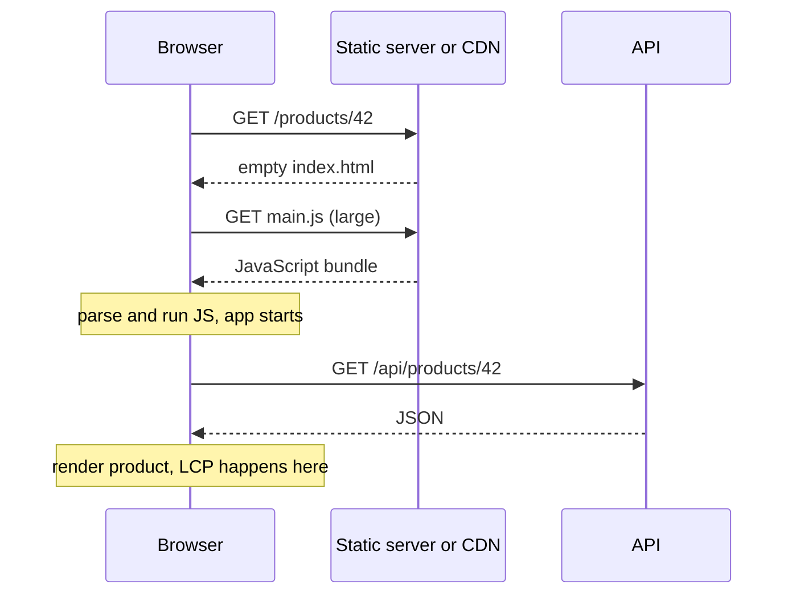
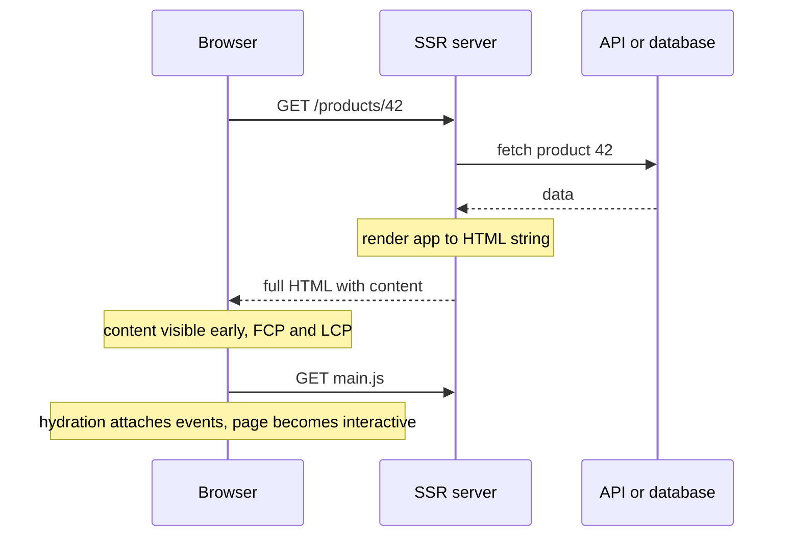
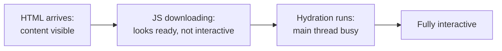
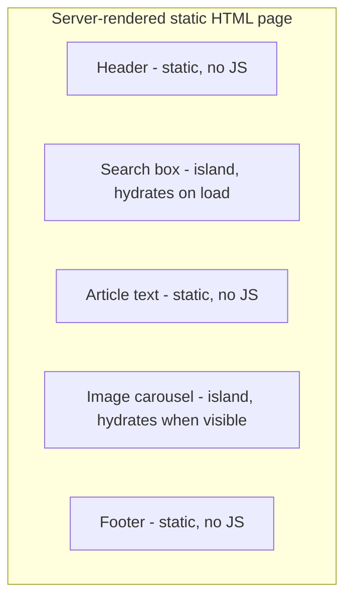
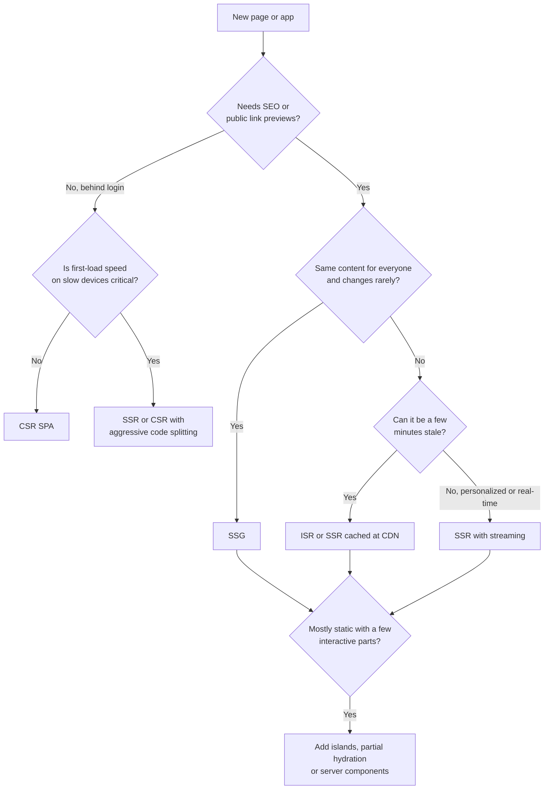

# Rendering Strategies: CSR, SSR, SSG and More

> In this document you will learn where and when the HTML of a web page is created: in the browser (CSR), on the server for each request (SSR), at build time (SSG), or in mixed ways (ISR, streaming, islands, server components). You will learn what hydration costs, how Angular 16 and newer Angular versions do SSR, and how to choose a strategy for a dashboard, a blog, an e-commerce site or an admin portal. "Would you use SSR for this?" is a common senior frontend and system design question.

**Before this:** [Browser architecture and rendering](../01-cs-and-web-fundamentals/07-browser-architecture-and-rendering.md) · [Web performance and Core Web Vitals](./05-web-performance-and-core-web-vitals.md) · **Interview questions:** [jump to the interview section](#interview-questions)

## Table of contents

1. [The core question where and when is HTML made](#the-core-question-where-and-when-is-html-made)
2. [Client-side rendering CSR](#client-side-rendering-csr)
3. [Server-side rendering SSR](#server-side-rendering-ssr)
4. [Hydration and its cost](#hydration-and-its-cost)
5. [Static site generation SSG](#static-site-generation-ssg)
6. [Incremental static regeneration ISR](#incremental-static-regeneration-isr)
7. [Streaming SSR](#streaming-ssr)
8. [Partial hydration and islands](#partial-hydration-and-islands)
9. [Resumability](#resumability)
10. [React Server Components](#react-server-components)
11. [Edge rendering](#edge-rendering)
12. [Angular SSR in v16 and newer versions](#angular-ssr-in-v16-and-newer-versions)
13. [SEO implications](#seo-implications)
14. [Performance trade-offs](#performance-trade-offs)
15. [Choosing a strategy](#choosing-a-strategy)
16. [Common mistakes and best practices](#common-mistakes-and-best-practices)
17. [How to explain this in an interview](#how-to-explain-this-in-an-interview)
18. [Interview questions](#interview-questions)
19. [Summary](#summary)
20. [References](#references)

---

## The core question where and when is HTML made

Every page the user sees is HTML in the end. A **rendering strategy** answers two questions:

1. **Where** is the HTML created? In the browser (client) or on a server?
2. **When** is it created? At build time, at request time, or after the page loads in the browser?

| Strategy | Where | When | One-line idea |
| --- | --- | --- | --- |
| **CSR** Client-side rendering | Browser | After the JavaScript loads | Send an empty shell + JavaScript; the browser builds the page |
| **SSR** Server-side rendering | Server | On every request | The server builds full HTML per request; the browser then hydrates it |
| **SSG** Static site generation | Build machine | At build time | Build all HTML files once; serve them from a CDN |
| **ISR** Incremental static regeneration | Server | At build time, then re-generated in the background | Static pages that refresh themselves after some time |
| **Streaming SSR** | Server | On request, sent in pieces | Send the page shell first, the slow parts later |

You can mix them in one app: static marketing pages, server-rendered product pages, and a client-rendered account area.

### Analogy: a restaurant

- **CSR:** you get the ingredients and a recipe (JavaScript) and cook at your table. It takes a while before you can eat, but after that you can change the dish easily.
- **SSR:** the kitchen cooks each dish when you order it. You get a ready plate quickly, but the kitchen works for every order.
- **SSG:** the dishes are cooked in the morning and kept ready. Instant service, but the menu cannot be personalized and changes need a new batch.
- **ISR:** pre-cooked dishes, but the kitchen quietly cooks a fresh batch when the old one gets too old.

---

## Client-side rendering CSR

### How it works

The server sends a nearly empty HTML file and a JavaScript bundle. The JavaScript runs in the browser, fetches data, and builds the DOM. This is how a default Angular CLI app (in v16) or a Vite + React app works.

```html
<!-- index.html sent by the server: no content yet -->
<!doctype html>
<html lang="en">
  <head>
    <meta charset="utf-8">
    <title>Shop</title>
    <link rel="stylesheet" href="/styles.8b2e44.css">
  </head>
  <body>
    <app-root></app-root>              <!-- Angular fills this in -->
    <script src="/main.3f9a1c.js" type="module"></script>
  </body>
</html>
```



### Pros

- **Simple hosting:** static files on a CDN; no server rendering needed. Cheap and scales easily.
- **Fast TTFB:** the HTML file is tiny and cacheable.
- **Rich interactivity:** after the first load, navigation is instant (no full page reloads), and the app feels like a desktop application.
- **Clear separation:** frontend is static files, backend is an API.

### Cons

- **Slow first content (FCP and LCP),** especially on slow phones: nothing useful appears until the JavaScript downloads, runs and fetches data.
- **SEO risk:** crawlers that do not run JavaScript (many social media link previews, some search engines) see an empty page. Google can render JavaScript, but rendering may be delayed and is less reliable than plain HTML.
- **Large bundles** make everything slower.
- **No content without JavaScript** (if a script fails to load, the page is blank).

### Good for

Apps behind a login where SEO does not matter and users stay for a long session: dashboards, admin portals, internal tools, editors, email clients.

---

## Server-side rendering SSR

### How it works

For each request, the server runs your app's code, fetches the data, renders the full HTML and sends it. The browser shows the content immediately. Then the JavaScript loads and **hydrates** the page to make it interactive.



### A tiny SSR server in Node.js

Frameworks do this for you, but the core idea is simple. This example was run with Node.js 22:

```js
import http from 'node:http';

const escapeHtml = (s) =>
  String(s).replace(/[&<>"']/g, (c) => ({ '&': '&amp;', '<': '&lt;', '>': '&gt;', '"': '&quot;', "'": '&#39;' }[c]));

async function getProduct(id) {
  return { id, name: 'Trail <Runner> 2', price: 89 }; // would come from a database or API
}

function renderProductPage(product) {
  // Serialize the data for the client app, escaping "<" so "</script>" in data cannot break out
  const state = JSON.stringify(product).replace(/</g, '\\u003c');
  return `<!doctype html>
<html lang="en">
<head><meta charset="utf-8"><title>${escapeHtml(product.name)}</title></head>
<body>
  <div id="root"><h1>${escapeHtml(product.name)}</h1><p>${product.price} EUR</p></div>
  <script>window.__INITIAL_DATA__ = ${state};</script>
  <script src="/app.js" defer></script>
</body>
</html>`;
}

http.createServer(async (req, res) => {
  if (req.url === '/products/42') {
    const html = renderProductPage(await getProduct(42));
    res.writeHead(200, { 'Content-Type': 'text/html; charset=utf-8' });
    res.end(html);
    return;
  }
  res.writeHead(404);
  res.end('Not found');
}).listen(3000);
```

The response contains `<h1>Trail &lt;Runner&gt; 2</h1>`: real content, correctly escaped. Two important details:

- **Escape everything** you put into HTML, or you create an XSS hole.
- **Transfer state:** the server already fetched the product. The client app should reuse `window.__INITIAL_DATA__` instead of fetching it again during startup. Frameworks call this transfer state or the HTTP transfer cache. The `<` escaping matters: without it, a product name containing `</script>` would end the script tag early. (Verified: the escaped JSON still parses back to the original string.)

### Pros

- **Fast FCP and LCP:** the content is in the first HTML response.
- **SEO and link previews:** crawlers get full HTML with real `<title>` and meta tags.
- **Works on slow devices:** less work before the user sees content.
- **Personalized and fresh:** each request can render user-specific, up-to-date data.

### Cons

- **Server cost and complexity:** you need servers (Node.js for Angular/React SSR) that render on every request, with scaling, monitoring and caching.
- **Slower TTFB:** the server must fetch data and render before sending anything (streaming helps).
- **Hydration cost:** the browser still downloads and runs the JavaScript. The page *looks* ready before it *is* ready.
- **Code must run on the server:** no `window`, `document` or `localStorage` there. Browser-only code needs guards.
- **Caching is harder** for personalized pages.

---

## Hydration and its cost

### What it is

**Hydration** is the process where the client-side framework takes over server-rendered HTML: it runs the components in the browser, matches them to the existing DOM, attaches event listeners and restores state, so the static HTML becomes an interactive app.

### Why it costs something

1. The browser downloads the **same app JavaScript** as in CSR.
2. The framework runs the components **again** in the browser to know which DOM node belongs to which component.
3. Data must be available on the client too (transferred in the HTML or fetched again).

So SSR gives early pixels, but **not** early interactivity. Between the moment the page is visible and the moment hydration finishes, clicks may do nothing. This gap is sometimes called the **uncanny valley**. Hydration is a long task on the main thread, so it can also hurt INP on slow devices.



### Destructive vs non-destructive hydration

- **Destructive** (old approach, for example Angular Universal before v16): the client app throws away the server DOM and renders everything again. This can cause a visible flicker and wastes work.
- **Non-destructive** (modern React, Angular 16+ with hydration enabled): the client **reuses** the existing DOM nodes and only attaches behavior.

### Hydration mismatches

The HTML that the client renders during hydration must match the server HTML. Typical causes of a mismatch:

- Rendering the current time, random numbers or `Math.random()` ids during render.
- Reading `window`, `localStorage` or the user's locale/timezone only on the client.
- Invalid HTML nesting (a `<div>` inside a `<p>`) that the browser "fixes" while parsing, so the DOM differs from what the framework expected.
- Code or libraries that change the DOM directly (outside the framework).

```jsx
// ❌ Server and client produce different text -> hydration mismatch
function Greeting() {
  return <p>Rendered at {new Date().toLocaleTimeString()}</p>;
}

// ✅ Render the client-only value after hydration
function Greeting() {
  const [time, setTime] = useState(null);
  useEffect(() => setTime(new Date().toLocaleTimeString()), []); // effects run only in the browser
  return <p>{time ? `Rendered at ${time}` : 'Loading time...'}</p>;
}
```

The ideas in the next sections (partial hydration, islands, resumability, server components) are all ways to **reduce the cost of hydration**.

---

## Static site generation SSG

### How it works

At **build time**, a script renders every page to an HTML file. You deploy the files to a CDN. On request, the CDN returns the ready file. No server rendering at request time.

```text
npm run build
  → /index.html
  → /blog/how-closures-work/index.html
  → /blog/event-loop-explained/index.html
  → /docs/getting-started/index.html
```

```js
// The idea of a static build script (frameworks like Astro, Next.js, Eleventy, VitePress do this)
const posts = await loadMarkdownPosts('content/blog');
for (const post of posts) {
  const html = renderLayout({ title: post.title, body: markdownToHtml(post.body) });
  await writeFile(`dist/blog/${post.slug}/index.html`, html);
}
```

### Pros

- **Fastest possible TTFB and LCP:** files come straight from a CDN close to the user.
- **Cheap and very reliable:** no servers to crash; a CDN can serve huge traffic.
- **Great SEO.**
- **Secure:** no server code to attack at request time.

### Cons

- **Content is fixed until the next build.** A typo fix or a new product needs a rebuild and deploy.
- **Build time grows** with the number of pages (100,000 product pages can take a long time).
- **Not personalized:** every user gets the same HTML (personal parts must be loaded on the client after load).

### Good for

Blogs, documentation, marketing and landing pages, portfolios, help centers: content that changes rarely and is the same for everyone.

Angular can prerender routes at build time too (see [Angular SSR](#angular-ssr-in-v16-and-newer-versions)).

---

## Incremental static regeneration ISR

### What it is

**ISR** (a term made popular by Next.js) combines SSG and SSR: pages are served as static files, but each page is **re-generated in the background** after a set time, or on demand. It is stale-while-revalidate for whole pages.

How it works step by step with a revalidation time of 60 seconds:

1. The page was generated at 10:00 and is cached.
2. A user visits at 10:00:30. They get the cached page instantly.
3. A user visits at 10:01:10 (older than 60 s). They **still get the cached (stale) page instantly**, and the server starts re-generating the page in the background.
4. The next visitor gets the fresh page.

**On-demand revalidation:** instead of a timer, your CMS or backend calls a revalidation endpoint ("product 42 changed"), and only that page is regenerated.

### Pros and cons

- **Pros:** static speed, fresh-enough content, no full rebuild, pages can be generated on first request instead of all at build time.
- **Cons:** some users see slightly outdated content; needs a platform or framework that supports it; harder to reason about ("why does this page still show the old price?").

### Good for

Large catalogs and content sites: e-commerce product pages, news articles, listings, where a short delay in updates is acceptable.

The same pattern can be built with a CDN that caches SSR responses with `Cache-Control: s-maxage=60, stale-while-revalidate=600`.

---

## Streaming SSR

### What it is

With classic SSR, the server waits until **all** data is fetched before sending any HTML. One slow API call (for example reviews) delays the whole page.

**Streaming SSR** sends the HTML **in chunks**: first the shell and fast content, then the slow parts when their data is ready. The browser starts rendering and loading CSS and JavaScript earlier. HTTP sends the response with chunked transfer encoding (HTTP/1.1) or as a stream (HTTP/2 and HTTP/3).

```js
// Node.js idea: write the fast part, then the slow part later (run with Node.js 22)
http.createServer(async (req, res) => {
  res.writeHead(200, { 'Content-Type': 'text/html; charset=utf-8' });

  // Chunk 1: sent immediately
  res.write('<!doctype html><html><head><title>Product</title></head><body>' +
            '<h1>Trail Runner 2</h1><div id="reviews">Loading reviews...</div>');

  // Chunk 2: sent when the slow data is ready
  const reviews = await getReviews(); // takes about 200 ms
  res.write(
    `<template id="reviews-data">${reviews.map((r) => `<p>${escapeHtml(r.text)}</p>`).join('')}</template>` +
    `<script>document.getElementById('reviews').replaceChildren(document.getElementById('reviews-data').content);</script>`,
  );

  res.end('</body></html>');
}).listen(3000);
```

Reading this response with `fetch` and a stream reader showed the first chunk at about 0 ms and the second at about 200 ms. The user sees the heading immediately and the reviews later, without waiting for the slow call.

In React, streaming is built on **Suspense**: the server sends the fallback (`Loading reviews...`) and later streams the real content with a small inline script that swaps it in (`renderToPipeableStream` in Node.js). Next.js App Router streams by default with `loading.js` and `<Suspense>`. Hydration can also happen per Suspense boundary (selective hydration), so parts become interactive earlier.

Trade-offs: once the first bytes (and the `200` status) are sent, you cannot change the status code or redirect, so errors in later chunks must be handled inside the page. Some proxies buffer responses and break streaming.

---

## Partial hydration and islands

### The problem

A typical content page (a blog post or a product page) is mostly **static**: text, images, footer. Only a few parts are interactive: a search box, an "add to cart" button, an image carousel. Full hydration still downloads and runs JavaScript for the **whole** page.

### Islands architecture

In the **islands architecture**, the page is static HTML by default, and only the interactive components ("islands") ship JavaScript and hydrate, each independently.



**Astro** is the best-known islands framework. You choose when each island hydrates:

```astro
---
import Header from '../components/Header.astro';      // static: zero JavaScript
import SearchBox from '../components/SearchBox.jsx';
import Carousel from '../components/Carousel.jsx';
---
<Header />
<SearchBox client:load />        <!-- hydrate immediately -->
<article>...</article>
<Carousel client:visible />      <!-- hydrate only when scrolled into view -->
```

### Partial and progressive hydration

- **Partial hydration:** hydrate only some components, leave the rest as static HTML.
- **Progressive (lazy) hydration:** hydrate components later, for example when they become visible, when the browser is idle, or when the user interacts with them.

Angular's newer versions implement this idea as **incremental hydration** with `@defer` blocks (see [Angular SSR](#angular-ssr-in-v16-and-newer-versions)).

**Pros:** much less JavaScript for content-heavy pages, better INP and TBT. **Cons:** not a great fit for highly interactive apps where almost everything is interactive; shared state between islands needs extra work.

---

## Resumability

**Resumability** (used by the **Qwik** framework) tries to avoid hydration completely. The server serializes into the HTML not only the content but also where event listeners are and the state the app needs. The browser does **not** re-run components on startup. When the user clicks something, only the code for that specific handler is downloaded and run, and it "resumes" from the serialized state.

- **Pros:** near-zero JavaScript at startup regardless of app size; very fast initial interactivity.
- **Cons:** a different programming model, a smaller ecosystem, and possible small delays on the first interaction while code is fetched (mitigated by prefetching).

You do not need deep knowledge of Qwik for most interviews. Know the idea: **hydration replays the app; resumability continues where the server stopped.**

---

## React Server Components

**React Server Components (RSC)** are components that run **only on the server** (or at build time). Their code is never sent to the browser. They can read databases or files directly and pass the result as props to **Client Components**, which are the interactive parts (marked with `'use client'`). React 19 includes the stable Server Components APIs, which are used through frameworks such as the Next.js App Router.

```jsx
// app/products/[id]/page.jsx (Server Component: runs on the server, sends no JS for itself)
import { getProduct } from '@/lib/db';
import AddToCartButton from './AddToCartButton';

export default async function ProductPage({ params }) {
  const product = await getProduct(params.id);   // direct data access on the server
  return (
    <main>
      <h1>{product.name}</h1>
      <p>{product.description}</p>
      <AddToCartButton productId={product.id} />  {/* client island */}
    </main>
  );
}
```

```jsx
// AddToCartButton.jsx
'use client';
import { useState } from 'react';

export default function AddToCartButton({ productId }) {
  const [added, setAdded] = useState(false);
  return (
    <button type="button" onClick={() => { addToCart(productId); setAdded(true); }}>
      {added ? 'Added' : 'Add to cart'}
    </button>
  );
}
```

Key points:

- RSC is **not the same as SSR**. SSR renders components to HTML for the first load; Server Components are a component type whose code stays on the server, and their output can be streamed on first load and on later navigations.
- Only Client Components are hydrated, so less JavaScript is sent (similar to islands).
- Server Components cannot use state, effects or browser APIs.
- Server code must be treated as a security boundary: never pass secrets as props to Client Components, and validate inputs to Server Actions like any API endpoint.

---

## Edge rendering

**Edge rendering** means running your SSR (or middleware) code on servers in many locations close to users (CDN "edge" networks such as Cloudflare Workers, Vercel Edge, Netlify Edge, AWS CloudFront functions), instead of one central region.

- **Pros:** lower latency for the HTML response (shorter network distance, better TTFB), scales automatically.
- **Cons:** limited runtimes (often not full Node.js; some Node APIs and native modules are missing), execution time and memory limits, and the big catch: **data is usually still in one region**. If the edge function must call a database in Frankfurt for a user in Sydney, rendering at the edge can be *slower* than rendering next to the database.

Good uses: personalization from cookies or geography, A/B test routing, redirects, authentication checks, rendering pages whose data is cached at the edge.

---

## Angular SSR in v16 and newer versions

Angular 16 is the main target of this repository. The SSR story changed a lot between v16 and v17, so it is important to know both. More version history is in [Angular 16 vs newer versions](../06-angular-16/16-angular-16-vs-newer-versions.md).

### Angular 16: Angular Universal

In Angular 16, SSR is provided by **Angular Universal** (`@nguniversal/express-engine`):

```bash
ng add @nguniversal/express-engine
# adds server.ts (an Express server), main.server.ts, app.server.module.ts, and new build targets

npm run dev:ssr        # development server with SSR
npm run build:ssr      # builds browser and server bundles
npm run serve:ssr      # runs the Express server (node dist/<app>/server/main.js)
npm run prerender      # prerenders routes to static HTML (SSG) with @nguniversal/builders
```

### Angular 16: non-destructive hydration (developer preview)

Angular 16 introduced **non-destructive hydration** as a **developer preview** (not yet recommended as stable). Without it, Angular Universal re-renders the page on the client and replaces the server DOM (destructive). With it, Angular reuses the server-rendered DOM.

```ts
// app.module.ts (Angular 16, NgModule-based app)
import { NgModule } from '@angular/core';
import { BrowserModule, provideClientHydration } from '@angular/platform-browser';

@NgModule({
  declarations: [AppComponent],
  imports: [BrowserModule],
  providers: [provideClientHydration()], // enables hydration (developer preview in v16)
  bootstrap: [AppComponent],
})
export class AppModule {}

// Standalone apps: bootstrapApplication(AppComponent, { providers: [provideClientHydration()] })
```

Facts about hydration in Angular 16 (from the v16 hydration guide and source):

- It requires an SSR app (Angular Universal) first.
- `provideClientHydration()` also turns on the **HTTP transfer cache** by default: `HttpClient` GET responses made on the server are embedded in the page and reused on the client, so requests are not sent twice. `withNoHttpTransferCache()` turns this off.
- The server and client DOM must match. Direct DOM manipulation (`document.querySelector`, `innerHTML`, `appendChild`), invalid HTML nesting, and CDN optimizations that strip HTML comments break hydration (Angular uses comment nodes as markers).
- Components that cannot be hydrated can opt out with the `ngSkipHydration` attribute on their host element. Angular then re-renders them from scratch on the client. Use it as a last resort.
- i18n blocks were not supported by hydration in v16 (those components were re-rendered).

### Writing SSR-safe Angular code

Code that runs on the server has no `window`, `document`, `localStorage` or `navigator`. Guard browser-only code:

```ts
import { Component, Inject, OnInit, PLATFORM_ID } from '@angular/core';
import { isPlatformBrowser } from '@angular/common';

@Component({ selector: 'app-recently-viewed', template: `...` })
export class RecentlyViewedComponent implements OnInit {
  items: string[] = [];

  constructor(@Inject(PLATFORM_ID) private platformId: object) {}

  ngOnInit(): void {
    if (isPlatformBrowser(this.platformId)) {
      // localStorage exists only in the browser
      this.items = JSON.parse(localStorage.getItem('recentlyViewed') ?? '[]');
    }
  }
}
```

Other rules: use Angular APIs (`Renderer2`, `DOCUMENT` token, `Meta` and `Title` services for SEO tags) instead of touching globals; avoid long-running timers on the server (they keep the request from finishing); use absolute URLs for server-side HTTP calls or an interceptor that adds the base URL.

### Newer Angular (17+)

> **Newer Angular (17+):**
> - **v17:** SSR moved into the Angular CLI as **`@angular/ssr`** (replacing `@nguniversal/*`). `ng new --ssr` creates an SSR app, and `ng add @angular/ssr` adds SSR to an existing one. Hydration became **stable**. The new esbuild-based application builder supports SSR and prerendering directly.
> - **v17:** `afterRender` and `afterNextRender` give a safe place for browser-only DOM code.
> - **v18:** **event replay** (`withEventReplay()`) records clicks that happen before hydration finishes and replays them afterwards (stable in v19).
> - **v19:** **incremental hydration** (developer preview, stable in v20) hydrates `@defer` blocks only when a trigger fires (`hydrate on viewport`, `hydrate on interaction`, ...). Angular 19 also added **route-level render modes** (developer preview in v19, stable in v20): each route can be server-rendered, client-rendered or prerendered.

---

## SEO implications

**SEO** (search engine optimization) depends on crawlers being able to read your content and metadata.

| Strategy | What a crawler gets | SEO |
| --- | --- | --- |
| CSR | Empty shell; content only after JavaScript runs | Risky: Google renders JavaScript, but later and with limits; many other crawlers and social previews do not |
| SSR | Full HTML with title, meta and content | Good |
| SSG / ISR | Full HTML, very fast | Best |

Things that matter beyond the strategy:

- **Unique `<title>` and meta description per page**, plus Open Graph tags for social previews. In Angular use the `Title` and `Meta` services; with SSR they end up in the server HTML.
- **Real links** (`<a href="/products/42">`), not click handlers on `<div>`s, so crawlers can discover pages.
- **Correct status codes:** a missing product should return **404**, not a 200 page that says "not found" (a "soft 404"). With SSR, set the status on the server response. Pure CSR cannot do this for deep links.
- **Canonical URLs**, sitemaps, structured data (JSON-LD).
- **Performance:** Core Web Vitals are part of Google's page experience signals.

Pages behind login do not need SEO at all, which is why CSR is fine for them.

---

## Performance trade-offs

| Metric | CSR | SSR | SSG / ISR | Streaming SSR | Islands / RSC |
| --- | --- | --- | --- | --- | --- |
| **TTFB** | Fast (static shell) | Slower (server renders first) | Fastest (CDN file) | Fast (shell sent early) | Depends on server or static |
| **FCP / LCP** | Slow (waits for JS + data) | Fast | Fastest | Fast, slow parts later | Fast |
| **Time until interactive** | After JS + data | After hydration | After hydration | Selective hydration helps | Fast (little JS) |
| **INP risk early on** | Large bundle startup | Hydration long tasks | Hydration long tasks | Lower | Lowest |
| **Server cost** | Lowest | Highest | Low (build) | High | Medium |
| **Personalization** | Easy (client) | Easy (server) | Hard (client-side only) | Easy | Easy |
| **Freshness** | Always fresh (API) | Always fresh | Until rebuild / revalidate | Always fresh | Depends |

Key insights:

- SSR moves work from the user's device to your server: better LCP, higher server cost and TTFB.
- SSR does not reduce the JavaScript the browser must run; hydration can even be a big long task. To reduce JavaScript, you need code splitting, islands, server components or resumability.
- Caching SSR output at a CDN (for anonymous users) gives SSG-like TTFB with SSR flexibility.
- For details on the metrics, see [Web performance and Core Web Vitals](./05-web-performance-and-core-web-vitals.md).

---

## Choosing a strategy



### Which strategy for common apps?

| App | Recommended | Why |
| --- | --- | --- |
| **Internal dashboard / analytics** | CSR SPA | Behind login, no SEO, long sessions, very interactive; static hosting is simple. Focus on code splitting and fast APIs. |
| **Blog / documentation** | SSG (maybe islands for search) | Same content for everyone, changes rarely, needs SEO and speed. |
| **E-commerce** | Hybrid: SSG/ISR for category and product pages, SSR for search results and personalized pages, CSR for cart, checkout and account | Product pages need SEO and fast LCP (they drive sales); prices and stock need freshness; account pages are private. |
| **Enterprise admin portal** | CSR SPA (an Angular app is a classic fit) | No SEO, authenticated, heavy forms and tables. SSR would add server cost for little benefit. |
| **News site** | ISR or SSR with CDN caching, streaming for slow widgets | SEO, high traffic peaks, content updates every few minutes. |
| **Social feed** | SSR or streaming for the first screen + CSR for infinite scroll and interactions | Personalized; first screen speed matters; then highly interactive. |
| **Marketing landing page** | SSG | Fastest possible LCP and SEO; rarely changes. |

---

## Common mistakes and best practices

### Common mistakes

1. **SSR for an internal app** "because SSR is modern". It adds servers, complexity and new bug types with no SEO need.
2. **CSR for public content pages** that need SEO and fast LCP on mobile.
3. **Using `window`, `document` or `localStorage` directly** in code that also runs on the server. The server render crashes.
4. **Fetching the same data twice** (on the server and again during client startup) because transfer state is not used.
5. **Hydration mismatches** from dates, random values, locale differences, invalid HTML, or direct DOM manipulation.
6. **Forgetting caching for SSR.** Every anonymous request renders the same page from scratch.
7. **Thinking SSR makes the app interactive sooner.** It shows content sooner; hydration still has to finish.
8. **Leaking private data into cached pages:** caching a personalized SSR page at the CDN and serving it to other users. Mark personalized responses `Cache-Control: private` (or `no-store`).
9. **Returning 200 for not-found pages** in SSR (soft 404s).

### Best practices

1. **Choose per route, not per app.** Hybrid rendering is normal: static, server and client pages can live in one app.
2. **Measure TTFB, LCP and INP** before and after changing strategy (see [Web performance](./05-web-performance-and-core-web-vitals.md)).
3. **Cache SSR output** for anonymous users at the CDN, with `stale-while-revalidate` where acceptable.
4. **Transfer state** from server to client (Angular's HTTP transfer cache, React framework data loading).
5. **Keep server and client rendering deterministic**; render client-only values after hydration.
6. **Guard browser APIs** (`isPlatformBrowser`, effects in React, `afterNextRender` in Angular 17+).
7. **Stream slow parts** instead of blocking the whole page.
8. **Reduce hydration work:** less JavaScript, lazy/partial hydration, islands or server components for content-heavy pages.
9. **Escape everything** that goes into server-rendered HTML, including serialized state.

---

## How to explain this in an interview

Use this when asked "What is the difference between CSR, SSR and SSG?" or "Would you use SSR here?"

1. **Define it:** "They differ in where and when HTML is created. CSR builds it in the browser with JavaScript, SSR builds it on the server for every request, and SSG builds it once at build time. ISR is static pages that regenerate in the background."
2. **Why it exists:** "CSR gives rich interactivity and simple hosting but a slow first paint and weak SEO. SSR and SSG put content in the first HTML response, which helps LCP, SEO and slow devices."
3. **How it works:** "With SSR, the server fetches data, renders HTML and sends it; then the browser downloads the JavaScript and hydrates: it runs the components again, attaches events and makes the page interactive."
4. **Small example:** "For a product page, the server renders the title, price and image, so LCP happens on the first response. The app reuses the server's data through transfer state instead of fetching again."
5. **Where it is useful:** "SSG for blogs and docs, ISR or cached SSR for product pages, SSR with streaming for personalized pages, and CSR for dashboards and admin portals behind login."
6. **Trade-offs / gotchas:** "SSR costs server resources and can increase TTFB, and hydration means the page looks ready before it's interactive. Islands, partial hydration and server components reduce that JavaScript cost. In Angular 16 SSR is Angular Universal with hydration in developer preview; from v17 it's `@angular/ssr` and hydration is stable."

---

## Interview questions

### Q1. What is the difference between CSR, SSR and SSG?

**What the interviewer is checking:** The basic model (where and when HTML is made) and the main trade-offs.

**Short spoken answer (30–60 seconds):**
> "The difference is where and when the HTML is created. With client-side rendering, the server sends an empty shell and a JavaScript bundle, and the browser builds the page; it's simple to host and very interactive, but the first content is slow and SEO is weaker. With server-side rendering, the server renders full HTML for every request, so content shows quickly and crawlers see it, but it costs server resources and the page still needs hydration to become interactive. With static generation, pages are rendered once at build time and served from a CDN, which is the fastest and cheapest, but content is only as fresh as the last build and can't be personalized on the server."

**Follow-up questions:**
- **Which one has the best TTFB?** — SSG (a file from a CDN). CSR also has a fast TTFB because the shell is tiny, but its LCP is slow. SSR has the slowest TTFB because the server works before responding.
- **Can you combine them in one app?** — Yes, and it's common: static marketing pages, server-rendered product pages and a client-rendered account area, chosen per route.

**Common mistakes:** Saying SSR "makes the app faster" in general, without separating content visibility from interactivity.

**Where this is used in real projects:** Architecture decisions for every new web project.

### Q2. What is hydration, and why can it be expensive?

**What the interviewer is checking:** Understanding of what happens after SSR HTML arrives.

**Short spoken answer (30–60 seconds):**
> "Hydration is when the client framework takes over the server-rendered HTML: it downloads the app's JavaScript, runs the components again in the browser, matches them to the existing DOM, attaches event listeners and restores state. It's expensive because the browser still downloads and executes basically the same JavaScript as a client-rendered app, and the re-rendering is a long task on the main thread. During that time the page looks ready but clicks may not work, which hurts INP on slow devices. Server and client output must also match exactly, or you get hydration mismatch errors."

**Follow-up questions:**
- **What is a hydration mismatch, and what causes it?** — The client's first render differs from the server HTML. Causes: dates, random values, locale/timezone differences, reading `window` or `localStorage` during render, invalid HTML nesting, and direct DOM manipulation.
- **How can you reduce hydration cost?** — Ship less JavaScript (code splitting), hydrate lazily or partially (islands, Angular incremental hydration with `@defer` in v19+), use server components, or a resumable framework like Qwik.
- **What does Angular's event replay do?** — It records user events that happen before hydration finishes and replays them afterwards, so early clicks aren't lost (Angular 18+).

**Where this is used in real projects:** Any SSR app: Next.js, Angular Universal / `@angular/ssr`, Nuxt.

### Q3. When would you choose SSR over CSR? When would you not?

**What the interviewer is checking:** Decision-making with trade-offs.

**Short spoken answer (30–60 seconds):**
> "I choose SSR when the page is public and needs SEO or link previews, when first-content speed on mobile matters, like product or article pages, and when the content is personalized or must be fresh, so static generation doesn't fit. I don't choose it for apps behind a login, like dashboards and admin portals: there's no SEO need, users stay for long sessions, and SSR would add servers, caching complexity and SSR-specific bugs for little benefit. There, I focus on a fast CSR app with code splitting and fast APIs."

**Follow-up questions:**
- **SSR increased TTFB. Is that a problem?** — Not necessarily. Look at LCP: if the content now arrives in the first response, LCP usually improves even with a higher TTFB. Reduce TTFB with caching, streaming and faster data access.
- **How do you scale SSR?** — Stateless render servers behind a load balancer, CDN caching for anonymous pages, caching data calls, streaming, and falling back to CSR if rendering fails or times out.

### Q4. What is ISR, and how is it different from SSG and SSR?

**Short answer:** ISR (incremental static regeneration) serves pages as static files like SSG, but regenerates each page in the background after a revalidation time, or on demand when the content changes. The first visitor after expiry still gets the stale page instantly, and triggers a rebuild for the next visitors (stale-while-revalidate for pages). Compared with SSG, there is no full rebuild and pages can be generated on first request; compared with SSR, it is much cheaper and faster, but content can be briefly out of date. It fits large catalogs and news sites. A CDN caching SSR output with `s-maxage` and `stale-while-revalidate` achieves a similar result.

### Q5. What is streaming SSR, and what problem does it solve?

**What the interviewer is checking:** Understanding of TTFB and slow data in SSR.

**Short spoken answer (30–60 seconds):**
> "In classic SSR, the server waits for all data before sending any HTML, so one slow API call delays the whole page. Streaming SSR sends the HTML in chunks: first the shell and fast content, then each slow part when its data is ready, usually with a placeholder that gets replaced. The browser can start rendering and downloading CSS and JavaScript earlier, so TTFB and FCP improve. In React this is built on Suspense boundaries, and frameworks like Next.js stream by default. One trade-off is that after the first bytes are sent you can't change the status code or redirect, so errors in later parts must be handled inside the page."

**Code:** See the Node.js example in [Streaming SSR](#streaming-ssr) (run: first chunk at about 0 ms, second at about 200 ms).

### Q6. What are islands architecture and partial hydration?

**Short answer:** Most content pages are mostly static with a few interactive widgets. Islands architecture renders the whole page as static HTML and ships JavaScript only for the interactive components ("islands"), each hydrated independently, possibly lazily (on load, when idle, when visible). Partial hydration is the general idea of hydrating only some components; progressive hydration delays it until needed. The result is far less JavaScript and better INP for content sites. Astro is the best-known example; Angular's incremental hydration with `@defer` (v19+) and React Server Components follow similar ideas. It fits poorly when nearly everything on the page is interactive. See [Partial hydration and islands](#partial-hydration-and-islands).

### Q7. What are React Server Components, and how are they different from SSR?

**What the interviewer is checking:** A modern concept that is often confused with SSR.

**Short spoken answer (30–60 seconds):**
> "Server Components are React components that run only on the server, and their code is never sent to the browser. They can read databases directly and pass data to Client Components, which are the interactive parts marked with 'use client'. SSR is different: it renders components to HTML for the first page load, but all those components still ship to the browser and hydrate. With Server Components, only the client components hydrate, so the bundle is smaller. They're used through frameworks like the Next.js App Router. The trade-offs are a new mental model, the server-client boundary, and security: anything passed to a client component is public."

**Follow-up questions:**
- **Can Server Components use `useState` or `useEffect`?** — No. They render once on the server; interactivity belongs in Client Components.
- **Are Server Components and SSR used together?** — Usually yes: on the first load, the framework renders both server and client components to HTML (SSR), then hydrates only the client components.

### Q8. How does SSR work in Angular 16, and what changed in newer versions?

**What the interviewer is checking:** Angular-specific, version-aware knowledge.

**Short spoken answer (30–60 seconds):**
> "In Angular 16, SSR is Angular Universal: you run `ng add @nguniversal/express-engine`, which adds an Express server and server bundles, and you can prerender routes too. Angular 16 also introduced non-destructive hydration as a developer preview, enabled with `provideClientHydration()`, so the client reuses the server DOM instead of re-rendering. It also turns on the HTTP transfer cache, so server GET requests aren't repeated on the client. Components that manipulate the DOM directly can opt out with `ngSkipHydration`. From Angular 17, SSR moved into the CLI as `@angular/ssr`, hydration became stable, and later versions added event replay, incremental hydration with `@defer`, and route-level render modes."

**Follow-up questions:**
- **How do you use `localStorage` safely in an Angular SSR app?** — Check `isPlatformBrowser(this.platformId)` with the injected `PLATFORM_ID`, or (v17+) run the code in `afterNextRender`. On the server, use a fallback.
- **Why can a CDN break Angular hydration?** — Angular hydration relies on comment nodes in the HTML as markers. CDN "HTML minify" features that strip comments break it (error NG0507 in the v16 docs).
- **What does `ngSkipHydration` do?** — It makes Angular skip hydrating that component and its children; they are re-rendered on the client instead. It is a last resort for components that are not hydration-compatible.

**Where this is used in real projects:** Public-facing Angular apps (e-commerce, content sites) that need SEO.

### Q9. Scenario: you are building an e-commerce site. Which rendering strategies do you use?

**What the interviewer is checking:** Hybrid, per-route thinking.

**Short spoken answer (30–60 seconds):**
> "I'd use a hybrid. Home, category and product pages need SEO, link previews and fast LCP because they drive sales, so I'd statically generate or server-render them with CDN caching and short revalidation, ISR-style, and load fast-changing details like stock or personalized recommendations on the client or stream them. Search results depend on the query and filters, so SSR with caching for popular queries. The cart, checkout and account pages are private and very interactive, so CSR is fine there, and they must never be cached publicly. Then I'd measure LCP and INP per page type and adjust."

**Follow-up questions:**
- **How do you show the right price if the product page is static?** — Regenerate on price changes (on-demand revalidation), keep revalidation short, and always confirm price and stock on the server at checkout. Optionally fetch live price/stock on the client after load.
- **How do you avoid serving one user's personalized page to another?** — Do not cache personalized responses publicly (`Cache-Control: private`), vary caches correctly, and keep personalization in client-side requests or uncached SSR.

### Q10. Scenario: an internal admin portal built with Angular is slow on first load. Should you add SSR?

**What the interviewer is checking:** Not using SSR as a hammer.

**Short spoken answer (30–60 seconds):**
> "Probably not as the first step. It's behind login, so there's no SEO benefit, and SSR would add servers and complexity. First I'd measure what's slow. Usually it's a large initial bundle, so I'd add lazy-loaded routes, remove heavy libraries, check bundle budgets, and make sure static files are compressed and cached with hashed names. Then I'd check API waterfalls and slow endpoints. A fast skeleton or app shell also improves perceived speed. If it's still too slow for users on weak hardware, SSR could be reconsidered, but it's rarely needed for an admin portal."

**Where this is used in real projects:** Enterprise Angular apps. See [Case study: enterprise admin portal](../09-system-design/07-case-study-enterprise-admin-portal.md).

### Q11. How do rendering strategies affect SEO?

**Short answer:** Crawlers need HTML with content, a unique title and meta tags, real links and correct status codes. SSR and SSG provide that in the first response. With CSR, the HTML is empty until JavaScript runs: Google can render JavaScript but may do it later and with limits, and many other crawlers and social-media link preview bots do not run JavaScript at all. SSR also lets you return a real 404 status for missing pages and set per-page Open Graph tags. Performance (Core Web Vitals) also plays a part. Pages behind login do not need SEO. See [SEO implications](#seo-implications).

### Q12. Find the bug: this Angular component crashes during server-side rendering.

```ts
@Component({ selector: 'app-theme-toggle', template: `<button (click)="toggle()">{{ theme }}</button>` })
export class ThemeToggleComponent {
  theme = localStorage.getItem('theme') ?? 'light';
  toggle() {
    this.theme = this.theme === 'light' ? 'dark' : 'light';
    localStorage.setItem('theme', this.theme);
    document.body.classList.toggle('dark', this.theme === 'dark');
  }
}
```

**What the interviewer is checking:** Awareness of server vs browser environments.

**Short spoken answer (30–60 seconds):**
> "The field initializer reads `localStorage` when the component is created, and on the server there is no `localStorage`, so it throws a ReferenceError and the server render fails. The `document.body` access would also be a problem on the server, and it bypasses Angular. I'd inject `PLATFORM_ID` and only read storage when `isPlatformBrowser` is true, using a default on the server. For the body class I'd inject the `DOCUMENT` token and use `Renderer2`. To avoid a hydration mismatch or a flash, the theme could also be stored in a cookie so the server can render the right theme from the start."

**Code:**

```ts
@Component({ selector: 'app-theme-toggle', template: `<button type="button" (click)="toggle()">{{ theme }}</button>` })
export class ThemeToggleComponent implements OnInit {
  theme = 'light';
  private readonly isBrowser = isPlatformBrowser(this.platformId);

  constructor(
    @Inject(PLATFORM_ID) private platformId: object,
    @Inject(DOCUMENT) private document: Document,
    private renderer: Renderer2,
  ) {}

  ngOnInit(): void {
    if (this.isBrowser) this.theme = localStorage.getItem('theme') ?? 'light';
  }

  toggle(): void {
    this.theme = this.theme === 'light' ? 'dark' : 'light';
    if (this.isBrowser) localStorage.setItem('theme', this.theme);
    const method = this.theme === 'dark' ? 'addClass' : 'removeClass';
    this.renderer[method](this.document.body, 'dark');
  }
}
```

### Q13. What is edge rendering, and when does it not help?

**Short answer:** Edge rendering runs SSR or middleware code on CDN servers close to users, which shortens network distance and improves TTFB. It does not help, and can even hurt, when the page needs data from a database in one far-away region: each edge render then makes long round trips to the database. Edge runtimes also have limits (often not full Node.js, limited CPU time and memory). It works best for personalization from cookies, redirects, A/B routing, auth checks and pages whose data is cached at the edge.

### Q14. What is resumability?

**Short answer:** Resumability (Qwik) avoids hydration: the server serializes the state and the locations of event handlers into the HTML, so the browser does not re-run components at startup. When the user interacts, only the code for that handler is loaded and it continues from the serialized state. The result is almost no startup JavaScript regardless of app size. The trade-offs are a different programming model, a smaller ecosystem, and possible small delays on the first interaction. In one line: hydration replays the app on the client; resumability continues where the server stopped.

### Q15. How do you avoid fetching the same data twice with SSR?

**Short answer:** The server already fetched the data to render the HTML, so serialize it into the page (escaped safely, for example replacing `<` with `<` in the JSON) and let the client read it during startup instead of fetching again. Angular calls this transfer state; in Angular 16 `provideClientHydration()` enables the HTTP transfer cache by default, which caches `HttpClient` GET responses made on the server and reuses them on the client. React frameworks pass loader or server component data in the payload. Without it, every page load makes duplicate API calls and may cause content to flicker. See the example in [Server-side rendering SSR](#server-side-rendering-ssr).

### Q16. Which rendering strategy for an analytics dashboard with large tables?

**Short answer:** CSR. It is behind login (no SEO), users keep it open for a long time, and it is highly interactive (filters, sorting, charts). Improve the first load with route-level code splitting, a quick app shell or skeletons, and parallel API calls; handle big data with server-side pagination, virtualization and Web Workers. SSR would add server cost and hydration work while the data still has to be fetched per user. See [Case study: analytics dashboard and large tables](../09-system-design/09-case-study-analytics-dashboard-and-large-tables.md).

---

## Summary

- A rendering strategy decides **where** (browser or server) and **when** (build, request, after load) HTML is created.
- **CSR:** empty shell + JavaScript. Simple hosting and rich interactivity, but slow first content and weaker SEO. Best for apps behind login.
- **SSR:** full HTML per request. Fast FCP/LCP and good SEO, but server cost, higher TTFB, SSR-safe code and hydration.
- **Hydration** re-runs components in the browser to attach behavior. The page looks ready before it is interactive; mismatches happen when server and client output differ.
- **SSG:** HTML at build time, served from a CDN. Fastest and cheapest, but only as fresh as the last build. **ISR** regenerates static pages in the background.
- **Streaming SSR** sends the shell first and slow parts later.
- **Islands, partial hydration, resumability and React Server Components** all reduce the JavaScript and hydration cost.
- **Edge rendering** improves TTFB only when the data is also close to the user.
- **Angular 16:** SSR with Angular Universal, non-destructive hydration in developer preview (`provideClientHydration()`, HTTP transfer cache on by default, `ngSkipHydration`). **Angular 17+:** `@angular/ssr`, stable hydration; later event replay, incremental hydration and route-level render modes.
- Choose per route: SSG for content, ISR/cached SSR for catalogs, SSR with streaming for personalized public pages, CSR for dashboards and admin portals.

## References

- web.dev — Rendering on the Web: https://web.dev/articles/rendering-on-the-web
- web.dev — Time to First Byte: https://web.dev/articles/ttfb
- Patterns.dev — Islands architecture: https://www.patterns.dev/vanilla/islands-architecture
- Angular (v16 source docs) — Hydration guide: https://github.com/angular/angular/blob/16.2.x/aio/content/guide/hydration.md
- Angular (v16) — Server-side rendering (Angular Universal): https://v16.angular.io/guide/universal
- Angular (v16) — Prerendering: https://v16.angular.io/guide/prerendering
- Angular — Server-side and hybrid rendering (current): https://angular.dev/guide/ssr
- Angular — Hydration (current): https://angular.dev/guide/hydration
- Angular — Incremental hydration: https://angular.dev/guide/incremental-hydration
- React — Server Components: https://react.dev/reference/rsc/server-components
- React — `renderToPipeableStream`: https://react.dev/reference/react-dom/server/renderToPipeableStream
- React — React v19 release post: https://react.dev/blog/2024/12/05/react-19
- Next.js — Rendering and Incremental Static Regeneration docs: https://nextjs.org/docs/app/guides/incremental-static-regeneration
- Astro — Islands architecture: https://docs.astro.build/en/concepts/islands/
- Qwik — Resumable: https://qwik.dev/docs/concepts/resumable/
- Google Search Central — JavaScript SEO basics: https://developers.google.com/search/docs/crawling-indexing/javascript/javascript-seo-basics
