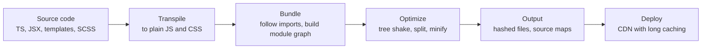
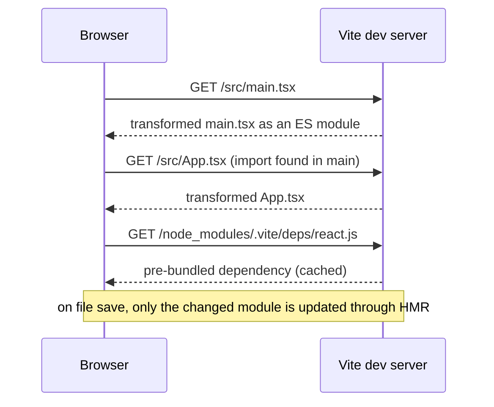

# Build Tools and Bundlers

> In this document you will learn what happens between the code you write and the files the browser downloads: npm scripts, transpiling, bundling, tree shaking, code splitting, source maps, minification, environment variables, polyfills, linting and monorepo tools. You will also learn how the Angular CLI builds an Angular 16 app and what changed in newer versions. Interviewers ask "what does webpack do?", "why didn't tree shaking remove this code?" and "Vite vs webpack?" to check that you understand your toolchain instead of treating it as magic.

**Before this:** [Modules: ESM and CommonJS](../02-javascript/14-modules-esm-and-commonjs.md) · [Modules, npm and packages](../07-nodejs-backend/03-modules-npm-and-packages.md) · [Web performance](./05-web-performance-and-core-web-vitals.md) · **Interview questions:** [jump to the interview section](#interview-questions)

## Table of contents

1. [Why build tools exist](#why-build-tools-exist)
2. [npm scripts](#npm-scripts)
3. [Transpiling](#transpiling)
4. [Bundling concepts](#bundling-concepts)
5. [webpack](#webpack)
6. [Vite](#vite)
7. [Other bundlers esbuild Rollup Rolldown Rspack Turbopack Parcel](#other-bundlers-esbuild-rollup-rolldown-rspack-turbopack-parcel)
8. [Angular CLI builders](#angular-cli-builders)
9. [Tree shaking](#tree-shaking)
10. [Code splitting and dynamic import](#code-splitting-and-dynamic-import)
11. [Source maps](#source-maps)
12. [Minification and content hashing](#minification-and-content-hashing)
13. [Build-time environment variables](#build-time-environment-variables)
14. [Polyfills and browserslist](#polyfills-and-browserslist)
15. [Hot module replacement](#hot-module-replacement)
16. [Module Federation](#module-federation)
17. [Linting and formatting ESLint and Prettier](#linting-and-formatting-eslint-and-prettier)
18. [Monorepo tools](#monorepo-tools)
19. [How to explain this in an interview](#how-to-explain-this-in-an-interview)
20. [Interview questions](#interview-questions)
21. [Summary](#summary)
22. [References](#references)

---

## Why build tools exist

The code you write is not the best code to send to a browser.

| You write | The browser needs |
| --- | --- |
| TypeScript, JSX, Angular templates, SCSS | Plain JavaScript and CSS |
| Hundreds of small module files | A small number of optimized files |
| Imports from `node_modules` (`import { map } from 'rxjs'`) | Real URLs it can download |
| Readable code with comments and long names | Small (minified, compressed) files |
| `if (DEBUG) {...}` and dev-only tools | Production code without debug code |
| Modern syntax | Syntax your target browsers support |
| Files named `main.js` | Files named `main.3f9a1c.js` so they can be cached safely |

A **build tool** automates all these steps. In development it also gives you a fast dev server with live updates. In production it produces optimized files.



### Analogy

A build tool is like a publishing house. Authors (developers) write chapters in drafts with notes and different formats. The publisher translates, edits, removes notes, combines the chapters into books, prints compact editions and puts a version number on the cover so bookstores know which edition is the latest.

---

## npm scripts

**npm scripts** are named commands in `package.json`. They are the standard entry point to every build tool, so a new developer only needs to know `npm run <name>`.

```json
{
  "name": "shop-frontend",
  "scripts": {
    "start": "ng serve",
    "build": "ng build",
    "test": "ng test",
    "lint": "eslint .",
    "format": "prettier --write .",
    "prebuild": "npm run lint",
    "analyze": "ng build --stats-json && npx webpack-bundle-analyzer dist/shop/stats.json"
  }
}
```

Key facts:

- `npm run build` runs the `build` script. `npm start` and `npm test` work without `run`.
- Scripts can use binaries from `node_modules/.bin` directly (`ng`, `eslint`, `vite`) without a global install.
- `pre<name>` and `post<name>` scripts run automatically before and after `<name>` (here, lint runs before every build).
- `npx <tool>` runs a package binary (downloading it if it is not installed).
- Pass extra arguments after `--`: `npm run build -- --configuration=staging`.
- Scripts run in a shell that differs between Windows and Linux. Avoid shell-specific syntax (`VAR=x cmd`, `rm -rf`) or use cross-platform tools (`cross-env`, `rimraf`, or Node scripts).

Package management itself (`package.json`, lock files, semantic versioning) is covered in [Modules, npm and packages](../07-nodejs-backend/03-modules-npm-and-packages.md).

---

## Transpiling

### What it is

**Transpiling** means converting source code into another version of source code: TypeScript to JavaScript, JSX to `React.createElement`/`jsx()` calls, or new JavaScript syntax to older syntax.

```ts
// Input: TypeScript with modern syntax
const total = (items: { price: number }[]): number => items.reduce((sum, i) => sum + i.price, 0);
const city = user?.address?.city ?? 'Unknown';
```

```js
// Output for an old target (ES2019): types removed, optional chaining and ?? rewritten
const total = (items) => items.reduce((sum, i) => sum + i.price, 0);
var _a, _b;
const city = (_b = (_a = user === null || user === void 0 ? void 0 : user.address) === null || _a === void 0 ? void 0 : _a.city) !== null && _b !== void 0 ? _b : 'Unknown';
```

For a modern target (ES2020+), `?.` and `??` stay as they are. That is why choosing the right target matters: older targets mean bigger, slower code.

### The main transpilers

| Tool | Written in | Type-checks? | Speed | Typical use |
| --- | --- | --- | --- | --- |
| **tsc** (TypeScript compiler) | TypeScript | **Yes** | Slower | Type checking (`tsc --noEmit`), building libraries, `.d.ts` generation |
| **Babel** | JavaScript | No | Slower | Very configurable plugins, older webpack setups, special transforms |
| **esbuild** | Go | No | Very fast | Transpiling and bundling in Vite (up to v7), Angular's esbuild builder, many tools |
| **SWC** | Rust | No | Very fast | Next.js, Rspack, Jest via `@swc/jest`, Vite React plugin option |
| **Oxc** | Rust | No | Very fast | Newer toolchain used by Rolldown and Vite 8 for transforms and minification |

### Type checking vs transpiling

Fast transpilers (esbuild, SWC, Babel) **remove types without checking them**. They look at one file at a time. Your build can succeed with type errors, so you must run `tsc --noEmit` separately (in CI, in your editor, or in the framework's build, like the Angular CLI does).

Because they handle one file at a time, some TypeScript features that need information from other files cannot be compiled safely by them. The `isolatedModules: true` compiler option makes TypeScript warn you about such code (for example re-exporting a type without `export type`). TypeScript configuration is covered in [Modules, declaration files and tsconfig](../03-typescript/09-modules-declaration-files-and-tsconfig.md).

---

## Bundling concepts

### What a bundler does

A **bundler** starts from one or more **entry points**, follows every `import` to build a **module graph** (which file depends on which), transforms each file, and writes a small number of output files (**bundles** or **chunks**).

Why not just ship ES modules unbundled? Browsers support `import` natively. But an app with 2,000 modules would need 2,000 requests in waterfalls (the browser discovers imports only after downloading each file), bare imports like `'rxjs'` do not work without import maps, and you lose tree shaking, minification across modules and many optimizations. So production builds are still bundled.

### Core vocabulary

| Term | Meaning |
| --- | --- |
| **Entry** | The file where the graph starts (`src/main.ts`) |
| **Module graph** | All modules reachable from the entries and their dependencies |
| **Chunk** | One output JavaScript file containing one or more modules |
| **Initial chunk** | Loaded at startup |
| **Lazy (async) chunk** | Loaded later with dynamic `import()` |
| **Vendor chunk** | Code from `node_modules`, often split so it can be cached separately |
| **Loader / plugin / transform** | Code that teaches the bundler to handle non-JS files or change the output |
| **Runtime** | Small code inside the bundle that loads chunks and connects modules |
| **Asset** | Images, fonts and other files copied or inlined into the output |

### What a bundle looks like inside

A bundle is a set of module functions plus a tiny loader. This simplified version of what older bundlers generate runs in Node.js:

```js
const modules = {
  './src/main.js': (require, exports) => {
    const { formatPrice } = require('./src/format.js');
    console.log(formatPrice(1999));
  },
  './src/format.js': (require, exports) => {
    exports.formatPrice = (cents) => `${(cents / 100).toFixed(2)} EUR`;
  },
};

function runBundle(entry) {
  const cache = {};
  function require(id) {
    if (cache[id]) return cache[id].exports; // each module runs only once
    const module = { exports: {} };
    cache[id] = module;
    modules[id](require, module.exports);
    return module.exports;
  }
  require(entry);
}

runBundle('./src/main.js'); // 19.99 EUR
```

Modern bundlers go further with **scope hoisting**: they put modules into one scope where possible (removing the wrapper functions), which makes the code smaller and faster.

---

## webpack

**webpack** has been the most widely used bundler for years. The Angular CLI used it by default up to Angular 16, and many existing React and enterprise projects still use it (webpack 5 is the current major version).

Main concepts:

- **entry:** where to start.
- **output:** where and how to write files (`[name].[contenthash].js`).
- **loaders:** transform files *as they are imported* (for example `ts-loader` or `babel-loader` for TypeScript, `css-loader` for CSS, asset modules for images).
- **plugins:** hook into the whole build (generate `index.html`, extract CSS into files, define constants, analyze bundles).
- **mode:** `development` (fast builds, readable output) or `production` (minification, tree shaking, `process.env.NODE_ENV` set to `"production"`).
- **optimization.splitChunks:** rules for creating shared and vendor chunks.

```js
// webpack.config.js (simplified)
const HtmlWebpackPlugin = require('html-webpack-plugin');
const MiniCssExtractPlugin = require('mini-css-extract-plugin');

module.exports = (env, argv) => ({
  mode: argv.mode ?? 'production',
  entry: './src/main.ts',
  output: {
    filename: '[name].[contenthash].js', // hashed names for long-term caching
    path: __dirname + '/dist',
    clean: true,
  },
  resolve: { extensions: ['.ts', '.js'] },
  module: {
    rules: [
      { test: /\.ts$/, use: 'ts-loader', exclude: /node_modules/ },
      { test: /\.css$/, use: [MiniCssExtractPlugin.loader, 'css-loader'] },
      { test: /\.(png|svg|woff2)$/, type: 'asset/resource' },
    ],
  },
  plugins: [
    new HtmlWebpackPlugin({ template: './src/index.html' }), // injects the <script> tags
    new MiniCssExtractPlugin({ filename: '[name].[contenthash].css' }),
  ],
  optimization: {
    splitChunks: { chunks: 'all' }, // shared and vendor code into separate chunks
  },
  devtool: argv.mode === 'development' ? 'eval-cheap-module-source-map' : 'source-map',
  devServer: { port: 8080, historyApiFallback: true },
});
```

| Pros | Cons |
| --- | --- |
| Extremely flexible, huge plugin ecosystem | Complex configuration |
| Mature, battle-tested, Module Federation built in | Slower than newer native-code tools, especially for large dev builds |

---

## Vite

### What it is

**Vite** is a build tool with a very fast development server and an optimized production build. It is the default for many new React, Vue, Svelte and other projects.

### How the dev server works

Vite does **not bundle your app in development**. It serves your source files as **native ES modules**. When the browser requests a file, Vite transforms just that file (TypeScript, JSX, CSS) on demand and sends it. Dependencies from `node_modules` are **pre-bundled** once (many small files of a library become one file, and CommonJS packages are converted to ESM) and cached.



Result: the dev server starts almost instantly, no matter how big the app is, because it only processes the files the current page actually imports. Updates after a save are fast because only the changed module is replaced.

### Production build

For production, Vite **does bundle**, because unbundled ESM is slow over the network:

- **Vite 7 and earlier:** esbuild for dependency pre-bundling and transforms in development, **Rollup** for production bundles.
- **Vite 8 (stable since March 12, 2026):** **Rolldown**, a Rust-based bundler compatible with the Rollup plugin API, is the single bundler for both development and production, with Oxc used for transforming and minifying. Most Rollup/Vite plugins keep working; options formerly under `build.rollupOptions` move to `build.rolldownOptions`. Vite 8 needs Node.js 20.19+ or 22.12+.

```js
// vite.config.js
import { defineConfig } from 'vite';
import react from '@vitejs/plugin-react';

export default defineConfig({
  plugins: [react()],
  server: {
    port: 5173,
    proxy: { '/api': 'http://localhost:3000' }, // avoid CORS in development
  },
  build: {
    sourcemap: 'hidden', // generate maps but do not reference them from the JS files
    target: 'es2022',
  },
});
```

| Pros | Cons |
| --- | --- |
| Very fast dev server start and HMR | Dev (unbundled) and production (bundled) differ, which can rarely cause "works in dev, breaks in prod" |
| Simple config, good defaults | Very large apps can make many requests in dev on a cold page load |
| Framework-agnostic, large plugin ecosystem | Less flexible than webpack for unusual setups |

Note on the Angular side: Angular CLI 17+ also uses Vite as its **dev server** with esbuild, but through the Angular builder; you do not configure Vite directly in an Angular project.

---

## Other bundlers esbuild Rollup Rolldown Rspack Turbopack Parcel

| Tool | Language | Known for | Typical use |
| --- | --- | --- | --- |
| **esbuild** | Go | Extreme speed; bundling, transpiling, minifying | Libraries, scripts, inside Vite (up to v7) and the Angular CLI |
| **Rollup** | JavaScript | Clean ESM output, excellent tree shaking, plugin API | Libraries; Vite production builds up to v7 |
| **Rolldown** | Rust | Rollup-compatible API with native speed (1.0 in 2026) | Vite 8 |
| **Rspack** | Rust | webpack-compatible API and plugins, much faster | Migrating large webpack projects |
| **Turbopack** | Rust | Incremental bundler from Vercel | Default bundler in Next.js 16 (October 2025) for dev and build |
| **Parcel** | JS/Rust | Zero configuration | Small and medium apps, prototypes |

The trend is clear: build tools are being rewritten in native languages (Go, Rust) for speed, while keeping the plugin APIs that developers already know.

---

## Angular CLI builders

The **Angular CLI** hides the bundler behind **builders**, configured in `angular.json`. You run `ng serve`, `ng build` and `ng test`; the builder does the work.

### Angular 16

| Builder | What it is | Status in v16 |
| --- | --- | --- |
| `@angular-devkit/build-angular:browser` | webpack-based browser build | **Default** for `ng new` projects |
| `@angular-devkit/build-angular:dev-server` | `ng serve` | Default |
| `@angular-devkit/build-angular:browser-esbuild` | esbuild-based build; `ng serve` uses Vite as the dev server | **Developer preview**: not yet recommended for production; some options (budgets, localization, web workers) were not supported yet |

To try the esbuild builder in v16, change the `builder` of the `build` target from `browser` to `browser-esbuild` in `angular.json`.

```json
// angular.json (Angular 16, simplified)
{
  "projects": {
    "shop": {
      "architect": {
        "build": {
          "builder": "@angular-devkit/build-angular:browser",
          "options": {
            "outputPath": "dist/shop",
            "index": "src/index.html",
            "main": "src/main.ts",
            "polyfills": ["zone.js"],
            "tsConfig": "tsconfig.app.json",
            "assets": ["src/favicon.ico", "src/assets"],
            "styles": ["src/styles.scss"]
          },
          "configurations": {
            "production": {
              "budgets": [
                { "type": "initial", "maximumWarning": "500kb", "maximumError": "1mb" },
                { "type": "anyComponentStyle", "maximumWarning": "2kb", "maximumError": "4kb" }
              ],
              "outputHashing": "all"
            },
            "development": {
              "buildOptimizer": false,
              "optimization": false,
              "vendorChunk": true,
              "extractLicenses": false,
              "sourceMap": true,
              "namedChunks": true
            }
          },
          "defaultConfiguration": "production"
        }
      }
    }
  }
}
```

What the production build does for you: AOT compilation of templates, tree shaking, minification, content hashing (`outputHashing: "all"`), critical CSS inlining, license extraction and budget checks. You get these without writing a bundler config. Customizing webpack directly requires third-party builders (for example custom-webpack builders), which is a maintenance risk.

> **Newer Angular (17+):** the esbuild-based **`application` builder** (`@angular-devkit/build-angular:application`, later `@angular/build:application`) is the default for new projects. It uses esbuild for builds and Vite for the dev server, supports SSR and prerendering directly, and builds much faster than webpack. Existing projects can migrate with `ng update` migrations. The webpack `browser` builder remains available for compatibility. See [Angular 16 vs newer versions](../06-angular-16/16-angular-16-vs-newer-versions.md).

---

## Tree shaking

### What it is

**Tree shaking** is dead-code elimination for modules: the bundler removes **exports that are never imported** anywhere. The name comes from shaking a tree so dead leaves fall off.

```js
// math.js
export function add(a, b) { return a + b; }
export function multiply(a, b) { return a * b; }   // never imported
export function bigUnusedHelper() { /* 5 KB of code */ }

// main.js
import { add } from './math.js';
console.log(add(2, 3));
// Production bundle: contains add(), but not multiply() or bigUnusedHelper()
```

### Requirements for tree shaking

**1. ES modules (static `import`/`export`).** ESM imports and exports are static: the bundler can see what is used without running the code. CommonJS (`require`, `module.exports`) is dynamic, so bundlers usually cannot safely remove unused parts.

```js
// ✅ Tree-shakable
import { debounce } from 'lodash-es';

// ❌ Usually pulls in the whole library (CommonJS build)
const _ = require('lodash');
// ❌ Also often brings everything: the default lodash package is CommonJS
import _ from 'lodash';
```

**2. No side effects (or side effects declared).** A **side effect** is code that does something when the module is *imported*, not when a function is called: modifying globals, adding polyfills, registering custom elements, importing CSS. A bundler must keep a module with side effects even if you do not use its exports, unless you tell it that the module is safe to drop. Library authors do this with the `sideEffects` field in `package.json`:

```json
{
  "name": "my-ui-library",
  "sideEffects": false
}
```

```json
{
  "name": "my-ui-library",
  "sideEffects": ["*.css", "./src/polyfills.js"]
}
```

`false` means "every file can be removed if its exports are unused". The array form lists the files that must be kept. Marking a file as side-effect-free when it is not (for example a CSS import or a polyfill) makes the bundler drop it, and the app breaks.

**3. Pure annotations.** Some code looks like it might have side effects (a function call at the top level). The `/*#__PURE__*/` comment tells the minifier the call is safe to remove if the result is unused:

```js
export const theme = /*#__PURE__*/ createTheme({ primary: '#0b5394' });
```

**4. A production build.** Tree shaking and dead-code removal happen in production mode with minification.

### Why tree shaking sometimes fails

- The library ships only CommonJS.
- The module has (or is assumed to have) side effects.
- **Barrel files** (`index.ts` that re-exports everything) combined with side effects or CommonJS can pull in the whole folder. With side-effect-free ESM they are usually fine, but they still slow down builds and dev servers.
- Dynamic property access: `import * as utils from './utils'; utils[name]()` makes the bundler keep everything.
- Classes: unused methods of a class used anywhere are **not** removed (tree shaking works at the level of exports, not class members).

Angular services with `@Injectable({ providedIn: 'root' })` are tree-shakable: if no code injects the service, it is removed from the bundle. Services listed in an NgModule's `providers` array are always included.

---

## Code splitting and dynamic import

**Code splitting** creates several chunks instead of one big bundle. Every **dynamic `import()`** becomes a split point: the imported module and its dependencies go into a separate chunk that is loaded when the code runs.

```js
// Static import: part of the initial chunk
import { renderHome } from './home.js';

// Dynamic import: a separate chunk, downloaded only when needed
async function openReportEditor() {
  const { ReportEditor } = await import('./report-editor.js');
  new ReportEditor(document.querySelector('#editor')).open();
}
```

Common split points:

- **Routes:** Angular `loadChildren`/`loadComponent`, React `lazy()`.
- **Heavy, rarely used features:** editors, charts, PDF/Excel export.
- **Vendor code:** a separate chunk for `node_modules` that changes less often than your code, so it stays cached between deploys.

Hints for the bundler:

```js
// webpack magic comments: name the chunk, prefetch it when the browser is idle
const { ChartPanel } = await import(/* webpackChunkName: "charts" */ /* webpackPrefetch: true */ './chart-panel.js');
```

The performance side (what to split, prefetching, waterfalls) is in [Web performance](./05-web-performance-and-core-web-vitals.md#code-splitting-and-lazy-loading). Dynamic `import()` as a language feature is in [Modules: ESM and CommonJS](../02-javascript/14-modules-esm-and-commonjs.md).

---

## Source maps

### What they are

Production code is transpiled, bundled and minified. An error at `main.3f9a1c.js:1:48213` is useless. A **source map** (a `.map` file) maps positions in the generated code back to the original files, lines and names. DevTools and error-tracking tools use it to show the real code.

```js
// at the end of the generated file:
//# sourceMappingURL=main.3f9a1c.js.map
```

### Types and choices

| Option | Quality | Speed | Use |
| --- | --- | --- | --- |
| Full separate source map (`source-map`) | Best (original lines and columns) | Slowest | Production builds |
| Cheap / eval variants (webpack `eval-cheap-module-source-map`) | Good enough (lines) | Fast rebuilds | Development |
| **Hidden** source maps | Full maps, but the JS file has no `sourceMappingURL` comment | Same as full | Production: upload maps to your error tracker, do not expose them |
| No source maps | None | Fastest | When you really do not need them |

### Production considerations

- Public source maps expose your original source code (not secrets, if you do not put secrets in frontend code, but business logic and comments).
- A common approach: generate **hidden** source maps in CI, upload them to an error-tracking service (for example Sentry), and do not deploy them to the public server.
- Angular: `"sourceMap": { "scripts": true, "styles": true, "hidden": true }` in `angular.json`. Vite: `build.sourcemap: 'hidden'`. webpack: `devtool: 'hidden-source-map'`.

---

## Minification and content hashing

### Minification

**Minification** makes code smaller without changing what it does:

- removes whitespace and comments,
- renames local variables to short names (**mangling**),
- removes dead code (`if (false) {...}`, unreachable code),
- simplifies expressions.

```js
// Before
function calculateCartTotal(cartItems) {
  // sum the price of all items
  const total = cartItems.reduce((sum, item) => sum + item.price * item.quantity, 0);
  if (process.env.NODE_ENV !== 'production') {
    console.log('debug total', total);
  }
  return total;
}

// After (production, with NODE_ENV replaced by "production")
function calculateCartTotal(t){return t.reduce((t,e)=>t+e.price*e.quantity,0)}
```

Tools: **Terser** (classic, in webpack and the Angular webpack builder), **esbuild**, **SWC**, **Oxc**. CSS is minified too (cssnano, Lightning CSS, esbuild).

Remember: minification happens at build time; **compression** (gzip, Brotli) happens on the network. You use both. See [Web performance](./05-web-performance-and-core-web-vitals.md#compression).

### Content hashing

Build tools add a hash of the file **content** to the file name. Same content, same name; changed content, new name. This allows caching files "forever" while users still get new code right after a deploy (cache busting). Here is the idea in Node.js (run):

```js
import { createHash } from 'node:crypto';

function hashedName(name, content) {
  const hash = createHash('sha256').update(content).digest('hex').slice(0, 8);
  const dot = name.lastIndexOf('.');
  return `${name.slice(0, dot)}.${hash}${name.slice(dot)}`;
}

console.log(hashedName('main.js', 'console.log("v1")')); // main.bee07646.js
console.log(hashedName('main.js', 'console.log("v1")')); // main.bee07646.js  (same content, same name)
console.log(hashedName('main.js', 'console.log("v2")')); // main.af414ebf.js  (changed content, new name)
```

The caching headers that go with this are in [Web performance](./05-web-performance-and-core-web-vitals.md#http-caching-for-static-assets).

---

## Build-time environment variables

### The key idea

In frontend builds, "environment variables" are usually **replaced with literal values at build time**. The browser has no `process.env`. The bundler searches the code for known expressions and replaces them with text.

```js
// Your code
if (process.env.NODE_ENV !== 'production') enableDevTools();
const apiUrl = import.meta.env.VITE_API_URL;

// After a production build (the values are pasted into the code)
if ("production" !== 'production') enableDevTools(); // then removed as dead code
const apiUrl = "https://api.shop.example.com";
```

| Tool | How it works |
| --- | --- |
| webpack | `mode` sets `process.env.NODE_ENV`; `DefinePlugin` replaces other expressions |
| esbuild | `--define:process.env.NODE_ENV='"production"'` |
| Vite | `import.meta.env.MODE`, `DEV`, `PROD`; variables from `.env` files **only if they start with `VITE_`** |
| Angular CLI (16) | `environment.ts` files swapped with `fileReplacements` per configuration; since Angular 15, `ng new` no longer creates them, so you run `ng generate environments` |

```ts
// src/environments/environment.ts (development)
export const environment = { production: false, apiUrl: 'http://localhost:3000/api' };

// src/environments/environment.prod.ts
export const environment = { production: true, apiUrl: 'https://api.shop.example.com' };
```

```json
// angular.json, inside configurations.production
"fileReplacements": [
  { "replace": "src/environments/environment.ts", "with": "src/environments/environment.prod.ts" }
]
```

### Never put secrets in frontend environment variables

Everything that is built into the frontend bundle is **public**. Anyone can open DevTools and read it. API keys for payment providers, database passwords and private tokens must stay on the server. The `VITE_` prefix rule exists exactly to stop you from accidentally exposing all your environment variables. Public values (API base URL, analytics site id, a public "publishable" key) are fine.

### Build once, deploy many

Build-time variables mean you need a separate build per environment (dev, staging, production). Many teams prefer **one build artifact** promoted through all environments, with configuration loaded at **runtime** (for example `fetch('/config.json')` before bootstrapping, or a config injected by the server). This guarantees that what you tested is exactly what you deploy. See [Production Node.js](../07-nodejs-backend/14-production-nodejs.md).

---

## Polyfills and browserslist

### Syntax transforms vs polyfills

Two different problems:

- **New syntax** (`?.`, `??`, class fields, `async`/`await`): an old browser cannot even parse it. The fix is a **syntax transform** by the transpiler (rewrite into older syntax).
- **New APIs** (`Array.prototype.at`, `structuredClone`, `Promise.withResolvers`, `Object.groupBy`): the syntax is fine, but the function does not exist. The fix is a **polyfill**: code that adds the missing function if it is not there.

```js
// A tiny polyfill (the idea; real projects use core-js)
if (!Array.prototype.at) {
  Object.defineProperty(Array.prototype, 'at', {
    value: function at(index) {
      const i = Math.trunc(index) || 0;
      return this[i < 0 ? this.length + i : i];
    },
    writable: true,
    configurable: true,
  });
}
```

Transpilers do **not** add API polyfills by themselves. Babel can add `core-js` polyfills based on usage (`useBuiltIns: 'usage'`); with other tools you import what you need.

### browserslist

**browserslist** is a shared config that says which browsers you support. Babel, Autoprefixer, the Angular CLI and other tools read it to decide which syntax to transform and which CSS prefixes to add.

```text
# .browserslistrc
last 2 Chrome versions
last 2 Firefox versions
last 2 Safari major versions
last 2 Edge versions
not dead
```

Fewer old browsers means less transformed code and fewer polyfills, so smaller and faster bundles.

### Angular

- Angular uses browserslist (an Angular 16 project can add a `.browserslistrc`; otherwise the CLI's defaults for supported browsers apply).
- `polyfills: ["zone.js"]` in `angular.json` loads Zone.js, which Angular 16's change detection needs. (Zoneless apps in newer Angular versions remove it.)
- Angular dropped Internet Explorer 11 support in v13, and with it **differential loading** (building separate ES5 and modern bundles). Modern Angular outputs modern JavaScript only.

---

## Hot module replacement

**Hot module replacement (HMR)** updates changed modules in the running app **without a full page reload**, ideally keeping the app's state (form values, open dialogs, scroll position).

How it works:

1. The dev server watches your files.
2. You save a file. The dev server rebuilds only that module.
3. It sends a message over a WebSocket to the HMR runtime in the browser.
4. The runtime downloads the new module and replaces the old one. Frameworks re-render the affected components (React Fast Refresh keeps component state for function components).
5. If a module cannot be hot-replaced safely, the page reloads fully.

Plain **live reload** just refreshes the whole page on every change and loses state. HMR is faster and keeps your place while you work. (Angular CLI's webpack dev server supports HMR with `ng serve --hmr`; the default is live reload.)

---

## Module Federation

**Module Federation** (introduced in webpack 5) lets separately built and deployed applications **load code from each other at runtime**. One app (the "host" or "shell") loads modules exposed by other apps ("remotes"), and they can share dependencies like Angular or React so they are not downloaded twice.

```js
// webpack.config.js of a remote "orders" app (simplified)
const { ModuleFederationPlugin } = require('webpack').container;

module.exports = {
  plugins: [
    new ModuleFederationPlugin({
      name: 'orders',
      filename: 'remoteEntry.js',
      exposes: { './OrdersModule': './src/app/orders/orders.module.ts' },
      shared: { '@angular/core': { singleton: true, strictVersion: true } },
    }),
  ],
};
```

It is the most common technical base for **micro-frontends** (several teams owning and deploying parts of one UI independently). It brings real costs: version alignment of shared libraries, runtime failures when a remote is down, consistent routing, auth and design across teams, and harder debugging. Native Federation and Rspack/Rsbuild variants exist for esbuild- and Rust-based tooling. When micro-frontends are (and are not) worth it is discussed in [Frontend architecture at scale](../09-system-design/05-frontend-architecture-at-scale.md).

---

## Linting and formatting ESLint and Prettier

### ESLint

**ESLint** is a **linter**: it analyzes code for problems and bad patterns without running it. Examples: unused variables, `==` instead of `===`, missing hook dependencies in React, floating promises (with type-aware TypeScript rules), accessibility issues in templates.

```js
// eslint.config.js (flat config, the default since ESLint 9)
import js from '@eslint/js';
import tseslint from 'typescript-eslint';

export default tseslint.config(
  js.configs.recommended,
  ...tseslint.configs.recommended,
  {
    rules: {
      eqeqeq: 'error',
      'no-console': ['warn', { allow: ['warn', 'error'] }],
      '@typescript-eslint/no-explicit-any': 'warn',
    },
  },
  { ignores: ['dist/**', 'coverage/**'] },
);
```

- ESLint 9 and newer use the **flat config** file (`eslint.config.js`) by default; older projects use `.eslintrc.*`.
- **typescript-eslint** adds TypeScript parsing and rules.
- **angular-eslint** adds Angular-specific rules for TypeScript and templates (`ng add @angular-eslint/schematics`). TSLint, which older Angular projects used, is deprecated.

### Prettier

**Prettier** is a **formatter**: it rewrites code into one consistent style (indentation, quotes, line breaks). It does not find bugs.

| | ESLint | Prettier |
| --- | --- | --- |
| Job | Find problems and enforce code-quality rules | Make formatting consistent |
| Changes code? | Only for auto-fixable rules | Always reformats |
| Configurable | Many rules | Very few options on purpose |

Use both: Prettier for formatting, ESLint for code quality, and turn off ESLint's formatting rules (`eslint-config-prettier`) so they do not fight. Newer all-in-one tools like **Biome** combine linting and formatting in one fast binary.

### Automation

- Run lint and format checks in **CI** so they cannot be skipped.
- **Pre-commit hooks** (`husky` + `lint-staged`) run them on changed files before each commit.
- Editor integration shows problems as you type.

---

## Monorepo tools

A **monorepo** is one repository with several projects (apps and shared libraries), for example a customer app, an admin app, a shared UI library and shared API types.

Benefits: shared code without publishing packages, one place for tooling, atomic changes across projects. Costs: tooling complexity, slower CI if everything is rebuilt, need for clear boundaries.

| Tool | What it adds |
| --- | --- |
| **npm / pnpm / Yarn workspaces** | Link local packages together, one install for the whole repo |
| **Nx** | Project graph, "affected" commands (build/test only what changed), computation caching (local and remote), code generators, module boundary lint rules; strong Angular support |
| **Turborepo** | Task pipelines and caching across workspace packages, simple setup |

```bash
# Nx: run tests only for projects affected by the current changes
npx nx affected -t test

# Turborepo: build all packages with caching
npx turbo run build
```

The key idea of both: **do not repeat work**. If a library did not change, reuse the cached build and test results.

---

## How to explain this in an interview

Use this when asked "What does a bundler do?" or "How does your build work?"

1. **Define it:** "A build tool turns my source code into optimized files for the browser. The main parts are transpiling, bundling and optimizing."
2. **Why it exists:** "Browsers don't understand TypeScript, JSX or Angular templates, and shipping thousands of unminified modules would be slow. I also want hashed file names for caching and no debug code in production."
3. **How it works:** "The bundler starts from an entry, follows imports to build a module graph, transforms each file with loaders or plugins, removes unused exports with tree shaking, splits code at dynamic imports, minifies, adds content hashes, and writes chunks plus source maps."
4. **Small example:** "In an Angular 16 app, `ng build` uses the webpack-based builder: AOT-compiles templates, splits each lazy route into its own chunk, minifies, adds hashes and checks the bundle budgets in `angular.json`."
5. **Where it is useful:** "Tree shaking needs ES modules and side-effect-free code, so I prefer `lodash-es` over `lodash`. I use hidden source maps uploaded to the error tracker, and I never put secrets in build-time variables because the bundle is public."
6. **Trade-offs / gotchas:** "webpack is very flexible but slower; Vite gives an instant dev server by serving native ES modules and bundles only for production, now with Rolldown in Vite 8. Angular 17+ switched to an esbuild-based builder with Vite as the dev server. Fast transpilers don't type-check, so I still run `tsc` in CI."

---

## Interview questions

### Q1. Why do we need bundlers if browsers support ES modules?

**What the interviewer is checking:** Understanding of the real reasons, not just "browsers are old".

**Short spoken answer (30–60 seconds):**
> "Browsers do support native ES modules, but shipping an app unbundled is slow in production. The browser discovers imports only after downloading each file, so a big app turns into thousands of requests in waterfalls. Bare imports like 'rxjs' don't resolve without extra setup. And we'd lose the optimizations a bundler gives: tree shaking, minification across modules, code splitting with shared chunks, content hashes for caching, and transforming TypeScript, JSX, templates and CSS. That's why tools like Vite serve native modules in development, where it's fast and convenient, but still bundle for production."

**Follow-up questions:**
- **Doesn't HTTP/2 multiplexing solve the many-requests problem?** — It reduces the cost per request, but not the discovery waterfall (each level of imports needs another round trip), and it does not give you tree shaking or minification. Very fine-grained unbundled delivery is still slower for large apps.
- **What are import maps?** — A browser feature (`<script type="importmap">`) that maps bare specifiers like `'lit'` to URLs, allowing unbundled ESM without a build step for small apps.

### Q2. What is the difference between transpiling and bundling?

**Short answer:** Transpiling converts one file's source into another form (TypeScript to JavaScript, JSX to function calls, new syntax to older syntax) and works file by file. Bundling combines many modules into a few output files by following the import graph, and enables graph-level optimizations like tree shaking and code splitting. A build usually does both: each module is transpiled (by tsc, Babel, esbuild, SWC or Oxc) as the bundler (webpack, Rollup, Rolldown, esbuild) processes it.

### Q3. What is tree shaking, and why might it not work?

**What the interviewer is checking:** Requirements for tree shaking and practical debugging.

**Short spoken answer (30–60 seconds):**
> "Tree shaking removes exports that are never imported from the final bundle. It works because ES module imports and exports are static, so the bundler can see what's used without running the code. It fails when a library only ships CommonJS, because `require` is dynamic; when modules have side effects at import time, or the bundler can't be sure they don't, so it has to keep them; when you use dynamic access like `utils[name]`; and it never removes unused methods of a class. Libraries help by shipping ESM and setting `sideEffects: false` in package.json, and by marking pure calls with `/*#__PURE__*/`."

**Follow-up questions:**
- **What does `"sideEffects": false` mean, and what can go wrong?** — It tells the bundler that any file in the package can be dropped if its exports are unused. If a file actually has a side effect (CSS import, polyfill, global registration), it gets removed and the app breaks. Use the array form to list such files.
- **How do you find out why a library is so big in your bundle?** — Use a bundle analyzer (source-map-explorer, webpack-bundle-analyzer, a Rollup/Vite visualizer) to see which modules are included, then check whether you import the ESM build and only what you need.
- **Are Angular services tree-shakable?** — Yes, if they use `@Injectable({ providedIn: 'root' })` and nobody injects them. Services in an NgModule's `providers` array are always included.

**Common mistakes:** Thinking tree shaking works with any import style, or that it removes unused code inside functions (that is minifier dead-code elimination, a related step).

### Q4. Code review: why is this bundle 70 KB bigger than expected?

```ts
import _ from 'lodash';
import * as dateFns from 'date-fns';

export function formatOrder(order: Order) {
  return `${_.capitalize(order.customer)} - ${dateFns.format(order.createdAt, 'yyyy-MM-dd')}`;
}
```

**What the interviewer is checking:** Applying tree-shaking knowledge.

**Short spoken answer (30–60 seconds):**
> "The `lodash` package is CommonJS, so a default import brings in the whole library even though we use one function. I'd switch to `lodash-es` with a named import, `import { capitalize } from 'lodash-es'`, or just write the one-line function. The namespace import of `date-fns` is usually tree-shakable in modern versions because it's ESM, but named imports are clearer and safer: `import { format } from 'date-fns'`. Then I'd confirm with a bundle analyzer. For simple formatting, the built-in `Intl.DateTimeFormat` might replace the library entirely."

### Q5. webpack vs Vite: what is the difference?

**What the interviewer is checking:** Understanding of the dev-server architecture difference.

**Short spoken answer (30–60 seconds):**
> "webpack bundles the whole app, even in development, before the dev server is ready, so start-up and rebuilds get slower as the app grows. It's extremely flexible, with loaders, plugins and Module Federation. Vite serves source files as native ES modules in development and transforms each file on demand when the browser asks for it, with dependencies pre-bundled once, so the server starts almost instantly and HMR stays fast. For production Vite still bundles: with Rollup up to Vite 7, and with Rolldown, a Rust bundler, in Vite 8. The trade-off is that dev and production pipelines differ a bit, and webpack still wins for very custom setups and existing large configs."

**Follow-up questions:**
- **Why does Vite pre-bundle dependencies?** — Many packages ship as CommonJS (which browsers can't import natively) or as hundreds of tiny ESM files (too many requests). Pre-bundling converts them into single ESM files once and caches them.
- **What could cause "works in dev, breaks in prod" with Vite?** — Differences between the on-demand dev transforms and the production bundler: CommonJS interop issues, side-effect assumptions in tree shaking, or environment variables used incorrectly. Always test the production build (`vite build && vite preview`).

### Q6. How does the Angular CLI build an app in Angular 16, and what changed in Angular 17?

**What the interviewer is checking:** Angular-specific, version-aware build knowledge.

**Short spoken answer (30–60 seconds):**
> "In Angular 16, `ng build` uses the webpack-based `browser` builder from `@angular-devkit/build-angular`, configured in `angular.json`. In production it AOT-compiles templates, tree-shakes, splits lazy routes into chunks, minifies, adds content hashes, inlines critical CSS and checks bundle budgets. Angular 16 also had an esbuild-based builder, `browser-esbuild`, as a developer preview, with Vite as the dev server. From Angular 17, the new esbuild-based `application` builder is the default for new projects, with Vite for `ng serve`, built-in SSR and prerendering support, and much faster builds. The webpack builder is still available for older projects."

**Follow-up questions:**
- **How do you customize webpack in an Angular 16 project?** — Not directly: the CLI hides the config. You can use third-party custom-webpack builders, but they add upgrade risk. Prefer CLI options when possible.
- **What are budgets?** — Size limits in `angular.json` (for example initial bundle warning at 500 KB, error at 1 MB; per-component styles 2 KB / 4 KB in a new v16 project). The build warns or fails when they are exceeded.

### Q7. How does code splitting work, and how do you control chunk names and prefetching?

**Short answer:** Every dynamic `import()` is a split point: the bundler puts the imported module and its dependencies into a separate chunk and generates runtime code to load it on demand. Routes (Angular `loadChildren`/`loadComponent`, React `lazy`) are the main split points; shared dependencies go into common chunks, and `node_modules` can go into a vendor chunk that stays cached between deploys. In webpack you can name and prefetch chunks with magic comments (`/* webpackChunkName: "charts" */`, `/* webpackPrefetch: true */`); Angular has preloading strategies for lazy routes. See [Code splitting and dynamic import](#code-splitting-and-dynamic-import).

### Q8. What are source maps, and should you deploy them to production?

**What the interviewer is checking:** Debuggability vs exposure trade-off.

**Short spoken answer (30–60 seconds):**
> "A source map maps positions in the transpiled, minified bundle back to the original source files and names, so DevTools and error trackers show real file names and lines instead of `main.js` line 1 column 48,000. In development I use fast, cheaper source maps. In production I usually generate full but hidden source maps: the bundle doesn't reference them, so browsers don't download them, and CI uploads them to the error-tracking service. That way I can debug production errors without publishing my original source. There are no secrets in frontend code anyway, but there's no need to expose business logic and comments."

### Q9. How do environment variables work in a frontend build? Can you store an API secret there?

**What the interviewer is checking:** The most dangerous misconception in frontend builds.

**Short spoken answer (30–60 seconds):**
> "In frontend builds, environment variables are replaced with literal values at build time. The bundler finds expressions like `process.env.NODE_ENV` or `import.meta.env.VITE_API_URL` and pastes the value into the code, and then dead-code elimination can remove dev-only branches. In Angular 16 it's usually `environment.ts` files swapped by `fileReplacements`. So the values end up in the JavaScript that every user downloads. That means no secrets: anything in the bundle is public. Secret keys stay on the server, and the frontend calls the backend, which uses them. Vite even requires the `VITE_` prefix so you don't expose variables by accident."

**Follow-up questions:**
- **What is "build once, deploy many"?** — Producing one artifact and promoting it through staging and production, loading environment-specific configuration at runtime (for example a `config.json` fetched before bootstrap), instead of building separately per environment.
- **Is a Google Maps or Stripe publishable key a secret?** — No, those keys are designed to be public and restricted by domain or permissions. A Stripe *secret* key is a secret and must never be in frontend code.

### Q10. What is the difference between a polyfill and a syntax transform? What is browserslist?

**Short answer:** Old browsers fail in two ways. They cannot parse new **syntax** (`?.`, class fields): the transpiler rewrites it into older syntax. Or they lack new **APIs** (`Array.prototype.at`, `structuredClone`): a polyfill adds the missing function at runtime, usually from core-js. Transpilers do not add polyfills automatically unless configured (Babel `useBuiltIns: 'usage'`). **browserslist** is a shared list of target browsers (in `.browserslistrc` or `package.json`) that Babel, Autoprefixer, the Angular CLI and others use to decide what to transform and prefix. Supporting fewer old browsers gives smaller, faster bundles. See [Polyfills and browserslist](#polyfills-and-browserslist).

### Q11. Why do fast transpilers like esbuild and SWC not catch type errors?

**Short answer:** They strip TypeScript types file by file without building the full type graph, which is what makes them so fast. Type checking needs the whole program and is done by `tsc`. So a build with esbuild or SWC can succeed with type errors: run `tsc --noEmit` in CI and in your editor (the Angular CLI runs type checking as part of its build). Use `isolatedModules: true` so TypeScript warns about code that single-file transpilers cannot compile correctly (for example re-exporting types without `export type`).

### Q12. Scenario: after a deploy, some users see a blank page or "ChunkLoadError". What happened?

**What the interviewer is checking:** Real-world deployment and caching knowledge.

**Short spoken answer (30–60 seconds):**
> "Most likely users had the old app open, or a cached old `index.html`, that refers to old hashed chunk names. After the deploy those old files were deleted from the server, so when they navigate to a lazy route the dynamic import fails. Fixes: keep old assets available for a while after each deploy, for example by uploading new files without deleting old ones on the CDN; make sure `index.html` is served with `no-cache` so new visits get the new version; catch chunk-load errors and reload the page once; and optionally detect new versions and show a 'new version available' prompt, which Angular's service worker supports with `SwUpdate`."

### Q13. What is Module Federation, and when would you use it?

**What the interviewer is checking:** Awareness of micro-frontend tooling and its costs.

**Short spoken answer (30–60 seconds):**
> "Module Federation, introduced in webpack 5, lets separately built and deployed apps load code from each other at runtime. A shell app loads modules exposed by remote apps through a `remoteEntry.js` file, and they can share libraries like Angular as singletons so they're downloaded once. It's the usual base for micro-frontends, where independent teams deploy parts of one UI on their own schedule. I'd use it only when team independence is really worth it, because it adds version alignment problems for shared libraries, runtime failures when a remote is down, and harder routing, auth, design consistency and debugging. For one team, a well-structured monorepo is usually simpler."

**Follow-up questions:**
- **What happens if the shell and a remote use different Angular versions?** — Sharing as a singleton fails or both versions load; with `strictVersion` you get a runtime error. Teams must coordinate major upgrades.

### Q14. What is the difference between ESLint and Prettier?

**Short answer:** ESLint is a linter: it analyzes code for bugs and bad patterns (unused variables, `==`, missing hook dependencies, unsafe `any`, floating promises) and can auto-fix some. Prettier is a formatter: it rewrites code into one consistent style and does not find bugs. Use both, with `eslint-config-prettier` turning off ESLint's formatting rules so the tools do not conflict, and enforce them in CI and with pre-commit hooks (husky + lint-staged). ESLint 9+ uses flat config (`eslint.config.js`); Angular projects add angular-eslint (TSLint is deprecated).

### Q15. What is HMR, and how is it different from live reload?

**Short answer:** Live reload refreshes the whole page when a file changes, so the app's state is lost. Hot module replacement swaps only the changed module in the running app through a WebSocket message from the dev server, and frameworks re-render affected components, often keeping state (React Fast Refresh keeps function component state). If a module can't be replaced safely, the tool falls back to a full reload. HMR makes UI work much faster because you stay on the same screen with the same data.

### Q16. What do monorepo tools like Nx and Turborepo add on top of npm workspaces?

**Short answer:** Workspaces link local packages and give one install. Nx and Turborepo add a **task graph** (build a library before the apps that use it), **caching** of build and test results locally and remotely (unchanged projects are not rebuilt), and **affected** commands that run tasks only for projects touched by a change, which keeps CI fast as the repo grows. Nx also adds code generators, a project graph visualization and lint rules for module boundaries (for example "feature libraries may not import other features"), and has strong Angular support.

### Q17. Output prediction: what does this print, and what does a production bundler do with the `if`?

```js
const mode = 'production';
if (mode !== 'production') console.log('debug');
console.log('done');
```

**Answer (run with Node.js):** it prints only `done`.

**Explanation:** `mode !== 'production'` is `false`, so the debug line never runs. A production minifier goes further: because `mode` is a constant, it can evaluate the condition at build time and **remove the whole `if` statement** from the bundle (dead-code elimination). This is exactly how `if (process.env.NODE_ENV !== 'production') {...}` blocks disappear from production builds after the bundler replaces `process.env.NODE_ENV` with `"production"`. If the value were only known at runtime (for example read from `location.hostname`), the code would have to stay in the bundle.

---

## Summary

- Build tools turn source code (TypeScript, JSX, templates, SCSS) into optimized browser files: **transpile → bundle → optimize → output**.
- **npm scripts** are the standard entry point to all build commands.
- **Transpilers** (tsc, Babel, esbuild, SWC, Oxc) convert code; only **tsc type-checks**, so run `tsc --noEmit` in CI.
- A **bundler** builds a module graph from entries and outputs chunks. **webpack** is flexible and mature; **Vite** serves native ESM in development and bundles for production (Rollup up to v7, **Rolldown in Vite 8**, March 2026).
- **Angular 16:** webpack-based `browser` builder by default; esbuild builder with Vite dev server in developer preview. **Angular 17+:** esbuild-based `application` builder by default.
- **Tree shaking** needs ES modules, side-effect-free code (`sideEffects`), and production builds; CommonJS and side effects block it.
- **Code splitting** happens at dynamic `import()`; split by route and heavy features.
- **Source maps** map minified code back to sources; use hidden maps uploaded to your error tracker in production.
- **Minification** shrinks code; **content hashing** enables long-term caching with instant updates.
- **Build-time environment variables** are pasted into the public bundle: never put secrets there.
- **Polyfills** add missing APIs; **syntax transforms** rewrite new syntax; **browserslist** defines targets.
- **Module Federation** enables micro-frontends at a real coordination cost; **ESLint** finds problems, **Prettier** formats; **Nx/Turborepo** cache and run only affected tasks in monorepos.

## References

- webpack — Concepts: https://webpack.js.org/concepts/
- webpack — Tree Shaking: https://webpack.js.org/guides/tree-shaking/
- webpack — Code Splitting: https://webpack.js.org/guides/code-splitting/
- webpack — Module Federation: https://webpack.js.org/concepts/module-federation/
- webpack — Devtool (source maps): https://webpack.js.org/configuration/devtool/
- Vite — Why Vite: https://vite.dev/guide/why
- Vite — Announcing Vite 8: https://vite.dev/blog/announcing-vite8
- Vite — Env Variables and Modes: https://vite.dev/guide/env-and-mode
- esbuild documentation: https://esbuild.github.io/
- Rollup — Introduction (tree shaking): https://rollupjs.org/introduction/
- Angular (v16 source docs) — esbuild builder (developer preview): https://github.com/angular/angular/blob/16.2.x/aio/content/guide/esbuild.md
- Angular (v16) — Building and serving Angular apps: https://v16.angular.io/guide/build
- Angular — Angular application build system (current): https://angular.dev/tools/cli/build-system-migration
- TypeScript — `isolatedModules`: https://www.typescriptlang.org/tsconfig/#isolatedModules
- MDN — Source maps (`SourceMap` header and usage): https://developer.mozilla.org/en-US/docs/Glossary/Source_map
- MDN — Polyfill: https://developer.mozilla.org/en-US/docs/Glossary/Polyfill
- browserslist: https://github.com/browserslist/browserslist
- ESLint — Configuration files (flat config): https://eslint.org/docs/latest/use/configure/configuration-files
- Prettier — Why Prettier / Prettier vs linters: https://prettier.io/docs/comparison
- Nx documentation: https://nx.dev/getting-started/intro
- Turborepo documentation: https://turborepo.com/docs
- Next.js 16 release post (Turbopack default): https://nextjs.org/blog/next-16
