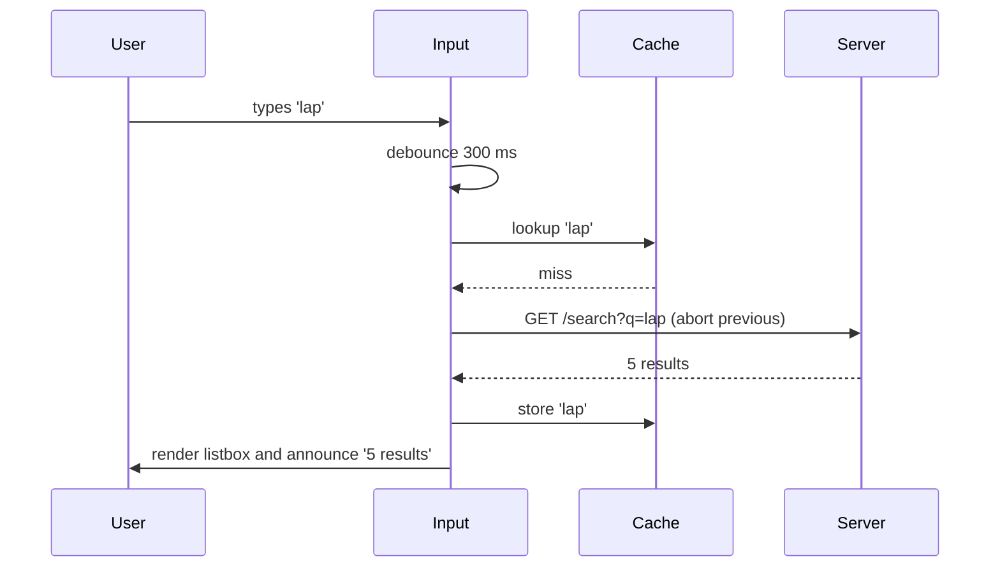
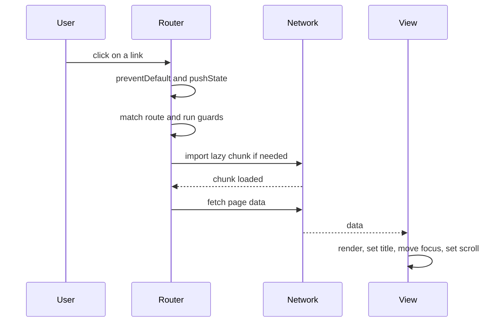

# Frontend Engineering — Mixed Interview Questions

> This file is mixed and cross-topic practice for the whole frontend subject: HTML, CSS, the DOM, accessibility, performance, state, data fetching, React, rendering strategies and build tools. Each topic document already has its own interview questions. Use this file after you have studied the topics, and again right before interviews.

## Table of contents

1. [All topic questions at a glance](#all-topic-questions-at-a-glance)
2. [Mixed and cross-topic questions](#mixed-and-cross-topic-questions)
3. [Rapid revision round](#rapid-revision-round)
4. [Summary](#summary)

## All topic questions at a glance

### [HTML Semantics and Forms](./01-html-semantics-and-forms.md)

- [Q1. What is semantic HTML, and why does it matter?](./01-html-semantics-and-forms.md#q1-what-is-semantic-html-and-why-does-it-matter)
- [Q2. What is the difference between div, section and article?](./01-html-semantics-and-forms.md#q2-what-is-the-difference-between-div-section-and-article)
- [Q3. A user clicks a "+1" button in a form and the page reloads. Why?](./01-html-semantics-and-forms.md#q3-a-user-clicks-a-1-button-in-a-form-and-the-page-reloads-why)
- [Q4. What is the difference between GET and POST for form submission?](./01-html-semantics-and-forms.md#q4-what-is-the-difference-between-get-and-post-for-form-submission)
- [Q5. How does native form validation work, and how do you show your own error messages?](./01-html-semantics-and-forms.md#q5-how-does-native-form-validation-work-and-how-do-you-show-your-own-error-messages)
- [Q6. What does this code print?](./01-html-semantics-and-forms.md#q6-what-does-this-code-print)
- [Q7. Why do form fields need labels? What are the ways to label a field?](./01-html-semantics-and-forms.md#q7-why-do-form-fields-need-labels-what-are-the-ways-to-label-a-field)
- [Q8. Explain srcset, sizes and the picture element. When do you use each?](./01-html-semantics-and-forms.md#q8-explain-srcset-sizes-and-the-picture-element-when-do-you-use-each)
- [Q9. How do you write good alt text?](./01-html-semantics-and-forms.md#q9-how-do-you-write-good-alt-text)
- [Q10. What is the difference between `defer`, `async` and `type="module"` on a script?](./01-html-semantics-and-forms.md#q10-what-is-the-difference-between-defer-async-and-typemodule-on-a-script)
- [Q11. Which meta tags are important, and why?](./01-html-semantics-and-forms.md#q11-which-meta-tags-are-important-and-why)
- [Q12. What are data attributes, and what should you watch out for?](./01-html-semantics-and-forms.md#q12-what-are-data-attributes-and-what-should-you-watch-out-for)
- [Q13. What does the iframe `sandbox` attribute do? What is the risk of `allow-scripts allow-same-origin`?](./01-html-semantics-and-forms.md#q13-what-does-the-iframe-sandbox-attribute-do-what-is-the-risk-of-allow-scripts-allow-same-origin)
- [Q14. How do you safely display user-provided text in HTML?](./01-html-semantics-and-forms.md#q14-how-do-you-safely-display-user-provided-text-in-html)
- [Q15. What is the template element, and why use it instead of a hidden div?](./01-html-semantics-and-forms.md#q15-what-is-the-template-element-and-why-use-it-instead-of-a-hidden-div)
- [Q16. When would you use the native dialog element instead of a custom modal?](./01-html-semantics-and-forms.md#q16-when-would-you-use-the-native-dialog-element-instead-of-a-custom-modal)
- [Q17. What are web components? Would you use them in an Angular project?](./01-html-semantics-and-forms.md#q17-what-are-web-components-would-you-use-them-in-an-angular-project)
- [Q18. Scenario: you must build a signup form. Walk me through the HTML decisions.](./01-html-semantics-and-forms.md#q18-scenario-you-must-build-a-signup-form-walk-me-through-the-html-decisions)
- [Q19. Code review: what is wrong with this HTML?](./01-html-semantics-and-forms.md#q19-code-review-what-is-wrong-with-this-html)
- [Q20. Is it wrong to have more than one h1? Does a section "reset" heading levels?](./01-html-semantics-and-forms.md#q20-is-it-wrong-to-have-more-than-one-h1-does-a-section-reset-heading-levels)
- [Q21. What is the difference between `disabled` and `readonly`?](./01-html-semantics-and-forms.md#q21-what-is-the-difference-between-disabled-and-readonly)
- [Q22. What DOM does the browser build when a div is placed inside a paragraph?](./01-html-semantics-and-forms.md#q22-what-dom-does-the-browser-build-when-a-div-is-placed-inside-a-paragraph)

### [CSS Layout and Responsive Design](./02-css-layout-and-responsive-design.md)

- [Q1. What is the cascade, and how does the browser decide which rule wins?](./02-css-layout-and-responsive-design.md#q1-what-is-the-cascade-and-how-does-the-browser-decide-which-rule-wins)
- [Q2. How is specificity calculated? Give examples.](./02-css-layout-and-responsive-design.md#q2-how-is-specificity-calculated-give-examples)
- [Q3. What color is the "Pay" button?](./02-css-layout-and-responsive-design.md#q3-what-color-is-the-pay-button)
- [Q4. What is the difference between content-box and border-box?](./02-css-layout-and-responsive-design.md#q4-what-is-the-difference-between-content-box-and-border-box)
- [Q5. Explain the position values.](./02-css-layout-and-responsive-design.md#q5-explain-the-position-values)
- [Q6. Debugging: a dropdown has `z-index: 9999` but still appears behind the header. Why?](./02-css-layout-and-responsive-design.md#q6-debugging-a-dropdown-has-z-index-9999-but-still-appears-behind-the-header-why)
- [Q7. When do you use flexbox and when do you use grid?](./02-css-layout-and-responsive-design.md#q7-when-do-you-use-flexbox-and-when-do-you-use-grid)
- [Q8. What does `flex: 1` mean? What widths do these items get?](./02-css-layout-and-responsive-design.md#q8-what-does-flex-1-mean-what-widths-do-these-items-get)
- [Q9. How do you center an element horizontally and vertically?](./02-css-layout-and-responsive-design.md#q9-how-do-you-center-an-element-horizontally-and-vertically)
- [Q10. What is the difference between em, rem and px? What font sizes do these elements get?](./02-css-layout-and-responsive-design.md#q10-what-is-the-difference-between-em-rem-and-px-what-font-sizes-do-these-elements-get)
- [Q11. What is the difference between auto-fill and auto-fit in grid?](./02-css-layout-and-responsive-design.md#q11-what-is-the-difference-between-auto-fill-and-auto-fit-in-grid)
- [Q12. What is mobile-first? What is the difference between media queries and container queries?](./02-css-layout-and-responsive-design.md#q12-what-is-mobile-first-what-is-the-difference-between-media-queries-and-container-queries)
- [Q13. Why does `height: 100vh` cut off content on phones, and how do you fix it?](./02-css-layout-and-responsive-design.md#q13-why-does-height-100vh-cut-off-content-on-phones-and-how-do-you-fix-it)
- [Q14. What are CSS custom properties, and how are they different from Sass variables?](./02-css-layout-and-responsive-design.md#q14-what-are-css-custom-properties-and-how-are-they-different-from-sass-variables)
- [Q15. What is the difference between a pseudo-class and a pseudo-element?](./02-css-layout-and-responsive-design.md#q15-what-is-the-difference-between-a-pseudo-class-and-a-pseudo-element)
- [Q16. Which CSS properties are cheap to animate, and why?](./02-css-layout-and-responsive-design.md#q16-which-css-properties-are-cheap-to-animate-and-why)
- [Q17. What is the difference between `display: none`, `visibility: hidden` and `opacity: 0`?](./02-css-layout-and-responsive-design.md#q17-what-is-the-difference-between-display-none-visibility-hidden-and-opacity-0)
- [Q18. Compare BEM, CSS Modules, CSS-in-JS and Tailwind. What would you pick?](./02-css-layout-and-responsive-design.md#q18-compare-bem-css-modules-css-in-js-and-tailwind-what-would-you-pick)
- [Q19. How does Angular's view encapsulation work? What is `::ng-deep`?](./02-css-layout-and-responsive-design.md#q19-how-does-angulars-view-encapsulation-work-what-is-ng-deep)
- [Q20. What is the gap between these two boxes?](./02-css-layout-and-responsive-design.md#q20-what-is-the-gap-between-these-two-boxes)
- [Q21. Debugging: text-overflow ellipsis does not work inside a flex row, and the button is pushed out. Why?](./02-css-layout-and-responsive-design.md#q21-debugging-text-overflow-ellipsis-does-not-work-inside-a-flex-row-and-the-button-is-pushed-out-why)
- [Q22. What can you do with `:has()`?](./02-css-layout-and-responsive-design.md#q22-what-can-you-do-with-has)
- [Q23. Scenario: build the layout for an admin dashboard (header, collapsible sidebar, main area with a grid of widgets). How do you approach it?](./02-css-layout-and-responsive-design.md#q23-scenario-build-the-layout-for-an-admin-dashboard-header-collapsible-sidebar-main-area-with-a-grid-of-widgets-how-do-you-approach-it)
- [Q24. Debugging: `position: sticky` does not stick. What do you check?](./02-css-layout-and-responsive-design.md#q24-debugging-position-sticky-does-not-stick-what-do-you-check)

### [DOM and Events](./03-dom-and-events.md)

- [Q1. What is the DOM?](./03-dom-and-events.md#q1-what-is-the-dom)
- [Q2. Explain event propagation.](./03-dom-and-events.md#q2-explain-event-propagation)
- [Q3. What does this print when the button is clicked?](./03-dom-and-events.md#q3-what-does-this-print-when-the-button-is-clicked)
- [Q4. What is the difference between stopPropagation, stopImmediatePropagation and preventDefault?](./03-dom-and-events.md#q4-what-is-the-difference-between-stoppropagation-stopimmediatepropagation-and-preventdefault)
- [Q5. What is event delegation? Implement it.](./03-dom-and-events.md#q5-what-is-event-delegation-implement-it)
- [Q6. What is the difference between event.target and event.currentTarget?](./03-dom-and-events.md#q6-what-is-the-difference-between-eventtarget-and-eventcurrenttarget)
- [Q7. innerHTML, textContent or innerText: which do you use and why?](./03-dom-and-events.md#q7-innerhtml-textcontent-or-innertext-which-do-you-use-and-why)
- [Q8. What does this print? (attributes versus properties)](./03-dom-and-events.md#q8-what-does-this-print-attributes-versus-properties)
- [Q9. Find the bug: why are only some paragraphs updated?](./03-dom-and-events.md#q9-find-the-bug-why-are-only-some-paragraphs-updated)
- [Q10. Debugging: removeEventListener does not remove the listener. What are the possible causes?](./03-dom-and-events.md#q10-debugging-removeeventlistener-does-not-remove-the-listener-what-are-the-possible-causes)
- [Q11. What are passive event listeners, and why do they matter?](./03-dom-and-events.md#q11-what-are-passive-event-listeners-and-why-do-they-matter)
- [Q12. How do you create and dispatch a custom event? What does this print?](./03-dom-and-events.md#q12-how-do-you-create-and-dispatch-a-custom-event-what-does-this-print)
- [Q13. What is the order of logs here? Does it change if a real user clicks?](./03-dom-and-events.md#q13-what-is-the-order-of-logs-here-does-it-change-if-a-real-user-clicks)
- [Q14. How would you implement lazy loading or infinite scroll?](./03-dom-and-events.md#q14-how-would-you-implement-lazy-loading-or-infinite-scroll)
- [Q15. Compare IntersectionObserver, MutationObserver and ResizeObserver.](./03-dom-and-events.md#q15-compare-intersectionobserver-mutationobserver-and-resizeobserver)
- [Q16. What is layout thrashing, and how do you avoid it?](./03-dom-and-events.md#q16-what-is-layout-thrashing-and-how-do-you-avoid-it)
- [Q17. Scenario: you must display 10,000 rows from an API. How do you keep the page fast?](./03-dom-and-events.md#q17-scenario-you-must-display-10000-rows-from-an-api-how-do-you-keep-the-page-fast)
- [Q18. What is the difference between DOMContentLoaded and load?](./03-dom-and-events.md#q18-what-is-the-difference-between-domcontentloaded-and-load)
- [Q19. Which events do not bubble, and how do you still handle them on a parent?](./03-dom-and-events.md#q19-which-events-do-not-bubble-and-how-do-you-still-handle-them-on-a-parent)
- [Q20. Scenario: your single-page app gets slower every time the user opens and closes a page. What do you suspect?](./03-dom-and-events.md#q20-scenario-your-single-page-app-gets-slower-every-time-the-user-opens-and-closes-a-page-what-do-you-suspect)
- [Q21. Code review: what is wrong with this code?](./03-dom-and-events.md#q21-code-review-what-is-wrong-with-this-code)
- [Q22. What is the difference between event.key and event.code?](./03-dom-and-events.md#q22-what-is-the-difference-between-eventkey-and-eventcode)
- [Q23. Why use pointer events instead of mouse and touch events?](./03-dom-and-events.md#q23-why-use-pointer-events-instead-of-mouse-and-touch-events)
- [Q24. How does Angular handle DOM events compared to plain JavaScript?](./03-dom-and-events.md#q24-how-does-angular-handle-dom-events-compared-to-plain-javascript)

### [Accessibility](./04-accessibility.md)

- [Q1. What is web accessibility, and why does it matter?](./04-accessibility.md#q1-what-is-web-accessibility-and-why-does-it-matter)
- [Q2. Explain the WCAG POUR principles and the conformance levels.](./04-accessibility.md#q2-explain-the-wcag-pour-principles-and-the-conformance-levels)
- [Q3. What is ARIA, and what is the first rule of ARIA?](./04-accessibility.md#q3-what-is-aria-and-what-is-the-first-rule-of-aria)
- [Q4. How is an element's accessible name calculated?](./04-accessibility.md#q4-how-is-an-elements-accessible-name-calculated)
- [Q5. How do you make a site fully usable with the keyboard?](./04-accessibility.md#q5-how-do-you-make-a-site-fully-usable-with-the-keyboard)
- [Q6. How do you build an accessible modal dialog?](./04-accessibility.md#q6-how-do-you-build-an-accessible-modal-dialog)
- [Q7. In a single-page app, what accessibility problem appears on route changes, and how do you fix it?](./04-accessibility.md#q7-in-a-single-page-app-what-accessibility-problem-appears-on-route-changes-and-how-do-you-fix-it)
- [Q8. What are live regions, and when do you use polite versus assertive?](./04-accessibility.md#q8-what-are-live-regions-and-when-do-you-use-polite-versus-assertive)
- [Q9. What contrast ratios does WCAG require?](./04-accessibility.md#q9-what-contrast-ratios-does-wcag-require)
- [Q10. How do you make form errors accessible?](./04-accessibility.md#q10-how-do-you-make-form-errors-accessible)
- [Q11. Code review: what accessibility problems do you see?](./04-accessibility.md#q11-code-review-what-accessibility-problems-do-you-see)
- [Q12. A button shows only an icon. How do you make it accessible?](./04-accessibility.md#q12-a-button-shows-only-an-icon-how-do-you-make-it-accessible)
- [Q13. How do you test accessibility?](./04-accessibility.md#q13-how-do-you-test-accessibility)
- [Q14. What is a skip link, and how do you implement it?](./04-accessibility.md#q14-what-is-a-skip-link-and-how-do-you-implement-it)
- [Q15. How would you build an accessible autocomplete (combobox)?](./04-accessibility.md#q15-how-would-you-build-an-accessible-autocomplete-combobox)
- [Q16. What is the difference between hiding content with `display: none`, `aria-hidden`, `inert` and a visually-hidden class?](./04-accessibility.md#q16-what-is-the-difference-between-hiding-content-with-display-none-aria-hidden-inert-and-a-visually-hidden-class)
- [Q17. How does the Angular CDK help with accessibility?](./04-accessibility.md#q17-how-does-the-angular-cdk-help-with-accessibility)
- [Q18. Scenario: a product manager wants a carousel that auto-rotates every 3 seconds on the home page. What do you say?](./04-accessibility.md#q18-scenario-a-product-manager-wants-a-carousel-that-auto-rotates-every-3-seconds-on-the-home-page-what-do-you-say)
- [Q19. Which WCAG 2.2 additions affect frontend developers most?](./04-accessibility.md#q19-which-wcag-22-additions-affect-frontend-developers-most)
- [Q20. Is it enough to add `role="button"` and `tabindex="0"` to a div?](./04-accessibility.md#q20-is-it-enough-to-add-rolebutton-and-tabindex0-to-a-div)

### [Web Performance and Core Web Vitals](./05-web-performance-and-core-web-vitals.md)

- [Q1. What are Core Web Vitals, and what are the thresholds?](./05-web-performance-and-core-web-vitals.md#q1-what-are-core-web-vitals-and-what-are-the-thresholds)
- [Q2. What is LCP and how do you improve it?](./05-web-performance-and-core-web-vitals.md#q2-what-is-lcp-and-how-do-you-improve-it)
- [Q3. What is INP and why did it replace FID?](./05-web-performance-and-core-web-vitals.md#q3-what-is-inp-and-why-did-it-replace-fid)
- [Q4. What causes layout shifts and how do you fix them?](./05-web-performance-and-core-web-vitals.md#q4-what-causes-layout-shifts-and-how-do-you-fix-them)
- [Q5. Lighthouse gives a score of 95, but real-user data says the page is slow. How is that possible?](./05-web-performance-and-core-web-vitals.md#q5-lighthouse-gives-a-score-of-95-but-real-user-data-says-the-page-is-slow-how-is-that-possible)
- [Q6. The page is slow. How do you investigate?](./05-web-performance-and-core-web-vitals.md#q6-the-page-is-slow-how-do-you-investigate)
- [Q7. What is a long task, and how do you break one up?](./05-web-performance-and-core-web-vitals.md#q7-what-is-a-long-task-and-how-do-you-break-one-up)
- [Q8. Output prediction: does await Promise.resolve() let the browser paint?](./05-web-performance-and-core-web-vitals.md#q8-output-prediction-does-await-promiseresolve-let-the-browser-paint)
- [Q9. Find the bug: this code makes resizing very slow](./05-web-performance-and-core-web-vitals.md#q9-find-the-bug-this-code-makes-resizing-very-slow)
- [Q10. What is the difference between `async`, `defer` and `type="module"` scripts?](./05-web-performance-and-core-web-vitals.md#q10-what-is-the-difference-between-async-defer-and-typemodule-scripts)
- [Q11. What is the difference between `preload`, `prefetch` and `preconnect`?](./05-web-performance-and-core-web-vitals.md#q11-what-is-the-difference-between-preload-prefetch-and-preconnect)
- [Q12. How do you cache static assets, and how do users get new code after a deploy?](./05-web-performance-and-core-web-vitals.md#q12-how-do-you-cache-static-assets-and-how-do-users-get-new-code-after-a-deploy)
- [Q13. How do you decide what to code-split?](./05-web-performance-and-core-web-vitals.md#q13-how-do-you-decide-what-to-code-split)
- [Q14. How would you show a table with 10,000 rows?](./05-web-performance-and-core-web-vitals.md#q14-how-would-you-show-a-table-with-10000-rows)
- [Q15. When would you use a Web Worker, and what are its limits?](./05-web-performance-and-core-web-vitals.md#q15-when-would-you-use-a-web-worker-and-what-are-its-limits)
- [Q16. Why should you animate `transform` and `opacity` instead of `top`, `left` or `width`?](./05-web-performance-and-core-web-vitals.md#q16-why-should-you-animate-transform-and-opacity-instead-of-top-left-or-width)
- [Q17. How do you optimize images on a website?](./05-web-performance-and-core-web-vitals.md#q17-how-do-you-optimize-images-on-a-website)
- [Q18. What is `font-display` and which value would you choose?](./05-web-performance-and-core-web-vitals.md#q18-what-is-font-display-and-which-value-would-you-choose)
- [Q19. Calculate the Total Blocking Time](./05-web-performance-and-core-web-vitals.md#q19-calculate-the-total-blocking-time)
- [Q20. How do you prevent performance regressions in a team?](./05-web-performance-and-core-web-vitals.md#q20-how-do-you-prevent-performance-regressions-in-a-team)
- [Q21. Scenario: marketing added a chat widget and a tag manager, and LCP and INP got worse. What do you do?](./05-web-performance-and-core-web-vitals.md#q21-scenario-marketing-added-a-chat-widget-and-a-tag-manager-and-lcp-and-inp-got-worse-what-do-you-do)
- [Q22. When does memoization help, and when does it hurt?](./05-web-performance-and-core-web-vitals.md#q22-when-does-memoization-help-and-when-does-it-hurt)
- [Q23. How do SSR and CSR affect Core Web Vitals?](./05-web-performance-and-core-web-vitals.md#q23-how-do-ssr-and-csr-affect-core-web-vitals)

### [Components and State Management](./06-components-and-state-management.md)

- [Q1. What is component-based architecture, and what makes a component reusable?](./06-components-and-state-management.md#q1-what-is-component-based-architecture-and-what-makes-a-component-reusable)
- [Q2. What is the difference between presentational and container components?](./06-components-and-state-management.md#q2-what-is-the-difference-between-presentational-and-container-components)
- [Q3. How do components communicate? How do two sibling components share data?](./06-components-and-state-management.md#q3-how-do-components-communicate-how-do-two-sibling-components-share-data)
- [Q4. What kinds of state exist in a frontend app, and where do you keep each?](./06-components-and-state-management.md#q4-what-kinds-of-state-exist-in-a-frontend-app-and-where-do-you-keep-each)
- [Q5. What does "lifting state up" mean? When would you do it?](./06-components-and-state-management.md#q5-what-does-lifting-state-up-mean-when-would-you-do-it)
- [Q6. What is derived state, and why shouldn't you store it?](./06-components-and-state-management.md#q6-what-is-derived-state-and-why-shouldnt-you-store-it)
- [Q7. Why is immutability important in frontend state management?](./06-components-and-state-management.md#q7-why-is-immutability-important-in-frontend-state-management)
- [Q8. Output prediction: what does this print?](./06-components-and-state-management.md#q8-output-prediction-what-does-this-print)
- [Q9. What is unidirectional data flow?](./06-components-and-state-management.md#q9-what-is-unidirectional-data-flow)
- [Q10. When would you introduce a global store like NgRx or Redux, and when would you avoid it?](./06-components-and-state-management.md#q10-when-would-you-introduce-a-global-store-like-ngrx-or-redux-and-when-would-you-avoid-it)
- [Q11. What is the difference between server state and client state? What does a library like TanStack Query do?](./06-components-and-state-management.md#q11-what-is-the-difference-between-server-state-and-client-state-what-does-a-library-like-tanstack-query-do)
- [Q12. What is prop drilling? How do you avoid it?](./06-components-and-state-management.md#q12-what-is-prop-drilling-how-do-you-avoid-it)
- [Q13. What are the pros and cons of an event bus?](./06-components-and-state-management.md#q13-what-are-the-pros-and-cons-of-an-event-bus)
- [Q14. Code review: what is wrong with this component?](./06-components-and-state-management.md#q14-code-review-what-is-wrong-with-this-component)
- [Q15. Design the API of a reusable modal dialog component.](./06-components-and-state-management.md#q15-design-the-api-of-a-reusable-modal-dialog-component)
- [Q16. Write a minimal store with `dispatch`, `subscribe` and `getState`.](./06-components-and-state-management.md#q16-write-a-minimal-store-with-dispatch-subscribe-and-getstate)
- [Q17. Scenario: users complain that the filters on the orders page reset when they reload or press Back. How do you fix it?](./06-components-and-state-management.md#q17-scenario-users-complain-that-the-filters-on-the-orders-page-reset-when-they-reload-or-press-back-how-do-you-fix-it)
- [Q18. What is a design system, and how is it different from a component library?](./06-components-and-state-management.md#q18-what-is-a-design-system-and-how-is-it-different-from-a-component-library)
- [Q19. In Angular 16, would you use RxJS, signals or NgRx for shared state?](./06-components-and-state-management.md#q19-in-angular-16-would-you-use-rxjs-signals-or-ngrx-for-shared-state)
- [Q20. How do you keep a global store from becoming a dumping ground?](./06-components-and-state-management.md#q20-how-do-you-keep-a-global-store-from-becoming-a-dumping-ground)

### [API Integration and Data Fetching](./07-api-integration-and-data-fetching.md)

- [Q1. Output prediction: does `fetch` reject on a 404?](./07-api-integration-and-data-fetching.md#q1-output-prediction-does-fetch-reject-on-a-404)
- [Q2. How do you handle errors properly with `fetch`?](./07-api-integration-and-data-fetching.md#q2-how-do-you-handle-errors-properly-with-fetch)
- [Q3. Compare `fetch`, axios and Angular `HttpClient`.](./07-api-integration-and-data-fetching.md#q3-compare-fetch-axios-and-angular-httpclient)
- [Q4. How do you model loading, error, empty and success states?](./07-api-integration-and-data-fetching.md#q4-how-do-you-model-loading-error-empty-and-success-states)
- [Q5. How do you add a timeout to `fetch` and cancel requests?](./07-api-integration-and-data-fetching.md#q5-how-do-you-add-a-timeout-to-fetch-and-cancel-requests)
- [Q6. Implement retry with exponential backoff. Which requests should be retried?](./07-api-integration-and-data-fetching.md#q6-implement-retry-with-exponential-backoff-which-requests-should-be-retried)
- [Q7. Scenario: in a search box, sometimes the results don't match the text the user typed. Why, and how do you fix it?](./07-api-integration-and-data-fetching.md#q7-scenario-in-a-search-box-sometimes-the-results-dont-match-the-text-the-user-typed-why-and-how-do-you-fix-it)
- [Q8. Write a function that de-duplicates identical in-flight requests.](./07-api-integration-and-data-fetching.md#q8-write-a-function-that-de-duplicates-identical-in-flight-requests)
- [Q9. What is stale-while-revalidate?](./07-api-integration-and-data-fetching.md#q9-what-is-stale-while-revalidate)
- [Q10. How do you keep cached data correct after the user changes something?](./07-api-integration-and-data-fetching.md#q10-how-do-you-keep-cached-data-correct-after-the-user-changes-something)
- [Q11. What are optimistic updates? When would you avoid them?](./07-api-integration-and-data-fetching.md#q11-what-are-optimistic-updates-when-would-you-avoid-them)
- [Q12. Offset vs cursor pagination: what are the trade-offs?](./07-api-integration-and-data-fetching.md#q12-offset-vs-cursor-pagination-what-are-the-trade-offs)
- [Q13. Implement infinite scroll.](./07-api-integration-and-data-fetching.md#q13-implement-infinite-scroll)
- [Q14. Polling, Server-Sent Events or WebSockets: how do you choose?](./07-api-integration-and-data-fetching.md#q14-polling-server-sent-events-or-websockets-how-do-you-choose)
- [Q15. How do you upload a file with a progress bar?](./07-api-integration-and-data-fetching.md#q15-how-do-you-upload-a-file-with-a-progress-bar)
- [Q16. Where should a single-page app store authentication tokens?](./07-api-integration-and-data-fetching.md#q16-where-should-a-single-page-app-store-authentication-tokens)
- [Q17. Several requests fail with 401 at the same time because the access token expired. How do you refresh the token correctly?](./07-api-integration-and-data-fetching.md#q17-several-requests-fail-with-401-at-the-same-time-because-the-access-token-expired-how-do-you-refresh-the-token-correctly)
- [Q18. You see a CORS error in the console. What does it mean, and how do you fix it?](./07-api-integration-and-data-fetching.md#q18-you-see-a-cors-error-in-the-console-what-does-it-mean-and-how-do-you-fix-it)
- [Q19. How would you design the API layer of a large frontend app?](./07-api-integration-and-data-fetching.md#q19-how-would-you-design-the-api-layer-of-a-large-frontend-app)
- [Q20. Output prediction: `Promise.all` vs `Promise.allSettled` for a dashboard](./07-api-integration-and-data-fetching.md#q20-output-prediction-promiseall-vs-promiseallsettled-for-a-dashboard)
- [Q21. What makes a good error message in the UI?](./07-api-integration-and-data-fetching.md#q21-what-makes-a-good-error-message-in-the-ui)
- [Q22. Why validate API responses at runtime if you already use TypeScript?](./07-api-integration-and-data-fetching.md#q22-why-validate-api-responses-at-runtime-if-you-already-use-typescript)

### [React Essentials](./08-react-essentials.md)

- [Q1. What is the virtual DOM, and how does reconciliation work?](./08-react-essentials.md#q1-what-is-the-virtual-dom-and-how-does-reconciliation-work)
- [Q2. Output prediction: what does the button show after one click?](./08-react-essentials.md#q2-output-prediction-what-does-the-button-show-after-one-click)
- [Q3. When does a React component re-render?](./08-react-essentials.md#q3-when-does-a-react-component-re-render)
- [Q4. Why are keys important in lists? Why is using the index a problem?](./08-react-essentials.md#q4-why-are-keys-important-in-lists-why-is-using-the-index-a-problem)
- [Q5. Explain `useEffect`: dependencies, cleanup and common mistakes.](./08-react-essentials.md#q5-explain-useeffect-dependencies-cleanup-and-common-mistakes)
- [Q6. Find the bug: why does this timer stop at 1?](./08-react-essentials.md#q6-find-the-bug-why-does-this-timer-stop-at-1)
- [Q7. When should you use `useMemo`, `useCallback` and `React.memo`?](./08-react-essentials.md#q7-when-should-you-use-usememo-usecallback-and-reactmemo)
- [Q8. What is the difference between controlled and uncontrolled inputs?](./08-react-essentials.md#q8-what-is-the-difference-between-controlled-and-uncontrolled-inputs)
- [Q9. What are the rules of hooks, and why do they exist?](./08-react-essentials.md#q9-what-are-the-rules-of-hooks-and-why-do-they-exist)
- [Q10. What is a custom hook? Write one.](./08-react-essentials.md#q10-what-is-a-custom-hook-write-one)
- [Q11. How does context work, and what are its performance pitfalls?](./08-react-essentials.md#q11-how-does-context-work-and-what-are-its-performance-pitfalls)
- [Q12. How do you fetch data in React correctly?](./08-react-essentials.md#q12-how-do-you-fetch-data-in-react-correctly)
- [Q13. What did React 18 change? Explain automatic batching and transitions.](./08-react-essentials.md#q13-what-did-react-18-change-explain-automatic-batching-and-transitions)
- [Q14. What are the main new features in React 19?](./08-react-essentials.md#q14-what-are-the-main-new-features-in-react-19)
- [Q15. Output prediction: what renders when the cart is empty?](./08-react-essentials.md#q15-output-prediction-what-renders-when-the-cart-is-empty)
- [Q16. React vs Angular: how would you compare them?](./08-react-essentials.md#q16-react-vs-angular-how-would-you-compare-them)
- [Q17. Scenario: typing in a search input is laggy because a big list re-renders on every keystroke. What do you do?](./08-react-essentials.md#q17-scenario-typing-in-a-search-input-is-laggy-because-a-big-list-re-renders-on-every-keystroke-what-do-you-do)
- [Q18. What does Strict Mode do?](./08-react-essentials.md#q18-what-does-strict-mode-do)

### [Rendering Strategies: CSR, SSR, SSG and More](./09-rendering-strategies-csr-ssr-ssg.md)

- [Q1. What is the difference between CSR, SSR and SSG?](./09-rendering-strategies-csr-ssr-ssg.md#q1-what-is-the-difference-between-csr-ssr-and-ssg)
- [Q2. What is hydration, and why can it be expensive?](./09-rendering-strategies-csr-ssr-ssg.md#q2-what-is-hydration-and-why-can-it-be-expensive)
- [Q3. When would you choose SSR over CSR? When would you not?](./09-rendering-strategies-csr-ssr-ssg.md#q3-when-would-you-choose-ssr-over-csr-when-would-you-not)
- [Q4. What is ISR, and how is it different from SSG and SSR?](./09-rendering-strategies-csr-ssr-ssg.md#q4-what-is-isr-and-how-is-it-different-from-ssg-and-ssr)
- [Q5. What is streaming SSR, and what problem does it solve?](./09-rendering-strategies-csr-ssr-ssg.md#q5-what-is-streaming-ssr-and-what-problem-does-it-solve)
- [Q6. What are islands architecture and partial hydration?](./09-rendering-strategies-csr-ssr-ssg.md#q6-what-are-islands-architecture-and-partial-hydration)
- [Q7. What are React Server Components, and how are they different from SSR?](./09-rendering-strategies-csr-ssr-ssg.md#q7-what-are-react-server-components-and-how-are-they-different-from-ssr)
- [Q8. How does SSR work in Angular 16, and what changed in newer versions?](./09-rendering-strategies-csr-ssr-ssg.md#q8-how-does-ssr-work-in-angular-16-and-what-changed-in-newer-versions)
- [Q9. Scenario: you are building an e-commerce site. Which rendering strategies do you use?](./09-rendering-strategies-csr-ssr-ssg.md#q9-scenario-you-are-building-an-e-commerce-site-which-rendering-strategies-do-you-use)
- [Q10. Scenario: an internal admin portal built with Angular is slow on first load. Should you add SSR?](./09-rendering-strategies-csr-ssr-ssg.md#q10-scenario-an-internal-admin-portal-built-with-angular-is-slow-on-first-load-should-you-add-ssr)
- [Q11. How do rendering strategies affect SEO?](./09-rendering-strategies-csr-ssr-ssg.md#q11-how-do-rendering-strategies-affect-seo)
- [Q12. Find the bug: this Angular component crashes during server-side rendering.](./09-rendering-strategies-csr-ssr-ssg.md#q12-find-the-bug-this-angular-component-crashes-during-server-side-rendering)
- [Q13. What is edge rendering, and when does it not help?](./09-rendering-strategies-csr-ssr-ssg.md#q13-what-is-edge-rendering-and-when-does-it-not-help)
- [Q14. What is resumability?](./09-rendering-strategies-csr-ssr-ssg.md#q14-what-is-resumability)
- [Q15. How do you avoid fetching the same data twice with SSR?](./09-rendering-strategies-csr-ssr-ssg.md#q15-how-do-you-avoid-fetching-the-same-data-twice-with-ssr)
- [Q16. Which rendering strategy for an analytics dashboard with large tables?](./09-rendering-strategies-csr-ssr-ssg.md#q16-which-rendering-strategy-for-an-analytics-dashboard-with-large-tables)

### [Build Tools and Bundlers](./10-build-tools-and-bundlers.md)

- [Q1. Why do we need bundlers if browsers support ES modules?](./10-build-tools-and-bundlers.md#q1-why-do-we-need-bundlers-if-browsers-support-es-modules)
- [Q2. What is the difference between transpiling and bundling?](./10-build-tools-and-bundlers.md#q2-what-is-the-difference-between-transpiling-and-bundling)
- [Q3. What is tree shaking, and why might it not work?](./10-build-tools-and-bundlers.md#q3-what-is-tree-shaking-and-why-might-it-not-work)
- [Q4. Code review: why is this bundle 70 KB bigger than expected?](./10-build-tools-and-bundlers.md#q4-code-review-why-is-this-bundle-70-kb-bigger-than-expected)
- [Q5. webpack vs Vite: what is the difference?](./10-build-tools-and-bundlers.md#q5-webpack-vs-vite-what-is-the-difference)
- [Q6. How does the Angular CLI build an app in Angular 16, and what changed in Angular 17?](./10-build-tools-and-bundlers.md#q6-how-does-the-angular-cli-build-an-app-in-angular-16-and-what-changed-in-angular-17)
- [Q7. How does code splitting work, and how do you control chunk names and prefetching?](./10-build-tools-and-bundlers.md#q7-how-does-code-splitting-work-and-how-do-you-control-chunk-names-and-prefetching)
- [Q8. What are source maps, and should you deploy them to production?](./10-build-tools-and-bundlers.md#q8-what-are-source-maps-and-should-you-deploy-them-to-production)
- [Q9. How do environment variables work in a frontend build? Can you store an API secret there?](./10-build-tools-and-bundlers.md#q9-how-do-environment-variables-work-in-a-frontend-build-can-you-store-an-api-secret-there)
- [Q10. What is the difference between a polyfill and a syntax transform? What is browserslist?](./10-build-tools-and-bundlers.md#q10-what-is-the-difference-between-a-polyfill-and-a-syntax-transform-what-is-browserslist)
- [Q11. Why do fast transpilers like esbuild and SWC not catch type errors?](./10-build-tools-and-bundlers.md#q11-why-do-fast-transpilers-like-esbuild-and-swc-not-catch-type-errors)
- [Q12. Scenario: after a deploy, some users see a blank page or "ChunkLoadError". What happened?](./10-build-tools-and-bundlers.md#q12-scenario-after-a-deploy-some-users-see-a-blank-page-or-chunkloaderror-what-happened)
- [Q13. What is Module Federation, and when would you use it?](./10-build-tools-and-bundlers.md#q13-what-is-module-federation-and-when-would-you-use-it)
- [Q14. What is the difference between ESLint and Prettier?](./10-build-tools-and-bundlers.md#q14-what-is-the-difference-between-eslint-and-prettier)
- [Q15. What is HMR, and how is it different from live reload?](./10-build-tools-and-bundlers.md#q15-what-is-hmr-and-how-is-it-different-from-live-reload)
- [Q16. What do monorepo tools like Nx and Turborepo add on top of npm workspaces?](./10-build-tools-and-bundlers.md#q16-what-do-monorepo-tools-like-nx-and-turborepo-add-on-top-of-npm-workspaces)
- [Q17. Output prediction: what does this print, and what does a production bundler do with the `if`?](./10-build-tools-and-bundlers.md#q17-output-prediction-what-does-this-print-and-what-does-a-production-bundler-do-with-the-if)

## Mixed and cross-topic questions

These questions combine several topics. Most of them are scenarios, code reviews or trade-off discussions, because that is how senior frontend interviews usually go: the interviewer starts with one topic and keeps pulling the thread into others.

### Q1. Production issue: after a redesign, the product listing page has bad LCP and bad CLS. How do you investigate and fix it?

**Draws on:** [HTML images](./01-html-semantics-and-forms.md#images-and-responsive-images) · [CSS layout](./02-css-layout-and-responsive-design.md#responsive-design) · [LCP](./05-web-performance-and-core-web-vitals.md#lcp-largest-contentful-paint) · [CLS](./05-web-performance-and-core-web-vitals.md#cls-cumulative-layout-shift) · [Rendering strategies](./09-rendering-strategies-csr-ssr-ssg.md)

**What the interviewer is checking:** That you measure first, know what each metric is made of, and connect HTML, CSS, loading and rendering choices to the numbers.

**Short spoken answer (30–60 seconds):**
> First I confirm the problem with field data, because Lighthouse alone can lie. I look at the 75th percentile for LCP and CLS on mobile in CrUX or our RUM data, and I check which element is the LCP element and which elements shift. Then I reproduce it in the Performance panel with throttling. For LCP, the usual causes after a redesign are a big hero image that is lazy-loaded or discovered late, render-blocking CSS or fonts, or content that only appears after JavaScript runs. I fix that with a properly sized image using `srcset`, `fetchpriority="high"`, no `loading="lazy"` on it, and preloading if needed. For CLS, I give images and ad slots a size with `width`/`height` or `aspect-ratio`, reserve space for banners, and use a font fallback with matching metrics. Then I verify with field data after the deploy.

**Detailed explanation:**

LCP has four parts: server response time (TTFB), the delay before the resource starts loading, the resource download time, and the render delay. A redesign often breaks the second part: the hero image moves into a CSS background or a JavaScript carousel, so the browser's preload scanner cannot find it early.

CLS comes from elements that appear or change size **after** content below them has been painted. Typical redesign causes:

- Images without `width` and `height` attributes (the browser cannot reserve space).
- A cookie or promo banner inserted at the top after load.
- Web fonts that swap and change text size.
- Product cards whose height depends on a price that loads later.

**Code or diagram:**

```html
<!-- ❌ Wrong: lazy, no size, low priority -->


<!-- ✅ Correct: sized, responsive, high priority, found by the preload scanner -->

```

```css
/* Reserve space for content that arrives later */
.product-card__image { aspect-ratio: 4 / 3; width: 100%; }
.promo-slot { min-height: 120px; }
```

**Follow-up questions:**
- **The page is client-side rendered. Does that matter for LCP?** — Yes. With CSR, the LCP element exists only after the JavaScript bundle downloads, runs and fetches data. SSR or SSG puts the HTML (and the image tag) in the first response, so the image can start loading much earlier.
- **Would you lazy-load the product grid images?** — Yes, but not the first row that is visible on load. Lazy-load images below the fold only.
- **How do you prevent this from happening again?** — Add Lighthouse CI with budgets to the pipeline, and alerts on the RUM 75th percentile per page type.

**Common mistakes:** Listing random tips without measuring. Lazy-loading the LCP image. Fixing CLS with `min-height` everywhere instead of finding the element that shifts. Trusting a lab score from a fast laptop.

**Where this is used in real projects:** Every e-commerce or content team that tracks Core Web Vitals for SEO and conversion.

---

### Q2. Design a search-as-you-type autocomplete from end to end. What decisions do you make?

**Draws on:** [Event delegation and keyboard events](./03-dom-and-events.md#keyboard-mouse-pointer-and-focus-events) · [Accessible combobox](./04-accessibility.md#accessible-custom-components) · [Race conditions](./07-api-integration-and-data-fetching.md#race-conditions-and-the-latest-request-wins) · [Caching](./07-api-integration-and-data-fetching.md#client-side-caching-and-stale-while-revalidate) · [Kinds of state](./06-components-and-state-management.md#kinds-of-state)

**What the interviewer is checking:** Whether you can combine networking, state, keyboard behavior and accessibility in one component, instead of only "debounce the input".

**Short spoken answer (30–60 seconds):**
> I split it into four parts. Network: I debounce the input by about 300 ms, skip very short queries, cancel the previous request with an `AbortController` or `switchMap`, and cache results by query so going back to an earlier query is instant. State: I model the request as idle, loading, success, empty and error, plus the active option index. Keyboard and accessibility: I follow the ARIA combobox pattern — the input has `role="combobox"`, `aria-expanded` and `aria-controls`, the list is a `listbox`, arrow keys move `aria-activedescendant` while focus stays in the input, Enter selects and Escape closes. A polite live region announces the number of results. Rendering: I insert result text with `textContent`, and I highlight matches without `innerHTML`.

**Detailed explanation:**

| Concern | Decision | Why |
|---|---|---|
| Too many requests | Debounce 250–300 ms, minimum 2 characters | Saves server load and battery |
| Out-of-order responses | Abort the previous request, and check a request id | Debounce alone does not fix races |
| Repeated queries | In-memory cache keyed by the normalized query | Instant results when the user deletes characters |
| Focus | Focus stays in the input; `aria-activedescendant` points to the active option | Screen readers read the active option, and the user can keep typing |
| Announcements | Polite live region: "5 results available" | Screen reader users know results appeared |
| Safety | `textContent` for labels | Search results may contain user-generated text |
| Mobile | `inputmode`, `autocomplete="off"`, large touch targets (24×24 px or more) | WCAG 2.2 target size |

**Code or diagram:**



**Follow-up questions:**
- **Why not move real focus to the options?** — The user would have to move back to the input to keep typing. The combobox pattern keeps DOM focus in the input and uses `aria-activedescendant` to tell assistive technology which option is active.
- **How do you highlight the matching part safely?** — Split the label string at the match and create `<mark>` and text nodes with `textContent`, instead of building an HTML string.
- **How would you test it?** — Unit test the debounce and race logic with fake timers, and run an end-to-end test with keyboard only and an axe scan.

**Common mistakes:** Only debouncing and forgetting races. Building options with `innerHTML`. Moving focus into the list. No empty and error states. No live region.

**Where this is used in real projects:** Global search in admin portals, product search in shops, address lookup in checkout forms, user pickers.

---

### Q3. Code review: find every problem in this list rendering code.

**Draws on:** [innerHTML vs textContent](./03-dom-and-events.md#innerhtml-textcontent-and-innertext) · [Event delegation](./03-dom-and-events.md#event-delegation) · [Buttons](./01-html-semantics-and-forms.md#buttons-and-the-default-submit-pitfall) · [Accessibility](./04-accessibility.md#semantic-html-first) · [DOM performance](./03-dom-and-events.md#dom-performance)

```html
<form id="cart-form">
  <div id="cart"></div>
  <button>Checkout</button>
</form>
```

```js
function renderCart(items) {
  const cart = document.getElementById("cart");
  cart.innerHTML = "";
  for (const item of items) {
    cart.innerHTML += `
      <div class="row">
        <span>${item.name}</span>
        <div class="remove" onclick="removeItem(${item.id})">x</div>
        <button>+1</button>
      </div>`;
  }
  document.querySelectorAll(".row button").forEach((btn, i) => {
    btn.addEventListener("click", () => addOne(items[i].id));
  });
}
```

**What the interviewer is checking:** Security, correctness, accessibility and performance at the same time.

**Short spoken answer (30–60 seconds):**
> I see four groups of problems. Security: `item.name` goes into `innerHTML`, so a product name with an `` runs script — that is XSS. Correctness: the "+1" buttons are inside a form and have no `type`, so they default to `submit` and reload the page. Accessibility: the remove control is a `div` with an "x", so it is not focusable, has no role and has no useful name. Performance and structure: `innerHTML +=` re-parses the whole list on every iteration, and attaching a listener per button after each render is wasteful. I would build nodes with `textContent`, use real `<button type="button">` elements with `aria-label`s like "Remove Blue mug", and use one delegated click listener on the cart that reads `data-id`.

**Detailed explanation:**

1. **XSS:** any string from a user or an API that goes into `innerHTML` can contain HTML that runs code. Inline `onclick` attributes also block a strict Content Security Policy.
2. **Default submit:** a `<button>` in a `<form>` without `type` is a submit button.
3. **Fake button:** a `div` does not get keyboard focus, does not react to Enter or Space, and is announced as plain text.
4. **Name:** "x" is read as "x". The name must say what is removed.
5. **Performance:** `innerHTML +=` serializes and re-parses all earlier rows each time, so the loop is O(n²) work.
6. **Listener leak risk:** each render adds new listeners to new buttons. It works, but delegation is simpler and survives re-renders.

**Code or diagram:**

```js
// ✅ Correct
const cart = document.getElementById("cart");

function renderCart(items) {
  cart.replaceChildren(...items.map((item) => {
    const row = document.createElement("div");
    row.className = "row";
    row.dataset.id = String(item.id);

    const name = document.createElement("span");
    name.textContent = item.name; // text, never HTML

    const add = document.createElement("button");
    add.type = "button";
    add.dataset.action = "add";
    add.textContent = "+1";
    add.setAttribute("aria-label", `Add one more ${item.name}`);

    const remove = document.createElement("button");
    remove.type = "button";
    remove.dataset.action = "remove";
    remove.textContent = "Remove";
    remove.setAttribute("aria-label", `Remove ${item.name}`);

    row.append(name, add, remove);
    return row;
  }));
}

// One listener for all rows, now and later
cart.addEventListener("click", (event) => {
  const button = event.target.closest("button[data-action]");
  if (!button || !cart.contains(button)) return;
  const id = Number(button.closest(".row").dataset.id);
  if (button.dataset.action === "add") addOne(id);
  else removeItem(id);
});
```

**Follow-up questions:**
- **Would a `<template>` element be better?** — Yes, for bigger rows. Clone the template content, fill the text with `textContent`, and insert. It keeps the markup in HTML and is still safe.
- **How do frameworks avoid this XSS?** — Angular interpolation and React JSX insert text by default. The risk comes back with `[innerHTML]` (Angular sanitizes it) and `dangerouslySetInnerHTML` (React does not sanitize).
- **After removing a row, where should focus go?** — To the next row's remove button, or to the cart heading if the list is empty. Otherwise focus is lost on `body`.

**Common mistakes:** Spotting only the XSS. Fixing the `div` with `role="button"` but forgetting keyboard handling. Forgetting focus management after removal.

**Where this is used in real projects:** Shopping carts, todo lists, admin tables with row actions, any legacy jQuery-style code you must review.

---

### Q4. Output prediction: what does this print when `buy.click()` runs?

**Draws on:** [Event propagation](./03-dom-and-events.md#event-propagation-capture-target-and-bubble) · [stopPropagation](./03-dom-and-events.md#stoppropagation-stopimmediatepropagation-and-preventdefault) · [Event loop](../02-javascript/16-event-loop.md)

```html
<ul id="list"><li><button id="buy">Buy</button></li></ul>
```

```js
list.addEventListener("click", () => console.log("list"));
buy.addEventListener("click", (e) => {
  console.log("buy 1");
  Promise.resolve().then(() => console.log("microtask"));
  e.stopPropagation();
});
buy.addEventListener("click", () => console.log("buy 2"));
document.addEventListener("click", () => console.log("document"), true);
buy.click();
console.log("after");
```

**What the interviewer is checking:** Capture vs bubble, what `stopPropagation` stops (and what it does not), and when microtasks run during a synthetic click.

**Short spoken answer (30–60 seconds):**
> It prints "document", "buy 1", "buy 2", "after", "microtask". The document listener is a capture listener, so it runs first, on the way down. At the target, both button listeners run, because `stopPropagation` only stops the event from moving to other elements — it does not stop other listeners on the same element. That would need `stopImmediatePropagation`. The `list` bubble listener never runs. The microtask runs last because `buy.click()` is synchronous: our script is still on the call stack until "after" is printed.

**Answer (verified with jsdom):**

```text
document
buy 1
buy 2
after
microtask
```

**Detailed explanation:**

1. Capture phase: `window` → `document` (capture listener prints "document") → `ul` → `li`.
2. Target phase: "buy 1" runs. It queues a microtask and calls `stopPropagation()`.
3. Still at the target: "buy 2" runs, because the flag only blocks *other* nodes.
4. Bubble phase is cancelled, so "list" never prints.
5. `click()` returns, "after" prints, the script ends, the stack is empty, and the microtask prints.

**Follow-up questions:**
- **What changes with a real user click?** — In a browser, the microtask queue is emptied after each listener returns, because the stack becomes empty between listeners. The order would be "document", "buy 1", "microtask", "buy 2". There is no "after" line, because no script called `click()`.
- **Why is `stopPropagation` risky in apps?** — Analytics, "click outside to close" handlers and delegated listeners on ancestors stop working. Prefer checking `event.target` in the parent.

**Common mistakes:** Thinking `stopPropagation` also stops "buy 2". Forgetting the capture listener runs first. Putting "microtask" right after "buy 1".

**Where this is used in real projects:** Dropdowns that close on outside clicks, nested clickable cards, and tests that use `.click()` and depend on promise timing.

---

### Q5. Output prediction: a tiny stale-while-revalidate helper

**Draws on:** [Stale-while-revalidate](./07-api-integration-and-data-fetching.md#client-side-caching-and-stale-while-revalidate) · [Server state](./06-components-and-state-management.md#server-state-and-server-state-libraries) · [Async and await](../02-javascript/18-async-await.md)

```js
const cache = new Map();

async function swr(key, fetcher, onUpdate) {
  if (cache.has(key)) {
    onUpdate(cache.get(key), "cache");
  }
  const fresh = await fetcher();
  cache.set(key, fresh);
  onUpdate(fresh, "network");
}

let version = 0;
const fetchUser = async () => `user v${++version}`;
const log = (value, source) => console.log(source, value);

await swr("user", fetchUser, log);
await swr("user", fetchUser, log);
swr("user", fetchUser, log); // no await
console.log("sync end");
```

**What the interviewer is checking:** That you understand the SWR idea (show cached data now, refresh in the background) and the exact async order.

**Short spoken answer (30–60 seconds):**
> The first call has an empty cache, so it only prints "network user v1". The second call finds the cache, prints "cache user v1" immediately, then fetches and prints "network user v2". The third call is not awaited. Its synchronous part runs right away: it prints "cache user v2" and starts the fetch, then hits `await`. So "sync end" prints next, and "network user v3" prints last, in a microtask. This is exactly the SWR experience: the user sees old data instantly and fresh data a moment later.

**Answer (verified with Node.js):**

```text
network user v1
cache user v1
network user v2
cache user v2
sync end
network user v3
```

**Detailed explanation:** An async function runs synchronously until its first `await`. In the third call, `onUpdate(..., "cache")` happens before the `await`, so it prints before "sync end". The `fetcher()` call also starts synchronously (that is when `version` becomes 3). Only the code after `await` waits.

**Follow-up questions:**
- **What is missing for production?** — De-duplication of parallel calls for the same key, error handling (keep showing stale data if the refresh fails), a stale time so you do not refetch on every call, and cache size limits.
- **When is showing stale data wrong?** — For data where an old value causes harm: account balance before a payment, stock levels at checkout, permissions. Then you show a loading state or revalidate first.

**Common mistakes:** Putting "sync end" first (forgetting that code before the first `await` runs synchronously). Putting "cache user v2" after "sync end".

**Where this is used in real projects:** TanStack Query, SWR and RTK Query work this way. Dashboards and lists that reopen often feel instant because of it.

---

### Q6. Scenario: users on cheap Android phones say typing in a large Angular form is laggy. What do you do?

**Draws on:** [INP](./05-web-performance-and-core-web-vitals.md#inp-interaction-to-next-paint) · [Long tasks](./05-web-performance-and-core-web-vitals.md#runtime-performance) · [Angular specifics](./05-web-performance-and-core-web-vitals.md#angular-specifics) · [Derived state](./06-components-and-state-management.md#derived-state) · [Forms](./01-html-semantics-and-forms.md#forms)

**What the interviewer is checking:** That you connect "laggy typing" to INP and main-thread work, and know the Angular 16 levers.

**Short spoken answer (30–60 seconds):**
> Laggy typing is an INP problem: something runs on the main thread for too long after each key press. I record a Performance trace with 4x or 6x CPU throttling and type a few characters. In Angular apps the usual causes are change detection checking a huge component tree on every keystroke, template method calls that recalculate things like totals or filtered lists, and synchronous validators or `valueChanges` subscriptions that do heavy work. My fixes are: `OnPush` on large components, pure pipes or precomputed values instead of method calls in templates, `trackBy` on `*ngFor`, debouncing expensive `valueChanges` work, `updateOn: 'blur'` for fields that do not need per-key validation, and splitting the form into sections. Then I confirm the INP improvement with field data.

**Detailed explanation:**

| What the trace shows | Likely cause | Fix |
|---|---|---|
| Long "Recalculate style" and "Layout" after each key | Huge DOM, or the form re-renders many rows | Split into steps or tabs, virtualize long lists |
| Long scripting with many Angular change detection frames | Default change detection on a big tree | `OnPush`, immutable inputs |
| Same function called hundreds of times | Method calls in the template | Pure pipe, or compute once when inputs change |
| Long task in a `valueChanges` subscriber | Heavy filtering or API calls per key | `debounceTime`, `distinctUntilChanged`, move work to a Web Worker |

**Code or diagram:**

```ts
// ❌ Wrong: runs on every change detection cycle, for every row
// <td>{{ calculateLineTotal(line) }}</td>

// ✅ Correct (Angular 16): pure pipe runs only when the input reference changes
@Pipe({ name: 'lineTotal', standalone: true, pure: true })
export class LineTotalPipe implements PipeTransform {
  transform(line: OrderLine): number {
    return line.quantity * line.unitPrice;
  }
}
// <td>{{ line | lineTotal }}</td>
```

**Follow-up questions:**
- **Does the lag show in Lighthouse?** — Usually not. Lighthouse loads the page; it does not type. Use field INP data, or record your own interaction trace. TBT in the lab only hints at it.
- **What about signals?** — In Angular 16 signals are a developer preview. Newer Angular versions use signals for finer-grained updates and support zoneless apps, which reduce change detection cost.
- **Is `updateOn: 'blur'` always fine?** — No. Fields like a password strength meter or a character counter need per-key updates. Choose per field.

**Common mistakes:** Blaming the network. Debouncing the input itself, which makes the typed characters appear late. Optimizing without a trace.

**Where this is used in real projects:** Insurance and banking forms, order entry screens, admin settings pages with hundreds of fields.

---

### Q7. Design a reusable data table component for an admin portal. What does its API look like, and what does it own?

**Draws on:** [Designing reusable components](./06-components-and-state-management.md#designing-reusable-components) · [State ownership](./06-components-and-state-management.md#state-ownership-and-lifting-state-up) · [Virtualization](./05-web-performance-and-core-web-vitals.md#large-dom-and-list-virtualization) · [Pagination](./07-api-integration-and-data-fetching.md#pagination-and-infinite-scroll) · [Accessibility](./04-accessibility.md#accessible-custom-components)

**What the interviewer is checking:** Component API design, where state lives, and whether you think about performance and accessibility up front.

**Short spoken answer (30–60 seconds):**
> I make the table a presentational component. It receives rows, column definitions, the current sort and the current page as inputs, and it emits events like `sortChange`, `pageChange` and `rowAction`. It does not fetch data itself, because sorting and filtering on large data sets must happen on the server, and the page should own that state — ideally in the URL query params so reload and the Back button work. Column templates let teams customize cells without forking the component. I use a real `<table>` with `<th scope="col">` and `aria-sort` on the sorted header, and sort buttons inside the headers. For very long lists I prefer server pagination; I add virtualization only when users really need to scroll thousands of rows, because virtualization hurts find-in-page and screen reader navigation.

**Detailed explanation:**

| Owned by the table | Owned by the page (container) |
|---|---|
| Column widths, hover, focus within the grid | Data fetching and request state |
| Rendering cells from templates | Sort, filter and page (in the URL) |
| Emitting user intent (sort clicked, page changed) | Selection that other components use |
| Empty and loading visuals (from inputs) | Error handling and retry |

A good rule: **the table never decides what data means.** It only shows what it is given and reports what the user wants.

**Code or diagram:**

```ts
// Angular 16 API sketch
@Component({
  selector: 'app-data-table',
  changeDetection: ChangeDetectionStrategy.OnPush,
  templateUrl: './data-table.component.html',
})
export class DataTableComponent<T> {
  @Input({ required: true }) rows: readonly T[] = [];
  @Input({ required: true }) columns: readonly ColumnDef<T>[] = [];
  @Input() sort: { column: string; direction: 'asc' | 'desc' } | null = null;
  @Input() loading = false;
  @Input() trackBy: TrackByFunction<T> = (_i, row) => row;
  @Output() sortChange = new EventEmitter<{ column: string; direction: 'asc' | 'desc' }>();
  @Output() rowAction = new EventEmitter<{ action: string; row: T }>();
}
```

```html
<th scope="col" [attr.aria-sort]="sort?.column === col.key ? (sort?.direction === 'asc' ? 'ascending' : 'descending') : null">
  <button type="button" (click)="toggleSort(col.key)">{{ col.label }}</button>
</th>
```

**Follow-up questions:**
- **Why not let the table sort the rows itself?** — It only sees the current page. Sorting one page of 50 rows out of 20,000 gives wrong results. Client-side sorting is fine only when all rows are loaded.
- **How do you keep it fast with 50 columns?** — `OnPush`, `trackBy`, column templates without heavy logic, and maybe column virtualization or hiding rarely used columns.
- **What about `required: true` on `@Input`?** — Required inputs arrived in Angular 16, so this works in the target version.

**Common mistakes:** A "god table" that fetches, caches, filters and exports. Sort state that is lost on reload. A `div` grid with no table semantics.

**Where this is used in real projects:** Orders, users, invoices, audit logs — almost every enterprise admin screen.

---

### Q8. Production issue: after enabling SSR, clicks do nothing for the first two seconds, and the console shows hydration warnings. What is happening?

**Draws on:** [Hydration and its cost](./09-rendering-strategies-csr-ssr-ssg.md#hydration-and-its-cost) · [Angular SSR](./09-rendering-strategies-csr-ssr-ssg.md#angular-ssr-in-v16-and-newer-versions) · [INP](./05-web-performance-and-core-web-vitals.md#inp-interaction-to-next-paint) · [Events](./03-dom-and-events.md#events-and-addeventlistener)

**What the interviewer is checking:** That you understand the gap between "visible" and "interactive", and the common causes of hydration mismatches.

**Short spoken answer (30–60 seconds):**
> With SSR the HTML arrives first, so the page looks ready, but event listeners are attached only when the JavaScript bundle has downloaded and hydration has finished. Until then, clicks hit plain HTML and are lost. That is the "uncanny valley". Hydration warnings mean the HTML the client renders is different from what the server sent — usually because of dates and time zones, random IDs, `localStorage` reads, or browser-only checks like `window.innerWidth` during rendering. A mismatch can make the framework throw away and re-create DOM, which makes the delay longer. I fix the mismatches by making the first render deterministic and moving browser-only code after hydration. Then I reduce the JavaScript needed for hydration: code splitting, deferring non-critical widgets, and in newer Angular, event replay and incremental hydration.

**Detailed explanation:**

| Cause of mismatch | Example | Fix |
|---|---|---|
| Time | `new Date().toLocaleTimeString()` in a template | Render the time on the client only, or send a fixed timestamp |
| Random values | `Math.random()` IDs for labels | Stable IDs from data or a counter shared by server and client |
| Browser storage | Theme read from `localStorage` during render | Read a cookie on the server, or apply after hydration |
| Viewport checks | Different layout from `window.innerWidth` | Use CSS media queries instead |
| Invalid HTML | `<div>` inside `<p>` | The browser repairs the HTML, so the DOM differs from the server string |

The last row links to HTML parsing: the browser's parser fixes invalid nesting (see [HTML semantics Q22](./01-html-semantics-and-forms.md#q22-what-dom-does-the-browser-build-when-a-div-is-placed-inside-a-paragraph)), so the DOM no longer matches what the framework expects.

**Follow-up questions:**
- **What does Angular 16 offer here?** — Non-destructive hydration as a developer preview with `provideClientHydration()`. It reuses the server DOM instead of re-creating it. `ngSkipHydration` opts a component out. Event replay arrived in v18 and incremental hydration in v19.
- **How do you measure the gap?** — Compare FCP/LCP with the time when hydration finishes, and look at INP for early interactions in field data.
- **Can you just show a spinner until hydration?** — That throws away the SSR benefit. Better to keep the HTML usable: real links and forms work even before JavaScript.

**Common mistakes:** Thinking SSR makes the page interactive sooner. Ignoring hydration warnings. Fixing a mismatch by skipping hydration everywhere.

**Where this is used in real projects:** Public shops, marketing pages and news sites built with Angular SSR, Next.js or Nuxt.

---

### Q9. Explain all the cache layers a frontend request can hit, and what happens to each one after a deploy and after a data change.

**Draws on:** [HTTP caching of assets](./05-web-performance-and-core-web-vitals.md#loading-performance) · [Client-side caching](./07-api-integration-and-data-fetching.md#client-side-caching-and-stale-while-revalidate) · [Content hashing](./10-build-tools-and-bundlers.md#minification-and-content-hashing) · [Cross-layer caching](../09-system-design/03-caching-strategies-and-invalidation.md)

**What the interviewer is checking:** A clear mental model of caching, and that you separate "new code" problems from "new data" problems.

**Short spoken answer (30–60 seconds):**
> From closest to farthest: the in-memory cache in the app, like a TanStack Query cache or a `shareReplay` in an Angular service; the service worker cache if we have one; the browser HTTP cache; the CDN; and finally the server with its own caches. For code, I use content-hashed file names with a one-year `immutable` cache, and `index.html` with `no-cache` so the browser always revalidates it. After a deploy, the new `index.html` points to new file names, so users get new code without any purge. For data, I use short or no HTTP caching for personal API responses, a stale time in the in-memory cache, and explicit invalidation after mutations. The service worker is the dangerous layer: if it caches `index.html` aggressively, users can be stuck on an old version, so it needs a clear update flow.

**Detailed explanation:**

| Layer | Holds | After a deploy | After a data change |
|---|---|---|---|
| In-memory (query cache, services) | API data for this tab | Gone on reload | Invalidate the related keys after a mutation |
| Service worker | Assets, sometimes API data | New worker installs; you decide when it activates | Your code decides |
| Browser HTTP cache | Assets and some API responses | Hashed names change, so old files are simply unused | Use `no-store` or short `max-age` for personal data |
| CDN | Public assets and public pages | Hashed files need no purge; purge `index.html` or keep it short-lived | Purge or use short TTL with `stale-while-revalidate` |

**Code or diagram:**

```text
index.html           Cache-Control: no-cache                 (always revalidate)
main.3f9a1c.js       Cache-Control: public, max-age=31536000, immutable
/api/me              Cache-Control: private, no-store        (personal data)
/api/products?page=1 Cache-Control: public, max-age=60, stale-while-revalidate=300
```

**Follow-up questions:**
- **A user still has the old app open after a deploy. What can break?** — Lazy chunks of the old version may be deleted from the server, so navigation fails with a chunk load error. Keep old chunks for a while, and catch the error to reload the page.
- **Why `no-cache` and not `no-store` for `index.html`?** — `no-cache` still lets the browser keep the file, but it must revalidate (cheap 304 response). `no-store` forces a full download every time.

**Common mistakes:** Caching `index.html` for a long time. Using query strings like `?v=2` instead of content hashes. Caching personal API data in a shared CDN.

**Where this is used in real projects:** Every production single-page app and every deploy pipeline.

---

### Q10. Find the bug: this React search component sometimes shows wrong results and sometimes loops forever.

**Draws on:** [useEffect](./08-react-essentials.md#useeffect) · [Data fetching patterns](./08-react-essentials.md#data-fetching-patterns) · [Race conditions](./07-api-integration-and-data-fetching.md#race-conditions-and-the-latest-request-wins) · [Network errors vs HTTP errors](./07-api-integration-and-data-fetching.md#network-errors-vs-http-errors)

```jsx
function ProductSearch({ query }) {
  const [results, setResults] = useState([]);
  const filters = { query, inStock: true };

  useEffect(() => {
    fetch(`/api/products?q=${filters.query}&inStock=${filters.inStock}`)
      .then((res) => res.json())
      .then((data) => setResults(data));
  }, [filters]);

  return <ul>{results.map((p, i) => <li key={i}>{p.name}</li>)}</ul>;
}
```

**What the interviewer is checking:** Effect dependencies, object identity, race conditions, error handling and keys — React and data fetching together.

**Short spoken answer (30–60 seconds):**
> The loop comes from `filters`: it is a new object on every render, so the effect runs after every render. The effect sets state, which renders again, which creates a new `filters`, and so on. The wrong results come from a race: there is no cleanup, so an older, slower response can arrive last and overwrite the newer one. There are also smaller bugs: the query is not URL-encoded, `res.ok` is not checked, so a 500 error page is parsed as JSON, and the list uses the index as key. I would depend on the primitive `query`, abort the request in the cleanup function, check `res.ok`, encode the parameter, and use `p.id` as key. In a real app I would use TanStack Query instead.

**Detailed explanation:**

1. **Infinite loop:** React compares dependencies with `Object.is`. A new object is never equal to the old one.
2. **Race condition:** typing "ph" then "phone" starts two requests. If "ph" is slower, it wins.
3. **Encoding:** a query like `a&b` breaks the URL. Use `encodeURIComponent` or `URLSearchParams`.
4. **HTTP errors:** `fetch` resolves on 404 and 500. Without a `res.ok` check, `res.json()` may throw a confusing parse error, or the error body is shown as results.
5. **Keys:** index keys break item state when the list order changes.

**Code or diagram:**

```jsx
function ProductSearch({ query }) {
  const [state, setState] = useState({ status: 'idle', results: [] });

  useEffect(() => {
    if (!query) return;
    const controller = new AbortController();
    const params = new URLSearchParams({ q: query, inStock: 'true' });
    setState((s) => ({ ...s, status: 'loading' }));

    fetch(`/api/products?${params}`, { signal: controller.signal })
      .then((res) => {
        if (!res.ok) throw new Error(`HTTP ${res.status}`);
        return res.json();
      })
      .then((results) => setState({ status: 'success', results }))
      .catch((error) => {
        if (error.name !== 'AbortError') setState({ status: 'error', results: [] });
      });

    return () => controller.abort(); // the older request can no longer win
  }, [query]); // a primitive dependency

  if (state.status === 'error') return <p role="alert">Search failed. Please try again.</p>;
  return <ul>{state.results.map((p) => <li key={p.id}>{p.name}</li>)}</ul>;
}
```

**Follow-up questions:**
- **Could `useMemo` fix the `filters` loop?** — Yes, `useMemo(() => ({ query, inStock: true }), [query])` keeps the same object until `query` changes. But depending on `query` directly is simpler.
- **In Strict Mode development, the request is sent twice. Is that a bug?** — No. React mounts, unmounts and mounts again to test your cleanup. The first request is aborted.
- **How does Angular solve the same problem?** — `switchMap` on the query stream cancels the previous `HttpClient` request.

**Common mistakes:** Removing the dependency array (that makes it worse). Adding `// eslint-disable` for the hooks rule. Fixing only the loop and not the race.

**Where this is used in real projects:** Any React search, filter panel or detail page that loads by ID.

---

### Q11. How would you implement the same shared cart state in plain JavaScript, Angular 16 and React? What stays the same?

**Draws on:** [Build a tiny store](./06-components-and-state-management.md#build-a-tiny-store-to-understand-stores) · [Unidirectional data flow](./06-components-and-state-management.md#unidirectional-data-flow) · [useContext](./08-react-essentials.md#usecontext) · [React vs Angular](./08-react-essentials.md#react-vs-angular) · [Angular DI](../06-angular-16/05-dependency-injection.md)

**What the interviewer is checking:** Whether you understand state management as an idea, not as a library.

**Short spoken answer (30–60 seconds):**
> The idea is the same everywhere: one owner holds the cart, the state is replaced immutably, components read it and send intents like "add item", and derived values like the total are computed, not stored. In plain JavaScript, that is a small store with `getState`, `dispatch` and `subscribe`. In Angular 16, it is usually a singleton service provided in root, with a private `BehaviorSubject` and a public observable, read in templates with the `async` pipe; signals are possible but still a developer preview in v16. In React, it is state in a provider component — `useReducer` plus context — or a small store library like Zustand, with selectors to avoid re-rendering everything. What changes is only how the UI subscribes and re-renders.

**Detailed explanation:**

| Part | Plain JS | Angular 16 | React |
|---|---|---|---|
| Owner | Store object in a module | `@Injectable({ providedIn: 'root' })` service | Provider component or external store |
| Reading | `store.subscribe(render)` | `cart$ \| async` or `toSignal` | `useContext` or `useStore(selector)` |
| Updating | `store.dispatch({ type: 'add' })` | `cartService.add(item)` | `dispatch({ type: 'add' })` |
| Derived total | Function of state | `map()` on the stream, or `computed()` | Computed during render, `useMemo` if heavy |
| Re-render trigger | Your listener | Change detection (OnPush + async pipe) | State or context change |

**Code or diagram:**

```ts
// Angular 16 service: one owner, immutable updates, derived total
@Injectable({ providedIn: 'root' })
export class CartService {
  private readonly items$$ = new BehaviorSubject<readonly CartItem[]>([]);
  readonly items$ = this.items$$.asObservable();
  readonly total$ = this.items$.pipe(
    map((items) => items.reduce((sum, i) => sum + i.price * i.quantity, 0)),
  );

  add(item: CartItem): void {
    this.items$$.next([...this.items$$.value, item]); // new array, never push()
  }
}
```

**Follow-up questions:**
- **Why expose `asObservable()` instead of the subject?** — So only the service can push new values. Components cannot call `next()` and break the single-owner rule.
- **What is the context performance trap in React?** — Every consumer re-renders when the context value changes. Split contexts, memoize the value, or use a store with selectors.
- **Where should the cart be saved across reloads?** — On the server for logged-in users. For guests, `localStorage` is fine because a cart is not secret. Validate it when reading.

**Common mistakes:** Mutating the array with `push`, which breaks `OnPush` and memoization. Storing the total as separate state. Saying "use NgRx" without saying why.

**Where this is used in real projects:** Carts, the current user, feature flags, notification counts — any state that many components share.

---

### Q12. Design a toast notification system. Which topics does it touch?

**Draws on:** [Live regions](./04-accessibility.md#live-regions) · [Z-index and stacking contexts](./02-css-layout-and-responsive-design.md#z-index-and-stacking-contexts) · [Component communication](./06-components-and-state-management.md#component-communication-patterns) · [Animations](./02-css-layout-and-responsive-design.md#transitions-animations-and-performance)

**What the interviewer is checking:** That a "small" UI feature is designed with accessibility, state and CSS in mind.

**Short spoken answer (30–60 seconds):**
> I build one toast service that any component can call, like `toast.success('Order saved')`, and one container component near the root that renders the queue. That avoids z-index problems inside nested stacking contexts. The container is a live region that exists from page load — `role="status"` for normal messages, and `role="alert"` only for urgent errors. Toasts stay long enough to read, they pause on hover and focus, and they can be closed with a real button. A toast never contains the only way to do something important; an "Undo" action must also be reachable elsewhere or the toast must stay until dismissed. I animate only `transform` and `opacity`, and I respect `prefers-reduced-motion`.

**Detailed explanation:**

- **State:** a queue in a service or store. Each toast has `id`, `message`, `type`, `timeout` and an optional action. Limit the visible count (for example 3).
- **Accessibility:** live regions must be in the DOM *before* the message is added, or screen readers may not announce it. WCAG 2.2.1 (Timing Adjustable) means users need enough time; pause the timer on hover and focus.
- **Focus:** do not move focus to the toast. It would interrupt the user.
- **CSS:** a fixed container at the root, outside transformed ancestors (a `transform` on an ancestor changes what `position: fixed` is relative to).
- **Motion:** animate `transform` and `opacity` only, so the compositor can do the work.

**Code or diagram:**

```html
<!-- Rendered once at the app root -->
<div class="toast-region" role="status" aria-live="polite"></div>
```

```css
.toast-region { position: fixed; inset-block-end: 1rem; inset-inline-end: 1rem; z-index: 1000; }
.toast { transition: transform 200ms ease, opacity 200ms ease; }
@media (prefers-reduced-motion: reduce) { .toast { transition: none; } }
```

**Follow-up questions:**
- **Why not create the live region together with the first toast?** — Many screen readers only watch regions that already exist. A region inserted together with its text is often not announced.
- **Angular-specific tools?** — The CDK `LiveAnnouncer` announces text, and the CDK Overlay renders content at the root of the page.

**Common mistakes:** Using `role="alert"` for everything (too noisy). Auto-dismissing in 2 seconds. Putting the only "Undo" in a toast that disappears.

**Where this is used in real projects:** "Saved", "Copied to clipboard", "Item added to cart" messages in almost every app.

---

### Q13. Debugging: a dropdown menu inside a modal dialog is cut off at the modal's edge. Why, and what are your options?

**Draws on:** [Positioning](./02-css-layout-and-responsive-design.md#positioning) · [Z-index and stacking contexts](./02-css-layout-and-responsive-design.md#z-index-and-stacking-contexts) · [Template, dialog and web components](./01-html-semantics-and-forms.md#template-dialog-and-web-components) · [Modals and focus traps](./04-accessibility.md#modals-and-focus-traps)

**What the interviewer is checking:** The difference between clipping and stacking, and modern ways to escape both.

**Short spoken answer (30–60 seconds):**
> This is usually not a z-index problem. The modal body has `overflow: auto` or `hidden`, so anything positioned inside it is clipped at its edges, no matter how high the z-index is. Raising z-index does not help, because clipping is a different mechanism. My options: render the menu outside the modal, at the end of `body`, and position it with JavaScript — that is what Angular CDK Overlay and React portals do. Or use the native `popover` attribute, which puts the menu in the browser's top layer, above everything and outside any clipping; it is Baseline since January 2025. Whatever I choose, the keyboard behavior must still work: focus moves into the menu, Escape closes the menu first and not the whole dialog, and focus returns to the trigger.

**Detailed explanation:**

| Problem | Caused by | Fixed by z-index? |
|---|---|---|
| **Clipping** | An ancestor with `overflow` other than `visible` | No |
| **Stacking** | An ancestor that creates a stacking context (`transform`, `opacity < 1`, `z-index` on a positioned element, ...) | Only inside the same stacking context |

`position: fixed` on the menu may escape the overflow, but not if an ancestor has `transform`, `filter` or `contain: paint`, because then `fixed` becomes relative to that ancestor.

**Code or diagram:**

```html
<button type="button" popovertarget="row-menu" aria-haspopup="menu">Actions</button>
<div id="row-menu" popover>
  <button type="button">Edit</button>
  <button type="button">Delete</button>
</div>
```

**Follow-up questions:**
- **How do you position a popover next to its trigger?** — CSS anchor positioning does this declaratively, but it is not yet available in every major browser. Until then, compute the position with `getBoundingClientRect()` or use a library like Floating UI or CDK Overlay.
- **Does a popover trap focus?** — No. A popover is not modal. For a menu that is fine. For a real modal, use `<dialog>` with `showModal()`.

**Common mistakes:** Setting `z-index: 99999`. Removing `overflow` from the modal and breaking its scrolling. Forgetting that Escape should close only the top-most layer.

**Where this is used in real projects:** Row action menus in tables inside dialogs, date pickers in forms, select boxes in side panels.

---

### Q14. Security review: product reviews may contain bold text and links. How do you render user-generated rich text safely?

**Draws on:** [Escaping](./01-html-semantics-and-forms.md#escaping-and-character-entities) · [Iframe sandbox](./01-html-semantics-and-forms.md#iframes-and-the-sandbox-attribute) · [innerHTML](./03-dom-and-events.md#innerhtml-textcontent-and-innertext) · [JSX](./08-react-essentials.md#jsx) · [XSS and CSP](../10-testing-security-production/05-web-security-xss-csrf-cors-csp.md)

**What the interviewer is checking:** Defense in depth for XSS, and framework-specific knowledge.

**Short spoken answer (30–60 seconds):**
> The safest option is to not accept HTML at all: store Markdown or a small structured format, and render it to DOM nodes with a renderer that allows only a few elements. If we must accept HTML, I sanitize it with an allowlist sanitizer like DOMPurify — only `b`, `i`, `p`, `a`, and only `http` and `https` links, with `rel="noopener noreferrer"` added. I sanitize on the server when saving or serving, and again in the browser right before rendering. In Angular, `[innerHTML]` already goes through the built-in sanitizer, and I never call `bypassSecurityTrustHtml` on user content. In React, `dangerouslySetInnerHTML` gets only sanitized output. On top of that, a strict Content Security Policy blocks inline scripts if something slips through.

**Detailed explanation:**

- **Layer 1 — Format:** Markdown with HTML disabled removes most risk.
- **Layer 2 — Sanitizer:** an allowlist, never a blocklist. Blocklists miss tricks like `<svg onload>`, `javascript:` URLs with odd spacing, or `srcdoc`.
- **Layer 3 — Framework:** use text bindings for everything else.
- **Layer 4 — CSP:** `script-src 'self'` with nonces, no `'unsafe-inline'`.
- **Layer 5 — Isolation:** for truly untrusted rich content (like customer HTML emails), render it in a sandboxed `<iframe>` without `allow-same-origin` together with `allow-scripts`.

**Code or diagram:**

```js
// Browser side, just before rendering (DOMPurify is a widely used sanitizer)
const clean = DOMPurify.sanitize(review.html, {
  ALLOWED_TAGS: ["b", "i", "em", "strong", "p", "a", "ul", "li"],
  ALLOWED_ATTR: ["href"],
});
reviewBody.innerHTML = clean; // ✅ only after sanitizing
```

**Follow-up questions:**
- **Why sanitize in the browser if the server already did it?** — The data might be stored by an older version, imported from another system, or changed by a bug. The renderer is the last point where you know the content will become HTML.
- **Is `textContent` enough?** — Yes, if you do not need formatting. It is the best choice whenever possible.
- **What about links?** — Check the protocol (`http:` or `https:` only) and add `rel="noopener noreferrer"` and maybe `rel="ugc"` for user content.

**Common mistakes:** Writing your own regex sanitizer. Sanitizing only on input. Trusting that "only admins can write this".

**Where this is used in real projects:** Comments, reviews, CMS content, chat messages, email previews.

---

### Q15. A form submit creates duplicate orders when the network is slow. How do you fix it from the HTML to the server?

**Draws on:** [Forms](./01-html-semantics-and-forms.md#forms) · [Accessible error messages](./04-accessibility.md#accessible-forms-and-error-messages) · [Retries](./07-api-integration-and-data-fetching.md#retries-with-exponential-backoff) · [Optimistic updates](./07-api-integration-and-data-fetching.md#optimistic-updates-with-rollback) · [Validation and error handling in Node](../07-nodejs-backend/08-validation-and-error-handling.md)

**What the interviewer is checking:** That you know frontend guards are not enough, and you think about idempotency.

**Short spoken answer (30–60 seconds):**
> Duplicates happen when the user clicks twice, presses Enter twice, or when our code retries a POST after a timeout even though the first request reached the server. I fix it in layers. In the UI, I track a "submitting" state, disable the submit button or ignore new submits while one is in flight, and show progress with a live status message. But the real fix is on the server: the client generates an idempotency key, for example with `crypto.randomUUID()`, once per checkout attempt, and sends it in a header. The server stores the key with the result, so a repeated request returns the first result instead of creating a second order. Only with that key is it safe to retry the POST.

**Detailed explanation:**

- **Disable vs ignore:** a disabled button loses focus and may confuse screen reader users. Many teams keep the button enabled with `aria-disabled="true"` and ignore clicks while submitting.
- **Server validation errors:** map field errors from the API back to the form fields, set `aria-invalid`, link messages with `aria-describedby`, and focus an error summary.
- **Optimistic UI:** do not show "Order placed" optimistically. Payments and orders need the real answer.

**Code or diagram:**

```js
let submitting = false;
const idempotencyKey = crypto.randomUUID(); // one key per checkout attempt

form.addEventListener("submit", async (event) => {
  event.preventDefault();
  if (submitting) return; // ignore double submit
  submitting = true;
  submitButton.setAttribute("aria-disabled", "true");
  status.textContent = "Placing your order...";
  try {
    const response = await fetch("/api/orders", {
      method: "POST",
      headers: { "Content-Type": "application/json", "Idempotency-Key": idempotencyKey },
      body: JSON.stringify(Object.fromEntries(new FormData(form))),
    });
    if (!response.ok) throw new Error(`HTTP ${response.status}`);
    status.textContent = "Order placed.";
  } catch {
    status.textContent = "We could not confirm your order. Please try again.";
  } finally {
    submitting = false;
    submitButton.removeAttribute("aria-disabled");
  }
});
```

**Follow-up questions:**
- **Should the key change when the user edits the form and submits again?** — If the content changes, it is a new attempt and should get a new key. If it is the same attempt being retried, keep the key.
- **What should the UI say after a timeout?** — Not "failed". The order may exist. Say that you could not confirm it, and let the user check their orders or retry safely with the same key.

**Common mistakes:** Only disabling the button. Retrying POST automatically without a key. Showing "Order failed" after a timeout.

**Where this is used in real projects:** Checkouts, payments, booking forms, "create ticket" buttons.

---

### Q16. Output prediction: what do these lines print?

**Draws on:** [Forms and FormData](./01-html-semantics-and-forms.md#forms) · [Attributes and properties](./03-dom-and-events.md#attributes-and-properties) · [Type coercion](../02-javascript/02-type-coercion-and-equality.md)

```html
<form id="cart">
  <input name="qty" value="2">
  <input name="qty" value="3">
  <input name="gift" type="checkbox" value="yes">
</form>
```

```js
const data = new FormData(cart);
console.log(Object.fromEntries(data));
console.log(data.getAll("qty").reduce((a, b) => a + b, 0));
console.log(data.getAll("qty").map(Number).reduce((a, b) => a + b, 0));
console.log(data.get("gift"));
console.log(cart.querySelector("[name=gift]").checked);
```

**What the interviewer is checking:** That form values are strings, that duplicate names exist, and that unchecked checkboxes send nothing.

**Short spoken answer (30–60 seconds):**
> `Object.fromEntries` keeps only the last value for a repeated key, so it prints `{ qty: '3' }`. The first `reduce` starts with the number 0 and adds strings, so it concatenates: `'023'`. After `map(Number)` it adds numbers and gives `5`. `data.get('gift')` is `null`, because an unchecked checkbox is not part of the form data at all. And `checked` is `false`. The lesson: everything from a form is a string, and you must convert and validate it yourself.

**Answer (verified with jsdom):**

```text
{ qty: '3' }
023
5
null
false
```

**Detailed explanation:**

1. `FormData` has two `qty` entries: `'2'` and `'3'`. `Object.fromEntries` overwrites, so the last one wins.
2. `0 + '2'` is `'02'` (string concatenation), then `'02' + '3'` is `'023'`.
3. `[2, 3]` summed is `5`.
4. Unchecked checkboxes are skipped when the form data set is built.
5. The `checked` property is the current state, which is `false`.

**Follow-up questions:**
- **How do you get all values in an object?** — Build it yourself: loop over `data.keys()` and use `getAll` for keys that can repeat.
- **How do you send `false` for the checkbox?** — Read `checkbox.checked` in JavaScript, or treat a missing field as `false` on the server.

**Common mistakes:** Expecting `5` from the first reduce. Expecting `'off'` or `false` for the checkbox.

**Where this is used in real projects:** Any form that is serialized with `FormData` and sent as JSON.

---

### Q17. Senior trade-off: micro-frontends, a monorepo, or one app? A company has 6 teams working on one big Angular admin portal.

**Draws on:** [Module Federation](./10-build-tools-and-bundlers.md#module-federation) · [Monorepo tools](./10-build-tools-and-bundlers.md#monorepo-tools) · [Design systems](./06-components-and-state-management.md#design-systems-and-component-libraries) · [Frontend architecture at scale](../09-system-design/05-frontend-architecture-at-scale.md)

**What the interviewer is checking:** That you choose architecture based on team and deployment needs, and you know the costs of micro-frontends.

**Short spoken answer (30–60 seconds):**
> My default is one application in a monorepo, split into clear feature libraries with enforced boundaries — for example Nx with lint rules that stop one feature from importing another's internals — plus a shared design system library. Each team owns its folders and lazy-loaded routes. That gives most of the team independence with one build, one framework version and no runtime integration problems. I would consider micro-frontends with Module Federation only if teams really need independent deployments on different schedules, or if we are migrating step by step from an old framework. The costs are real: shared dependency versions, a bigger bundle if versions drift, harder end-to-end testing, a consistent look across apps, and shared state like auth and routing across boundaries.

**Detailed explanation:**

| Option | Good when | Costs |
|---|---|---|
| One app, feature folders | Small to medium teams, one release train | Boundaries depend on discipline |
| Monorepo with libraries (Nx, Turborepo) | Several teams, one product, shared code | Tooling setup, CI caching needed |
| Micro-frontends (Module Federation) | Independent deploys, mixed frameworks, gradual migration | Runtime integration, version alignment, performance, more complex local dev |

**Follow-up questions:**
- **How do you keep the look consistent across teams?** — A design system: design tokens as CSS custom properties, a component library with documented APIs, and visual regression tests.
- **How do you stop a monorepo build from getting slow?** — "Affected" builds and tests (only the projects changed by a commit), and local plus remote caching of build outputs.
- **What breaks first in micro-frontends?** — Usually shared dependencies: two Angular versions on one page, or two copies of RxJS, make the bundle large and can cause subtle bugs with singletons.

**Common mistakes:** Choosing micro-frontends because "it scales" without independent deployment needs. Ignoring the design system. Sharing a global store across micro-frontends.

**Where this is used in real projects:** Large enterprise portals, banking back-offices, platforms that combine products built by different teams.

---

### Q18. A designer reports that the layout breaks at 400% zoom. What is the requirement, and how do you fix it?

**Draws on:** [CSS units](./02-css-layout-and-responsive-design.md#css-units) · [Responsive design](./02-css-layout-and-responsive-design.md#responsive-design) · [WCAG principles and levels](./04-accessibility.md#wcag-principles-and-levels) · [Color and contrast](./04-accessibility.md#color-and-contrast)

**What the interviewer is checking:** That you know WCAG reflow and text resize, and how responsive CSS solves them.

**Short spoken answer (30–60 seconds):**
> WCAG 1.4.10 Reflow, level AA, says content must work at a width of 320 CSS pixels without scrolling in two directions. 400% zoom on a 1280-pixel screen is exactly that: the viewport becomes 320 CSS pixels wide. So zoom is really a responsive design test. If the layout breaks, it usually has fixed pixel widths, fixed heights that cut off text, or a sidebar that does not collapse. I fix it with fluid layouts — grid with `minmax`, flex-wrap, `max-width` instead of `width` — `rem` font sizes, no fixed heights on text containers, and the same breakpoints that serve phones. I also check 1.4.4, text resize to 200%, and 1.4.12, text spacing.

**Detailed explanation:**

- **Why zoom equals narrow screens:** zooming increases the size of a CSS pixel, so fewer CSS pixels fit in the window. Media queries and container queries react as if the screen were small.
- **Exceptions:** data tables, maps and diagrams may scroll in two directions. The page around them must not.
- **Fixed heights:** a button with `height: 40px` cuts off text when the user increases text spacing. Use `min-height` and padding.

**Code or diagram:**

```css
/* ❌ Breaks when zoomed */
.layout { display: grid; grid-template-columns: 280px 1000px; }
.card { height: 180px; }

/* ✅ Reflows */
.layout { display: grid; grid-template-columns: repeat(auto-fit, minmax(min(100%, 18rem), 1fr)); gap: 1rem; }
.card { min-height: 11rem; padding: 1rem; }
```

**Follow-up questions:**
- **Why `min(100%, 18rem)` inside `minmax`?** — Without it, an 18rem minimum can be wider than a very narrow screen and cause horizontal scrolling.
- **Should font sizes be in `px`?** — Use `rem`, so the user's browser font-size setting is respected. Browser zoom works with any unit, but the font-size setting only affects relative units.

**Common mistakes:** Testing only with device emulation and never with browser zoom. Using `vw` for font sizes without a `rem` part, which stops text from growing with zoom.

**Where this is used in real projects:** Accessibility audits for public-sector and EU-facing products, where WCAG AA is often a legal requirement.

---

### Q19. How do you implement light and dark themes in a server-rendered app without a flash of the wrong theme?

**Draws on:** [CSS custom properties](./02-css-layout-and-responsive-design.md#css-custom-properties) · [Color and contrast](./04-accessibility.md#color-and-contrast) · [Server-side rendering](./09-rendering-strategies-csr-ssr-ssg.md#server-side-rendering-ssr) · [Script loading attributes](./01-html-semantics-and-forms.md#script-loading-attributes)

**What the interviewer is checking:** CSS architecture, user preferences, and the order in which the browser renders.

**Short spoken answer (30–60 seconds):**
> I define design tokens as CSS custom properties on `:root`, and override them for the dark theme. The default follows the user's system with `prefers-color-scheme`, and I set `color-scheme` so form controls and scrollbars match. If the user picks a theme manually, I store the choice in a cookie, not only in `localStorage`, so the server can render the right `data-theme` attribute in the first HTML. That avoids the flash. Without SSR, a tiny inline script in the `<head>` reads the choice and sets the attribute before the first paint. Both themes need checked contrast ratios — dark themes often fail on grey text.

**Detailed explanation:**

- **Why the flash happens:** the HTML paints with the default theme, and the JavaScript that reads `localStorage` runs later and switches. The user sees a light flash on a dark preference.
- **Why a cookie helps with SSR:** the server cannot read `localStorage`, but it receives cookies with the request.
- **Inline script cost:** a few hundred bytes, render-blocking on purpose. With a strict CSP it needs a nonce or a hash.

**Code or diagram:**

```css
:root {
  color-scheme: light dark;
  --surface: #ffffff;
  --text: #1f2937;
}
@media (prefers-color-scheme: dark) {
  :root:not([data-theme="light"]) { --surface: #111827; --text: #f3f4f6; }
}
:root[data-theme="dark"] { --surface: #111827; --text: #f3f4f6; }
body { background: var(--surface); color: var(--text); }
```

**Follow-up questions:**
- **Why not just swap two stylesheet files?** — Swapping files causes a network request and a flash. Custom properties switch instantly and can be scoped to parts of the page.
- **How do you test both themes?** — Visual regression snapshots in both color schemes, and an automated contrast check like axe in each theme.

**Common mistakes:** Hard-coded colors in components that ignore the tokens. Forgetting `color-scheme`, so inputs stay white in dark mode. Checking contrast only in the light theme.

**Where this is used in real projects:** Dashboards, developer tools, documentation sites, any app with a theme switch.

---

### Q20. Your app is used on trains with flaky networks. How do you make data loading and saving feel reliable?

**Draws on:** [Modeling request state](./07-api-integration-and-data-fetching.md#modeling-request-state) · [Retries](./07-api-integration-and-data-fetching.md#retries-with-exponential-backoff) · [Optimistic updates](./07-api-integration-and-data-fetching.md#optimistic-updates-with-rollback) · [Error UX](./07-api-integration-and-data-fetching.md#error-handling-and-error-ux) · [Loading performance](./05-web-performance-and-core-web-vitals.md#loading-performance)

**What the interviewer is checking:** Failure handling as a design topic, not an afterthought.

**Short spoken answer (30–60 seconds):**
> I design for three situations: slow, failing and offline. For reads, I show cached data first with stale-while-revalidate, use timeouts so spinners never hang forever, and retry idempotent GET requests with exponential backoff and jitter. For writes, I use optimistic updates only for low-risk actions like marking a message as read, with rollback on failure, and idempotency keys so retries are safe. I listen to `online` and `offline` events and show a clear banner, and I refetch when the connection comes back. For real offline support, a service worker caches the app shell, and a queue in IndexedDB stores pending writes until they can be sent.

**Detailed explanation:**

| Situation | Read strategy | Write strategy | UI |
|---|---|---|---|
| Slow | Cached data, skeletons, timeouts | Show "Saving..." | Never block the whole page |
| Failing (5xx, timeouts) | Retry with backoff (GET only) | Retry only with idempotency key | Clear message with a retry button |
| Offline | Service worker cache, IndexedDB | Queue and sync later | Banner, and mark unsent items |

`navigator.onLine` being `true` does not mean the server is reachable. It only means the device has some network. Treat request failures as the real signal.

**Follow-up questions:**
- **Why add jitter to backoff?** — Without randomness, thousands of clients retry at the same moments after an outage and overload the server again.
- **What about conflicts when queued writes are sent later?** — The server must detect them, for example with a version number or `If-Match` ETag, and the UI must show the conflict instead of silently overwriting.

**Common mistakes:** Infinite spinners. Retrying POST requests blindly. Showing raw error text like "TypeError: Failed to fetch".

**Where this is used in real projects:** Field service apps, delivery driver apps, chat apps, any mobile web app.

---

### Q21. Output prediction: in-flight request de-duplication

**Draws on:** [Request de-duplication](./07-api-integration-and-data-fetching.md#request-de-duplication) · [Callbacks and promises](../02-javascript/17-callbacks-and-promises.md)

```js
const inFlight = new Map();
let calls = 0;

function fetchOnce(key) {
  if (inFlight.has(key)) return inFlight.get(key);
  calls++;
  const p = new Promise((resolve) => setTimeout(() => resolve(`${key} data`), 10))
    .finally(() => inFlight.delete(key));
  inFlight.set(key, p);
  return p;
}

const a = fetchOnce("orders");
const b = fetchOnce("orders");
console.log(a === b, calls);
console.log(await a);
const c = fetchOnce("orders");
console.log(a === c, calls);
```

**What the interviewer is checking:** That you understand sharing a promise, and when the shared entry is removed.

**Short spoken answer (30–60 seconds):**
> The first call creates a promise and stores it. The second call finds it in the map and returns the same promise, so `a === b` is `true` and `calls` is 1. After `await a`, the `finally` callback has already removed the key, because `p` is the promise returned by `finally` and it settles only after the callback runs. So the third call starts a new request: `a === c` is `false` and `calls` is 2. That is the intended design: de-duplicate only while a request is in flight, and let a cache with a stale time handle reuse afterwards.

**Answer (verified with Node.js):**

```text
true 1
orders data
false 2
```

**Detailed explanation:** The value stored in the map is the result of `.finally(...)`, not the inner promise. When the timer resolves the inner promise, the `finally` callback runs first (it deletes the key) and then `p` resolves with the same value. So by the time `await a` continues, the map is empty.

**Follow-up questions:**
- **What happens if the request fails?** — `finally` still removes the key, so the next call retries. All callers that shared the promise receive the same rejection.
- **What if one caller aborts?** — With a shared request, one caller must not abort it for everyone. Count subscribers and abort only when all of them are gone, or do not pass the caller's signal to the shared request.

**Common mistakes:** Thinking the key stays in the map after resolution. Storing the inner promise and deleting the key in a separate `then`, which leaves the key forever if the request rejects.

**Where this is used in real projects:** Several widgets on one dashboard asking for the current user at the same time, Angular services with `shareReplay`, query libraries.

---

### Q22. Code review: what is wrong with this Angular 16 component?

**Draws on:** [Presentational and container components](./06-components-and-state-management.md#presentational-and-container-components) · [Removing event listeners](./03-dom-and-events.md#removing-event-listeners) · [Angular specifics](./05-web-performance-and-core-web-vitals.md#angular-specifics) · [Angular security](../06-angular-16/15-security.md)

```ts
@Component({
  selector: 'app-order-list',
  template: `
    <div *ngFor="let order of orders" (click)="open(order)">
      <span [innerHTML]="order.customerNote"></span>
      {{ formatTotal(order) }}
    </div>
  `,
})
export class OrderListComponent implements OnInit {
  orders: Order[] = [];
  constructor(private http: HttpClient, private sanitizer: DomSanitizer) {}

  ngOnInit() {
    this.http.get<Order[]>('/api/orders').subscribe((orders) => {
      this.orders = orders;
      orders.forEach((o) => (o.customerNote = this.sanitizer.bypassSecurityTrustHtml(o.customerNote) as any));
    });
    window.addEventListener('resize', () => this.recalculateLayout());
    setInterval(() => this.http.get<Order[]>('/api/orders').subscribe((o) => (this.orders = o)), 5000);
  }

  formatTotal(order: Order) { return order.items.reduce((s, i) => s + i.price * i.qty, 0).toFixed(2); }
  open(order: Order) { /* ... */ }
  recalculateLayout() { /* ... */ }
}
```

**What the interviewer is checking:** Security, leaks, performance, accessibility and architecture in one Angular snippet.

**Short spoken answer (30–60 seconds):**
> The worst problem is security: `bypassSecurityTrustHtml` on a customer note turns off Angular's sanitizer, so any HTML in the note can run script. I would remove the bypass, or show the note as text with interpolation. Second, leaks: the `resize` listener and the `setInterval` are never removed, so every time this component is created, another listener and another polling loop start, and they keep the component in memory. Third, performance: `formatTotal` runs on every change detection for every row, there is no `trackBy`, and polling replaces the whole array, so all rows are re-created. Fourth, accessibility: a clickable `div` is not a button or link, so keyboard users cannot open an order. And the component fetches data itself; I would move fetching and polling into a service and keep this as a presentational list.

**Detailed explanation and fixes:**

| Problem | Fix |
|---|---|
| XSS through `bypassSecurityTrustHtml` | Use `{{ order.customerNote }}`, or plain `[innerHTML]` (sanitized) if limited HTML is needed |
| `resize` listener leak | `@HostListener('window:resize')`, or remove it in `ngOnDestroy` |
| `setInterval` leak | Use RxJS `timer(0, 5000).pipe(switchMap(...))` with the `async` pipe, so it stops on destroy |
| Method call in the template | Pure pipe, or compute totals once when data arrives |
| No `trackBy` | `trackBy: trackById` so rows are reused |
| Clickable `div` | A `<button type="button">` or a router link per row |
| Mutating the response objects | Map to new view-model objects |

**Code or diagram:**

```ts
// Container side: polling that stops automatically when the async pipe unsubscribes
readonly orders$ = timer(0, 5000).pipe(
  switchMap(() => this.orderApi.list()),   // cancels a slow request when the next tick comes
  map((orders) => orders.map((o) => ({ ...o, total: sumTotal(o) }))),
);
```

**Follow-up questions:**
- **Is polling every 5 seconds a good idea at all?** — It depends. Pause it when the tab is hidden (`document.visibilityState`), or use Server-Sent Events if updates must be fast.
- **Would `takeUntilDestroyed` work here in Angular 16?** — Yes, it exists in v16 as a developer preview (stable since v19). The `async` pipe is the simpler, stable option.

**Common mistakes:** Only noticing the subscription leak. Thinking `HttpClient` subscriptions themselves leak (one-shot HTTP observables complete on their own; the interval is the real leak).

**Where this is used in real projects:** This is a typical pull request in an enterprise Angular codebase.

---

### Q23. Walk me through what happens when a user clicks a link in a single-page app, until the new page is visible and usable.

**Draws on:** [Events](./03-dom-and-events.md#events-and-addeventlistener) · [Focus management in SPAs](./04-accessibility.md#focus-management-in-single-page-apps) · [Code splitting](./10-build-tools-and-bundlers.md#code-splitting-and-dynamic-import) · [Modeling request state](./07-api-integration-and-data-fetching.md#modeling-request-state) · [Kinds of state](./06-components-and-state-management.md#kinds-of-state) · [Routing in Angular](../06-angular-16/06-routing-guards-and-lazy-loading.md)

**What the interviewer is checking:** A complete mental model of client-side navigation, including the parts people forget (focus, title, scroll, errors).

**Short spoken answer (30–60 seconds):**
> The link is a real `<a href>`, so it works without JavaScript and with "open in new tab". The router listens for clicks, calls `preventDefault`, and uses the History API — `pushState` — to change the URL without a page reload. Then it matches the route, runs guards, and if the route is lazy-loaded, downloads that chunk with a dynamic `import()`. It runs resolvers or the component starts fetching data, showing a loading state. When the component renders, the framework updates the DOM. Then come the parts people forget: update the document title, move focus to the new page's main heading or announce the change, restore or reset scroll position, and handle errors like a failed chunk or a 404.

**Code or diagram:**



**Detailed explanation:**

- **Back button:** the router listens to `popstate` and renders the route for the previous URL. State that belongs to the URL (filters, page number, selected tab) should be in the URL so Back restores it.
- **Prefetching:** routers can prefetch chunks on hover or when idle to make navigation feel instant.
- **Accessibility:** without focus management, screen reader users hear nothing after the click, because the page did not reload. Angular's `TitleStrategy` and a focus call on the heading after `NavigationEnd` solve it.

**Follow-up questions:**
- **What if the user clicks another link while data is loading?** — Cancel the first navigation and its requests. Angular's router cancels the old navigation; your data layer should abort or ignore stale responses.
- **Why not use a `button` with a click handler instead of a link?** — You lose "open in new tab", copy link, and the correct role for screen readers. Navigation should be a link.

**Common mistakes:** Forgetting focus, title and scroll. Using `div` or `button` elements for navigation.

**Where this is used in real projects:** Every Angular, React or Vue single-page app.

---

### Q24. A design system must be shared by an Angular app and a React app. Do you build it with web components?

**Draws on:** [Template, dialog and web components](./01-html-semantics-and-forms.md#template-dialog-and-web-components) · [Design systems](./06-components-and-state-management.md#design-systems-and-component-libraries) · [Angular view encapsulation](./02-css-layout-and-responsive-design.md#angular-view-encapsulation) · [React vs Angular](./08-react-essentials.md#react-vs-angular)

**What the interviewer is checking:** Real trade-offs of web components, not hype.

**Short spoken answer (30–60 seconds):**
> Web components are a good fit for the leaf components of a design system — buttons, badges, inputs, icons — because they work in any framework. The shadow DOM keeps their styles isolated, and CSS custom properties let each app theme them. But there are costs. Form controls inside shadow DOM need extra work to take part in native forms and labels, using `ElementInternals`. Server-side rendering of shadow DOM needs declarative shadow DOM. Framework integration has small gaps: in Angular you add `CUSTOM_ELEMENTS_SCHEMA`, and React 19 finally passes properties and events to custom elements properly, while React 18 needed wrappers. So I often share design tokens and CSS for everything, use web components for simple leaf components, and build complex components like data tables or date pickers natively in each framework, or with a headless library.

**Detailed explanation:**

| Layer | Shared how | Why |
|---|---|---|
| Design tokens (colors, spacing, type) | CSS custom properties, generated from one source | Works everywhere, no runtime |
| Base CSS | One stylesheet | Simple and fast |
| Leaf components | Web components | Framework-neutral |
| Complex components | Framework-native, or headless logic plus native wrappers | Need deep integration with forms, routing, change detection |

**Follow-up questions:**
- **How does styling get into shadow DOM?** — Page CSS does not reach in, but inherited properties (like `color` and `font`) and custom properties do. The `::part()` selector exposes chosen inner elements for styling.
- **How are events sent out of a web component?** — With `CustomEvent`, using `bubbles: true` and `composed: true` so the event crosses the shadow boundary.

**Common mistakes:** Building everything as web components, including complex forms. Forgetting accessibility across the shadow boundary (`aria-labelledby` cannot point to IDs in another shadow root).

**Where this is used in real projects:** Companies with several frontend stacks: Salesforce Lightning, Adobe Spectrum and Microsoft Fluent all offer web component versions of their design systems.

---

### Q25. Output prediction: unsubscribing during dispatch in a tiny store

**Draws on:** [Build a tiny store](./06-components-and-state-management.md#build-a-tiny-store-to-understand-stores) · [Immutability](./06-components-and-state-management.md#immutability)

```js
function createStore(reducer, state) {
  let listeners = [];
  return {
    getState: () => state,
    subscribe(fn) {
      listeners.push(fn);
      return () => { listeners = listeners.filter((l) => l !== fn); };
    },
    dispatch(action) {
      state = reducer(state, action);
      listeners.forEach((l) => l());
    },
  };
}

const store = createStore((s, a) => (a.type === "inc" ? { count: s.count + 1 } : s), { count: 0 });
const unsubscribeA = store.subscribe(() => {
  console.log("A", store.getState().count);
  unsubscribeA();
});
store.subscribe(() => console.log("B", store.getState().count));

store.dispatch({ type: "inc" });
store.dispatch({ type: "inc" });
store.dispatch({ type: "noop" });
```

**What the interviewer is checking:** How a store notifies listeners, and why stores and selectors compare references.

**Short spoken answer (30–60 seconds):**
> The first dispatch prints "A 1" and "B 1". A unsubscribes itself during the loop, but `filter` creates a new array and `forEach` keeps going over the old one, so B is still called. The second dispatch prints only "B 2". The third action is unknown, so the reducer returns the same state object, but this store still calls every listener, so it prints "B 2" again. That is why real UI bindings compare the selected value with the previous one before re-rendering — otherwise every action would re-render every subscriber.

**Answer (verified with Node.js):**

```text
A 1
B 1
B 2
B 2
```

**Detailed explanation:**

1. Dispatch 1: state becomes `{ count: 1 }`. The loop runs over `[A, B]`. A prints and replaces `listeners` with `[B]`, but the loop still holds the old array. B prints.
2. Dispatch 2: state becomes `{ count: 2 }`. The loop runs over `[B]`.
3. Dispatch 3: the reducer returns the same object. B still runs and prints the same count.

**Follow-up questions:**
- **How would you skip notifications when nothing changed?** — In `dispatch`, compare `next === state` and return early. Or let each subscriber select a slice and compare it with its last value, which is what `useSelector` and NgRx `select` do with `distinctUntilChanged`.
- **Why must reducers return the same object for unknown actions?** — So reference checks can say "nothing changed" cheaply.

**Common mistakes:** Thinking B is skipped in the first dispatch. Thinking the noop dispatch prints nothing.

**Where this is used in real projects:** Redux, NgRx and Zustand all use these ideas. Knowing them helps you debug "why did this component re-render?".

---

## Rapid revision round

Short answers for the last hour before an interview. Each one links to the document that explains it fully.

### R1. Why use `<button>` instead of a clickable `div`?
A button is focusable, works with Enter and Space, and is announced as a button, all for free. A `div` needs a role, `tabindex` and key handling to get close. [HTML semantics](./01-html-semantics-and-forms.md#semantic-html)

### R2. What is the default `type` of a `<button>` inside a form?
`submit`. Always write `type="button"` for buttons that do not submit. [Buttons](./01-html-semantics-and-forms.md#buttons-and-the-default-submit-pitfall)

### R3. Are `disabled` and `readonly` fields sent with the form?
`readonly` fields are sent. `disabled` fields are not. [Forms](./01-html-semantics-and-forms.md#forms)

### R4. What do `srcset` and `sizes` do?
`srcset` lists image files with their widths. `sizes` tells the browser how wide the image will be shown, so it can pick the best file before CSS loads. [Responsive images](./01-html-semantics-and-forms.md#images-and-responsive-images)

### R5. `defer` vs `async` on a script?
Both download in parallel. `defer` runs after parsing, in document order. `async` runs as soon as it arrives, in any order. [Script loading](./01-html-semantics-and-forms.md#script-loading-attributes)

### R6. Why is `allow-scripts allow-same-origin` dangerous on a sandboxed iframe?
For same-origin content, the framed page can then use script to remove its own sandbox. [Iframes](./01-html-semantics-and-forms.md#iframes-and-the-sandbox-attribute)

### R7. In what order does the cascade decide which rule wins?
Origin and importance, then cascade layers, then specificity, then source order. Inheritance only applies when no rule sets the property. [Cascade](./02-css-layout-and-responsive-design.md#how-the-browser-picks-a-value-the-cascade)

### R8. What is the specificity of `:where(#nav) a`?
(0,0,1). `:where()` always counts as zero; `:is()` takes the specificity of its most specific argument. [Specificity](./02-css-layout-and-responsive-design.md#specificity)

### R9. Why does `box-sizing: border-box` help?
`width` then includes padding and border, so adding padding does not make the box wider than you planned. [Box model](./02-css-layout-and-responsive-design.md#the-box-model)

### R10. Why might `z-index: 9999` not work?
z-index only competes inside the same stacking context, and properties like `transform` or `opacity` below 1 create new contexts. [Stacking contexts](./02-css-layout-and-responsive-design.md#z-index-and-stacking-contexts)

### R11. Flexbox or grid?
Flexbox for one direction where content decides sizes (toolbars, rows of buttons). Grid for two-dimensional layouts where the container decides the tracks. [Flexbox or grid](./02-css-layout-and-responsive-design.md#flexbox-or-grid)

### R12. Media query vs container query?
A media query looks at the viewport. A container query looks at the size of a parent container, so a component can adapt wherever it is placed. [Responsive design](./02-css-layout-and-responsive-design.md#responsive-design)

### R13. Which CSS properties are cheap to animate?
`transform` and `opacity`, because the compositor can handle them without layout or paint. [Animations](./02-css-layout-and-responsive-design.md#transitions-animations-and-performance)

### R14. What does `::ng-deep` do, and should you use it?
It lets a component's styles reach into child components' encapsulated styles. It is deprecated; prefer CSS custom properties or global theme styles. [View encapsulation](./02-css-layout-and-responsive-design.md#angular-view-encapsulation)

### R15. `children` vs `childNodes`?
`children` contains only elements. `childNodes` also contains text and comment nodes, including whitespace. [Nodes and elements](./03-dom-and-events.md#nodes-and-elements)

### R16. Live `HTMLCollection` vs static `NodeList`?
`getElementsByClassName` returns a live collection that changes with the DOM. `querySelectorAll` returns a static snapshot. [Selecting elements](./03-dom-and-events.md#selecting-elements)

### R17. Attribute vs property for an input's value?
The `value` attribute is the initial value. The `value` property is the current value. [Attributes and properties](./03-dom-and-events.md#attributes-and-properties)

### R18. What are the three event phases?
Capture (from `window` down), target, and bubble (back up). Listeners run in the bubble phase by default. [Event propagation](./03-dom-and-events.md#event-propagation-capture-target-and-bubble)

### R19. `event.target` vs `event.currentTarget`?
`target` is the element where the event started. `currentTarget` is the element whose listener is running now. [The event object](./03-dom-and-events.md#the-event-object)

### R20. What is event delegation?
One listener on a parent handles events from many children, using `event.target.closest(...)`. It also works for children added later. [Event delegation](./03-dom-and-events.md#event-delegation)

### R21. What is a passive listener?
A listener that promises not to call `preventDefault()`, so the browser can scroll immediately without waiting for it. [Keyboard, mouse, pointer and focus events](./03-dom-and-events.md#keyboard-mouse-pointer-and-focus-events)

### R22. What is the easiest way to remove several listeners at once?
Pass the same `AbortController` signal to each `addEventListener` call and call `abort()` once. [Removing event listeners](./03-dom-and-events.md#removing-event-listeners)

### R23. What is the first rule of ARIA?
Do not use ARIA if a native HTML element already gives the role and behavior you need. [ARIA](./04-accessibility.md#aria-roles-states-and-properties)

### R24. `aria-hidden="true"` vs `inert`?
`aria-hidden` hides content from assistive technology only; it can still get focus. `inert` makes content unfocusable, unclickable and hidden from assistive technology. [ARIA](./04-accessibility.md#aria-roles-states-and-properties)

### R25. What are the WCAG AA contrast ratios?
4.5:1 for normal text, 3:1 for large text and for UI components and focus indicators. [Color and contrast](./04-accessibility.md#color-and-contrast)

### R26. What is the current WCAG version?
WCAG 2.2, published in October 2023. It added criteria such as Focus Not Obscured, Target Size (Minimum) and Accessible Authentication. [WCAG](./04-accessibility.md#wcag-principles-and-levels)

### R27. Why do single-page apps need focus management on route changes?
The page does not reload, so screen readers announce nothing. Move focus to the new heading, or announce the new page, and update the title. [Focus management](./04-accessibility.md#focus-management-in-single-page-apps)

### R28. `aria-live="polite"` vs `"assertive"`?
Polite waits until the screen reader is idle. Assertive interrupts and should be used only for urgent messages. [Live regions](./04-accessibility.md#live-regions)

### R29. What are the three Core Web Vitals and their "good" thresholds?
LCP at most 2.5 s, INP at most 200 ms, CLS at most 0.1, measured at the 75th percentile of real visits. [Core Web Vitals](./05-web-performance-and-core-web-vitals.md#core-web-vitals-overview)

### R30. Lab data vs field data?
Lab data (Lighthouse) is one controlled run, good for debugging. Field data (CrUX, RUM) is real users on real devices, and it is what Core Web Vitals are judged on. [Lab vs field](./05-web-performance-and-core-web-vitals.md#lab-data-vs-field-data)

### R31. What is a long task?
A main-thread task longer than 50 ms. During it, the page cannot react to input. [Runtime performance](./05-web-performance-and-core-web-vitals.md#runtime-performance)

### R32. What is layout thrashing?
Alternating DOM writes and layout reads in a loop, which forces the browser to calculate layout again and again. Batch reads, then writes. [Layout thrashing](./05-web-performance-and-core-web-vitals.md#layout-thrashing)

### R33. `preload` vs `prefetch` vs `preconnect`?
`preload` fetches a resource the current page needs soon. `prefetch` fetches something a future page may need, at low priority. `preconnect` opens the connection to an origin early. [Loading performance](./05-web-performance-and-core-web-vitals.md#loading-performance)

### R34. What is list virtualization?
Rendering only the rows that are visible, plus a small buffer, and reusing them while the user scrolls. [Virtualization](./05-web-performance-and-core-web-vitals.md#large-dom-and-list-virtualization)

### R35. What is derived state?
A value you can calculate from other state, like a total or a filtered list. Compute it; do not store it, or it can get out of sync. [Derived state](./06-components-and-state-management.md#derived-state)

### R36. Why does immutability matter for UI frameworks?
Change detection, memoization and selectors can then use a cheap reference check (`===`) to know if something changed. [Immutability](./06-components-and-state-management.md#immutability)

### R37. Server state vs client state?
Server state is borrowed data that can become stale and needs caching and refetching. Client state is owned by the app, like an open menu or a form draft. [Server state](./06-components-and-state-management.md#server-state-and-server-state-libraries)

### R38. Presentational vs container component?
A presentational component only shows inputs and emits events. A container component gets data and handles logic, then passes data down. [Presentational and container](./06-components-and-state-management.md#presentational-and-container-components)

### R39. Does `fetch` reject on a 500 response?
No. It rejects only when the request cannot complete (network error, CORS block, abort). Check `response.ok`. [Network vs HTTP errors](./07-api-integration-and-data-fetching.md#network-errors-vs-http-errors)

### R40. How do you cancel a `fetch`?
Pass an `AbortController` signal and call `abort()`. The promise rejects with an `AbortError`. `AbortSignal.timeout(ms)` gives a timeout. [Cancellation](./07-api-integration-and-data-fetching.md#timeouts-and-cancellation-with-abortcontroller)

### R41. Which requests are safe to retry automatically?
Idempotent ones like GET, PUT and DELETE, on network errors, 429, 502, 503 and 504. POST only with an idempotency key. [Retries](./07-api-integration-and-data-fetching.md#retries-with-exponential-backoff)

### R42. Offset vs cursor pagination?
Offset is simple and allows jumping to page N, but items shift when data changes. A cursor is stable and fast for feeds, but you cannot jump to a page. [Pagination](./07-api-integration-and-data-fetching.md#pagination-and-infinite-scroll)

### R43. Polling vs SSE vs WebSockets?
Polling is simplest. SSE is one-way, server to client, over HTTP, with automatic reconnect. WebSockets are two-way and best for chat or collaboration. [Real-time updates](./07-api-integration-and-data-fetching.md#real-time-updates-polling-sse-and-websockets)

### R44. Who fixes a CORS error?
The server, by sending the right `Access-Control-Allow-*` headers, or you avoid cross-origin calls with a same-origin proxy. Frontend code alone cannot fix it. [CORS](./07-api-integration-and-data-fetching.md#cors-errors-from-the-frontend-point-of-view)

### R45. Why should React keys not be array indexes in dynamic lists?
When items are inserted or reordered, the index points to a different item, so React reuses the wrong component state. [Lists and keys](./08-react-essentials.md#lists-keys-and-reconciliation)

### R46. When does a React component re-render?
When its state changes, when its parent re-renders, or when a context it uses changes. Props changing is not a separate trigger; it happens because the parent re-rendered. [Re-rendering rules](./08-react-essentials.md#rendering-and-re-rendering-rules)

### R47. What is a stale closure in hooks?
A callback created in an earlier render still sees that render's values. Fix it with correct dependencies, functional updates or a ref. [Stale closures](./08-react-essentials.md#stale-closures-in-hooks)

### R48. What does React 18 automatic batching do?
Several state updates in the same event, timeout or promise callback cause only one re-render. [Batching and transitions](./08-react-essentials.md#react-18-automatic-batching-and-transitions)

### R49. CSR vs SSR vs SSG in one sentence each?
CSR builds HTML in the browser with JavaScript. SSR builds HTML on the server for each request. SSG builds HTML once at build time. [Rendering strategies](./09-rendering-strategies-csr-ssr-ssg.md#the-core-question-where-and-when-is-html-made)

### R50. What is hydration?
The client-side framework attaches event listeners and state to server-rendered HTML, so it becomes interactive. [Hydration](./09-rendering-strategies-csr-ssr-ssg.md#hydration-and-its-cost)

### R51. How does SSR work in Angular 16?
Through Angular Universal (`@nguniversal/express-engine`), with non-destructive hydration as a developer preview. From v17, SSR is in `@angular/ssr` and hydration is stable. [Angular SSR](./09-rendering-strategies-csr-ssr-ssg.md#angular-ssr-in-v16-and-newer-versions)

### R52. Transpiling vs bundling?
Transpiling turns new or typed syntax into JavaScript that target browsers understand. Bundling combines many modules into a few optimized files. [Transpiling](./10-build-tools-and-bundlers.md#transpiling)

### R53. What stops tree shaking from working?
CommonJS modules, side effects at the top level of modules without a correct `sideEffects` setting, and importing a whole library object instead of named exports. [Tree shaking](./10-build-tools-and-bundlers.md#tree-shaking)

### R54. Why put a content hash in file names?
The file name changes only when the content changes, so files can be cached for a year and users still get new code after a deploy. [Content hashing](./10-build-tools-and-bundlers.md#minification-and-content-hashing)

### R55. Can you keep an API secret in a frontend environment variable?
No. Build-time variables are written into the JavaScript bundle, and anyone can read it. Keep secrets on a server. [Environment variables](./10-build-tools-and-bundlers.md#build-time-environment-variables)

### R56. What builds an Angular 16 app?
The webpack-based `browser` builder by default; an esbuild-based builder was a developer preview. Angular 17+ uses the esbuild-based `application` builder by default. [Angular CLI builders](./10-build-tools-and-bundlers.md#angular-cli-builders)

---

## Summary

- **Semantics first.** Native HTML elements give you accessibility, keyboard support and correct behavior for free. Many questions (buttons, forms, dialogs, links) are really about choosing the right element.
- **Never put untrusted data into HTML.** Use `textContent` and framework text bindings. If you must render HTML, sanitize with an allowlist and add CSP. This comes up in DOM, React, Angular and code review questions.
- **Measure before you optimize.** For performance questions, start with field data and a trace, name the metric (LCP, INP, CLS), find the bottleneck, fix it, and verify.
- **The main thread is shared.** Long tasks, layout thrashing, heavy change detection and big hydration all compete with user input. Break work up and render less.
- **Every piece of state needs one owner.** Decide where state lives (component, URL, service or store, server cache), keep it immutable, and compute derived values.
- **Async UI needs failure design.** Check `response.ok`, model loading, empty and error states, cancel stale requests, retry only safe requests, and use idempotency keys for writes.
- **Accessibility is part of every feature.** Focus management, live regions, labels, contrast and keyboard use come up in modal, form, toast, table and routing questions.
- **Know the version story.** Angular 16 is the baseline (NgModules, Universal SSR, signals in developer preview, webpack builder). Be ready to explain what changed in Angular 17+ and in React 18 and 19.
- **Answer with trade-offs.** For architecture questions (SSR or not, store or not, micro-frontends or monorepo), state your default, when you would choose differently, and what it costs.
