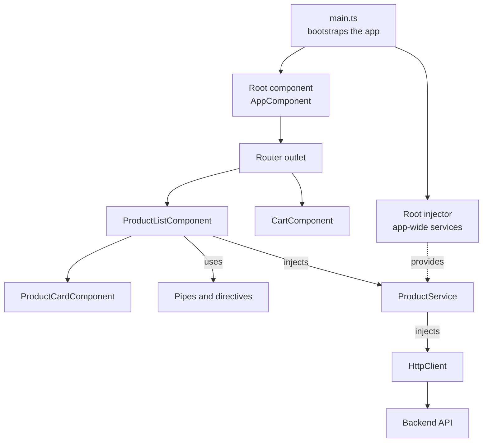
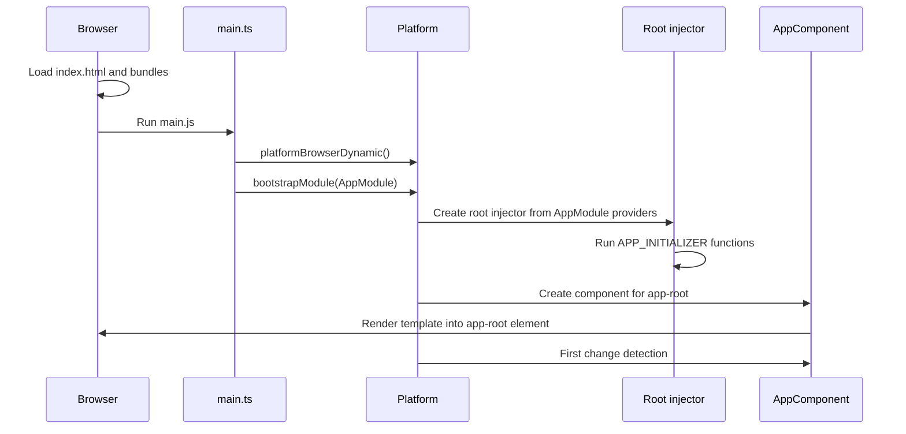
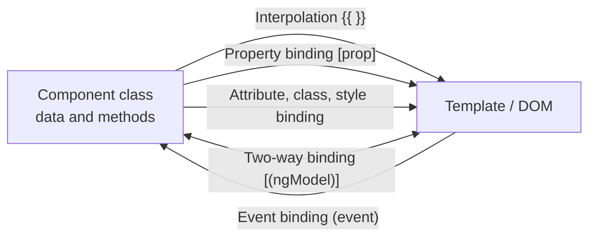

# Angular Fundamentals

> In this document you will learn what Angular is, how an Angular 16 application is built and started, the difference between NgModules and standalone components, and every kind of data binding. These basics come up at the start of almost every Angular interview, and weak answers here make the interviewer doubt everything that follows.

**Before this:** [TypeScript basics](../03-typescript/01-typescript-basics-and-types.md) · [Decorators](../03-typescript/10-decorators.md) · [Components and state management](../05-frontend-engineering/06-components-and-state-management.md) · **Interview questions:** [jump to the interview section](#interview-questions)

## Table of contents

1. [What Angular is](#what-angular-is)
2. [The building blocks of an Angular app](#the-building-blocks-of-an-angular-app)
3. [The Angular CLI](#the-angular-cli)
4. [Workspace structure](#workspace-structure)
5. [How an Angular app starts](#how-an-angular-app-starts)
6. [NgModules](#ngmodules)
7. [Standalone components](#standalone-components)
8. [NgModules vs standalone: how to choose](#ngmodules-vs-standalone-how-to-choose)
9. [Templates and data binding](#templates-and-data-binding)
10. [Template reference variables](#template-reference-variables)
11. [How Angular compiles your app: Ivy, AOT and JIT](#how-angular-compiles-your-app-ivy-aot-and-jit)
12. [Zone.js and change detection in one page](#zonejs-and-change-detection-in-one-page)
13. [Environment configuration](#environment-configuration)
14. [Angular vs React vs Vue](#angular-vs-react-vs-vue)
15. [Common mistakes](#common-mistakes)
16. [Best practices](#best-practices)
17. [How to explain Angular in an interview](#how-to-explain-angular-in-an-interview)
18. [Interview questions](#interview-questions)
19. [Summary](#summary)
20. [References](#references)

---

## What Angular is

**Angular** is a front-end framework from Google for building single-page applications (SPAs) in TypeScript. A **single-page application** loads one HTML page and then changes the screen with JavaScript, without full page reloads.

Angular is a **full framework**, not just a view library. Out of the box it gives you:

| Need | What Angular gives you |
| --- | --- |
| UI building blocks | Components, templates, directives, pipes |
| Sharing logic and data | Services and a built-in dependency injection system |
| Navigation between screens | `@angular/router` |
| Forms and validation | `@angular/forms` (template-driven and reactive forms) |
| Talking to a server | `HttpClient` in `@angular/common/http` |
| Async data streams | RxJS (a required dependency) |
| Testing | TestBed and testing utilities |
| Tooling | The Angular CLI (create, build, serve, test, update) |
| Others | Animations, i18n, service worker, server-side rendering |

Angular is also **opinionated**. It has an "official way" to do most things: one router, one forms library, one HTTP client, one project structure, one CLI. This matters in big companies. Two Angular projects from two different teams look similar, so developers can move between them quickly.

### Why Angular exists

Large front-end apps have the same problems again and again:

- How do we split the UI into reusable pieces?
- How do we share data and logic without global variables?
- How do we keep the screen in sync with the data?
- How do we keep 50 developers working in the same code without chaos?

React answers the first and third questions and leaves the rest to you. Angular answers all of them with built-in tools and a fixed structure.

### Analogy

Think of Angular as a **fully furnished apartment**. The kitchen, the furniture and the wiring are already there and they all fit together. React is more like an **empty apartment**: you choose every piece yourself. The furnished apartment is faster to move into and easier for a big family to share. But if you want a very unusual kitchen, it takes more work to replace what is already there.

### Angular vs AngularJS

Do not confuse them. Interviewers sometimes check this.

| | AngularJS (1.x) | Angular (2 and later) |
| --- | --- | --- |
| Released | 2010 | 2016 (a full rewrite) |
| Language | JavaScript | TypeScript |
| Building block | Controllers and `$scope` | Components |
| Change detection | Digest cycle with watchers | Component tree checks (Zone.js, later signals) |
| Status | End of life since January 2022 | Active |

"Angular" with no version number means Angular 2+. AngularJS is a different framework.

### Versions and Angular 16

- Angular uses **semantic versioning**: major.minor.patch (for example 16.2.12).
- Until v22, a new major version came out about **every 6 months**. Starting with v22 (June 2026), the official plan is one major version per year.
- Angular 16 was released in **May 2023**. It is no longer officially supported (the official release page lists v2 to v19 as unsupported). But many company apps still run Angular 16, so this repository teaches Angular 16 first and marks newer changes clearly.

---

## The building blocks of an Angular app

An Angular app is a **tree of components**. Around that tree, Angular gives you services, dependency injection, a router and more.



| Building block | What it is | Example |
| --- | --- | --- |
| **Component** | A class + an HTML template + styles. It controls one part of the screen. | `ProductCardComponent` shows one product. |
| **Template** | The HTML of a component, with Angular syntax for bindings. | `<h2>{{ product.name }}</h2>` |
| **Directive** | A class that adds behavior to an element. A component is a directive with a template. | `*ngIf`, `[ngClass]`, your own `appHighlight` |
| **Pipe** | A function you use in a template to format a value. | `{{ price \| currency }}` |
| **Service** | A class for logic and data that is not tied to one view. | `ProductService`, `AuthService` |
| **Dependency injection (DI)** | The system that creates services and gives them to classes that need them. | `constructor(private products: ProductService) {}` |
| **NgModule** | A container that groups components, directives, pipes and providers. Optional since standalone components. | `AppModule`, `ProductsModule` |
| **Router** | Maps URLs to components. | `/products/42` shows `ProductDetailComponent` |

Each of these has its own document:

- Components and templates → [02-components-and-templates.md](02-components-and-templates.md)
- Directives and pipes → [03-directives-and-pipes.md](03-directives-and-pipes.md)
- Lifecycle hooks → [04-lifecycle-hooks.md](04-lifecycle-hooks.md)
- Dependency injection → [05-dependency-injection.md](05-dependency-injection.md)
- Routing → [06-routing-guards-and-lazy-loading.md](06-routing-guards-and-lazy-loading.md)

### A first component

```ts
import { Component } from '@angular/core';

@Component({
  selector: 'app-hello',              // the HTML tag that shows this component
  template: `<h1>Hello, {{ name }}!</h1>
             <button (click)="changeName()">Change name</button>`,
  styles: [`h1 { color: teal; }`],    // in Angular 16, styles is an array
})
export class HelloComponent {
  name = 'Asha';

  changeName() {
    this.name = 'Ravi';
  }
}
```

What happens:

1. Somewhere in another template you write `<app-hello></app-hello>`.
2. Angular creates a `HelloComponent` object and renders its template inside that tag.
3. The page shows "Hello, Asha!".
4. You click the button. Angular calls `changeName()`, `name` becomes `'Ravi'`.
5. Angular runs change detection, sees that `name` changed, and updates the text to "Hello, Ravi!".

You never touch the DOM yourself. You change the data, and Angular updates the screen.

---

## The Angular CLI

The **Angular CLI** (`ng`) is the command-line tool for creating, running, building, testing and updating Angular projects. Almost every Angular project uses it.

```bash
# Install the CLI for Angular 16 globally
npm install -g @angular/cli@16

# Create a new project (asks about routing and stylesheet format)
ng new shop-app

# Create a new project that uses standalone components (Angular 16+)
ng new shop-app --standalone --routing --style=scss

# Start the dev server on http://localhost:4200 with live reload
cd shop-app
ng serve

# Production build into dist/
ng build
```

### Most useful commands

| Command | Short form | What it does |
| --- | --- | --- |
| `ng new <name>` | | Creates a new workspace and app |
| `ng serve` | `ng s` | Builds in memory and serves with live reload |
| `ng build` | `ng b` | Builds the app. Uses the `production` configuration by default (since v12). |
| `ng generate component products/product-list` | `ng g c products/product-list` | Creates a component (`.ts`, `.html`, `.scss`, `.spec.ts`) and adds it to the nearest NgModule |
| `ng g s products/product` | | Creates a service (`ProductService` with `providedIn: 'root'`) |
| `ng g m products --routing` | | Creates a feature NgModule with its own routing module |
| `ng g d shared/highlight` | | Creates a directive |
| `ng g p shared/truncate` | | Creates a pipe |
| `ng g guard auth/auth` | | Creates a route guard |
| `ng g interceptor core/auth` | | Creates an HTTP interceptor |
| `ng g environments` | | Creates `src/environments/` files (since v15, not created by default) |
| `ng test` | `ng t` | Runs unit tests (Karma + Jasmine by default in Angular 16) |
| `ng add <package>` | | Installs a library and runs its setup schematic, for example `ng add @angular/material` |
| `ng update` | | Updates Angular packages and runs code migrations |
| `ng version` | `ng v` | Shows Angular, CLI, Node.js and TypeScript versions |
| `ng lint` | | Runs the linter. Since v12 no linter is installed by default; run `ng add @angular-eslint/schematics` first |

Useful flags:

```bash
ng g c products/product-card --standalone          # standalone component (v14+)
ng g c products/product-card --change-detection OnPush
ng g c products/product-card --skip-tests           # no .spec.ts file
ng g c products/product-card --inline-template --inline-style
ng g c products/product-card --dry-run              # show what would be created, write nothing
ng serve --port 4300 --open                         # other port, open the browser
ng serve --proxy-config proxy.conf.json             # forward /api calls to a backend
ng build --configuration development                # non-optimized build
```

> **Newer Angular (17+):** `ng new` creates standalone apps by default (use `--no-standalone` for NgModules), and the new `application` builder based on esbuild and Vite is the default. In Angular 16 the esbuild builder exists only as a developer preview. In v21+, new projects use Vitest instead of Karma by default.

---

## Workspace structure

This is what `ng new shop-app --routing` creates in Angular 16 (NgModule style):

```text
shop-app/
  angular.json            ← workspace and build configuration
  package.json            ← npm dependencies and scripts
  tsconfig.json           ← base TypeScript config (strict mode on by default)
  tsconfig.app.json       ← TypeScript config for the app code
  tsconfig.spec.json      ← TypeScript config for tests
  .editorconfig
  README.md
  src/
    index.html            ← the single HTML page; contains <app-root></app-root>
    main.ts               ← entry point; bootstraps the app
    styles.scss           ← global styles
    favicon.ico
    assets/               ← images, fonts, JSON files copied as-is
    app/
      app.module.ts       ← root NgModule
      app-routing.module.ts
      app.component.ts    ← root component class
      app.component.html  ← root component template
      app.component.scss
      app.component.spec.ts
```

Files that you will **not** see in a new Angular 16 project (they were removed from the default template in v15): `polyfills.ts`, `test.ts`, `karma.conf.js` and `src/environments/`. Polyfills are now listed in `angular.json` (`"polyfills": ["zone.js"]`). Older projects that were upgraded may still have these files, and that is fine.

### The important files

**`src/index.html`** — the only HTML page. The `<app-root>` tag is where Angular puts the root component.

```html
<!doctype html>
<html lang="en">
<head>
  <meta charset="utf-8">
  <title>ShopApp</title>
  <base href="/">
  <meta name="viewport" content="width=device-width, initial-scale=1">
</head>
<body>
  <app-root></app-root>
</body>
</html>
```

**`src/main.ts`** — the entry point. It starts Angular.

```ts
import { platformBrowserDynamic } from '@angular/platform-browser-dynamic';
import { AppModule } from './app/app.module';

platformBrowserDynamic().bootstrapModule(AppModule)
  .catch(err => console.error(err));
```

**`src/app/app.module.ts`** — the root NgModule.

```ts
import { NgModule } from '@angular/core';
import { BrowserModule } from '@angular/platform-browser';
import { AppRoutingModule } from './app-routing.module';
import { AppComponent } from './app.component';

@NgModule({
  declarations: [AppComponent],
  imports: [BrowserModule, AppRoutingModule],
  providers: [],
  bootstrap: [AppComponent],
})
export class AppModule {}
```

**`angular.json`** — tells the CLI how to build, serve and test each project in the workspace. A shortened version:

```json
{
  "projects": {
    "shop-app": {
      "projectType": "application",
      "sourceRoot": "src",
      "prefix": "app",
      "architect": {
        "build": {
          "builder": "@angular-devkit/build-angular:browser",
          "options": {
            "outputPath": "dist/shop-app",
            "index": "src/index.html",
            "main": "src/main.ts",
            "polyfills": ["zone.js"],
            "tsConfig": "tsconfig.app.json",
            "assets": ["src/favicon.ico", "src/assets"],
            "styles": ["src/styles.scss"],
            "scripts": []
          },
          "configurations": {
            "production": {
              "budgets": [
                { "type": "initial", "maximumWarning": "500kb", "maximumError": "1mb" }
              ],
              "outputHashing": "all"
            },
            "development": {
              "buildOptimizer": false,
              "optimization": false,
              "sourceMap": true
            }
          },
          "defaultConfiguration": "production"
        },
        "serve": { "builder": "@angular-devkit/build-angular:dev-server" },
        "test": { "builder": "@angular-devkit/build-angular:karma" }
      }
    }
  }
}
```

Key ideas in `angular.json`:

- **`architect`** (also called **targets**): one entry per command (`build`, `serve`, `test`). Each entry names a **builder**, which is the program that does the work.
- **`configurations`**: named sets of options. `ng build` uses `production` by default; `ng serve` uses `development`.
- **`budgets`**: the build warns or fails if the bundle gets too big. This protects performance.
- **`prefix`**: the CLI uses `app-` as the selector prefix for generated components.

### The standalone version

`ng new shop-app --standalone --routing` (Angular 16) creates no `app.module.ts`. Instead you get:

```text
src/app/
  app.component.ts     ← standalone root component
  app.config.ts        ← app-wide providers
  app.routes.ts        ← the route list
```

```ts
// src/app/app.config.ts
import { ApplicationConfig } from '@angular/core';
import { provideRouter } from '@angular/router';
import { routes } from './app.routes';

export const appConfig: ApplicationConfig = {
  providers: [provideRouter(routes)],
};
```

```ts
// src/main.ts
import { bootstrapApplication } from '@angular/platform-browser';
import { appConfig } from './app/app.config';
import { AppComponent } from './app/app.component';

bootstrapApplication(AppComponent, appConfig)
  .catch(err => console.error(err));
```

---

## How an Angular app starts

**Bootstrapping** means starting the Angular application: creating the injectors, creating the root component and showing it on the page.

### Step by step (NgModule app)

1. The browser downloads `index.html`. It contains `<app-root></app-root>` and `<script>` tags for the built bundles (`runtime.js`, `polyfills.js`, `main.js`).
2. `polyfills.js` runs first. It loads **Zone.js**, which patches browser async APIs (more on this [later](#zonejs-and-change-detection-in-one-page)).
3. `main.js` runs the code from `main.ts`: `platformBrowserDynamic().bootstrapModule(AppModule)`.
4. Angular creates the **platform** (one per page) and then the **root injector** from `AppModule` and all the modules it imports. Every provider from these modules is registered here.
5. Angular runs the `APP_INITIALIZER` functions (for example "load the runtime config") and waits for them if they return a Promise or Observable.
6. Angular reads `bootstrap: [AppComponent]`. It finds the element that matches the selector `app-root` in `index.html`.
7. Angular creates an `AppComponent` instance (its constructor runs, and its dependencies are injected).
8. Angular renders the root template, which creates child components, and runs the first **change detection** pass.
9. The app is now running. From now on, Zone.js tells Angular when async work (clicks, timers, HTTP) finishes, and Angular updates the screen.



### Standalone bootstrapping

With standalone components, there is no root module. `bootstrapApplication(AppComponent, appConfig)` does the same job:

- It creates the platform and an **environment injector** from the `providers` in `appConfig`.
- It creates `AppComponent` and renders it into `<app-root>`.

```ts
// main.ts for a standalone app without a separate config file
import { bootstrapApplication } from '@angular/platform-browser';
import { provideHttpClient } from '@angular/common/http';
import { AppComponent } from './app/app.component';

bootstrapApplication(AppComponent, {
  providers: [
    provideHttpClient(), // replaces importing HttpClientModule
  ],
}).catch(err => console.error(err));
```

`bootstrapApplication` was added in v14 (developer preview) and became stable in v15, together with standalone components.

---

## NgModules

### What it is

An **NgModule** is a class with the `@NgModule` decorator. It groups related components, directives and pipes, and it tells Angular two things:

1. **Compilation context**: which components, directives and pipes each template is allowed to use.
2. **Providers**: which services to register in an injector.

### The metadata

```ts
import { NgModule } from '@angular/core';
import { CommonModule } from '@angular/common';
import { FormsModule } from '@angular/forms';
import { ProductListComponent } from './product-list/product-list.component';
import { ProductCardComponent } from './product-card/product-card.component';
import { PricePipe } from './price.pipe';
import { ProductsRoutingModule } from './products-routing.module';

@NgModule({
  declarations: [ProductListComponent, ProductCardComponent, PricePipe],
  imports: [CommonModule, FormsModule, ProductsRoutingModule],
  exports: [ProductCardComponent],
  providers: [],
})
export class ProductsModule {}
```

| Property | Meaning | Rule to remember |
| --- | --- | --- |
| `declarations` | Components, directives and pipes that **belong** to this module | A non-standalone declarable must be declared in **exactly one** module. |
| `imports` | Other modules (or standalone components) whose **exported** things this module's templates can use | Imports are not inherited. Each module imports what its own templates need. |
| `exports` | Declarables (or modules) that **other** modules can use when they import this one | If you do not export it, it is private to this module. |
| `providers` | Services to register in the module's injector | For eagerly loaded modules this is the root injector. For lazy-loaded modules it is a child injector. |
| `bootstrap` | The root component(s) to create at startup | Only used in the root module. |

### The compilation context rule

This is the rule that causes the most beginner errors:

> A template can only use a component, directive or pipe if it is **declared** in the same module, or **exported** by a module that this module **imports**.

So if `ProductListComponent` (declared in `ProductsModule`) uses `<app-product-card>`, then `ProductCardComponent` must be declared in `ProductsModule`, or exported by a module that `ProductsModule` imports.

If the rule is broken, the Angular 16 compiler gives errors like this (real compiler output):

```text
error NG8001: 'app-product-card' is not a known element:
1. If 'app-product-card' is an Angular component, then verify that it is part of this module.
2. If 'app-product-card' is a Web Component then add 'CUSTOM_ELEMENTS_SCHEMA' to the '@NgModule.schemas' of this component to suppress this message.

error NG8002: Can't bind to 'ngModel' since it isn't a known property of 'input'.
```

The fix for the first error: declare or import the component. The fix for the second: import `FormsModule` in the module that declares the component.

### Common module types

Teams usually organize NgModule apps into these kinds of modules:

| Module type | Contains | Imported by |
| --- | --- | --- |
| **Root module** (`AppModule`) | `BrowserModule`, the root component, app-wide setup | Nobody. It is bootstrapped. |
| **Core module** (`CoreModule`) | App-wide singletons: layout shell, interceptors, error handler | `AppModule` only, once |
| **Shared module** (`SharedModule`) | Reusable dumb components, directives, pipes. Re-exports `CommonModule`, `FormsModule` | Every feature module |
| **Feature module** (`ProductsModule`) | Everything for one business area. Often lazy-loaded. | The router (lazy) or `AppModule` (eager) |
| **Routing module** (`ProductsRoutingModule`) | `RouterModule.forChild(routes)` | Its feature module |

```ts
// shared.module.ts — reusable UI, NO services
@NgModule({
  declarations: [SpinnerComponent, TruncatePipe, HighlightDirective],
  imports: [CommonModule],
  exports: [CommonModule, FormsModule, SpinnerComponent, TruncatePipe, HighlightDirective],
})
export class SharedModule {}
```

```ts
// core.module.ts — imported only once, in AppModule
import { NgModule, Optional, SkipSelf } from '@angular/core';
import { HTTP_INTERCEPTORS, HttpClientModule } from '@angular/common/http';
import { AuthInterceptor } from './auth.interceptor';

@NgModule({
  imports: [HttpClientModule],
  providers: [{ provide: HTTP_INTERCEPTORS, useClass: AuthInterceptor, multi: true }],
})
export class CoreModule {
  // If CoreModule is imported a second time (for example in a lazy module), fail fast.
  constructor(@Optional() @SkipSelf() parentModule: CoreModule | null) {
    if (parentModule) {
      throw new Error('CoreModule is already loaded. Import it in AppModule only.');
    }
  }
}
```

Two rules that prevent real bugs:

- **`BrowserModule` only in the root module.** Feature modules import `CommonModule` (which gives `*ngIf`, `*ngFor`, pipes). `BrowserModule` re-exports `CommonModule` and adds browser-specific setup that must happen once.
- **Do not put services in the `providers` of a `SharedModule`.** Every lazy-loaded module that imports `SharedModule` gets its own child injector and its own copy of those services. You then have two "singletons" with different data. Use `@Injectable({ providedIn: 'root' })` instead. The details are in [Dependency injection](05-dependency-injection.md#lazy-loading-and-separate-instances).

### The `forRoot` / `forChild` pattern

Some modules need providers in the root injector only once, but their components and directives everywhere. The router is the classic case:

```ts
// app-routing.module.ts
@NgModule({
  imports: [RouterModule.forRoot(appRoutes)],   // router services + directives
  exports: [RouterModule],
})
export class AppRoutingModule {}

// products-routing.module.ts
@NgModule({
  imports: [RouterModule.forChild(productRoutes)], // only directives + child routes
  exports: [RouterModule],
})
export class ProductsRoutingModule {}
```

`forRoot()` returns a `ModuleWithProviders` object: the module plus its providers. `forChild()` returns the module without the app-wide services. You can use the same pattern in your own libraries.

---

## Standalone components

### What it is

A **standalone component** is a component that does not need to be declared in an NgModule. It lists its own dependencies in an `imports` array.

```ts
import { Component, Input } from '@angular/core';
import { CurrencyPipe, NgIf } from '@angular/common';

export interface Product {
  id: number;
  name: string;
  price: number;
  inStock: boolean;
}

@Component({
  selector: 'app-product-card',
  standalone: true,
  imports: [NgIf, CurrencyPipe],   // what THIS template uses
  template: `
    <h3>{{ product.name }}</h3>
    <p>{{ product.price | currency }}</p>
    <span *ngIf="!product.inStock">Out of stock</span>
  `,
})
export class ProductCardComponent {
  @Input({ required: true }) product!: Product;
}
```

Directives and pipes can be standalone too: `@Directive({ standalone: true, ... })`, `@Pipe({ standalone: true, ... })`.

### Why it exists

NgModules caused real pain:

- To use one small component, you had to find which module declares it and import that whole module.
- Beginners hit "is not a known element" errors all the time.
- A `SharedModule` with 80 declarations makes it hard to see what a component really uses, and it makes lazy loading less precise.

With standalone components, each component says exactly what it needs. The component file alone tells you its dependencies.

### Timeline

| Version | Status |
| --- | --- |
| v14 | Standalone components, directives and pipes added as **developer preview** |
| v15 | **Stable**. `bootstrapApplication`, `provideRouter`, `provideHttpClient` stable too |
| v16 | `ng new --standalone`, and a migration schematic: `ng generate @angular/core:standalone` |
| v17 | `ng new` creates standalone apps by default |
| v19 | `standalone: true` is the default in the decorator. NgModule-declared components must now say `standalone: false` |

### Mixing standalone and NgModules

Both styles work together in Angular 16, so you can migrate step by step.

```ts
// 1. A standalone component can import an NgModule
@Component({
  standalone: true,
  selector: 'app-search-box',
  imports: [FormsModule],           // gives ngModel
  template: `<input [(ngModel)]="query">`,
})
export class SearchBoxComponent {
  query = '';
}

// 2. An NgModule can import a standalone component (in imports, NOT declarations)
@NgModule({
  declarations: [ProductListComponent],
  imports: [CommonModule, SearchBoxComponent, ProductCardComponent],
})
export class ProductsModule {}
```

```ts
// ❌ Wrong: standalone components cannot be declared
@NgModule({ declarations: [ProductCardComponent] })  // compile error
export class ProductsModule {}

// ✅ Correct
@NgModule({ imports: [ProductCardComponent] })
export class ProductsModule {}
```

Lazy loading a standalone component needs no module:

```ts
// app.routes.ts
export const routes: Routes = [
  {
    path: 'cart',
    loadComponent: () => import('./cart/cart.component').then(m => m.CartComponent),
  },
];
```

Routing details are in [Routing, guards and lazy loading](06-routing-guards-and-lazy-loading.md).

> **Newer Angular (19+):** `standalone` defaults to `true`. If you see `standalone: false` in newer code, that component is declared in an NgModule.

---

## NgModules vs standalone: how to choose

| Question | NgModules | Standalone |
| --- | --- | --- |
| Where are dependencies listed? | In the module, far from the component | In the component's own `imports` |
| Lazy loading unit | A whole module (`loadChildren`) | A single component (`loadComponent`) or a route file |
| App-wide providers | `AppModule.providers`, `forRoot()` | `bootstrapApplication(..., { providers })`, `provideX()` functions |
| Boilerplate | More files | Fewer files |
| Learning curve | The compilation-context rule confuses beginners | Easier to understand |
| Ecosystem in Angular 16 | Every library supports it | Most modern libraries support it; some old ones only ship modules (use `importProvidersFrom`) |
| Future direction | Still supported, not deprecated | The recommended default in newer Angular |

Practical advice for an Angular 16 codebase:

- **New app on Angular 16:** start standalone.
- **Big existing NgModule app:** do not rewrite everything just to change syntax. Write new features as standalone, and migrate old areas when you touch them. Use the schematic `ng generate @angular/core:standalone`, which runs in three steps (convert components, remove unneeded modules, switch to standalone bootstrap).
- **Shared UI library:** make components standalone. Both module apps and standalone apps can use them.

---

## Templates and data binding

**Data binding** connects the component class (data and methods) with the template (what the user sees). Angular has several kinds, and the direction of data flow is what separates them.



| Binding | Syntax | Direction | Example |
| --- | --- | --- | --- |
| Interpolation | `{{ expr }}` | Class → view | `<h2>{{ product.name }}</h2>` |
| Property | `[property]="expr"` | Class → view | `` |
| Attribute | `[attr.name]="expr"` | Class → view | `<td [attr.colspan]="span">` |
| Class | `[class.name]="bool"` or `[class]="expr"` | Class → view | `<li [class.active]="isActive">` |
| Style | `[style.prop]="expr"` or `[style]="expr"` | Class → view | `<div [style.width.px]="progress">` |
| Event | `(event)="statement"` | View → class | `<button (click)="save()">` |
| Two-way | `[(prop)]="field"` | Both | `<input [(ngModel)]="query">` |

We will use this component for the examples:

```ts
@Component({
  selector: 'app-product-detail',
  templateUrl: './product-detail.component.html',
})
export class ProductDetailComponent {
  product = { name: 'Laptop', price: 999, imageUrl: '/assets/laptop.png', inStock: true };
  quantity = 1;
  isFavorite = false;
  progress = 40;

  addToCart() {
    console.log(`Adding ${this.quantity} x ${this.product.name}`);
  }

  toggleFavorite() {
    this.isFavorite = !this.isFavorite;
  }
}
```

### Interpolation

**Interpolation** puts the value of an expression into the text of the page.

```html
<h2>{{ product.name }}</h2>                <!-- Laptop -->
<p>Total: {{ product.price * quantity }}</p> <!-- Total: 999 -->
<p>{{ product.inStock ? 'In stock' : 'Sold out' }}</p> <!-- In stock -->
```

Important facts:

- The expression is evaluated against the **component instance**. `product` means `this.product`.
- The result is converted to a string. `null` and `undefined` become an empty string.
- The result is treated as **text**, never as HTML. If `product.name` is `'<b>Laptop</b>'`, the user sees the tags as literal characters. This is one of Angular's built-in XSS protections (see [Security](15-security.md)).
- You can also use interpolation inside attribute values: ``. Angular turns this into a property binding.

### Property binding

**Property binding** sets a **DOM property** of an element (or an `@Input` of a component) to the value of an expression.

```html

<button [disabled]="!product.inStock">Add to cart</button>
<app-product-card [product]="product"></app-product-card>
```

- The square brackets tell Angular: "the right side is an expression, not a string".
- Without brackets, the value is a plain string: `<app-product-card product="product">` passes the string `"product"`.

```html
<!-- ❌ Wrong: passes the string 'false'. A non-empty string is truthy, so the button is disabled -->
<button disabled="false">Save</button>

<!-- ✅ Correct: passes the boolean false -->
<button [disabled]="false">Save</button>
```

### Properties vs attributes

This difference is a classic interview question.

- An **HTML attribute** is written in the HTML source. It sets the **initial** value. It is always a string.
- A **DOM property** lives on the JavaScript object of the element. It holds the **current** value. It can be any type.

Example: `<input value="Asha">`. The attribute `value` is `"Asha"`. The user types "Ravi". Now the property `input.value` is `"Ravi"`, but `input.getAttribute('value')` is still `"Asha"`.

Angular's `[x]` binding sets **properties**. Some attributes have **no matching property**, so you must use **attribute binding** with `attr.`:

```html
<!-- ❌ Wrong: <td> has no 'colspan' property (the property is colSpan); Angular gives a compile error -->
<td [colspan]="span">Total</td>

<!-- ✅ Correct -->
<td [attr.colspan]="span">Total</td>

<!-- ARIA and data-* attributes have no properties either -->
<button [attr.aria-label]="'Remove ' + product.name" [attr.aria-expanded]="menuOpen">✕</button>
<li [attr.data-id]="product.id">...</li>
```

If the attribute binding value is `null` or `undefined`, Angular **removes** the attribute. This is handy for optional ARIA attributes.

### Class binding

```html
<!-- One class, on or off -->
<li [class.active]="isActive">Home</li>

<!-- Several classes from an object -->
<div [class]="{ card: true, featured: product.price > 500, 'out-of-stock': !product.inStock }"></div>

<!-- A string of class names -->
<div [class]="'card large'"></div>
```

Static classes and bound classes merge: `<div class="card" [class.selected]="isSelected">` keeps `card` and adds or removes `selected`.

### Style binding

```html
<!-- One style, with a unit suffix -->
<div class="bar" [style.width.px]="progress"></div>   <!-- width: 40px -->
<div [style.width.%]="progress"></div>                <!-- width: 40% -->
<p [style.color]="isFavorite ? 'red' : 'gray'">♥</p>

<!-- Several styles from an object -->
<div [style]="{ 'background-color': product.inStock ? 'white' : '#eee', padding: '8px' }"></div>
```

The built-in directives `[ngClass]` and `[ngStyle]` do similar things. Since Ivy (v9), plain `[class]` and `[style]` bindings support objects too, so you often do not need the directives. See [Directives and pipes](03-directives-and-pipes.md).

### Event binding

**Event binding** listens to a DOM event (or a component `@Output`) and runs a **template statement** when it fires.

```html
<button (click)="addToCart()">Add to cart</button>
<button (click)="toggleFavorite()">{{ isFavorite ? '♥' : '♡' }}</button>

<!-- $event is the event object (or the value emitted by an @Output) -->
<input (input)="onSearch($event)">

<!-- Key event filtering: only fires for Enter -->
<input #box (keyup.enter)="search(box.value)">

<!-- Child component output -->
<app-product-card [product]="product" (addToCart)="onAdd($event)"></app-product-card>
```

```ts
onSearch(event: Event) {
  const value = (event.target as HTMLInputElement).value;
  console.log(value);
}
```

**Template statements** (in event bindings) can assign values and chain with `;`. **Template expressions** (in `{{ }}` and `[ ]`) should only read values.

```html
<button (click)="quantity = quantity + 1; addToCart()">Add one more</button>
```

### Two-way binding

**Two-way binding** keeps a field and a form control in sync in both directions. The syntax `[( )]` is called **"banana in a box"**.

```html
<!-- Needs FormsModule (in the NgModule imports, or the standalone component imports) -->
<input [(ngModel)]="quantity" type="number">
<p>You will buy {{ quantity }} item(s).</p>
```

`[(ngModel)]` is only a shortcut. Angular rewrites it as a property binding plus an event binding:

```html
<input [ngModel]="quantity" (ngModelChange)="quantity = $event">
```

So two-way binding works on **any** component that has an input named `x` and an output named `xChange`:

```ts
@Component({
  selector: 'app-quantity-picker',
  standalone: true,
  template: `
    <button (click)="change(-1)">−</button>
    <span>{{ value }}</span>
    <button (click)="change(1)">+</button>
  `,
})
export class QuantityPickerComponent {
  @Input() value = 1;
  @Output() valueChange = new EventEmitter<number>();   // must be named <input>Change

  change(delta: number) {
    this.value = Math.max(1, this.value + delta);
    this.valueChange.emit(this.value);
  }
}
```

```html
<!-- Parent template -->
<app-quantity-picker [(value)]="quantity"></app-quantity-picker>
<p>Quantity in parent: {{ quantity }}</p>
```

Step by step when the user clicks "+":

1. The child's `change(1)` runs. `value` becomes 2.
2. The child emits `valueChange` with `2`.
3. The parent's hidden statement `quantity = $event` runs, so `quantity` becomes 2.
4. Change detection runs. The parent text shows "Quantity in parent: 2", and `[value]` passes 2 back to the child (no change, so nothing more happens).

> **Newer Angular (17.2+):** the `model()` function creates a signal-based two-way input in one line: `value = model(1);`. It does not exist in Angular 16.

### Rules for template expressions

Angular template expressions look like JavaScript, but they are more limited:

- They can only see members of the component (and template variables). `window`, `document`, `console`, `Math` and global functions are **not** available.
- No assignments (`=`, `+=`), no `new`, no `++`/`--`, no bitwise operators in expressions (assignments are allowed only in event statements).
- They run on **every** change detection pass, so they must be **fast** and have **no side effects**.

```html
<!-- ❌ Wrong: console is not available; Angular reports an error -->
<p>{{ console.log(product) }}</p>

<!-- ❌ Wrong idea: a heavy method runs on every change detection pass -->
<p>{{ calculateRecommendations() }}</p>

<!-- ✅ Better: compute once in the class, or use a pure pipe -->
<p>{{ recommendations }}</p>
```

The safe navigation operator `?.`, the non-null assertion `!` and pipes are explained in [Components and templates](02-components-and-templates.md#template-syntax-essentials).

> **Self-closing tags:** Angular 16 supports self-closing tags for components: `<app-product-card [product]="p" />`. Older code always writes the closing tag.

---

## Template reference variables

A **template reference variable** gives a name to an element (or a component, or a directive) inside a template. You create it with `#name`.

```html
<!-- 1. On a DOM element: the variable is the HTMLInputElement -->
<input #searchBox type="text" placeholder="Search products">
<button (click)="search(searchBox.value)">Search</button>
```

```html
<!-- 2. On a component: the variable is the component instance -->
<app-video-player #player></app-video-player>
<button (click)="player.play()">Play</button>
```

```html
<!-- 3. With a directive's exportAs name: the variable is the directive instance -->
<form #checkoutForm="ngForm" (ngSubmit)="submit(checkoutForm.value)">
  <input name="email" ngModel required email>
  <button [disabled]="checkoutForm.invalid">Pay</button>
</form>
```

How Angular decides the value:

| Where you write `#ref` | Value of `ref` |
| --- | --- |
| A plain HTML element | The DOM element |
| A component's host element | The component instance |
| `#ref="exportName"` | The directive with that `exportAs` name (`ngForm`, `ngModel`, `matMenu`...) |
| An `<ng-template>` | A `TemplateRef` |

**Scope rule:** a template variable is visible in the whole template where it is defined, but **not outside a structural directive boundary**. A variable defined inside `*ngIf` or `*ngFor` cannot be used outside that block, because the directive creates a separate embedded template.

```html
<div *ngIf="showSearch">
  <input #query>
</div>
<!-- ❌ Wrong: 'query' does not exist here -->
<button (click)="search(query.value)">Go</button>
```

To use an element from the **class**, use `@ViewChild` instead (see [Components and templates](02-components-and-templates.md#template-queries-viewchild-and-viewchildren)).

---

## How Angular compiles your app: Ivy, AOT and JIT

The browser does not understand Angular templates. Something must turn `<h1>Hello, {{ name }}!</h1>` into JavaScript that creates and updates DOM nodes. That something is the **Angular compiler**.

### Ivy

**Ivy** is Angular's compiler and rendering engine. It became the default in v9 and fully replaced the old **View Engine** in v13.

Ivy compiles each component into plain JavaScript instructions. For this component:

```ts
@Component({
  selector: 'app-greeting',
  standalone: true,
  template: `<h1>Hello, {{ name }}!</h1><button (click)="wave()">Wave</button>`,
})
export class GreetingComponent {
  @Input() name = 'Asha';
  wave() { console.log('wave'); }
}
```

the Angular 16 compiler generates code like this (simplified from real `ngc` output):

```js
static ɵcmp = ɵɵdefineComponent({
  type: GreetingComponent,
  selectors: [['app-greeting']],
  inputs: { name: 'name' },
  template: function GreetingComponent_Template(rf, ctx) {
    if (rf & 1) {                       // creation mode: build the DOM once
      ɵɵelementStart(0, 'h1');
      ɵɵtext(1);
      ɵɵelementEnd();
      ɵɵelementStart(2, 'button');
      ɵɵlistener('click', () => ctx.wave());
      ɵɵtext(3, 'Wave');
      ɵɵelementEnd();
    }
    if (rf & 2) {                       // update mode: runs on every change detection
      ɵɵadvance(1);
      ɵɵtextInterpolate1('Hello, ', ctx.name, '!');
    }
  },
});
```

What this shows:

- The template becomes a function with two modes. **Creation mode** builds the DOM once. **Update mode** runs on each change detection pass and only touches bindings (`ctx.name`).
- `ctx` is the component instance. That is why templates can only see component members.
- Angular compares the new value of `ctx.name` with the old one and updates the text node only if it changed.

Benefits of Ivy:

- **Smaller bundles**: unused Angular features are tree-shaken because each instruction is a separate function.
- **Locality**: each component is compiled using only its own metadata, so builds are faster and libraries can ship pre-compiled code.
- Made standalone components, better debugging (`ng.getComponent(el)` in the browser console in dev mode) and stricter template type checking possible.

### AOT vs JIT

The compiler can run at two different times:

- **AOT (Ahead-of-Time)**: the compiler runs **at build time**, on your machine or CI server. The browser receives already-compiled JavaScript.
- **JIT (Just-in-Time)**: the compiler is shipped **to the browser** and compiles templates at runtime.

| | AOT | JIT |
| --- | --- | --- |
| When templates compile | During `ng build` / `ng serve` | In the browser at startup |
| Startup speed | Faster: no compile step in the browser | Slower |
| Bundle size | Smaller: the compiler is not shipped | Larger: includes `@angular/compiler` |
| Template errors | Found at build time | Found at runtime, by users |
| Security | Templates are not compiled from strings at runtime, so less risk of template injection | Higher risk if templates are built from user data |
| Default | Yes, for `ng build` and `ng serve` since v9 | Rare; some test setups use it |

With `strictTemplates: true` (the default in new projects), AOT also **type-checks your templates**. A typo like `{{ product.nmae }}` fails the build instead of showing an empty string.

### Analogy

AOT is like a restaurant that cooks the food in the kitchen before it reaches your table. JIT is like getting raw ingredients and a stove at your table. You get the same meal, but AOT is faster for you and safer.

---

## Zone.js and change detection in one page

**Change detection** is how Angular keeps the screen in sync with your data. After something happens (a click, a timer, an HTTP response), Angular walks the component tree, re-evaluates template bindings, and updates the DOM where values changed.

But how does Angular know that "something happened"? In Angular 16 the answer is **Zone.js**.

- **Zone.js** is a library that **patches** browser async APIs: `setTimeout`, `setInterval`, `Promise`, `addEventListener`, `XMLHttpRequest`, `fetch` and more.
- Patching means Zone.js wraps these functions, so it knows when an async task starts and when its callback finishes.
- Angular runs your app inside a zone called **NgZone**. When the queue of pending microtasks becomes empty after a task, NgZone tells Angular, and Angular calls `ApplicationRef.tick()`, which runs change detection from the root component down.

```ts
@Component({
  selector: 'app-clock',
  template: `<p>{{ now }}</p>`,
})
export class ClockComponent {
  now = new Date().toLocaleTimeString();

  constructor() {
    setInterval(() => {
      this.now = new Date().toLocaleTimeString();
      // No manual "refresh" call: Zone.js sees the timer callback finish,
      // and Angular runs change detection, so the screen updates.
    }, 1000);
  }
}
```

That is why plain assignments "just work" in Angular. The details (OnPush, `ChangeDetectorRef`, `runOutsideAngular`, signals) are in [Change detection and signals](10-change-detection-and-signals.md).

> **Newer Angular:** zoneless change detection (no Zone.js) was experimental in v18, became stable in v20.2, and is the default for new projects in v21+. Angular then relies on signals, the `async` pipe, events and `markForCheck` to know when to update.

---

## Environment configuration

Apps need different settings per environment: the API URL in development is not the production URL.

### Build-time environment files

Since v15, new projects have no environment files. Create them with:

```bash
ng generate environments
```

This creates two files and updates `angular.json`:

```ts
// src/environments/environment.ts — used by default (production)
export const environment = {
  production: true,
  apiUrl: 'https://api.shop.example.com',
};
```

```ts
// src/environments/environment.development.ts — swapped in for development builds
export const environment = {
  production: false,
  apiUrl: 'http://localhost:3000',
};
```

```json
"configurations": {
  "development": {
    "fileReplacements": [
      {
        "replace": "src/environments/environment.ts",
        "with": "src/environments/environment.development.ts"
      }
    ]
  }
}
```

Your code always imports the base file. The CLI swaps the file at build time:

```ts
import { environment } from '../environments/environment';

@Injectable({ providedIn: 'root' })
export class ProductService {
  private readonly baseUrl = `${environment.apiUrl}/products`;
  constructor(private http: HttpClient) {}
}
```

Two important warnings:

- **Environment files are compiled into the JavaScript bundle.** Anyone can read them in the browser. **Never put secrets** (private API keys, database passwords, client secrets) in them. Front-end code cannot keep secrets.
- **Build-time config means one build per environment.** If you want to "build once and deploy the same files to test, staging and production", you need **runtime configuration** instead: load a `config.json` file when the app starts.

### Runtime configuration (short version)

```ts
// app-config.service.ts
export interface AppConfig { apiUrl: string; featureFlags: Record<string, boolean>; }

@Injectable({ providedIn: 'root' })
export class AppConfigService {
  private config!: AppConfig;
  constructor(private http: HttpClient) {}

  load(): Promise<void> {
    return firstValueFrom(this.http.get<AppConfig>('/assets/config.json'))
      .then(config => { this.config = config; });
  }

  get apiUrl(): string { return this.config.apiUrl; }
}

// app.module.ts
providers: [
  {
    provide: APP_INITIALIZER,
    useFactory: (config: AppConfigService) => () => config.load(),
    deps: [AppConfigService],
    multi: true,
  },
],
```

Angular waits for the Promise before it creates the root component, so every service can use the config. The deployment pipeline writes a different `config.json` per environment. More about this in [Enterprise architecture](13-enterprise-architecture.md) and about `APP_INITIALIZER` in [Dependency injection](05-dependency-injection.md#multi-providers).

---

## Angular vs React vs Vue

| | Angular | React | Vue |
| --- | --- | --- | --- |
| What it is | Full framework | UI library | Progressive framework |
| Language | TypeScript (required in practice) | JavaScript or TypeScript | JavaScript or TypeScript |
| Templates | HTML templates with Angular syntax | JSX (HTML-like syntax inside JavaScript) | HTML templates in single-file components (JSX possible) |
| How the UI updates | Zone.js-based change detection (v16), signals in newer versions | Re-runs component functions on state change, then diffs a virtual DOM | Reactive proxies track dependencies, virtual DOM |
| Dependency injection | Built-in, hierarchical | None built-in (Context is used for sharing values) | `provide` / `inject` (simple) |
| Routing, forms, HTTP | Official, built-in | Third-party (React Router, React Hook Form, fetch/axios) | Official router; forms and HTTP are third-party |
| Async model | RxJS Observables everywhere | Promises, hooks | Promises, composables |
| Structure | Strong conventions, CLI generates everything | You choose structure and libraries | Moderate conventions |
| Learning curve | Steeper (DI, RxJS, decorators) | Easier start, many choices later | Easiest start |
| Typical fit | Large enterprise apps, big teams, long-lived products | Anything; huge ecosystem | Small to large apps; easy to adopt step by step |

None of them is "the best". A fair interview answer: Angular trades flexibility for consistency. In a team of 40 developers working on one product for 5 years, consistency and built-in tools are worth a lot. For a small marketing site, Angular may be more than you need. React is covered in [React essentials](../05-frontend-engineering/08-react-essentials.md).

---

## Common mistakes

1. **Declaring a standalone component in an NgModule.** Standalone components go in `imports`, not `declarations`.
2. **Declaring the same component in two NgModules.** This is a compile error. Declare it once, export it, and import that module where needed.
3. **Forgetting `FormsModule` for `ngModel`** or `ReactiveFormsModule` for `formControl`. You get "Can't bind to 'ngModel' since it isn't a known property of 'input'".
4. **Importing `BrowserModule` in a feature module.** Use `CommonModule` in feature modules.
5. **Providing services in a `SharedModule`.** Lazy modules get their own copies. Use `providedIn: 'root'`.
6. **Putting secrets in `environment.ts`.** It ships to the browser.
7. **Binding a boolean or number without brackets:** `disabled="false"` passes a string. Use `[disabled]="false"`.
8. **Using `[colspan]` or `[aria-label]` property bindings.** These attributes have no properties. Use `[attr.colspan]` and `[attr.aria-label]`.
9. **Heavy method calls in templates.** They run on every change detection pass.
10. **Manipulating the DOM directly** with `document.querySelector` in components. It breaks with server-side rendering, bypasses Angular's sanitization, and fights with change detection. Use bindings, or `ElementRef`/`Renderer2` when you really must.

---

## Best practices

- **Use the CLI to generate code.** It follows naming conventions and updates modules for you.
- **Keep `strict: true` and `strictTemplates: true`.** Most bugs are found at build time instead of by users.
- **Prefer standalone components for new code in Angular 16.** Each component then shows its own dependencies, and migration to newer Angular is easier.
- **Use `providedIn: 'root'` for app-wide services.** They are tree-shakable and always singletons.
- **Keep templates simple.** Move logic into the class or into pure pipes. Templates should read values, not compute them.
- **Use property binding for non-string values** and attribute binding for ARIA and `data-*` attributes.
- **Keep environment files free of secrets**, and use runtime config when you need "build once, deploy many".
- **Use budgets in `angular.json`** so bundle size problems fail the build early.
- **Run `ng update` regularly**, one major version at a time. Its migrations change your code for you.

---

## How to explain Angular in an interview

1. **Define it:** "Angular is a TypeScript-based front-end framework from Google for building single-page applications. It is a full framework: components, dependency injection, router, forms, HTTP client and CLI all come in the box."
2. **Why it exists:** "Large apps need structure. Angular gives one standard way to build components, share logic through services and DI, and organize code, so big teams stay consistent."
3. **How it works:** "The app is a tree of components. Each component has a class and a template. The compiler turns templates into JavaScript instructions at build time (AOT with Ivy). At runtime, Zone.js tells Angular when async work finishes, and change detection updates the DOM where bindings changed."
4. **Small example:** "A `ProductCardComponent` gets a product through an `@Input`, shows it with interpolation, and emits an `addToCart` event with an `@Output`. A `ProductService` provided in root loads data with `HttpClient`."
5. **Where it is useful:** "Enterprise apps with many screens and forms: admin portals, banking, CRM, internal tools, where many developers work on the same code for years."
6. **Trade-offs / gotchas:** "The learning curve is steeper because of DI, RxJS and decorators, and the framework is bigger than a view library. In Angular 16 you also choose between NgModules and standalone components; I prefer standalone for new code."

---

## Interview questions

### Q1. What is Angular, and how is it different from AngularJS?

**What the interviewer is checking:** Whether you can describe Angular clearly at a high level, and you do not mix up the two frameworks.

**Short spoken answer (30–60 seconds):**
> Angular is a front-end framework from Google for building single-page apps in TypeScript. It's a full framework, so routing, forms, HTTP, dependency injection, testing tools and a CLI are all built in. You build the UI as a tree of components, and you put shared logic in services that Angular injects. AngularJS is the old 1.x framework. It was JavaScript-based and used controllers, `$scope` and a digest cycle. Angular 2 was a complete rewrite with components, TypeScript and a much faster compiler. AngularJS reached end of life in 2022, so when people say "Angular" today, they mean Angular 2 and later.

**Detailed explanation:**
- Angular apps are made of components (class + template + styles), directives, pipes and services.
- DI is built in and hierarchical, which makes code testable and lets you scope services.
- RxJS is used for async streams (HTTP, router events, form value changes).
- The compiler (Ivy) turns templates into JavaScript at build time (AOT).
- AngularJS used two-way binding with watchers and a digest loop. Large AngularJS pages became slow because each digest checked many watchers. Angular uses one-way data flow down the component tree, which is more predictable.

**Follow-up questions:**
- **Why is Angular called "opinionated"?** — Because it has one official way to do most things: one router, one forms library, one HTTP client, a CLI that generates a standard structure. You give up some freedom, but every Angular project looks similar.
- **Is Angular a library or a framework?** — A framework. A library is code you call. A framework calls your code: Angular creates your components, injects services and runs change detection. This is called inversion of control.
- **What is an SPA, and what is its main downside?** — A single-page app loads one HTML page and updates the screen with JavaScript. Downsides: a larger first download and weaker SEO without server-side rendering. Angular solves the second with SSR (see [Rendering strategies](../05-frontend-engineering/09-rendering-strategies-csr-ssr-ssg.md)).

**Common mistakes:** Saying "Angular is a library", calling Angular "AngularJS", or listing features without explaining the component tree idea.

**Where this is used in real projects:** The first minutes of any Angular interview, and when you explain technology choices to a client or a new team member.

### Q2. What are the main building blocks of an Angular application?

**What the interviewer is checking:** Whether you know the role of each piece and how they connect.

**Short spoken answer (30–60 seconds):**
> The core building block is the component: a TypeScript class plus a template and styles, which controls one part of the screen. Components form a tree, starting from the root `AppComponent`. Directives add behavior to elements, and pipes format values in templates. Business logic and data access go into services, and Angular's dependency injection creates them and gives them to whoever needs them. The router maps URLs to components. In older or bigger apps, NgModules group all of these. In newer code, standalone components list their own dependencies instead.

**Detailed explanation:** See the [table of building blocks](#the-building-blocks-of-an-angular-app). The key relationships: components use directives and pipes in templates, components inject services, services inject other services like `HttpClient`, and the router decides which components appear in `<router-outlet>`.

**Follow-up questions:**
- **What is the difference between a component and a directive?** — A component is a directive with its own template. A directive has no template; it changes the behavior or look of an existing element.
- **Why not put HTTP calls directly in components?** — Components should handle the view. Putting data access in a service makes it reusable, easy to mock in tests, and keeps components small.
- **Where do you keep state that many components share?** — In a service (for example with a `BehaviorSubject` or signals), or in a store like NgRx for complex apps. See [State management](11-state-management-and-ngrx.md).

**Common mistakes:** Forgetting services and DI, or describing NgModules as required in modern Angular.

**Where this is used in real projects:** When you design a new feature: which parts are components, which are services, and how they talk.

### Q3. What happens when an Angular application starts?

**What the interviewer is checking:** Understanding of bootstrapping and the order of setup.

**Short spoken answer (30–60 seconds):**
> The browser loads `index.html`, which has an `<app-root>` tag and the script bundles. The polyfills run first and load Zone.js. Then `main.ts` runs. In a module app it calls `platformBrowserDynamic().bootstrapModule(AppModule)`; in a standalone app it calls `bootstrapApplication(AppComponent, appConfig)`. Angular creates the platform and the root injector with all the app-wide providers, runs any `APP_INITIALIZER` functions and waits for them, then creates the root component, renders it into `<app-root>`, and runs the first change detection. After that, Zone.js triggers change detection whenever async work finishes.

**Detailed explanation:** See [How an Angular app starts](#how-an-angular-app-starts) with the sequence diagram. An important detail is that `APP_INITIALIZER` can delay bootstrapping. That is the right place to load runtime configuration, because no component exists yet.

**Follow-up questions:**
- **How would you load a config file before any component is created?** — Use `APP_INITIALIZER` with a factory that returns a Promise or Observable. Angular waits for it before creating the root component.
- **What if `<app-root>` is missing from `index.html`?** — Bootstrapping fails with `NG05104: The selector "app-root" did not match any elements`, and the page stays blank.
- **Can you bootstrap two Angular apps on one page?** — Yes. Each call creates its own application and root injector, but they share the platform injector. Services with `providedIn: 'platform'` are shared between them.

**Common mistakes:** Not knowing where `AppModule` or `appConfig` comes in, or saying "Angular reads `angular.json` at runtime" (it is only used by the CLI at build time).

**Where this is used in real projects:** Loading config, initializing auth before routing, debugging "app shows a blank page" problems.

### Q4. What is an NgModule? Explain declarations, imports, exports, providers and bootstrap.

**What the interviewer is checking:** The compilation-context rule and the provider role of modules.

**Short spoken answer (30–60 seconds):**
> An NgModule is a class with the `@NgModule` decorator that groups related components, directives and pipes and configures providers. `declarations` lists the components, directives and pipes that belong to the module; each one can belong to only one module. `imports` brings in other modules so this module's templates can use what they export. `exports` makes some of my declarations available to modules that import mine. `providers` registers services in the module's injector, which is the root injector for eager modules and a child injector for lazy ones. `bootstrap` is used only in the root module to say which component to create at startup.

**Detailed explanation:** The most important idea is that modules define a **compilation context**: a template can only use what is declared in its own module or exported by an imported module. Imports are not transitive in the sense of templates: if module A imports B and B imports C, A cannot use C's components unless B re-exports C.

**Code:**

```ts
@NgModule({
  declarations: [OrderListComponent, OrderStatusPipe], // belong here
  imports: [CommonModule, SharedModule],               // can use their exports
  exports: [OrderStatusPipe],                          // others may use this pipe
})
export class OrdersModule {}
```

**Follow-up questions:**
- **Can a component be declared in two modules?** — No. Angular reports an error. Declare it in one module (often a small module per component, or a shared module), export it, and import that module.
- **What does re-exporting mean?** — Putting an imported module in `exports`, like `SharedModule` exporting `CommonModule`. Then every module that imports `SharedModule` also gets `CommonModule`'s directives.
- **What is the difference between `providers` in a module and `providedIn: 'root'`?** — Both can create a root singleton, but `providedIn` is tree-shakable: if nothing injects the service, it is removed from the bundle. Module providers are always included. Also, module providers in a lazy module create a separate instance.

**Common mistakes:** Thinking imports are inherited by child modules, or that declaring a component also makes it available everywhere.

**Where this is used in real projects:** Every NgModule-based Angular 16 app, and debugging NG8001 "is not a known element" errors.

### Q5. What are standalone components, and why were they added?

**What the interviewer is checking:** Modern Angular knowledge and the reasoning behind the change.

**Short spoken answer (30–60 seconds):**
> A standalone component is a component with `standalone: true` that doesn't need an NgModule. It lists the components, directives, pipes and modules its template uses in its own `imports` array. They came as a developer preview in Angular 14 and became stable in 15. The reason is that NgModules added an extra layer: to use a small component you had to find and import the module that declares it, and errors like "is not a known element" were very common. With standalone, each component is self-describing, you can lazy-load a single component with `loadComponent`, and the app starts with `bootstrapApplication`. NgModules still work, and both can be mixed.

**Detailed explanation:** See [Standalone components](#standalone-components). Directives and pipes can also be standalone. App-wide providers move from `AppModule` to `bootstrapApplication` and functions like `provideRouter()` and `provideHttpClient()`. For libraries that only ship NgModules, `importProvidersFrom(SomeModule.forRoot())` extracts the providers.

**Follow-up questions:**
- **How do you use a standalone component in an NgModule app?** — Put it in the module's `imports` array (not `declarations`).
- **How do you lazy-load a standalone component?** — With `loadComponent: () => import('./cart.component').then(m => m.CartComponent)` in the route.
- **What changed in Angular 19?** — `standalone: true` became the default, so new components do not need the flag, and module-declared components need `standalone: false`.

**Common mistakes:** Saying NgModules are deprecated (they are not), or declaring a standalone component.

**Where this is used in real projects:** New Angular 16 apps and features, shared component libraries, migrating old apps.

### Q6. Your company has a large Angular 16 NgModule app. Should you migrate it to standalone?

**What the interviewer is checking:** Senior judgment: cost vs value, incremental change, risk.

**Short spoken answer (30–60 seconds):**
> Not as a big-bang rewrite. Standalone gives clearer dependencies, finer lazy loading and an easier path to newer Angular versions, but changing hundreds of files at once is risky and does not add user value by itself. I'd write all new components as standalone, make shared UI components standalone because both styles can import them, and migrate older areas when we touch them anyway. Angular 16 has a schematic, `ng generate @angular/core:standalone`, which does the mechanical work in three steps, so we can migrate feature by feature with tests running after each step.

**Detailed explanation:** Things to check before migrating: test coverage, third-party libraries that only ship NgModules (wrap with `importProvidersFrom`), `forRoot()` providers that must move into `bootstrapApplication`, and team familiarity. Migrating is also a good moment to remove a giant `SharedModule` that makes every feature depend on everything.

**Follow-up questions:**
- **What are the three steps of the standalone migration schematic?** — Convert declarations to standalone, remove NgModules that are no longer needed, and switch to standalone bootstrapping with `bootstrapApplication`.
- **How do you keep `forRoot()` providers in a standalone app?** — `bootstrapApplication(AppComponent, { providers: [importProvidersFrom(SomeLibModule.forRoot(config))] })`.
- **Does standalone make the app faster?** — Not by itself. It can reduce bundle size when lazy loading becomes more precise, but the runtime rendering is the same Ivy engine.

**Common mistakes:** "Yes, migrate everything now" without risk analysis, or "never migrate" without knowing the benefits.

**Where this is used in real projects:** Upgrade planning and tech-debt discussions.

### Q7. Explain the different types of data binding in Angular.

**What the interviewer is checking:** The direction of data flow and the correct syntax.

**Short spoken answer (30–60 seconds):**
> There are three directions. From class to view, we have interpolation with double curly braces for text, property binding with square brackets to set a DOM property or a component input, and the special forms `[attr.x]`, `[class.x]` and `[style.x]` for attributes, classes and styles. From view to class, we have event binding with parentheses, like `(click)="save()"`, where `$event` holds the event or the emitted value. And two-way binding with the banana-in-a-box syntax `[(ngModel)]`, which is just a property binding plus an event binding combined, so the field and the input stay in sync.

**Detailed explanation:** See [Templates and data binding](#templates-and-data-binding). Angular's default data flow is one-way down the tree (inputs) and events up (outputs). Two-way binding is sugar over that, not a separate mechanism.

**Code:**

```html
<h2>{{ product.name }}</h2>

<td [attr.colspan]="2"></td>
<li [class.active]="isActive" [style.width.px]="width"></li>
<button (click)="addToCart()">Add</button>
<input [(ngModel)]="quantity">
```

**Follow-up questions:**
- **What does `[(ngModel)]` turn into?** — `[ngModel]="quantity" (ngModelChange)="quantity = $event"`.
- **How do you support `[(value)]` on your own component?** — Add `@Input() value` and `@Output() valueChange = new EventEmitter()`, and emit when the value changes.
- **Is `src="{{ url }}"` the same as `[src]="url"`?** — For strings, yes. Angular turns the interpolation into a property binding. But for non-string values (objects, booleans) you must use `[ ]`, because interpolation always produces a string.

**Common mistakes:** Saying Angular is "two-way bound by default" like AngularJS, or not knowing that `[( )]` is syntax sugar.

**Where this is used in real projects:** Every template.

### Q8. What is the difference between a DOM property and an HTML attribute? When do you need `[attr.x]`?

**What the interviewer is checking:** A precise understanding of the DOM, which explains binding errors.

**Short spoken answer (30–60 seconds):**
> Attributes are defined in the HTML and set the initial value; they're always strings. Properties live on the DOM object and hold the current value, with any type. For example, after a user types into `<input value="Asha">`, the `value` property changes but the `value` attribute stays "Asha". Angular's square-bracket binding sets properties, not attributes. Some attributes have no matching property, like `colspan` on a table cell, ARIA attributes, or `data-*` attributes, so for those I use attribute binding: `[attr.colspan]`, `[attr.aria-label]`. If the value is null, Angular removes the attribute.

**Detailed explanation:** Some names also differ: the attribute `class` maps to the property `className`, the attribute `for` maps to `htmlFor`, the attribute `colspan` maps to `colSpan`. Angular's template compiler checks property names against a DOM schema, which is why `[colspan]` fails at compile time while `[colSpan]` and `[attr.colspan]` work.

**Follow-up questions:**
- **Why does `<button disabled="false">` disable the button?** — `disabled` is a boolean attribute. Its presence alone means "disabled". The string `"false"` is still present. Use `[disabled]="false"`.
- **How do you remove an attribute with a binding?** — Bind it to `null`: `[attr.aria-describedby]="hasError ? 'email-error' : null"`.

**Common mistakes:** Thinking `[x]` sets an attribute, or that the attribute updates when the user types.

**Where this is used in real projects:** Accessibility attributes, tables, custom data attributes for testing or analytics.

### Q9. How does `[(ngModel)]` work? How would you build your own two-way binding?

**What the interviewer is checking:** That you know two-way binding is syntax sugar, and the naming convention.

**Short spoken answer (30–60 seconds):**
> `[(ngModel)]` is shorthand. Angular expands it into `[ngModel]="field"` plus `(ngModelChange)="field = $event"`. The `NgModel` directive from `FormsModule` writes the value into the input and emits `ngModelChange` when the user types. For my own component, I just follow the convention: an input called `value` and an output called `valueChange`. Then the parent can write `[(value)]="quantity"`. When the child emits a new value, the parent's field is updated, and change detection passes it back down.

**Detailed explanation and code:** See the [QuantityPickerComponent example](#two-way-binding). The output must be named exactly `<inputName>Change`. The `$event` value is the emitted value, not a DOM event.

**Follow-up questions:**
- **What happens if you forget `FormsModule`?** — Compile error: "Can't bind to 'ngModel' since it isn't a known property of 'input'".
- **Is two-way binding a good idea for complex forms?** — For simple inputs it is fine. For complex forms with validation and dynamic fields, reactive forms are easier to test and reason about. See [Forms](07-forms.md).
- **What is the newer way?** — In Angular 17.2+, `model()` creates a writable signal input that supports `[( )]` in one line.

**Common mistakes:** Naming the output `onValueChange` or `changed`; then `[(value)]` does not work.

**Where this is used in real projects:** Custom pickers, toggles, date inputs, dialogs with an `open`/`openChange` pair.

### Q10. What is a template reference variable?

**What the interviewer is checking:** Template basics and knowing what the variable points to.

**Short spoken answer (30–60 seconds):**
> It's a name for an element inside a template, created with a hash, like `#searchBox`. On a normal element it refers to the DOM element, so I can write `(click)="search(searchBox.value)"`. On a component, it refers to the component instance, so I can call its public methods. With a directive's export name, like `#form="ngForm"`, it refers to that directive instance, which is how template-driven forms read validity. It is only visible inside the template, and not outside an `*ngIf` or `*ngFor` block where it was declared. If I need the element in the class, I use `@ViewChild` instead.

**Follow-up questions:**
- **What does `#tpl` on an `<ng-template>` give you?** — A `TemplateRef` that you can render with `ngTemplateOutlet` or pass to `*ngIf="cond; else tpl"`.
- **What is `exportAs`?** — A property in `@Directive` metadata that names the directive for template variables. `NgForm` has `exportAs: 'ngForm'`.

**Common mistakes:** Trying to use a variable from inside `*ngIf` outside it.

**Where this is used in real projects:** Quick input reads, template-driven forms, calling child component methods, `else` templates.

### Q11. What is Ivy?

**Short answer:** Ivy is Angular's current compiler and rendering engine (default since v9; the old View Engine was removed in v13). It compiles each component into a template function with plain DOM instructions, which gives smaller bundles through tree-shaking, faster builds through locality (each component is compiled using only its own metadata), stricter template type checking, and it made standalone components possible. See [Ivy](#ivy) for real compiled output.

### Q12. What is the difference between AOT and JIT compilation?

**What the interviewer is checking:** When templates are compiled and why it matters.

**Short spoken answer (30–60 seconds):**
> Both turn templates into JavaScript, but at different times. AOT, ahead-of-time, compiles during the build, so the browser receives ready JavaScript. JIT, just-in-time, ships the compiler to the browser and compiles at startup. AOT gives faster startup, smaller bundles because the compiler isn't shipped, template errors at build time instead of in production, and better security because templates aren't compiled from strings at runtime. Since Angular 9, AOT is the default for both `ng build` and `ng serve`, so JIT is mostly historical or used in some test setups.

**Follow-up questions:**
- **What does `strictTemplates` add?** — Full type checking of template expressions during AOT: wrong property names, wrong input types and wrong `$event` types fail the build.
- **Why is JIT a security risk?** — If templates are built from user-controlled strings and compiled at runtime, an attacker could inject template code. With AOT, templates are fixed at build time.

**Common mistakes:** Saying AOT is "only for production" (that was true before v9, not today).

**Where this is used in real projects:** Build configuration, explaining bundle size, debugging template errors in CI.

### Q13. What is Zone.js, and why does Angular use it?

**What the interviewer is checking:** How Angular knows when to update the view.

**Short spoken answer (30–60 seconds):**
> Zone.js is a library that patches the browser's async APIs, like `setTimeout`, promises, DOM event listeners and XHR. Because of that, it knows when any async callback runs and finishes. Angular runs the app inside a zone called NgZone. When a task finishes and there are no more pending microtasks, NgZone notifies Angular, and Angular calls `ApplicationRef.tick()`, which runs change detection from the root. That's why in Angular 16 I can just assign `this.name = 'Ravi'` inside a timer or an HTTP callback and the screen updates without calling any refresh function. The trade-off is that every async event can trigger a full check, which is why we use OnPush, and newer Angular versions can run without Zone.js using signals.

**Detailed explanation:** See [Zone.js and change detection in one page](#zonejs-and-change-detection-in-one-page) and the full [Change detection and signals](10-change-detection-and-signals.md) document.

**Follow-up questions:**
- **How do you run code without triggering change detection?** — `ngZone.runOutsideAngular(() => { ... })`, for example for a `mousemove` listener or an animation loop. Re-enter with `ngZone.run()` when you need to update the view.
- **What happens if a third-party library updates data outside the zone?** — The screen does not update until the next change detection. Wrap the update in `ngZone.run()` or call `ChangeDetectorRef.markForCheck()` / `detectChanges()`.
- **Is Zone.js still required in newer Angular?** — No. Zoneless became stable in v20.2 and is the default for new apps in v21+.

**Common mistakes:** Saying Zone.js "does change detection". It only tells Angular **when** to run it.

**Where this is used in real projects:** Performance tuning, integrating charts and maps, debugging "the view does not update" problems.

### Q14. Debugging: you get "NG8001: 'app-product-card' is not a known element". How do you fix it?

**What the interviewer is checking:** Practical knowledge of compilation scope in both styles.

**Short spoken answer (30–60 seconds):**
> The template that uses `<app-product-card>` can't see that component. First I check the selector spelling. Then, in an NgModule app, the component must be declared in the same module as the component using it, or declared and exported by another module that this module imports. A common trap is that it's exported from `SharedModule` but the lazy feature module forgot to import `SharedModule`. In a standalone component, I add `ProductCardComponent` to the component's own `imports` array. If it's a real web component, not an Angular one, I add `CUSTOM_ELEMENTS_SCHEMA`, but I never use that schema just to hide the error.

**Detailed explanation:** The error message itself lists the options. A related error, NG8002 "Can't bind to 'x' since it isn't a known property of 'y'", has the same causes plus one more: the input name may be wrong.

**Follow-up questions:**
- **Why not just add `NO_ERRORS_SCHEMA`?** — It turns off checking for unknown elements and properties, so real typos are no longer caught. It is sometimes used in shallow unit tests, never in app code.
- **The component is declared and exported correctly, but tests still fail with the same error. Why?** — The TestBed has its own testing module. You must import the component (or its module) in `TestBed.configureTestingModule`.

**Common mistakes:** Adding the component to `declarations` of a second module (duplicate declaration error), or reaching for `CUSTOM_ELEMENTS_SCHEMA` immediately.

**Where this is used in real projects:** Daily development and unit test setup.

### Q15. Code review: a `SharedModule` has `providers: [CartService]` and is imported by three lazy-loaded feature modules. What is the problem?

**What the interviewer is checking:** Understanding of module injectors and lazy loading.

**Short spoken answer (30–60 seconds):**
> Each lazy-loaded module gets its own child injector. When a lazy module imports `SharedModule`, the `CartService` provider is registered again in that child injector. So each lazy feature gets its own `CartService` instance, and the cart in one feature is different from the cart in another. The fix is to remove the service from the shared module's providers and use `@Injectable({ providedIn: 'root' })`, which gives one app-wide instance and is tree-shakable. Shared modules should only contain declarables, not services.

**Detailed explanation:** Eagerly imported modules all merge their providers into the root injector, so the bug often appears only after someone converts a feature to lazy loading. The full explanation with diagrams is in [Dependency injection](05-dependency-injection.md#lazy-loading-and-separate-instances).

**Follow-up questions:**
- **When do you want a separate instance per lazy feature?** — When the state truly belongs to that feature, like a wizard's state. Then provide it on purpose in the feature's route or module.
- **How did people prevent this before `providedIn`?** — The `forRoot()` pattern: `SharedModule.forRoot()` with providers imported once in `AppModule`, plain `SharedModule` everywhere else.

**Common mistakes:** Assuming every service is a singleton.

**Where this is used in real projects:** Code reviews of module-based apps, especially after adding lazy loading.

### Q16. How do you handle environment-specific configuration? Is it safe to put an API key in `environment.ts`?

**What the interviewer is checking:** Build-time vs runtime config, and front-end security awareness.

**Short spoken answer (30–60 seconds):**
> In Angular 16 I generate environment files with `ng generate environments`. Code imports `environment.ts`, and `fileReplacements` in `angular.json` swaps in the development file for development builds. That's build-time config, so you need one build per environment. If we want to build once and promote the same artifact through test, staging and production, I load a `config.json` at runtime with `APP_INITIALIZER`. About secrets: no, anything in the front-end bundle is public. A user can open dev tools and read it. Only public values like a public API base URL or a public analytics ID belong there. Real secrets stay on the server.

**Follow-up questions:**
- **How does the app know the config before services need it?** — `APP_INITIALIZER` blocks bootstrapping until the config Promise resolves.
- **What if a third-party API needs a secret key?** — Call it from your own backend (a proxy) that holds the key, and let the Angular app call your backend.

**Common mistakes:** Believing minification hides secrets, or not knowing that `environment.ts` is replaced at build time, not at runtime.

**Where this is used in real projects:** Every deployed Angular app, Docker images that serve the same build in many environments.

### Q17. Angular vs React: when would you choose Angular?

**What the interviewer is checking:** Balanced judgment, not fan talk.

**Short spoken answer (30–60 seconds):**
> React is a UI library: it handles rendering and leaves routing, forms, data fetching and structure to you. Angular is a full framework with all of those built in, plus dependency injection and a CLI that enforces a structure. I'd choose Angular for a large, long-lived product with a big team, lots of forms and business rules, where consistency matters more than flexibility. Strong TypeScript integration and DI also help with testing. I'd choose React when the team already knows it, when we need its huge ecosystem, or for a smaller app where Angular's structure would be overhead. Both can build excellent apps; the team and the product decide.

**Follow-up questions:**
- **How do they update the UI differently?** — React re-runs component functions when state changes and diffs a virtual DOM. Angular (v16) compiles templates into update instructions and checks bindings when Zone.js signals that async work finished. Newer Angular adds fine-grained updates with signals.
- **What is the biggest learning hurdle in Angular?** — Usually RxJS and the DI hierarchy.

**Common mistakes:** "Angular is better" or "React is faster" with no reasoning.

**Where this is used in real projects:** Architecture decisions and client discussions.

### Q18. What is `angular.json` used for?

**Short answer:** It is the workspace configuration file for the Angular CLI. It lists the projects in the workspace and, for each one, the **targets** (`build`, `serve`, `test`, `lint`, `extract-i18n`), the **builder** that runs each target, and options like entry file, polyfills, assets, global styles, budgets and `fileReplacements`. Named `configurations` (like `production` and `development`) change those options. It is used only by the CLI at build time; it is not shipped to the browser.

### Q19. Output prediction: what does the user see?

```ts
@Component({
  selector: 'app-message',
  template: `
    <p>{{ html }}</p>
    <p [innerHTML]="html"></p>
  `,
})
export class MessageComponent {
  html = '<b>Sale</b><script>alert(1)</script>';
}
```

**Answer (browser behavior):**
- The first paragraph shows the literal text `<b>Sale</b><script>alert(1)</script>`. Interpolation always produces text, so the browser does not parse it as HTML.
- The second paragraph shows **Sale** in bold. `[innerHTML]` does insert HTML, but Angular's sanitizer removes the `<script>` element first. In development mode Angular logs: `WARNING: sanitizing HTML stripped some content, see https://g.co/ng/security#xss`.

**Why:** Interpolation sets the text content of a text node, so no HTML parsing happens. `[innerHTML]` goes through Angular's `DomSanitizer` for the HTML security context. Bypassing it with `bypassSecurityTrustHtml` would let dangerous content through. See [Security](15-security.md).

### Q20. Why can't you call `console.log()` or use `window` inside a template?

**Short answer:** Template expressions are evaluated against the component instance (the `ctx` object in the compiled template function), not against the global scope. So `console` means `this.console`, which does not exist, and strict template checking reports an error. This is on purpose: it keeps templates simple and side-effect free. If you really need a global value in a template, expose it through the component (`readonly year = new Date().getFullYear();`) or inject it (for example the `DOCUMENT` token).

---

## Summary

- Angular is a full TypeScript framework for SPAs: components, DI, router, forms, HTTP and CLI are built in and designed to work together.
- An app is a tree of components. Services hold shared logic, and DI provides them.
- The CLI (`ng new`, `ng serve`, `ng build`, `ng g`, `ng update`) creates and manages projects. `angular.json` configures it.
- An NgModule app starts with `platformBrowserDynamic().bootstrapModule(AppModule)`. A standalone app starts with `bootstrapApplication(AppComponent, appConfig)`.
- NgModules define a compilation context (declarations, imports, exports) and providers. A component can be declared in only one module.
- Standalone components (stable since v15) list their own `imports`. They mix freely with NgModules. In v19+ they are the default.
- Binding types: interpolation, property, attribute, class, style (class → view), event (view → class), and two-way `[( )]`, which is property + event binding.
- `[x]` binds DOM properties. Use `[attr.x]` for ARIA, `data-*` and attributes without properties.
- Ivy compiles templates into instructions. AOT (default since v9) compiles at build time: faster, smaller, safer, type-checked.
- Zone.js tells Angular when async work finishes so change detection can run. Zoneless is the default only in newer Angular (v21+).
- Environment files are build-time and public. Never put secrets in them. Use runtime config for "build once, deploy many".

---

## References

- Angular 16 docs — Architecture overview: https://v16.angular.io/guide/architecture
- Angular 16 docs — NgModules: https://v16.angular.io/guide/ngmodules
- Angular 16 docs — Standalone components: https://v16.angular.io/guide/standalone-components
- Angular 16 docs — Binding syntax: https://v16.angular.io/guide/binding-syntax
- Angular 16 docs — Template reference variables: https://v16.angular.io/guide/template-reference-variables
- Angular 16 docs — Ahead-of-time compilation: https://v16.angular.io/guide/aot-compiler
- Angular 16 docs — Configuring application environments: https://v16.angular.io/guide/build
- Angular 16 docs — Workspace and project file structure: https://v16.angular.io/guide/file-structure
- Angular 16 docs — CLI reference: https://v16.angular.io/cli
- Angular CLI 16.2 application schematic (generated files): https://github.com/angular/angular-cli/tree/16.2.x/packages/schematics/angular/application
- Angular releases and support policy: https://angular.dev/reference/releases
- Angular zoneless guide: https://angular.dev/guide/zoneless
- MDN — HTML attribute reference and DOM properties: https://developer.mozilla.org/en-US/docs/Web/HTML/Attributes
