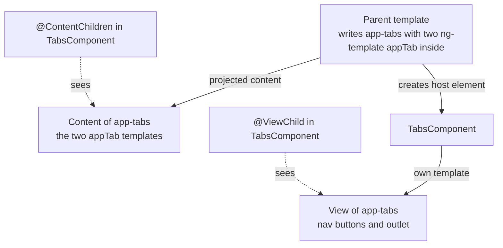
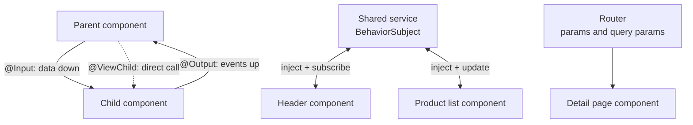

# Components and Templates

> In this document you will learn everything about Angular 16 components: the `@Component` metadata, style encapsulation, inputs and outputs (including required inputs and input transforms), template queries, content projection, `ng-template` and `ngTemplateOutlet`, host bindings, dynamic components, and every way components talk to each other. Component design questions are the core of most Angular interviews, from junior to senior level.

**Before this:** [Angular fundamentals](01-angular-fundamentals.md) · [Components and state management (framework-neutral)](../05-frontend-engineering/06-components-and-state-management.md) · **Interview questions:** [jump to the interview section](#interview-questions)

## Table of contents

1. [What a component is](#what-a-component-is)
2. [The Component decorator](#the-component-decorator)
3. [View encapsulation and component styles](#view-encapsulation-and-component-styles)
4. [Inputs](#inputs)
5. [Outputs](#outputs)
6. [Template syntax essentials](#template-syntax-essentials)
7. [Template queries: ViewChild and ViewChildren](#template-queries-viewchild-and-viewchildren)
8. [Content projection](#content-projection)
9. [ng-template, ng-container and ngTemplateOutlet](#ng-template-ng-container-and-ngtemplateoutlet)
10. [Host bindings and host listeners](#host-bindings-and-host-listeners)
11. [Component communication patterns](#component-communication-patterns)
12. [Dynamic components](#dynamic-components)
13. [Smart and presentational components](#smart-and-presentational-components)
14. [Common mistakes](#common-mistakes)
15. [Best practices](#best-practices)
16. [How to explain component communication in an interview](#how-to-explain-component-communication-in-an-interview)
17. [Interview questions](#interview-questions)
18. [Summary](#summary)
19. [References](#references)

---

## What a component is

A **component** is the basic UI building block in Angular. It has three parts:

1. A **TypeScript class** that holds data (fields) and behavior (methods).
2. A **template** (HTML with Angular syntax) that describes what to show.
3. **Styles** (CSS) that apply to that template.

The `@Component` decorator connects the three and gives the component a **selector**, the HTML tag that shows it.

```ts
import { Component } from '@angular/core';

@Component({
  selector: 'app-user-badge',
  standalone: true,
  template: `<span class="badge">{{ initials }}</span>`,
  styles: [`.badge { border-radius: 50%; padding: 4px 8px; background: #ddd; }`],
})
export class UserBadgeComponent {
  initials = 'AS';
}
```

```html
<!-- In another template -->
<app-user-badge></app-user-badge>
```

### How it works inside

When Angular meets `<app-user-badge>` in a template:

1. It finds the component whose selector matches.
2. It creates an instance of the class (running the constructor and injecting dependencies).
3. It renders the compiled template **inside** the `<app-user-badge>` element. That element is called the **host element**.
4. On every change detection pass, it re-checks the template bindings (`initials`) and updates the DOM if a value changed.

Each use of the tag creates a **new instance**. Ten `<app-user-badge>` tags mean ten objects with their own fields.

### Analogy

A component is like a **cookie cutter**. The class and template are the cutter. Each `<app-user-badge>` in the page is one cookie. All cookies have the same shape, but each one can have different toppings (input values).

---

## The Component decorator

The `@Component` decorator takes a metadata object. These are the properties you will use in Angular 16:

| Property | What it does | Example |
| --- | --- | --- |
| `selector` | CSS selector that matches the host element | `'app-user-list'`, `'[appCard]'` (attribute), `'.widget'` (class, rare) |
| `template` / `templateUrl` | Inline template or path to an `.html` file (use one, not both) | `templateUrl: './user-list.component.html'` |
| `styles` / `styleUrls` | Inline styles or paths to style files. **Both are arrays in Angular 16.** | `styleUrls: ['./user-list.component.scss']` |
| `standalone` | `true` means no NgModule is needed | `standalone: true` |
| `imports` | Standalone only: components, directives, pipes and modules this template uses | `imports: [NgIf, NgFor, UserCardComponent]` |
| `changeDetection` | `Default` or `OnPush` | `ChangeDetectionStrategy.OnPush` |
| `encapsulation` | How styles are scoped: `Emulated` (default), `ShadowDom`, `None` | `ViewEncapsulation.None` |
| `providers` | Services created for this component and its children | `providers: [UserFormStore]` |
| `viewProviders` | Like `providers`, but not visible to projected content | `viewProviders: [TabsService]` |
| `host` | Bindings on the host element (alternative to `@HostBinding`) | `host: { class: 'card', '(click)': 'toggle()' }` |
| `hostDirectives` | Directives applied to the host element (v15+) | `hostDirectives: [TooltipDirective]` |
| `exportAs` | Name for template reference variables | `exportAs: 'userList'` |
| `schemas` | Allow unknown elements, for example web components | `schemas: [CUSTOM_ELEMENTS_SCHEMA]` |
| `preserveWhitespaces` | Keep extra whitespace in templates (default `false`) | rarely changed |

A realistic component:

```ts
import { ChangeDetectionStrategy, Component, EventEmitter, Input, Output } from '@angular/core';
import { NgFor, NgIf } from '@angular/common';

export interface User {
  id: number;
  name: string;
  email: string;
  active: boolean;
}

@Component({
  selector: 'app-user-list',
  standalone: true,
  imports: [NgIf, NgFor],
  templateUrl: './user-list.component.html',
  styleUrls: ['./user-list.component.scss'],
  changeDetection: ChangeDetectionStrategy.OnPush,
})
export class UserListComponent {
  @Input({ required: true }) users: User[] = [];
  @Output() userSelected = new EventEmitter<User>();

  trackById(index: number, user: User): number {
    return user.id;
  }
}
```

> **Newer Angular (17+):** `styles` can be a single string and there is a singular `styleUrl: './x.css'`. In Angular 16 both must be arrays. **Angular 19+** makes `standalone: true` the default. **Angular 22** makes `OnPush` the default change detection strategy for components.

---

## View encapsulation and component styles

### What it is

**View encapsulation** decides whether a component's CSS can leak out to the rest of the page, and whether outside CSS can leak in.

### Why it exists

In a normal web page, CSS is global. A rule `.title { color: red; }` in one file colors every `.title` everywhere. In a big app with hundreds of components, global CSS quickly becomes a mess. Angular scopes component styles so `.title` in `UserCardComponent` only affects `UserCardComponent`'s template.

### The three modes

| Mode | How it works | Use when |
| --- | --- | --- |
| `ViewEncapsulation.Emulated` (default) | Angular adds unique attributes to elements and rewrites your CSS selectors to include them | Almost always |
| `ViewEncapsulation.ShadowDom` | Uses the browser's real Shadow DOM | Building web components, or when you need true isolation |
| `ViewEncapsulation.None` | No scoping. Styles become global. | Theming wrappers, styling third-party DOM you cannot reach otherwise (use carefully) |

### How Emulated works inside

For this component:

```ts
@Component({
  selector: 'app-root',
  standalone: true,
  template: `<h1 class="title">Hi</h1>`,
  styles: [`.title { color: red; }`],
})
export class AppComponent {}
```

Angular 16 produces this DOM and CSS (real output, the id number differs per component):

```html
<app-root _nghost-ng-c3838455358="">
  <h1 _ngcontent-ng-c3838455358="" class="title">Hi</h1>
</app-root>
```

```css
.title[_ngcontent-ng-c3838455358] { color: red; }
```

- Every element in the component's template gets a `_ngcontent-<id>` attribute.
- The host element gets a `_nghost-<id>` attribute.
- Every selector in the component's CSS gets `[_ngcontent-<id>]` added, so it only matches elements from this template.

A `.title` element in another component has a different id, so the rule does not match it.

### Special selectors

```css
/* :host — style the host element itself (<app-user-card>) */
:host {
  display: block;            /* custom elements are inline by default */
  border: 1px solid #ccc;
}

/* :host(.selected) — style the host when it has a class */
:host(.selected) {
  border-color: blue;
}

/* :host-context(.dark-theme) — style when ANY ancestor has the class */
:host-context(.dark-theme) h2 {
  color: white;
}

/* ::ng-deep — let a rule reach into child components (DEPRECATED) */
:host ::ng-deep .mat-mdc-form-field {
  width: 100%;
}
```

About `::ng-deep`:

- It turns off encapsulation for the rest of the selector, so the rule can style elements inside **child** components.
- Angular's documentation marks it as **deprecated**, but it still works in Angular 16 and newer, and there is no direct replacement yet. Many projects use it to style third-party components.
- Always put `:host` before it. Without `:host`, the rule becomes fully global and can break other pages.

Better alternatives to `::ng-deep`:

1. **CSS custom properties (variables).** They pass through encapsulation. The child exposes `--card-padding`, and the parent sets it.
2. A component input for the variation (`[size]="'large'"`).
3. A global stylesheet (`styles.scss`) for app-wide theme rules.

```css
/* child: card.component.css */
.card { padding: var(--card-padding, 16px); }

/* parent: dashboard.component.css */
:host { --card-padding: 8px; }
```

### Common mistakes with styles

- Expecting `app-user-card { margin: 8px }` in the parent's CSS to work: it does work (the host element is in the parent's template), but `:host` in the child is the cleaner place for the component's own layout.
- Forgetting that custom elements are `display: inline` by default. Add `:host { display: block; }` when the component is a block.
- Using `ViewEncapsulation.None` to fix one style and accidentally changing the whole app.

---

## Inputs

### What it is

An **input** is a property that a parent can set from its template. It is how data flows **down** the component tree.

```ts
@Component({
  selector: 'app-product-card',
  standalone: true,
  imports: [CurrencyPipe],
  template: `
    <h3>{{ name }}</h3>
    <p>{{ price | currency }}</p>
  `,
})
export class ProductCardComponent {
  @Input() name = '';
  @Input() price = 0;
}
```

```html
<!-- Parent template -->
<app-product-card [name]="product.name" [price]="product.price"></app-product-card>
<app-product-card name="Laptop" [price]="999"></app-product-card>
```

- `[name]="product.name"` binds an expression.
- `name="Laptop"` passes a plain string (no brackets needed for strings).
- `[price]="999"` passes a number. Without brackets, `price="999"` passes the string `"999"`.

### Aliases

You can give an input a different public name. Use this rarely; it makes code harder to search.

```ts
@Input('productName') name = '';     // or @Input({ alias: 'productName' })
```

```html
<app-product-card productName="Laptop"></app-product-card>
```

### Required inputs (Angular 16)

Before v16, nothing stopped a parent from forgetting an important input. Angular 16 added **required inputs**:

```ts
export class UserCardComponent {
  @Input({ required: true }) user!: User;
}
```

If a parent uses `<app-user-card></app-user-card>` without `[user]`, the build fails (real Angular 16 compiler output):

```text
error NG8008: Required input 'user' from component UserCardComponent must be specified.
```

Notes:

- This is a **compile-time** check of templates. It does not check components created dynamically with `createComponent`.
- The `!` (definite assignment) tells TypeScript "this will be set before use". Angular guarantees it is set before `ngOnInit`.

### Input transforms (Angular 16.1)

An **input transform** is a function that changes the value before Angular assigns it to the property. Angular 16.1 added the option and two built-in transform functions.

The problem it solves: HTML authors like to write boolean attributes without values.

```html
<app-button disabled>Save</app-button>
```

Without a transform, `disabled` receives the empty string `''`, which is falsy. The button looks enabled. That is the opposite of what the author meant.

```ts
import { Component, Input, booleanAttribute, numberAttribute } from '@angular/core';

@Component({
  selector: 'app-button',
  standalone: true,
  template: `<button [disabled]="disabled" [style.font-size.px]="size"><ng-content></ng-content></button>`,
})
export class ButtonComponent {
  @Input({ transform: booleanAttribute }) disabled = false;
  @Input({ transform: numberAttribute }) size = 14;
}
```

```html
<app-button disabled size="18">Save</app-button>   <!-- disabled = true, size = 18 (number) -->
<app-button [disabled]="isSaving">Save</app-button> <!-- works with booleans too -->
```

What the built-in transforms do:

| Function | Input | Result |
| --- | --- | --- |
| `booleanAttribute` | `''` (attribute present), `'true'`, `true`, any other string | `true` |
| `booleanAttribute` | `'false'`, `false`, `null`, `undefined` | `false` |
| `numberAttribute` | `'42'`, `42` | `42` |
| `numberAttribute` | `'abc'` | `NaN` (or the fallback you pass as second argument) |

You can write your own transform. It must be a **pure function** with no side effects:

```ts
function trimString(value: string | undefined): string {
  return value?.trim() ?? '';
}

export class SearchBoxComponent {
  @Input({ transform: trimString }) placeholder = '';
}
```

With a transform, the template type-checker accepts the transform's **parameter** type. So `[placeholder]="undefined"` is allowed, while the class property is always a `string`.

> **Newer Angular (17.1+, stable in 19):** signal inputs: `name = input<string>('')`, `user = input.required<User>()`, and `disabled = input(false, { transform: booleanAttribute })`. You read them as functions: `name()`. They do not exist in Angular 16.

### Reacting to input changes: setter vs ngOnChanges

Sometimes you must do something when an input changes, for example re-calculate a derived value. There are two classic ways.

**1. An input setter** — runs every time this one input is set:

```ts
export class UserAvatarComponent {
  initials = '';
  private _name = '';

  @Input()
  set name(value: string) {
    this._name = value;
    this.initials = value
      .split(' ')
      .map(part => part[0]?.toUpperCase() ?? '')
      .join('');
  }
  get name(): string {
    return this._name;
  }
}
```

**2. `ngOnChanges`** — runs once per change detection pass with **all** inputs that changed:

```ts
export class PriceTagComponent implements OnChanges {
  @Input() price = 0;
  @Input() currency = 'USD';
  label = '';

  ngOnChanges(changes: SimpleChanges): void {
    if (changes['price'] || changes['currency']) {
      this.label = new Intl.NumberFormat('en-US', { style: 'currency', currency: this.currency })
        .format(this.price);
    }
  }
}
```

| | Input setter | `ngOnChanges` |
| --- | --- | --- |
| Granularity | One input | All changed inputs together |
| Previous value | Not available unless you store it | `changes['price'].previousValue` |
| Good for | Derived value from one input | Logic that needs two or more inputs at once |
| Order | Runs when Angular sets the input, **before** `ngOnChanges` | Runs after all inputs of this pass are set |

Both only run when the **reference** changes. If the parent mutates an object (`user.name = 'Ravi'`) without creating a new object, neither runs. This is the same reason `OnPush` needs immutable updates. See [Lifecycle hooks](04-lifecycle-hooks.md) for `SimpleChanges` details, and [Change detection](10-change-detection-and-signals.md) for `OnPush`.

---

## Outputs

### What it is

An **output** is an event that a child component emits so the parent can react. It is how information flows **up** the component tree.

```ts
import { Component, EventEmitter, Input, Output } from '@angular/core';

@Component({
  selector: 'app-product-card',
  standalone: true,
  template: `
    <h3>{{ product.name }}</h3>
    <button (click)="onAddClick()">Add to cart</button>
  `,
})
export class ProductCardComponent {
  @Input({ required: true }) product!: Product;
  @Output() addToCart = new EventEmitter<Product>();

  onAddClick() {
    this.addToCart.emit(this.product);
  }
}
```

```html
<!-- Parent template: $event is the emitted Product -->
<app-product-card
  *ngFor="let p of products"
  [product]="p"
  (addToCart)="cart.add($event)">
</app-product-card>
```

### How it works inside

- `EventEmitter<T>` extends RxJS `Subject<T>`. `emit(value)` calls `next(value)`.
- The `(addToCart)="..."` binding subscribes to the emitter. Angular unsubscribes when the child is destroyed.
- Emitting is **synchronous**: the parent handler runs immediately, inside `emit()`.
- Component outputs **do not bubble** like DOM events. Only the direct parent's template can listen. To reach a grandparent, the middle component must re-emit, or you use a shared service.

### Naming rules

- Name outputs after what happened: `addToCart`, `selectionChange`, `closed`, `saved`.
- **Do not** prefix with `on` (`onSave`). `on` is for handler methods: `(saved)="onSaved($event)"`.
- **Do not** reuse native DOM event names like `click` or `change` for outputs. The native event from inside the component can bubble to the host element too, and the parent then gets two different kinds of `$event` on the same binding.

```ts
// ❌ Wrong: a native 'click' also bubbles from the inner <button>,
// so (click) on <app-icon-button> receives both a MouseEvent and your value.
@Output() click = new EventEmitter<string>();

// ✅ Correct
@Output() pressed = new EventEmitter<string>();
```

> **Newer Angular (17.3+, stable in 19):** `addToCart = output<Product>();` is a lighter alternative to `@Output() ... new EventEmitter()`. It does not exist in Angular 16.

---

## Template syntax essentials

The binding types are covered in [Angular fundamentals](01-angular-fundamentals.md#templates-and-data-binding). These are the other pieces of template syntax you use every day.

### Pipes

A **pipe** transforms a value for display. You apply it with `|`, pass arguments with `:`, and chain several pipes.

```html
<p>{{ order.createdAt | date:'dd MMM yyyy' }}</p>     <!-- 05 Mar 2024 -->
<p>{{ order.total | currency:'EUR' }}</p>              <!-- €1,250.00 -->
<p>{{ user.name | uppercase }}</p>                     <!-- ASHA SHARMA -->
<p>{{ description | slice:0:50 }}...</p>
<ul><li *ngFor="let item of items$ | async">{{ item }}</li></ul>
```

Pipes are covered fully in [Directives and pipes](03-directives-and-pipes.md).

### Safe navigation operator `?.`

If an object can be `null` or `undefined` (for example while data is loading), `?.` stops the expression and returns `undefined` instead of throwing.

```html
<!-- user is undefined until the HTTP call finishes -->
<p>{{ user?.address?.city }}</p>   <!-- shows nothing instead of crashing -->
```

```html
<!-- ❌ Without ?. you get: TypeError: Cannot read properties of undefined (reading 'address') -->
<p>{{ user.address.city }}</p>
```

### Non-null assertion operator `!`

`!` tells the **template type-checker** "trust me, this is not null here". It does nothing at runtime.

```html
<!-- Inside *ngIf the checker already knows user exists, but for a value
     checked elsewhere you can assert it: -->
<p>{{ selectedUser!.name }}</p>
```

Use `!` rarely. If you are wrong, you get a runtime error. Prefer `*ngIf="user as u"` or `?.`.

### `$any()`

`$any(expr)` turns off type checking for one expression. It is an escape hatch, for example for a value from an untyped library.

```html
<p>{{ $any(row).legacyField }}</p>
```

### Expression rules (short reminder)

Template expressions are evaluated against the component instance, must not have side effects, and run on every change detection pass. Keep them simple. Prefer a pipe or a precomputed field over a method call that does real work.

---

## Template queries: ViewChild and ViewChildren

### What it is

A **view query** gives the component class a reference to something in its **own template**: a DOM element, a child component, a directive, or a `TemplateRef`.

### Why it exists

Most of the time, bindings are enough. But sometimes the class must act directly:

- Focus an input after a dialog opens.
- Call a method on a child component (`player.play()`).
- Pass a DOM element to a chart or map library.
- Get a `ViewContainerRef` to insert dynamic components.

### `@ViewChild`

```ts
import { AfterViewInit, Component, ElementRef, ViewChild } from '@angular/core';

@Component({
  selector: 'app-login',
  standalone: true,
  template: `
    <input #emailInput type="email" placeholder="Email">
    <app-password-strength #strength></app-password-strength>
  `,
  imports: [PasswordStrengthComponent],
})
export class LoginComponent implements AfterViewInit {
  // By template reference variable name → the DOM element wrapped in ElementRef
  @ViewChild('emailInput') emailInput!: ElementRef<HTMLInputElement>;

  // By component class → the component instance
  @ViewChild(PasswordStrengthComponent) strength!: PasswordStrengthComponent;

  ngAfterViewInit(): void {
    this.emailInput.nativeElement.focus();
  }
}
```

What you can query by:

| Selector | Example | Result |
| --- | --- | --- |
| Template variable name (string) | `@ViewChild('emailInput')` | `ElementRef` for an element, or the component instance if `#emailInput` is on a component |
| Component or directive class | `@ViewChild(ChartComponent)` | The instance |
| `TemplateRef` | `@ViewChild(TemplateRef)` | The first `<ng-template>` |

The `read` option changes **what** you get from the matched element:

```ts
// The element has a component, but I want its ElementRef
@ViewChild(ChartComponent, { read: ElementRef }) chartHost!: ElementRef<HTMLElement>;

// I want a ViewContainerRef at this place to insert dynamic components
@ViewChild('slot', { read: ViewContainerRef, static: true }) slot!: ViewContainerRef;
```

### Timing and the `static` option

This is the most common source of bugs with view queries.

- `static: false` (the **default**): the query result is set **after** the view is created and checked, so it is ready in `ngAfterViewInit`. It also updates later if the element appears or disappears (for example inside `*ngIf`).
- `static: true`: the result is set **before** `ngOnInit`, so you can use it in `ngOnInit`. It only works for elements that are **always** present, not inside `*ngIf` or `*ngFor`. It never updates.

I tested this in Angular 16 with this template:

```html
<h1 #title>Hi</h1>
<div *ngIf="show"><input #inside></div>
```

```ts
@ViewChild('title', { static: true }) titleStatic!: ElementRef;   // always present
@ViewChild('inside') insideDynamic?: ElementRef;                   // inside *ngIf
@ViewChild('inside', { static: true }) insideStatic?: ElementRef;  // wrong combination

ngOnInit() {
  console.log(!!this.titleStatic);    // true
  console.log(!!this.insideDynamic);  // false (not resolved yet)
}
ngAfterViewInit() {
  console.log(!!this.insideDynamic);  // true
  console.log(!!this.insideStatic);   // false (static queries cannot see inside *ngIf)
}
```

| | `static: true` | `static: false` (default) |
| --- | --- | --- |
| First available | `ngOnInit` | `ngAfterViewInit` |
| Inside `*ngIf` / `*ngFor` | Never found | Found, and updated when it changes |
| Typical use | `ViewContainerRef` slots, always-present elements needed early | Everything else |

### `@ViewChildren` and `QueryList`

`@ViewChildren` returns **all** matches as a `QueryList`, a live list that updates when items are added or removed.

```ts
@Component({
  selector: 'app-faq',
  standalone: true,
  imports: [NgFor, FaqItemComponent],
  template: `
    <app-faq-item *ngFor="let q of questions" [question]="q"></app-faq-item>
    <button (click)="collapseAll()">Collapse all</button>
  `,
})
export class FaqComponent implements AfterViewInit {
  @Input() questions: Question[] = [];
  @ViewChildren(FaqItemComponent) items!: QueryList<FaqItemComponent>;

  ngAfterViewInit(): void {
    console.log(`Rendered ${this.items.length} items`);
    // .changes is an Observable that emits when the list changes
    this.items.changes.subscribe((list: QueryList<FaqItemComponent>) =>
      console.log(`Now ${list.length} items`));
  }

  collapseAll(): void {
    this.items.forEach(item => item.collapse());
  }
}
```

`QueryList` has `length`, `first`, `last`, `toArray()`, `forEach`, `map`, `filter`, `find` and the `changes` Observable.

> **Newer Angular (17.2+, stable in 19):** signal queries `viewChild()`, `viewChildren()`, `contentChild()` and `contentChildren()` return signals, so there is no timing guesswork. Not available in Angular 16.

---

## Content projection

### What it is

**Content projection** lets a parent pass **HTML content** into a child component. The child decides **where** that content appears, using `<ng-content>`.

### Why it exists

Inputs pass data. But for layout components (cards, dialogs, tabs, panels), the parent wants to pass whole pieces of UI: a title with an icon, a form, a list of buttons. Projection lets one generic `CardComponent` wrap any content.

### Analogy

A component with `<ng-content>` is like a **picture frame**. The frame (child) decides the border and the size. The picture (projected content) comes from the person who uses the frame (parent).

### Single-slot projection

```ts
@Component({
  selector: 'app-card',
  standalone: true,
  template: `
    <div class="card">
      <ng-content></ng-content>
    </div>
  `,
  styles: [`.card { border: 1px solid #ddd; border-radius: 8px; padding: 16px; }`],
})
export class CardComponent {}
```

```html
<app-card>
  <h3>Monthly sales</h3>
  <p>Revenue grew by 12%.</p>
</app-card>
```

Everything between `<app-card>` and `</app-card>` appears where `<ng-content>` is.

### Multi-slot projection with `select`

`<ng-content select="...">` takes a CSS selector (element, attribute or class). Content that matches goes to that slot. Content that matches no slot goes to the `<ng-content>` without `select`. If there is no default slot, unmatched content is **not shown**.

```ts
@Component({
  selector: 'app-dialog',
  standalone: true,
  template: `
    <div class="dialog">
      <header><ng-content select="[dialog-title]"></ng-content></header>
      <section><ng-content></ng-content></section>
      <footer><ng-content select="[dialog-actions]"></ng-content></footer>
    </div>
  `,
})
export class DialogComponent {}
```

```html
<app-dialog>
  <h2 dialog-title>Delete order?</h2>
  <p>This cannot be undone.</p>                 <!-- goes to the default slot -->
  <div dialog-actions>
    <button (click)="cancel()">Cancel</button>
    <button (click)="confirm()">Delete</button>
  </div>
</app-dialog>
```

`ngProjectAs` lets an element match a slot it would not normally match, for example an `<ng-container>`:

```html
<ng-container ngProjectAs="[dialog-actions]">
  <button>OK</button>
</ng-container>
```

> **Newer Angular (18+):** `<ng-content>` can have fallback content: `<ng-content>Default text</ng-content>` shows "Default text" when nothing is projected. In Angular 16, content inside `<ng-content>` is not supported this way.

### Important: projected content is always created

Projected content is created by the **parent**, not by the child. It is created even if the child never shows it. I verified this in Angular 16:

```ts
@Component({
  selector: 'app-panel',
  standalone: true,
  imports: [NgIf],
  template: `<div *ngIf="open"><ng-content></ng-content></div>`,
})
export class PanelComponent {
  @Input() open = false;
}
```

```html
<app-panel [open]="false">
  <app-heavy-report></app-heavy-report>
</app-panel>
```

The console prints `HeavyReportComponent created` even though the panel is closed and nothing is shown. The component also stays alive (its `ngOnDestroy` does not run) when the panel toggles. Wrapping `<ng-content>` in `*ngIf` only hides the content.

If you need **lazy** content (created only when shown, destroyed when hidden), the parent must pass an `<ng-template>` and the child renders it with `ngTemplateOutlet`:

```ts
@Component({
  selector: 'app-lazy-panel',
  standalone: true,
  imports: [NgIf, NgTemplateOutlet],
  template: `
    <button (click)="open = !open">{{ open ? 'Hide' : 'Show' }}</button>
    <div *ngIf="open">
      <ng-container [ngTemplateOutlet]="content"></ng-container>
    </div>
  `,
})
export class LazyPanelComponent {
  @ContentChild(TemplateRef) content!: TemplateRef<unknown>;
  open = false;
}
```

```html
<app-lazy-panel>
  <ng-template>
    <app-heavy-report></app-heavy-report>   <!-- created only when the panel opens -->
  </ng-template>
</app-lazy-panel>
```

### Content queries: `@ContentChild` and `@ContentChildren`

View queries look at the component's **own template**. **Content queries** look at the **projected content** (what the parent put between the tags).



```ts
@Directive({ selector: '[appTab]', standalone: true })
export class TabDirective {
  @Input() appTab = '';                 // the tab label
  constructor(public template: TemplateRef<unknown>) {}
}

@Component({
  selector: 'app-tabs',
  standalone: true,
  imports: [NgFor, NgIf, NgTemplateOutlet],
  template: `
    <nav>
      <button *ngFor="let tab of tabs; let i = index"
              [class.active]="i === activeIndex"
              (click)="activeIndex = i">{{ tab.appTab }}</button>
    </nav>
    <ng-container *ngIf="tabs.get(activeIndex) as tab"
                  [ngTemplateOutlet]="tab.template"></ng-container>
  `,
})
export class TabsComponent implements AfterContentInit {
  @ContentChildren(TabDirective) tabs!: QueryList<TabDirective>;
  activeIndex = 0;

  ngAfterContentInit(): void {
    console.log(`Found ${this.tabs.length} tabs`);
  }
}
```

```html
<app-tabs>
  <ng-template appTab="Profile"><app-profile-form /></ng-template>
  <ng-template appTab="Security"><app-password-form /></ng-template>
</app-tabs>
```

Each tab's content is a template, so only the active tab is created.

Important details:

- Content queries are ready in **`ngAfterContentInit`** (before `ngAfterViewInit`).
- `@ContentChildren` matches only **direct** children of the host by default. Pass `{ descendants: true }` to also match deeper elements.
- `@ContentChild` (single) searches descendants by default.

I tested this: with one `appTab` directly inside `<app-tabs>` and one nested inside a `<section>`, `@ContentChildren(TabDirective)` found 1 and `@ContentChildren(TabDirective, { descendants: true })` found 2.

---

## ng-template, ng-container and ngTemplateOutlet

### `<ng-template>`

An **`<ng-template>`** is a piece of template that Angular does **not** render by itself. It is a blueprint. Something must render it: a structural directive (`*ngIf`, `*ngFor`), `ngTemplateOutlet`, or your code with `ViewContainerRef.createEmbeddedView()`.

```html
<ng-template #loading>
  <p>Loading orders...</p>
</ng-template>

<ul *ngIf="orders; else loading">
  <li *ngFor="let order of orders">{{ order.id }}</li>
</ul>
```

In code, an `<ng-template>` is a `TemplateRef`.

### `<ng-container>`

An **`<ng-container>`** is a grouping element that produces **no DOM element**. Use it when you need a place for a structural directive but do not want an extra `<div>` that breaks your layout or CSS (for example inside `<ul>`, `<tr>` or a flex container).

```html
<!-- Two structural directives cannot be on one element. ng-container solves it. -->
<ul>
  <ng-container *ngFor="let user of users">
    <li *ngIf="user.active">{{ user.name }}</li>
  </ng-container>
</ul>
```

The rendered DOM has only `<ul>` and `<li>` elements (plus comment nodes Angular uses as anchors).

### `ngTemplateOutlet` with context

**`ngTemplateOutlet`** renders a `TemplateRef` at a place you choose. You can pass a **context** object. Inside the template, `let-x` declares template variables from that context:

- `let-item` (no value) reads `$implicit`.
- `let-i="index"` reads the `index` property.

```html
<ng-template #userRow let-user let-i="index">
  <tr><td>{{ i + 1 }}</td><td>{{ user.name }}</td></tr>
</ng-template>

<table>
  <ng-container *ngFor="let u of users; let idx = index">
    <ng-container *ngTemplateOutlet="userRow; context: { $implicit: u, index: idx }"></ng-container>
  </ng-container>
</table>
```

### Realistic example: a reusable list with a custom item template

This is the pattern used by component libraries (for example custom rows in a data table or options in a select).

```ts
import { Component, ContentChild, Input, TemplateRef } from '@angular/core';
import { NgFor, NgIf, NgTemplateOutlet } from '@angular/common';

export interface ItemContext<T> {
  $implicit: T;
  index: number;
}

@Component({
  selector: 'app-smart-list',
  standalone: true,
  imports: [NgFor, NgIf, NgTemplateOutlet],
  template: `
    <p *ngIf="items.length === 0">{{ emptyText }}</p>
    <ul>
      <li *ngFor="let item of items; let i = index">
        <!-- Use the parent's template if given, otherwise a default -->
        <ng-container
          *ngTemplateOutlet="itemTemplate ?? defaultItem; context: { $implicit: item, index: i }">
        </ng-container>
      </li>
    </ul>
    <ng-template #defaultItem let-item>{{ item }}</ng-template>
  `,
})
export class SmartListComponent<T> {
  @Input() items: T[] = [];
  @Input() emptyText = 'Nothing here';
  @ContentChild(TemplateRef) itemTemplate?: TemplateRef<ItemContext<T>>;
}
```

```html
<app-smart-list [items]="orders" emptyText="No orders yet">
  <ng-template let-order let-i="index">
    <strong>#{{ i + 1 }}</strong> {{ order.id }} — {{ order.total | currency }}
  </ng-template>
</app-smart-list>
```

The child controls the list structure and the empty state. The parent controls how each item looks. Neither knows the other's internals.

---

## Host bindings and host listeners

The **host element** is the element that matches the component's selector (`<app-user-card>`). Sometimes the component must change its own host element: add a class, set an ARIA role, or listen to events on it.

### `@HostBinding`

```ts
@Component({
  selector: 'app-user-card',
  standalone: true,
  template: `<h3>{{ user.name }}</h3>`,
})
export class UserCardComponent {
  @Input({ required: true }) user!: User;
  @Input() selected = false;

  @HostBinding('class.selected') get isSelected() { return this.selected; }
  @HostBinding('attr.role') role = 'listitem';
  @HostBinding('attr.tabindex') tabIndex = 0;
  @HostBinding('style.opacity') get opacity() { return this.user.active ? 1 : 0.5; }
}
```

Result: `<app-user-card class="selected" role="listitem" tabindex="0" style="opacity: 1">`.

### `@HostListener`

```ts
export class UserCardComponent {
  @Output() picked = new EventEmitter<User>();   // not 'select': that is a DOM event name

  // Event on the host element
  @HostListener('click')
  onClick() {
    this.picked.emit(this.user);
  }

  // Keyboard event with key filter, with access to the event object
  @HostListener('keydown.enter', ['$event'])
  onEnter(event: KeyboardEvent) {
    event.preventDefault();
    this.picked.emit(this.user);
  }
}
```

Global targets: `'window:resize'`, `'document:click'`, `'document:keydown.escape'`.

```ts
@HostListener('document:keydown.escape')
closeOnEscape() {
  this.closed.emit();
}
```

Angular removes these listeners automatically when the component is destroyed. That is a big advantage over `window.addEventListener`, which you must remove yourself.

Be careful with `window:scroll` and `window:resize` listeners: each event triggers change detection in a Zone.js app. For high-frequency events, see `runOutsideAngular` in [Change detection](10-change-detection-and-signals.md).

### The `host` metadata alternative

The same can be written in the decorator. The Angular style guide in newer versions prefers this form.

```ts
@Component({
  selector: 'app-user-card',
  standalone: true,
  template: `<h3>{{ user.name }}</h3>`,
  host: {
    role: 'listitem',                      // static attribute
    '[class.selected]': 'selected',        // binding
    '(click)': 'picked.emit(user)',        // listener
    '(keydown.enter)': 'onEnter($event)',
  },
})
export class UserCardComponent { /* ... */ }
```

---

## Component communication patterns

Components must share data and events. The right pattern depends on **how the components are related**.



| Relationship | Pattern | Example |
| --- | --- | --- |
| Parent → child | `@Input` | List passes a `product` to each card |
| Child → parent | `@Output` + `EventEmitter` | Card emits `addToCart` |
| Parent calls child method | `@ViewChild` | Page calls `videoPlayer.pause()` |
| Two-way between parent and child | `[(x)]` with `x` + `xChange` | Quantity picker |
| Siblings or far-apart components | Shared service with `Subject` / `BehaviorSubject` (or signals) | Header cart badge and product list |
| Between pages | Router params, query params, or a service | `/orders/42` |
| App-wide complex state | A store (NgRx) | See [State management](11-state-management-and-ngrx.md) |

### 1. Parent to child with `@Input`

Shown in [Inputs](#inputs). The parent owns the data; the child displays it.

### 2. Child to parent with `@Output`

Shown in [Outputs](#outputs). The child reports what happened; the parent decides what to do.

### 3. Parent calls the child with `@ViewChild`

```ts
@Component({
  selector: 'app-lesson-page',
  standalone: true,
  imports: [VideoPlayerComponent],
  template: `
    <app-video-player [src]="lesson.videoUrl"></app-video-player>
    <button (click)="takeQuiz()">Take quiz</button>
  `,
})
export class LessonPageComponent {
  @Input({ required: true }) lesson!: Lesson;
  @ViewChild(VideoPlayerComponent) player!: VideoPlayerComponent;

  takeQuiz() {
    this.player.pause();    // direct method call on the child
    // ... open quiz
  }
}
```

This creates **tight coupling**: the parent depends on the child's public methods. Use it for imperative actions (`focus`, `play`, `reset`) that do not fit well as inputs.

### 4. Any components through a shared service

When components are not parent and child (siblings, or far apart in the tree), put the shared state in a service. Use a `BehaviorSubject` so new subscribers immediately get the current value.

```ts
import { Injectable } from '@angular/core';
import { BehaviorSubject, map } from 'rxjs';

export interface CartItem { productId: number; name: string; price: number; qty: number; }

@Injectable({ providedIn: 'root' })
export class CartService {
  private readonly itemsSubject = new BehaviorSubject<CartItem[]>([]);

  // Read-only streams for components
  readonly items$ = this.itemsSubject.asObservable();
  readonly count$ = this.items$.pipe(map(items => items.reduce((sum, i) => sum + i.qty, 0)));

  add(product: { id: number; name: string; price: number }): void {
    const items = this.itemsSubject.value;
    const existing = items.find(i => i.productId === product.id);
    const next = existing
      ? items.map(i => i.productId === product.id ? { ...i, qty: i.qty + 1 } : i)  // new array, new object
      : [...items, { productId: product.id, name: product.name, price: product.price, qty: 1 }];
    this.itemsSubject.next(next);
  }
}
```

```ts
// header.component.ts — far away from the product list
@Component({
  selector: 'app-header',
  standalone: true,
  imports: [AsyncPipe],
  template: `<a routerLink="/cart">Cart ({{ cart.count$ | async }})</a>`,
})
export class HeaderComponent {
  constructor(public cart: CartService) {}
}

// product-list.component.ts
@Component({
  selector: 'app-product-list',
  standalone: true,
  imports: [NgFor, ProductCardComponent],
  template: `
    <app-product-card *ngFor="let p of products" [product]="p" (addToCart)="cart.add($event)">
    </app-product-card>
  `,
})
export class ProductListComponent {
  @Input() products: Product[] = [];
  constructor(public cart: CartService) {}
}
```

Step by step when the user clicks "Add to cart":

1. `ProductCardComponent` emits `addToCart` with the product.
2. `ProductListComponent`'s binding calls `cart.add(product)`.
3. `CartService` creates a **new** items array and calls `itemsSubject.next(next)`.
4. `count$` (derived with `map`) emits the new total.
5. The `async` pipe in `HeaderComponent` receives the value and marks the header for check.
6. Change detection runs; the header shows "Cart (1)".

The header and the list never reference each other. They only share the service.

Why `asObservable()`? It hides `next()` from components. Only the service can change the state, so every change goes through `add()` and is easy to find and test.

### Choosing between patterns

- Start with **inputs and outputs**. They are explicit, easy to test, and work well with `OnPush`.
- If you pass the same input through three levels of components that do not use it ("prop drilling"), move that state to a **service**.
- Use `@ViewChild` only for imperative calls.
- Use a store only when many features share complex state with many update paths.

---

## Dynamic components

### What it is

A **dynamic component** is created from code at runtime, instead of being written in a template. Examples: a toast notification, a modal dialog, a widget dashboard where the user picks widgets, or a form built from JSON.

### How to do it in Angular 16

Since v13, you pass the component class directly to `ViewContainerRef.createComponent()`. (The old `ComponentFactoryResolver` is deprecated and not needed.)

A **`ViewContainerRef`** is a place in the view where you can insert views (components or templates) from code.

```ts
import {
  Component, ComponentRef, ViewChild, ViewContainerRef, Input, Output, EventEmitter,
} from '@angular/core';

@Component({
  selector: 'app-toast',
  standalone: true,
  template: `<div class="toast" [class.error]="type === 'error'">
               {{ message }} <button (click)="closed.emit()">✕</button>
             </div>`,
})
export class ToastComponent {
  @Input() message = '';
  @Input() type: 'info' | 'error' = 'info';
  @Output() closed = new EventEmitter<void>();
}

@Component({
  selector: 'app-root',
  standalone: true,
  template: `
    <button (click)="showToast('Order saved')">Save</button>
    <ng-container #toastHost></ng-container>
  `,
})
export class AppComponent {
  @ViewChild('toastHost', { read: ViewContainerRef, static: true })
  toastHost!: ViewContainerRef;

  showToast(message: string): void {
    const ref: ComponentRef<ToastComponent> = this.toastHost.createComponent(ToastComponent);

    // setInput (v14.1+) sets the input AND marks the view for check (works with OnPush)
    ref.setInput('message', message);
    ref.setInput('type', 'info');

    // Outputs are normal EventEmitters
    const sub = ref.instance.closed.subscribe(() => ref.destroy());
    ref.onDestroy(() => sub.unsubscribe());

    setTimeout(() => ref.destroy(), 5000);   // auto-close (destroying twice is safe)
  }
}
```

Step by step:

1. `@ViewChild(..., { read: ViewContainerRef, static: true })` gets a container at the place of `<ng-container #toastHost>`. `static: true` makes it ready in `ngOnInit`.
2. `createComponent(ToastComponent)` creates the component, inserts its host element after the anchor, and returns a `ComponentRef`.
3. `setInput()` sets inputs. Prefer it to `ref.instance.message = ...`, because it also runs `ngOnChanges` and works with `OnPush`.
4. `ref.destroy()` removes the component from the DOM and runs its `ngOnDestroy`.

Useful `ViewContainerRef` methods: `createComponent()`, `createEmbeddedView(templateRef, context)`, `clear()`, `remove(index)`, `length`, `get(index)`.

### `NgComponentOutlet` (declarative)

If you only need "show this component class here", the `*ngComponentOutlet` directive from `@angular/common` does it in the template:

```ts
@Component({
  selector: 'app-dashboard',
  standalone: true,
  imports: [NgFor, NgComponentOutlet],
  template: `
    <section *ngFor="let w of widgets">
      <ng-container *ngComponentOutlet="w.component; inputs: w.inputs"></ng-container>
    </section>
  `,
})
export class DashboardComponent {
  widgets = [
    { component: SalesChartComponent, inputs: { range: 'month' } },
    { component: TopProductsComponent, inputs: { limit: 5 } },
  ];
}
```

The `inputs` option (`ngComponentOutletInputs`) was added in **Angular 16.2**. In older versions you had to pass data through a custom injector.

### Lazy-loading a dynamic component

Combine a dynamic `import()` with `createComponent`. The component's code is downloaded only when needed:

```ts
async openReportDialog(): Promise<void> {
  const { ReportDialogComponent } = await import('./report-dialog.component');
  const ref = this.dialogHost.createComponent(ReportDialogComponent);
  ref.setInput('reportId', this.reportId);
}
```

> **Newer Angular (17+):** `@defer` blocks lazy-load parts of a template declaratively. Not available in Angular 16.

---

## Smart and presentational components

### What it is

A common way to design components is to split them into two kinds:

- **Smart components** (also called **container** components) know about the app: they inject services, load data, handle routing, and decide what happens.
- **Presentational components** (also called **dumb** or UI components) only display data from inputs and report user actions through outputs. They do not inject business services.

| | Smart (container) | Presentational (dumb) |
| --- | --- | --- |
| Knows about services, store, router | Yes | No |
| Gets data from | Services, store, route | `@Input` only |
| Reports actions by | Calling services | `@Output` only |
| Reusable | Rarely (tied to one page) | Very (used in many places) |
| Change detection | Often Default or OnPush with async pipe | Ideal for `OnPush` |
| Testing | Needs mocked services | Just set inputs and check outputs |
| Example | `OrderPageComponent` | `OrderTableComponent`, `StatusBadgeComponent` |

```ts
// Smart: knows about services and routing
@Component({
  selector: 'app-order-page',
  standalone: true,
  imports: [AsyncPipe, NgIf, OrderTableComponent],
  template: `
    <app-order-table
      *ngIf="orders$ | async as orders"
      [orders]="orders"
      (cancel)="onCancel($event)">
    </app-order-table>
  `,
})
export class OrderPageComponent {
  orders$ = this.orderService.getOrders();
  constructor(private orderService: OrderService, private toast: ToastService) {}

  onCancel(order: Order): void {
    this.orderService.cancel(order.id).subscribe(() => this.toast.show('Order cancelled'));
  }
}

// Presentational: only inputs and outputs, OnPush
@Component({
  selector: 'app-order-table',
  standalone: true,
  imports: [NgFor, CurrencyPipe],
  changeDetection: ChangeDetectionStrategy.OnPush,
  template: `
    <table>
      <tr *ngFor="let o of orders; trackBy: trackById">
        <td>{{ o.id }}</td>
        <td>{{ o.total | currency }}</td>
        <td><button (click)="cancel.emit(o)">Cancel</button></td>
      </tr>
    </table>
  `,
})
export class OrderTableComponent {
  @Input({ required: true }) orders: Order[] = [];
  @Output() cancel = new EventEmitter<Order>();
  trackById = (_: number, o: Order) => o.id;
}
```

### Advantages

- Presentational components are easy to reuse, test and show in a component library (Storybook).
- Business logic is in a few places (smart components and services), so it is easy to find.
- `OnPush` works naturally on presentational components because they only change when inputs change.

### Disadvantages

- More components and more wiring of inputs and outputs.
- Taken too far, every tiny piece becomes two components. Use judgment: a small component that is only used once can inject a service.

This pattern is expanded with facades and layers in [Enterprise architecture](13-enterprise-architecture.md).

---

## Common mistakes

1. **Using `@ViewChild` results in `ngOnInit` without `static: true`.** The value is `undefined`. Use `ngAfterViewInit`, or `static: true` for always-present elements.
2. **`static: true` for elements inside `*ngIf`/`*ngFor`.** They are never found.
3. **Mutating input objects** (`this.user.name = 'x'`) in the child. The parent's data changes silently. Inputs should be treated as read-only; emit an event instead.
4. **Mutating an object in the parent and expecting `ngOnChanges` or `OnPush` to react.** They only see new references.
5. **Expecting `*ngIf` around `<ng-content>` to stop the projected component from being created.** It is still created. Use an `<ng-template>` for lazy content.
6. **Naming outputs like DOM events** (`click`, `change`), or prefixing them with `on`.
7. **Forgetting to unsubscribe** from `ref.instance.someOutput` for dynamic components that live long, or forgetting to `destroy()` them.
8. **Global `::ng-deep` without `:host`.** The rule leaks into the whole app.
9. **Using `ViewEncapsulation.None` to fix one style.** Every rule in that file becomes global.
10. **Setting inputs on dynamic components with `ref.instance.x = value`** in an `OnPush` component. The view may not update. Use `ref.setInput('x', value)`.
11. **Doing DOM work through `nativeElement` everywhere.** It breaks server-side rendering and skips Angular's sanitization. Prefer bindings, then `Renderer2`, and use `nativeElement` only for things like `focus()` or third-party libraries.

---

## Best practices

- **Keep components small and focused.** One clear job per component. Move data access and business rules into services.
- **Prefer inputs and outputs** for parent-child communication. They are explicit and work well with `OnPush`.
- **Use `{ required: true }`** (v16) for inputs the component cannot work without. The compiler then catches missing bindings.
- **Use `booleanAttribute` and `numberAttribute`** (v16.1) for boolean and number inputs of reusable UI components, so `<app-button disabled>` works as HTML authors expect.
- **Treat inputs as immutable.** Never change an input object in the child; emit an event and let the owner update the data with a new reference.
- **Use `OnPush` for presentational components.**
- **Use `:host` for the component's own layout**, and CSS custom properties to let parents customize styles.
- **Use `<ng-template>` + `ngTemplateOutlet`** for customizable parts of reusable components (item templates, empty states) and for lazy content.
- **Use `setInput()`** for dynamic components, and always destroy them.
- **Prefer `host` metadata or `@HostBinding`/`@HostListener`** over manual `addEventListener` on the host; Angular cleans them up for you.

---

## How to explain component communication in an interview

1. **Define it:** "Component communication is how components share data and events. Angular's default flow is data down through inputs and events up through outputs."
2. **Why it exists:** "Components are isolated on purpose, so they are reusable and testable. But a page needs them to work together, so we need clear, explicit channels."
3. **How it works:** "A parent binds `[product]="p"` to the child's `@Input`. The child has an `@Output` `EventEmitter` and emits, and the parent listens with `(addToCart)="..."`. For components that are not parent and child, I use a shared service with a `BehaviorSubject` or signals, and the components subscribe with the async pipe. `@ViewChild` lets a parent call a child method directly."
4. **Small example:** "A product card gets a product input and emits `addToCart`. The list passes it to a `CartService`. The header shows the count from `cart.count$ | async`. The header and the list never know about each other."
5. **Where it is useful:** "Inputs and outputs for reusable UI components; services for siblings and cross-page state like the cart or the current user; a store like NgRx when many features change shared state."
6. **Trade-offs / gotchas:** "Passing inputs through many levels is prop drilling, which is a sign to use a service. `@ViewChild` creates tight coupling. Inputs only react to new references, so I update state immutably, especially with `OnPush`."

---

## Interview questions

### Q1. What is a component, and what are the main properties of the `@Component` decorator?

**What the interviewer is checking:** Basic understanding and familiarity with real metadata.

**Short spoken answer (30–60 seconds):**
> A component is a TypeScript class with a template and styles that controls one part of the screen. The `@Component` decorator connects them. The key properties are `selector`, which is the HTML tag that shows the component; `template` or `templateUrl`; `styles` or `styleUrls`; `changeDetection`, where I often choose OnPush; `encapsulation` for style scoping; `providers` for component-level services; and for standalone components, `standalone: true` and `imports`, which list everything the template uses. Every time the selector appears in a template, Angular creates a new instance of the class and renders the template inside the host element.

**Detailed explanation:** See [The Component decorator](#the-component-decorator). Remember that in Angular 16 `styles` and `styleUrls` are arrays.

**Follow-up questions:**
- **What is the host element?** — The element that matches the selector, like `<app-user-card>`. The component's template renders inside it. You can style it with `:host` and bind to it with `@HostBinding` or `host`.
- **Can a selector be an attribute?** — Yes, `selector: '[appCard]'` or `'button[app-button]'`. Attribute selectors are useful when the component must keep a native element, like a real `<button>` for accessibility.
- **What is the difference between `providers` and `viewProviders`?** — Both create services per component instance. `viewProviders` are not visible to projected content. See [Dependency injection](05-dependency-injection.md#providers-vs-viewproviders).

**Common mistakes:** Forgetting `imports` in standalone components, or listing both `template` and `templateUrl`.

**Where this is used in real projects:** Every component you write.

### Q2. How does view encapsulation work? What are `:host` and `::ng-deep`?

**What the interviewer is checking:** How Angular scopes CSS and how to style across components responsibly.

**Short spoken answer (30–60 seconds):**
> By default Angular uses emulated encapsulation. It adds a unique attribute like `_ngcontent-ng-c123` to every element in the component's template and rewrites each CSS selector to include that attribute, so the styles only match that component's elements. The host element gets an `_nghost` attribute, which is how `:host` styles the component's own tag. The other options are `ShadowDom`, which uses real browser Shadow DOM, and `None`, which makes styles global. `::ng-deep` disables scoping for the rest of a selector so a rule can reach child components. It's deprecated, so I use it only with `:host` in front, and I prefer CSS custom properties or inputs to customize children.

**Code:**

```css
:host { display: block; }
:host(.compact) .row { padding: 4px; }
:host ::ng-deep .third-party-tooltip { max-width: 240px; } /* last resort */
```

**Follow-up questions:**
- **Why do my styles not apply to content added with `[innerHTML]`?** — That HTML is not compiled by Angular, so it has no `_ngcontent` attributes. Your scoped selectors do not match it. Use `::ng-deep` under `:host`, a global style, or `ViewEncapsulation.None` for that component.
- **Do global styles in `styles.scss` affect components?** — Yes. Encapsulation stops component styles from leaking **out**; it does not stop global styles from coming **in**.
- **What does `:host-context(.dark)` do?** — Applies styles when any ancestor of the host has the class `dark`. It is useful for themes.

**Common mistakes:** Thinking encapsulation blocks global CSS, or using `::ng-deep` without `:host`.

**Where this is used in real projects:** Theming, overriding Angular Material styles, design systems.

### Q3. What are required inputs and input transforms in Angular 16?

**What the interviewer is checking:** Up-to-date Angular 16 knowledge.

**Short spoken answer (30–60 seconds):**
> Angular 16 added `@Input({ required: true })`. If a parent template uses the component without that input, the compiler fails with NG8008, so a missing input is caught at build time instead of producing a broken component. Angular 16.1 added input transforms: `@Input({ transform: fn })` runs a function on the value before it's assigned. The built-in `booleanAttribute` and `numberAttribute` handle the classic HTML case: `<app-button disabled>` passes an empty string, and `booleanAttribute` turns that into `true`. `numberAttribute` turns `size="18"` into the number 18.

**Detailed explanation:** See [Required inputs](#required-inputs-angular-16) and [Input transforms](#input-transforms-angular-161). Transforms must be pure. The template type-checker uses the transform's parameter type for what the parent may pass.

**Follow-up questions:**
- **Does `required` work for components created with `createComponent()`?** — No. It is a template compile-time check. Dynamic creation is not checked.
- **What does `booleanAttribute('false')` return?** — `false`. Only `'false'`, `false`, `null` and `undefined` give `false`; any other value, including `''`, gives `true`.
- **What is the signal-based version?** — `input.required<User>()` and `input(false, { transform: booleanAttribute })` from Angular 17.1+, stable in 19.

**Common mistakes:** Putting side effects in a transform, or thinking required inputs are checked at runtime.

**Where this is used in real projects:** Shared UI libraries and design systems.

### Q4. When would you use an input setter instead of `ngOnChanges`?

**What the interviewer is checking:** Knowing both tools and their trade-offs.

**Short spoken answer (30–60 seconds):**
> Both let me react when an input changes. A setter runs each time that single input is assigned, so it's good for deriving one value from one input, like turning a full name into initials. `ngOnChanges` runs once per change detection pass with a `SimpleChanges` object that contains every input that changed, with previous and current values. I use it when the logic depends on several inputs together, like a price and a currency, or when I need the previous value. The setter runs first, when Angular sets the input, and `ngOnChanges` runs after all inputs for that pass are set. Both only fire when the reference changes, not when an object is mutated.

**Code:**

```ts
@Input() set name(v: string) { this.initials = toInitials(v); }   // one input

ngOnChanges(c: SimpleChanges) {                                     // several inputs
  if (c['price'] || c['currency']) this.label = format(this.price, this.currency);
}
```

**Follow-up questions:**
- **What runs first: the setter or `ngOnChanges`?** — The setter. I verified in Angular 16: the setter logs first, then `ngOnChanges` logs with all changed keys.
- **What is the modern alternative?** — With signal inputs (newer Angular), a `computed()` derives values automatically.

**Common mistakes:** Assuming either runs when the parent mutates an object.

**Where this is used in real projects:** Formatting, derived display values, resetting internal state when an id input changes.

### Q5. How does a child component send data to its parent?

**What the interviewer is checking:** Outputs and how they work inside.

**Short spoken answer (30–60 seconds):**
> With an `@Output`. The child declares `@Output() addToCart = new EventEmitter<Product>()` and calls `this.addToCart.emit(product)`. The parent listens with `(addToCart)="onAdd($event)"`, where `$event` is the emitted value. `EventEmitter` extends an RxJS Subject, and the event binding subscribes to it; Angular unsubscribes automatically when the child is destroyed. Emitting is synchronous, and unlike DOM events, component outputs don't bubble, so only the direct parent can listen.

**Follow-up questions:**
- **How does the grandparent get the event?** — The middle component re-emits it, or both use a shared service. Outputs do not bubble.
- **Is `emit()` synchronous?** — Yes. The parent's handler runs inside the `emit()` call, before the next line in the child runs.
- **Why not name the output `click`?** — A native click can also bubble from inside the component to the host element. The parent's `(click)` handler would then receive both `MouseEvent`s and your values.

**Common mistakes:** Calling the parent through an injected parent component reference, which couples them tightly.

**Where this is used in real projects:** Buttons, forms, tables, dialogs — any reusable component.

### Q6. What is the difference between `@ViewChild` and `@ContentChild`?

**What the interviewer is checking:** The view vs content distinction and timing.

**Short spoken answer (30–60 seconds):**
> `@ViewChild` queries the component's own template — elements and child components that the component itself declares. `@ContentChild` queries projected content — what the parent put between the component's tags, which shows up through `ng-content`. Timing differs too: content queries are ready in `ngAfterContentInit`, and view queries in `ngAfterViewInit`, unless I mark a view query `static: true`, which makes it available in `ngOnInit` but only works for elements that aren't inside `*ngIf` or `*ngFor`. The plural forms, `@ViewChildren` and `@ContentChildren`, return a live `QueryList`.

**Code:**

```ts
// Inside <app-tabs> template: its own <nav> → ViewChild
@ViewChild('nav') nav!: ElementRef;

// <app-tabs><ng-template appTab="A">...</ng-template></app-tabs> → ContentChildren
@ContentChildren(TabDirective) tabs!: QueryList<TabDirective>;
```

**Follow-up questions:**
- **Does `@ContentChildren` find nested elements?** — Only direct children by default. Pass `{ descendants: true }`. (`@ContentChild`, single, searches descendants by default.)
- **What does the `read` option do?** — It chooses what to return from the matched element: `ElementRef`, `ViewContainerRef`, `TemplateRef`, or a specific directive.

**Common mistakes:** Using `@ViewChild` to find projected content (it returns `undefined`).

**Where this is used in real projects:** Tabs, accordions, tables with column definitions, form field wrappers.

### Q7. Output prediction: what does this log?

```ts
@Component({
  selector: 'app-root',
  standalone: true,
  imports: [NgIf],
  template: `
    <h1 #title>Hi</h1>
    <div *ngIf="show"><input #inside></div>
  `,
})
export class AppComponent implements OnInit, AfterViewInit {
  show = true;
  @ViewChild('title', { static: true }) titleStatic!: ElementRef;
  @ViewChild('inside') insideDynamic?: ElementRef;
  @ViewChild('inside', { static: true }) insideStatic?: ElementRef;

  ngOnInit() {
    console.log('init', !!this.titleStatic, !!this.insideDynamic);
  }
  ngAfterViewInit() {
    console.log('view', !!this.insideDynamic, !!this.insideStatic);
  }
}
```

**Answer (verified by running in Angular 16.2):**

```text
init true false
view true false
```

**Why:**
1. Static queries are resolved during view creation, before `ngOnInit`. `#title` is always present, so `titleStatic` is set.
2. `insideDynamic` is a dynamic query (default). It is resolved after the view, including the `*ngIf` content, is created and checked. In `ngOnInit` it is still `undefined`.
3. In `ngAfterViewInit`, the dynamic query sees the input inside `*ngIf`.
4. `insideStatic` asks for a static result, but the element is inside an embedded template that does not exist at creation time, so it stays `undefined` forever.

### Q8. What is content projection? How do you build a multi-slot component?

**What the interviewer is checking:** Building flexible layout components.

**Short spoken answer (30–60 seconds):**
> Content projection lets a parent pass HTML into a child, and the child places it with `<ng-content>`. It's how we build generic wrappers like cards, dialogs or panels. For several areas, I use `<ng-content select="...">` with a CSS selector, for example `[dialog-title]` and `[dialog-actions]`, plus one default `<ng-content>` for everything else. One important detail: projected content is created by the parent even if the child never shows it, so wrapping `<ng-content>` in `*ngIf` doesn't make it lazy. For lazy or repeated content, the parent passes an `<ng-template>` and the child renders it with `ngTemplateOutlet`.

**Code:** See [Multi-slot projection with select](#multi-slot-projection-with-select).

**Follow-up questions:**
- **Can you project the same content twice?** — No. `<ng-content>` moves the content once. To render something several times, pass an `<ng-template>` and render it with `ngTemplateOutlet` multiple times.
- **What happens to content that matches no slot and there is no default slot?** — It is not rendered.
- **What is `ngProjectAs`?** — It makes an element (often `<ng-container>`) match a slot selector it would not match otherwise.

**Common mistakes:** Believing `*ngIf` around `ng-content` delays creation; projecting into a component and expecting it to be destroyed when hidden.

**Where this is used in real projects:** Design-system components: cards, modals, page layouts, form fields.

### Q9. Output prediction: is `HeavyReportComponent` created?

```ts
@Component({
  selector: 'app-panel',
  standalone: true,
  imports: [NgIf],
  template: `<div *ngIf="open"><ng-content></ng-content></div>`,
})
export class PanelComponent { @Input() open = false; }

@Component({
  selector: 'app-heavy-report',
  standalone: true,
  template: `<b>report</b>`,
})
export class HeavyReportComponent {
  constructor() { console.log('HeavyReportComponent created'); }
}

// Parent template:
// <app-panel [open]="false"><app-heavy-report /></app-panel>
```

**Answer (verified in Angular 16.2):** Yes. The console prints `HeavyReportComponent created`, but nothing is visible on the page.

**Why:** Projected content belongs to the parent's view. The parent creates `HeavyReportComponent` when it creates its own template. The child only decides **where** to insert the already-created nodes. When `open` is `false`, the `*ngIf` simply does not insert them. To create it lazily, pass an `<ng-template>` and render it with `ngTemplateOutlet` inside the `*ngIf`.

### Q10. What is the difference between `ng-template`, `ng-container` and `ng-content`?

**What the interviewer is checking:** Clear distinctions between three similar-looking elements.

**Short spoken answer (30–60 seconds):**
> `ng-template` defines a template that isn't rendered by itself; something must render it, like `*ngIf`, `ngTemplateOutlet` or a `ViewContainerRef`. In code it's a `TemplateRef`. `ng-container` is a grouping element that renders no DOM element, so I use it to hold a structural directive without adding an extra div, for example to combine `*ngFor` and `*ngIf`. `ng-content` is a slot inside a component's template where projected content from the parent is placed.

| Element | Renders on its own? | Purpose |
| --- | --- | --- |
| `<ng-template>` | No | A blueprint rendered later (lazy, repeatable) |
| `<ng-container>` | Yes, its children, but no element for itself | Grouping without extra DOM |
| `<ng-content>` | Shows projected content | A slot for content from the parent |

**Follow-up questions:**
- **Why can't you put `*ngFor` and `*ngIf` on the same element?** — Each `*` creates an `<ng-template>` around the element, and Angular allows only one structural directive per element. Use `<ng-container>` for one of them.
- **How do you pass data into an `ng-template`?** — Through the context of `ngTemplateOutlet` or `createEmbeddedView`, read with `let-x` (for `$implicit`) or `let-x="key"`.

**Common mistakes:** Thinking `ng-container` is a real element you can style.

**Where this is used in real projects:** Loading/empty states, table rows, reusable list item templates.

### Q11. How does `ngTemplateOutlet` work with a context?

**Short answer:** `ngTemplateOutlet` renders a `TemplateRef` at the current location. The `context` object becomes the template's variables: `let-item` reads `$implicit`, `let-i="index"` reads `index`.

```html
<ng-template #row let-user let-i="index"><li>{{ i }}: {{ user.name }}</li></ng-template>
<ng-container *ngTemplateOutlet="row; context: { $implicit: currentUser, index: 0 }"></ng-container>
```

Component libraries use it to let consumers customize parts of a component (item templates, headers, empty states) while the library keeps the structure.

### Q12. How do sibling components communicate?

**What the interviewer is checking:** Choosing the right pattern when there is no direct parent-child link.

**Short spoken answer (30–60 seconds):**
> Siblings don't have a direct channel. If they share a parent and the data is simple, the parent can own the state: one sibling emits an output, the parent updates its field, and passes it to the other sibling as an input. If they're far apart, or the state is used in several places, I move it into a service provided in root, with a private `BehaviorSubject` and a public read-only observable. One component calls a method like `cart.add()`, and the other shows `cart.count$ | async`. For complex app-wide state with many update paths, I'd use a store like NgRx.

**Code:** See [the CartService example](#4-any-components-through-a-shared-service).

**Follow-up questions:**
- **Why `BehaviorSubject` and not `Subject`?** — `BehaviorSubject` has a current value and gives it to new subscribers immediately. A component created later still sees the current cart. A plain `Subject` gives only future values.
- **Why expose `asObservable()`?** — So components cannot call `next()`. All updates go through the service's methods, which keeps state changes in one place.
- **Could you use signals in Angular 16?** — Yes, as a developer preview: a `signal()` in the service and `computed()` for derived values. Many teams waited for them to become stable (v17 for `signal`/`computed`).

**Common mistakes:** Using `@ViewChild` across siblings through the parent, or a global event bus with string event names that nobody can trace.

**Where this is used in real projects:** Cart badges, current user, notifications, filters shared between a sidebar and a list.

### Q13. Debugging: an `OnPush` child does not update when the parent changes `user.name`. Why?

**What the interviewer is checking:** Reference vs mutation, OnPush.

**Short spoken answer (30–60 seconds):**
> Because the parent mutated the object instead of replacing it. An `OnPush` component is checked when one of its inputs gets a new reference, when an event happens inside it, or when it's marked for check, for example by the async pipe. `this.user.name = 'Ravi'` keeps the same object reference, so Angular sees no input change and skips the child. The fix is an immutable update: `this.user = { ...this.user, name: 'Ravi' }`. Then the input reference changes, `ngOnChanges` runs, and the child is checked.

**Code:**

```ts
// ❌ Wrong
this.user.name = 'Ravi';

// ✅ Correct
this.user = { ...this.user, name: 'Ravi' };
```

**Follow-up questions:**
- **Would the child update with Default change detection?** — Yes. Default components are checked on every pass and read `user.name` again. That hides the bug until someone switches to `OnPush`.
- **What else can trigger an `OnPush` check?** — An event in the component or its children, the async pipe receiving a value, `markForCheck()`, or (newer) a signal read in the template changing.

**Common mistakes:** Calling `detectChanges()` everywhere instead of fixing the data flow.

**Where this is used in real projects:** Every app that uses `OnPush`. Details in [Change detection and signals](10-change-detection-and-signals.md).

### Q14. How do you create a component dynamically in Angular 16?

**What the interviewer is checking:** Modern API knowledge (no factories) and lifecycle responsibility.

**Short spoken answer (30–60 seconds):**
> I get a `ViewContainerRef` — usually with `@ViewChild('host', { read: ViewContainerRef, static: true })` on an `ng-container` — and call `createComponent(ToastComponent)`. Since Angular 13 I don't need `ComponentFactoryResolver`. It returns a `ComponentRef`. I set inputs with `ref.setInput('message', text)`, which also runs `ngOnChanges` and works with OnPush. I subscribe to outputs through `ref.instance`, and I call `ref.destroy()` when I'm done, which removes it from the DOM and runs `ngOnDestroy`. For simple cases, `*ngComponentOutlet` does the same in the template, and since 16.2 it accepts inputs.

**Code:** See [Dynamic components](#dynamic-components).

**Follow-up questions:**
- **Why `setInput` instead of `ref.instance.message = ...`?** — `setInput` marks the component for check and triggers `ngOnChanges`. Direct assignment does neither, so an `OnPush` component may not update.
- **How do you lazy-load the component code?** — `const { ReportDialogComponent } = await import('./report-dialog.component');` then `createComponent(ReportDialogComponent)`.
- **How do you give it a different injector?** — Pass `{ injector }` in the options of `createComponent`, for example an injector created with `Injector.create({ providers, parent })`.

**Common mistakes:** Using deprecated factories, forgetting to destroy, or leaking output subscriptions.

**Where this is used in real projects:** Toasts, dialogs, dashboards with user-chosen widgets, JSON-driven forms.

### Q15. What are `@HostBinding` and `@HostListener`?

**Short answer:** They connect class members to the **host element**. `@HostBinding('class.selected') isSelected = true` sets a class, attribute (`attr.role`), property or style on the host. `@HostListener('click', ['$event'])` listens to events on the host, or on `window`/`document` with `'window:resize'` and `'document:keydown.escape'`. Angular removes these listeners on destroy. The same can be written with the `host` property in the decorator, which newer style guides prefer. Watch out for high-frequency global events: each one triggers change detection in a Zone.js app.

### Q16. What are smart and presentational components? Why split them?

**What the interviewer is checking:** Component design thinking.

**Short spoken answer (30–60 seconds):**
> A smart, or container, component knows about the application: it injects services or the store, loads data, and handles actions. A presentational component only receives data through inputs and reports user actions through outputs; it doesn't know where the data comes from. The split makes presentational components reusable and very easy to test, and they work well with OnPush because they change only when inputs change. Business logic stays in a few smart components and services, so it's easy to find. The cost is more components and more input-output wiring, so I don't split tiny one-off components just for the pattern.

**Follow-up questions:**
- **Can a presentational component inject anything?** — UI-only services are fine (for example a `DOCUMENT` token or a UI animation helper). It should not inject data services or the store.
- **Where does the facade pattern fit?** — A facade service sits between smart components and the state layer, so smart components call `ordersFacade.load()` instead of knowing about NgRx or HTTP. See [Enterprise architecture](13-enterprise-architecture.md).

**Common mistakes:** Presentational components that call HTTP "just once", which breaks reuse.

**Where this is used in real projects:** Component libraries, Storybook, large feature modules.

### Q17. Code review: what is wrong with this component?

```ts
@Component({
  selector: 'app-user-editor',
  template: `<input [value]="user.name" (input)="user.name = $any($event.target).value">`,
})
export class UserEditorComponent {
  @Input() user!: User;
  @Output() onSave = new EventEmitter();
}
```

**Answer:**

1. **It mutates the input object.** `user.name = ...` changes the parent's object directly. The parent's other views may update unexpectedly, and `OnPush` parents will not know. Keep a local copy (or a form) and emit the result.
2. **The output is named `onSave`.** Outputs should be named after the event (`save` or `saved`); `on` is for handlers.
3. **The output is untyped.** Use `EventEmitter<User>` so `$event` is type-checked in the parent.
4. **`user` should be required.** Use `@Input({ required: true })`.
5. **`$any()` hides a type problem.** Read the value with a template variable instead: `<input #name [value]="user.name">` and `(click)="save(name.value)"`, or use a reactive form.

A better version:

```ts
@Component({
  selector: 'app-user-editor',
  standalone: true,
  template: `
    <input #nameInput [value]="user.name">
    <button (click)="save.emit({ ...user, name: nameInput.value })">Save</button>
  `,
})
export class UserEditorComponent {
  @Input({ required: true }) user!: User;
  @Output() save = new EventEmitter<User>();
}
```

### Q18. How would you design a reusable data table component?

**What the interviewer is checking:** Senior component API design.

**Short spoken answer (30–60 seconds):**
> I'd keep the table presentational and OnPush. Data comes in through an input of rows, plus a column definition input, and user actions go out as outputs like `sortChange`, `pageChange` and `rowClick`. The table never fetches data; a smart parent does that, so the same table works with client-side or server-side paging. For custom cells, I'd let the consumer pass `ng-template`s, either through a cell template map or through content children with a directive like `appCellDef="price"`, and render them with `ngTemplateOutlet` and a context containing the row. I'd use `trackBy` with a row id, `booleanAttribute` for flags like `striped`, proper table semantics and ARIA sort attributes, and virtual scrolling for very long lists.

**Follow-up questions:**
- **Why templates instead of inputs for cells?** — Inputs can pass data, but not markup with bindings and components. Templates let the consumer render anything (badges, links, buttons) while the table controls structure.
- **Where should sorting state live?** — With the owner of the data. For server-side sorting, the parent listens to `sortChange` and reloads. The table only shows the current sort from an input.
- **How do you keep it fast with 10,000 rows?** — `OnPush`, `trackBy`, pagination or CDK virtual scroll, and no method calls in cell bindings. See [Performance](12-performance.md).

**Common mistakes:** A "god table" that fetches data, holds filters and knows business rules.

**Where this is used in real projects:** Admin portals, analytics dashboards (see [large tables case study](../09-system-design/09-case-study-analytics-dashboard-and-large-tables.md)).

### Q19. Why does Angular warn about "ExpressionChangedAfterItHasBeenChecked" when a child emits an output in `ngAfterViewInit`?

**Short answer:** In development mode, after each change detection pass Angular runs a second, check-only pass. It expects every binding to have the same value as before. Now look at the order:

1. Angular checks the parent's bindings (`status` is `'loading'`).
2. The child's `ngAfterViewInit` runs and emits.
3. The parent's handler sets `status = 'loaded'`. But the parent's binding was already checked in this pass.
4. The second, check-only pass sees a different value and throws.

Real Angular 16 output for a parent template `<p>{{ status }}</p><app-emitter (ready)="status = $event" />`: `NG0100: ExpressionChangedAfterItHasBeenCheckedError: Expression has changed after it was checked. Previous value: 'loading'. Current value: 'loaded'.` Fixes: emit earlier (for example in `ngOnInit`), restructure so the parent owns the value, or as a last resort defer the emit to the next tick. The full explanation is in [Lifecycle hooks](04-lifecycle-hooks.md#expressionchangedafterithasbeencheckederror).

### Q20. What is the difference between `providers` on a component and `providedIn: 'root'`?

**Short answer:** `providedIn: 'root'` creates one instance for the whole app. A service in a component's `providers` gets a **new instance for each component instance**, shared by that component and its children, and destroyed (its `ngOnDestroy` runs) with the component. Use component providers for state that belongs to one component instance, like the state of one editor tab or one wizard. Details in [Dependency injection](05-dependency-injection.md#component-level-providers).

---

## Summary

- A component is a class + template + styles, connected by `@Component`. Each use of the selector creates a new instance rendered inside the host element.
- In Angular 16, `styles` and `styleUrls` are arrays. Standalone components list their dependencies in `imports`.
- Emulated encapsulation scopes CSS with `_ngcontent`/`_nghost` attributes. Use `:host` for the component's own element. `::ng-deep` is deprecated; prefer CSS variables.
- `@Input` passes data down. Angular 16 adds `required: true`; 16.1 adds `transform` with `booleanAttribute` and `numberAttribute`.
- Setters react to one input; `ngOnChanges` sees all changed inputs. Both need a new reference.
- `@Output` with `EventEmitter` sends events up. Emits are synchronous and do not bubble. Do not name outputs like DOM events or with `on`.
- `@ViewChild` queries the own template (`ngAfterViewInit`, or `ngOnInit` with `static: true` for always-present elements). `@ContentChild` queries projected content (`ngAfterContentInit`).
- `<ng-content>` projects content; projected content is always created by the parent. Use `<ng-template>` + `ngTemplateOutlet` for lazy or repeated content.
- `<ng-template>` is a blueprint, `<ng-container>` is a grouping element with no DOM, `<ng-content>` is a projection slot.
- Communication: inputs/outputs for parent-child, a service with a `BehaviorSubject` for siblings and distant components, `@ViewChild` for imperative calls, a store for complex shared state.
- Dynamic components: `ViewContainerRef.createComponent(Type)`, `setInput()`, `destroy()`. `NgComponentOutlet` accepts inputs since 16.2.
- Split smart (data, services) and presentational (inputs/outputs, `OnPush`) components for reuse and testability.

---

## References

- Angular 16 docs — Component overview: https://v16.angular.io/guide/component-overview
- Angular 16 docs — Component interaction: https://v16.angular.io/guide/component-interaction
- Angular 16 docs — Component styles and view encapsulation: https://v16.angular.io/guide/component-styles
- Angular 16 docs — Inputs and outputs: https://v16.angular.io/guide/inputs-outputs
- Angular 16 docs — Content projection: https://v16.angular.io/guide/content-projection
- Angular 16 docs — Dynamic component loader: https://v16.angular.io/guide/dynamic-component-loader
- Angular 16 API — `Input` (required, transform): https://v16.angular.io/api/core/Input
- Angular 16 API — `booleanAttribute`: https://v16.angular.io/api/core/booleanAttribute
- Angular 16 API — `ViewChild`: https://v16.angular.io/api/core/ViewChild
- Angular 16 API — `ContentChildren`: https://v16.angular.io/api/core/ContentChildren
- Angular 16 API — `ViewContainerRef`: https://v16.angular.io/api/core/ViewContainerRef
- Angular 16 API — `NgComponentOutlet`: https://v16.angular.io/api/common/NgComponentOutlet
- Angular 16 API — `HostBinding` and `HostListener`: https://v16.angular.io/api/core/HostBinding
- Angular blog — Angular v16 is here: https://blog.angular.dev/angular-v16-is-here-4d7a28ec680d
- Angular API (current) — `Component` metadata: https://angular.dev/api/core/Component
