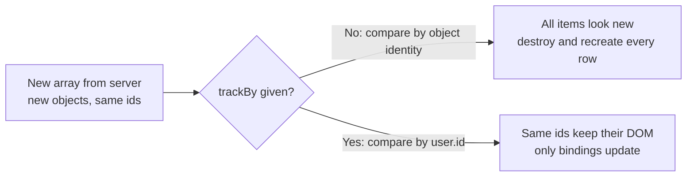
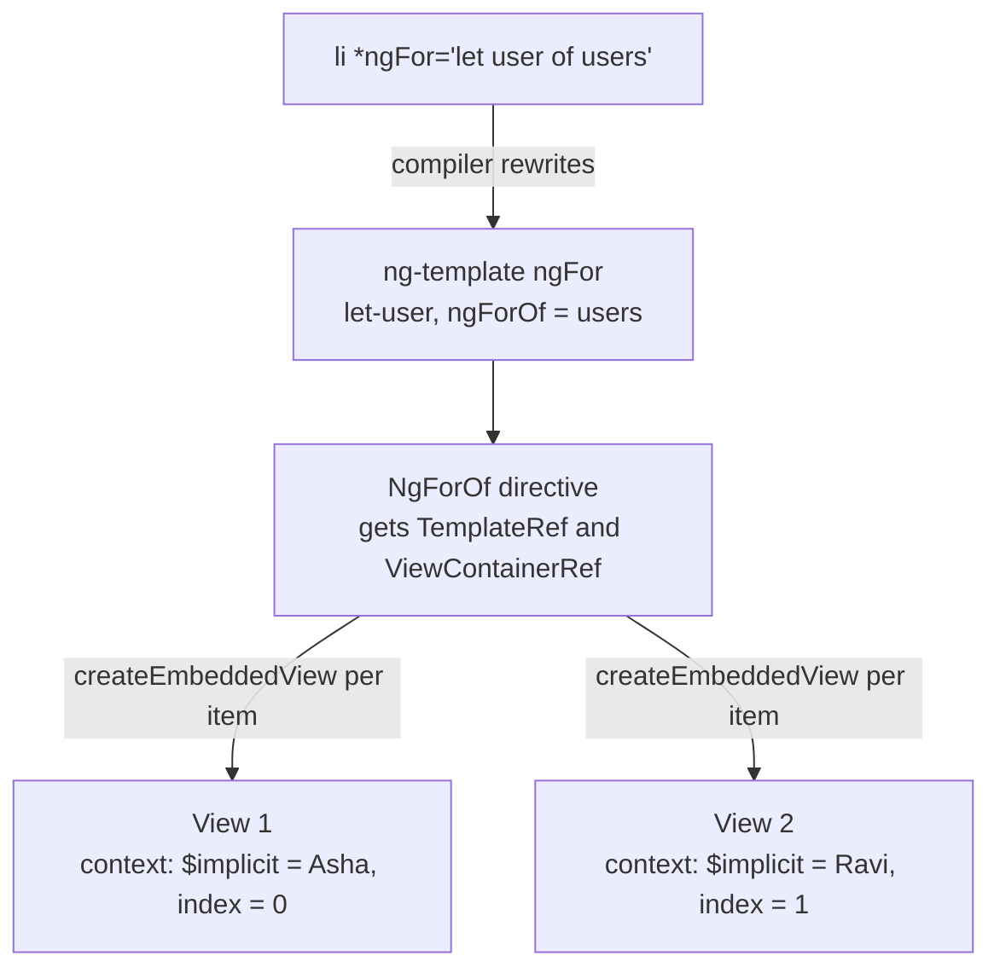
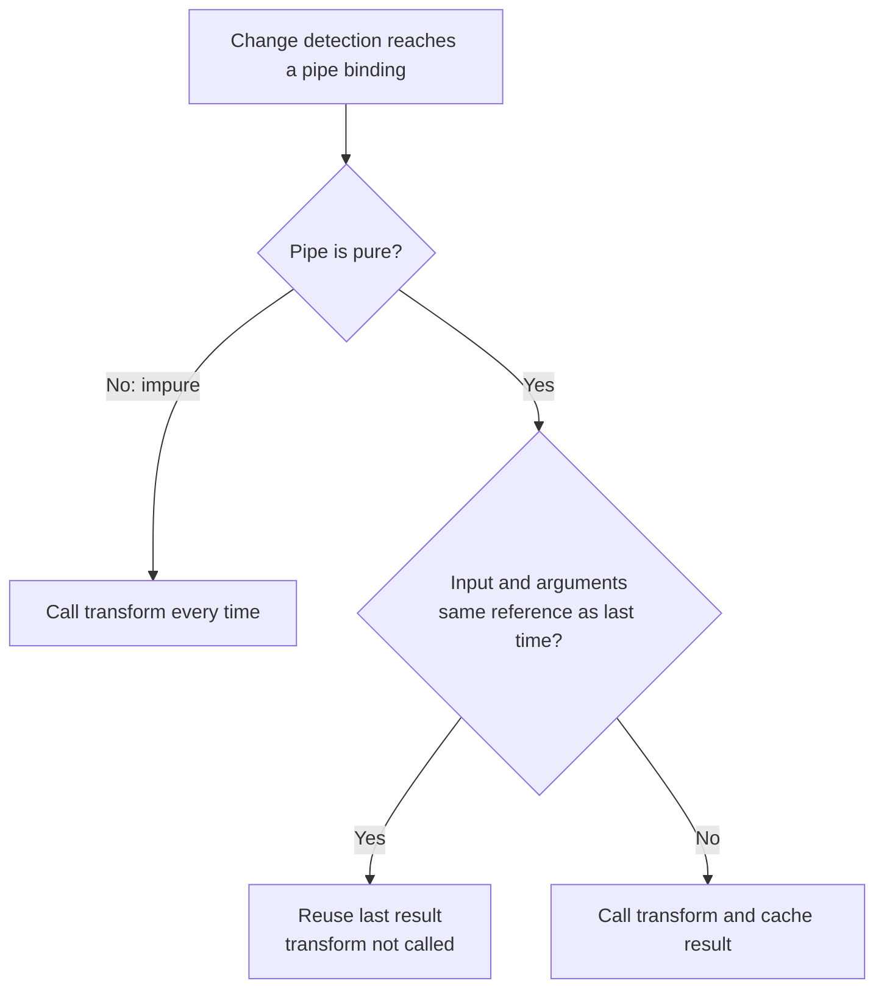
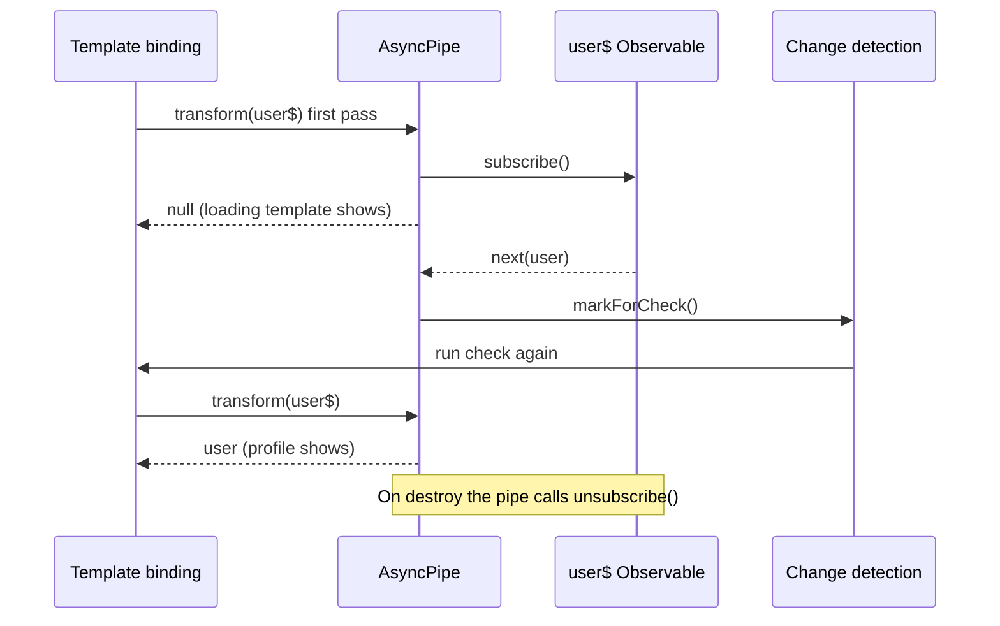

# Directives and Pipes

> In this document you will learn the three kinds of directives, every important built-in directive and pipe, how the `*` syntax really works, how to write your own attribute and structural directives, the directive composition API, and the difference between pure and impure pipes. Interviewers use these topics to check whether you understand what Angular does behind its template syntax, and whether you know the performance impact of your template choices.

**Before this:** [Angular fundamentals](01-angular-fundamentals.md) · [Components and templates](02-components-and-templates.md) · **Interview questions:** [jump to the interview section](#interview-questions)

## Table of contents

1. [What a directive is](#what-a-directive-is)
2. [Built-in attribute directives](#built-in-attribute-directives)
3. [Built-in structural directives](#built-in-structural-directives)
4. [How the star syntax works](#how-the-star-syntax-works)
5. [Writing custom attribute directives](#writing-custom-attribute-directives)
6. [Writing custom structural directives](#writing-custom-structural-directives)
7. [The directive composition API](#the-directive-composition-api)
8. [What a pipe is](#what-a-pipe-is)
9. [Built-in pipes](#built-in-pipes)
10. [Writing custom pipes](#writing-custom-pipes)
11. [Pure and impure pipes](#pure-and-impure-pipes)
12. [The async pipe in depth](#the-async-pipe-in-depth)
13. [Pipes vs method calls in templates](#pipes-vs-method-calls-in-templates)
14. [Newer Angular: built-in control flow](#newer-angular-built-in-control-flow)
15. [Common mistakes](#common-mistakes)
16. [Best practices](#best-practices)
17. [How to explain pure and impure pipes in an interview](#how-to-explain-pure-and-impure-pipes-in-an-interview)
18. [Interview questions](#interview-questions)
19. [Summary](#summary)
20. [References](#references)

---

## What a directive is

A **directive** is a class that adds behavior to an element in a template. Angular has three kinds:

| Kind | What it does | Has a template? | Examples |
| --- | --- | --- | --- |
| **Component** | Creates a piece of UI with its own template | Yes | `<app-user-card>` |
| **Attribute directive** | Changes the look or behavior of an existing element | No | `ngClass`, `ngStyle`, `ngModel`, your `appHighlight` |
| **Structural directive** | Adds or removes elements (changes the DOM structure) | No (it uses a template you give it) | `*ngIf`, `*ngFor`, `*ngSwitchCase`, your `*appHasRole` |

A component is really a directive with a template. `@Component` extends `@Directive` and adds template, styles and a few more options.

### Analogy

- A **component** is a new piece of furniture.
- An **attribute directive** is paint or a handle you add to existing furniture.
- A **structural directive** is the person who decides whether the furniture is in the room at all, and how many copies.

### How Angular finds directives

A directive has a **selector**, just like a component. Angular checks every element in a template against the selectors of the directives available in that template (the standalone component's `imports`, or the NgModule's compilation context).

```ts
@Directive({ selector: '[appHighlight]', standalone: true })   // attribute selector
export class HighlightDirective {}
```

```html
<p appHighlight>This paragraph gets the directive.</p>
```

Selectors can be attributes (`[appHighlight]`), elements (`app-x`), classes (`.x`), or combinations (`input[type=email][appEmail]`). Attribute selectors are by far the most common for directives.

Several directives can match the same element. A component can only be one per element.

---

## Built-in attribute directives

### `ngClass`

Adds and removes CSS classes. It accepts a string, an array or an object.

```html
<!-- Object: key = class name, value = condition -->
<div class="card" [ngClass]="{ active: isActive, disabled: !enabled }"></div>
<!-- with isActive = true, enabled = false → class="card active disabled" -->

<!-- Array -->
<div [ngClass]="['card', size]"></div>

<!-- String -->
<div [ngClass]="'card shadow'"></div>
```

Since Ivy, plain `[class]` binding also accepts all three forms, and `[class.active]="isActive"` handles one class. Many teams now use `[class]` and keep `ngClass` only in old code. Both are fine in Angular 16.

### `ngStyle`

Sets inline styles from an object. Keys can include a unit.

```html
<div [ngStyle]="{ 'font-size.px': fontSize, 'background-color': theme.background }"></div>
<!-- with fontSize = 14 → style="font-size: 14px; background-color: ..." -->
```

As with classes, `[style]="{...}"` and `[style.font-size.px]="fontSize"` do the same without the directive.

### `ngModel`

Two-way binding for form controls in **template-driven forms**. It needs `FormsModule`.

```html
<input [(ngModel)]="searchTerm" name="search">
```

`ngModel` is covered in [Angular fundamentals](01-angular-fundamentals.md#two-way-binding) and [Forms](07-forms.md).

---

## Built-in structural directives

Structural directives start with `*`. They add, remove or repeat a piece of template. In Angular 16 they come from `@angular/common` (`CommonModule`, or the standalone directives `NgIf`, `NgFor`, `NgSwitch`, `NgSwitchCase`, `NgSwitchDefault`).

### `*ngIf`

Adds the element when the condition is truthy and **removes it from the DOM** when it is falsy. When removed, child components are **destroyed** (their `ngOnDestroy` runs). When added back, they are created again from scratch.

```html
<p *ngIf="cart.items.length > 0">You have items in your cart.</p>
```

**With `else`:** show another template when the condition is falsy.

```html
<div *ngIf="orders.length > 0; else emptyState">
  <app-order-table [orders]="orders"></app-order-table>
</div>
<ng-template #emptyState>
  <p>No orders yet.</p>
</ng-template>
```

**With `as`:** store the result of the expression in a local variable. This is very common with the `async` pipe.

```html
<div *ngIf="user$ | async as user; else loading">
  Hello {{ user.name }}
</div>
<ng-template #loading><app-spinner></app-spinner></ng-template>
```

Inside the block, `user` has the non-null type, so the template type-checker knows it exists.

**With `then` and `else`** (rarely needed):

```html
<ng-container *ngIf="isAdmin; then adminView; else userView"></ng-container>
<ng-template #adminView>Admin panel</ng-template>
<ng-template #userView>User panel</ng-template>
```

**`*ngIf` vs `[hidden]`:**

| | `*ngIf="false"` | `[hidden]="true"` |
| --- | --- | --- |
| DOM element | Removed | Still in the DOM, `display: none` |
| Child components | Destroyed, then re-created later | Stay alive, keep their state |
| Cost of toggling | Higher (create/destroy) | Lower |
| Cost while hidden | None | Bindings inside are still checked |
| Use when | Content is heavy or rarely shown, or must not exist (permissions) | Toggled often and must keep state (for example a form in a tab) |

A CSS rule like `.x { display: flex }` can override the `hidden` attribute, so `[hidden]` sometimes "does not work". Use `[style.display]` or a class in that case.

### `*ngFor`

Repeats a template for each item of a list.

```html
<ul>
  <li *ngFor="let user of users; let i = index; let first = first; let last = last; let even = even; let c = count">
    {{ i }}: {{ user.name }} (first: {{ first }}, last: {{ last }}, even: {{ even }}, total: {{ c }})
  </li>
</ul>
```

The local variables (verified in Angular 16 with four users):

| Variable | Meaning | Values for 4 items |
| --- | --- | --- |
| `index` | Position, starting at 0 | 0, 1, 2, 3 |
| `count` | Number of items | 4 for every row |
| `first` | `true` for the first row | true, false, false, false |
| `last` | `true` for the last row | false, false, false, true |
| `even` | `true` when `index` is even | true, false, true, false |
| `odd` | `true` when `index` is odd | false, true, false, true |

#### `trackBy`

By default, `*ngFor` tracks items by **object identity**. If you replace the array with new objects (for example after an HTTP refresh), Angular thinks every item is new. It **destroys all DOM elements and creates them again**, even if the data is the same. This is slow for big lists, and it loses focus, scroll position and component state.

A **`trackBy` function** tells Angular how to identify an item, usually by id:

```ts
@Component({
  selector: 'app-user-list',
  standalone: true,
  imports: [NgFor],
  template: `
    <ul>
      <li *ngFor="let user of users; trackBy: trackById">{{ user.name }}</li>
    </ul>
    <button (click)="refresh()">Refresh</button>
  `,
})
export class UserListComponent {
  users: User[] = [];
  constructor(private userService: UserService) {}

  trackById(index: number, user: User): number {
    return user.id;
  }

  refresh(): void {
    this.userService.getUsers().subscribe(users => (this.users = users)); // new objects every time
  }
}
```

With `trackById`, Angular keeps the existing `<li>` for every id it already knows. It only updates changed bindings, adds new ids and removes missing ones.



### `ngSwitch`

Shows one of several templates based on a value. It uses three directives together.

```html
<div [ngSwitch]="order.status">
  <span *ngSwitchCase="'paid'" class="badge green">Paid</span>
  <span *ngSwitchCase="'failed'" class="badge red">Failed</span>
  <span *ngSwitchDefault class="badge gray">Pending</span>
</div>
```

- `[ngSwitch]` is an attribute directive (no `*`) on the container.
- `*ngSwitchCase` and `*ngSwitchDefault` are structural directives.
- Matching uses strict equality (`===`). `*ngSwitchCase="'paid'"` needs the inner quotes because the value is an expression; `paid` without quotes would mean a component property named `paid`.

### One structural directive per element

You cannot put two `*` directives on the same element:

```html
<!-- ❌ Wrong: compile error "Can't have multiple template bindings on one element" -->
<li *ngFor="let user of users" *ngIf="user.active">{{ user.name }}</li>

<!-- ✅ Correct: use ng-container for one of them -->
<ng-container *ngFor="let user of users">
  <li *ngIf="user.active">{{ user.name }}</li>
</ng-container>
```

The reason is explained in the next section.

---

## How the star syntax works

The `*` is **syntax sugar**. Angular rewrites every `*directive` into an `<ng-template>` with normal property bindings. Understanding this rewrite explains almost every rule of structural directives.

### `*ngIf`

```html
<!-- What you write -->
<p *ngIf="isLoggedIn">Welcome back!</p>

<!-- What Angular sees -->
<ng-template [ngIf]="isLoggedIn">
  <p>Welcome back!</p>
</ng-template>
```

So:

1. The `<p>` element moves **inside** an `<ng-template>`. A template is not rendered by itself.
2. The `NgIf` directive sits on the `<ng-template>`. It receives the template as a `TemplateRef` and a `ViewContainerRef` (the place where views can be inserted).
3. When `ngIf` becomes true, the directive calls `viewContainer.createEmbeddedView(templateRef)`. When it becomes false, it calls `viewContainer.clear()`.

With `else` and `as`:

```html
<!-- What you write -->
<div *ngIf="user$ | async as user; else loading">{{ user.name }}</div>

<!-- What Angular sees -->
<ng-template [ngIf]="user$ | async" let-user="ngIf" [ngIfElse]="loading">
  <div>{{ user.name }}</div>
</ng-template>
```

`as user` becomes `let-user="ngIf"`: the directive puts the value into its template context under the key `ngIf`, and `let-user` reads it.

### `*ngFor` and microsyntax

The text inside `*ngFor="..."` is called **microsyntax**. Angular parses it with simple rules:

- The first word after `let` that has no `=` is the `$implicit` variable.
- A keyword like `of` or `trackBy` becomes an input named `<directiveName><Keyword>`: `of` → `ngForOf`, `trackBy` → `ngForTrackBy`.
- `let i = index` reads `index` from the template context.

```html
<!-- What you write -->
<li *ngFor="let user of users; let i = index; trackBy: trackById">{{ i }} {{ user.name }}</li>

<!-- What Angular sees -->
<ng-template ngFor let-user [ngForOf]="users" let-i="index" [ngForTrackBy]="trackById">
  <li>{{ i }} {{ user.name }}</li>
</ng-template>
```

That is why the directive class is called `NgForOf` and has inputs `ngForOf` and `ngForTrackBy`. For each item it creates an embedded view with a context object like `{ $implicit: user, index: 0, count: 4, ... }`.



### Why only one structural directive per element

Each `*` wraps the element in its own `<ng-template>`. With two stars on one element, Angular would have to decide which template wraps which, and the order would change the meaning (repeat-then-filter vs filter-then-repeat). Angular refuses to guess, so it only allows one. You choose the order yourself with `<ng-container>`.

---

## Writing custom attribute directives

### Example 1: highlight on hover

```ts
import { Directive, HostBinding, HostListener, Input } from '@angular/core';

@Directive({
  selector: '[appHighlight]',
  standalone: true,
})
export class HighlightDirective {
  @Input() appHighlight = 'yellow';     // same name as the selector: <p appHighlight="lightblue">
  @Input() defaultColor = '';

  @HostBinding('style.backgroundColor') backgroundColor = '';

  @HostListener('mouseenter') onMouseEnter() {
    this.backgroundColor = this.appHighlight || 'yellow';
  }

  @HostListener('mouseleave') onMouseLeave() {
    this.backgroundColor = this.defaultColor;
  }
}
```

```html
<p appHighlight="lightblue" defaultColor="white">Hover over me</p>
```

When the mouse enters, the paragraph gets `style="background-color: lightblue;"` (verified in Angular 16).

Notes:

- An input with the **same name as the selector** lets you pass a value through the attribute itself.
- `@HostBinding` and `@HostListener` work on directives the same way as on components.
- Angular removes the listeners automatically when the element is destroyed.

### Example 2: autofocus

```ts
import { AfterViewInit, Directive, ElementRef, inject } from '@angular/core';

@Directive({
  selector: '[appAutofocus]',
  standalone: true,
})
export class AutofocusDirective implements AfterViewInit {
  private readonly el = inject(ElementRef<HTMLElement>);

  ngAfterViewInit(): void {
    this.el.nativeElement.focus();
  }
}
```

```html
<input appAutofocus placeholder="Search">
```

- **`ElementRef`** wraps the host DOM element. `nativeElement` is the real element.
- We focus in `ngAfterViewInit`, when the element is attached to the view.
- Direct DOM access (`nativeElement`) does not work in server-side rendering, where there is no real DOM. For calls like `focus()`, a check with `isPlatformBrowser` can guard it in SSR apps.

### Example 3: Renderer2 for DOM changes

**`Renderer2`** is Angular's abstraction for DOM changes. It works on the server and in web workers, and it is the safe way to add classes, attributes and listeners from code.

```ts
import { Directive, ElementRef, Input, OnChanges, Renderer2 } from '@angular/core';

@Directive({ selector: '[appBadge]', standalone: true })
export class BadgeDirective implements OnChanges {
  @Input() appBadge: number | null = null;   // number to show, or null to hide
  private badgeEl?: HTMLElement;

  constructor(private el: ElementRef<HTMLElement>, private renderer: Renderer2) {}

  ngOnChanges(): void {
    if (this.appBadge && !this.badgeEl) {
      this.badgeEl = this.renderer.createElement('span');
      this.renderer.addClass(this.badgeEl, 'badge');
      this.renderer.appendChild(this.el.nativeElement, this.badgeEl);
    }
    if (this.badgeEl) {
      this.renderer.setProperty(this.badgeEl, 'textContent', this.appBadge ? String(this.appBadge) : '');
      this.renderer.setStyle(this.badgeEl, 'display', this.appBadge ? 'inline-block' : 'none');
    }
  }
}
```

```html
<button [appBadge]="unreadCount">Inbox</button>
```

### Example 4: disable an element by permission

A realistic directive: disable buttons the user is not allowed to use, and explain why.

```ts
@Directive({
  selector: '[appRequirePermission]',
  standalone: true,
  host: {
    '[disabled]': '!allowed',                  // works on <button>, <input>, ...
    '[attr.title]': "allowed ? null : 'You do not have permission for this action'",
    '[class.no-permission]': '!allowed',
  },
})
export class RequirePermissionDirective {
  private readonly auth = inject(AuthService);
  @Input({ required: true }) appRequirePermission!: string;

  get allowed(): boolean {
    return this.auth.hasPermission(this.appRequirePermission);
  }
}
```

```html
<button appRequirePermission="orders.delete" (click)="deleteOrder()">Delete</button>
```

Remember: hiding or disabling a button is **user experience**, not security. The server must check permissions too.

### Example 5: click outside (with an output)

```ts
@Directive({ selector: '[appClickOutside]', standalone: true })
export class ClickOutsideDirective {
  @Output() appClickOutside = new EventEmitter<void>();
  constructor(private el: ElementRef<HTMLElement>) {}

  @HostListener('document:click', ['$event.target'])
  onDocumentClick(target: EventTarget | null): void {
    if (target instanceof Node && !this.el.nativeElement.contains(target)) {
      this.appClickOutside.emit();
    }
  }
}
```

```html
<div class="dropdown" *ngIf="open" (appClickOutside)="open = false">...</div>
```

Directives can have outputs too. Naming the output like the selector lets you write `(appClickOutside)="..."`.

---

## Writing custom structural directives

A structural directive gets two things by injection:

- **`TemplateRef`** — the template it sits on (the content between the tags).
- **`ViewContainerRef`** — the place where it can insert views of that template.

### Example 1: `*appUnless` (the opposite of `*ngIf`)

```ts
import { Directive, Input, TemplateRef, ViewContainerRef } from '@angular/core';

@Directive({
  selector: '[appUnless]',
  standalone: true,
})
export class UnlessDirective {
  private hasView = false;

  constructor(
    private templateRef: TemplateRef<unknown>,
    private viewContainer: ViewContainerRef,
  ) {}

  @Input() set appUnless(condition: boolean) {
    if (!condition && !this.hasView) {
      this.viewContainer.createEmbeddedView(this.templateRef);   // show
      this.hasView = true;
    } else if (condition && this.hasView) {
      this.viewContainer.clear();                                // hide
      this.hasView = false;
    }
  }
}
```

```html
<p *appUnless="loggedIn">Please log in.</p>
<!-- Angular rewrites it to: <ng-template [appUnless]="loggedIn"><p>Please log in.</p></ng-template> -->
```

Step by step:

1. Angular creates the directive on the `<ng-template>` and injects `TemplateRef` and `ViewContainerRef`.
2. Angular sets the input `appUnless` to `false` (the user is not logged in). The setter creates the view, so the paragraph appears.
3. The user logs in, `loggedIn` becomes `true`. On the next change detection pass, the setter runs with `true` and clears the container. The paragraph is removed.

The `hasView` flag prevents creating a second copy when the input is set to `false` again.

### Example 2: `*appHasRole` with `else` and a service

A realistic directive used in admin apps: show content only for users with a role, and react when the user's roles change.

```ts
import { Directive, Input, OnDestroy, TemplateRef, ViewContainerRef, inject } from '@angular/core';
import { BehaviorSubject } from 'rxjs';

@Injectable({ providedIn: 'root' })
export class AuthService {
  private readonly rolesSubject = new BehaviorSubject<string[]>([]);
  readonly roles$ = this.rolesSubject.asObservable();
  setRoles(roles: string[]): void { this.rolesSubject.next(roles); }
}

@Directive({
  selector: '[appHasRole]',
  standalone: true,
})
export class HasRoleDirective implements OnDestroy {
  private readonly templateRef = inject(TemplateRef<unknown>);
  private readonly viewContainer = inject(ViewContainerRef);
  private readonly auth = inject(AuthService);

  private requiredRoles: string[] = [];
  private elseTemplate: TemplateRef<unknown> | null = null;
  private userRoles: string[] = [];

  private readonly sub = this.auth.roles$.subscribe(roles => {
    this.userRoles = roles;
    this.updateView();
  });

  @Input() set appHasRole(roles: string | string[]) {
    this.requiredRoles = Array.isArray(roles) ? roles : [roles];
    this.updateView();
  }

  // Microsyntax "else" maps to an input named appHasRoleElse
  @Input() set appHasRoleElse(template: TemplateRef<unknown> | null) {
    this.elseTemplate = template;
    this.updateView();
  }

  private updateView(): void {
    const allowed = this.requiredRoles.some(role => this.userRoles.includes(role));
    this.viewContainer.clear();
    if (allowed) {
      this.viewContainer.createEmbeddedView(this.templateRef);
    } else if (this.elseTemplate) {
      this.viewContainer.createEmbeddedView(this.elseTemplate);
    }
  }

  ngOnDestroy(): void {
    this.sub.unsubscribe();
  }
}
```

```html
<button *appHasRole="'admin'; else noAccess" (click)="deleteUser()">Delete user</button>
<ng-template #noAccess><span>No access</span></ng-template>

<section *appHasRole="['admin', 'support']">Support tools</section>
```

I verified this in Angular 16: with roles `['viewer']` the page shows "No access"; after `auth.setRoles(['admin'])` and a change detection pass, the button appears and "No access" is removed.

A simpler version would call `clear()` and re-create the view on every update. For a real app, keep track of what is shown (like `hasView` in `appUnless`) so the content is not destroyed and re-created when nothing changed.

Remember again: this hides UI. **The server must still check the role** for every request.

### Template context and type checking

A structural directive can pass data to its template through a **context** object, just like `*ngFor` passes `index`.

```ts
interface LetContext<T> {
  $implicit: T;     // let-value
  appLet: T;        // "as value"
}

@Directive({ selector: '[appLet]', standalone: true })
export class LetDirective<T> {
  private context: LetContext<T | null> = { $implicit: null, appLet: null };

  constructor(templateRef: TemplateRef<LetContext<T | null>>, viewContainer: ViewContainerRef) {
    viewContainer.createEmbeddedView(templateRef, this.context);
  }

  @Input() set appLet(value: T) {
    this.context.$implicit = this.context.appLet = value;
  }

  // Tells the template type-checker what type the context has
  static ngTemplateContextGuard<T>(dir: LetDirective<T>, ctx: unknown): ctx is LetContext<T> {
    return true;
  }
}
```

```html
<!-- Shows the section even when the value is falsy (unlike *ngIf) -->
<section *appLet="unreadCount$ | async as count">You have {{ count }} new messages.</section>
```

`ngTemplateContextGuard` is a static method that the Angular compiler reads to type-check variables inside the template. Without it, `count` would be typed as `any`.

---

## The directive composition API

### What it is

The **directive composition API** (Angular 15+) lets a component or directive apply other directives to its **own host element** with the `hostDirectives` property.

### Why it exists

Imagine you have small reusable behaviors: a tooltip, a "disabled" style, focus tracking. Before v15, to give a button component all of them, you either copied the code into the component, used inheritance (only one base class), or asked every user to write `<app-button appTooltip appDisabledStyle>`. Host directives let the component include these behaviors itself.

### Example

```ts
import { Component, Directive, Input, booleanAttribute } from '@angular/core';

@Directive({
  selector: '[appTooltip]',
  standalone: true,
  host: { '[attr.title]': 'tooltip' },
})
export class TooltipDirective {
  @Input() tooltip = '';
}

@Directive({
  selector: '[appDisabledStyle]',
  standalone: true,
  host: {
    '[class.is-disabled]': 'disabled',
    '[attr.aria-disabled]': 'disabled',
  },
})
export class DisabledStyleDirective {
  @Input({ transform: booleanAttribute }) disabled = false;
}

@Component({
  selector: 'app-icon-button',
  standalone: true,
  hostDirectives: [
    { directive: TooltipDirective, inputs: ['tooltip'] },
    { directive: DisabledStyleDirective, inputs: ['disabled'] },
  ],
  template: `<ng-content></ng-content>`,
})
export class IconButtonComponent {}
```

```html
<app-icon-button tooltip="Delete item" disabled>🗑</app-icon-button>
```

Rendered host element (verified in Angular 16, debug attributes removed):

```html
<app-icon-button tooltip="Delete item" disabled="" title="Delete item"
                 aria-disabled="true" class="is-disabled">🗑</app-icon-button>
```

### Rules

- Host directives must be **standalone**.
- Their inputs and outputs are **not exposed by default**. You list the ones you want in `inputs` and `outputs`, and you can rename them: `inputs: ['tooltip: appTooltipText']`.
- Their selectors are ignored. They are applied because the host lists them, not because the selector matches.
- Host directives are created **before** the host component or directive, and their lifecycle hooks run before the host's.
- The host can inject a host directive to talk to it: `inject(TooltipDirective)`.

| | Inheritance (`extends`) | Host directives |
| --- | --- | --- |
| Number of behaviors | One base class | Many |
| Coupling | Tight; child sees all base internals | Loose; only listed inputs/outputs |
| Reuse outside components | No | The same directive works on plain elements too |

---

## What a pipe is

A **pipe** is a class with a `transform` method that formats a value for display in a template.

```html
<p>{{ order.createdAt | date:'dd MMM yyyy' }}</p>
```

- The value on the left of `|` is the first argument of `transform`.
- Arguments after `:` are the next arguments.
- Pipes can be **chained**: the output of one is the input of the next.

```html
<p>{{ user.name | slice:0:10 | uppercase }}</p>
```

### Why pipes exist

Without pipes, you would format values in the component (`formattedDate = ...`) for every field, or call methods in templates. Pipes give reusable, declarative formatting, and **pure pipes** are cached, so they are faster than method calls.

### Operator precedence

The pipe operator has **lower** precedence than most operators, but **higher** precedence than the ternary `?:`.

```html
<!-- Means: isVip ? 'VIP' : (name | uppercase) -->
{{ isVip ? 'VIP' : name | uppercase }}

<!-- Use parentheses to be clear -->
{{ (isVip ? 'vip' : 'regular') | uppercase }}
{{ (users | activeUsers).length }}
```

---

## Built-in pipes

All examples below were run with Angular 16.2 pipes, locale `en-US`, and time zone `UTC` for dates (dates depend on the user's time zone unless you pass one).

### Text pipes

```html
{{ 'asha sharma' | uppercase }}        <!-- ASHA SHARMA -->
{{ 'ASHA' | lowercase }}               <!-- asha -->
{{ 'angular in ACTION' | titlecase }}  <!-- Angular In Action -->
{{ 'Hello Angular' | slice:0:5 }}      <!-- Hello -->
```

`slice` also works on arrays: `[1,2,3,4,5] | slice:1:3` → `[2,3]`, and `slice:-2` → `[4,5]`. It is handy for "show first 5 items".

### `date`

```html
<!-- order.createdAt = 2024-03-05T14:30:00Z -->
{{ order.createdAt | date }}                        <!-- Mar 5, 2024 (default: 'mediumDate') -->
{{ order.createdAt | date:'short' }}                <!-- 3/5/24, 2:30 PM -->
{{ order.createdAt | date:'medium' }}               <!-- Mar 5, 2024, 2:30:00 PM -->
{{ order.createdAt | date:'longDate' }}             <!-- March 5, 2024 -->
{{ order.createdAt | date:'fullDate' }}             <!-- Tuesday, March 5, 2024 -->
{{ order.createdAt | date:'dd/MM/yyyy' }}           <!-- 05/03/2024 -->
{{ order.createdAt | date:'dd MMM yyyy' }}          <!-- 05 Mar 2024 -->
{{ order.createdAt | date:'HH:mm' }}                <!-- 14:30 -->
{{ order.createdAt | date:'h:mm a' }}               <!-- 2:30 PM -->
{{ order.createdAt | date:'HH:mm':'+0530' }}        <!-- 20:00 (third argument: time zone) -->
```

- The input can be a `Date`, a number (milliseconds) or an ISO string.
- `null` and `undefined` give `null`, which shows as nothing.
- Format letters: `yyyy` year, `MM` month number, `MMM` short month name, `dd` day, `EEEE` weekday name, `HH` 24-hour, `h` 12-hour, `mm` minutes, `a` AM/PM.
- Without a time zone argument, the pipe uses the browser's time zone. For server timestamps, decide on purpose which time zone to show.

### Number pipes: `number`, `currency`, `percent`

The **digits info** format is `minIntegerDigits.minFractionDigits-maxFractionDigits`.

```html
{{ 1234567.891 | number }}            <!-- 1,234,567.891 (default '1.0-3') -->
{{ 3.14159 | number:'1.2-2' }}        <!-- 3.14 -->
{{ 5 | number:'3.1-1' }}              <!-- 005.0 -->
{{ 2.5 | number:'1.0-0' }}            <!-- 3 (rounds half up) -->

{{ 1250 | currency }}                 <!-- $1,250.00 (default USD) -->
{{ 1250 | currency:'EUR' }}           <!-- €1,250.00 -->
{{ 1250 | currency:'INR' }}           <!-- ₹1,250.00 -->
{{ 1250 | currency:'EUR':'code' }}    <!-- EUR1,250.00 -->
{{ 1250.5 | currency:'CAD' }}         <!-- CA$1,250.50 -->
{{ 1250.5 | currency:'CAD':'symbol-narrow' }}  <!-- $1,250.50 -->
{{ 1250.75 | currency:'USD':'symbol':'1.0-0' }} <!-- $1,251 -->

{{ 0.256 | percent }}                 <!-- 26% -->
{{ 0.256 | percent:'1.1-1' }}         <!-- 25.6% -->
```

The default currency is `USD`. Change it app-wide with the `DEFAULT_CURRENCY_CODE` token: `{ provide: DEFAULT_CURRENCY_CODE, useValue: 'EUR' }`.

**Locales:** Angular uses `en-US` by default. To format for another locale, register its data and set `LOCALE_ID`:

```ts
import { registerLocaleData } from '@angular/common';
import localeDe from '@angular/common/locales/de';
registerLocaleData(localeDe);

// providers: [{ provide: LOCALE_ID, useValue: 'de-DE' }]
// {{ 1250 | currency:'EUR' }} → 1.250,00 €
```

### `json`

Shows a value as formatted JSON. Very useful for debugging.

```html
<pre>{{ form.value | json }}</pre>
<!--
{
  "id": 1,
  "tags": [
    "a"
  ]
}
-->
```

It uses `JSON.stringify(value, null, 2)`. It is **impure** (it runs on every change detection pass), so remove it before production.

### `keyvalue`

Turns an object or a `Map` into an array of `{ key, value }` so you can loop over it with `*ngFor`.

```ts
settings = { theme: 'dark', lang: 'en', autosave: true };
keepOrder = () => 0;   // compare function that keeps insertion order
```

```html
<li *ngFor="let entry of settings | keyvalue">{{ entry.key }} = {{ entry.value }}</li>
<!-- autosave = true, lang = en, theme = dark  ← sorted by key by default -->

<li *ngFor="let entry of settings | keyvalue: keepOrder">{{ entry.key }} = {{ entry.value }}</li>
<!-- theme = dark, lang = en, autosave = true  ← original order -->
```

The default **sorts by key**. That surprises many developers. Pass a compare function to control the order.

### `async`

Subscribes to an Observable or a Promise and shows its latest value. It is so important that it has [its own section](#the-async-pipe-in-depth).

```html
<p>{{ greeting$ | async }}</p>
```

### Other built-in pipes

- `i18nPlural` and `i18nSelect` for simple plural and select text.
- `lowercase`, `uppercase`, `titlecase` (above).

---

## Writing custom pipes

A custom pipe is a class with `@Pipe` that implements `PipeTransform`.

### Example 1: truncate text

```ts
import { Pipe, PipeTransform } from '@angular/core';

@Pipe({
  name: 'truncate',
  standalone: true,
})
export class TruncatePipe implements PipeTransform {
  transform(value: string | null | undefined, limit = 20, suffix = '…'): string {
    if (!value) return '';
    return value.length > limit ? value.slice(0, limit).trimEnd() + suffix : value;
  }
}
```

```html
{{ 'Angular pipes format values' | truncate:10 }}   <!-- Angular pi… -->
{{ product.description | truncate:100:' (more)' }}
```

### Example 2: human-readable file size

```ts
@Pipe({ name: 'fileSize', standalone: true })
export class FileSizePipe implements PipeTransform {
  private readonly units = ['B', 'KB', 'MB', 'GB', 'TB'];

  transform(bytes: number | null | undefined, decimals = 1): string {
    if (bytes == null || isNaN(bytes)) return '';
    if (bytes === 0) return '0 B';
    const i = Math.min(Math.floor(Math.log(bytes) / Math.log(1024)), this.units.length - 1);
    const value = bytes / Math.pow(1024, i);
    return `${value.toFixed(i === 0 ? 0 : decimals)} ${this.units[i]}`;
  }
}
```

```html
{{ 1536 | fileSize }}          <!-- 1.5 KB -->
{{ 5505024 | fileSize:2 }}     <!-- 5.25 MB -->
{{ 512 | fileSize }}           <!-- 512 B -->
{{ 0 | fileSize }}             <!-- 0 B -->
```

### Using custom pipes

- **Standalone pipe:** add it to the component's `imports`.
- **NgModule pipe:** add it to the module's `declarations` (and `exports` if other modules need it).

```ts
@Component({
  standalone: true,
  imports: [TruncatePipe, FileSizePipe],
  // ...
})
export class FileListComponent {}
```

### Rules for good pipes

- Keep `transform` **pure**: same input → same output, no side effects, no HTTP calls.
- Handle `null` and `undefined` (values are often missing while data loads).
- Pipes can inject services (`inject(LOCALE_ID)`, a translation service), but keep them light.
- You can also use a pipe class in TypeScript code: `new TruncatePipe().transform(text, 10)`, or inject it if you add it to `providers`. Often a plain function is cleaner for code.

---

## Pure and impure pipes

### What it is

- A **pure pipe** (the default, `pure: true`) runs **only when its input value or arguments change**. For objects and arrays, "change" means a **new reference**.
- An **impure pipe** (`pure: false`) runs on **every change detection pass**, for every place it is used.

### Why it matters

Pure pipes are a performance feature. Angular remembers the last inputs and the last result. If the inputs are the same (`===`) on the next pass, Angular reuses the result and does not call `transform` at all.

### A test you can reason about

I ran this in Angular 16.2 with two pipes that do the same thing (filter active users), one pure and one impure:

```ts
@Pipe({ name: 'activeUsers', standalone: true })                     // pure (default)
export class ActiveUsersPipe implements PipeTransform {
  transform(users: User[]): User[] {
    return users.filter(u => u.active);
  }
}

@Pipe({ name: 'activeUsersImpure', standalone: true, pure: false })  // impure
export class ActiveUsersImpurePipe implements PipeTransform {
  transform(users: User[]): User[] {
    return users.filter(u => u.active);
  }
}
```

```html
<p>{{ (users | activeUsers).length }}</p>
<p>{{ (users | activeUsersImpure).length }}</p>
```

Results:

| What happened | Pure pipe | Impure pipe |
| --- | --- | --- |
| `transform` calls during 3 change detection passes with no data change | 0 | 6 (in dev mode, each pass checks bindings twice) |
| After `users.push({ name: 'Kiran', active: true })` | Still shows **2** (stale!) | Shows **3** |
| After `users = [...users]` (new array) | Shows **3** | Shows **3** |

What this shows:

1. The pure pipe is very cheap: it is skipped when nothing changed.
2. The pure pipe **does not see mutations**. `push` changes the array's contents but not its reference, so Angular does not call `transform`. The screen shows old data.
3. The fix is not to make the pipe impure. The fix is **immutable updates**: create a new array (`[...users, newUser]`).
4. The impure pipe always shows fresh data, but its cost grows with every change detection pass and every use. A filter or sort on 5,000 items in an impure pipe can make typing in an input feel slow.



### Instances

- A **pure** pipe class is instantiated once per place it is used in a template, and the instance is reused.
- An **impure** pipe also gets one instance per use. That lets impure pipes like `async` keep state (the subscription) per binding.

### When impure pipes are correct

- The pipe depends on something **other than its inputs**: the current time, a subscription, a translation that can change at runtime.
- Built-in impure pipes: `async` (keeps a subscription), `json`, `keyvalue` (it checks the object for changes with a differ), `slice` is pure.

Even then, keep the `transform` very fast and return the **same reference** when nothing changed, or downstream bindings will see a "new" value every pass.

---

## The async pipe in depth

### What it does

The **`async` pipe** subscribes to an Observable (or waits for a Promise), returns the latest value, and cleans up for you.

```ts
@Component({
  selector: 'app-profile',
  standalone: true,
  imports: [AsyncPipe, NgIf],
  template: `
    <div *ngIf="user$ | async as user; else loading">
      <h2>{{ user.name }}</h2>
      <p>{{ user.email }}</p>
    </div>
    <ng-template #loading><p>Loading profile...</p></ng-template>
  `,
})
export class ProfileComponent {
  user$ = this.userService.getCurrentUser();   // Observable<User>
  constructor(private userService: UserService) {}
}
```

### How it works inside

1. **Subscribe:** on the first change detection pass, the pipe subscribes to `user$`.
2. **Before the first value:** it returns `null`. That is why the `else loading` template shows first. (With `json`, `{{ user$ | async | json }}` shows the text `null`.)
3. **New value arrives:** the pipe stores it and calls `ChangeDetectorRef.markForCheck()`. That marks the component and its ancestors for check, so it works with `OnPush`.
4. **Next change detection pass:** the pipe returns the stored value, and the template shows it.
5. **Reference changes:** if the expression now gives a **different** Observable (for example `user$` was reassigned), the pipe unsubscribes from the old one and subscribes to the new one.
6. **Destroy:** when the component (or the `*ngIf` block) is destroyed, the pipe unsubscribes. No memory leak.



### Each `async` pipe is a separate subscription

```html
<!-- ❌ Two async pipes = two subscriptions = two HTTP requests for a cold HttpClient Observable -->
<h2>{{ (user$ | async)?.name }}</h2>
<p>{{ (user$ | async)?.email }}</p>
```

I verified this in Angular 16: two `async` pipes on the same Observable created **two** subscriptions, and both were unsubscribed when the component was destroyed. With an HTTP Observable, each subscription sends its own request.

Fixes:

```html
<!-- ✅ One subscription with *ngIf ... as -->
<ng-container *ngIf="user$ | async as user">
  <h2>{{ user.name }}</h2>
  <p>{{ user.email }}</p>
</ng-container>
```

```ts
// ✅ Or share the stream in the class
user$ = this.userService.getCurrentUser().pipe(shareReplay({ bufferSize: 1, refCount: true }));
```

See [RxJS](09-rxjs.md) for `shareReplay`.

### Gotcha: falsy values with `*ngIf ... as`

`*ngIf="count$ | async as count"` hides the block when `count` is `0`, `''` or `false`, because `*ngIf` checks truthiness. Wrap the value in an object, or use a small "let" directive (shown above):

```html
<ng-container *ngIf="{ count: count$ | async } as vm">
  You have {{ vm.count }} new messages.   <!-- works for 0 -->
</ng-container>
```

This "view model object" pattern is also a good way to combine several streams in one place.

### Why the async pipe is the preferred way

| Manual `subscribe()` in the component | `async` pipe |
| --- | --- |
| You must unsubscribe (`ngOnDestroy`, `takeUntil`) | Automatic unsubscribe |
| With `OnPush`, you must call `markForCheck()` | Calls `markForCheck()` for you |
| You copy values into fields | The template reads the stream directly |
| Easy to create nested subscriptions | Encourages composing streams with operators |

> **Newer Angular:** with signals, `toSignal(user$)` (developer preview in v16, stable in v20) turns an Observable into a signal you read as `user()` in the template.

---

## Pipes vs method calls in templates

A method call in a template runs on **every change detection pass**, because Angular cannot know whether the result changed without calling it.

```ts
// In the component
getFullName(user: User): string {
  console.log('getFullName called');
  return `${user.firstName} ${user.lastName}`;
}
```

```html
<!-- ❌ Runs on every pass, for every row -->
<li *ngFor="let user of users">{{ getFullName(user) }}</li>
```

In a Zone.js app, a change detection pass happens after every click, key press, timer and HTTP response anywhere in the app (unless `OnPush` skips this component). In my Angular 16 test, a template method ran 6 times during 3 passes (dev mode checks twice per pass), while a pure pipe on the same data ran 0 times.

Better options:

```ts
// ✅ Option 1: a pure pipe (cached per input)
@Pipe({ name: 'fullName', standalone: true })
export class FullNamePipe implements PipeTransform {
  transform(user: User): string {
    return `${user.firstName} ${user.lastName}`;
  }
}
```

```html
<li *ngFor="let user of users">{{ user | fullName }}</li>
```

```ts
// ✅ Option 2: compute once when the data arrives
this.userService.getUsers().subscribe(users => {
  this.rows = users.map(u => ({ ...u, fullName: `${u.firstName} ${u.lastName}` }));
});
```

Is every method call bad? No. A method that returns a field or does trivial work is fine. The problem is **expensive** work: filtering or sorting big arrays, formatting many dates, creating new objects or arrays (a new array every pass also breaks `OnPush` children and `ngFor` diffing). Measure with Angular DevTools when in doubt (see [Performance](12-performance.md)).

| | Template method | Pure pipe | Precomputed field |
| --- | --- | --- | --- |
| When it runs | Every pass | Only when input reference changes | Once, when data changes |
| Reusable across components | No | Yes | No |
| Sees object mutations | Yes | No | No |
| Good for | Trivial getters | Reusable formatting and derived values | Page-specific derived data |

---

## Newer Angular: built-in control flow

> **Newer Angular (17+):** Angular 17 added a built-in control flow syntax in templates (developer preview in 17, stable in 18). It replaces `*ngIf`, `*ngFor` and `ngSwitch`. In **Angular 20**, `NgIf`, `NgFor` and `NgSwitch` are **deprecated**, with removal planned for v22. None of this exists in Angular 16.

```html
<!-- Angular 17+ -->
@if (user) {
  <p>Hello {{ user.name }}</p>
} @else {
  <p>Please log in</p>
}

@for (item of items; track item.id; let i = $index) {
  <li>{{ i }}: {{ item.name }}</li>
} @empty {
  <li>No items</li>
}

@switch (order.status) {
  @case ('paid') { <span>Paid</span> }
  @default { <span>Pending</span> }
}
```

| Angular 16 | Angular 17+ |
| --- | --- |
| `*ngIf="cond; else other"` | `@if (cond) { } @else { }` |
| `*ngFor="let x of list; trackBy: fn"` | `@for (x of list; track x.id) { }` — `track` is **required** |
| `index`, `first`, `last` | `$index`, `$first`, `$last`, `$count`, `$even`, `$odd` |
| Empty list needs a separate `*ngIf` | `@empty { }` block |
| `[ngSwitch]` + `*ngSwitchCase` | `@switch` + `@case` |
| Needs `NgIf`/`NgFor` imports | Built into the template language, no imports |

An automatic migration exists: `ng generate @angular/core:control-flow`. Custom structural directives (like `*appHasRole`) still work in newer versions.

---

## Common mistakes

1. **Two structural directives on one element.** Use `<ng-container>`.
2. **No `trackBy` on lists that are refreshed from the server.** Every refresh re-creates all rows.
3. **Mutating arrays used with pure pipes** (`push`, `splice`, `sort` in place). The pipe shows stale data. Create new arrays.
4. **Making a pipe impure to "fix" stale data.** It hides the real problem and costs performance.
5. **Heavy method calls in templates**, especially inside `*ngFor`.
6. **Several `async` pipes on the same cold Observable**, causing duplicate HTTP requests.
7. **`*ngIf="value$ | async as v"` with values that can be `0` or `''`.** The block disappears.
8. **Forgetting quotes in `*ngSwitchCase="paid"`.** Without quotes, `paid` is a property name.
9. **Directly changing the DOM in directives with `document.querySelector`.** Use `ElementRef` for your own host, `Renderer2` for changes, and keep SSR in mind.
10. **Forgetting `CommonModule` (or `NgIf`/`NgFor`) in standalone components.** The template compiles with an error like "Can't bind to 'ngIf' since it isn't a known property".
11. **Relying on `*appHasRole` or a disabled button for security.** The server must authorize every request.
12. **Leaving `| json` in production templates.** It is impure and shows internal data.

---

## Best practices

- **Use `trackBy` with `*ngFor`** for any list that can be refreshed or reordered. Track by a stable id.
- **Prefer pure pipes** for formatting and derived values. Update data immutably so pure pipes and `OnPush` work.
- **Use the `async` pipe** instead of manual subscriptions in components, and combine streams into one view model with `*ngIf="vm$ | async as vm"`.
- **Use `<ng-container>`** to group structural directives without extra DOM.
- **Use `*ngIf` for content that should not exist** (heavy components, permission-based UI) and `[hidden]` for cheap toggles where state must survive.
- **Make custom directives and pipes standalone** so any component or module can import them.
- **Name directive selectors with your prefix** (`appHighlight`, not `highlight`) to avoid clashes with native attributes and libraries.
- **Use `Renderer2` or host bindings** for DOM changes in directives.
- **Use `hostDirectives`** to compose small reusable behaviors instead of inheritance.
- **Handle `null` and `undefined` in pipes.**
- **Plan for control flow migration** when upgrading past Angular 16: new code in newer versions should use `@if`/`@for`.

---

## How to explain pure and impure pipes in an interview

1. **Define it:** "A pipe transforms a value in a template. A pure pipe, the default, runs only when its input or arguments change by reference. An impure pipe runs on every change detection pass."
2. **Why it exists:** "Template expressions run on every change detection pass. Pure pipes let Angular cache the result, so formatting or filtering isn't recomputed when nothing changed."
3. **How it works:** "Angular stores the last input values for each pure pipe binding. On each pass it compares them with `===`. If they're the same, it reuses the last result without calling `transform`."
4. **Small example:** "A pure `activeUsers` filter pipe isn't called again when I `push` a user into the array, because the array reference didn't change, so the view shows stale data. If I assign a new array, it runs. An impure version would always update, but it runs on every pass."
5. **Where it is useful:** "Pure pipes for dates, currency, names, any derived display value. Impure only when the result depends on something outside the inputs, like the async pipe, which keeps a subscription."
6. **Trade-offs / gotchas:** "Pure pipes need immutable data. Impure pipes can make the app slow if they do real work. And a method call in a template behaves like an impure pipe — it runs every pass."

---

## Interview questions

### Q1. What are the types of directives in Angular?

**What the interviewer is checking:** The basic classification and that you know a component is a directive.

**Short spoken answer (30–60 seconds):**
> There are three kinds. Components are directives with their own template — they create UI. Attribute directives change the appearance or behavior of an existing element, like `ngClass`, `ngStyle` or a custom `appHighlight`. Structural directives change the DOM structure by adding, removing or repeating elements, like `*ngIf`, `*ngFor` and `*ngSwitchCase`. They're written with a star, which is sugar for wrapping the element in an `ng-template`. A structural directive gets a `TemplateRef` and a `ViewContainerRef` and decides when to create views from the template.

**Follow-up questions:**
- **Can an element have several directives?** — Yes, several attribute directives and at most one component. But only one structural directive per element.
- **Can a directive have inputs and outputs?** — Yes, exactly like a component, plus host bindings and lifecycle hooks.
- **Does a directive have lifecycle hooks?** — Yes, the same hooks as a component. See [Lifecycle hooks](04-lifecycle-hooks.md).

**Common mistakes:** Forgetting that components are directives, or calling `ngModel` a structural directive.

**Where this is used in real projects:** Every template; custom directives for permissions, focus, tooltips, analytics tracking.

### Q2. What does the `*` in `*ngIf` mean? Show the desugared form.

**What the interviewer is checking:** Understanding of what Angular does behind the syntax.

**Short spoken answer (30–60 seconds):**
> The star is syntax sugar. Angular wraps the element in an `ng-template` and moves the directive onto the template as a property binding. So `<p *ngIf="isLoggedIn">` becomes `<ng-template [ngIf]="isLoggedIn"><p>...</p></ng-template>`. The template isn't rendered on its own. The `NgIf` directive receives a `TemplateRef` for it and a `ViewContainerRef`, and when the condition is true it calls `createEmbeddedView`, and when false it calls `clear`. For `*ngFor`, the microsyntax `let user of users; trackBy: fn` becomes `let-user` plus the inputs `ngForOf` and `ngForTrackBy`.

**Code:**

```html
<li *ngFor="let user of users; let i = index; trackBy: trackById">{{ user.name }}</li>
<!-- becomes -->
<ng-template ngFor let-user [ngForOf]="users" let-i="index" [ngForTrackBy]="trackById">
  <li>{{ user.name }}</li>
</ng-template>
```

**Follow-up questions:**
- **Why can't you use two stars on one element?** — Each star creates its own `ng-template` wrapper, and the order would change the meaning. Angular only allows one; use `ng-container` to choose the order.
- **How does `as user` work in `*ngIf`?** — It becomes `let-user="ngIf"`: `NgIf` puts the condition value into the template context under the key `ngIf`.

**Common mistakes:** Saying the star "hides" the element with CSS.

**Where this is used in real projects:** Writing custom structural directives and debugging template errors.

### Q3. What is `trackBy`, and why is it important?

**What the interviewer is checking:** List rendering performance.

**Short spoken answer (30–60 seconds):**
> `*ngFor` tracks items by object identity by default. If I reload a list from the server, I get new objects, even if the data is the same, so Angular removes every DOM element and creates them again. That's slow for big lists and it loses focus, scroll position and component state. A `trackBy` function returns a stable identity for each item, usually the id. Then Angular keeps the existing DOM for ids it already knows, updates only the changed bindings, and adds or removes only the rows that really changed.

**Code:**

```ts
trackById(index: number, user: User): number { return user.id; }
```

```html
<li *ngFor="let user of users; trackBy: trackById">{{ user.name }}</li>
```

**Follow-up questions:**
- **What should you not use as a track key?** — The index, if items can be inserted, removed or reordered, because the same index then points to different items. Use a real id.
- **What is the newer equivalent?** — In `@for` (Angular 17+), `track item.id` is required.
- **Does `trackBy` help if you mutate the same objects?** — Identity already stays the same in that case, so default tracking keeps the DOM. `trackBy` matters when you get new objects for the same items.

**Common mistakes:** Defining `trackBy` as a method that uses `this` incorrectly, or returning the whole object.

**Where this is used in real projects:** Tables, feeds, any list with polling or refresh.

### Q4. Write a custom structural directive `*appUnless`.

**What the interviewer is checking:** Practical knowledge of `TemplateRef` and `ViewContainerRef`.

**Short spoken answer (30–60 seconds):**
> I create a directive with the selector `[appUnless]` and inject `TemplateRef` and `ViewContainerRef`. I add an input setter with the same name as the selector, so `*appUnless="condition"` sets it. When the condition is false and nothing is shown, I call `createEmbeddedView(templateRef)`. When the condition is true and a view is shown, I call `clear()`. I keep a `hasView` flag so I don't create duplicate views.

**Code:** See [Example 1: appUnless](#example-1-appunless-the-opposite-of-ngif).

**Follow-up questions:**
- **How would you support `else`?** — Add an input named `appUnlessElse` of type `TemplateRef`. The microsyntax `; else other` maps to `<selector>Else`.
- **How do you give the template typed variables?** — Pass a context object to `createEmbeddedView` and add a static `ngTemplateContextGuard` so the compiler knows the context type.
- **What is the difference between `clear()` and hiding with CSS?** — `clear()` destroys the embedded view and its components; CSS keeps them alive.

**Common mistakes:** Creating a new view every time the input is set, so the content duplicates.

**Where this is used in real projects:** Permission directives, feature flags, "let" directives, skeleton loaders.

### Q5. How would you build a `*appHasRole` directive? Is it enough to protect admin features?

**What the interviewer is checking:** A realistic structural directive with a service, and security awareness.

**Short spoken answer (30–60 seconds):**
> It's a structural directive that injects `TemplateRef`, `ViewContainerRef` and an auth service. It has an input for the required roles and an optional `else` template input. It subscribes to the user's roles stream, and on every change it decides whether to render the main template, the else template or nothing. It unsubscribes in `ngOnDestroy`. But no, it's not security. It only hides UI in the browser, and anyone can call the API directly or change the JavaScript. The server must check permissions on every request. The directive is for user experience — not showing buttons that would fail anyway.

**Code:** See [Example 2: appHasRole](#example-2-apphasrole-with-else-and-a-service).

**Follow-up questions:**
- **Why subscribe to a roles stream instead of reading once?** — Roles can change during the session (login, logout, role switch, token refresh). Reading once would show stale UI.
- **What happens with `OnPush` parents?** — The embedded views are created by the directive directly, so they appear at once. If you only changed a field, you would need `markForCheck()`.

**Common mistakes:** Treating front-end checks as authorization.

**Where this is used in real projects:** Admin portals, multi-role dashboards.

### Q6. What is the difference between a pure and an impure pipe?

**What the interviewer is checking:** Performance understanding of pipes.

**Short spoken answer (30–60 seconds):**
> A pure pipe runs only when its input value or arguments change by reference. Angular caches the last result and skips `transform` when the inputs are the same. That's the default. An impure pipe, with `pure: false`, runs on every change detection pass. Pure pipes are fast, but they don't notice mutations: if I push into an array, the reference is the same, so the pipe doesn't run and shows stale data. The fix is immutable updates, not making the pipe impure. I use impure pipes only when the output depends on something besides the inputs — the async pipe is impure because it holds a subscription.

**Detailed explanation:** See [Pure and impure pipes](#pure-and-impure-pipes) with the verified call counts.

**Follow-up questions:**
- **Which built-in pipes are impure?** — `async`, `json` and `keyvalue`. Most formatting pipes (`date`, `currency`, `uppercase`, `slice`) are pure.
- **Is a method call in the template more like a pure or impure pipe?** — Impure. It runs on every pass.
- **How many instances of a pipe are created?** — One per place it is used in a template (per binding), for both pure and impure pipes.

**Common mistakes:** "Pure means no side effects" only — that is good practice, but the Angular meaning is about **when** it runs.

**Where this is used in real projects:** Formatting, filtering, translation pipes, performance reviews.

### Q7. Output prediction: what does the template show after the button click?

```ts
@Pipe({ name: 'activeUsers', standalone: true })
export class ActiveUsersPipe implements PipeTransform {
  transform(users: User[]): User[] { return users.filter(u => u.active); }
}

@Component({
  selector: 'app-root',
  standalone: true,
  imports: [ActiveUsersPipe],
  template: `
    <p>Active: {{ (users | activeUsers).length }}</p>
    <button (click)="addUser()">Add</button>
  `,
})
export class AppComponent {
  users = [
    { name: 'Asha', active: true },
    { name: 'Ravi', active: false },
    { name: 'Meera', active: true },
  ];
  addUser() {
    this.users.push({ name: 'Kiran', active: true });
  }
}
```

**Answer (verified in Angular 16.2):** It shows `Active: 2` before **and** after the click.

**Why:**
1. The first render calls the pure pipe once: 2 active users.
2. The click runs `addUser()`, which mutates the same array with `push`.
3. Change detection runs. Angular compares the pipe input with the last one: same array reference, so it reuses the cached result `2` and does not call `transform`.
4. Fix: `this.users = [...this.users, { name: 'Kiran', active: true }];` — now it shows `Active: 3`.

### Q8. How does the `async` pipe work, and why is it preferred over `subscribe()`?

**What the interviewer is checking:** Subscription management and change detection integration.

**Short spoken answer (30–60 seconds):**
> The async pipe subscribes to an Observable or Promise when the template first renders and returns `null` until a value arrives. When a value comes, it stores it and calls `markForCheck`, so the component updates even with OnPush. If the expression starts returning a different Observable, it unsubscribes from the old one and subscribes to the new one. When the component is destroyed, it unsubscribes. So I don't need `ngOnDestroy`, `takeUntil` or manual `markForCheck`, and I avoid memory leaks. One thing to watch: each async pipe is its own subscription, so I use `*ngIf="data$ | async as data"` once, or share the stream.

**Follow-up questions:**
- **What does `{{ user$ | async | json }}` show before the first value?** — The text `null`. I verified this in Angular 16.
- **Why might `*ngIf="count$ | async as count"` not show anything?** — When `count` is `0`, `*ngIf` treats it as false. Wrap it: `*ngIf="{ count: count$ | async } as vm"`.
- **Does the async pipe work with Promises?** — Yes. It shows the resolved value. It cannot cancel a Promise, though.

**Common mistakes:** Using two async pipes on an HTTP Observable and getting two requests.

**Where this is used in real projects:** Almost every component that shows server data.

### Q9. Debugging: the network tab shows the same API request twice when a page loads. The template is below. Why?

```html
<h2>{{ (product$ | async)?.name }}</h2>
<p>{{ (product$ | async)?.price | currency }}</p>
```

**Short spoken answer (30–60 seconds):**
> Each async pipe subscribes separately. `HttpClient` Observables are cold: every subscription sends a new request. So two async pipes mean two GET requests. I'd fix it by subscribing once with `*ngIf="product$ | async as product"` around both elements, or by sharing the stream with `shareReplay({ bufferSize: 1, refCount: true })` if several parts of the template or several components need it.

**Follow-up questions:**
- **What does `refCount: true` change?** — When all subscribers unsubscribe, the shared subscription is closed. Without it, the source stays subscribed forever, which can leak for long-running streams.
- **Can a resolver help?** — Yes, the router can load data before the page (see [Routing](06-routing-guards-and-lazy-loading.md)), but the duplicate-subscription problem still exists if you then subscribe twice to an HTTP call.

**Common mistakes:** Blaming Angular or the backend.

**Where this is used in real projects:** Performance audits and API cost reduction.

### Q10. Why should you avoid method calls in templates? When is it acceptable?

**What the interviewer is checking:** Change detection awareness and pragmatism.

**Short spoken answer (30–60 seconds):**
> Angular can't know if a method's result changed without calling it, so a method in a template runs on every change detection pass. In a Zone.js app that's after every click, key press, timer or HTTP response, and inside `*ngFor` it's multiplied by the number of rows. If the method filters, sorts or formats a lot of data, the app gets slow. Also, a method that returns a new array or object every time breaks `OnPush` children and `ngFor` diffing. Simple getters that return a field are fine. For real work I use a pure pipe, a precomputed field, or with newer Angular a computed signal.

**Follow-up questions:**
- **How would you measure the cost?** — Angular DevTools profiler shows how long each change detection pass takes and which components are expensive. A `console.count` in the method also shows how often it runs.
- **Does `OnPush` fix it?** — It reduces how often the component is checked, so the method runs less. But the method still runs on every check of that component.

**Common mistakes:** Saying "never use methods" without nuance.

**Where this is used in real projects:** Code reviews, large tables, slow forms.

### Q11. What is the difference between `*ngIf` and `[hidden]`?

**Short answer:** `*ngIf` adds or removes the element from the DOM: child components are destroyed and re-created, and their state is lost. `[hidden]` keeps the element and its components alive and only hides it with CSS (`display: none`), so the bindings inside are still checked. Use `*ngIf` for heavy or permission-based content; use `[hidden]` for frequent toggles where state must be kept. A CSS rule with `display` can override `hidden`, so test it.

### Q12. What is the directive composition API?

**What the interviewer is checking:** Angular 15+ knowledge and reuse design.

**Short spoken answer (30–60 seconds):**
> It's the `hostDirectives` option, added in Angular 15. A component or directive can apply other standalone directives to its own host element. For example, an icon button component can include a tooltip directive and a disabled-style directive, and users just write `<app-icon-button tooltip="Delete" disabled>`. The host directives' inputs and outputs are hidden unless I list them in `inputs` and `outputs`, where I can also rename them. It's a composition alternative to inheritance: I can combine many small behaviors, and the same directives still work on plain elements.

**Code:** See [The directive composition API](#the-directive-composition-api).

**Follow-up questions:**
- **Can a host directive be non-standalone?** — No, it must be standalone.
- **In which order are they created?** — Host directives are created before the host, and their lifecycle hooks run first.
- **How does the host talk to a host directive?** — It injects it: `private tooltip = inject(TooltipDirective);`.

**Common mistakes:** Expecting all inputs of the host directive to be available automatically.

**Where this is used in real projects:** Design systems (Angular CDK and Material use this approach), shared behaviors like focus rings and tracking.

### Q13. How do you create a custom pipe? Give an example.

**Short answer:** Create a class with `@Pipe({ name: 'truncate', standalone: true })` that implements `PipeTransform`. The `transform(value, ...args)` method returns the display value. Import it in the standalone component (or declare it in an NgModule). Keep it pure and handle `null`. Example: [truncate](#example-1-truncate-text): `{{ text | truncate:10 }}` → `Angular pi…`.

### Q14. Output prediction: what does this show?

```ts
settings = { theme: 'dark', lang: 'en', autosave: true };
```

```html
<span *ngFor="let e of settings | keyvalue">{{ e.key }}={{ e.value }};</span>
```

**Answer (verified in Angular 16.2):** `autosave=true;lang=en;theme=dark;`

**Why:** The `keyvalue` pipe sorts entries by key by default (here alphabetically). To keep the original order, pass a compare function that returns `0`: `settings | keyvalue: keepOrder` with `keepOrder = () => 0`, which shows `theme=dark;lang=en;autosave=true;`.

### Q15. How would you write a directive that closes a dropdown when the user clicks outside it?

**What the interviewer is checking:** Host listeners, outputs and `ElementRef`.

**Short spoken answer (30–60 seconds):**
> I'd write an attribute directive with `@HostListener('document:click', ['$event.target'])`. In the handler, I check if the click target is inside the host element with `this.el.nativeElement.contains(target)`. If not, I emit an output, which I name like the selector, `appClickOutside`, so the template can write `(appClickOutside)="open = false"`. Angular removes the document listener when the element is destroyed. If the directive is used many times on a page, I'd keep in mind that each instance adds a document listener that triggers change detection on every click.

**Code:** See [Example 5: click outside](#example-5-click-outside-with-an-output).

**Follow-up questions:**
- **Why might the dropdown close immediately after opening?** — The same click that opens it bubbles to `document`. If the directive is created during that click, its listener can receive it. Common fixes: register the listener on the next tick, or check that the click did not start on the toggle button.
- **How would you avoid change detection for every click?** — Add the listener manually inside `ngZone.runOutsideAngular()` and call `ngZone.run()` only when you emit.

**Common mistakes:** Using `window.addEventListener` without removing it.

**Where this is used in real projects:** Dropdowns, popovers, side panels.

### Q16. Code review: what would you change?

```html
<div *ngFor="let order of orders" *ngIf="order.visible">
  {{ formatOrder(order) }} — {{ order.items | json }}
  <span [ngClass]="{'paid': order.status == 'paid'}"></span>
</div>
```

**Answer:**

1. Two structural directives on one element is a compile error. Use `<ng-container *ngFor>` with `*ngIf` inside, or better, filter in the component (`visibleOrders`).
2. No `trackBy`. Add `trackBy: trackById`.
3. `formatOrder(order)` runs on every pass for every row. Use a pure pipe or precompute.
4. `| json` is impure and for debugging only. Show real fields.
5. `==` should be `===`, and `[class.paid]="order.status === 'paid'"` is simpler than `ngClass` for one class.

```html
<ng-container *ngFor="let order of visibleOrders; trackBy: trackById">
  <div>
    {{ order | orderSummary }}
    <span [class.paid]="order.status === 'paid'"></span>
  </div>
</ng-container>
```

### Q17. What is the difference between `ElementRef` and `Renderer2`?

**Short answer:** `ElementRef` is a wrapper around the host DOM element (`nativeElement`). Using `nativeElement` directly works in the browser but not where there is no real DOM (server-side rendering, web workers), and direct `innerHTML` writes skip Angular's sanitization. `Renderer2` is Angular's abstraction for DOM operations (`addClass`, `setStyle`, `setAttribute`, `listen`, `createElement`) that works on every platform. Prefer bindings first, then `Renderer2`, and use `nativeElement` only for things like `focus()` or handing the element to a third-party library.

### Q18. What are `ngClass` and `ngStyle`, and do you still need them?

**Short answer:** `[ngClass]` adds classes from a string, array or object; `[ngStyle]` sets styles from an object with optional units (`'font-size.px': 14`). Since Ivy (v9), plain `[class]` and `[style]` bindings accept the same forms, and `[class.active]` / `[style.width.px]` handle single values. So new code can usually skip the directives. They still work in Angular 16 and newer.

### Q19. What happens to a component inside `*ngIf` when the condition becomes false and then true again?

**Short answer:** When the condition becomes false, `NgIf` calls `viewContainer.clear()`. The embedded view is destroyed, the component's `ngOnDestroy` runs, and its DOM is removed. When the condition becomes true again, a **new** instance is created: constructor, `ngOnChanges`, `ngOnInit` and the rest run again, and all previous state (form values, scroll position) is gone. If you need to keep state, use `[hidden]` or store the state in a service.

### Q20. How do you migrate `*ngIf` and `*ngFor` when upgrading to newer Angular?

**What the interviewer is checking:** Awareness of the modern direction while working in Angular 16.

**Short spoken answer (30–60 seconds):**
> Angular 17 introduced built-in control flow: `@if`, `@for` and `@switch`, stable from 18. In Angular 20 `NgIf`, `NgFor` and `NgSwitch` are deprecated. There's a schematic, `ng generate @angular/core:control-flow`, that rewrites templates automatically. The main difference to watch is that `@for` requires a `track` expression, so places where we forgot `trackBy` get a decision. `@for` also has an `@empty` block, and the context variables are `$index`, `$first` and so on. Custom structural directives keep working, so permission directives don't need changes.

**Follow-up questions:**
- **Is control flow faster?** — It removes directive overhead and makes tracking mandatory, which helps list performance, and it is built into the compiler so no imports are needed.
- **What would you do in Angular 16 to prepare?** — Use `trackBy` everywhere and avoid deep reliance on `ngFor` internals.

**Common mistakes:** Thinking custom structural directives are deprecated too.

**Where this is used in real projects:** Upgrade planning. See [Angular 16 vs newer versions](16-angular-16-vs-newer-versions.md).

---

## Summary

- Directives add behavior to elements: components (with templates), attribute directives (change look/behavior) and structural directives (change DOM structure).
- `ngClass`/`ngStyle` still work, but plain `[class]`/`[style]` bindings do the same since Ivy.
- `*ngIf` removes elements and destroys components; `[hidden]` keeps them. `*ngIf ... as` with the async pipe avoids duplicate subscriptions.
- `*ngFor` gives `index`, `count`, `first`, `last`, `even`, `odd`. Always use `trackBy` with a stable id for refreshed lists.
- The `*` is sugar for `<ng-template>` plus property bindings; microsyntax maps keywords to inputs (`of` → `ngForOf`). Only one structural directive per element.
- Custom structural directives inject `TemplateRef` and `ViewContainerRef` and call `createEmbeddedView` / `clear`.
- `hostDirectives` (v15+) compose standalone directives onto a host; their inputs/outputs must be listed.
- Pure pipes (default) run only when input references change and are cached; impure pipes run every pass. Pure pipes do not see mutations — update data immutably.
- The async pipe subscribes, returns `null` first, calls `markForCheck` on new values and unsubscribes on destroy. Each async pipe is a separate subscription.
- Template method calls run every pass. Use pure pipes or precomputed values for real work.
- Angular 17+ replaces `*ngIf`/`*ngFor`/`ngSwitch` with `@if`/`@for`/`@switch`; the old directives are deprecated in v20.

---

## References

- Angular 16 docs — Built-in directives: https://v16.angular.io/guide/built-in-directives
- Angular 16 docs — Attribute directives: https://v16.angular.io/guide/attribute-directives
- Angular 16 docs — Structural directives: https://v16.angular.io/guide/structural-directives
- Angular 16 docs — Directive composition API: https://v16.angular.io/guide/directive-composition-api
- Angular 16 docs — Understanding pipes: https://v16.angular.io/guide/pipes-overview
- Angular 16 docs — Pipes and change detection: https://v16.angular.io/guide/pipes-change-detection
- Angular 16 API — `NgForOf`: https://v16.angular.io/api/common/NgForOf
- Angular 16 API — `NgIf`: https://v16.angular.io/api/common/NgIf
- Angular 16 API — `AsyncPipe`: https://v16.angular.io/api/common/AsyncPipe
- Angular 16 API — `DatePipe`: https://v16.angular.io/api/common/DatePipe
- Angular 16 API — `KeyValuePipe`: https://v16.angular.io/api/common/KeyValuePipe
- Angular API (v20) — `NgFor` deprecation notice: https://v20.angular.dev/api/common/NgFor
- Angular docs — Built-in control flow: https://angular.dev/guide/templates/control-flow
