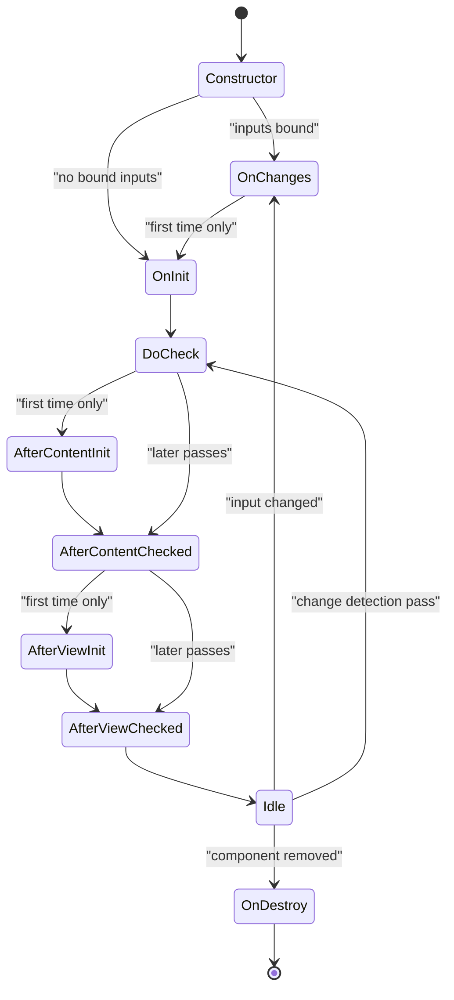
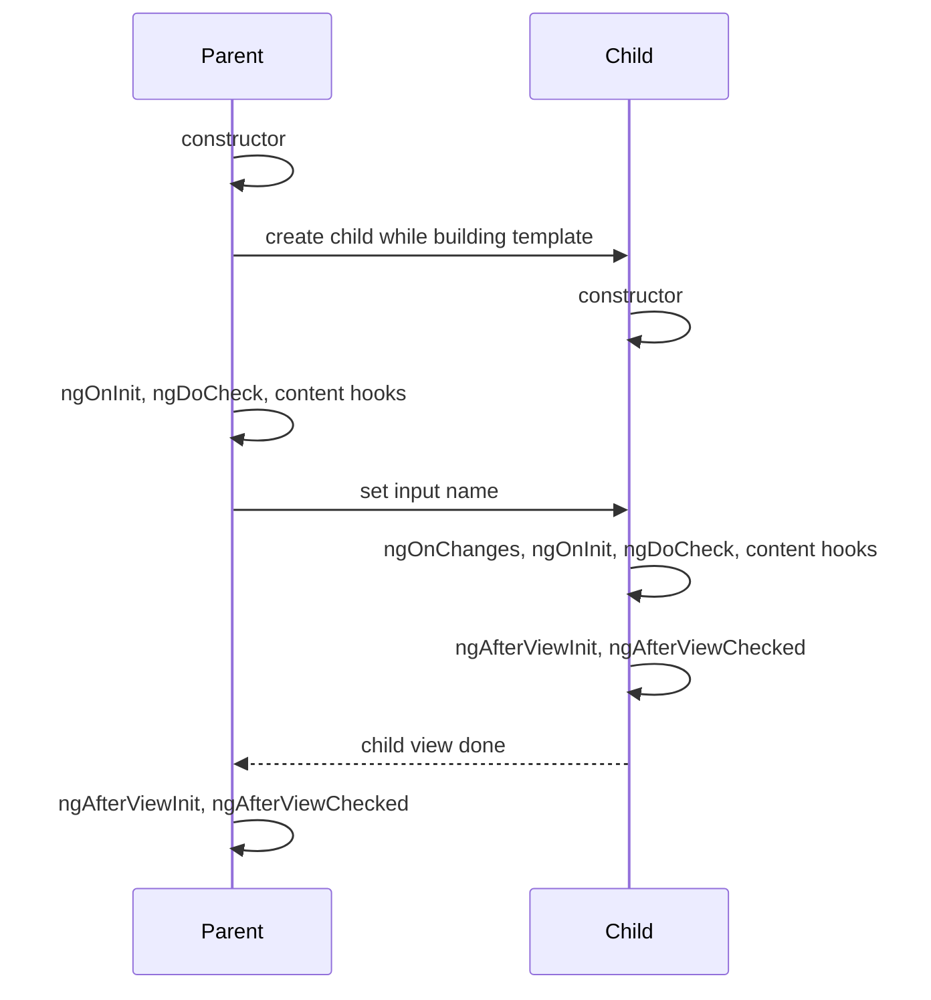

# Lifecycle Hooks

> In this document you will learn every Angular lifecycle hook: when it runs, how often, in which order for parents and children, and what work belongs in it. You will also learn why `ExpressionChangedAfterItHasBeenCheckedError` happens and how to fix it, plus the Angular 16 additions `DestroyRef`, `takeUntilDestroyed` and `afterRender`. Lifecycle questions show the interviewer whether you understand how Angular creates, updates and destroys components.

**Before this:** [Components and templates](02-components-and-templates.md) · [Change detection basics](01-angular-fundamentals.md#zonejs-and-change-detection-in-one-page) · **Interview questions:** [jump to the interview section](#interview-questions)

## Table of contents

1. [What lifecycle hooks are](#what-lifecycle-hooks-are)
2. [Constructor vs ngOnInit](#constructor-vs-ngoninit)
3. [The full order of hooks](#the-full-order-of-hooks)
4. [Each hook in detail](#each-hook-in-detail)
5. [Parent and child order](#parent-and-child-order)
6. [ExpressionChangedAfterItHasBeenCheckedError](#expressionchangedafterithasbeencheckederror)
7. [DestroyRef and takeUntilDestroyed](#destroyref-and-takeuntildestroyed)
8. [afterRender and afterNextRender](#afterrender-and-afternextrender)
9. [Hooks in directives and services](#hooks-in-directives-and-services)
10. [Common mistakes](#common-mistakes)
11. [Best practices](#best-practices)
12. [How to explain lifecycle hooks in an interview](#how-to-explain-lifecycle-hooks-in-an-interview)
13. [Interview questions](#interview-questions)
14. [Summary](#summary)
15. [References](#references)

---

## What lifecycle hooks are

A component has a **lifecycle**: Angular creates it, sets its inputs, renders its template, checks it again and again when data changes, and finally destroys it.

**Lifecycle hooks** are methods with special names that Angular calls at these moments. You implement a hook by adding the method to your class. The matching interface (`OnInit`, `OnDestroy`, ...) is optional, but it helps TypeScript catch typos.

```ts
import { Component, OnDestroy, OnInit } from '@angular/core';

@Component({
  selector: 'app-clock',
  standalone: true,
  template: `<p>{{ time }}</p>`,
})
export class ClockComponent implements OnInit, OnDestroy {
  time = '';
  private timerId?: ReturnType<typeof setInterval>;

  ngOnInit(): void {                         // after inputs are set, once
    this.timerId = setInterval(() => (this.time = new Date().toLocaleTimeString()), 1000);
  }

  ngOnDestroy(): void {                      // just before Angular removes the component
    clearInterval(this.timerId);
  }
}
```

### Why they exist

You need "the right moment" for different jobs:

- Load data only after inputs are known.
- Touch the DOM only after it exists.
- Clean up timers and subscriptions before the component disappears, or they leak.

### Analogy

Think of a hotel guest. Check-in (constructor) gives them a room key. Unpacking (`ngOnInit`) happens once they know their plans (inputs). Room service checks (`ngDoCheck`, `...Checked` hooks) happen many times during the stay. Check-out (`ngOnDestroy`) means returning the key and cleaning up. If the guest leaves without checking out, the room stays blocked: that is a memory leak.

---

## Constructor vs ngOnInit

This is a classic Angular interview question.

| | `constructor` | `ngOnInit` |
| --- | --- | --- |
| Who calls it | JavaScript (`new`), through Angular's DI | Angular, as a lifecycle hook |
| When | When the class instance is created | After the first `ngOnChanges`, once |
| Inputs available? | **No** (still default values) | **Yes** |
| Template / DOM available? | No | No (child views are not rendered yet) |
| Use for | Injecting dependencies, simple field setup | Initialization that needs inputs: loading data, building forms, subscriptions |

I verified this in Angular 16 with a child bound as `<app-child [name]="user">` where `user = 'Asha'`:

```ts
export class ChildComponent implements OnInit {
  @Input() name = '';

  constructor() {
    console.log('constructor name =', JSON.stringify(this.name)); // constructor name = ""
  }

  ngOnInit() {
    console.log('ngOnInit name =', this.name);                    // ngOnInit name = Asha
  }
}
```

```ts
// ❌ Wrong: the input is still empty here
constructor(private orders: OrderService) {
  this.orders.getOrdersForCustomer(this.customerId).subscribe(/* ... */);
}

// ✅ Correct
ngOnInit(): void {
  this.orders.getOrdersForCustomer(this.customerId).subscribe(/* ... */);
}
```

Keep constructors light. Heavy work in a constructor also makes the class harder to test, because creating it already starts side effects.

---

## The full order of hooks

| Order | Hook | When it runs | How often |
| --- | --- | --- | --- |
| 0 | `constructor` | Instance created | Once |
| 1 | `ngOnChanges(changes)` | Before `ngOnInit`, and whenever a **bound input** gets a new value | Only if the component has template-bound inputs; then on every input change |
| 2 | `ngOnInit()` | After the first `ngOnChanges` (or first, if there are no inputs) | Once |
| 3 | `ngDoCheck()` | During every change detection pass that checks this component | Very often |
| 4 | `ngAfterContentInit()` | After projected content (`ng-content`) is initialized | Once |
| 5 | `ngAfterContentChecked()` | After projected content is checked | Every check |
| 6 | `ngAfterViewInit()` | After the component's view **and child views** are initialized | Once |
| 7 | `ngAfterViewChecked()` | After the view and child views are checked | Every check |
| 8 | `ngOnDestroy()` | Just before Angular destroys the component | Once |



Every later change detection pass runs: `ngOnChanges` (only if an input changed) → `ngDoCheck` → `ngAfterContentChecked` → `ngAfterViewChecked`. The `...Init` hooks never run again.

> **Newer Angular (20+):** `afterRender` was renamed `afterEveryRender` and became stable, together with `afterNextRender`. They run after all the hooks above, once the DOM is updated.

---

## Each hook in detail

### ngOnChanges

Runs when Angular sets a **template-bound input** to a new value. It receives a `SimpleChanges` object: a map from input property name to a `SimpleChange` with `previousValue`, `currentValue` and `firstChange`.

```ts
export class ChildComponent implements OnChanges {
  @Input() name = '';
  @Input('label') title = '';   // public name 'label', property 'title'

  ngOnChanges(changes: SimpleChanges): void {
    for (const key of Object.keys(changes)) {
      const c = changes[key];
      console.log(`${key}: prev=${JSON.stringify(c.previousValue)} curr=${JSON.stringify(c.currentValue)} first=${c.firstChange}`);
    }
  }
}
```

Verified output in Angular 16 for `<app-child [name]="user" label="Hi">`, then `user` changed to `'Ravi'`, then set to `'Ravi'` again:

```text
title: prev=undefined curr="Hi" first=true
name: prev=undefined curr="Asha" first=true
name: prev="Asha" curr="Ravi" first=false
                      ← setting 'Ravi' again: no call at all
```

Important facts:

- The key is the **class property name** (`title`), not the alias (`label`).
- On the first call, `previousValue` is `undefined` and `firstChange` is `true` (also `c.isFirstChange()`).
- It runs only when the value **changes by `===`**. Mutating an object input does not trigger it.
- It does **not** run when you set the property from code (`this.name = 'x'`), and it does not run for components without bound inputs.
- `ComponentRef.setInput()` for dynamic components **does** trigger it.

Typical use: react to several inputs together, reset internal state when an id changes.

```ts
ngOnChanges(changes: SimpleChanges): void {
  if (changes['productId'] && !changes['productId'].firstChange) {
    this.selectedImageIndex = 0;          // reset when the user opens another product
  }
}
```

### ngOnInit

Runs once, after the first `ngOnChanges`. Inputs are set. Use it for:

- Loading initial data based on inputs.
- Building a reactive form from input data.
- Starting subscriptions (combined with `takeUntilDestroyed` or the async pipe).

The template's child components are **not** created yet, so `@ViewChild` queries (non-static) are still `undefined`.

### ngDoCheck

Runs on **every** change detection pass that reaches this component, right after `ngOnChanges`/`ngOnInit`. Use it only for custom change detection that Angular cannot do, for example noticing a mutation inside an input object.

```ts
import { DoCheck, Input, KeyValueDiffer, KeyValueDiffers, inject } from '@angular/core';

export class FiltersSummaryComponent implements DoCheck {
  @Input() filters: Record<string, string> = {};
  summary = '';
  private differ: KeyValueDiffer<string, string> = inject(KeyValueDiffers).find({}).create();

  ngDoCheck(): void {
    const changes = this.differ.diff(this.filters);   // cheap compare of keys and values
    if (changes) {
      this.summary = Object.entries(this.filters).map(([k, v]) => `${k}: ${v}`).join(', ');
    }
  }
}
```

Keep `ngDoCheck` extremely fast. It can run many times per second. Usually the better fix is immutable data, not `ngDoCheck`.

### ngAfterContentInit and ngAfterContentChecked

Run after Angular projects the parent's content into this component's `<ng-content>`. `@ContentChild` and `@ContentChildren` results are ready in `ngAfterContentInit`.

```ts
export class TabsComponent implements AfterContentInit {
  @ContentChildren(TabDirective) tabs!: QueryList<TabDirective>;

  ngAfterContentInit(): void {
    if (this.tabs.length === 0) console.warn('app-tabs has no tabs');
    this.tabs.changes.subscribe(() => this.ensureValidActiveTab());
  }
}
```

### ngAfterViewInit and ngAfterViewChecked

Run after the component's own view and all its child views are created (Init) or checked (Checked). Non-static `@ViewChild` and `@ViewChildren` results are ready in `ngAfterViewInit`. This is the place to work with the DOM or hand an element to a third-party library.

```ts
export class SalesChartComponent implements AfterViewInit, OnDestroy {
  @ViewChild('canvas') canvas!: ElementRef<HTMLCanvasElement>;
  @Input() data: number[] = [];
  private chart?: ChartLike;

  ngAfterViewInit(): void {
    this.chart = createChart(this.canvas.nativeElement, this.data);  // DOM exists now
  }

  ngOnDestroy(): void {
    this.chart?.destroy();
  }
}
```

Do **not** change fields that are bound in this component's template inside `ngAfterViewInit` or `ngAfterViewChecked`. The view was just checked, so you get the error described [below](#expressionchangedafterithasbeencheckederror).

### ngOnDestroy

Runs once, just before Angular destroys the component (route change, `*ngIf` becoming false, a dynamic component's `destroy()`). Clean up everything that would keep running:

| Resource | Cleanup |
| --- | --- |
| RxJS subscriptions you created with `subscribe()` | `unsubscribe()`, or `takeUntilDestroyed()` |
| `setInterval`, `setTimeout` | `clearInterval`, `clearTimeout` |
| `addEventListener` on `window`/`document` | `removeEventListener` (or use `@HostListener`, which cleans itself) |
| Third-party widgets (charts, maps, editors) | Their `destroy()` method |
| WebSocket, `EventSource`, `ResizeObserver`, `IntersectionObserver` | `close()` / `disconnect()` |

You do **not** need to clean up: `async` pipe subscriptions, `@Output` bindings, `@HostListener`, and `HttpClient` calls that already completed.

`ngOnDestroy` does **not** run if the user closes the browser tab. Use the `beforeunload` event for that case.

---

## Parent and child order

Change detection goes **top-down**, and the "after" hooks finish **bottom-up**. I ran this in Angular 16.2: an `AppComponent` (no inputs) with one `<app-child [name]="user" />`, both logging every hook.

```text
Parent constructor
Child constructor
Parent ngOnInit
Parent ngDoCheck
Parent ngAfterContentInit
Parent ngAfterContentChecked
Child ngOnChanges ["name"]
Child ngOnInit
Child ngDoCheck
Child ngAfterContentInit
Child ngAfterContentChecked
Child ngAfterViewInit
Child ngAfterViewChecked
Parent ngAfterViewInit
Parent ngAfterViewChecked
```

Then, on a later change detection pass:

```text
Parent ngDoCheck
Parent ngAfterContentChecked
Child ngDoCheck
Child ngAfterContentChecked
Child ngAfterViewChecked
Parent ngAfterViewChecked
```

And when the app is destroyed, `Child ngOnDestroy` runs (the parent did not implement it).

Step by step for the first pass:

1. Angular creates the parent. While creating the parent's template, it creates the child, so **both constructors** run first.
2. Angular checks the parent: `ngOnInit`, `ngDoCheck`, then the content hooks (the parent has no projected content, but the hooks still run).
3. Angular updates the parent's template bindings. That sets the child input `name`.
4. Angular moves down to the child: `ngOnChanges` (input set), `ngOnInit`, `ngDoCheck`, content hooks.
5. The child's view is checked, so the child's view hooks run.
6. Only when **all children** are done does the parent's view count as checked: `Parent ngAfterViewInit`, `Parent ngAfterViewChecked`.



Practical consequences:

- In the parent's `ngOnInit`, the child exists (constructor ran) but has not been initialized.
- In the parent's `ngAfterViewInit`, all children are fully initialized. That is why `@ViewChild` is reliable there.
- The order of hooks between a component and **directives on the same element** is not something to rely on.

---

## ExpressionChangedAfterItHasBeenCheckedError

### What it is

In **development mode**, after each change detection pass, Angular runs a **second check** that only compares values: it re-evaluates every binding and makes sure nothing changed. If a binding changed during the pass that already checked it, Angular throws:

```text
NG0100: ExpressionChangedAfterItHasBeenCheckedError: Expression has changed after it was checked.
Previous value: 'loading'. Current value: 'loaded'. Expression location: AppComponent component.
```

(Real Angular 16 output.)

### Why it exists

Angular's data flow is **one-way, top-down**. A parent's bindings are checked before its children. If a child (or a later hook) changes the parent's data after the parent was checked, the screen now shows an old value. The dev-mode check catches this bug early. In production the second check does not run, so the screen would simply be out of date until the next pass.

### A common example

```ts
@Component({
  selector: 'app-emitter',
  standalone: true,
  template: `child`,
})
export class EmitterComponent implements AfterViewInit {
  @Output() ready = new EventEmitter<string>();
  ngAfterViewInit() {
    this.ready.emit('loaded');        // runs after the parent's bindings were checked
  }
}

@Component({
  selector: 'app-root',
  standalone: true,
  imports: [EmitterComponent],
  template: `<p>{{ status }}</p><app-emitter (ready)="status = $event" />`,
})
export class AppComponent {
  status = 'loading';
}
```

Step by step:

1. Angular checks `AppComponent`'s template: `{{ status }}` → `'loading'`.
2. Angular checks the child. In the child's `ngAfterViewInit`, it emits `'loaded'`.
3. The parent handler sets `status = 'loaded'`.
4. The dev-mode verification pass re-reads `{{ status }}`: `'loaded'` ≠ `'loading'` → NG0100.

Other typical causes:

- Changing a bound field in the component's own `ngAfterViewInit`/`ngAfterViewChecked`.
- A getter that returns a new value every time (`get now() { return Date.now(); }` or a new array/object each call).
- A shared service value changed by a child during its initialization, while a parent shows it.

### How to fix it (best first)

1. **Fix the data flow.** Compute the value before the view is checked: in `ngOnInit` of the owner, in a service before rendering, or by passing it down as an input instead of emitting it up.
2. **Use an Observable with the `async` pipe** (or a signal in newer Angular). The update then schedules a normal new check.
3. **Move the code to an earlier hook.** For example, use `@ViewChild(..., { static: true })` and do the work in `ngOnInit`.
4. **Call `ChangeDetectorRef.detectChanges()`** right after the change in that component. It re-checks the view in the same pass. Use it when the value really can only be known after the view exists (for example a measured element size).
5. **Defer to the next tick** (`Promise.resolve().then(...)` or `setTimeout`). This works, but causes an extra pass and a visible flicker, and it hides design problems. Treat it as a last resort.

```ts
// Option 4: the value depends on a rendered size
ngAfterViewInit(): void {
  this.isTruncated = this.text.nativeElement.scrollWidth > this.text.nativeElement.clientWidth;
  this.cdr.detectChanges();   // re-check this view now
}
```

Never "fix" it by turning on production mode in development. The bug is still there.

---

## DestroyRef and takeUntilDestroyed

Angular 16 added two tools that make cleanup easier.

### DestroyRef

**`DestroyRef`** is an injectable object that lets you register cleanup callbacks. Injected in a component or directive, the callbacks run when that component or directive is destroyed. Injected in a service, they run when the service's injector is destroyed. It is a public, stable API in Angular 16.

```ts
@Component({ selector: 'app-live-prices', standalone: true, template: `...` })
export class LivePricesComponent {
  constructor() {
    const socket = new WebSocket('wss://prices.example.com');
    inject(DestroyRef).onDestroy(() => socket.close());   // cleanup next to setup
  }
}
```

The benefit: setup and cleanup are written **together**, and reusable functions can register their own cleanup without the component writing `ngOnDestroy`.

```ts
// A reusable helper that cleans up after itself
export function injectWindowResize(callback: () => void): void {
  const handler = () => callback();
  window.addEventListener('resize', handler);
  inject(DestroyRef).onDestroy(() => window.removeEventListener('resize', handler));
}

export class LayoutComponent {
  constructor() {
    injectWindowResize(() => this.recalculateColumns());
  }
  recalculateColumns() { /* ... */ }
}
```

`onDestroy()` returns a function that removes the callback again if you no longer need it.

### takeUntilDestroyed

**`takeUntilDestroyed()`** (from `@angular/core/rxjs-interop`, developer preview in Angular 16, stable in Angular 19) is an RxJS operator that completes the stream when the component is destroyed.

```ts
import { takeUntilDestroyed } from '@angular/core/rxjs-interop';

@Component({ selector: 'app-search', standalone: true, imports: [ReactiveFormsModule], template: `<input [formControl]="query">` })
export class SearchComponent {
  query = new FormControl('', { nonNullable: true });

  constructor(private search: SearchService) {
    this.query.valueChanges
      .pipe(debounceTime(300), takeUntilDestroyed())     // no ngOnDestroy needed
      .subscribe(term => this.search.setTerm(term));
  }
}
```

Without arguments, it **must be called in an injection context** (constructor or field initializer), because it injects `DestroyRef` itself. Outside, Angular throws (real Angular 16 output):

```text
NG0203: takeUntilDestroyed() can only be used within an injection context such as a constructor,
a factory function, a field initializer, or a function used with `runInInjectionContext`.
```

To use it in `ngOnInit` or a method, inject `DestroyRef` first and pass it:

```ts
export class OrdersComponent implements OnInit {
  @Input({ required: true }) customerId!: string;
  orders: Order[] = [];
  private destroyRef = inject(DestroyRef);

  constructor(private orderService: OrderService) {}

  ngOnInit(): void {
    this.orderService.watchOrders(this.customerId)       // needs the input, so ngOnInit
      .pipe(takeUntilDestroyed(this.destroyRef))
      .subscribe(orders => (this.orders = orders));
  }
}
```

I verified that after the component was destroyed, the stream had no subscribers left.

### Compared with the older pattern

```ts
// Before Angular 16: the destroy$ subject pattern
export class OldSearchComponent implements OnInit, OnDestroy {
  private destroy$ = new Subject<void>();

  ngOnInit(): void {
    this.query.valueChanges.pipe(takeUntil(this.destroy$)).subscribe(/* ... */);
  }

  ngOnDestroy(): void {
    this.destroy$.next();
    this.destroy$.complete();
  }
}
```

Both work. `takeUntilDestroyed` removes the boilerplate. Put it **last** in the `pipe` (after operators like `switchMap`), so inner subscriptions are also cut off. More unsubscribe strategies are in [RxJS](09-rxjs.md).

---

## afterRender and afterNextRender

### What they are

Angular 16.2 added two functions, both **developer preview** in Angular 16:

- **`afterNextRender(callback)`** — runs the callback **once**, after the next time Angular has finished rendering the whole application.
- **`afterRender(callback)`** — runs the callback **after every** render.

They must be called in an injection context (usually the constructor), and they return an `AfterRenderRef` with a `destroy()` method. They are removed automatically when the component is destroyed.

### Why they exist

`ngAfterViewInit` is per component and runs during change detection. Some work needs the **final DOM** after Angular finished everything, for example measuring layout or starting a DOM library. Also, these callbacks **do not run during server-side rendering**, so they are the safe place for browser-only code.

```ts
@Component({
  selector: 'app-editor',
  standalone: true,
  template: `<div #host class="editor"></div>`,
})
export class EditorComponent {
  @ViewChild('host') host!: ElementRef<HTMLElement>;
  private editor?: { destroy(): void };

  constructor() {
    afterNextRender(() => {
      // Browser only, DOM is ready
      this.editor = createRichTextEditor(this.host.nativeElement);
    });
    inject(DestroyRef).onDestroy(() => this.editor?.destroy());
  }
}
```

In my Angular 16.2 test, `afterNextRender` ran after all the component and directive `ngAfterViewInit` hooks.

> **Newer Angular:** in v19 the API gained a phase object (`earlyRead`, `write`, `mixedReadWrite`, `read`) to avoid layout thrashing, and `afterRenderEffect` was added. In **v20**, `afterRender` was renamed to **`afterEveryRender`**, and `afterEveryRender` and `afterNextRender` became stable.

Use them rarely. They run for the whole app, and `afterRender` runs after every change detection pass, so expensive callbacks hurt performance.

---

## Hooks in directives and services

### Directives

Directives have the same hooks as components. I verified that a directive on a component's host element gets `ngOnInit`, `ngAfterViewInit` and `ngOnDestroy` calls. A directive has no template of its own, so its "view" hooks follow the host element's view.

```ts
@Directive({ selector: '[appTrackVisible]', standalone: true })
export class TrackVisibleDirective implements AfterViewInit, OnDestroy {
  @Input() appTrackVisible = '';            // analytics event name
  private observer?: IntersectionObserver;

  constructor(private el: ElementRef<HTMLElement>, private analytics: AnalyticsService) {}

  ngAfterViewInit(): void {
    this.observer = new IntersectionObserver(entries => {
      if (entries.some(e => e.isIntersecting)) this.analytics.track(this.appTrackVisible);
    });
    this.observer.observe(this.el.nativeElement);
  }

  ngOnDestroy(): void {
    this.observer?.disconnect();
  }
}
```

### Services

Services only get **`ngOnDestroy`**, and only when their injector is destroyed:

| Where the service is provided | When `ngOnDestroy` runs |
| --- | --- |
| `providedIn: 'root'` | When the whole application is destroyed (rarely matters in the browser) |
| A component's `providers` | When that component instance is destroyed |
| A lazy route's `providers` | When that route's injector is destroyed (normally never during the session) |

I verified that a service in a component's `providers` ran its `ngOnDestroy` when the component was removed by `*ngIf`. This makes component-level services a good fit for state that should live and die with one screen. See [Dependency injection](05-dependency-injection.md#component-level-providers).

---

## Common mistakes

1. **Using inputs in the constructor.** They are not set yet.
2. **Using non-static `@ViewChild` in `ngOnInit`.** It is `undefined`. Use `ngAfterViewInit` or `static: true`.
3. **Heavy work in `ngDoCheck`, `ngAfterContentChecked`, `ngAfterViewChecked`.** They run on every pass.
4. **Changing template-bound fields in `ngAfterViewInit`.** Causes NG0100.
5. **Expecting `ngOnChanges` when mutating an input object.** Only new references count.
6. **Forgetting `ngOnDestroy` cleanup** for manual subscriptions, intervals and global listeners. Memory leaks and "ghost" handlers that run after navigation.
7. **Calling `takeUntilDestroyed()` without an argument in `ngOnInit`.** NG0203. Pass a `DestroyRef`.
8. **Putting `takeUntilDestroyed` before `switchMap`** or other flattening operators. The inner Observable keeps running.
9. **Wrapping everything in `setTimeout`** to silence NG0100 instead of fixing the data flow.
10. **Accessing `window`/`document` in `ngOnInit` in an SSR app.** Use `afterNextRender` or guard with `isPlatformBrowser`.

---

## Best practices

- **Constructor for DI, `ngOnInit` for initialization.** Inputs exist only from `ngOnInit`.
- **Prefer the `async` pipe** so there is nothing to clean up.
- **Use `takeUntilDestroyed()`** (Angular 16) for subscriptions you must create manually, and keep it last in `pipe`.
- **Use `DestroyRef.onDestroy`** to keep setup and cleanup together, especially in reusable helper functions.
- **Do DOM work in `ngAfterViewInit`** (or `afterNextRender` when SSR matters) and clean it up in `ngOnDestroy`.
- **Avoid `ngDoCheck`.** Use immutable data so Angular's normal input checks work.
- **Keep every `...Checked` hook trivial.**
- **Treat NG0100 as a design signal.** Fix where the data is produced.
- **Implement the hook interfaces** (`implements OnInit`) so typos like `ngOnInt` are caught.

---

## How to explain lifecycle hooks in an interview

1. **Define it:** "Lifecycle hooks are methods Angular calls at key moments of a component's life: creation, input changes, every change detection check, and destruction."
2. **Why it exists:** "Different work needs different moments: inputs are ready only in `ngOnInit`, the DOM and child components only in `ngAfterViewInit`, and cleanup must happen in `ngOnDestroy` to avoid leaks."
3. **How it works:** "The order is constructor, `ngOnChanges`, `ngOnInit`, `ngDoCheck`, `ngAfterContentInit`, `ngAfterContentChecked`, `ngAfterViewInit`, `ngAfterViewChecked`, and finally `ngOnDestroy`. The Init hooks run once; `ngDoCheck` and the Checked hooks run on every pass. Parents initialize before children, but a parent's view hooks run after all its children are done."
4. **Small example:** "A chart component reads its data input in `ngOnInit`, creates the chart on the canvas from `@ViewChild` in `ngAfterViewInit`, and destroys the chart in `ngOnDestroy`."
5. **Where it is useful:** "Loading data, building forms, integrating third-party DOM libraries, subscriptions and cleanup. In Angular 16 I use `takeUntilDestroyed` and `DestroyRef` instead of a lot of `ngOnDestroy` boilerplate."
6. **Trade-offs / gotchas:** "Changing bound data in `ngAfterViewInit` causes ExpressionChangedAfterItHasBeenChecked in dev mode. `ngOnChanges` only fires for new references. And the Checked hooks run so often that heavy code there slows the whole app."

---

## Interview questions

### Q1. What is the difference between the constructor and `ngOnInit`?

**What the interviewer is checking:** Whether you know when inputs are available and where initialization belongs.

**Short spoken answer (30–60 seconds):**
> The constructor is a normal TypeScript constructor. Angular calls it through dependency injection when it creates the instance, so I use it to inject services and set simple defaults. At that point inputs aren't set yet. `ngOnInit` is a lifecycle hook that Angular calls once, after the first `ngOnChanges`, when the input values are available. So anything that depends on inputs — loading data for a customer id, building a form from an input object — goes into `ngOnInit`. Keeping the constructor light also makes the class easier to test.

**Code:** See [Constructor vs ngOnInit](#constructor-vs-ngoninit) (verified output: `""` in the constructor, `Asha` in `ngOnInit`).

**Follow-up questions:**
- **Is the template rendered in `ngOnInit`?** — No. Child components exist but are not initialized, and non-static `@ViewChild` is `undefined`. Use `ngAfterViewInit` for the view.
- **Can you use `inject()` in `ngOnInit`?** — No. `inject()` works only in an injection context: constructor, field initializers, factories. Inject into a field and use it in `ngOnInit`.
- **Why not subscribe in the constructor?** — It works for streams that do not need inputs (and `takeUntilDestroyed()` without arguments must be called there). For streams that depend on inputs, use `ngOnInit`.

**Common mistakes:** "The constructor is for Angular and `ngOnInit` is for TypeScript" — it is the other way around.

**Where this is used in real projects:** Every component.

### Q2. List the lifecycle hooks in order and say how often each runs.

**What the interviewer is checking:** The exact order and the Init vs Checked distinction.

**Short spoken answer (30–60 seconds):**
> After the constructor: `ngOnChanges` when bound inputs change, also before init; `ngOnInit` once; `ngDoCheck` on every change detection pass; `ngAfterContentInit` once after projected content is initialized, then `ngAfterContentChecked` every pass; `ngAfterViewInit` once after the component's view and its child views are initialized, then `ngAfterViewChecked` every pass; and `ngOnDestroy` once before the component is removed. So the Init hooks run once, the DoCheck and Checked hooks run on every check, and `ngOnChanges` runs only when inputs get new values.

**Code:** See [the table and diagram](#the-full-order-of-hooks).

**Follow-up questions:**
- **When is `ngOnChanges` not called at all?** — When the component has no template-bound inputs (for example the root component), or when you set properties from code.
- **Which hooks run on a pass where nothing changed?** — `ngDoCheck`, `ngAfterContentChecked`, `ngAfterViewChecked` (for components that are checked; `OnPush` components that are skipped do not run them).
- **What runs after `ngAfterViewChecked` in newer Angular?** — `afterNextRender`/`afterEveryRender` callbacks.

**Common mistakes:** Putting `ngAfterViewInit` before `ngAfterContentInit`.

**Where this is used in real projects:** Choosing the right hook for a task.

### Q3. Output prediction: what is the order of logs for a parent with one child?

The parent `AppComponent` (no inputs) renders `<app-child [name]="user" />`. Both log every hook.

**Answer (verified in Angular 16.2):**

```text
Parent constructor
Child constructor
Parent ngOnInit
Parent ngDoCheck
Parent ngAfterContentInit
Parent ngAfterContentChecked
Child ngOnChanges ["name"]
Child ngOnInit
Child ngDoCheck
Child ngAfterContentInit
Child ngAfterContentChecked
Child ngAfterViewInit
Child ngAfterViewChecked
Parent ngAfterViewInit
Parent ngAfterViewChecked
```

**Why:** Both constructors run while the parent's template is being created. Change detection is top-down, so the parent is initialized first; the child gets its input during the parent's template update and then runs its own hooks. A view counts as checked only when all child views are checked, so the parent's view hooks come last. The parent has no `ngOnChanges` because it has no bound inputs. See the [step-by-step walkthrough](#parent-and-child-order).

### Q4. What is `SimpleChanges`, and what does it contain?

**Short answer:** It is the argument of `ngOnChanges`: an object whose keys are the **property names** of inputs that changed in this pass (not their aliases). Each value is a `SimpleChange` with `previousValue`, `currentValue`, `firstChange` and `isFirstChange()`. On the first call, `previousValue` is `undefined` and `firstChange` is `true`. Verified: an input declared as `@Input('label') title` appears under the key `title`.

### Q5. Output prediction: how many times does `ngOnChanges` run?

```ts
// Parent
user = 'Asha';
// template: <app-child [name]="user" />
// Later, in order:
this.user = 'Ravi';   // then change detection
this.user = 'Ravi';   // then change detection
```

**Answer (verified):** Two times. Once on initialization (`prev=undefined curr="Asha" first=true`) and once for the change to `'Ravi'` (`prev="Asha" curr="Ravi" first=false`). Setting the same value `'Ravi'` again does nothing, because Angular compares the new binding value with `===` and sees no change.

### Q6. What is ExpressionChangedAfterItHasBeenCheckedError? How do you fix it?

**What the interviewer is checking:** Deep understanding of one-way data flow and dev-mode checks.

**Short spoken answer (30–60 seconds):**
> In development mode, after every change detection pass, Angular runs a second pass that only verifies that no binding changed. If something changed a value after its binding was already checked in the same pass, it throws NG0100. A classic case: a child emits an event in `ngAfterViewInit`, and the parent's handler changes a field that the parent's template already rendered. It exists to protect one-way, top-down data flow; in production the check doesn't run and the screen would just be stale. To fix it, I first fix the data flow: compute the value earlier, in `ngOnInit` or in a service, or pass it down instead of up. Otherwise I use an observable with the async pipe, or call `detectChanges()` when the value really depends on the rendered DOM. Deferring with `setTimeout` works but is a last resort.

**Code:** See [the example and the fixes](#expressionchangedafterithasbeencheckederror).

**Follow-up questions:**
- **Why don't you see it in production?** — The verification pass runs only in dev mode. The bug is still there; the user just sees an outdated value until the next pass.
- **Can a getter cause it?** — Yes, if it returns a different value on each call, like `Date.now()` or a new array.
- **Why does `detectChanges()` fix it?** — It re-renders this view immediately with the new value, so the verification pass sees the same value.

**Common mistakes:** Answering only "wrap it in `setTimeout`".

**Where this is used in real projects:** Very common when integrating dynamic components, measurements and parent-child events.

### Q7. What are `DestroyRef` and `takeUntilDestroyed`?

**What the interviewer is checking:** Angular 16 knowledge and modern cleanup.

**Short spoken answer (30–60 seconds):**
> Both came in Angular 16. `DestroyRef` is an injectable object that lets me register cleanup callbacks with `onDestroy()`. In a component, they run when the component is destroyed; in a service, when its injector is destroyed. It lets me keep setup and cleanup together, even inside reusable helper functions. `takeUntilDestroyed` is an RxJS operator from `@angular/core/rxjs-interop` that completes a stream when the component is destroyed. Called in the constructor or a field initializer, it finds `DestroyRef` by itself. In `ngOnInit` or a method I must pass `DestroyRef` in, otherwise I get NG0203. It replaces the old `destroy$` subject plus `takeUntil` pattern. In Angular 16 `takeUntilDestroyed` is a developer preview; it became stable in 19.

**Code:** See [DestroyRef and takeUntilDestroyed](#destroyref-and-takeuntildestroyed).

**Follow-up questions:**
- **Where should `takeUntilDestroyed` go in the pipe?** — Last, so it also stops inner subscriptions created by `switchMap` or `mergeMap`.
- **Is the async pipe still better?** — When the value is only shown in the template, yes: no subscription code at all.
- **Can a service use `DestroyRef`?** — Yes. For a root service it fires when the app is destroyed; for a component-provided service, when the component is destroyed.

**Common mistakes:** Calling `takeUntilDestroyed()` without an argument in `ngOnInit`.

**Where this is used in real projects:** Form `valueChanges`, WebSocket streams, router events.

### Q8. Debugging: after navigating away from a page, a console log from that page keeps appearing every few seconds. What is wrong?

**What the interviewer is checking:** That you recognize a missing cleanup (a memory leak) and know the cleanup tools.

**Short spoken answer (30–60 seconds):**
> The page component started something that keeps running after it was destroyed — probably an `interval` subscription, a `setInterval`, or a WebSocket — and never cleaned it up. The callback still holds a reference to the component, so the component can't be garbage collected either; that's a memory leak. I'd find where the subscription or timer is created and add cleanup: `takeUntilDestroyed()`, an unsubscribe in `ngOnDestroy`, `clearInterval`, or better, show the stream with the async pipe. In Chrome DevTools I can confirm the fix with a heap snapshot after navigating back and forth.

**Follow-up questions:**
- **Which subscriptions don't need manual cleanup?** — The async pipe, `@Output` and `@HostListener` bindings, and Observables that complete on their own, like a finished `HttpClient` request.
- **Why might an HTTP request still need cancelling?** — If the user leaves before the response arrives, the callback still runs. Usually harmless, but if it navigates or shows a toast, cancel it with `takeUntilDestroyed` or `switchMap`.

**Common mistakes:** Assuming Angular unsubscribes everything automatically.

**Where this is used in real projects:** Leak investigations (see [Memory management](../02-javascript/19-memory-management-and-garbage-collection.md)).

### Q9. When would you use `ngDoCheck`?

**Short answer:** Only when you must detect changes Angular cannot see, typically mutations inside an input object or array that you do not control. Use `KeyValueDiffers` or `IterableDiffers` to compare cheaply, and keep it very fast because it runs on every change detection pass. In most cases the better solution is immutable data, so `ngOnChanges` or `OnPush` notice the new reference.

### Q10. Which hook would you use to integrate a chart library, and how do you clean it up?

**What the interviewer is checking:** Practical DOM timing and cleanup.

**Short spoken answer (30–60 seconds):**
> I'd get the canvas with `@ViewChild` and create the chart in `ngAfterViewInit`, because that's when the view and the element exist. If the chart only needs an element that is always present, `static: true` would also work in `ngOnInit`. When the data input changes, I'd update the chart in `ngOnChanges` if the chart exists. In `ngOnDestroy` I call the chart's `destroy()` so its listeners and canvas memory are released. In an SSR app I'd use `afterNextRender` instead, because it doesn't run on the server. And if the chart fires lots of events, I'd create it inside `runOutsideAngular` to avoid extra change detection.

**Follow-up questions:**
- **Why not in `ngOnInit`?** — A non-static `@ViewChild` is still `undefined`, and the element may not be in the DOM yet.
- **What if the chart is inside `*ngIf`?** — Use a non-static query and react when it appears, for example with a setter on the `@ViewChild` property or by listening to `QueryList.changes` for `@ViewChildren`.

**Common mistakes:** Forgetting `destroy()`, causing leaks on every navigation.

**Where this is used in real projects:** Dashboards, maps, rich text editors.

### Q11. What are `afterRender` and `afterNextRender`?

**Short answer:** Functions added in Angular 16.2 as a developer preview. `afterNextRender(fn)` runs `fn` once after Angular's next full render; `afterRender(fn)` runs after every render. They must be called in an injection context, they run after all the component hooks, and they never run during server-side rendering, which makes them the safe place for browser-only DOM code like measuring elements or starting a DOM library. In Angular 20, `afterRender` became `afterEveryRender` and both became stable. In v19 they gained phases (`earlyRead`, `write`, `mixedReadWrite`, `read`).

### Q12. Does a service have lifecycle hooks?

**Short answer:** Only `ngOnDestroy`. It runs when the injector that created the service is destroyed: for a root service when the app is destroyed, for a component-provided service when that component instance is destroyed (verified in Angular 16), for a lazy route's service when that route injector is destroyed. Services have no `ngOnInit`; use the constructor or an explicit `init()` method.

### Q13. Code review: what is wrong here?

```ts
@Component({ selector: 'app-user-panel', template: `<h2>{{ title }}</h2><input #search>` })
export class UserPanelComponent implements OnInit, AfterViewInit {
  @Input() userId!: string;
  @ViewChild('search') search!: ElementRef<HTMLInputElement>;
  title = '';

  constructor(private users: UserService) {
    this.users.getUser(this.userId).subscribe(u => (this.title = u.name));
  }

  ngOnInit() {
    this.search.nativeElement.focus();
    interval(5000).subscribe(() => this.users.refresh(this.userId));
  }

  ngAfterViewInit() {
    this.title = this.title.toUpperCase();
  }
}
```

**Answer:**

1. `getUser(this.userId)` in the constructor: `userId` is still `undefined`. Move to `ngOnInit`, and make the input `required`.
2. `this.search.nativeElement.focus()` in `ngOnInit`: the non-static query is `undefined` there. Move to `ngAfterViewInit` (or use `static: true`, since the input is always present).
3. `interval(5000).subscribe(...)` never unsubscribes: it keeps running after the component is gone. Add `takeUntilDestroyed(this.destroyRef)`.
4. Changing `title` (bound in the template) in `ngAfterViewInit` causes NG0100 in dev mode. Transform the name when it arrives instead: `u => (this.title = u.name.toUpperCase())`, or use a pipe.

### Q14. In which order are `ngOnDestroy` calls made when a parent is removed?

**Short answer:** Children are destroyed together with the parent's view; Angular calls `ngOnDestroy` on the components, directives and component-level services in the destroyed tree. In my Angular 16 test, when an `*ngIf` removed a child, the child's provided service `ngOnDestroy`, then the directive's `ngOnDestroy`, then the `DestroyRef` callbacks ran. Do not write code that depends on the exact order between siblings or between a component and its directives; make each cleanup independent.

### Q15. Why should you avoid heavy logic in `ngAfterViewChecked`?

**Short answer:** It runs after every change detection pass for that component, which in a Zone.js app can be after every click, key press, timer and HTTP response. Anything slow there multiplies across the app and makes typing and scrolling feel slow. Changing bound state there can also cause NG0100 or extra passes. Use it only for very cheap checks, or move the work to event handlers, `ngOnChanges` or `afterNextRender`.

### Q16. Your component shows data from an input object. The parent updates `config.pageSize = 50`, but your `ngOnChanges` never runs. Why, and what are your options?

**What the interviewer is checking:** Reference vs mutation, and whether you fix the data flow instead of adding workarounds.

**Short spoken answer (30–60 seconds):**
> `ngOnChanges` runs only when the input binding gets a new value by reference. The parent mutated a property of the same object, so from Angular's point of view the input didn't change. The best fix is in the parent: create a new object, `this.config = { ...this.config, pageSize: 50 }`. That also makes OnPush work. If I can't change the parent, I could detect the mutation in `ngDoCheck` with a `KeyValueDiffer`, but that runs on every pass, so it's a workaround. Another design is to pass the primitive value itself, `[pageSize]="config.pageSize"`, so each change is a new primitive value.

**Follow-up questions:**
- **Would `OnPush` on your component show the new page size?** — No. `OnPush` also compares input references, so the component is not checked for this change. A new object fixes both problems.
- **Is `ngDoCheck` with a differ ever the right choice?** — Only when you cannot control the parent (for example a third-party wrapper). Keep the diff cheap, because `ngDoCheck` runs on every pass.

**Common mistakes:** Calling `detectChanges()` everywhere instead of fixing the data flow.

**Where this is used in real projects:** Config objects, filters, table options.

---

## Summary

- Lifecycle hooks are methods Angular calls at creation, input changes, every check, and destruction. Implement the interfaces to catch typos.
- The constructor is for DI; inputs are available only from `ngOnInit`.
- Order: `ngOnChanges` → `ngOnInit` → `ngDoCheck` → `ngAfterContentInit` → `ngAfterContentChecked` → `ngAfterViewInit` → `ngAfterViewChecked` → `ngOnDestroy`.
- Init hooks run once; `ngDoCheck` and the Checked hooks run on every pass; `ngOnChanges` runs only when a bound input gets a new value (`===`).
- `SimpleChanges` keys are property names (not aliases), with `previousValue`, `currentValue`, `firstChange`.
- Parents initialize before children, but a parent's view hooks run after all children finish.
- Non-static `@ViewChild` is ready in `ngAfterViewInit`; content queries in `ngAfterContentInit`.
- NG0100 (ExpressionChanged...) means a binding changed after it was checked in the same pass; fix the data flow first.
- Angular 16 adds `DestroyRef` (stable) and `takeUntilDestroyed` (developer preview); pass a `DestroyRef` when used outside an injection context.
- `afterNextRender`/`afterRender` (16.2, developer preview) run after rendering and never on the server; renamed/stabilized in v20.
- Clean up manual subscriptions, timers, global listeners and third-party widgets in `ngOnDestroy` or with `DestroyRef`.

---

## References

- Angular 16 docs — Lifecycle hooks: https://v16.angular.io/guide/lifecycle-hooks
- Angular 16 API — `OnChanges` and `SimpleChanges`: https://v16.angular.io/api/core/SimpleChanges
- Angular 16 API — `DestroyRef`: https://v16.angular.io/api/core/DestroyRef
- Angular 16 API — `takeUntilDestroyed`: https://v16.angular.io/api/core/rxjs-interop/takeUntilDestroyed
- Angular 16 API — `afterNextRender`: https://v16.angular.io/api/core/afterNextRender
- Angular error reference — NG0100: https://angular.dev/errors/NG0100
- Angular error reference — NG0203: https://angular.dev/errors/NG0203
- Angular docs (current) — Component lifecycle: https://angular.dev/guide/components/lifecycle
- Angular blog — Angular v16 is here: https://blog.angular.dev/angular-v16-is-here-4d7a28ec680d
