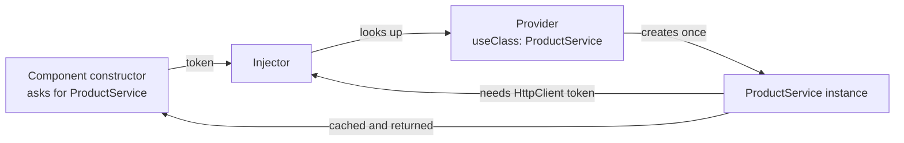
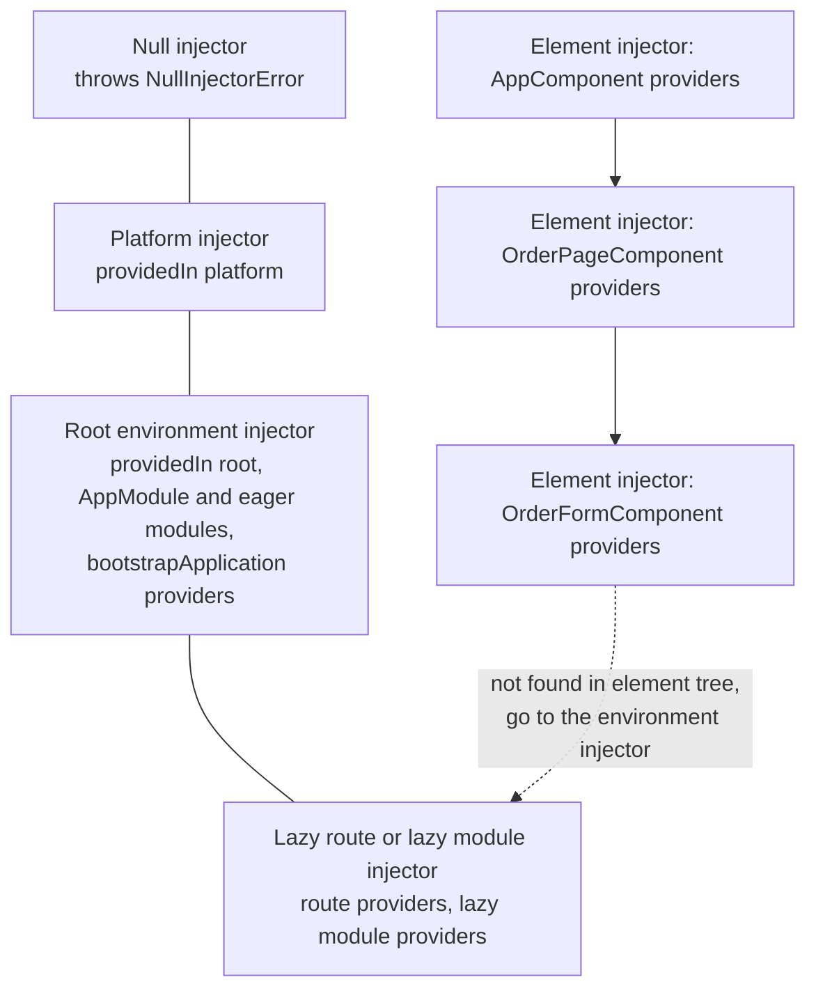
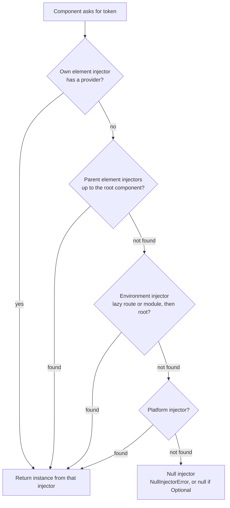
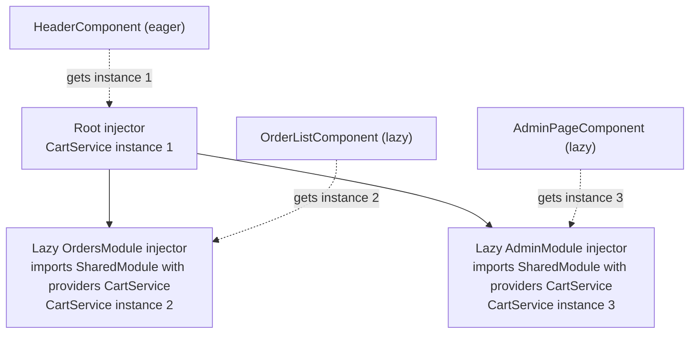

# Dependency Injection in Angular

> In this document you will learn how Angular's dependency injection (DI) system really works in Angular 16: tokens, providers and injectors, the injector hierarchy, how Angular resolves a dependency step by step, every provider type, `InjectionToken`, multi providers, resolution modifiers, the `inject()` function, lazy-loading pitfalls and standalone providers. DI is the heart of Angular, and interviewers use it to separate developers who use Angular from developers who understand it.

**Before this:** [Dependency inversion and injection (the general concept)](../04-oop-solid-design-patterns/05-dependency-inversion-and-injection.md) · [Angular fundamentals](01-angular-fundamentals.md) · [Components and templates](02-components-and-templates.md) · **Interview questions:** [jump to the interview section](#interview-questions)

## Table of contents

1. [What DI is in Angular](#what-di-is-in-angular)
2. [Tokens, providers and injectors](#tokens-providers-and-injectors)
3. [Creating and providing a service](#creating-and-providing-a-service)
4. [The providedIn options](#the-providedin-options)
5. [Two ways to inject: constructor and inject](#two-ways-to-inject-constructor-and-inject)
6. [Provider types](#provider-types)
7. [InjectionToken](#injectiontoken)
8. [Multi providers](#multi-providers)
9. [The injector hierarchy](#the-injector-hierarchy)
10. [How Angular resolves a dependency](#how-angular-resolves-a-dependency)
11. [Component-level providers](#component-level-providers)
12. [Providers vs viewProviders](#providers-vs-viewproviders)
13. [Resolution modifiers](#resolution-modifiers)
14. [Lazy loading and separate instances](#lazy-loading-and-separate-instances)
15. [Standalone apps and environment providers](#standalone-apps-and-environment-providers)
16. [forwardRef and circular dependencies](#forwardref-and-circular-dependencies)
17. [Overriding providers in tests](#overriding-providers-in-tests)
18. [Real-world DI patterns](#real-world-di-patterns)
19. [Common mistakes](#common-mistakes)
20. [Best practices](#best-practices)
21. [How to explain DI in an interview](#how-to-explain-di-in-an-interview)
22. [Interview questions](#interview-questions)
23. [Summary](#summary)
24. [References](#references)

---

## What DI is in Angular

**Dependency injection** means a class does not create the objects it needs (its **dependencies**). Instead, it asks for them, and something else gives them to it. In Angular, that "something else" is the **injector**.

```ts
// ❌ Without DI: the component creates its own dependencies
export class ProductListComponent {
  private http = new HttpClient(/* ??? it needs a handler, which needs a backend... */);
  private products = new ProductService(this.http);
}

// ✅ With DI: the component asks, Angular provides
@Component({ selector: 'app-product-list', standalone: true, template: `...` })
export class ProductListComponent {
  constructor(private products: ProductService) {}
}
```

### Why Angular uses DI

- **Loose coupling:** the component depends on "a `ProductService`", not on how to build one.
- **Easy testing:** in a test you give the component a fake `ProductService`. No real HTTP.
- **Shared instances:** many components can share one service instance (one cart, one logged-in user).
- **Scoping:** you choose how long an instance lives and who shares it: the whole app, one lazy feature, or one component.
- **Configuration:** you can swap implementations (mock API in development, a different logger in production) without changing the classes that use them.

The general idea of DI and the dependency inversion principle are explained in [Dependency inversion and injection](../04-oop-solid-design-patterns/05-dependency-inversion-and-injection.md). This document is about Angular's specific system.

### Analogy

A restaurant kitchen. A cook (component) needs ingredients (services). The cook does not grow vegetables or raise chickens. The cook asks the **storeroom** (injector) for "tomatoes" (token). The storeroom manager knows the **recipe** (provider) for how to get tomatoes: buy them, take them from the shelf, or prepare them. Each kitchen station can have its own small storeroom, and if it does not have something, it asks the main storeroom. That "ask the next storeroom up" chain is Angular's **injector hierarchy**.

---

## Tokens, providers and injectors

Angular DI has three parts. Learn these names, because every DI answer uses them.

| Part | What it is | Example |
| --- | --- | --- |
| **Token** | The key you ask for: "I want *this*" | The class `ProductService`, or an `InjectionToken` like `API_URL` |
| **Provider** | The recipe: how to create the value for a token | `{ provide: ProductService, useClass: ProductService }` |
| **Injector** | The object that holds providers, creates instances, caches them and hands them out | The root injector, a component's element injector |



What happens when Angular creates `ProductListComponent`:

1. Angular sees that the constructor needs a `ProductService` (the **token**).
2. It asks the injector for that token.
3. The injector finds the **provider**. If it already created an instance, it returns the cached one. Otherwise it creates it.
4. To create `ProductService`, the injector sees that it needs `HttpClient`, so it resolves that first (recursively).
5. The instance is cached in that injector. Within one injector, a provider produces **one instance** (a singleton per injector).

How does Angular know the constructor parameter types at runtime? TypeScript types disappear after compilation. The Angular compiler reads the constructor types at build time and generates a **factory** function, for example `ProductListComponent_Factory`, that calls `ɵɵdirectiveInject(ProductService)` for each parameter. That is why the parameter type must be a **class** (a real runtime value) or you must use `@Inject(TOKEN)`: an interface has no runtime value.

---

## Creating and providing a service

A **service** is a class that holds logic or data that is not tied to one view.

```ts
import { Injectable } from '@angular/core';
import { HttpClient } from '@angular/common/http';
import { Observable } from 'rxjs';

export interface Product { id: number; name: string; price: number; }

@Injectable({ providedIn: 'root' })
export class ProductService {
  constructor(private http: HttpClient) {}

  getProducts(): Observable<Product[]> {
    return this.http.get<Product[]>('/api/products');
  }
}
```

`@Injectable()` marks the class for DI. Angular generates a factory for it, so the injector knows how to create it and which dependencies to pass.

There are three places to **provide** a service:

| Where | Syntax | Instance lifetime and sharing |
| --- | --- | --- |
| In the service itself | `@Injectable({ providedIn: 'root' })` | One instance for the whole app. Tree-shakable. |
| In an environment injector | `providers` of `@NgModule`, `bootstrapApplication`, or a `Route` | One instance per that injector (app, lazy module or lazy route) |
| In a component or directive | `providers` / `viewProviders` of `@Component` / `@Directive` | One instance **per component instance**, shared with its children |

### Tree-shakable providers

With `providedIn: 'root'`, the provider is attached to the service class itself. If no code ever injects the service, the bundler removes it from the build. That is a **tree-shakable provider**.

With `providers: [ProductService]` in an NgModule, the module imports the class, so it is always in the bundle, used or not.

This is why `providedIn: 'root'` is the default choice for app-wide services. `ng g s product` generates it.

---

## The providedIn options

```ts
@Injectable({ providedIn: 'root' })      // the app's root environment injector
@Injectable({ providedIn: 'platform' })  // the platform injector shared by all apps on the page
@Injectable({ providedIn: 'any' })       // DEPRECATED since v15
@Injectable({ providedIn: SomeModule })  // DEPRECATED since v15
@Injectable()                            // not provided anywhere automatically
```

| Option | Meaning | Use when |
| --- | --- | --- |
| `'root'` | One instance in the application's root injector | Almost every app-wide service |
| `'platform'` | One instance in the platform injector, shared by **all** Angular apps on the page | Rare: several Angular apps (micro-frontends) on one page that must share a service |
| `'any'` | One instance in the root for eager code, plus a separate instance in **each lazy-loaded** module injector | Deprecated in v15. Do not use in new code. |
| `SomeModule` | Provided in that NgModule's injector | Deprecated in v15. Use `'root'` or module `providers`. |
| no `providedIn` | You must add it to some `providers` array yourself | Services that must be scoped (component-level, route-level) or configured |

A service without `providedIn` that nobody provides causes an error when injected (real Angular 16 output):

```text
R3InjectorError(Environment Injector)[MissingService -> MissingService]:
  NullInjectorError: No provider for MissingService!
```

The bracket shows the **path**: which token was requested and which dependency chain led to the missing one. In a real app it looks like `R3InjectorError(AppModule)[OrderService -> AuditService -> AuditService]`, meaning `OrderService` needed `AuditService`, which has no provider.

---

## Two ways to inject: constructor and inject

### Constructor injection

The classic way: list dependencies as constructor parameters.

```ts
@Component({ selector: 'app-cart', standalone: true, template: `...` })
export class CartComponent {
  constructor(
    private readonly cart: CartService,
    private readonly router: Router,
  ) {}
}
```

### The `inject()` function

Since Angular 14 you can call `inject(Token)` directly, usually in a field initializer:

```ts
import { Component, inject } from '@angular/core';

@Component({ selector: 'app-cart', standalone: true, template: `...` })
export class CartComponent {
  private readonly cart = inject(CartService);
  private readonly router = inject(Router);
  readonly items$ = this.cart.items$;     // field initializers can use earlier fields
}
```

Why `inject()` is useful:

- **Inheritance is simpler.** With constructor injection, a subclass must repeat the base class's parameters and call `super(...)`. With `inject()` in the base class, the subclass passes nothing.
- **Reusable functions** can inject things: `injectQueryParam('page')`, functional guards, functional interceptors, `takeUntilDestroyed()`.
- **Tokens with types** need no decorator: `inject(API_URL)` returns `string`; with constructors you write `@Inject(API_URL) apiUrl: string`.
- Options are an object: `inject(LoggerService, { optional: true, skipSelf: true })`.

```ts
// Inheritance with constructor injection: every subclass repeats dependencies
export abstract class BasePage {
  constructor(protected title: Title, protected analytics: AnalyticsService) {}
}
export class OrdersPage extends BasePage {
  constructor(title: Title, analytics: AnalyticsService, private orders: OrderService) {
    super(title, analytics);
  }
}

// Inheritance with inject(): subclasses stay clean
export abstract class BasePageWithInject {
  protected title = inject(Title);
  protected analytics = inject(AnalyticsService);
}
export class OrdersPage2 extends BasePageWithInject {
  private orders = inject(OrderService);
}
```

### The injection context rule

`inject()` only works **while Angular is creating something through DI**. This moment is called the **injection context**. It includes:

- Constructors of classes created by DI (components, directives, pipes, services).
- Field initializers of those classes.
- `useFactory` functions and `InjectionToken` factories.
- Functional guards, resolvers and interceptors (Angular calls them in a context).
- Code run with `runInInjectionContext(injector, fn)` (Angular 16).

It does **not** work in lifecycle hooks, event handlers, `setTimeout` callbacks or after an `await`. Real Angular 16 error:

```text
NG0203: inject() must be called from an injection context such as a constructor, a factory function,
a field initializer, or a function used with `runInInjectionContext`.
```

```ts
export class ReportComponent implements OnInit {
  // ✅ Field initializer: injection context
  private readonly reports = inject(ReportService);
  private readonly injector = inject(Injector);

  ngOnInit(): void {
    // ❌ NG0203: lifecycle hooks are not an injection context
    // const logger = inject(LoggerService);

    // ✅ If you really need it later, use the saved injector
    const logger = runInInjectionContext(this.injector, () => inject(LoggerService));
  }
}
```

In reusable helper functions, call `assertInInjectionContext(myHelper)` (Angular 16) at the start, so misuse gives a clear error.

### Which one to choose?

Both are fully supported in Angular 16. Many teams now prefer `inject()` for consistency with functional APIs, but constructor injection is not deprecated. Pick one style per project. Angular provides a migration (`ng generate @angular/core:inject`) in newer versions.

---

## Provider types

A provider is written as `{ provide: TOKEN, use...: ... }`. Writing just the class, `providers: [ProductService]`, is shorthand for `{ provide: ProductService, useClass: ProductService }`.

### useClass

"When someone asks for this token, create an instance of this class."

```ts
providers: [
  { provide: LoggerService, useClass: ConsoleLoggerService },
]
```

Typical uses: swap an implementation, use a mock in tests or in development.

```ts
// environment-based implementation
providers: [
  { provide: PaymentGateway, useClass: environment.production ? StripeGateway : FakeGateway },
]
```

### useValue

"Use this ready-made value." Good for configuration objects, constants and test doubles.

```ts
providers: [
  { provide: APP_CONFIG, useValue: { apiUrl: 'https://api.shop.com', retries: 2 } },
  { provide: ProductService, useValue: { getProducts: () => of([]) } },   // a test fake
]
```

### useFactory

"Call this function to create the value." Use it when creation needs logic or other dependencies. List the dependencies in `deps`, in the order of the function's parameters (or use `inject()` inside the factory).

```ts
export function loggerFactory(config: AppConfig, http: HttpClient): LoggerService {
  return config.production ? new RemoteLogger(http, config.logUrl) : new ConsoleLogger();
}

providers: [
  { provide: LoggerService, useFactory: loggerFactory, deps: [APP_CONFIG, HttpClient] },
]

// The same with inject() inside the factory (injection context), no deps needed
providers: [
  {
    provide: LoggerService,
    useFactory: () => {
      const config = inject(APP_CONFIG);
      return config.production ? new RemoteLogger(inject(HttpClient), config.logUrl) : new ConsoleLogger();
    },
  },
]
```

The factory runs **once per injector** (the result is cached), not on every injection.

### useExisting

"This token is an **alias** for another token. Return the same instance."

```ts
providers: [
  FancyLogger,
  { provide: LoggerService, useExisting: FancyLogger },
]
```

### useClass vs useExisting (a classic trap)

I verified both in Angular 16:

```ts
// useExisting: one instance, two tokens
const a = createEnvironmentInjector(
  [FancyLogger, { provide: LoggerService, useExisting: FancyLogger }], parent);
a.get(LoggerService) === a.get(FancyLogger);   // true

// useClass: two separate instances
const b = createEnvironmentInjector(
  [FancyLogger, { provide: LoggerService, useClass: FancyLogger }], parent);
b.get(LoggerService) === b.get(FancyLogger);   // false
```

With `useClass`, the injector creates a **new** `FancyLogger` for the `LoggerService` token, separate from the one registered for `FancyLogger`. If the logger holds state (a buffer of messages), you now have two buffers. Use `useExisting` when you want one object reachable through two tokens, for example a narrow interface-like token and the full class.

| Provider | Creates | Typical use |
| --- | --- | --- |
| `useClass` | A new instance of the given class | Swap implementations, mocks |
| `useValue` | Nothing; uses the given value | Config, constants, simple fakes |
| `useFactory` | Whatever the function returns | Creation needs logic or other dependencies |
| `useExisting` | Nothing; returns the instance of another token | Aliases, exposing one object under several tokens (`NG_VALUE_ACCESSOR`) |

### Abstract classes as tokens

Interfaces cannot be tokens (no runtime value). An **abstract class** can, because it exists at runtime. This is the cleanest way to code against an abstraction:

```ts
export abstract class Storage {
  abstract get(key: string): string | null;
  abstract set(key: string, value: string): void;
}

@Injectable()
export class LocalStorageService implements Storage {
  get(key: string) { return localStorage.getItem(key); }
  set(key: string, value: string) { localStorage.setItem(key, value); }
}

// app config / module
providers: [{ provide: Storage, useClass: LocalStorageService }]

// consumer depends only on the abstraction
export class ThemeService {
  private storage = inject(Storage);
}
```

---

## InjectionToken

### What it is

An **`InjectionToken`** is a unique token for values that are **not classes**: strings, numbers, config objects, functions, or interfaces.

### Why it exists

You cannot write `inject(string)` or `inject(AppConfig)` when `AppConfig` is an interface. Using a plain string as a token (`'API_URL'`) is possible in old code but risky: two libraries could use the same string. An `InjectionToken` is a unique object, so it can never clash, and it carries a **type**.

```ts
import { InjectionToken, inject } from '@angular/core';

export interface AppConfig {
  apiUrl: string;
  retries: number;
}

export const APP_CONFIG = new InjectionToken<AppConfig>('APP_CONFIG');   // description for error messages
```

```ts
// Provide it (bootstrapApplication, an NgModule, or a component)
providers: [
  { provide: APP_CONFIG, useValue: { apiUrl: 'https://api.shop.com', retries: 2 } },
]
```

```ts
// Inject it
@Injectable({ providedIn: 'root' })
export class ApiService {
  private readonly config = inject(APP_CONFIG);              // type: AppConfig

  // constructor style needs @Inject
  // constructor(@Inject(APP_CONFIG) private config: AppConfig) {}
}
```

### Tokens with a default factory

A token can define its own provider, like `providedIn: 'root'` for a service. Then you do not need to provide it anywhere, but you still can override it.

```ts
export const API_URL = new InjectionToken<string>('API_URL', {
  providedIn: 'root',
  factory: () => inject(APP_CONFIG).apiUrl + '/v1',
});

// inject(API_URL) → 'https://api.shop.com/v1'   (verified)
```

Useful tokens built into Angular: `DOCUMENT` (from `@angular/common`), `LOCALE_ID`, `APP_INITIALIZER`, `ENVIRONMENT_INITIALIZER`, `PLATFORM_ID`, `HTTP_INTERCEPTORS`, `NG_VALIDATORS`, `NG_VALUE_ACCESSOR`, `DEFAULT_CURRENCY_CODE`.

```ts
// Use DOCUMENT instead of the global document: it works in SSR and is easy to fake in tests
export class ThemeService {
  private readonly document = inject(DOCUMENT);
  setDark(dark: boolean): void {
    this.document.body.classList.toggle('dark', dark);
  }
}
```

---

## Multi providers

### What it is

Normally, if a token is provided twice in the same injector, the **last provider wins**. With **`multi: true`**, Angular collects **all** values into an **array** instead.

```ts
export const PLUGINS = new InjectionToken<string[]>('PLUGINS');

providers: [
  { provide: PLUGINS, useValue: 'analytics', multi: true },
  { provide: PLUGINS, useValue: 'chat', multi: true },
]
// inject(PLUGINS) → ['analytics', 'chat']   (verified, in registration order)

providers: [
  { provide: SINGLE, useValue: 'first' },
  { provide: SINGLE, useValue: 'second' },
]
// inject(SINGLE) → 'second'   (verified: last wins)
```

### Why it exists

It is a **plugin system**: many independent parts of the app can contribute to one list without knowing about each other. Angular itself uses it a lot:

| Multi token | What each provider adds |
| --- | --- |
| `HTTP_INTERCEPTORS` | One class-based HTTP interceptor |
| `APP_INITIALIZER` | One function to run (and wait for) before the app starts |
| `ENVIRONMENT_INITIALIZER` | One function to run when an environment injector is created |
| `NG_VALIDATORS` / `NG_ASYNC_VALIDATORS` | One validator for a form control directive |
| `NG_VALUE_ACCESSOR` | The control value accessor of a custom form control |

```ts
// app.module.ts (Angular 16, NgModule style)
providers: [
  { provide: HTTP_INTERCEPTORS, useClass: AuthInterceptor, multi: true },
  { provide: HTTP_INTERCEPTORS, useClass: ErrorInterceptor, multi: true },
  {
    provide: APP_INITIALIZER,
    useFactory: () => {
      const config = inject(AppConfigService);
      return () => config.load();          // must return a function; Angular waits for its Promise/Observable
    },
    multi: true,
  },
]
```

The order of a multi provider array is the registration order. For `HTTP_INTERCEPTORS`, that is the order requests pass through the interceptors (see [HttpClient and interceptors](08-httpclient-and-interceptors.md)).

### The classic bug: forgetting `multi: true`

```ts
// ❌ Wrong: replaces the whole interceptor array with a single class.
//    HttpClient expects an array and other interceptors are lost.
{ provide: HTTP_INTERCEPTORS, useClass: AuthInterceptor }

// ✅ Correct
{ provide: HTTP_INTERCEPTORS, useClass: AuthInterceptor, multi: true }
```

Angular reports an error when the same token is provided both with and without `multi` in one injector, which helps catch this.

### Your own extension point

```ts
export interface DashboardWidget { id: string; title: string; component: Type<unknown>; }
export const DASHBOARD_WIDGETS = new InjectionToken<DashboardWidget[]>('DASHBOARD_WIDGETS');

// Each feature registers its widget
providers: [
  { provide: DASHBOARD_WIDGETS, multi: true, useValue: { id: 'sales', title: 'Sales', component: SalesWidgetComponent } },
]

// The dashboard does not know the features
export class DashboardComponent {
  readonly widgets = inject(DASHBOARD_WIDGETS);
}
```

> **Newer Angular (19+):** `APP_INITIALIZER` and `ENVIRONMENT_INITIALIZER` are deprecated in favor of `provideAppInitializer(() => ...)` and `provideEnvironmentInitializer(() => ...)`. In Angular 16, use the tokens with `multi: true`.

---

## The injector hierarchy

Angular does not have one injector. It has a **tree** of injectors. There are two kinds of injector trees.

### 1. Environment injectors (formerly "module injectors")

These hold app-wide and feature-wide services.

- **Null injector** — the top. It throws `NullInjectorError` for any token (unless the request is optional).
- **Platform injector** — created by `platformBrowserDynamic()` or `bootstrapApplication`. Shared by all apps on the page. Holds `providedIn: 'platform'` services and platform-level tokens.
- **Root environment injector** — one per application. Holds `providedIn: 'root'` services, providers of `AppModule` and **all eagerly imported** NgModules, or the `providers` of `bootstrapApplication`.
- **Child environment injectors** — created for **lazy-loaded** NgModules (`loadChildren`) and for **routes with `providers`** (standalone). Their parent is the root (or the parent route's injector).

### 2. Element injectors

Every element in a template that has a component or directive with `providers` / `viewProviders` gets an **element injector**. They follow the **DOM/component tree**, not the module structure. A component that provides `TabsService` makes it available to itself and all elements inside its view.



> **Terminology:** the Angular docs call them `ElementInjector` and `EnvironmentInjector`. Before v14 the second kind was called `ModuleInjector`. In an NgModule app you still see `NgModuleRef`, which is an environment injector.

---

## How Angular resolves a dependency

When a component or directive asks for a token, Angular searches in **two phases**.

**Phase 1: the element injector tree.**

1. Start at the element injector of the element where the request comes from (the component's own `providers`).
2. If not found, go to the **parent element injector**, then its parent, up the component tree to the root component.

**Phase 2: the environment injector tree.**

3. If no element injector has it, go back to the requesting element and ask the **environment injector** that belongs to it (the injector of the lazy route/module that loaded this component, or the root injector).
4. If not found, go to the parent environment injector, and so on: lazy → root → platform → null.
5. The null injector throws `NullInjectorError: No provider for X!` (unless the dependency is `@Optional()`, which returns `null`).

The **first** provider found wins, and its injector creates or returns the instance.



### Worked example

```ts
@Injectable({ providedIn: 'root' })
export class NotificationService {}           // root

@Injectable()
export class OrderFormStore {}                // no providedIn

@Component({
  selector: 'app-order-page',
  standalone: true,
  providers: [OrderFormStore],                // element injector of app-order-page
  imports: [OrderFormComponent],
  template: `<app-order-form></app-order-form>`,
})
export class OrderPageComponent {}

@Component({ selector: 'app-order-form', standalone: true, template: `...` })
export class OrderFormComponent {
  private store = inject(OrderFormStore);          // found in parent element injector (phase 1)
  private notifications = inject(NotificationService); // not in element tree → root (phase 2)
}
```

1. `OrderFormComponent` asks for `OrderFormStore`. Its own element injector has no provider. Its parent, `app-order-page`, has one. Angular uses the `OrderPageComponent`'s instance.
2. It asks for `NotificationService`. No element injector has it. Angular asks the environment injector: the root injector has it (`providedIn: 'root'`).

Two important consequences:

- A service provided in a component **hides** (shadows) a root provider of the same token for that component's subtree.
- A service is found through the **element tree where the component is used**, not where the component is declared. The same component class can get different instances in different places.

---

## Component-level providers

When you put a service in a component's `providers`, Angular creates **a new instance for every instance of that component**. The component and all its children (in its view and in content projected into it) share that instance. The instance is **destroyed with the component**, and its `ngOnDestroy` runs (verified in Angular 16).

### Why this is useful

Some state belongs to **one piece of UI**, not to the whole app:

- One editor tab with unsaved changes.
- One wizard's step data.
- One data grid's sort and filter state.
- One chat room window.

If you put that state in a root service, two editor tabs would share it, and it would survive after the user leaves the page.

```ts
@Injectable()   // no providedIn: it must be provided by the component
export class EditorStore implements OnDestroy {
  private readonly contentSubject = new BehaviorSubject<string>('');
  readonly content$ = this.contentSubject.asObservable();
  readonly dirty$ = new BehaviorSubject(false);

  update(content: string): void {
    this.contentSubject.next(content);
    this.dirty$.next(true);
  }

  ngOnDestroy(): void {
    console.log('EditorStore destroyed');   // runs when the editor component is destroyed
  }
}

@Component({
  selector: 'app-document-editor',
  standalone: true,
  providers: [EditorStore],                 // each editor gets its own store
  imports: [EditorToolbarComponent, EditorBodyComponent],
  template: `
    <app-editor-toolbar></app-editor-toolbar>   <!-- injects the same EditorStore -->
    <app-editor-body></app-editor-body>         <!-- injects the same EditorStore -->
  `,
})
export class DocumentEditorComponent {
  @Input({ required: true }) documentId!: string;
}
```

```html
<!-- Two independent editors, two independent stores -->
<app-document-editor documentId="a"></app-document-editor>
<app-document-editor documentId="b"></app-document-editor>
```

The toolbar and body talk through their shared store without inputs and outputs, and the two editors never mix their data. This is also the idea behind NgRx `ComponentStore` (see [State management](11-state-management-and-ngrx.md)).

---

## Providers vs viewProviders

Components have two provider arrays. The difference is about **content projection**.

- **`providers`**: visible to the component, its **view** (its own template) and **projected content** (`<ng-content>`).
- **`viewProviders`**: visible to the component and its **view** only. Projected content **cannot** see them.

I verified this in Angular 16 with a `LeafComponent` that injects `TabsService` with `@Optional()`, placed once inside the component's own template and once as projected content:

```ts
@Component({
  selector: 'app-viewp',
  standalone: true,
  imports: [LeafComponent],
  viewProviders: [TabsService],
  template: `<app-leaf name="own"></app-leaf><ng-content></ng-content>`,
})
export class ViewProvidersComponent {}

@Component({
  selector: 'app-prov',
  standalone: true,
  imports: [LeafComponent],
  providers: [TabsService],
  template: `<app-leaf name="own"></app-leaf><ng-content></ng-content>`,
})
export class ProvidersComponent {}
```

```html
<app-viewp><app-leaf name="projected"></app-leaf></app-viewp>
<app-prov><app-leaf name="projected"></app-leaf></app-prov>
```

| Leaf | In `app-viewp` (viewProviders) | In `app-prov` (providers) |
| --- | --- | --- |
| In the component's own template | Gets `TabsService` | Gets `TabsService` |
| Projected from outside | `null` (not visible) | Gets `TabsService` |

### When to use viewProviders

Use `viewProviders` when a service is an **internal detail** of a component, and you do not want content from the outside to depend on it (or accidentally get it). For example, a `TabsComponent` might use an internal `TabsKeyboardService` for its own header buttons, while a projected custom component should not reach into it.

Use `providers` when projected children **must** talk to the parent through the service, for example `<app-tabs>` with projected `<app-tab>` children that register themselves with the parent's `TabsService`.

---

## Resolution modifiers

**Resolution modifiers** change where Angular looks for a dependency and what happens if it is missing. They are decorators on constructor parameters, or options of `inject()`.

| Decorator | `inject()` option | Meaning |
| --- | --- | --- |
| `@Optional()` | `{ optional: true }` | If not found, return `null` instead of throwing |
| `@Self()` | `{ self: true }` | Look **only** in the current element's injector |
| `@SkipSelf()` | `{ skipSelf: true }` | Start looking in the **parent** injector |
| `@Host()` | `{ host: true }` | Stop looking at the **host component's view boundary** |

### @Optional

```ts
export class AnalyticsButtonDirective {
  // Works with or without analytics configured
  private analytics = inject(AnalyticsService, { optional: true });

  @HostListener('click') track() {
    this.analytics?.track('button_click');
  }
}

// constructor style
constructor(@Optional() private analytics: AnalyticsService | null) {}
```

`optional` changes what happens at the **end** of the search, not where it searches.

### @Self

Only the current element's injector. Useful when a directive must get a provider from the **same element**, not from an ancestor.

```ts
// A custom form control directive that wants the NgControl on ITS element only
@Directive({ selector: '[appTrimOnBlur]', standalone: true })
export class TrimOnBlurDirective {
  private control = inject(NgControl, { self: true, optional: true });

  @HostListener('blur') onBlur() {
    const value = this.control?.value;
    if (typeof value === 'string') this.control?.control?.setValue(value.trim());
  }
}
```

Without `self`, the directive might pick up an `NgControl` from a parent element by accident.

### @SkipSelf

Skip the current element and start at the parent. Two classic uses:

**1. Get the parent's instance of the same service** (nested structures like menus, trees, nested forms):

```ts
@Injectable()
export class MenuService {
  // A sub-menu gets its own MenuService, but also needs the parent menu's one
  readonly parent = inject(MenuService, { skipSelf: true, optional: true });
  readonly level: number = this.parent ? this.parent.level + 1 : 0;
}

@Component({
  selector: 'app-menu',
  standalone: true,
  providers: [MenuService],
  template: `<ng-content></ng-content>`,
})
export class MenuComponent {}
```

**2. Guard against importing a module twice** (the `CoreModule` guard from [Angular fundamentals](01-angular-fundamentals.md#common-module-types)): `constructor(@Optional() @SkipSelf() parent: CoreModule | null)`.

Verified example: a component that provides `SINGLE = 'child-level'` and whose parent provides `SINGLE = 'root-component-level'`:

```ts
constructor(@Inject(SINGLE) own: string, @SkipSelf() @Inject(SINGLE) parent: string) {
  console.log(own, parent);   // child-level root-component-level
}
```

### @Host

`@Host()` stops the search at the boundary of the **host component's view**. The idea: "I want this dependency from the component I live in, not from somewhere above it."

The exact rule surprises many developers. I verified it in Angular 16 with the leaf components from the previous section, using `@Optional() @Host()`:

| Leaf position | Found with `@Host()`? | Why |
| --- | --- | --- |
| In the own template of `app-viewp` (`viewProviders`) | Yes | The host component's `viewProviders` are inside the boundary |
| In the own template of `app-prov` (`providers`) | **No** (`null`) | The host component's normal `providers` sit on its host element, which is **outside** its view boundary |
| Projected into `app-prov` | Yes | The projected leaf belongs to the parent's view, and `app-prov`'s element is inside that view |

So: when a child in a component's template should find a service with `@Host()`, the host component should provide it in **`viewProviders`**. This is how the Angular docs show `@Host()` too.

A practical use of `@Host`: form control directives inside a form component use `@Host()` to find the `ControlContainer` (the parent form group) of the form they are written in, and not a form further up.

### Combining modifiers

Modifiers combine: `@Optional() @SkipSelf()`, `@Optional() @Host()`, `@Optional() @Self()`. `self` and `skipSelf` together make no sense.

---

## Lazy loading and separate instances

This section explains one of the most common real DI bugs in NgModule apps: "my singleton has two instances".

### The rule

- **Eagerly imported NgModules** do not get their own injector. All their `providers` are merged into the **root injector**.
- A **lazy-loaded NgModule** (`loadChildren`) gets its **own child environment injector** when it loads. Its `providers`, and the providers of every module it imports, are registered **in that child injector**.
- A **standalone route with `providers`** also gets its own child environment injector.

So if a lazy module provides a service that the root also provides, components in the lazy module get a **different instance**.



### The bug in code

```ts
// ❌ shared.module.ts
@NgModule({
  declarations: [SpinnerComponent],
  exports: [SpinnerComponent],
  providers: [CartService],          // every importer gets this provider again
})
export class SharedModule {}

// orders.module.ts — lazy
@NgModule({ imports: [SharedModule, OrdersRoutingModule] })
export class OrdersModule {}
```

Symptoms: the cart badge in the header (eager, root instance) shows 0 items, while the orders page (lazy instance) shows 3. Nothing is "broken" in the code of either component.

I reproduced the mechanism in Angular 16 with a child environment injector, which is what the router creates for a lazy module or route:

```ts
const rootCart = rootInjector.get(CartService);                                    // id 3
const lazyInjector = createEnvironmentInjector([CartService], rootInjector, 'lazy');
lazyInjector.get(CartService);                                                     // id 4 — a new instance
createEnvironmentInjector([], rootInjector).get(CartService);                      // id 3 — no provider, so the root one
```

### The fixes

1. **Use `providedIn: 'root'`** and remove the service from module `providers`. The lazy injector does not provide it again, so lookups go up to the root. This is the standard fix.
2. **The `forRoot()` pattern** for modules that must carry providers:

```ts
@NgModule({ declarations: [SpinnerComponent], exports: [SpinnerComponent] })
export class SharedModule {
  static forRoot(): ModuleWithProviders<SharedModule> {
    return { ngModule: SharedModule, providers: [CartService] };
  }
}

// AppModule:      imports: [SharedModule.forRoot()]   ← providers once, in root
// Feature module: imports: [SharedModule]             ← declarations only
```

3. **A guard** in the constructor of services or modules that must be singletons: inject the same token with `@Optional() @SkipSelf()` and throw if a parent instance exists.

### When separate instances are what you want

Sometimes a lazy feature **should** have its own instance: state that belongs only to that feature and should be fresh for it. Then provide it **on purpose** in the lazy module or route, and document why.

```ts
// Standalone: a route-level provider (Angular 14.2+)
export const routes: Routes = [
  {
    path: 'checkout',
    providers: [CheckoutStore],                 // one instance for this route subtree
    loadChildren: () => import('./checkout/checkout.routes').then(m => m.CHECKOUT_ROUTES),
  },
];
```

Note: route injectors are created when the route is first activated and are **not destroyed** when you navigate away (in Angular 16). So route-level state survives leaving and coming back. If the state must reset on every visit, provide it in the page component instead.

---

## Standalone apps and environment providers

Standalone apps have no `AppModule`, so app-wide providers go to `bootstrapApplication`:

```ts
// main.ts / app.config.ts (Angular 16)
bootstrapApplication(AppComponent, {
  providers: [
    provideRouter(routes),                                   // v14.2+, replaces RouterModule.forRoot
    provideHttpClient(withInterceptors([authInterceptor])),  // v15+, replaces HttpClientModule
    provideAnimations(),                                     // replaces BrowserAnimationsModule
    importProvidersFrom(SomeLegacyModule.forRoot()),         // providers from an NgModule
    { provide: APP_CONFIG, useValue: config },
  ],
});
```

### `importProvidersFrom`

Many libraries in the Angular 16 era only ship NgModules with `forRoot()`. `importProvidersFrom(Module)` extracts the **providers** of an NgModule (and the modules it imports) so you can use them in a standalone app. It does not import the module's components into any template.

It can only be used in **environment** injectors (`bootstrapApplication`, route `providers`), not in a component's `providers`.

### `EnvironmentProviders` and `makeEnvironmentProviders`

Functions like `provideRouter()` and `provideHttpClient()` return an **`EnvironmentProviders`** object. Angular's type system prevents you from putting it in a component's `providers` array, because these services must live in an environment injector (app or route), not on an element.

You can write your own `provideX()` function with `makeEnvironmentProviders` (Angular 15+). This is the modern replacement for a `forRoot()` module:

```ts
export interface AnalyticsConfig { trackingId: string; debug?: boolean; }
export const ANALYTICS_CONFIG = new InjectionToken<AnalyticsConfig>('ANALYTICS_CONFIG');

@Injectable({ providedIn: 'root' })
export class AnalyticsService {
  private config = inject(ANALYTICS_CONFIG);
  start() { console.log('analytics started', this.config.trackingId); }
}

export function provideAnalytics(config: AnalyticsConfig): EnvironmentProviders {
  return makeEnvironmentProviders([
    { provide: ANALYTICS_CONFIG, useValue: config },
    // Run setup code when the injector is created (no component needs to inject it first)
    { provide: ENVIRONMENT_INITIALIZER, multi: true, useValue: () => inject(AnalyticsService).start() },
  ]);
}

// main.ts
bootstrapApplication(AppComponent, { providers: [provideAnalytics({ trackingId: 'G-123' })] });
// console: analytics started G-123   (verified)
```

| NgModule world | Standalone world |
| --- | --- |
| `AppModule.providers` | `bootstrapApplication(App, { providers })` |
| `RouterModule.forRoot(routes)` | `provideRouter(routes)` |
| `HttpClientModule` + `HTTP_INTERCEPTORS` | `provideHttpClient(withInterceptors([...]))` (or `withInterceptorsFromDi()` for class interceptors) |
| `SomeLibModule.forRoot(config)` | `provideSomeLib(config)`, or `importProvidersFrom(SomeLibModule.forRoot(config))` |
| Lazy module `providers` | `Route.providers` |

---

## forwardRef and circular dependencies

### forwardRef

JavaScript classes are not hoisted like functions. If class `A` refers to class `B` **before** `B` is defined in the same file, `B` is `undefined` at that moment. `forwardRef(() => B)` wraps the reference in a function, so Angular reads it later, when `B` exists.

The most common real use is a custom form control that provides itself as `NG_VALUE_ACCESSOR`. Inside the `@Component` decorator, the class is not defined yet:

```ts
@Component({
  selector: 'app-rating',
  standalone: true,
  template: `...`,
  providers: [
    {
      provide: NG_VALUE_ACCESSOR,
      useExisting: forwardRef(() => RatingComponent),   // the class does not exist yet here
      multi: true,
    },
  ],
})
export class RatingComponent implements ControlValueAccessor { /* ... */ }
```

The full `ControlValueAccessor` example is in [Forms](07-forms.md).

### Circular dependencies

If `A` needs `B` and `B` needs `A`, the injector cannot create either one first. Real Angular 16 error:

```text
NG0200: Circular dependency in DI detected for A.
```

`forwardRef` does **not** fix a real circular dependency between two services; it only fixes a "defined later in the file" problem. Real fixes are design changes:

1. **Extract** the shared logic into a third service `C` that both use.
2. **Invert** one direction with events: `B` exposes an Observable that `A` subscribes to, instead of `B` calling `A`.
3. **Inject lazily** as a last resort: inject `Injector` and call `injector.get(A)` inside a method, not in the constructor. A common real case is an HTTP interceptor that needs a service which itself uses `HttpClient`.

---

## Overriding providers in tests

DI is what makes Angular code easy to test. In tests you replace real dependencies with fakes through the **TestBed** injector.

```ts
describe('ProductListComponent', () => {
  it('shows products from the service', async () => {
    const productServiceStub = {
      getProducts: () => of([{ id: 1, name: 'Laptop', price: 999 }]),
    };

    await TestBed.configureTestingModule({
      imports: [ProductListComponent],                               // standalone component
      providers: [{ provide: ProductService, useValue: productServiceStub }],
    }).compileComponents();

    const fixture = TestBed.createComponent(ProductListComponent);
    fixture.detectChanges();
    expect(fixture.nativeElement.textContent).toContain('Laptop');
  });
});
```

Useful tools:

| Tool | Use |
| --- | --- |
| `providers: [{ provide: X, useValue: fake }]` | Replace a root or module-level service |
| `TestBed.inject(X)` | Get an instance from the test injector (for example to spy on it) |
| `TestBed.overrideProvider(X, { useValue: fake })` | Replace a provider everywhere, including one already declared elsewhere |
| `TestBed.overrideComponent(C, { set: { providers: [...] } })` | Replace a **component-level** provider (the test module's `providers` cannot reach it, because the component's own element injector wins) |
| `TestBed.runInInjectionContext(() => fn())` | Run code that uses `inject()`, like functional guards and interceptors |

The component-level case is a classic surprise: if `EditorComponent` has `providers: [EditorStore]`, then `TestBed.configureTestingModule({ providers: [{ provide: EditorStore, useValue: fake }] })` does **not** affect it, because the component's element injector finds its own provider first. Use `overrideComponent`.

Full testing details are in [Testing](14-testing.md).

---

## Real-world DI patterns

### 1. Typed app configuration

```ts
export const APP_CONFIG = new InjectionToken<AppConfig>('APP_CONFIG');
// provide once at bootstrap, inject anywhere: inject(APP_CONFIG).apiUrl
```

With runtime config, fetch `config.json` in `main.ts` before bootstrapping and provide the result with `useValue`, or load it in an `APP_INITIALIZER`.

### 2. Abstraction with swappable implementations

```ts
export abstract class ErrorReporter { abstract report(error: unknown): void; }

@Injectable() export class SentryReporter extends ErrorReporter { report(e: unknown) { /* send */ } }
@Injectable() export class ConsoleReporter extends ErrorReporter { report(e: unknown) { console.error(e); } }

providers: [{ provide: ErrorReporter, useClass: environment.production ? SentryReporter : ConsoleReporter }]
```

### 3. Strategy registry with multi providers

```ts
export interface ExportStrategy { format: 'csv' | 'xlsx' | 'pdf'; export(rows: unknown[]): Blob; }
export const EXPORT_STRATEGIES = new InjectionToken<ExportStrategy[]>('EXPORT_STRATEGIES');

providers: [
  { provide: EXPORT_STRATEGIES, useClass: CsvExport, multi: true },
  { provide: EXPORT_STRATEGIES, useClass: XlsxExport, multi: true },
]

@Injectable({ providedIn: 'root' })
export class ExportService {
  private strategies = inject(EXPORT_STRATEGIES);
  export(format: ExportStrategy['format'], rows: unknown[]): Blob {
    const strategy = this.strategies.find(s => s.format === format);
    if (!strategy) throw new Error(`No exporter for ${format}`);
    return strategy.export(rows);
  }
}
```

Adding PDF export means adding one provider. `ExportService` does not change (open/closed principle).

### 4. Wrapping browser globals

```ts
export const WINDOW = new InjectionToken<Window>('WINDOW', {
  providedIn: 'root',
  factory: () => inject(DOCUMENT).defaultView as Window,
});
```

Code that injects `WINDOW` and `DOCUMENT` instead of using globals is testable (inject a fake) and safer for SSR.

### 5. Per-component state

A service in a component's `providers` for state that belongs to one instance (editor, wizard, grid). See [Component-level providers](#component-level-providers).

### 6. Reusable `inject` helper functions

```ts
export function injectRouteParam(name: string): Observable<string | null> {
  return inject(ActivatedRoute).paramMap.pipe(map(params => params.get(name)));
}

export class OrderDetailComponent {
  readonly orderId$ = injectRouteParam('id');   // field initializer = injection context
}
```

---

## Common mistakes

1. **Providing a service in a `SharedModule` (or lazy module) that should be a singleton.** Each lazy injector creates a new instance.
2. **Assuming every service is a singleton.** It is a singleton **per injector**.
3. **Forgetting `multi: true`** for `HTTP_INTERCEPTORS`, `APP_INITIALIZER`, `NG_VALIDATORS` or `NG_VALUE_ACCESSOR`.
4. **Using `useClass` when you mean `useExisting`.** You get two instances.
5. **Using an interface as a token.** Interfaces do not exist at runtime. Use an `InjectionToken` or an abstract class.
6. **Calling `inject()` outside an injection context** (in `ngOnInit`, callbacks, after `await`). NG0203.
7. **Using string tokens** (`provide: 'API_URL'`). They can clash and are untyped.
8. **Putting `importProvidersFrom` or `provideHttpClient()` in a component's `providers`.** They are environment providers.
9. **Trying to override a component-level provider with TestBed `providers`.** Use `overrideComponent`.
10. **Fixing a real circular dependency with `forwardRef`.** Redesign instead.
11. **Storing page state in a root service** and wondering why it is still there after navigation or shared between two tabs.
12. **Using `providedIn: 'any'`.** Deprecated since v15.

---

## Best practices

- **Default to `@Injectable({ providedIn: 'root' })`** for app-wide services: singleton, tree-shakable, no module wiring.
- **Choose the scope from the lifetime of the data.** App-wide → root. Feature-wide and on purpose → lazy route/module. One UI instance → component `providers`.
- **Use `InjectionToken<T>`** for config and non-class values, with a description for clear error messages.
- **Code against abstractions** (abstract classes or tokens) where you expect different implementations.
- **Use `inject()` in field initializers** for new code, and keep one style per project.
- **Expose `provideX()` functions** (`makeEnvironmentProviders`) for libraries in standalone apps; keep `forRoot()` for NgModule consumers.
- **Use `viewProviders`** for services that are internal to a component and must not leak to projected content.
- **Use `DOCUMENT` and tokens instead of globals** for SSR safety and testability.
- **Keep constructors cheap.** Services are created on first injection; heavy work there slows down whatever injects them first.
- **Avoid DI cycles** by keeping services focused (single responsibility).

---

## How to explain DI in an interview

1. **Define it:** "Dependency injection means a class doesn't create its dependencies; it declares what it needs, and Angular's injector provides them. In Angular you ask for a token, a provider says how to create the value, and an injector creates it once and caches it."
2. **Why it exists:** "It makes classes loosely coupled and easy to test, because I can swap a real service for a fake. It also lets me share one instance, or scope instances to a feature or a single component."
3. **How it works:** "There are two injector trees. Element injectors follow the component tree and hold component and directive providers. Environment injectors hold app-wide services: the root injector, child injectors for lazy routes or modules, then the platform and null injectors. When a component asks for a token, Angular walks up the element injectors first, then the environment injectors, and the first provider found wins. If nothing is found, I get `NullInjectorError`, unless the dependency is optional."
4. **Small example:** "`ProductService` with `providedIn: 'root'` is one tree-shakable singleton. An `EditorStore` in an editor component's `providers` gives each editor its own store, destroyed with the editor. An `APP_CONFIG` `InjectionToken` provides typed config with `useValue`. `HTTP_INTERCEPTORS` is a multi provider, so many interceptors are collected into an array."
5. **Where it is useful:** "Services, configuration, swapping implementations per environment, plugin systems with multi providers, per-component state, and replacing dependencies in tests."
6. **Trade-offs / gotchas:** "A service is a singleton per injector, not globally — a lazy module that provides a service again creates a second instance. `inject()` only works in an injection context. Interfaces can't be tokens. And with `useClass` versus `useExisting` you can accidentally get two instances."

---

## Interview questions

### Q1. What is dependency injection, and how does Angular implement it?

**What the interviewer is checking:** Whether you can explain the concept and the three Angular parts: token, provider, injector.

**Short spoken answer (30–60 seconds):**
> Dependency injection means a class doesn't create its own dependencies; it declares them, and something else provides them. In Angular that's the injector. A class asks for a token — usually a service class, or an `InjectionToken` for config. The provider is the recipe that says how to create the value: `useClass`, `useValue`, `useFactory` or `useExisting`. The injector finds the provider, creates the instance once, caches it and hands it out. The compiler generates a factory for each injectable class, which is why constructor parameter types must be real runtime values. The benefits are loose coupling, easy testing with fakes, and control over sharing and lifetime.

**Detailed explanation:** See [Tokens, providers and injectors](#tokens-providers-and-injectors).

**Follow-up questions:**
- **Why can't I inject an interface?** — TypeScript interfaces are removed at compile time, so there is no runtime value to use as a key. Use an `InjectionToken<MyInterface>` or an abstract class.
- **Is every service a singleton?** — Only per injector. Each injector that has a provider creates its own instance.
- **What does `@Injectable()` do?** — It tells the compiler to generate a factory for the class, so the injector can create it with its dependencies. With `providedIn`, it also registers the provider.

**Common mistakes:** Describing DI as "importing a service" (an import is a module reference, not injection).

**Where this is used in real projects:** Every Angular service, interceptor, guard and test.

### Q2. What does `providedIn: 'root'` mean, and what is a tree-shakable provider?

**What the interviewer is checking:** Modern provider registration and bundle-size awareness.

**Short spoken answer (30–60 seconds):**
> `providedIn: 'root'` registers the service in the application's root environment injector, so there is one instance for the whole app, created the first time something injects it. Because the provider is attached to the service class itself, instead of being listed in a module, the build can remove the service if nothing injects it. That's what tree-shakable means. A service listed in an NgModule's `providers` is always in the bundle because the module references it. So `providedIn: 'root'` is my default for app-wide services.

**Follow-up questions:**
- **What are the other options?** — `'platform'` (shared by all apps on the page), `'any'` and a module type (both deprecated since v15), or no `providedIn` so you must provide it yourself.
- **Is a root service created at startup?** — No, lazily, on first injection. To run code at startup, use `APP_INITIALIZER` or `ENVIRONMENT_INITIALIZER`.
- **If a lazy-loaded component injects a root service, which instance does it get?** — The same root instance, unless the lazy injector provides the service again.

**Common mistakes:** Thinking `'root'` means "the AppComponent's injector" — it is the root environment injector, not an element injector.

**Where this is used in real projects:** Almost all services.

### Q3. Explain the injector hierarchy and how Angular resolves a dependency.

**What the interviewer is checking:** The core mental model of Angular DI.

**Short spoken answer (30–60 seconds):**
> There are two hierarchies. Element injectors are created for elements whose component or directive has `providers` or `viewProviders`, and they follow the component tree. Environment injectors hold app and feature services: the root injector with `providedIn: 'root'`, eager module and `bootstrapApplication` providers, child injectors for lazy modules and routes with providers, then the platform injector and finally the null injector. When a component asks for a token, Angular first walks up the element injectors from that component to the root component. If none has it, it goes to the environment injector of that component — the lazy route's or the root — and walks up to platform. The first provider found wins. If it reaches the null injector, it throws `NullInjectorError`, or returns null if the dependency is optional.

**Code or diagram:** See [the hierarchy diagram](#the-injector-hierarchy) and [the resolution flowchart](#how-angular-resolves-a-dependency).

**Follow-up questions:**
- **Why does the same component get different service instances in two places?** — Lookup follows the element tree where the component is **used**. If one parent provides the service and another does not, the instances differ.
- **What is a ModuleInjector?** — The older name (before v14) for what is now called an environment injector.
- **Does the router outlet create an injector?** — The outlet uses the environment injector of the activated route; routes with `providers` or lazy modules create child environment injectors.

**Common mistakes:** Describing only the module hierarchy and forgetting element injectors, or saying lookup goes "from root down".

**Where this is used in real projects:** Debugging "wrong instance" and "no provider" bugs, designing state scope.

### Q4. Why does my "singleton" service have two instances?

**What the interviewer is checking:** Practical knowledge of lazy-loading injectors.

**Short spoken answer (30–60 seconds):**
> Because a service is a singleton per injector. The usual cause is that the service is listed in the `providers` of a module that is imported by a lazy-loaded module — often a `SharedModule`. A lazy module gets its own child injector, and its providers, including those of imported modules, are registered there. So the lazy feature gets a second instance while eager parts use the root one. Another cause is the service being in a component's `providers`. The fix is `providedIn: 'root'` and removing it from module providers, or the `forRoot()` pattern so the providers are registered only once in the root.

**Code:** See [Lazy loading and separate instances](#lazy-loading-and-separate-instances).

**Follow-up questions:**
- **How would you prove it in the browser?** — Give the service an id (`id = Math.random()`) and log it in both places, or use Angular DevTools' injector tree view.
- **How do you protect a service from being provided twice?** — In its constructor, `inject(MyService, { skipSelf: true, optional: true })` and throw if a parent instance exists.

**Common mistakes:** Blaming change detection when the data simply lives in two objects.

**Where this is used in real projects:** NgModule apps with lazy features; very common after converting a feature to lazy loading.

### Q5. What are the provider types? What is the difference between `useClass` and `useExisting`?

**What the interviewer is checking:** Knowing each provider recipe and a subtle instance trap.

**Short spoken answer (30–60 seconds):**
> There are four. `useClass` creates an instance of a class for the token, good for swapping implementations. `useValue` uses a ready value, good for config and test fakes. `useFactory` calls a function, optionally with `deps` or `inject()` inside, when creation needs logic. `useExisting` makes the token an alias for another token, returning the same instance. The trap: if I provide `FancyLogger` and also `{ provide: LoggerService, useClass: FancyLogger }`, I get two separate `FancyLogger` instances. With `useExisting: FancyLogger`, both tokens return one instance. I verified that: `useExisting` gives `true` for identity, `useClass` gives `false`.

**Follow-up questions:**
- **How often does a `useFactory` run?** — Once per injector that resolves the token; the result is cached.
- **Where does Angular itself use `useExisting`?** — `NG_VALUE_ACCESSOR` and `NG_VALIDATORS` providers in custom form controls point to the component instance with `useExisting: forwardRef(() => MyComponent)`.
- **What does `providers: [MyService]` mean?** — Shorthand for `{ provide: MyService, useClass: MyService }`.

**Common mistakes:** Using `useValue` with a class (you get the class itself, not an instance).

**Where this is used in real projects:** Environment-based implementations, aliases, config, tests.

### Q6. What is an `InjectionToken`, and when do you use it?

**What the interviewer is checking:** Injecting non-class values safely.

**Short spoken answer (30–60 seconds):**
> An `InjectionToken` is a unique, typed token for things that aren't classes: config objects, strings like an API URL, functions, or interface types. Interfaces can't be tokens because they don't exist at runtime, and plain string tokens can clash between libraries. I create it with `new InjectionToken<AppConfig>('APP_CONFIG')`, provide it with `useValue` or `useFactory`, and inject it with `inject(APP_CONFIG)`, which is typed. A token can also have a default with `providedIn: 'root'` and a `factory`, so it works without being provided, but can still be overridden.

**Code:** See [InjectionToken](#injectiontoken).

**Follow-up questions:**
- **How do you inject a token in a constructor?** — `constructor(@Inject(APP_CONFIG) private config: AppConfig) {}`.
- **What built-in tokens do you use?** — `DOCUMENT`, `LOCALE_ID`, `PLATFORM_ID`, `APP_INITIALIZER`, `HTTP_INTERCEPTORS`, `NG_VALUE_ACCESSOR`.

**Common mistakes:** `provide: 'apiUrl'` string tokens; forgetting `@Inject` with constructor injection of a token.

**Where this is used in real projects:** Configuration, feature flags, browser globals, library options.

### Q7. What are multi providers? Give real examples.

**What the interviewer is checking:** Extension-point design and a common bug.

**Short spoken answer (30–60 seconds):**
> Normally the last provider for a token wins. With `multi: true`, Angular collects all providers for that token into an array. It's a plugin mechanism: different parts of the app can each add something without knowing about each other. Angular uses it for `HTTP_INTERCEPTORS`, `APP_INITIALIZER`, `ENVIRONMENT_INITIALIZER`, `NG_VALIDATORS` and `NG_VALUE_ACCESSOR`. The classic bug is forgetting `multi: true` on an interceptor, which replaces the array instead of adding to it. I also use multi providers for my own registries, like export strategies or dashboard widgets contributed by features.

**Follow-up questions:**
- **What order are the values in?** — Registration order. For interceptors, that is the order requests go through them.
- **What if you mix multi and non-multi for one token?** — Angular throws "Cannot mix multi providers and regular providers" (verified in Angular 16).
- **How do lazy features add to a multi token?** — They are collected only in that child injector and are not merged with the parent: lookups from the feature get only the child array (verified: root `["root-a"]`, child `["lazy-b"]` → the feature sees `["lazy-b"]`). That is why interceptors provided in a lazy module replace, rather than add to, the root interceptors. Keep app-wide multi tokens in the root.

**Common mistakes:** Forgetting `multi: true`; expecting a later provider to append without it.

**Where this is used in real projects:** Interceptors, app initialization, validators, plugin systems.

### Q8. What is the `inject()` function, and what is an injection context?

**What the interviewer is checking:** Modern DI and its main constraint.

**Short spoken answer (30–60 seconds):**
> `inject()` is a function, available since Angular 14, that returns a dependency without constructor parameters: `private cart = inject(CartService)`. It makes inheritance cleaner because subclasses don't repeat constructor parameters, it works nicely with typed tokens, and it lets reusable functions inject things — functional guards, interceptors, `takeUntilDestroyed`. The constraint is that it only works in an injection context: while Angular is creating something through DI. That means constructors, field initializers, provider factories, and functions Angular runs in context, like functional guards. In lifecycle hooks, event handlers or after `await`, it throws NG0203. If I really need it later, I can save the `Injector` and use `runInInjectionContext`, added in Angular 16.

**Follow-up questions:**
- **How do you pass options?** — `inject(Logger, { optional: true, self: true, skipSelf: true, host: true })`. The older `InjectFlags` argument is deprecated.
- **Is constructor injection deprecated?** — No. Both are supported; pick one style per project.
- **How do you write a helper that must run in a context?** — Call `assertInInjectionContext(helperFn)` at the start for a clear error.

**Common mistakes:** Calling `inject()` inside `ngOnInit` or `subscribe` callbacks.

**Where this is used in real projects:** Standalone components, functional guards/resolvers/interceptors, reusable inject helpers.

### Q9. Explain `@Optional`, `@Self`, `@SkipSelf` and `@Host` with examples.

**What the interviewer is checking:** Fine control over resolution.

**Short spoken answer (30–60 seconds):**
> They change where Angular looks and what happens if nothing is found. `@Optional` returns null instead of throwing, for features that may not be configured, like analytics. `@Self` looks only in the current element's injector, for example a directive that wants the `NgControl` on its own element. `@SkipSelf` starts at the parent, which is useful in nested structures — a sub-menu getting the parent menu's service — and for guards against providing a module or service twice. `@Host` stops the search at the host component's view boundary, so a child gets the dependency from the component it lives in, not from higher up. With `inject()`, these are options like `{ optional: true, skipSelf: true }`.

**Code:** See [Resolution modifiers](#resolution-modifiers).

**Follow-up questions:**
- **A child in a component's template uses `@Host()` but gets null although the host component has the service in `providers`. Why?** — The host component's normal `providers` sit on its host element, outside the `@Host` boundary. Put the service in `viewProviders` (verified in Angular 16).
- **What does `@Optional() @SkipSelf()` in a module constructor do?** — It looks for an already-created instance of the same module in a parent injector, to throw if the module was imported twice.

**Common mistakes:** Thinking `@Optional` changes where the search goes.

**Where this is used in real projects:** Form directives, nested menus/trees, optional integrations, singleton guards.

### Q10. Output prediction: what does each `LeafComponent` receive?

```ts
@Injectable() export class TabsService {}

@Component({
  selector: 'app-leaf', standalone: true, template: `leaf`,
})
export class LeafComponent {
  constructor(
    @Attribute('name') name: string,
    @Optional() tabs: TabsService | null,
    @Optional() @Host() hostTabs: TabsService | null,
  ) {
    console.log(name, !!tabs, !!hostTabs);
  }
}

@Component({
  selector: 'app-viewp', standalone: true, imports: [LeafComponent],
  viewProviders: [TabsService],
  template: `<app-leaf name="viewp-own"></app-leaf><ng-content></ng-content>`,
})
export class ViewProvidersComponent {}

@Component({
  selector: 'app-prov', standalone: true, imports: [LeafComponent],
  providers: [TabsService],
  template: `<app-leaf name="prov-own"></app-leaf><ng-content></ng-content>`,
})
export class ProvidersComponent {}

// AppComponent template:
// <app-viewp><app-leaf name="viewp-projected"></app-leaf></app-viewp>
// <app-prov><app-leaf name="prov-projected"></app-leaf></app-prov>
```

**Answer (verified in Angular 16.2; log order is creation order):**

```text
viewp-projected false false
prov-projected true true
viewp-own true true
prov-own true false
```

**Why:**
1. `viewp-projected`: projected content cannot see `viewProviders`, and nothing above provides `TabsService`.
2. `prov-projected`: `providers` are visible to projected content. With `@Host`, the projected leaf belongs to `AppComponent`'s view, and the `app-prov` element is inside that view, so it is found.
3. `viewp-own`: the component's own template sees `viewProviders`, and they are inside the `@Host` boundary.
4. `prov-own`: the leaf sees `providers` normally, but `@Host` stops at the host component's view boundary, and normal `providers` are on the host element, outside it. So `hostTabs` is `null`.
5. The projected leaves log first because projected content is created by the parent's template, before the child components render their own templates.

### Q11. What is the difference between `providers` and `viewProviders`?

**Short answer:** Both create an instance per component instance. `providers` are visible to the component, its view and projected content. `viewProviders` are visible only to the component and its view; projected content cannot see them. Use `viewProviders` for internal services that must not leak to content passed in from outside; use `providers` when projected children must talk to the parent through the service (like tabs registering with a tab group). See the [verified table](#providers-vs-viewproviders).

### Q12. When would you provide a service at the component level?

**What the interviewer is checking:** Scoping state to UI lifetime.

**Short spoken answer (30–60 seconds):**
> When the state belongs to one instance of a piece of UI, not to the whole app. Each component instance gets its own service instance, its children share it, and it is destroyed with the component — its `ngOnDestroy` runs. Examples: one editor tab with unsaved changes, one wizard, one data grid's sort and filter state. Two editors on the screen then have independent stores, and the state is cleaned up when the user leaves. With a root service, two editors would share state, and it would survive navigation.

**Follow-up questions:**
- **How do children reach it?** — They inject it normally; the lookup finds the parent component's element injector first.
- **How do you test a component with its own provider?** — `TestBed.overrideComponent(EditorComponent, { set: { providers: [{ provide: EditorStore, useValue: fake }] } })`.

**Common mistakes:** Putting page state in a root service and manually resetting it.

**Where this is used in real projects:** Editors, wizards, grids, NgRx ComponentStore.

### Q13. Code review: what is wrong?

```ts
@NgModule({
  providers: [
    { provide: HTTP_INTERCEPTORS, useClass: AuthInterceptor },
    { provide: 'API_URL', useValue: 'https://api.shop.com' },
    { provide: Logger, useClass: FileLogger },
    FileLogger,
  ],
})
export class SharedModule {}
```

**Answer:**

1. `HTTP_INTERCEPTORS` without `multi: true`. It must be a multi provider.
2. A string token `'API_URL'`. Use `new InjectionToken<string>('API_URL')` for type safety and to avoid clashes.
3. `useClass: FileLogger` plus `FileLogger` gives **two** logger instances. Use `useExisting: FileLogger` if they should be the same.
4. Providers in a `SharedModule` are duplicated in every lazy module that imports it. App-wide providers (interceptors, config, logger) belong in the root: `AppModule`/`CoreModule`, `bootstrapApplication`, or `providedIn: 'root'`.

### Q14. How do you provide app-wide services in a standalone Angular 16 app?

**What the interviewer is checking:** Standalone-era DI APIs.

**Short spoken answer (30–60 seconds):**
> In `bootstrapApplication`'s `providers`, usually in an `app.config.ts`. Instead of importing modules, I call provider functions: `provideRouter(routes)`, `provideHttpClient(withInterceptors([...]))`, `provideAnimations()`. For libraries that only have NgModules, `importProvidersFrom(LibModule.forRoot())` extracts their providers. These return `EnvironmentProviders`, which can only go into environment injectors — the app or a route's `providers` — not into a component. For my own libraries, I write a `provideX(config)` function with `makeEnvironmentProviders`, which is the modern replacement for `forRoot()`. Feature-scoped services go in a route's `providers`.

**Code:** See [Standalone apps and environment providers](#standalone-apps-and-environment-providers).

**Follow-up questions:**
- **How do you keep class-based interceptors with `provideHttpClient`?** — Add `withInterceptorsFromDi()`; then `HTTP_INTERCEPTORS` multi providers still work.
- **What is `ENVIRONMENT_INITIALIZER` for?** — Running setup code when an environment injector is created, for example starting an analytics service from inside a `provideAnalytics()` function (verified).

**Common mistakes:** Putting `provideHttpClient()` in a component's `providers` (type error).

**Where this is used in real projects:** All standalone apps and modern libraries.

### Q15. What is `forwardRef`, and does it fix circular dependencies?

**What the interviewer is checking:** Distinguishing a declaration-order problem from a design problem.

**Short spoken answer (30–60 seconds):**
> `forwardRef(() => SomeClass)` delays reading a class reference until Angular needs it. It solves the problem of referring to a class that isn't defined yet at that point in the file — classes aren't hoisted. The common real case is a custom form control providing `NG_VALUE_ACCESSOR` with `useExisting: forwardRef(() => MyComponent)` inside its own decorator, where the class doesn't exist yet. It does not fix a real circular dependency where service A needs B and B needs A — Angular throws NG0200 "Circular dependency in DI detected". For that, I extract shared logic into a third service, replace one direction with an event stream, or as a last resort inject `Injector` and resolve lazily inside a method.

**Follow-up questions:**
- **Where does a circular dependency commonly appear in Angular?** — An HTTP interceptor that injects an auth service which itself injects `HttpClient`. Resolving the service lazily with `injector.get()` inside `intercept()`, or splitting the token-refresh logic out, fixes it.

**Common mistakes:** Adding `forwardRef` everywhere until the error disappears.

**Where this is used in real projects:** Custom form controls, interceptors.

### Q16. How do you replace a dependency in a unit test?

**Short answer:** Provide a fake in `TestBed.configureTestingModule({ providers: [{ provide: RealService, useValue: fake }] })`, then get it with `TestBed.inject()` to set up spies. For a provider declared in a component's own `providers`, the testing module cannot reach it; use `TestBed.overrideComponent(Comp, { set: { providers: [...] } })`. For code that uses `inject()` (functional guards, interceptors), run it with `TestBed.runInInjectionContext(() => guard(route, state))`. See [Overriding providers in tests](#overriding-providers-in-tests).

### Q17. Debugging: `NullInjectorError: No provider for HttpClient!` — what do you check?

**What the interviewer is checking:** Reading DI errors and knowing where HTTP is provided.

**Short spoken answer (30–60 seconds):**
> The error means no injector in the chain has a provider for `HttpClient`. The `R3InjectorError` path tells me which service needed it, for example `ProductService -> HttpClient`. In an NgModule app, I check that `HttpClientModule` is imported in `AppModule` or a core module. In a standalone app, I check for `provideHttpClient()` in `bootstrapApplication`. In unit tests, this error is common because the testing module is separate: I add `provideHttpClient()` and `provideHttpClientTesting()`, or `HttpClientTestingModule`, or I mock the service that uses HTTP.

**Follow-up questions:**
- **The app works but the test fails with this error. Why?** — TestBed builds its own injector from the testing module; app providers are not included automatically.
- **Should a lazy module import `HttpClientModule` again?** — No. That creates a new `HttpClient` setup in the lazy injector, and interceptors provided in the root no longer apply to requests from that feature.

**Common mistakes:** Adding `HttpClientModule` to many feature modules.

**Where this is used in real projects:** Very common setup and test error.

### Q18. What is the difference between an element injector and an environment injector?

**Short answer:** **Element injectors** are created for elements whose component or directive has `providers`/`viewProviders`; they follow the component tree and their instances live and die with the component. **Environment injectors** (root, lazy module/route, platform) hold app-wide or feature-wide services, are created at bootstrap or when a lazy route loads, and normally live for the whole session. Resolution checks the element injectors first, then the environment injectors. `EnvironmentProviders` like `provideRouter()` can only go into environment injectors.

### Q19. How would you design a configurable, reusable library service (for example an analytics client)?

**What the interviewer is checking:** Senior-level DI design.

**Short spoken answer (30–60 seconds):**
> I'd define an `InjectionToken<AnalyticsConfig>` for the configuration, and the service as `providedIn: 'root'` that injects that token. Then I'd expose a `provideAnalytics(config)` function built with `makeEnvironmentProviders`, which provides the config and, if the client must start at boot, registers an `ENVIRONMENT_INITIALIZER`. For NgModule consumers I'd also offer `AnalyticsModule.forRoot(config)`. I'd code consumers against an abstract `AnalyticsClient` class so apps can swap in a no-op implementation for tests or for users who declined tracking, and I'd make integrations inject it with `{ optional: true }` so the library works without it.

**Follow-up questions:**
- **How do you validate config?** — In the factory or initializer, throw a clear error early if required fields are missing.
- **How do you avoid double initialization?** — Provide it only through `provideAnalytics()` in the root, and guard with a `skipSelf` check if needed.

**Common mistakes:** Global singletons with static methods, which cannot be replaced in tests.

**Where this is used in real projects:** Internal libraries, design systems, Nx monorepos.

### Q20. Why are constructor parameter types enough for Angular to know what to inject?

**Short answer:** At build time, the Angular compiler reads the constructor's parameter types (classes) and generates a factory, for example `new ProductListComponent(ɵɵdirectiveInject(ProductService))`. The class is a real JavaScript value at runtime, so it can be the token. This is why interfaces and type aliases cannot be injected without `@Inject(TOKEN)`: after compilation, they do not exist. With `inject(TOKEN)` the token is passed explicitly, so no metadata is needed.

### Q21. Scenario: a route-level service keeps old data when the user leaves the page and comes back. Why, and what would you do?

**Short spoken answer (30–60 seconds):**
> Route-level providers live in an environment injector that the router creates the first time the route is activated, and in Angular 16 it is not destroyed when you navigate away. So the service instance, and its data, survives. If the state should reset on every visit, I'd provide the service in the page component's `providers` instead, so it's created and destroyed with the component. If it should survive but be refreshed, I'd keep it at the route level and reload or reset it when the page initializes.

**Common mistakes:** Assuming route injectors are destroyed on navigation.

**Where this is used in real projects:** Wizards, checkout flows, feature stores.

---

## Summary

- DI: a class declares dependencies; the injector provides them. Three parts: **token** (what), **provider** (how), **injector** (who creates and caches).
- `@Injectable({ providedIn: 'root' })` gives one tree-shakable app-wide instance, created on first use. `'any'` and module values are deprecated since v15.
- Provider types: `useClass`, `useValue`, `useFactory` (with `deps` or `inject()`), `useExisting` (alias). `useClass` next to the class itself creates a second instance.
- `InjectionToken<T>` for config and non-class values; tokens can have a default `factory`. Interfaces cannot be tokens; abstract classes can.
- `multi: true` collects providers into an array (interceptors, initializers, validators, value accessors). Forgetting it is a classic bug; mixing multi and regular providers throws.
- Two hierarchies: element injectors (component tree) and environment injectors (root, lazy module/route, platform, null). Lookup: element tree first, then environment tree; first match wins.
- Component `providers` give one instance per component instance, destroyed with it. `viewProviders` are hidden from projected content.
- `@Optional`, `@Self`, `@SkipSelf`, `@Host` (or `inject()` options) control the search. `@Host` sees the host's `viewProviders`, not its `providers`.
- `inject()` works only in an injection context (constructor, field initializer, factory); otherwise NG0203. `runInInjectionContext` (v16) runs code in one.
- Lazy modules and routes with `providers` get child injectors, so re-provided services become separate instances. Use `providedIn: 'root'` or `forRoot()`.
- Standalone apps use `bootstrapApplication` providers, `provideRouter`, `provideHttpClient`, `importProvidersFrom` and custom `makeEnvironmentProviders` functions.
- `forwardRef` fixes "class not defined yet", not real circular dependencies (NG0200).

---

## References

- Angular 16 docs — Dependency injection in Angular: https://v16.angular.io/guide/dependency-injection
- Angular 16 docs — Hierarchical injectors: https://v16.angular.io/guide/hierarchical-dependency-injection
- Angular 16 docs — Dependency providers: https://v16.angular.io/guide/dependency-injection-providers
- Angular 16 docs — Injection context: https://v16.angular.io/guide/dependency-injection-context
- Angular 16 docs — Lightweight injection tokens: https://v16.angular.io/guide/lightweight-injection-tokens
- Angular 16 docs — Singleton services: https://v16.angular.io/guide/singleton-services
- Angular 16 docs — Standalone components (providers and `importProvidersFrom`): https://v16.angular.io/guide/standalone-components
- Angular 16 API — `inject`: https://v16.angular.io/api/core/inject
- Angular 16 API — `Injectable` (`providedIn` options and deprecations): https://v16.angular.io/api/core/Injectable
- Angular 16 API — `InjectionToken`: https://v16.angular.io/api/core/InjectionToken
- Angular 16 API — `makeEnvironmentProviders`: https://v16.angular.io/api/core/makeEnvironmentProviders
- Angular 16 API — `runInInjectionContext`: https://v16.angular.io/api/core/runInInjectionContext
- Angular error reference — NG0200 (circular dependency): https://angular.dev/errors/NG0200
- Angular error reference — NG0203 (inject outside context): https://angular.dev/errors/NG0203
- Angular API (current) — `provideAppInitializer` (replaces `APP_INITIALIZER` in v19+): https://angular.dev/api/core/provideAppInitializer
