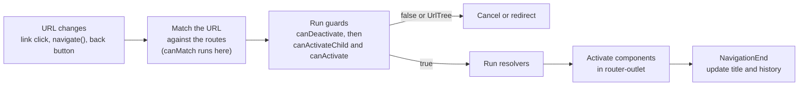

# Routing, Guards and Lazy Loading

> The Angular Router maps URLs to screens. In this document you will learn how to configure routes, read route parameters correctly, navigate in code, split your app with lazy loading and preloading, protect routes with guards, load data with resolvers, and why guards are a UX feature, not security. All examples are for Angular 16, with newer-version differences clearly marked.

**Before this:** [Angular fundamentals](01-angular-fundamentals.md) · [Dependency injection](05-dependency-injection.md) · [RxJS](09-rxjs.md) · [What happens when you type a URL](../01-cs-and-web-fundamentals/06-what-happens-when-you-type-a-url.md) · **Interview questions:** [jump to the interview section](#interview-questions)

## Table of contents

1. [What the router does](#what-the-router-does)
2. [Setting up the router](#setting-up-the-router)
3. [Defining routes](#defining-routes)
4. [router-outlet, routerLink and routerLinkActive](#router-outlet-routerlink-and-routerlinkactive)
5. [Programmatic navigation](#programmatic-navigation)
6. [Route parameters: snapshot vs paramMap](#route-parameters-snapshot-vs-parammap)
7. [Query parameters and fragments](#query-parameters-and-fragments)
8. [Binding route data to component inputs (v16)](#binding-route-data-to-component-inputs-v16)
9. [Child routes and named outlets](#child-routes-and-named-outlets)
10. [Redirects, wildcards and pathMatch](#redirects-wildcards-and-pathmatch)
11. [Lazy loading](#lazy-loading)
12. [Preloading strategies](#preloading-strategies)
13. [Guards](#guards)
14. [Functional vs class-based guards: the history](#functional-vs-class-based-guards-the-history)
15. [Resolvers](#resolvers)
16. [Route data and page titles](#route-data-and-page-titles)
17. [Router events](#router-events)
18. [Guards are UX, not security](#guards-are-ux-not-security)
19. [Newer Angular versions](#newer-angular-versions)
20. [Common mistakes](#common-mistakes)
21. [Best practices](#best-practices)
22. [How to explain this in an interview](#how-to-explain-this-in-an-interview)
23. [Interview questions](#interview-questions)
24. [Summary](#summary)
25. [References](#references)

---

## What the router does

An Angular app is a **single-page application (SPA)**. The browser loads one HTML page. After that, moving between "pages" does not load a new HTML document from the server. Instead, the **router**:

1. Watches the browser URL.
2. Finds the **route** that matches the URL.
3. Runs **guards** (may I enter? may I leave?) and **resolvers** (load data first).
4. Creates the matching **component** and shows it in a `<router-outlet>`.
5. Updates the browser history, so the back and forward buttons work.

**Analogy:** the router is like a **hotel receptionist**. You say a room number (the URL). The receptionist checks the booking list (route config), checks your key card (guards), maybe prepares the room first (resolver), and then sends you to the right room (component in the outlet).

By default the router uses the HTML5 **History API** (`pushState`), so URLs look like `/products/42`. That needs the server to return `index.html` for every app URL (a "fallback" rule), otherwise a page refresh on `/products/42` gives a 404 from the server. The alternative is **hash URLs** (`/#/products/42`), which never reach the server path; enable them with `useHash: true` or `withHashLocation()`.



---

## Setting up the router

### NgModule app: RouterModule.forRoot

```ts
// app-routing.module.ts
import { NgModule } from '@angular/core';
import { RouterModule, Routes } from '@angular/router';

const routes: Routes = [
  { path: '', component: HomeComponent },
  { path: 'products', component: ProductListComponent },
  { path: 'products/:id', component: ProductDetailComponent },
  { path: '**', component: NotFoundComponent },
];

@NgModule({
  imports: [RouterModule.forRoot(routes, { bindToComponentInputs: true })], // options are optional
  exports: [RouterModule],
})
export class AppRoutingModule {}
```

- `forRoot(routes)` registers the **Router service** and the routes. Call it **once**, in the root module.
- Feature modules use `RouterModule.forChild(routes)`, which registers routes but not a second Router.
- `exports: [RouterModule]` makes `router-outlet` and `routerLink` available in the templates of the module that imports `AppRoutingModule`.

### Standalone app: provideRouter (Angular 14.2+)

```ts
// main.ts
import { bootstrapApplication } from '@angular/platform-browser';
import { provideRouter, withComponentInputBinding, withPreloading, PreloadAllModules } from '@angular/router';
import { routes } from './app/app.routes';

bootstrapApplication(AppComponent, {
  providers: [
    provideRouter(
      routes,
      withComponentInputBinding(),       // v16: route params -> @Input()
      withPreloading(PreloadAllModules), // preload lazy routes after start
    ),
  ],
});
```

`provideRouter` takes **features** instead of an options object. In Angular 16 these features exist:

| Feature | Same as the `forRoot` option |
| --- | --- |
| `withComponentInputBinding()` (v16) | `bindToComponentInputs: true` |
| `withPreloading(Strategy)` | `preloadingStrategy` |
| `withHashLocation()` | `useHash: true` |
| `withInMemoryScrolling({ scrollPositionRestoration, anchorScrolling })` | the same options |
| `withRouterConfig({ paramsInheritanceStrategy, onSameUrlNavigation, ... })` | the same options |
| `withEnabledBlockingInitialNavigation()` | `initialNavigation: 'enabledBlocking'` (useful for SSR) |
| `withDisabledInitialNavigation()` | `initialNavigation: 'disabled'` |
| `withDebugTracing()` | `enableTracing: true` (logs every router event) |
| `withNavigationErrorHandler(fn)` (v15.2) | handle `NavigationError` |

The router directives (`RouterOutlet`, `RouterLink`, `RouterLinkActive`) are standalone since v14.2, so a standalone component imports them directly (or imports `RouterModule`).

---

## Defining routes

A route is an object in the `Routes` array. The most important properties:

| Property | Meaning |
| --- | --- |
| `path` | URL segment(s) to match, without a leading slash. `':id'` is a parameter. `''` is empty. `'**'` matches anything |
| `component` | The component to show |
| `loadComponent` | Lazy-load a standalone component (v14+) |
| `loadChildren` | Lazy-load child routes (a module or a routes file) |
| `children` | Nested routes, shown in the parent component's `<router-outlet>` |
| `redirectTo` | Redirect to another path |
| `pathMatch` | `'prefix'` (default) or `'full'` |
| `canActivate`, `canActivateChild`, `canDeactivate`, `canMatch` | Guards |
| `resolve` | Resolvers: data to load before activation |
| `data` | Static data for the route (`{ breadcrumb: 'Products' }`) |
| `title` | Page title (v14+) |
| `providers` | Services scoped to this route and its children (v14+) |
| `outlet` | Name of a secondary outlet |

### Order matters: first match wins

The router checks routes **in array order** and uses the **first** match. Put specific routes before general ones, and the wildcard `**` **last**:

```ts
// ❌ Wrong: 'products/new' never matches, because 'products/:id' catches it first (id = 'new')
const routes: Routes = [
  { path: 'products/:id', component: ProductDetailComponent },
  { path: 'products/new', component: ProductCreateComponent },
];

// ✅ Correct
const routes2: Routes = [
  { path: 'products/new', component: ProductCreateComponent },
  { path: 'products/:id', component: ProductDetailComponent },
  { path: '**', component: NotFoundComponent },
];
```

---

## router-outlet, routerLink and routerLinkActive

```html
<!-- app.component.html -->
<nav>
  <a routerLink="/" routerLinkActive="active" [routerLinkActiveOptions]="{ exact: true }"
     ariaCurrentWhenActive="page">Home</a>
  <a routerLink="/products" routerLinkActive="active" ariaCurrentWhenActive="page">Products</a>
  <a [routerLink]="['/products', product.id]">{{ product.name }}</a>
  <a [routerLink]="['/products']" [queryParams]="{ category: 'books', page: 1 }" fragment="top">Books</a>
</nav>

<router-outlet></router-outlet>
```

- **`<router-outlet>`** is the placeholder where the router renders the matched component.
- **`routerLink`** navigates without reloading the page. A string (`"/products"`) or an array of segments (`['/products', 42]` → `/products/42`). Paths without a leading `/` are **relative** to the current route (`routerLink="edit"` from `/products/42` goes to `/products/42/edit`; `'../'` goes up).
- **`routerLinkActive`** adds CSS classes when the link's route is active. By default it is active for any URL that **starts with** the link (so `/` would be active everywhere). Use `[routerLinkActiveOptions]="{ exact: true }"` for exact matching.
- **`ariaCurrentWhenActive="page"`** sets `aria-current="page"` on the active link, so screen readers know where the user is.

Why not `<a href="/products">`? A plain `href` makes the browser **reload the whole app** from the server. You lose in-memory state and pay the startup cost again.

---

## Programmatic navigation

Inject `Router` to navigate from code, for example after saving a form.

```ts
import { ActivatedRoute, Router } from '@angular/router';

export class ProductEditComponent {
  private readonly router = inject(Router);
  private readonly route = inject(ActivatedRoute);

  async save(): Promise<void> {
    // ... save ...
    const navigated = await this.router.navigate(['/products', this.productId]); // returns Promise<boolean>
    if (!navigated) {
      console.log('Navigation was cancelled (for example by a guard)');
    }
  }

  cancel(): void {
    this.router.navigate(['..'], { relativeTo: this.route }); // go up one level, relative to the current route
  }

  search(term: string): void {
    this.router.navigate([], {
      relativeTo: this.route,
      queryParams: { q: term, page: 1 },
      queryParamsHandling: 'merge', // keep other existing query params
      replaceUrl: true,             // do not add a history entry for every keystroke
    });
  }

  openFromAbsoluteUrl(): void {
    this.router.navigateByUrl('/orders/15?tab=items'); // takes a full URL string
  }
}
```

| Method | Input | Notes |
| --- | --- | --- |
| `navigate(commands, extras?)` | Array of segments | Supports `relativeTo`, `queryParams`, `fragment`, `queryParamsHandling`, `replaceUrl`, `state` |
| `navigateByUrl(url, extras?)` | Full URL string or `UrlTree` | Always absolute |
| `createUrlTree(commands, extras?)` | Array of segments | Builds a `UrlTree` without navigating (used for guard redirects) |

Both navigation methods return a **`Promise<boolean>`**: `true` if the navigation succeeded, `false` if it was cancelled (a guard said no), and it rejects if the navigation failed with an error.

`queryParamsHandling`: `'merge'` keeps existing query params and adds or replaces the new ones; `'preserve'` keeps the current ones and ignores the new ones; default (empty) replaces them.

`state` passes data that is not in the URL (for example, `{ state: { fromCart: true } }`). Read it with `router.getCurrentNavigation()?.extras.state` during navigation, or `history.state` afterwards. It is lost when the user opens the URL directly, so use it only for optional extras.

---

## Route parameters: snapshot vs paramMap

A route `products/:id` matches `/products/42` with `id = '42'`. Parameters are always **strings**. Read them from `ActivatedRoute`.

### Snapshot: the value at the moment the component was created

```ts
export class ProductDetailComponent implements OnInit {
  private readonly route = inject(ActivatedRoute);
  productId = '';

  ngOnInit(): void {
    this.productId = this.route.snapshot.paramMap.get('id')!; // '42'
  }
}
```

### paramMap Observable: the value now and in the future

```ts
export class ProductDetailComponent {
  private readonly route = inject(ActivatedRoute);
  private readonly productApi = inject(ProductApi);

  readonly product$ = this.route.paramMap.pipe(
    map(params => params.get('id')!),
    switchMap(id => this.productApi.getById(id)), // cancels the previous request when the id changes
  );
}
```

### Why does this matter? Component reuse

When the user navigates from `/products/42` to `/products/43`, the **same route config** matches. By default, the router **reuses the existing component instance**. It does **not** destroy and recreate it. So:

- The constructor and `ngOnInit` do **not** run again.
- `route.snapshot` still says `42` (the snapshot object of the old navigation).
- `route.paramMap` **emits** `43`.

```ts
// ❌ Bug: clicking "Next product" (/products/42 -> /products/43) changes the URL but not the page
ngOnInit(): void {
  const id = this.route.snapshot.paramMap.get('id')!;
  this.productApi.getById(id).subscribe(p => (this.product = p));
}

// ✅ Correct: react to every change
readonly product$ = this.route.paramMap.pipe(switchMap(params => this.productApi.getById(params.get('id')!)));
```

**Rule:** use the snapshot only when you are sure the component is always created fresh for each value (for example, a page you can only reach from a different route). Otherwise use `paramMap`, or the v16 input binding (next section).

`paramMap` vs `params`: `params` is a plain object (`params['id']`). `paramMap` is a `ParamMap` with `get()`, `getAll()` and `has()`. Both work; `paramMap` is the recommended API.

---

## Query parameters and fragments

Query parameters (`/products?category=books&page=2`) are optional and not part of the route path. Use them for **filters, sorting, pagination and search terms**, so the user can bookmark and share the exact view.

```ts
export class ProductListComponent {
  private readonly route = inject(ActivatedRoute);
  private readonly router = inject(Router);
  private readonly productApi = inject(ProductApi);

  readonly products$ = this.route.queryParamMap.pipe(
    map(params => ({
      category: params.get('category') ?? 'all',
      page: Number(params.get('page') ?? 1),
    })),
    distinctUntilChanged((a, b) => a.category === b.category && a.page === b.page),
    switchMap(filter => this.productApi.list(filter)),
  );

  goToPage(page: number): void {
    this.router.navigate([], { relativeTo: this.route, queryParams: { page }, queryParamsHandling: 'merge' });
  }
}
```

The **fragment** is the part after `#` (`/docs#installation`). Read it with `route.fragment` (an Observable) or `route.snapshot.fragment`. To scroll to the element with that id automatically, enable `anchorScrolling: 'enabled'` (with `withInMemoryScrolling` or `forRoot` options).

Query params, like path params, are strings. Convert and validate them (`Number(...)`, default values), because users can type anything into the URL.

---

## Binding route data to component inputs (v16)

**New in Angular 16:** the router can set route information directly into the routed component's `@Input()` properties. Enable it with `withComponentInputBinding()` (standalone) or `RouterModule.forRoot(routes, { bindToComponentInputs: true })`.

```ts
// route: { path: 'products/:id', component: ProductDetailComponent, data: { mode: 'view' }, resolve: { product: productResolver } }

@Component({ selector: 'app-product-detail', standalone: true, template: `...` })
export class ProductDetailComponent {
  @Input() id!: string;         // from the path param :id
  @Input() tab?: string;        // from the query param ?tab=reviews
  @Input() mode?: string;       // from route data
  @Input() product?: Product;   // from the resolver
}
```

How it works (from the Angular 16 source):

- The router merges **query params, path params, static `data` and resolved data** into one object, in that order: `{ ...queryParams, ...params, ...data }` (resolved data is part of `data`). Later sources win on name clashes, so **data beats path params, and path params beat query params**.
- It sets each component input whose name matches a key. Inputs with no matching key are set to `undefined`.
- It updates the inputs on **every** navigation that reuses the component, so you get new values when the id changes. Use an input setter or `ngOnChanges` to react:

```ts
@Input()
set id(value: string) {
  this.product$ = this.productApi.getById(value);
}
product$!: Observable<Product>;
```

Benefits: no `ActivatedRoute` injection, simpler tests (just set the input), and the component can be reused outside routing.

---

## Child routes and named outlets

### Child routes

Child routes render **inside** a parent component that has its own `<router-outlet>`. Use them for layouts: a settings page with a side menu, or a product page with tabs.

```ts
const routes: Routes = [
  {
    path: 'account',
    component: AccountLayoutComponent, // has a side menu and its own <router-outlet>
    children: [
      { path: '', redirectTo: 'profile', pathMatch: 'full' },
      { path: 'profile', component: ProfileComponent },   // /account/profile
      { path: 'security', component: SecurityComponent }, // /account/security
      { path: 'orders/:orderId', component: OrderComponent },
    ],
  },
];
```

```html
<!-- account-layout.component.html -->
<aside>
  <a routerLink="profile" routerLinkActive="active">Profile</a>
  <a routerLink="security" routerLinkActive="active">Security</a>
</aside>
<main><router-outlet></router-outlet></main>
```

A route can also be **componentless** (`{ path: 'admin', canActivateChild: [adminGuard], children: [...] }`) to group routes under one guard, resolver or `providers` array without adding a layout.

**Parameter inheritance:** by default (`paramsInheritanceStrategy: 'emptyOnly'`), a child route gets its parent's params only in two cases: the child route has an empty path (`path: ''`), or the parent route has no component. Example: with `{ path: 'orders/:orderId', component: OrderComponent, children: [{ path: 'items', component: OrderItemsComponent }] }`, the `items` child has a non-empty path and its parent has a component, so `OrderItemsComponent` does **not** see `orderId` in its own `paramMap`. To read a parent's `:orderId` from a deeper child, use `route.parent?.paramMap`, or set `paramsInheritanceStrategy: 'always'` (in `withRouterConfig` or `forRoot` options).

### Named (secondary) outlets

A page can have more than one outlet. Secondary outlets have names and show **independent** routes, for example a chat panel or a side drawer that stays open while the main content changes.

```html
<router-outlet></router-outlet>
<router-outlet name="panel"></router-outlet>
```

```ts
{ path: 'help', component: HelpPanelComponent, outlet: 'panel' }
// URL: /products(panel:help)
this.router.navigate([{ outlets: { panel: ['help'] } }]);     // open
this.router.navigate([{ outlets: { panel: null } }]);         // close
```

Named outlets are rarely needed. Many apps use a dialog service or component state instead, which keeps URLs simpler.

---

## Redirects, wildcards and pathMatch

```ts
const routes: Routes = [
  { path: '', redirectTo: 'dashboard', pathMatch: 'full' }, // '/' -> '/dashboard'
  { path: 'dashboard', component: DashboardComponent },
  { path: 'old-products', redirectTo: 'products' },        // keep old links working
  { path: 'products/:id', component: ProductDetailComponent },
  { path: 'item/:id', redirectTo: 'products/:id' },        // params can be reused in redirects
  { path: '**', component: NotFoundComponent },            // anything else
];
```

### pathMatch: 'prefix' vs 'full'

- **`'prefix'`** (default): the route matches if its path is a **prefix** of the remaining URL (by whole segments).
- **`'full'`**: the route matches only if its path is the **entire** remaining URL.

Every URL "starts with" the empty path `''`. So an empty-path redirect with `pathMatch: 'prefix'` would match every URL and redirect it:

```ts
// ❌ Wrong: Angular 16 throws in development mode:
// "Invalid configuration of route '{path: "", redirectTo: "dashboard"}': please provide 'pathMatch'..."
{ path: '', redirectTo: 'dashboard' }

// ❌ Also wrong: explicitly 'prefix' -> the empty path matches in front of every URL,
// so every URL is redirected (the rest of the URL is appended to 'dashboard')
{ path: '', redirectTo: 'dashboard', pathMatch: 'prefix' }

// ✅ Correct: only the exact empty URL is redirected
{ path: '', redirectTo: 'dashboard', pathMatch: 'full' }
```

(The missing-`pathMatch` check is a development-mode validation in the Angular 16 router source.)

The wildcard `**` matches any URL. It must be **last**, because routes after it are never reached.

---

## Lazy loading

### What it is and why

By default, all routed components are in the **main bundle**, which the browser downloads before the app starts. In a big app (admin, reports, settings, checkout), most users never visit most pages. **Lazy loading** puts a route's code in a **separate JavaScript chunk** that is downloaded only when the user first navigates to that route.

Benefits: a smaller main bundle, faster first load, and better Core Web Vitals (see [Web performance and Core Web Vitals](../05-frontend-engineering/05-web-performance-and-core-web-vitals.md)). The cost: a small delay the first time a lazy route is opened (fixed with preloading).

**How it works inside:** `loadChildren` and `loadComponent` take a function that calls dynamic `import()`. The Angular CLI's bundler sees the `import()` and creates a separate chunk file. The router calls the function only when a URL needs that route, then caches the result.

### Lazy loading an NgModule

```ts
// app-routing.module.ts
const routes: Routes = [
  {
    path: 'admin',
    loadChildren: () => import('./admin/admin.module').then(m => m.AdminModule),
  },
];
```

```ts
// admin/admin-routing.module.ts
const adminRoutes: Routes = [
  { path: '', component: AdminDashboardComponent },  // /admin
  { path: 'users', component: AdminUsersComponent }, // /admin/users
];

@NgModule({
  imports: [RouterModule.forChild(adminRoutes)], // forChild, never forRoot
  exports: [RouterModule],
})
export class AdminRoutingModule {}

@NgModule({
  declarations: [AdminDashboardComponent, AdminUsersComponent],
  imports: [CommonModule, AdminRoutingModule],
})
export class AdminModule {}
```

### Lazy loading a standalone component (v14+)

```ts
{
  path: 'reports',
  loadComponent: () => import('./reports/reports.component').then(m => m.ReportsComponent),
}
```

### Lazy loading a routes file (standalone, v14+)

```ts
// app.routes.ts
export const routes: Routes = [
  { path: 'checkout', loadChildren: () => import('./checkout/checkout.routes').then(m => m.CHECKOUT_ROUTES) },
];

// checkout/checkout.routes.ts
export const CHECKOUT_ROUTES: Routes = [
  {
    path: '',
    providers: [CheckoutStore], // a service instance shared only by the checkout pages
    children: [
      { path: '', loadComponent: () => import('./cart.component').then(m => m.CartComponent) },
      { path: 'payment', loadComponent: () => import('./payment.component').then(m => m.PaymentComponent) },
    ],
  },
];
```

### Default exports (v15+)

Since Angular 15, if the file uses `export default`, you can skip `.then(...)`:

```ts
// reports.component.ts: export default class ReportsComponent { ... }
{ path: 'reports', loadComponent: () => import('./reports/reports.component') }
```

### Lazy routes and dependency injection

A lazy-loaded **module** gets its **own child injector**. A service listed in that module's `providers` gets a **separate instance** from the one at the root. That is a classic singleton bug: "my cart service lost its state". Use `@Injectable({ providedIn: 'root' })` for app-wide singletons. Route-level `providers` (as in `CHECKOUT_ROUTES` above) create an environment injector for that route subtree on purpose. Details are in [Dependency injection](05-dependency-injection.md).

---

## Preloading strategies

Lazy loading makes the first load fast, but the first click on a lazy route waits for the chunk. **Preloading** downloads lazy chunks **in the background after the app has started**, so later navigation is instant.

| Strategy | Behavior |
| --- | --- |
| `NoPreloading` (default) | Load lazy chunks only on navigation |
| `PreloadAllModules` | After the initial navigation, preload every lazy route: `loadChildren` (unless the route has a `canLoad` guard) and `loadComponent` |
| Custom strategy | Your own rule: preload only some routes, or only on fast networks |

```ts
// NgModule
RouterModule.forRoot(routes, { preloadingStrategy: PreloadAllModules });

// Standalone
provideRouter(routes, withPreloading(PreloadAllModules));
```

Important detail (checked in the Angular 16 router source): the preloader skips `loadChildren` routes that have a **`canLoad`** guard, but it does **not** run **`canMatch`** guards. So `PreloadAllModules` downloads code behind `canMatch` too. If some users must not download a feature's code, use a custom strategy that skips it.

### A custom preloading strategy

Preload only routes marked with `data: { preload: true }`, and never on slow connections or with Data Saver on:

```ts
import { Injectable } from '@angular/core';
import { PreloadingStrategy, Route } from '@angular/router';
import { Observable, EMPTY } from 'rxjs';

@Injectable({ providedIn: 'root' })
export class SelectivePreloadingStrategy implements PreloadingStrategy {
  preload(route: Route, load: () => Observable<unknown>): Observable<unknown> {
    const connection = (navigator as Navigator & { connection?: { saveData?: boolean; effectiveType?: string } }).connection;
    const slowNetwork = connection?.saveData || connection?.effectiveType === '2g';
    return route.data?.['preload'] && !slowNetwork ? load() : EMPTY;
  }
}

// routes
{ path: 'orders', loadChildren: () => import('./orders/orders.routes').then(m => m.ORDER_ROUTES), data: { preload: true } }

// setup
provideRouter(routes, withPreloading(SelectivePreloadingStrategy));
```

`preload` receives the route and a `load` function. Return `load()` to preload, or `EMPTY` to skip. You can also delay preloading (`timer(5000).pipe(switchMap(() => load()))`), or preload on hover over a link.

---

## Guards

### What a guard is

A **guard** is a function the router calls during navigation to decide whether to continue. A guard returns:

| Return value | Effect |
| --- | --- |
| `true` | Continue |
| `false` | Cancel the navigation (stay where you are) |
| A `UrlTree` | Cancel and **redirect** to that URL (for example `/login`) |
| An `Observable` or `Promise` of the above | Wait for the async result (the router takes the first emitted value) |

Prefer returning a `UrlTree` over calling `router.navigate()` inside a guard. The router handles a `UrlTree` as one clean redirect, with correct priority when several guards redirect.

### The guard types

| Guard | Runs | Typical use |
| --- | --- | --- |
| `canMatch` (v14.1+) | While **matching** routes, before the route is chosen. If it returns `false`, the router **tries the next route** with the same path | Feature flags, role-based versions of a page, preventing lazy code download |
| `canActivate` | Before activating a route | Login required, role checks |
| `canActivateChild` | Before activating any **child** of the route | Protect a whole section with one guard |
| `canDeactivate` | Before **leaving** the current route | "You have unsaved changes" |
| `canLoad` (**deprecated since v15.1**) | Before downloading a lazy module | Replaced by `canMatch` |

### Order of execution

1. `canMatch` runs during route matching (for each candidate route).
2. Then `canDeactivate` runs for the routes being left, **from the deepest child up**.
3. Then `canActivateChild` and `canActivate` run **from the top parent down** to the deepest child.
4. If all pass, resolvers run.

### Functional guards in Angular 16 (recommended)

Since Angular 14.2, guards can be plain functions. You use `inject()` inside them for dependencies.

```ts
import { inject } from '@angular/core';
import { CanActivateFn, Router } from '@angular/router';

export const authGuard: CanActivateFn = (route, state) => {
  const auth = inject(AuthService);
  const router = inject(Router);

  if (auth.isLoggedIn()) {
    return true;
  }
  // Redirect to login and remember where the user wanted to go
  return router.createUrlTree(['/login'], { queryParams: { returnUrl: state.url } });
};

// routes
{ path: 'orders', component: OrdersComponent, canActivate: [authGuard] }
```

A **guard factory** for roles (a function that returns a guard):

```ts
export function roleGuard(...allowedRoles: string[]): CanActivateFn {
  return () => {
    const auth = inject(AuthService);
    const router = inject(Router);
    return auth.currentUser$.pipe(
      take(1),
      map(user => (user && allowedRoles.includes(user.role) ? true : router.createUrlTree(['/forbidden']))),
    );
  };
}

// routes
{ path: 'admin', canActivate: [authGuard, roleGuard('admin')], loadChildren: () => import('./admin/admin.routes').then(m => m.ADMIN_ROUTES) }
```

Note the `take(1)`: the router uses the first value, but a guard Observable that never completes is still a bad idea. Make it emit once.

### canDeactivate: unsaved changes

```ts
export interface HasUnsavedChanges {
  hasUnsavedChanges(): boolean;
}

export const unsavedChangesGuard: CanDeactivateFn<HasUnsavedChanges> = component =>
  component.hasUnsavedChanges() ? confirm('You have unsaved changes. Leave this page?') : true;

// The component
export class ProfileEditComponent implements HasUnsavedChanges {
  readonly form = inject(NonNullableFormBuilder).group({ name: [''] });
  hasUnsavedChanges(): boolean {
    return this.form.dirty;
  }
}

// routes
{ path: 'profile/edit', component: ProfileEditComponent, canDeactivate: [unsavedChangesGuard] }
```

The guard receives the **component instance**, plus `currentRoute`, `currentState` and `nextState`. In a real app, replace `confirm()` with your dialog service that returns an `Observable<boolean>`. `canDeactivate` does not run when the user closes the tab or types a new address; for that, also handle the browser `beforeunload` event. The `dirty` flag is explained in [Forms](07-forms.md).

### canMatch: same path, different versions

```ts
export const featureFlagGuard = (flag: string): CanMatchFn => () => inject(FeatureFlagService).isEnabled(flag);

const routes: Routes = [
  // If the flag is on, this route matches and the new dashboard's code is loaded...
  { path: 'dashboard', canMatch: [featureFlagGuard('newDashboard')], loadComponent: () => import('./dashboard-v2.component') },
  // ...otherwise the router tries the next route with the same path
  { path: 'dashboard', loadComponent: () => import('./dashboard.component') },
];
```

`canMatch` receives `(route, segments)`. Because it runs before matching finishes, a failing `canMatch` also means the lazy code is **not downloaded during that navigation** (a preloading strategy can still download it, as explained in [Preloading strategies](#preloading-strategies)). That is why it replaced `canLoad`. (`canLoad` only prevented loading; `canMatch` can also fall through to another route.)

### canActivateChild

```ts
{
  path: 'admin',
  canActivateChild: [() => inject(AuthService).hasRole('admin') || inject(Router).createUrlTree(['/forbidden'])],
  children: [
    { path: 'users', component: AdminUsersComponent },
    { path: 'settings', component: AdminSettingsComponent },
  ],
}
```

It runs before **each** child activation, including navigation between children, which is useful when permissions can change while the user is inside the section.

---

## Functional vs class-based guards: the history

This history is confusing, and interviewers sometimes test it. Here is the accurate timeline (checked against Angular release notes and the router source):

| Version | What happened |
| --- | --- |
| Before 14.2 | Guards were classes implementing `CanActivate`, `CanDeactivate`, etc., listed by class in the route (`canActivate: [AuthGuard]`) |
| **14.1** | `canMatch` guard added |
| **14.2** | Guards and resolvers can be **plain functions** (`CanActivateFn`, `ResolveFn`, ...) |
| **15.1** | `canLoad` / `CanLoad` **deprecated** in favor of `canMatch` |
| **15.2** | **Class-based and `InjectionToken` guards and resolvers deprecated** in favor of functional ones. In Angular 16 the interfaces (`CanActivate`, `CanDeactivate`, `CanMatch`, `Resolve`, ...) are marked `@deprecated`, and so is passing a class token in the route config |
| **16.0** | Helper functions `mapToCanActivate`, `mapToCanActivateChild`, `mapToCanDeactivate`, `mapToCanMatch` and `mapToResolve` added, to use existing class guards as functional ones |
| **18.0.x (June 2024)** | The **deprecation of the guard interfaces was removed**: class-based guard *implementations* are fine again. Passing a class token directly in the route (`canActivate: [AuthGuard]`) is still typed as deprecated (`DeprecatedGuard`); wrap it in a function instead |

So in an **Angular 16** project:

- Write **new** guards as functions.
- Existing class guards still **work**, but your IDE shows them as deprecated.
- To keep a class but use the functional style, wrap it:

```ts
// An existing class-based guard
@Injectable({ providedIn: 'root' })
export class LegacyAuthGuard {
  constructor(private readonly auth: AuthService, private readonly router: Router) {}
  canActivate(route: ActivatedRouteSnapshot, state: RouterStateSnapshot): boolean | UrlTree {
    return this.auth.isLoggedIn() ? true : this.router.createUrlTree(['/login']);
  }
}

// Option 1: v16 helper
{ path: 'orders', component: OrdersComponent, canActivate: mapToCanActivate([LegacyAuthGuard]) }

// Option 2: inline wrapper (works in 14.2+)
{ path: 'orders', component: OrdersComponent, canActivate: [(route, state) => inject(LegacyAuthGuard).canActivate(route, state)] }
```

---

## Resolvers

### What a resolver is

A **resolver** loads data **before** the route activates. The component starts with the data already available, so it does not show an empty state first.

```ts
import { ResolveFn, Router } from '@angular/router';
import { catchError, EMPTY } from 'rxjs';

export const productResolver: ResolveFn<Product> = route => {
  const productApi = inject(ProductApi);
  const router = inject(Router);
  return productApi.getById(route.paramMap.get('id')!).pipe(
    catchError(() => {
      router.navigate(['/not-found']);
      return EMPTY; // no value -> the navigation is cancelled
    }),
  );
};

// routes
{ path: 'products/:id', component: ProductDetailComponent, resolve: { product: productResolver } }
```

Read the data in the component:

```ts
// Option 1: ActivatedRoute.data (an Observable that updates when the route is reused)
readonly product$ = inject(ActivatedRoute).data.pipe(map(data => data['product'] as Product));

// Option 2 (v16): withComponentInputBinding -> @Input() product!: Product;
```

### Resolver rules in Angular 16

- The router subscribes and takes the **first** emitted value (it uses `first()` internally), so an Observable does not need to complete.
- If the resolver Observable **completes without emitting** (like `EMPTY`), the navigation is **cancelled**.
- If it **errors**, the navigation fails with a `NavigationError`.
- Resolvers run **after** all guards pass. Several resolvers on one route run in parallel.
- By default resolvers re-run when path params change (`runGuardsAndResolvers: 'paramsChange'`). Options include `'paramsOrQueryParamsChange'` and `'always'`.

### Resolver vs loading in the component

| | Resolver | Load in the component |
| --- | --- | --- |
| UX | The old page stays until data arrives; the new page appears complete | The new page appears immediately with a loading state |
| Perceived speed | Feels slow if the API is slow (nothing seems to happen) | Feels fast; skeletons and spinners give feedback |
| Error handling | Redirect or cancel before showing the page | Show the error inside the page |
| Good for | Small, fast, required data (an entity that must exist) | Large or slow data, dashboards with many widgets |

Many teams prefer loading in the component with a skeleton screen. If you use resolvers, show a global loading bar using router events (next sections).

---

## Route data and page titles

### Static route data

```ts
{ path: 'orders', component: OrdersComponent, data: { breadcrumb: 'Orders', requiredPermission: 'orders.read' } }
```

Read it with `route.snapshot.data['breadcrumb']`, `route.data` (Observable), inside guards (`route.data['requiredPermission']`), or as an input with `withComponentInputBinding()`. Use it for breadcrumbs, permissions, layout flags and analytics names.

### Page titles (v14+)

```ts
const routes: Routes = [
  { path: 'orders', component: OrdersComponent, title: 'Orders' },
  { path: 'products/:id', component: ProductDetailComponent, title: productTitleResolver }, // dynamic
];

export const productTitleResolver: ResolveFn<string> = route =>
  inject(ProductApi).getById(route.paramMap.get('id')!).pipe(map(p => `${p.name} | My Shop`));
```

The router sets `document.title` after each successful navigation. To change the format for **all** pages, provide a custom **`TitleStrategy`**:

```ts
@Injectable({ providedIn: 'root' })
export class AppTitleStrategy extends TitleStrategy {
  private readonly title = inject(Title);

  override updateTitle(snapshot: RouterStateSnapshot): void {
    const pageTitle = this.buildTitle(snapshot); // the deepest route's title
    this.title.setTitle(pageTitle ? `${pageTitle} | My Shop` : 'My Shop');
  }
}

// providers: [{ provide: TitleStrategy, useClass: AppTitleStrategy }]
```

Good titles help accessibility (screen readers announce the new title) and browser history.

---

## Router events

`Router.events` is an Observable of everything that happens during navigation. The main events, in order for a successful navigation:

1. `NavigationStart`
2. `RoutesRecognized`
3. `GuardsCheckStart` → `GuardsCheckEnd`
4. `ResolveStart` → `ResolveEnd`
5. `NavigationEnd`

Plus: `NavigationCancel` (a guard returned `false` or redirected), `NavigationError` (something threw), `NavigationSkipped` (v15.1+, navigation to the same URL ignored), `RouteConfigLoadStart` / `RouteConfigLoadEnd` (a lazy chunk is loading), `Scroll`, and `ChildActivation*` / `Activation*` events.

A global loading bar and page-view analytics:

```ts
@Component({
  selector: 'app-root',
  template: `
    <div class="loading-bar" *ngIf="navigating$ | async"></div>
    <router-outlet></router-outlet>
  `,
})
export class AppComponent {
  private readonly router = inject(Router);
  private readonly analytics = inject(AnalyticsService);

  readonly navigating$ = this.router.events.pipe(
    filter(e => e instanceof NavigationStart || e instanceof NavigationEnd || e instanceof NavigationCancel || e instanceof NavigationError),
    map(e => e instanceof NavigationStart),
  );

  constructor() {
    this.router.events
      .pipe(
        filter((e): e is NavigationEnd => e instanceof NavigationEnd),
        takeUntilDestroyed(),
      )
      .subscribe(e => this.analytics.pageView(e.urlAfterRedirects));
  }
}
```

Always stop the loading bar on **`NavigationCancel` and `NavigationError` too**, not only `NavigationEnd`, or it spins forever after a guard says no. `Router.events` never completes, so clean up the subscription.

---

## Guards are UX, not security

This is one of the most important points in the whole document.

All Angular code runs **in the user's browser**. The user can open DevTools, change variables, edit the JavaScript, or call your API directly with `curl`. So a guard can **never** protect data. It only decides which screens the app shows.

| Guards (client) do | The server must do |
| --- | --- |
| Hide screens the user cannot use | Authenticate every API request (validate the token or session) |
| Redirect to login for a better flow | Authorize every request (does **this** user have permission for **this** record?) |
| Avoid downloading code for features the user cannot use (`canMatch`) | Never trust IDs, roles or flags sent by the client |
| Warn about unsaved changes | Validate all input |

A user who bypasses `adminGuard` should see an admin page that **cannot load any data**, because every admin API call returns 403. Also remember that lazy-loaded code can still be downloaded by anyone who knows the chunk URL, so **never put secrets in frontend code**.

More on this in [Security](15-security.md) and [Authentication and authorization](../07-nodejs-backend/09-authentication-and-authorization.md).

---

## Newer Angular versions

> **Newer Angular (17+):**
> - **17:** `withViewTransitions()` adds the browser View Transitions API to route changes. New projects are standalone by default, so `provideRouter` + `app.routes.ts` is the normal setup.
> - **18:** guards and redirects can return a **`RedirectCommand`** (a redirect with navigation extras such as `skipLocationChange`); `redirectTo` can be a **function**. In June 2024 (18.0.x) the guard interface deprecation was removed (see the [history table](#functional-vs-class-based-guards-the-history)).
> - Newer versions keep improving signal integration (route params as signal inputs through `withComponentInputBinding()` + `input()`), but `ActivatedRoute`, guards, resolvers, lazy loading and preloading work the same way as in Angular 16.

---

## Common mistakes

**1. Using `snapshot` in a component that is reused** for different params. The page does not update. Use `paramMap` or input binding.

**2. Empty-path redirect without `pathMatch: 'full'`.**

**3. Wildcard route not last,** or a specific route after a parameter route.

**4. `RouterModule.forRoot` in a feature module.** Use `forChild`.

**5. Providing a "singleton" service in a lazy module's `providers`.** You get a second instance. Use `providedIn: 'root'`.

**6. Calling `router.navigate()` inside a guard and returning `false`.** Return a `UrlTree` instead.

**7. Guard Observables that never emit** (navigation hangs) or never complete. Use `take(1)`.

**8. Treating guards as security.** The API must authorize every request.

**9. Plain `href` links** for internal routes. They reload the app.

**10. Forgetting `NavigationCancel`/`NavigationError`** when hiding a loading indicator.

**11. Heavy resolvers** that make navigation feel frozen.

**12. Not converting param strings** (`'42'` vs `42`), causing failed comparisons.

---

## Best practices

- **Lazy load every feature area** (`loadChildren` / `loadComponent`) and choose a preloading strategy that fits your users.
- **Write functional guards and resolvers**, with `inject()`; wrap legacy classes with `mapToCanActivate` or an inline function.
- **Return `UrlTree`s** for redirects in guards.
- **Use `canMatch`** to hide whole features (and their code) from users who cannot use them.
- **React to params with Observables or input binding**, not snapshots, when the component can be reused.
- **Keep filters, sorting and pagination in query params** so views are shareable and the back button works.
- **Use route `providers`** for state that belongs to one feature.
- **Set page titles** with `title` and a `TitleStrategy`.
- **Show navigation progress** using router events, including cancel and error.
- **Always enforce authorization on the server.**

---

## How to explain this in an interview

### Explaining lazy loading

1. **Define it:** "Lazy loading means a route's code is split into a separate chunk and downloaded only when the user first navigates there."
2. **Why it exists:** "To keep the main bundle small so the app starts fast, because most users never visit most pages."
3. **How it works:** "loadChildren or loadComponent takes a function with a dynamic import. The CLI creates a separate chunk for it, and the router calls the function only when a URL needs that route."
4. **Small example:** "path admin with loadChildren importing the admin routes. The admin code is not in main.js."
5. **Where it is useful:** "Admin sections, reports, settings, checkout, anything not on the first screen."
6. **Trade-offs / gotchas:** "The first visit waits for the chunk, so I add a preloading strategy. Lazy NgModules create a child injector, so services in their providers are separate instances. And lazy code is still public, so no secrets in it."

### Explaining guards

1. **Define it:** "A guard is a function the router runs during navigation to allow, cancel or redirect it."
2. **Why it exists:** "To control which screens a user can reach or leave, like requiring login or warning about unsaved changes."
3. **How it works:** "It returns true, false, a UrlTree for a redirect, or an Observable or Promise of those. canMatch runs during matching, canDeactivate runs first for the routes being left, then canActivateChild and canActivate from parent to child, then resolvers."
4. **Small example:** "An authGuard injects the AuthService, returns true if logged in, otherwise a UrlTree to /login with a returnUrl."
5. **Where it is useful:** "Auth, roles, feature flags with canMatch, unsaved changes with canDeactivate."
6. **Trade-offs / gotchas:** "Guards are UX, not security: the server must authorize every request. In Angular 16 functional guards are recommended; class guards were deprecated in 15.2, and that interface deprecation was later removed in 18."

---

## Interview questions

### Q1. How does routing work in an Angular single-page application?

**What the interviewer is checking:** The full navigation pipeline and SPA basics (History API, server fallback).

**Short spoken answer (30–60 seconds):**
> The browser loads index.html once. After that, the Angular Router watches the URL. When it changes, through a routerLink click, router.navigate or the back button, the router matches the URL against the route config in order, first match wins. Then it runs guards: canDeactivate for the routes being left, then canActivateChild and canActivate from parent to child. If they pass, it runs resolvers, then creates the matched components inside router-outlet elements and emits NavigationEnd. It uses the History API, so URLs look normal, which means the server must return index.html for every app URL, otherwise a refresh on a deep link gives a 404.

**Follow-up questions:**
- **What is the alternative to History API URLs?** — Hash URLs (`/#/products`) with `useHash: true` or `withHashLocation()`. They need no server rewrite rule, but look worse and do not work well with SSR.
- **What does `routerLink` do differently from `href`?** — It calls the router, so there is no full page reload; `href` reloads the whole app.

**Common mistakes:** Forgetting the server fallback. Thinking the router reloads components on every navigation (it reuses them when the same route config matches).

**Where this is used in real projects:** Every Angular app; deployment configuration on Nginx, S3/CloudFront or similar.

---

### Q2. What is the difference between `route.snapshot.paramMap` and `route.paramMap`? When does the snapshot cause a bug?

**What the interviewer is checking:** Understanding of component reuse.

**Short spoken answer (30–60 seconds):**
> The snapshot is the route state at the moment the component was created. paramMap is an Observable that emits the current params and every later change. The difference matters because the router reuses the component instance when you navigate to the same route with different params, for example from /products/42 to /products/43. The constructor and ngOnInit do not run again, so code that read the snapshot in ngOnInit keeps showing product 42 while the URL says 43. So I use paramMap with switchMap to load data, or, in Angular 16, withComponentInputBinding so the id arrives as an input that updates on every navigation.

**Code:** See [Route parameters: snapshot vs paramMap](#route-parameters-snapshot-vs-parammap).

**Follow-up questions:**
- **Why `switchMap` there?** — If the user clicks quickly through products, older requests are cancelled and only the latest product is shown.
- **Can you force the router to recreate the component?** — With a custom `RouteReuseStrategy`, but reacting to param changes is simpler and cheaper.

**Common mistakes:** "Snapshot is just the synchronous version, both always work."

**Where this is used in real projects:** Detail pages with next/previous navigation, tabs that change a param.

---

### Q3. What does `withComponentInputBinding` do (Angular 16)?

**Short answer:** It makes the router set route information directly into `@Input()` properties of the routed component: path params, query params, static `data` and resolver data, matched by name. In Angular 16 the values are merged as `{ ...queryParams, ...params, ...data }`, so on a name clash data wins over path params, which win over query params. Inputs without a matching key are set to `undefined`. Inputs update on every navigation that reuses the component, so you react with a setter or `ngOnChanges`. Enable it with `provideRouter(routes, withComponentInputBinding())` or `RouterModule.forRoot(routes, { bindToComponentInputs: true })`. It removes the need to inject `ActivatedRoute` and makes components easier to test.

---

### Q4. What is lazy loading and how do you implement it in Angular 16?

**What the interviewer is checking:** Implementation for both NgModules and standalone, plus side effects on DI.

**Short spoken answer (30–60 seconds):**
> Lazy loading splits a route's code into a separate chunk that the browser downloads only when the user first navigates to it, which keeps the main bundle small. With NgModules I use loadChildren with a dynamic import of the feature module, and the feature module uses RouterModule.forChild. With standalone code I use loadComponent for a single component, or loadChildren that imports a routes array. Since Angular 15 default exports work without .then. I combine it with a preloading strategy so later navigation is instant. One gotcha: a lazy NgModule gets its own child injector, so a service in its providers is a new instance, not the root singleton.

**Follow-up questions:**
- **How do you verify that a route is really lazy?** — Run a production build and check that a separate chunk exists for it, and that nothing in the main bundle imports the feature directly. A direct import from an eager file pulls the code into the main bundle.
- **What does route-level `providers` do?** — It creates an environment injector for that route and its children, useful for feature-scoped state.

**Common mistakes:** `forRoot` in the feature module. Importing a lazy feature's component in an eager module. Expecting a module-provided service to be shared with the root.

**Where this is used in real projects:** Every medium or large app. Performance budgets are covered in [Performance](12-performance.md).

---

### Q5. What preloading strategies exist? Write a custom one.

**Short answer:** `NoPreloading` (default) loads lazy code only on navigation. `PreloadAllModules` downloads all lazy routes in the background after the app starts. A custom strategy implements `PreloadingStrategy.preload(route, load)` and returns `load()` to preload or `EMPTY` to skip, for example based on `route.data.preload` and the network connection. See [Preloading strategies](#preloading-strategies).

Follow-up: **Does `canMatch` stop preloading?** — Not in Angular 16. The preloader skips `loadChildren` routes that have `canLoad`, but it does not evaluate `canMatch`. Use a custom strategy if some code must not be downloaded for some users.

---

### Q6. What are the guard types, and in what order do they run?

**What the interviewer is checking:** Complete and ordered knowledge of guards.

**Short spoken answer (30–60 seconds):**
> There are canMatch, canActivate, canActivateChild, canDeactivate and the deprecated canLoad, plus resolvers, which are not guards but run in the same pipeline. canMatch runs during route matching; if it returns false, the router tries the next route with the same path, which is great for feature flags and avoids loading that route's code. Then canDeactivate runs for the routes being left, from the deepest child up. Then canActivateChild and canActivate run from the top parent down. Each guard returns true, false, a UrlTree to redirect, or an Observable or Promise of those. If everything passes, resolvers run and the components are activated.

**Follow-up questions:**
- **Why return a `UrlTree` instead of calling `navigate()` in the guard?** — The router treats it as one clean redirect of the current navigation, and handles priorities correctly if several guards redirect. Calling `navigate()` starts a second navigation while the first is still running.
- **What is the difference between `canMatch` and `canActivate`?** — `canMatch` decides whether the route can even be **matched** (and the router may try other routes); `canActivate` runs after a route is chosen and can only allow, cancel or redirect.
- **Why was `canLoad` deprecated?** — `canMatch` does everything `canLoad` did (prevents loading on navigation) and more (fallback to other routes, works for every route, not only lazy ones). `canLoad` was deprecated in 15.1.

**Common mistakes:** Not knowing `canMatch`. Wrong execution order. Guards that never emit.

**Where this is used in real projects:** Auth flows, role-based sections, feature flags, unsaved-changes dialogs.

---

### Q7. Write an auth guard and a role guard in Angular 16.

**Short answer:** Functional guards with `inject()`. The auth guard returns `true` or a `UrlTree` to `/login` with a `returnUrl` query param. The role guard is a factory that takes allowed roles, reads the current user once (`take(1)`), and returns `true` or a `UrlTree` to `/forbidden`. Combine them in `canActivate: [authGuard, roleGuard('admin')]`. The code is in [Functional guards in Angular 16](#functional-guards-in-angular-16-recommended).

Follow-up: **Where do you read `returnUrl` after login?** — In the login component: `this.router.navigateByUrl(this.route.snapshot.queryParamMap.get('returnUrl') ?? '/')`. Validate it is an internal path (starts with a single `/`, not `//` or `/\`) to avoid an open redirect, especially if any code passes it to `window.location`.

---

### Q8. Class-based guards are deprecated, right?

**What the interviewer is checking:** Accurate version history instead of a half-remembered rule.

**Short spoken answer (30–60 seconds):**
> It is more nuanced. Functional guards arrived in 14.2. In 15.2 Angular deprecated class-based and InjectionToken guards and resolvers, so in Angular 16 the CanActivate, CanDeactivate and Resolve interfaces are marked deprecated, and Angular 16 added mapToCanActivate and similar helpers to adapt existing classes. Later, in an 18.0 patch in June 2024, the team removed the deprecation from the guard interfaces, because classes themselves are fine. What stays deprecated is passing a class token directly in the route config; you wrap it in a function, for example canActivate with an arrow function that injects the class and calls it. So in an Angular 16 project I write new guards as functions and wrap the old ones.

**Code:** See [the history](#functional-vs-class-based-guards-the-history).

---

### Q9. How do you prevent users from leaving a form with unsaved changes?

**Short answer:** A `canDeactivate` guard. The component implements an interface such as `hasUnsavedChanges(): boolean` (usually `form.dirty && !saved`). The guard calls it and returns `true`, or the result of a confirm dialog (`boolean` or `Observable<boolean>`). After a successful save, mark the form pristine so the guard does not warn. For tab close or reload, also handle `beforeunload`, because `canDeactivate` only covers in-app navigation. See [canDeactivate: unsaved changes](#candeactivate-unsaved-changes).

---

### Q10. What is a resolver? Resolver or loading in the component — which do you prefer?

**What the interviewer is checking:** Knowledge plus UX judgment.

**Short spoken answer (30–60 seconds):**
> A resolver is a function on the route that loads data before the route activates. The router waits for its first value and passes the data to the component through ActivatedRoute.data or, in Angular 16, as an input. If the resolver completes without a value the navigation is cancelled, and if it errors the navigation fails. The advantage is that the page never renders half empty and I can redirect to not-found before showing anything. The downside is that the user sees nothing happening while the API is slow. So I use resolvers for small, required data, like making sure an entity exists, and for big or slow data I load in the component with a skeleton screen. With resolvers I show a global progress bar using router events.

**Follow-up questions:**
- **When do resolvers re-run?** — By default when path params change (`runGuardsAndResolvers: 'paramsChange'`); other options are `'paramsOrQueryParamsChange'`, `'pathParamsChange'`, `'always'`, or a custom function.
- **Do several resolvers run in sequence?** — No, resolvers of the same route run in parallel; parent routes resolve before children.

---

### Q11. Find the bug.

```ts
const routes: Routes = [
  { path: '', redirectTo: 'home' },
  { path: '**', component: NotFoundComponent },
  { path: 'home', component: HomeComponent },
  { path: 'users/:id', component: UserDetailComponent },
  { path: 'users/new', component: UserCreateComponent },
];
```

**Answer:**

1. The empty-path redirect has no `pathMatch: 'full'`. Angular 16 throws a configuration error in dev mode (and `'prefix'` would redirect everything).
2. The wildcard `**` is second, so `home` and `users` routes are never reached: every URL shows Not Found. Move it to the end.
3. `users/:id` comes before `users/new`, so `/users/new` opens the detail page with `id = 'new'`. Put `users/new` first.

**Fixed:**

```ts
const routes: Routes = [
  { path: '', redirectTo: 'home', pathMatch: 'full' },
  { path: 'home', component: HomeComponent },
  { path: 'users/new', component: UserCreateComponent },
  { path: 'users/:id', component: UserDetailComponent },
  { path: '**', component: NotFoundComponent },
];
```

---

### Q12. Are route guards enough to secure an admin area?

**What the interviewer is checking:** Security mindset. This is a red-flag question if answered wrongly.

**Short answer:** No. Guards run in the browser and can be bypassed with DevTools or by calling the API directly. They only improve UX: hide screens, redirect to login, avoid downloading code. Real security is on the server: every API request must be authenticated and authorized, per resource. A user who bypasses the guard should reach a page that cannot load any data because every call returns 403. Also, lazy chunks can be downloaded by anyone, so no secrets in frontend code. See [Guards are UX, not security](#guards-are-ux-not-security).

**Follow-up questions:**
- **Then why write guards at all?** — For a good user experience: users do not see screens they cannot use, they are sent to login with a `returnUrl`, and `canMatch` avoids downloading code they do not need.
- **The guard reads the role from a JWT in the browser. Is that safe?** — It is fine for UX decisions. The user can change it in their browser, so the server must check the role again from the verified token on every request.

---

### Q13. How do you show a global loading bar during navigation?

**Short answer:** Subscribe to `Router.events`. Show the bar on `NavigationStart`, and hide it on `NavigationEnd`, **`NavigationCancel`** and **`NavigationError`**. Forgetting cancel/error leaves it spinning after a guard redirect. Optionally include `RouteConfigLoadStart`/`End` to show progress while lazy chunks download. Use the `async` pipe or clean up the subscription, because `Router.events` never completes. Code: [Router events](#router-events).

---

### Q14. Your users complain the first click on "Reports" is slow, but later it is fast. Why, and what do you do?

**Short answer:** "Reports" is lazy loaded. The first click downloads its chunk (and maybe runs a resolver), later clicks use the cached code. Options: a preloading strategy (`PreloadAllModules`, or a selective one that preloads only common routes, or preload on link hover), make the chunk smaller (check what it imports with a bundle analyzer), move slow data loading from a resolver to the component with a skeleton, and show navigation progress. Measure with the network tab and Angular DevTools first.

---

### Q15. How do you keep filter and pagination state when the user presses Back or shares the link?

**Short answer:** Store it in **query params**, not only in component state. Read with `route.queryParamMap` (an Observable, because the component is reused), map to a typed filter object with defaults, and load data with `switchMap`. Update with `router.navigate([], { relativeTo: this.route, queryParams: {...}, queryParamsHandling: 'merge' })`, using `replaceUrl: true` for high-frequency changes like typing so history is not flooded. See [Query parameters and fragments](#query-parameters-and-fragments).

---

## Summary

- The router maps URLs to components in `<router-outlet>`, using the History API (server must fall back to `index.html`) or hash URLs.
- Setup: `RouterModule.forRoot` once (feature modules: `forChild`) or `provideRouter(routes, ...features)` for standalone apps.
- Routes match **in order, first match wins**: specific routes first, `**` last; empty-path redirects need `pathMatch: 'full'`.
- Navigate with `routerLink` (not `href`) and `router.navigate` / `navigateByUrl`, which return `Promise<boolean>`.
- **Components are reused** when only params change: use `paramMap` / `queryParamMap` Observables (with `switchMap`) or the v16 **`withComponentInputBinding()`**, not the snapshot.
- **Lazy loading:** `loadChildren` (module or routes file) and `loadComponent`; lazy NgModules get their own injector.
- **Preloading:** `PreloadAllModules` or a custom `PreloadingStrategy`; in v16 the preloader ignores `canMatch`.
- **Guards** return `true`, `false`, a `UrlTree` or an async version. Order: `canMatch` (matching), `canDeactivate` (child up), `canActivateChild`/`canActivate` (parent down), then resolvers. `canLoad` is deprecated since 15.1 in favor of `canMatch`.
- **Functional guards** (14.2+) are recommended; class guards were deprecated in 15.2 (Angular 16 marks them deprecated; `mapToCanActivate` helps), and the interface deprecation was removed in 18.0.x.
- **Resolvers** take the first value; empty → navigation cancelled. Prefer component loading with skeletons for slow data.
- Use `title` + `TitleStrategy`, route `data`, and `Router.events` (handle cancel and error too).
- **Guards are UX, not security.** The server must authorize every request.

## References

- Angular 16 — Common routing tasks: https://v16.angular.io/guide/router
- Angular 16 — Router tutorial and reference: https://v16.angular.io/guide/router-reference
- Angular 16 — Lazy-loading feature modules: https://v16.angular.io/guide/lazy-loading-ngmodules
- Angular 16 — Standalone components and routing (`loadComponent`, `provideRouter`): https://v16.angular.io/guide/standalone-components
- Angular 16 — `CanMatchFn`, `CanActivateFn`, `ResolveFn` API: https://v16.angular.io/api/router/CanMatchFn
- Angular 16 — `withComponentInputBinding` API: https://v16.angular.io/api/router/withComponentInputBinding
- Angular — Routing guide (current): https://angular.dev/guide/routing
- Angular — `CanLoad` API (deprecated, use `CanMatch`): https://angular.dev/api/router/CanLoad
- Angular — `DeprecatedGuard` API: https://angular.dev/api/router/DeprecatedGuard
- Angular release notes 14.2.0 (functional guards), 15.1.0 (`canLoad` deprecated), 15.2.0 (class guards deprecated), 16.0.0 (input binding, guard helpers): https://github.com/angular/angular/releases
- Angular PR #56408 — remove deprecation on Router guard interfaces (June 2024): https://github.com/angular/angular/pull/56408
- Angular router source at 16.2.12 (input binding merge order, resolver `first()`, preloader, config validation): https://github.com/angular/angular/tree/16.2.12/packages/router/src
