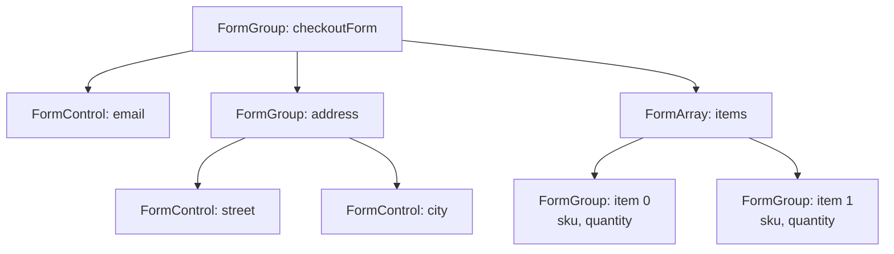
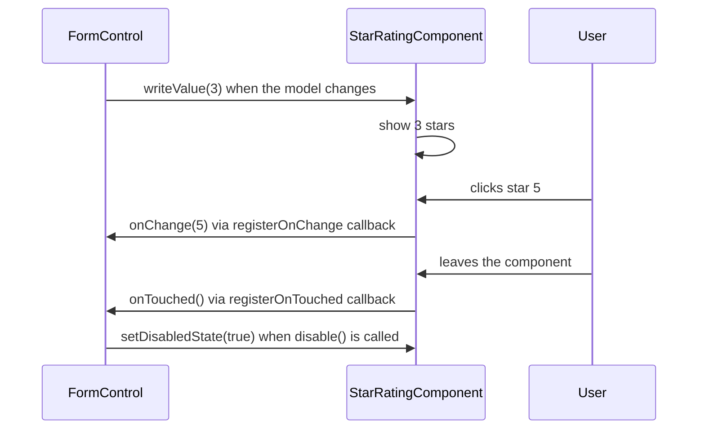

# Angular Forms

> Forms are where users give your app data: login, sign-up, checkout, settings, admin screens. In this document you will learn both Angular form approaches (template-driven and reactive), typed forms, every kind of validator, dynamic forms with `FormArray`, and how to build your own form controls with `ControlValueAccessor`. All examples are for Angular 16.

**Before this:** [Components and templates](02-components-and-templates.md) · [Directives and pipes](03-directives-and-pipes.md) · [RxJS](09-rxjs.md) · [HTML semantics and forms](../05-frontend-engineering/01-html-semantics-and-forms.md) · **Interview questions:** [jump to the interview section](#interview-questions)

## Table of contents

1. [Two ways to build forms](#two-ways-to-build-forms)
2. [The building blocks: FormControl, FormGroup, FormArray](#the-building-blocks-formcontrol-formgroup-formarray)
3. [Template-driven forms](#template-driven-forms)
4. [Reactive forms](#reactive-forms)
5. [Typed forms](#typed-forms)
6. [FormBuilder and NonNullableFormBuilder](#formbuilder-and-nonnullableformbuilder)
7. [Reading and writing values](#reading-and-writing-values)
8. [Form state: valid, dirty, touched](#form-state-valid-dirty-touched)
9. [Built-in validators](#built-in-validators)
10. [Custom validators](#custom-validators)
11. [Cross-field validators](#cross-field-validators)
12. [Async validators](#async-validators)
13. [Showing errors to the user](#showing-errors-to-the-user)
14. [valueChanges, statusChanges and updateOn](#valuechanges-statuschanges-and-updateon)
15. [Dynamic forms with FormArray](#dynamic-forms-with-formarray)
16. [Submit handling](#submit-handling)
17. [ControlValueAccessor: custom form controls](#controlvalueaccessor-custom-form-controls)
18. [Newer Angular versions](#newer-angular-versions)
19. [Common mistakes](#common-mistakes)
20. [Best practices](#best-practices)
21. [How to explain this in an interview](#how-to-explain-this-in-an-interview)
22. [Interview questions](#interview-questions)
23. [Summary](#summary)
24. [References](#references)

---

## Two ways to build forms

Angular has two form modules:

- **Template-driven forms** (`FormsModule`): you describe the form in the **HTML template** with `ngModel`. Angular creates the form model for you behind the scenes.
- **Reactive forms** (`ReactiveFormsModule`): you create the form model **in TypeScript** (`FormGroup`, `FormControl`), and bind the template to it.

Both use the same underlying classes (`FormControl`, `FormGroup`). The difference is **who creates them and where the logic lives**.

| | Template-driven | Reactive |
| --- | --- | --- |
| Module | `FormsModule` | `ReactiveFormsModule` |
| Form model created by | Angular, from directives in the template | You, in the component class |
| Main directive | `[(ngModel)]` | `[formGroup]`, `formControlName`, `[formControl]` |
| Data flow | Two-way binding, model updated **asynchronously** | Explicit, **synchronous** access to the model |
| Validation | Directives in HTML (`required`, `minlength`) and custom validator directives | Validator functions in TypeScript |
| Typed (v14+) | No strong typing of the form model | Yes, typed `FormControl<T>` |
| Dynamic fields | Hard | Easy (`FormArray`, `addControl`) |
| Unit testing | Needs the template rendered | Test the model without the DOM |
| Best for | Small, simple forms (login, newsletter, simple settings) | Complex forms, dynamic forms, cross-field rules, large apps |

**Analogy:** template-driven forms are like a **paper form**: the form itself is the source of truth, and you read what was written. Reactive forms are like a **database record with a form view**: the record in your code is the source of truth, and the form only shows and edits it.

Most enterprise Angular apps use **reactive forms**, and most interview questions focus on them. You should still know template-driven forms.

---

## The building blocks: FormControl, FormGroup, FormArray

All forms are trees of three classes. They all extend `AbstractControl`.

| Class | Represents | Value |
| --- | --- | --- |
| `FormControl` | One field (input, select, checkbox, custom control) | A single value |
| `FormGroup` | A fixed set of named controls (an object) | `{ name: ..., email: ... }` |
| `FormArray` | A list of controls with a variable length | `[ ..., ... ]` |
| `FormRecord` (v14+) | A group with dynamic keys, all of the same type | `{ [key: string]: T }` |

Every control has the same core API: `value`, `status`, `errors`, `valid`, `dirty`, `touched`, `setValue()`, `reset()`, `disable()`, `valueChanges`, and so on. A group or array combines the values and the validity of its children.



If any child is invalid, the parent is invalid. A disabled child is excluded from the parent's value and validity.

---

## Template-driven forms

### Setup

```ts
// NgModule app
@NgModule({ imports: [BrowserModule, FormsModule] })
export class AppModule {}

// Standalone component
@Component({ standalone: true, imports: [FormsModule] /* ... */ })
```

### A login form

```ts
@Component({
  selector: 'app-login',
  standalone: true,
  imports: [FormsModule, NgIf],
  template: `
    <form #loginForm="ngForm" (ngSubmit)="onSubmit(loginForm)">
      <label for="email">Email</label>
      <input id="email" name="email" type="email" [(ngModel)]="credentials.email"
             required email #emailCtrl="ngModel" />
      <p *ngIf="emailCtrl.invalid && emailCtrl.touched" class="error">
        <span *ngIf="emailCtrl.errors?.['required']">Email is required.</span>
        <span *ngIf="emailCtrl.errors?.['email']">Enter a valid email.</span>
      </p>

      <label for="password">Password</label>
      <input id="password" name="password" type="password" [(ngModel)]="credentials.password"
             required minlength="8" #passwordCtrl="ngModel" />
      <p *ngIf="passwordCtrl.errors?.['minlength'] && passwordCtrl.touched" class="error">
        At least 8 characters.
      </p>

      <button type="submit" [disabled]="loginForm.invalid">Log in</button>
    </form>
  `,
})
export class LoginComponent {
  credentials = { email: '', password: '' };

  onSubmit(form: NgForm): void {
    if (form.invalid) {
      return;
    }
    console.log('Logging in with', this.credentials); // or form.value
  }
}
```

How it works:

- `FormsModule` automatically attaches an **`NgForm`** directive to every `<form>` element. `#loginForm="ngForm"` gives you a reference to it.
- Each input with `ngModel` **and a `name` attribute** registers a `FormControl` in that `NgForm`. Without `name`, Angular throws an error inside a form.
- `required`, `email`, `minlength` are **validator directives** that add validators to the control.
- `#emailCtrl="ngModel"` gives access to the control's state (`invalid`, `touched`, `errors`).
- `(ngSubmit)` fires when the form is submitted (Enter or the submit button).

### Group fields with ngModelGroup

```html
<div ngModelGroup="address">
  <input name="street" [(ngModel)]="user.address.street" required />
  <input name="city" [(ngModel)]="user.address.city" required />
</div>
<!-- form.value = { address: { street: ..., city: ... }, ... } -->
```

### Template-driven forms are asynchronous

The form model is created **when the template is processed**, and `ngModel` updates happen **asynchronously** (in a microtask). That means:

- In `ngOnInit` the `NgForm` controls do not exist yet.
- Right after setting the model value in code, `form.value` may still show the old value.

This is one reason complex logic is harder with template-driven forms.

### Custom validator in a template-driven form

You need a **directive** that provides the validator through the `NG_VALIDATORS` token:

```ts
@Directive({
  selector: '[appForbiddenName]',
  standalone: true,
  providers: [{ provide: NG_VALIDATORS, useExisting: ForbiddenNameDirective, multi: true }],
})
export class ForbiddenNameDirective implements Validator {
  @Input('appForbiddenName') forbiddenName = '';

  validate(control: AbstractControl): ValidationErrors | null {
    return this.forbiddenName && control.value?.toLowerCase() === this.forbiddenName.toLowerCase()
      ? { forbiddenName: { value: control.value } }
      : null;
  }
}
// <input name="username" [(ngModel)]="username" appForbiddenName="admin" />
```

---

## Reactive forms

### Setup

```ts
@NgModule({ imports: [BrowserModule, ReactiveFormsModule] })
export class AppModule {}
// or in a standalone component: imports: [ReactiveFormsModule]
```

### A registration form

```ts
import { Component } from '@angular/core';
import { FormControl, FormGroup, ReactiveFormsModule, Validators } from '@angular/forms';
import { NgIf } from '@angular/common';

@Component({
  selector: 'app-register',
  standalone: true,
  imports: [ReactiveFormsModule, NgIf],
  template: `
    <form [formGroup]="form" (ngSubmit)="onSubmit()">
      <label for="name">Name</label>
      <input id="name" formControlName="name" />

      <label for="email">Email</label>
      <input id="email" type="email" formControlName="email" />
      <p *ngIf="form.controls.email.hasError('email') && form.controls.email.touched">Invalid email.</p>

      <div formGroupName="address">
        <input formControlName="city" placeholder="City" />
        <input formControlName="zip" placeholder="ZIP" />
      </div>

      <label><input type="checkbox" formControlName="acceptTerms" /> I accept the terms</label>

      <button type="submit" [disabled]="form.invalid">Register</button>
    </form>
  `,
})
export class RegisterComponent {
  readonly form = new FormGroup({
    name: new FormControl('', { nonNullable: true, validators: [Validators.required, Validators.maxLength(50)] }),
    email: new FormControl('', { nonNullable: true, validators: [Validators.required, Validators.email] }),
    address: new FormGroup({
      city: new FormControl('', { nonNullable: true }),
      zip: new FormControl('', { nonNullable: true, validators: Validators.pattern('[0-9]{5}') }),
    }),
    acceptTerms: new FormControl(false, { nonNullable: true, validators: Validators.requiredTrue }),
  });

  onSubmit(): void {
    if (this.form.invalid) {
      this.form.markAllAsTouched(); // show all errors
      return;
    }
    const value = this.form.getRawValue();
    // value: { name: string; email: string; address: { city: string; zip: string }; acceptTerms: boolean }
    console.log(value);
  }
}
```

### Template directives

| Directive | Use |
| --- | --- |
| `[formGroup]="form"` | Binds a `<form>` (or any element) to a `FormGroup` |
| `formControlName="email"` | Binds an input to a child control **by name**, inside a `formGroup` |
| `formGroupName="address"` | Binds to a nested group by name |
| `formArrayName="items"` | Binds to a nested array by name |
| `[formControl]="searchCtrl"` | Binds an input to a standalone `FormControl` (no group needed) |

```ts
// A standalone control for a search box
readonly search = new FormControl('', { nonNullable: true });
// template: <input type="search" [formControl]="search" />
```

### Why reactive forms are synchronous and testable

The model exists as soon as the class is constructed. You can read `this.form.value`, call `setValue`, or subscribe to `valueChanges` immediately, even in a unit test without any DOM:

```ts
it('requires an email', () => {
  const component = new RegisterComponent();
  component.form.controls.email.setValue('not-an-email');
  expect(component.form.controls.email.hasError('email')).toBe(true);
});
```

### Disabling controls: do it in the model

```ts
// ❌ Wrong: Angular warns ("It looks like you're using the disabled attribute with a reactive form directive")
// <input formControlName="email" [disabled]="isLocked" />

// ✅ Correct: disable in the model
this.form.controls.email.disable();
this.form.controls.email.enable();

// or create it disabled
readonly id = new FormControl({ value: 42, disabled: true });
```

A disabled control is excluded from `form.value` and from validation. Use `getRawValue()` to include it.

---

## Typed forms

### What changed in Angular 14

Before Angular 14, every form value was typed `any`. `form.value.emial` compiled fine and returned `undefined` at runtime.

Since **Angular 14**, reactive forms are **strictly typed**. The type is inferred from the initial value:

```ts
const name = new FormControl('Ann');     // FormControl<string | null>
const age = new FormControl(30);          // FormControl<number | null>
const tags = new FormControl<string[]>([]); // FormControl<string[] | null>

name.setValue(42); // ❌ compile error: number is not assignable to string | null
```

### Why `| null`?

`control.reset()` sets the value back to `null` by default. So the type includes `null`. If you want reset to go back to the **initial value**, use `nonNullable: true`:

```ts
const a = new FormControl('Ann');
const b = new FormControl('Ann', { nonNullable: true }); // FormControl<string>

a.reset();
b.reset();
console.log(a.value, b.value); // null 'Ann'
```

(Verified with `@angular/forms` 16.2 in Node.js.)

### Group types

```ts
const loginForm = new FormGroup({
  email: new FormControl('', { nonNullable: true }),
  remember: new FormControl(false, { nonNullable: true }),
});

loginForm.value;          // Partial<{ email: string; remember: boolean }>
loginForm.getRawValue();  // { email: string; remember: boolean }
loginForm.controls.email; // FormControl<string>  (typed access, autocomplete works)
```

`form.value` is `Partial<...>` because disabled controls are left out of `value`. `getRawValue()` includes every control, so its type is complete.

You can declare the type explicitly, which is useful for nullable fields:

```ts
interface ProfileForm {
  name: FormControl<string>;
  birthDate: FormControl<Date | null>;
}

const profile = new FormGroup<ProfileForm>({
  name: new FormControl('', { nonNullable: true }),
  birthDate: new FormControl<Date | null>(null),
});
```

### Untyped variants and FormRecord

- `UntypedFormControl`, `UntypedFormGroup`, `UntypedFormArray`, `UntypedFormBuilder` keep the old `any` behavior. The `ng update` migration to v14 replaced old usages with these, so existing apps kept compiling. Migrate them to typed forms over time.
- **`FormRecord<T>`** is for groups with **dynamic keys** of the same type, for example a permission checkbox per role:

```ts
const permissions = new FormRecord<FormControl<boolean>>({});
permissions.addControl('canEdit', new FormControl(false, { nonNullable: true }));
permissions.addControl('canDelete', new FormControl(false, { nonNullable: true }));
// value: { [key: string]: boolean }
```

With a normal typed `FormGroup`, you cannot add controls that are not in its type. `FormRecord` allows any key.

---

## FormBuilder and NonNullableFormBuilder

`FormBuilder` is a service that reduces the `new FormControl(...)` noise.

```ts
@Component({ /* ... */ })
export class CheckoutComponent {
  private readonly fb = inject(FormBuilder);

  readonly form = this.fb.group({
    email: ['', [Validators.required, Validators.email]], // [initialValue, syncValidators, asyncValidators]
    shipping: this.fb.group({
      street: ['', Validators.required],
      city: ['', Validators.required],
    }),
    giftMessage: [''],
  });
}
```

With the normal `FormBuilder`, controls are nullable (`string | null`). Use **`NonNullableFormBuilder`** (or `fb.nonNullable`) so every control resets to its initial value and types do not include `null`:

```ts
private readonly fb = inject(NonNullableFormBuilder);

readonly form = this.fb.group({
  email: ['', [Validators.required, Validators.email]], // FormControl<string>
  quantity: [1, Validators.min(1)],                     // FormControl<number>
});

// same thing:
readonly form2 = inject(FormBuilder).nonNullable.group({ email: [''] });
```

`FormBuilder` vs `new FormGroup()`: same result. `FormBuilder` is shorter for big forms. `new FormControl()` with an explicit options object is clearer when you set many options (`updateOn`, async validators).

---

## Reading and writing values

### setValue vs patchValue

- `setValue(value)` replaces the value. For a group, you **must** give a value for **every** control. A missing key throws an error.
- `patchValue(partial)` updates only the keys you give. Missing keys keep their value.

```ts
const profile = new FormGroup({ firstName: new FormControl(''), lastName: new FormControl('') });

profile.patchValue({ firstName: 'Ann' });
console.log(profile.value); // { firstName: 'Ann', lastName: '' }

profile.setValue({ firstName: 'Ann' });
// Error: NG01002: Must supply a value for form control with name: 'lastName'

profile.setValue({ firstName: 'Ann', lastName: 'Lee' }); // ✅
```

Use `setValue` when you have the **complete** object (it catches mistakes, like a renamed field). Use `patchValue` when you fill the form from an API response that has extra or missing fields.

### Options: emitEvent and onlySelf

```ts
control.setValue('x', { emitEvent: false }); // do not emit valueChanges/statusChanges
control.setValue('x', { onlySelf: true });   // do not update the parent's value and validity
```

`emitEvent: false` is useful to avoid infinite loops when you change a control inside its own `valueChanges` subscription, or when you fill a form programmatically and do not want "user changed something" logic to run.

### value vs getRawValue

```ts
const form = new FormGroup({
  email: new FormControl('a@b.com'),
  id: new FormControl({ value: 42, disabled: true }),
});
console.log(form.value);         // { email: 'a@b.com' }          (disabled control left out)
console.log(form.getRawValue()); // { email: 'a@b.com', id: 42 }
```

### reset

`reset()` sets values back (to `null`, or to the initial value for `nonNullable` controls) and also resets the state to **pristine** and **untouched**. You can pass a new value: `form.reset({ email: 'new@x.com' })`.

---

## Form state: valid, dirty, touched

Every control tracks several flags. They are also added as CSS classes on the element (`ng-valid`, `ng-invalid`, `ng-pending`, `ng-pristine`, `ng-dirty`, `ng-untouched`, `ng-touched`), so you can style them.

| Property | Meaning | Becomes true when |
| --- | --- | --- |
| `valid` / `invalid` | Passes all validators / fails at least one | After validation |
| `pending` | An async validator is running | Async validation started |
| `disabled` / `enabled` | Excluded from value and validation | `disable()` called |
| `pristine` / `dirty` | The **user** has not / has changed the value **through the UI** | User types or selects |
| `untouched` / `touched` | The user has not / has **blurred** (left) the field | First blur event |
| `status` | `'VALID'`, `'INVALID'`, `'PENDING'`, `'DISABLED'` | Always |

Two details that surprise people:

- `setValue()` and `patchValue()` from code **do not** make a control dirty. Only UI changes do (or `markAsDirty()`).
- A group whose controls are **all disabled** has status `'DISABLED'`, not `'VALID'`.

Methods to change state: `markAsTouched()`, `markAllAsTouched()` (the whole tree), `markAsDirty()`, `markAsPristine()`, `markAsUntouched()`, `markAsPending()`.

**Typical uses:**

- Show errors only when `touched` (or after a submit attempt), so the user is not greeted by red text.
- Warn about unsaved changes when the form is `dirty` (for example in a `canDeactivate` guard; see [Routing, guards and lazy loading](06-routing-guards-and-lazy-loading.md)).
- Disable the save button while `pending` or `invalid`.

---

## Built-in validators

`Validators` is a class with static validator functions:

| Validator | Error key and value when it fails |
| --- | --- |
| `Validators.required` | `{ required: true }` (empty string, `null`, `undefined`, empty array) |
| `Validators.requiredTrue` | `{ required: true }` if the value is not `true` (checkboxes like "accept terms") |
| `Validators.email` | `{ email: true }` |
| `Validators.minLength(n)` | `{ minlength: { requiredLength, actualLength } }` |
| `Validators.maxLength(n)` | `{ maxlength: { requiredLength, actualLength } }` |
| `Validators.min(n)` | `{ min: { min, actual } }` |
| `Validators.max(n)` | `{ max: { max, actual } }` |
| `Validators.pattern(regex)` | `{ pattern: { requiredPattern, actualValue } }` |
| `Validators.nullValidator` | Never fails (a placeholder) |
| `Validators.compose([...])` / `composeAsync` | Combines validators into one |

```ts
const email = new FormControl('', [Validators.required, Validators.email]);
console.log(email.errors);  // { required: true }
email.setValue('not-an-email');
console.log(email.errors);  // { email: true }
email.setValue('ann@example.com');
console.log(email.errors);  // null

new FormControl(15, Validators.min(18)).errors;
// { min: { min: 18, actual: 15 } }

new FormControl('12a45', Validators.pattern('[0-9]{5}')).errors;
// { pattern: { requiredPattern: '^[0-9]{5}$', actualValue: '12a45' } }
```

Details worth knowing:

- Most validators **ignore empty values**. `Validators.min(18)` on an empty control returns `null`. Combine with `required` if the field is mandatory.
- `Validators.pattern('...')` with a **string** adds `^` and `$` for you (see `requiredPattern` above). With a **RegExp** it uses it exactly as written.
- `Validators.email` follows a practical pattern similar to the HTML email input. It accepts `a@b` (no dot). Add your own rule if you need a stricter check.
- `required` does **not** reject a string of spaces. Use a custom "not blank" validator or trim the value.

**Client validation is for user experience. The server must validate again**, because anyone can bypass the browser.

---

## Custom validators

A **validator** is just a function: it receives a control and returns `null` (valid) or an **errors object** (invalid). Its type is `ValidatorFn`.

```ts
import { AbstractControl, ValidationErrors, ValidatorFn } from '@angular/forms';

// 1. A simple validator
export function notBlank(control: AbstractControl): ValidationErrors | null {
  const value = control.value;
  return typeof value === 'string' && value.trim().length === 0 && value.length > 0 ? { blank: true } : null;
}

// 2. A validator factory (takes parameters, returns a ValidatorFn)
export function forbiddenWords(words: string[]): ValidatorFn {
  return (control: AbstractControl): ValidationErrors | null => {
    const text = String(control.value ?? '').toLowerCase();
    const found = words.find(word => text.includes(word));
    return found ? { forbiddenWord: { word: found } } : null;
  };
}

// usage
readonly bio = new FormControl('', { nonNullable: true, validators: [notBlank, forbiddenWords(['spam', 'casino'])] });
```

Rules for good validators:

- Keep them **pure and fast**. They run on every value change.
- Return **useful error data** (`{ forbiddenWord: { word } }`), so the template can show a good message.
- Return `null` for empty values unless the validator **is** about emptiness. Let `required` handle that.

You can change validators at runtime:

```ts
// "Company name" is required only for business accounts
this.form.controls.accountType.valueChanges.subscribe(type => {
  const company = this.form.controls.companyName;
  if (type === 'business') {
    company.addValidators(Validators.required);
  } else {
    company.removeValidators(Validators.required);
  }
  company.updateValueAndValidity(); // re-run validation now
});
```

`addValidators` / `removeValidators` (v12.2+) need the **same function reference** to remove one. `setValidators` replaces all validators. Always call `updateValueAndValidity()` afterwards.

---

## Cross-field validators

Some rules involve **several fields**: password and confirmation must match, end date after start date, at least one contact method. Put the validator on the **parent group**, not on a single control.

```ts
export const passwordMatchValidator: ValidatorFn = (group: AbstractControl): ValidationErrors | null => {
  const password = group.get('password')?.value;
  const confirm = group.get('confirmPassword')?.value;
  return password && confirm && password !== confirm ? { passwordMismatch: true } : null;
};

readonly form = new FormGroup(
  {
    password: new FormControl('', { nonNullable: true, validators: [Validators.required, Validators.minLength(8)] }),
    confirmPassword: new FormControl('', { nonNullable: true, validators: Validators.required }),
  },
  { validators: passwordMatchValidator }, // group-level validator
);
```

```html
<form [formGroup]="form">
  <input type="password" formControlName="password" />
  <input type="password" formControlName="confirmPassword" />
  <p *ngIf="form.hasError('passwordMismatch') && form.controls.confirmPassword.touched">
    Passwords do not match.
  </p>
</form>
```

**Where the error lives:** on the **group** (`form.errors`), not on `confirmPassword`. The child control is still `valid`:

```ts
// password 'secret1', confirm 'secret2'
form.errors;                              // { passwordMismatch: true }
form.valid;                               // false
form.controls.confirmPassword.valid;      // true
```

So the template must check `form.hasError('passwordMismatch')`. If you want the red border on the confirm field, either style it from the group error, or set the error on the child inside the validator (more complex, because you must also remove it correctly).

A reusable version for "end after start":

```ts
export function dateRangeValidator(startKey: string, endKey: string): ValidatorFn {
  return group => {
    const start: Date | null = group.get(startKey)?.value ?? null;
    const end: Date | null = group.get(endKey)?.value ?? null;
    return start && end && end < start ? { dateRange: { startKey, endKey } } : null;
  };
}
```

---

## Async validators

### What and why

An **async validator** checks something that needs the server, like "is this username already taken?". Its type is `AsyncValidatorFn`: it returns a `Promise` or an `Observable` of `ValidationErrors | null`. The Observable should emit once and complete.

### How Angular runs it

1. Sync validators run first. **Async validators run only if all sync validators pass.** (No point asking the server about `ab` when `minLength(3)` already fails.)
2. While it runs, the control's status is **`PENDING`**.
3. When the value changes again, Angular **unsubscribes from the previous async validation** and starts a new one. (Checked in the Angular 16.2 source: it cancels the existing subscription before re-validating.)

Point 3 lets you build a debounce with `timer`:

```ts
@Injectable({ providedIn: 'root' })
export class UsernameValidator {
  private readonly userApi = inject(UserApi);

  available(): AsyncValidatorFn {
    return (control: AbstractControl): Observable<ValidationErrors | null> =>
      timer(400).pipe(
        // if the user types again within 400 ms, Angular unsubscribes and this request is never sent
        switchMap(() => this.userApi.isUsernameTaken(control.value)),
        map(isTaken => (isTaken ? { usernameTaken: true } : null)),
        catchError(() => of(null)), // a server error should not block the form; the server validates again on submit
      );
  }
}
```

```ts
readonly username = new FormControl('', {
  nonNullable: true,
  validators: [Validators.required, Validators.minLength(3)],
  asyncValidators: [inject(UsernameValidator).available()],
});
```

```html
<input formControlName="username" />
<p *ngIf="username.pending">Checking availability...</p>
<p *ngIf="username.hasError('usernameTaken')">This username is taken.</p>
```

**Verified behavior** (with `@angular/forms` 16.2 in Node.js, where the fake API takes 100 ms):

```text
setValue('an')     -> INVALID { minlength: ... }   (async validator did not run)
setValue('ann')    -> PENDING
setValue('anna')   -> previous check cancelled
setValue('admin')  -> previous check cancelled
after 200 ms       -> INVALID { usernameTaken: true }, server called only once
```

**Alternatives:** `updateOn: 'blur'` runs validation only when the user leaves the field, which also reduces requests. You can combine both.

**Common mistakes:**

- Returning an Observable that never completes (like `valueChanges`). The documentation requires the Observable to complete; keep it to one HTTP call.
- Putting `debounceTime` inside the validator: `of(value).pipe(debounceTime(400), ...)` does not help, because each call gets a fresh Observable. Use `timer`.
- Using an async validator for something a sync validator can do.

---

## Showing errors to the user

A clean pattern: show errors when the control is **invalid and (touched or the form was submitted)**.

```ts
@Component({
  selector: 'app-signup',
  standalone: true,
  imports: [ReactiveFormsModule, NgIf],
  template: `
    <form [formGroup]="form" (ngSubmit)="submit()" novalidate>
      <label for="email">Email</label>
      <input id="email" formControlName="email" [attr.aria-invalid]="showError('email')"
             aria-describedby="email-error" />
      <p id="email-error" class="error" *ngIf="showError('email')">
        {{ errorMessage('email') }}
      </p>
      <button type="submit">Sign up</button>
    </form>
  `,
})
export class SignupComponent {
  private readonly fb = inject(NonNullableFormBuilder);
  submitted = false;

  readonly form = this.fb.group({
    email: ['', [Validators.required, Validators.email]],
  });

  showError(name: keyof typeof this.form.controls): boolean {
    const control = this.form.controls[name];
    return control.invalid && (control.touched || this.submitted);
  }

  errorMessage(name: keyof typeof this.form.controls): string {
    const errors = this.form.controls[name].errors ?? {};
    if (errors['required']) return 'This field is required.';
    if (errors['email']) return 'Enter a valid email address.';
    return 'Invalid value.';
  }

  submit(): void {
    this.submitted = true;
    if (this.form.invalid) {
      this.form.markAllAsTouched();
      return;
    }
    // send this.form.getRawValue()
  }
}
```

Notes:

- `aria-invalid` and `aria-describedby` let screen readers announce the error. See [Accessibility](../05-frontend-engineering/04-accessibility.md).
- Calling small methods like `showError()` in the template is acceptable for a form, but in big forms move error messages into a reusable **error component** or a pure pipe, so the logic lives in one place.
- Angular adds `novalidate` to `<form>` automatically when `FormsModule` or `ReactiveFormsModule` is used, so the browser's own validation bubbles do not appear. Add `ngNativeValidate` if you want them.

---

## valueChanges, statusChanges and updateOn

### valueChanges and statusChanges

Every control exposes two Observables:

- `valueChanges` emits the new value on each change.
- `statusChanges` emits the new status (`'VALID'`, `'INVALID'`, `'PENDING'`, `'DISABLED'`).

Neither emits the current value on subscribe. Add `startWith(control.value)` if you need it.

```ts
// Auto-save a draft 1 second after the user stops typing
constructor() {
  this.form.valueChanges
    .pipe(
      debounceTime(1000),
      filter(() => this.form.valid),
      switchMap(() => this.draftApi.save(this.form.getRawValue())),
      takeUntilDestroyed(),
    )
    .subscribe();
}
```

```ts
// Dependent dropdown: when country changes, load its states and clear the old state
constructor() {
  this.states$ = this.form.controls.country.valueChanges.pipe(
    tap(() => this.form.controls.state.reset()),
    switchMap(country => (country ? this.geoApi.getStates(country) : of([]))),
  );
}
```

These streams never complete, so unsubscribe (here with `takeUntilDestroyed`, or use the `async` pipe). See [RxJS](09-rxjs.md#unsubscribe-strategies-in-angular).

### updateOn

By default a control updates its value and runs validators on **every input event** (`updateOn: 'change'`). You can change that:

| `updateOn` | Value and validation update | Use for |
| --- | --- | --- |
| `'change'` (default) | On every key press | Live feedback |
| `'blur'` | When the field loses focus | Expensive validation, async checks |
| `'submit'` | When the form is submitted | Forms where errors should appear only after submit |

```ts
// Per control
readonly username = new FormControl('', { nonNullable: true, updateOn: 'blur', asyncValidators: [/* ... */] });

// For a whole group
readonly form = new FormGroup({ /* ... */ }, { updateOn: 'submit' });
```

```html
<!-- Template-driven -->
<input name="email" [(ngModel)]="email" [ngModelOptions]="{ updateOn: 'blur' }" />
```

With `updateOn: 'blur'`, `valueChanges` also emits only on blur.

---

## Dynamic forms with FormArray

`FormArray` holds a list of controls whose length changes at runtime: order lines, phone numbers, addresses, survey answers.

```ts
@Component({
  selector: 'app-order-form',
  standalone: true,
  imports: [ReactiveFormsModule, NgFor, NgIf],
  template: `
    <form [formGroup]="form" (ngSubmit)="submit()">
      <input formControlName="customer" placeholder="Customer" />

      <div formArrayName="items">
        <div *ngFor="let item of items.controls; let i = index; trackBy: trackByIndex" [formGroupName]="i">
          <input formControlName="sku" placeholder="SKU" />
          <input type="number" formControlName="quantity" min="1" />
          <button type="button" (click)="removeItem(i)" [disabled]="items.length === 1">Remove</button>
        </div>
      </div>

      <button type="button" (click)="addItem()">Add item</button>
      <p *ngIf="items.hasError('tooManyItems')">Maximum 10 items.</p>
      <button type="submit" [disabled]="form.invalid">Place order</button>
    </form>
  `,
})
export class OrderFormComponent {
  private readonly fb = inject(NonNullableFormBuilder);

  readonly form = this.fb.group({
    customer: ['', Validators.required],
    items: this.fb.array([this.createItem()], { validators: maxItems(10) }),
  });

  get items(): FormArray<FormGroup<{ sku: FormControl<string>; quantity: FormControl<number> }>> {
    return this.form.controls.items;
  }

  createItem() {
    return this.fb.group({
      sku: ['', Validators.required],
      quantity: [1, [Validators.required, Validators.min(1)]],
    });
  }

  addItem(): void {
    this.items.push(this.createItem());
  }

  removeItem(index: number): void {
    this.items.removeAt(index);
  }

  trackByIndex(index: number): number {
    return index;
  }

  submit(): void {
    console.log(this.form.getRawValue()); // { customer: string, items: { sku: string, quantity: number }[] }
  }
}

export function maxItems(max: number): ValidatorFn {
  return control => (control instanceof FormArray && control.length > max ? { tooManyItems: { max } } : null);
}
```

`FormArray` methods: `push(control)`, `insert(index, control)`, `removeAt(index)`, `at(index)`, `setControl(index, control)`, `clear()`, `length`, `controls`.

**Filling a FormArray from API data:** `patchValue` only updates **existing** items. It does not add controls for extra array entries. Build the controls first:

```ts
loadOrder(order: Order): void {
  this.items.clear();
  order.items.forEach(item => this.items.push(this.fb.group({ sku: [item.sku, Validators.required], quantity: [item.quantity] })));
  this.form.patchValue({ customer: order.customer });
}
```

Also note: `reset()` on a group with a `FormArray` resets the values of the existing items, but it does **not** remove added items.

---

## Submit handling

A robust submit handler:

```ts
saving = false;

submit(): void {
  if (this.form.invalid) {
    this.form.markAllAsTouched();          // 1. show every error
    return;
  }
  if (this.saving) {
    return;                                // 2. prevent double submit
  }
  this.saving = true;
  this.form.disable();                     // 3. lock the form while saving (optional)

  this.userApi
    .create(this.form.getRawValue())       // 4. getRawValue: typed, includes disabled fields
    .pipe(
      finalize(() => {
        this.saving = false;
        this.form.enable();                // 5. always unlock, on success and error
      }),
    )
    .subscribe({
      next: () => {
        this.form.reset();                 // 6. back to pristine, so "unsaved changes" warnings stop
        this.router.navigate(['/users']);
      },
      error: (error: HttpErrorResponse) => this.applyServerErrors(error), // 7. map 422 errors to controls
    });
}
```

Why `getRawValue()`? It always includes every control, whatever is enabled or disabled, and its type has no `Partial`. (A small surprise: when **every** control of a group is disabled, Angular returns all values in `form.value` too; when only some are disabled, `form.value` leaves those out. `getRawValue()` avoids thinking about this.) Mapping server errors onto controls is shown in [HttpClient and interceptors](08-httpclient-and-interceptors.md#mapping-server-validation-errors-to-a-form).

Always use `type="submit"` on the submit button and `type="button"` on other buttons inside a form. A `<button>` without a type inside a form **submits** it.

---

## ControlValueAccessor: custom form controls

### The problem

You build a custom component: a star rating, a date picker, a toggle, a tag input. You want to use it **like a normal input**:

```html
<app-star-rating formControlName="rating"></app-star-rating>
<app-star-rating [(ngModel)]="review.rating"></app-star-rating>
```

Angular forms do not know how to talk to your component. You must teach them by implementing **`ControlValueAccessor`** (CVA).

### What it is

`ControlValueAccessor` is an interface that connects a form control (the model) to a UI element (the view). Angular already has built-in value accessors for `<input>`, `<select>`, checkboxes and radios. You write one for your component.



| Method | Called by Angular when | Your job |
| --- | --- | --- |
| `writeValue(value)` | The model value changes (initial value, `setValue`, `reset`) | Update the UI. Do **not** call `onChange` here |
| `registerOnChange(fn)` | Once, at setup | Store `fn`; call it when the **user** changes the value |
| `registerOnTouched(fn)` | Once, at setup | Store `fn`; call it when the user "leaves" the control (blur) |
| `setDisabledState(isDisabled)` | The control is disabled or enabled | Disable the UI |

### Full example: a star rating control

```ts
import { Component, Input, forwardRef } from '@angular/core';
import { NgFor } from '@angular/common';
import { ControlValueAccessor, NG_VALUE_ACCESSOR } from '@angular/forms';

@Component({
  selector: 'app-star-rating',
  standalone: true,
  imports: [NgFor],
  providers: [
    {
      provide: NG_VALUE_ACCESSOR,
      useExisting: forwardRef(() => StarRatingComponent), // the class is defined below this line
      multi: true,
    },
  ],
  template: `
    <div role="radiogroup" aria-label="Rating" (focusout)="onTouched()">
      <button
        *ngFor="let star of stars"
        type="button"
        role="radio"
        [attr.aria-checked]="star === value"
        [attr.aria-label]="star + ' stars'"
        [disabled]="disabled"
        [class.filled]="star <= value"
        (click)="select(star)"
      >★</button>
    </div>
  `,
})
export class StarRatingComponent implements ControlValueAccessor {
  @Input() max = 5;

  value = 0;
  disabled = false;

  // Placeholders until Angular registers the real callbacks
  private onChange: (value: number) => void = () => {};
  onTouched: () => void = () => {};

  get stars(): number[] {
    return Array.from({ length: this.max }, (_, i) => i + 1);
  }

  // Model -> view
  writeValue(value: number | null): void {
    this.value = value ?? 0;
  }

  registerOnChange(fn: (value: number) => void): void {
    this.onChange = fn;
  }

  registerOnTouched(fn: () => void): void {
    this.onTouched = fn;
  }

  setDisabledState(isDisabled: boolean): void {
    this.disabled = isDisabled;
  }

  // View -> model
  select(star: number): void {
    if (this.disabled) {
      return;
    }
    this.value = star;
    this.onChange(star); // tell the form the user changed the value
    this.onTouched();
  }
}
```

Usage:

```ts
readonly reviewForm = inject(NonNullableFormBuilder).group({
  rating: [0, Validators.min(1)],
  comment: [''],
});
// <form [formGroup]="reviewForm"><app-star-rating formControlName="rating" [max]="5"></app-star-rating></form>
```

**Step-by-step walkthrough:**

1. Angular sees `formControlName="rating"` on `<app-star-rating>`. It looks for an `NG_VALUE_ACCESSOR` provider on that element and finds the component itself.
2. Angular calls `registerOnChange` and `registerOnTouched` with its callbacks, and `writeValue(0)` with the initial value.
3. The user clicks star 4. `select(4)` updates the UI and calls `onChange(4)`. The `FormControl` value becomes 4, validators run, and the control becomes dirty.
4. Focus leaves the group. `onTouched()` marks the control as touched, so error messages can appear.
5. Code calls `reviewForm.controls.rating.disable()`. Angular calls `setDisabledState(true)`.
6. Code calls `reviewForm.reset()`. Angular calls `writeValue(0)`. The component shows zero stars and does **not** call `onChange` (that would create a loop and mark the control dirty).

**Why `forwardRef`?** The `providers` array is evaluated while the class is being defined, so `StarRatingComponent` does not exist yet at that point. `forwardRef(() => StarRatingComponent)` delays the lookup. See [Dependency injection](05-dependency-injection.md).

**Why `multi: true`?** `NG_VALUE_ACCESSOR` is a multi token: Angular collects all value accessors on the element and picks the best one (a custom one wins over the default).

**Angular 15+ detail:** `setDisabledState` is **always** called when the control is attached, even if the control is enabled (`setDisabledState(false)`). Before v15 it was called only for disabled controls. You can restore the old behavior with `ReactiveFormsModule.withConfig({ callSetDisabledState: 'whenDisabledForLegacyCode' })`, but it is better to make `setDisabledState` correct.

### Validation inside a custom control

If the control itself should report validation errors (for example a date input that can contain an unparseable date), also provide `NG_VALIDATORS` and implement `Validator.validate(control)`, the same way as the template-driven directive shown earlier.

### Composite controls

For a control that wraps several inputs (for example, a phone number with country code and number), keep an internal `FormGroup`, call `onChange` with the combined value from its `valueChanges`, and forward `setDisabledState` to the internal group.

---

## Newer Angular versions

> **Newer Angular (17+):**
> - **Angular 18** added unified control state change events: `control.events` emits `ValueChangeEvent`, `StatusChangeEvent`, `PristineChangeEvent`, `TouchedChangeEvent`, `FormSubmittedEvent` and `FormResetEvent`. In Angular 16 there is no observable for touched or pristine changes.
> - Newer versions let `FormControl`/`FormGroup` constructors and `reset` take more options, and template control flow (`@if`, `@for`) replaces `*ngIf`/`*ngFor` in form templates.
> - **Signal-based forms** (`@angular/forms/signals`) were introduced as an **experimental** API in Angular 21. They are not related to Angular 16.
> - Reactive forms and template-driven forms with `FormControl`, `FormGroup`, `FormArray`, typed forms and `ControlValueAccessor` work the same way in all these versions.

---

## Common mistakes

**1. Missing `name` on `ngModel` inside a `<form>`.** Angular throws an error, because it cannot register the control.

**2. Using the `disabled` attribute with reactive forms.** Use `control.disable()` or `{ value, disabled: true }`.

**3. Reading `form.value` and losing disabled fields.** Use `getRawValue()`.

**4. `setValue` with a partial object.** It throws; use `patchValue`.

**5. Expecting `patchValue` to grow a `FormArray`.** Push the controls first.

**6. Debounce inside an async validator with `debounceTime`.** Use `timer(...)` + `switchMap`.

**7. Calling `onChange` in `writeValue`.** It marks the control dirty and can create loops.

**8. Forgetting `registerOnTouched`/`onTouched`.** The custom control never becomes touched, so "show error on touched" never shows errors.

**9. Subscribing to `valueChanges` without cleanup,** or changing the same control inside its own `valueChanges` without `emitEvent: false` (infinite loop).

**10. Mixing `ngModel` and `formControlName` on the same element.** Angular warns; it was deprecated long ago. Pick one approach per form.

**11. A `<button>` without `type` inside a form.** It submits the form.

**12. Trusting client validation.** The server must validate everything again.

**13. Cross-field error checked on the child.** The error is on the group: `form.hasError('passwordMismatch')`.

---

## Best practices

- **Use reactive, typed forms** for anything beyond a trivial form. Prefer `NonNullableFormBuilder` so reset returns to initial values and types do not include `null`.
- **Keep validation logic in reusable validator functions**, with clear error keys and useful error data.
- **Put cross-field rules on the group.**
- **Use async validators sparingly,** with `timer` debounce or `updateOn: 'blur'`, and handle server errors.
- **Show errors on touched or after submit**, and use `markAllAsTouched()` on a failed submit.
- **Make errors accessible:** label every field, use `aria-invalid` and `aria-describedby`.
- **Read values with `getRawValue()`** for typed, complete data.
- **Prevent double submit** and lock or disable while saving; always unlock in `finalize`.
- **Map server validation errors** back onto controls with `setErrors`.
- **Wrap reusable inputs as `ControlValueAccessor` components** so they work with both reactive and template-driven forms.
- **Warn about unsaved changes** using `dirty` in a `canDeactivate` guard.

---

## How to explain this in an interview

### Explaining template-driven vs reactive forms

1. **Define it:** "Angular has two form approaches. In template-driven forms I describe the form in HTML with ngModel and Angular builds the model. In reactive forms I build the FormGroup and FormControls in TypeScript and bind the template to them."
2. **Why it exists:** "Template-driven is quick for simple forms. Reactive gives explicit, synchronous control for complex forms."
3. **How it works:** "Both use the same FormControl and FormGroup classes. Template-driven forms create them asynchronously from directives. Reactive forms create them in the class, so they are available immediately, typed since Angular 14, and easy to test without the DOM."
4. **Small example:** "A login form can be template-driven. A checkout form with dynamic order lines, a password-confirmation rule and an async username check is reactive, with a FormArray, a group validator and an async validator."
5. **Where it is useful:** "Most enterprise apps use reactive forms."
6. **Trade-offs / gotchas:** "Template-driven forms are harder to test and to make dynamic. Reactive forms need more code but scale better."

### Explaining ControlValueAccessor

1. **Define it:** "ControlValueAccessor is the bridge between a form control and a UI element."
2. **Why it exists:** "So my custom components, like a star rating or a date picker, work with formControlName and ngModel like native inputs."
3. **How it works:** "I implement four methods. writeValue is called when the model changes and I update the UI. registerOnChange and registerOnTouched give me callbacks that I call when the user changes the value or leaves the control. setDisabledState is called when the control is disabled. I register the component with the NG_VALUE_ACCESSOR multi token using forwardRef."
4. **Small example:** "In a star rating, clicking star 4 calls onChange(4), and reset calls writeValue(0)."
5. **Where it is useful:** "Design system components shared across the app."
6. **Trade-offs / gotchas:** "Never call onChange inside writeValue, remember onTouched or errors will not show, and since Angular 15 setDisabledState is always called."

---

## Interview questions

### Q1. What is the difference between template-driven and reactive forms? When do you use each?

**What the interviewer is checking:** Real understanding of where the model lives and the practical consequences, not just "one uses ngModel".

**Short spoken answer (30–60 seconds):**
> Both use the same FormControl and FormGroup classes underneath. In template-driven forms, I write the form in the template with ngModel and validation attributes, and Angular creates the controls for me, asynchronously. In reactive forms, I create the form model in the component class and bind the template to it with formGroup and formControlName. Reactive forms are synchronous, typed since Angular 14, easy to unit test without the DOM, and make dynamic fields, cross-field validation and reacting to valueChanges straightforward. So I use template-driven forms for very simple forms like a newsletter signup, and reactive forms for almost everything else in a real application.

**Follow-up questions:**
- **Why are template-driven forms "asynchronous"?** — The controls are created by directives while the view is processed, and `ngModel` writes values in a microtask. Right after you set a value in code, `form.value` may not show it yet, and the controls do not exist in `ngOnInit`.
- **Can you mix them in one form?** — Not on the same element. Using `ngModel` together with `formControlName` was deprecated and Angular warns about it.

**Common mistakes:** Saying template-driven forms do not use `FormControl`. Saying reactive forms do not support two-way binding (they update the model and the view in both directions, just not with `[(ngModel)]`).

**Where this is used in real projects:** Choosing a standard for a team; most enterprise Angular codebases standardize on reactive forms.

---

### Q2. What are typed forms? What does `nonNullable` do?

**What the interviewer is checking:** Angular 14+ knowledge and the reason for `| null`.

**Short spoken answer (30–60 seconds):**
> Since Angular 14, reactive forms are strictly typed. A FormControl's type is inferred from its initial value, so new FormControl('') is FormControl<string | null>, and a FormGroup knows the type of every control. The null is there because reset sets the value to null by default. If I pass nonNullable: true, or use NonNullableFormBuilder, reset goes back to the initial value instead, and the type is just string. form.value is a Partial type because disabled controls are excluded, so I use getRawValue to get the complete typed object. Old code was migrated to UntypedFormControl and friends, which keep the any type.

**Code:**

```ts
const a = new FormControl('Ann');                        // FormControl<string | null>
const b = new FormControl('Ann', { nonNullable: true }); // FormControl<string>
a.reset(); // a.value === null
b.reset(); // b.value === 'Ann'
```

**Follow-up questions:**
- **When do you use `FormRecord`?** — For a group with dynamic keys of the same type, like one checkbox per permission name loaded from the server.
- **Is the form value validated at runtime by the types?** — No. Types are compile-time only. Validators check runtime values, and the server validates again.

**Common mistakes:** Not knowing why `null` appears in the type. Using `form.value` and then fighting `Partial` types.

**Where this is used in real projects:** Safer refactoring: renaming a field breaks the build instead of failing silently.

---

### Q3. What is the difference between setValue and patchValue?

**Short answer:** `setValue` replaces the whole value and requires **every** control in the group; a missing key throws `NG01002: Must supply a value for form control with name: ...`. `patchValue` updates only the keys you pass and ignores the rest. Use `setValue` when you have the complete object and want mistakes caught; use `patchValue` to fill a form from partial or larger API data. Neither one marks the control as dirty, and both accept `{ emitEvent: false }`. Also, `patchValue` does not add new items to a `FormArray`.

---

### Q4. What does this code print?

```ts
const form = new FormGroup({
  email: new FormControl('ann@example.com'),
  id: new FormControl({ value: 7, disabled: true }),
});
console.log(form.value);
console.log(form.getRawValue());
form.controls.email.setValue('bob@example.com');
console.log(form.controls.email.dirty);
```

**Answer:**

```text
{ email: 'ann@example.com' }
{ email: 'ann@example.com', id: 7 }
false
```

**Step-by-step explanation:**

1. `form.value` leaves out disabled controls, so `id` is missing.
2. `getRawValue()` includes all controls, so `id: 7` is there.
3. `setValue` from code changes the value but does **not** make the control dirty. Only a change through the UI (or `markAsDirty()`) does.

(Verified with `@angular/forms` 16.2 in Node.js.)

---

### Q5. How do you write a custom validator? And a cross-field validator?

**What the interviewer is checking:** That you know a validator is just a function, and where group-level errors live.

**Short spoken answer (30–60 seconds):**
> A validator is a function that takes an AbstractControl and returns null when valid or an errors object when invalid. If it needs parameters, I write a factory that returns the ValidatorFn, like forbiddenWords(['spam']). I keep validators pure and fast and return useful error data. For rules that involve several fields, like password confirmation or a date range, I put the validator on the parent FormGroup, using the second argument of the FormGroup constructor. It reads the child values with group.get. The error then lives on the group, not on the child, so the template checks form.hasError('passwordMismatch').

**Code:** See [Custom validators](#custom-validators) and [Cross-field validators](#cross-field-validators).

**Follow-up questions:**
- **How do you add or remove a validator at runtime?** — `addValidators` / `removeValidators` with the same function reference (or `setValidators` to replace all), then `updateValueAndValidity()`.
- **How do you use a custom validator in a template-driven form?** — Wrap it in a directive that provides `NG_VALIDATORS` with `multi: true` and implements `Validator`.
- **Why might the confirm field still look valid when passwords do not match?** — Because the error is on the group. Style it from `form.hasError(...)` or set the error on the child explicitly.

**Common mistakes:** Returning `false`/`true` instead of `null`/object. Putting the cross-field validator on one child, where it cannot see changes to the other field.

**Where this is used in real projects:** Password rules, date ranges, conditional required fields, business rules like "discount cannot exceed price".

---

### Q6. How do async validators work? How do you debounce a "username taken" check?

**What the interviewer is checking:** Knowledge of PENDING, ordering with sync validators, and cancellation.

**Short spoken answer (30–60 seconds):**
> An async validator returns a Promise or an Observable of errors or null. Angular runs async validators only after all sync validators pass, and while one runs the control status is PENDING. When the value changes again, Angular unsubscribes from the previous validation Observable. I use that for debouncing: the validator returns timer(400) piped into switchMap to the API call. If the user types again within 400 milliseconds, the previous Observable is unsubscribed before the request is ever sent. I map the result to { usernameTaken: true } or null, catch server errors so they do not block the form, and show a "checking" message while pending. Another option is updateOn: 'blur'.

**Code:** See [Async validators](#async-validators). In the verified run, four quick value changes produced only **one** server call.

**Follow-up questions:**
- **Why not `debounceTime` inside the validator?** — Each validation call creates a new Observable with a single value; `debounceTime` inside it does not see the other calls. The cancellation of the previous subscription is what debounces, so `timer` is the right tool.
- **What happens to the form status during async validation?** — The control and its ancestors are `PENDING`, so `form.valid` is `false` and `form.pending` is `true`.
- **Should the server still check the username on submit?** — Yes. Between the check and the submit, someone else could take the name.

**Common mistakes:** Returning a never-completing Observable. Forgetting that sync validators gate the async one.

**Where this is used in real projects:** Username or email availability, coupon code validation, checking that a SKU exists.

---

### Q7. What is ControlValueAccessor? Implement one.

**What the interviewer is checking:** A frequently asked senior Angular question: building reusable form components.

**Short spoken answer (30–60 seconds):**
> ControlValueAccessor is the interface that connects Angular forms to a UI element. Angular has built-in accessors for inputs, selects and checkboxes. For my own components, like a star rating or a date picker, I implement it so they work with formControlName and ngModel. It has four methods: writeValue, called when the model changes, where I update the UI; registerOnChange and registerOnTouched, which give me callbacks I store and call when the user changes the value or leaves the control; and setDisabledState for disabling. I register the component with the NG_VALUE_ACCESSOR token, using useExisting with forwardRef and multi: true.

**Code:** See the full [star rating example](#full-example-a-star-rating-control).

**Follow-up questions:**
- **Why `forwardRef`?** — The `providers` array is evaluated while the class is being declared, before the class name is defined. `forwardRef` delays the reference.
- **Why must `writeValue` not call `onChange`?** — `writeValue` means "the model changed". Calling `onChange` would send the value back to the model, mark the control dirty and can loop.
- **What changed about `setDisabledState` in Angular 15?** — It is now always called on setup, even with `false`. Before, it was called only for disabled controls.
- **How do you make the custom control show validation errors from its parent?** — Read the control state by injecting `NgControl` (and setting `ngControl.valueAccessor = this` instead of providing `NG_VALUE_ACCESSOR`, to avoid a circular dependency), then use `ngControl.invalid` / `touched` in the template.

**Common mistakes:** Forgetting `multi: true`. Never calling `onTouched`, so touched-based errors never show. Calling `onChange` on every `writeValue`.

**Where this is used in real projects:** Design system libraries: date pickers, toggles, rich selects, currency inputs, tag inputs.

---

### Q8. Build a dynamic form where the user can add and remove order lines.

**What the interviewer is checking:** `FormArray` skills and template binding.

**Short answer:** Use a `FormArray` of `FormGroup`s. A factory method creates one line group. `push` adds, `removeAt` removes. In the template, bind `formArrayName="items"`, loop over `items.controls` with an index, and bind each line with `[formGroupName]="i"`. To load existing data, `clear()` the array and push a group per item before `patchValue`, because `patchValue` does not add items. Array-level rules (like a maximum number of lines) go in a validator on the `FormArray`. See [Dynamic forms with FormArray](#dynamic-forms-with-formarray).

Follow-up: **What does `form.reset()` do to a `FormArray` with three added lines?** — It resets the values of the three existing lines, but the lines stay. To go back to one line, `clear()` and push one.

---

### Q9. How and when should you show validation errors?

**Short spoken answer (30–60 seconds):**
> I show an error when the control is invalid and the user has interacted with it, meaning touched, or after they tried to submit. Otherwise the user sees red errors before typing anything. On submit, if the form is invalid, I call markAllAsTouched so every error appears, and I do not send the request. For accessibility, every input has a label, the error text has an id referenced by aria-describedby, and aria-invalid is set. In big apps I put the message mapping in a reusable error component, so "required" or "minlength" messages are consistent everywhere.

---

### Q10. Debugging: a teammate says "my form is valid but the submit button stays disabled" — or "the form value is missing a field". What do you check?

**Short answer:**
- Button disabled while it looks valid: check `form.pending` (an async validator still running or never completing), and check group-level validators (`form.errors`) that are not shown in the UI. Log `form.status` and `form.errors`.
- Missing field in the value: the control is probably **disabled**, so it is excluded from `form.value`. Use `getRawValue()`. Or the input is bound with the wrong `formControlName`, or (in template-driven forms) the input has no `name`.

---

### Q11. What does `updateOn` do? Give use cases.

**Short answer:** It controls when a control updates its value and runs validation: `'change'` (default, every keystroke), `'blur'` (when the field loses focus) or `'submit'` (when the form is submitted). Use `'blur'` for expensive or async validation (fewer server calls) and `'submit'` for forms that should validate only on submit. It can be set per control or for a whole group, and in template-driven forms with `[ngModelOptions]="{ updateOn: 'blur' }"`. `valueChanges` follows the same timing.

---

### Q12. How do you react to changes in one field to update another, without infinite loops?

**Short spoken answer (30–60 seconds):**
> I subscribe to the first control's valueChanges, with cleanup through takeUntilDestroyed or the async pipe. For a dependent dropdown I use switchMap to load the new options and reset the dependent control. If I need to set a value on the same control or on controls that would trigger each other, I pass emitEvent: false so the change does not emit valueChanges again. For conditional validation I add or remove validators and then call updateValueAndValidity.

**Code:** See [valueChanges, statusChanges and updateOn](#valuechanges-statuschanges-and-updateon).

---

### Q13. Code review: what is wrong here?

```ts
@Component({
  selector: 'app-profile',
  template: `
    <form [formGroup]="form" (ngSubmit)="save()">
      <input formControlName="email" [disabled]="!editable" />
      <button>Cancel</button>
      <button type="submit">Save</button>
    </form>
  `,
})
export class ProfileComponent implements OnInit {
  form = new FormGroup({ email: new FormControl(''), name: new FormControl('') });
  editable = false;

  constructor(private api: ProfileApi) {}

  ngOnInit(): void {
    this.api.load().subscribe(profile => this.form.setValue(profile));
    this.form.valueChanges.subscribe(v => this.api.saveDraft(v).subscribe());
  }

  save(): void {
    this.api.save(this.form.value).subscribe();
  }
}
```

**Answer:**

1. `[disabled]` on a reactive control does not work properly (Angular warns). Use `this.form.controls.email.disable()` / `enable()`.
2. The "Cancel" `<button>` has no `type`, so it **submits** the form. Add `type="button"`.
3. `setValue(profile)` throws if the API object has extra or missing fields; `patchValue` is safer for API data (or map the DTO first).
4. `valueChanges` subscription is never cleaned up, and it contains a **nested subscribe** that saves on every keystroke. Use `debounceTime` + `switchMap` (or `concatMap`) + `takeUntilDestroyed`.
5. `save()` does not check validity, has no validators at all, no double-submit protection, and no error handling.
6. `this.form.value` loses disabled fields; use `getRawValue()`.
7. Controls are nullable (`string | null`); `nonNullable` would give cleaner types.

---

### Q14. How do you warn the user about unsaved changes before leaving the page?

**Short answer:** Use the form's `dirty` flag. A `canDeactivate` route guard asks the component whether it has unsaved changes (`form.dirty && !saved`) and shows a confirm dialog if so. After a successful save, call `form.reset(savedValue)` or `markAsPristine()` so the guard stops warning. For closing the browser tab, also listen to the `beforeunload` event. Guards are shown in [Routing, guards and lazy loading](06-routing-guards-and-lazy-loading.md).

---

## Summary

- Angular has **template-driven** forms (`FormsModule`, `ngModel`, model built by Angular, asynchronous) and **reactive** forms (`ReactiveFormsModule`, model built in TypeScript, synchronous, typed, testable).
- Forms are trees of **`FormControl`**, **`FormGroup`**, **`FormArray`** and **`FormRecord`**. Parents combine children's values and validity; disabled controls are excluded.
- **Typed forms (v14+)** infer types from initial values; `| null` comes from `reset()`. Use **`nonNullable`** / **`NonNullableFormBuilder`**, and `getRawValue()` for complete typed values.
- **`setValue`** needs every key; **`patchValue`** updates some keys. Code changes do not make a control dirty.
- State flags: **valid/invalid/pending/disabled**, **pristine/dirty** (UI changes), **untouched/touched** (blur). Use `markAllAsTouched()` on a failed submit.
- **Validators** are functions returning `null` or an errors object. Built-ins ignore empty values (except `required`). **Cross-field** validators go on the group, and their errors live on the group.
- **Async validators** run after sync validators pass, set `PENDING`, and are cancelled on new values — debounce them with `timer` + `switchMap`.
- **`updateOn`**: `'change'`, `'blur'`, `'submit'`.
- **`FormArray`** powers dynamic forms: `push`, `removeAt`, `clear`; `patchValue` does not add items.
- **`ControlValueAccessor`** (`writeValue`, `registerOnChange`, `registerOnTouched`, `setDisabledState`) + `NG_VALUE_ACCESSOR` with `forwardRef` and `multi: true` makes custom components work with forms. Since v15, `setDisabledState` is always called.
- Client validation is UX only; **the server must validate again**.

## References

- Angular 16 — Forms overview: https://v16.angular.io/guide/forms-overview
- Angular 16 — Reactive forms: https://v16.angular.io/guide/reactive-forms
- Angular 16 — Typed forms: https://v16.angular.io/guide/typed-forms
- Angular 16 — Template-driven forms: https://v16.angular.io/guide/forms
- Angular 16 — Validating form input (custom, cross-field, async validators): https://v16.angular.io/guide/form-validation
- Angular 16 — Building dynamic forms: https://v16.angular.io/guide/dynamic-form
- Angular 16 — `ControlValueAccessor` API: https://v16.angular.io/api/forms/ControlValueAccessor
- Angular 16 — `Validators` API: https://v16.angular.io/api/forms/Validators
- Angular — Forms guide (current): https://angular.dev/guide/forms
- Angular — Signal Forms overview (experimental, v21): https://angular.dev/guide/forms/signals/overview
- MDN — Client-side form validation: https://developer.mozilla.org/en-US/docs/Learn_web_development/Extensions/Forms/Form_validation
