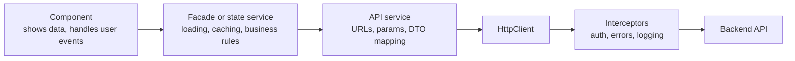
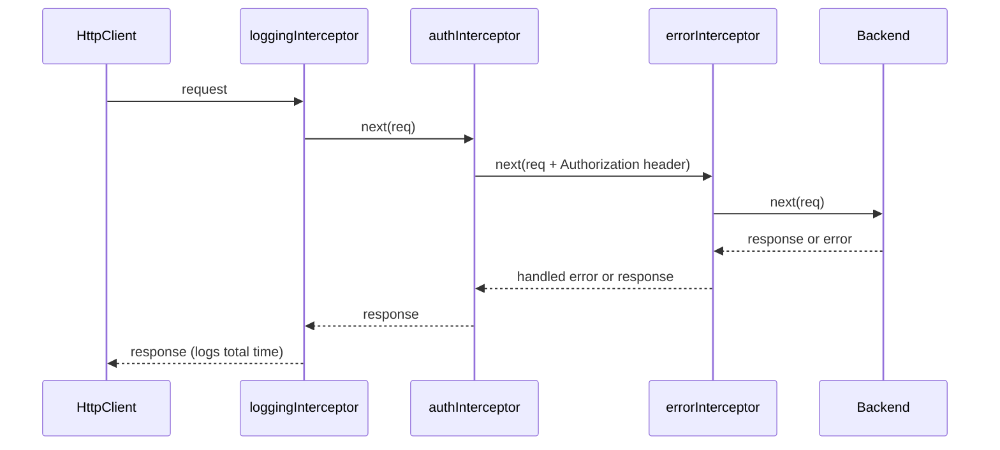
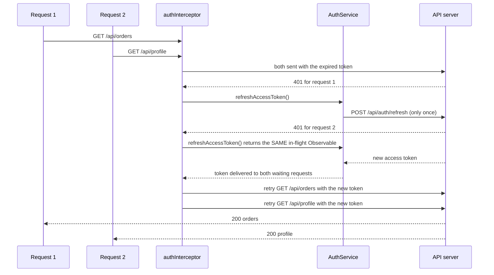

# HttpClient and Interceptors

> `HttpClient` is how an Angular app talks to a backend. Interceptors let you add behavior to every request in one place: auth tokens, error handling, loading indicators, caching, logging and retries. In this document you will learn both in depth for Angular 16, including the classic interview task of refreshing an expired token while many requests wait.

**Before this:** [RxJS](09-rxjs.md) · [Dependency injection](05-dependency-injection.md) · [HTTP, HTTPS and TLS](../01-cs-and-web-fundamentals/05-http-https-and-tls.md) · **Interview questions:** [jump to the interview section](#interview-questions)

## Table of contents

1. [What HttpClient is](#what-httpclient-is)
2. [Setting up HttpClient](#setting-up-httpclient)
3. [Making typed requests](#making-typed-requests)
4. [HttpClient Observables are cold and complete](#httpclient-observables-are-cold-and-complete)
5. [Params, headers and request options](#params-headers-and-request-options)
6. [Error handling](#error-handling)
7. [The API service layer pattern](#the-api-service-layer-pattern)
8. [Interceptors: the idea](#interceptors-the-idea)
9. [Functional interceptors](#functional-interceptors)
10. [Class-based interceptors](#class-based-interceptors)
11. [Interceptor order](#interceptor-order)
12. [Real interceptors you will write](#real-interceptors-you-will-write)
13. [HttpContext tokens](#httpcontext-tokens)
14. [Token refresh with request queueing](#token-refresh-with-request-queueing)
15. [Cancelling requests](#cancelling-requests)
16. [XSRF protection](#xsrf-protection)
17. [Testing HTTP code](#testing-http-code)
18. [Newer Angular versions](#newer-angular-versions)
19. [Common mistakes](#common-mistakes)
20. [Best practices](#best-practices)
21. [How to explain this in an interview](#how-to-explain-this-in-an-interview)
22. [Interview questions](#interview-questions)
23. [Summary](#summary)
24. [References](#references)

---

## What HttpClient is

`HttpClient` is Angular's service for sending HTTP requests. It lives in `@angular/common/http`.

Compared with calling `fetch` directly, it gives you:

- **Observables** for every request, so you can cancel, retry and combine requests with RxJS.
- **Automatic JSON** parsing of responses and serializing of request bodies.
- **Typed responses** with generics: `http.get<User[]>(url)`.
- **Interceptors**: one place to change every request and response.
- **XSRF protection** support built in.
- **Testing tools** (`HttpTestingController`) to fake the backend in unit tests.

By default in Angular 16, `HttpClient` uses `XMLHttpRequest` under the hood. Angular 16.1 added an optional `fetch`-based backend with `withFetch()` (developer preview in v16).

---

## Setting up HttpClient

You must provide `HttpClient` once, usually at the application root.

### NgModule app: HttpClientModule

```ts
import { NgModule } from '@angular/core';
import { BrowserModule } from '@angular/platform-browser';
import { HttpClientModule } from '@angular/common/http';

@NgModule({
  declarations: [AppComponent],
  imports: [BrowserModule, HttpClientModule], // import once, in the root module
  bootstrap: [AppComponent],
})
export class AppModule {}
```

### Standalone app: provideHttpClient (Angular 15+)

```ts
import { bootstrapApplication } from '@angular/platform-browser';
import { provideHttpClient, withInterceptors } from '@angular/common/http';

bootstrapApplication(AppComponent, {
  providers: [
    provideHttpClient(
      withInterceptors([authInterceptor, errorInterceptor]), // functional interceptors
    ),
  ],
});
```

`provideHttpClient()` takes **features**:

| Feature | What it does |
| --- | --- |
| `withInterceptors([...])` | Adds functional interceptors |
| `withInterceptorsFromDi()` | Also uses class-based interceptors registered with `HTTP_INTERCEPTORS` |
| `withXsrfConfiguration({ cookieName, headerName })` | Customizes XSRF cookie and header names |
| `withNoXsrfProtection()` | Turns off the built-in XSRF interceptor |
| `withJsonpSupport()` | Enables JSONP requests |
| `withRequestsMadeViaParent()` | Passes requests up to the parent injector's `HttpClient` (useful in lazy-loaded parts) |
| `withFetch()` | Uses `fetch` instead of `XMLHttpRequest` (v16.1+, developer preview in v16) |

You can also use `provideHttpClient()` in an NgModule app by putting it in the `providers` array of `AppModule`.

**Important:** provide `HttpClient` once. If you import `HttpClientModule` again in a lazy-loaded module, that module gets a **new** `HttpClient` that does **not** use the interceptors from the root. This is a classic bug: "my auth interceptor does not run for one feature".

---

## Making typed requests

```ts
import { HttpClient } from '@angular/common/http';
import { Injectable, inject } from '@angular/core';
import { Observable } from 'rxjs';

export interface Product {
  id: string;
  name: string;
  price: number;
}

export type NewProduct = Omit<Product, 'id'>;

@Injectable({ providedIn: 'root' })
export class ProductApi {
  private readonly http = inject(HttpClient);
  private readonly baseUrl = '/api/products';

  getAll(): Observable<Product[]> {
    return this.http.get<Product[]>(this.baseUrl);
  }

  getById(id: string): Observable<Product> {
    return this.http.get<Product>(`${this.baseUrl}/${id}`);
  }

  create(product: NewProduct): Observable<Product> {
    return this.http.post<Product>(this.baseUrl, product); // body is serialized to JSON
  }

  update(id: string, changes: Partial<NewProduct>): Observable<Product> {
    return this.http.patch<Product>(`${this.baseUrl}/${id}`, changes);
  }

  delete(id: string): Observable<void> {
    return this.http.delete<void>(`${this.baseUrl}/${id}`);
  }
}
```

### The generic is a promise to the compiler, not a check

`http.get<Product[]>(url)` tells TypeScript "trust me, the response is a `Product[]`". Angular does **not** check the data at runtime. If the backend sends `{ items: [...] }` or a field is `null`, TypeScript will not save you. The bug appears later, far from the HTTP call.

For data you do not fully trust (third-party APIs, evolving backends), validate it at the boundary. Request `unknown` and parse it:

```ts
getAll(): Observable<Product[]> {
  return this.http.get<unknown>(this.baseUrl).pipe(map(data => parseProducts(data)));
}
```

Runtime validation (for example with Zod) is explained in [Runtime validation and type-safe APIs](../03-typescript/11-runtime-validation-and-type-safe-apis.md).

### Reading more than the body

By default you get only the parsed body. The `observe` option changes that:

```ts
// Full response: status, headers, body
this.http.get<Product[]>('/api/products', { observe: 'response' }).subscribe(response => {
  console.log(response.status);                       // 200
  console.log(response.headers.get('X-Total-Count')); // '125'
  console.log(response.body);                         // Product[] | null
});
```

The `responseType` option handles non-JSON responses:

```ts
// Download a file as a Blob
this.http.get('/api/reports/42.pdf', { responseType: 'blob' }).subscribe(blob => {
  const url = URL.createObjectURL(blob);
  window.open(url);
});

// Plain text
this.http.get('/api/version', { responseType: 'text' }).subscribe(version => console.log(version));
```

### Upload progress

```ts
upload(file: File): Observable<number> {
  const form = new FormData();
  form.append('file', file);
  return this.http
    .post('/api/files', form, { reportProgress: true, observe: 'events' })
    .pipe(
      filter(event => event.type === HttpEventType.UploadProgress || event.type === HttpEventType.Response),
      map(event =>
        event.type === HttpEventType.UploadProgress ? Math.round((100 * event.loaded) / (event.total ?? 1)) : 100,
      ),
    );
}
```

Note: the `fetch` backend (`withFetch()`) does not report upload progress. Keep the default XHR backend if you need it.

---

## HttpClient Observables are cold and complete

Two facts explain most `HttpClient` behavior. (Cold and hot Observables are explained in [RxJS](09-rxjs.md#cold-vs-hot-and-unicast-vs-multicast).)

**1. They are cold: no subscribe, no request. Two subscribes, two requests.**

```ts
const products$ = this.http.get<Product[]>('/api/products'); // nothing sent yet

products$.subscribe(); // request 1
products$.subscribe(); // request 2
```

**2. They complete after the response.** A normal request emits **one** value (the body) and then completes. (With `observe: 'events'` it emits several events, then completes.) So you do not get a memory leak from a finished HTTP subscription.

Consequences:

- `this.http.delete(url)` without `subscribe()` deletes nothing.
- Two `async` pipes on the same HTTP Observable send two requests. Use one subscription or `shareReplay`.
- `retry()` works because resubscribing sends the request again.
- Unsubscribing before the response **aborts** the request in the browser.

---

## Params, headers and request options

### Query parameters

```ts
// Option 1: a plain object (simplest)
this.http.get<Product[]>('/api/products', {
  params: { category: 'books', page: 2, inStock: true },
});
// GET /api/products?category=books&page=2&inStock=true

// Option 2: HttpParams (immutable, good for building conditionally)
let params = new HttpParams().set('page', 2).set('size', 20);
if (searchTerm) {
  params = params.set('q', searchTerm); // set() returns a NEW HttpParams
}
params = params.append('tag', 'new').append('tag', 'sale'); // repeated key
this.http.get<Product[]>('/api/products', { params });
// GET /api/products?page=2&size=20&q=...&tag=new&tag=sale
```

**HttpParams and HttpHeaders are immutable.** Every `set`, `append` or `delete` returns a new instance:

```ts
// ❌ Wrong: the result of set() is thrown away
const params = new HttpParams();
params.set('page', 2);

// ✅ Correct
const params2 = new HttpParams().set('page', 2);
```

### Headers

```ts
const headers = new HttpHeaders({ 'X-Client-Version': '1.4.0' }).set('Accept-Language', 'en');
this.http.get<Product[]>('/api/products', { headers });

// or a plain object
this.http.get<Product[]>('/api/products', { headers: { 'X-Client-Version': '1.4.0' } });
```

Headers that every request needs (auth tokens, correlation IDs) belong in an **interceptor**, not in every service call.

### Request options summary

| Option | Values | Purpose |
| --- | --- | --- |
| `params` | object or `HttpParams` | Query string |
| `headers` | object or `HttpHeaders` | Request headers |
| `observe` | `'body'` (default), `'response'`, `'events'` | What the Observable emits |
| `responseType` | `'json'` (default), `'text'`, `'blob'`, `'arraybuffer'` | How to parse the body |
| `reportProgress` | boolean | Emit progress events (with `observe: 'events'`) |
| `withCredentials` | boolean | Send cookies on cross-origin requests |
| `context` | `HttpContext` | Per-request metadata for interceptors |

---

## Error handling

### HttpErrorResponse

When a request fails, the Observable **errors** with an `HttpErrorResponse`. Two kinds of failures produce it:

| Kind | `status` | `error` property | Example |
| --- | --- | --- | --- |
| Server returned an error status | 4xx or 5xx | The parsed error body from the server | 404 Not Found, 422 validation error, 500 |
| Request did not complete (network, CORS, aborted by browser) | `0` | A `ProgressEvent` (XHR backend) | Offline, DNS failure, blocked by CORS |

```ts
import { HttpErrorResponse } from '@angular/common/http';

function toUserMessage(error: HttpErrorResponse): string {
  if (error.status === 0) {
    return 'Cannot reach the server. Check your connection.';
  }
  if (error.status === 404) {
    return 'The item was not found.';
  }
  if (error.status === 422 && error.error?.errors) {
    return 'Please fix the highlighted fields.';
  }
  if (error.status >= 500) {
    return 'The server had a problem. Please try again later.';
  }
  return error.error?.message ?? 'Something went wrong.';
}
```

Note: a CORS failure looks like status `0` in the browser. The browser hides the details from JavaScript for security. Look at the browser console and network tab. CORS is explained in [Web security: XSS, CSRF, CORS and CSP](../01-cs-and-web-fundamentals/08-browser-storage-and-web-security-basics.md).

### catchError and retry

```ts
loadProducts(): Observable<Product[]> {
  return this.http.get<Product[]>('/api/products').pipe(
    retry({ count: 2, delay: 1000 }), // retry safe GETs on failure
    catchError((error: HttpErrorResponse) => {
      this.notifications.error(toUserMessage(error));
      return of([]); // fallback value so the page can still render
    }),
  );
}
```

Decide **where** to handle each error:

- **Interceptor (global):** logging, 401 handling (refresh or redirect to login), generic "server down" messages, retry policy for network errors.
- **Service or component (local):** messages that need context ("This username is taken"), fallback values, mapping 422 field errors onto form controls.

Do not swallow errors everywhere. A component that gets `of([])` cannot tell "no products" from "the server failed". Often the best local result is a state object such as `{ status: 'error', message }`.

How `catchError` and `retry` work in general (inner vs outer `catchError`, backoff) is explained in [RxJS](09-rxjs.md#error-handling-catcherror-and-retry).

### Mapping server validation errors to a form

```ts
save(): void {
  this.userApi.create(this.form.getRawValue()).subscribe({
    next: () => this.router.navigate(['/users']),
    error: (error: HttpErrorResponse) => {
      if (error.status === 422) {
        // Server body: { errors: { email: 'Email already exists' } }
        const fieldErrors: Record<string, string> = error.error.errors ?? {};
        for (const [field, message] of Object.entries(fieldErrors)) {
          this.form.get(field)?.setErrors({ server: message });
        }
      }
    },
  });
}
```

Forms and showing errors are covered in [Forms](07-forms.md).

---

## The API service layer pattern

Components should not build URLs and call `HttpClient` directly. Put HTTP calls in **API services** (also called data-access services).



| Layer | Responsibility |
| --- | --- |
| Component | Display, user events. No URLs, no `HttpClient`. |
| Facade / state service | Loading and error state, caching, combining calls |
| API service | One method per endpoint. Builds URLs and params. Maps backend DTOs to frontend models |
| Interceptors | Cross-cutting concerns for **all** requests |

A **DTO** (data transfer object) is the shape the backend sends. Mapping it to your own model in the API service protects the rest of the app from backend changes:

```ts
interface ProductDto {
  product_id: string;
  display_name: string;
  price_cents: number;
}

@Injectable({ providedIn: 'root' })
export class ProductApi {
  private readonly http = inject(HttpClient);
  private readonly baseUrl = inject(API_BASE_URL); // an InjectionToken with the environment URL

  getAll(): Observable<Product[]> {
    return this.http
      .get<ProductDto[]>(`${this.baseUrl}/products`)
      .pipe(map(dtos => dtos.map(dto => ({ id: dto.product_id, name: dto.display_name, price: dto.price_cents / 100 }))));
  }
}
```

`API_BASE_URL` is an `InjectionToken<string>` provided at the root (see [Dependency injection](05-dependency-injection.md)). Benefits: components stay simple, URLs live in one place, tests can fake the API service easily, and backend changes touch one file. State patterns on top of this are in [State management and NgRx](11-state-management-and-ngrx.md).

---

## Interceptors: the idea

### What it is

An **HTTP interceptor** is a function (or class) that sits between `HttpClient` and the backend. **Every** request passes through it on the way out, and every response (or error) passes through it on the way back.

An interceptor can:

- Change the request (add headers, change the URL) before it is sent.
- Short-circuit the request (return a cached response without calling the server).
- Change or inspect the response.
- Catch errors, retry, or replace them.
- Measure time, count active requests, log.

### Why it exists

Without interceptors, every service method would need to add the auth header, handle 401, show a spinner, and log errors. That is repeated code, easy to forget. Interceptors put **cross-cutting concerns** in one place.

### Analogy

Interceptors are like **airport security checkpoints** in a row. Every passenger (request) goes through each checkpoint in order on the way to the plane (server). On the way back (response), arriving passengers go through the checkpoints in **reverse** order. Each checkpoint can stamp the passport (add a header), send someone back (return an error or a cached response), or just record who passed (logging).

### How it works inside

`HttpClient` builds a **chain**. Each interceptor receives the request and a `next` function. Calling `next(req)` passes the request to the next interceptor, and the last one passes it to the **backend** (`HttpXhrBackend`, or `FetchBackend` with `withFetch()`), which really sends it. `next(req)` returns an `Observable<HttpEvent>`, so an interceptor can use RxJS operators on the response.

**Requests are immutable.** `HttpRequest` objects cannot be changed. To modify a request, you **clone** it: `req.clone({ setHeaders: { ... } })`. This makes retries safe: the original request is never changed by accident.

---

## Functional interceptors

Since Angular 15, an interceptor can be a plain function of type `HttpInterceptorFn`. It is registered with `provideHttpClient(withInterceptors([...]))`. Inside it you can call `inject()`, because Angular runs interceptor functions in an **injection context**.

```ts
import { HttpInterceptorFn } from '@angular/common/http';
import { inject } from '@angular/core';

export const authInterceptor: HttpInterceptorFn = (req, next) => {
  const token = inject(AuthService).getAccessToken();
  if (!token) {
    return next(req);
  }
  const authReq = req.clone({ setHeaders: { Authorization: `Bearer ${token}` } });
  return next(authReq);
};
```

```ts
// app.config.ts (standalone) or providers of AppModule
providers: [provideHttpClient(withInterceptors([authInterceptor, loggingInterceptor]))];
```

**Important:** call `inject()` at the **top** of the function, synchronously. Inside an RxJS callback (like `catchError`) you are no longer in the injection context, and `inject()` throws.

---

## Class-based interceptors

The older style (still fully supported in Angular 16) is a class that implements `HttpInterceptor`, registered as a **multi provider** on the `HTTP_INTERCEPTORS` token.

```ts
import { HttpEvent, HttpHandler, HttpInterceptor, HttpRequest } from '@angular/common/http';
import { Injectable } from '@angular/core';
import { Observable } from 'rxjs';

@Injectable()
export class AuthInterceptor implements HttpInterceptor {
  constructor(private readonly auth: AuthService) {}

  intercept(req: HttpRequest<unknown>, next: HttpHandler): Observable<HttpEvent<unknown>> {
    const token = this.auth.getAccessToken();
    const authReq = token ? req.clone({ setHeaders: { Authorization: `Bearer ${token}` } }) : req;
    return next.handle(authReq); // note: next.handle(), not next()
  }
}
```

```ts
@NgModule({
  imports: [BrowserModule, HttpClientModule],
  providers: [
    { provide: HTTP_INTERCEPTORS, useClass: AuthInterceptor, multi: true },
    { provide: HTTP_INTERCEPTORS, useClass: ErrorInterceptor, multi: true },
  ],
})
export class AppModule {}
```

`multi: true` means "add this to a list" instead of "replace the provider". Without it, the last interceptor would replace all others. Multi providers are explained in [Dependency injection](05-dependency-injection.md).

To use class interceptors together with `provideHttpClient()`, add `withInterceptorsFromDi()`:

```ts
providers: [
  provideHttpClient(withInterceptors([loggingInterceptor]), withInterceptorsFromDi()),
  { provide: HTTP_INTERCEPTORS, useClass: AuthInterceptor, multi: true },
];
```

### Functional vs class-based

| | Functional (`HttpInterceptorFn`) | Class (`HttpInterceptor`) |
| --- | --- | --- |
| Available since | Angular 15 | Angular 4.3 |
| Register with | `withInterceptors([...])` | `HTTP_INTERCEPTORS` multi provider (+ `withInterceptorsFromDi()` when using `provideHttpClient`) |
| Dependencies | `inject()` at the top | Constructor injection |
| Order | Order of the array: very clear | Order of provider registration: harder to see in big apps |
| Call next | `next(req)` | `next.handle(req)` |
| Recommended for new code | Yes (Angular docs recommend it) | For existing NgModule code |

---

## Interceptor order

Interceptors run **in the order you list them** for the request, and in **reverse order** for the response.

```ts
provideHttpClient(withInterceptors([loggingInterceptor, authInterceptor, errorInterceptor]));
```



Rules that follow from this:

- An interceptor **later** in the list sees the changes made by earlier ones. Here, `errorInterceptor` sees the request with the `Authorization` header.
- On the way back, the interceptor **closest to the backend** sees the response first. Here `errorInterceptor` can handle an error before `authInterceptor` and `loggingInterceptor` see it.
- Put a **logging/timing** interceptor first, so it measures everything, including retries done by later interceptors.
- Put a **retry** interceptor after the auth interceptor (closer to the backend), so each retry resends the request that already has the `Authorization` header. Be careful: each interceptor function runs **once** per request. A retry resubscribes to the Observable that `next()` returned; it does not call the interceptor functions again. So a retry does **not** read a new token, whatever the order (verified in Angular 16.2). If the token can change between attempts, do two things: put the retry interceptor **before** the auth interceptor, and make the auth interceptor read the token inside `defer()`: `return defer(() => next(withToken(req, auth.getAccessToken())))`. Then each retry resubscribes to the deferred Observable and reads the current token (verified).
- With `provideHttpClient`, the order of **features** also matters: `provideHttpClient(withInterceptors([a, b]), withInterceptorsFromDi())` runs `a`, then `b`, then the DI-based class interceptors. (In Angular 16, the built-in XSRF interceptor is added by `provideHttpClient` itself, before your interceptors.)
- Class interceptors run in the order their providers were registered. In large apps with providers in several modules this is hard to predict. That is one reason the Angular docs recommend functional interceptors.

---

## Real interceptors you will write

### 1. Auth token (only for your own API)

```ts
export const authInterceptor: HttpInterceptorFn = (req, next) => {
  const auth = inject(AuthService);
  const apiBaseUrl = inject(API_BASE_URL); // e.g. 'https://api.myshop.com'

  // Never send your token to third-party servers (CDNs, analytics, other APIs)
  const isOwnApi = req.url.startsWith('/api/') || req.url.startsWith(`${apiBaseUrl}/`); // keep the trailing slash
  const token = auth.getAccessToken();
  if (!isOwnApi || !token || req.context.get(SKIP_AUTH)) {
    return next(req);
  }
  return next(req.clone({ setHeaders: { Authorization: `Bearer ${token}` } }));
};
```

The `isOwnApi` check is a **security** rule. Keep the trailing slash in the check: without it, `https://api.myshop.com.evil.net` would also match `https://api.myshop.com`. An interceptor runs for **every** request, including calls to external services. Attaching your access token to them leaks it. Token storage and other auth security rules are in [Security](15-security.md) and [Authentication and authorization](../07-nodejs-backend/09-authentication-and-authorization.md).

### 2. Global error handling

```ts
export const errorInterceptor: HttpInterceptorFn = (req, next) => {
  const notifications = inject(NotificationService);
  const router = inject(Router);

  return next(req).pipe(
    catchError((error: unknown) => {
      if (error instanceof HttpErrorResponse) {
        if (error.status === 0) {
          notifications.error('Network error. Check your connection.');
        } else if (error.status === 403) {
          router.navigate(['/forbidden']);
        } else if (error.status >= 500) {
          notifications.error('Server error. Please try again later.');
        }
        // 400/404/422 are left to the calling code, which knows the context
      }
      return throwError(() => error); // always rethrow: callers must know the request failed
    }),
  );
};
```

Always **rethrow** after handling. If the interceptor returned `EMPTY` or a fake success, the calling code would think the save worked.

### 3. Loading indicator

```ts
@Injectable({ providedIn: 'root' })
export class LoadingService {
  private readonly active = signal(0);
  readonly isLoading = computed(() => this.active() > 0);
  start(): void { this.active.update(n => n + 1); }
  stop(): void { this.active.update(n => Math.max(0, n - 1)); }
}

export const SKIP_LOADING = new HttpContextToken<boolean>(() => false);

export const loadingInterceptor: HttpInterceptorFn = (req, next) => {
  if (req.context.get(SKIP_LOADING)) {
    return next(req);
  }
  const loading = inject(LoadingService);
  loading.start();
  return next(req).pipe(finalize(() => loading.stop())); // runs on success, error AND cancel
};
```

A **counter** (not a boolean) handles parallel requests: the spinner hides only when the last request ends. `finalize` makes sure the counter goes down even when a request fails or is cancelled by `switchMap`. (`signal` is a developer preview in Angular 16; a `BehaviorSubject<number>` works the same way.)

### 4. Caching GET requests

```ts
export const CACHE_REQUEST = new HttpContextToken<boolean>(() => false);

@Injectable({ providedIn: 'root' })
export class HttpCacheService {
  private readonly cache = new Map<string, { response: HttpResponse<unknown>; storedAt: number }>();
  private readonly ttlMs = 60_000;

  get(key: string): HttpResponse<unknown> | undefined {
    const entry = this.cache.get(key);
    if (!entry || Date.now() - entry.storedAt > this.ttlMs) {
      this.cache.delete(key);
      return undefined;
    }
    return entry.response;
  }

  set(key: string, response: HttpResponse<unknown>): void {
    this.cache.set(key, { response, storedAt: Date.now() });
  }

  clear(): void {
    this.cache.clear(); // call on logout so the next user does not see old data
  }
}

export const cachingInterceptor: HttpInterceptorFn = (req, next) => {
  if (req.method !== 'GET' || !req.context.get(CACHE_REQUEST)) {
    return next(req);
  }
  const cache = inject(HttpCacheService);
  const cached = cache.get(req.urlWithParams);
  if (cached) {
    return of(cached.clone()); // short-circuit: the backend is not called
  }
  return next(req).pipe(
    tap(event => {
      if (event instanceof HttpResponse) {
        cache.set(req.urlWithParams, event);
      }
    }),
  );
};

// usage: opt in per request
this.http.get<Country[]>('/api/countries', { context: new HttpContext().set(CACHE_REQUEST, true) });
```

Only cache **GET** requests, use a **key with params** (`urlWithParams`), add an **expiry**, and **clear** the cache on logout. Caching strategy in general is in [Caching strategies and invalidation](../09-system-design/03-caching-strategies-and-invalidation.md).

### 5. Logging and timing

```ts
export const loggingInterceptor: HttpInterceptorFn = (req, next) => {
  const started = performance.now();
  let status = 'unknown';
  return next(req).pipe(
    tap({
      next: event => {
        if (event instanceof HttpResponse) status = String(event.status);
      },
      error: (error: HttpErrorResponse) => (status = `failed ${error.status}`),
    }),
    finalize(() => {
      const ms = Math.round(performance.now() - started);
      console.info(`${req.method} ${req.urlWithParams} -> ${status} in ${ms} ms`);
    }),
  );
};
```

In production you would send this to a monitoring service instead of the console, and add a correlation ID header (`X-Request-Id`) so frontend and backend logs can be matched. See [Production Node.js](../07-nodejs-backend/14-production-nodejs.md).

### 6. Retry for safe requests

```ts
export const retryInterceptor: HttpInterceptorFn = (req, next) => {
  if (req.method !== 'GET') {
    return next(req); // never auto-retry writes that may not be idempotent
  }
  return next(req).pipe(
    retry({
      count: 2,
      delay: (error: unknown, retryCount: number) => {
        const retryable = error instanceof HttpErrorResponse && (error.status === 0 || error.status >= 500);
        return retryable ? timer(retryCount * 1000) : throwError(() => error);
      },
    }),
  );
};
```

---

## HttpContext tokens

Sometimes one request needs to tell an interceptor "treat me differently": skip the spinner, skip auth, enable caching. Do not use fake headers for that. Use **`HttpContext`** (Angular 12+).

```ts
import { HttpContext, HttpContextToken } from '@angular/common/http';

// 1. Define a token with a default value
export const SKIP_AUTH = new HttpContextToken<boolean>(() => false);

// 2. Set it on a request
this.http.post('/api/auth/login', credentials, {
  context: new HttpContext().set(SKIP_AUTH, true),
});

// 3. Read it in an interceptor
if (req.context.get(SKIP_AUTH)) {
  return next(req);
}
```

Benefits: type-safe, never sent to the server, and the default value means requests that do not set it behave normally. The default is created by a function, so each request gets its own value (important when the value is an object or array).

---

## Token refresh with request queueing

### The problem

Your app uses a short-lived **access token** (for example, 15 minutes) and a long-lived **refresh token** (usually in an `HttpOnly` cookie). When the access token expires, the API returns **401**. The app should:

1. Get a new access token by calling `/api/auth/refresh`.
2. Retry the failed request with the new token.
3. If the dashboard fired **five requests at once** and all got 401, call refresh **only once**. The other four must **wait** for that refresh, then retry.
4. If the refresh fails, log the user out, and fail all waiting requests.

### The design

The key idea is a **shared in-flight refresh Observable**. The first 401 starts the refresh. Every other 401 that arrives while the refresh is running subscribes to the **same** Observable. When it emits the new token, they all retry. If it errors, they all get the error.

```ts
@Injectable({ providedIn: 'root' })
export class AuthService {
  private readonly http = inject(HttpClient);
  private readonly router = inject(Router);
  private accessToken: string | null = null;
  private refreshInFlight$: Observable<string> | null = null;

  getAccessToken(): string | null {
    return this.accessToken;
  }

  refreshAccessToken(): Observable<string> {
    if (!this.refreshInFlight$) {
      this.refreshInFlight$ = this.http
        .post<{ accessToken: string }>('/api/auth/refresh', {}, {
          withCredentials: true,                          // send the HttpOnly refresh cookie
          context: new HttpContext().set(SKIP_AUTH, true), // do not intercept the refresh call itself
        })
        .pipe(
          map(response => response.accessToken),
          tap(token => (this.accessToken = token)),
          finalize(() => (this.refreshInFlight$ = null)), // next expiry starts a fresh refresh
          shareReplay({ bufferSize: 1, refCount: false }),  // one HTTP call for all waiting requests
        );
    }
    return this.refreshInFlight$;
  }

  logout(): void {
    this.accessToken = null;
    this.router.navigate(['/login']);
  }
}
```

```ts
export const SKIP_AUTH = new HttpContextToken<boolean>(() => false);

function withToken(req: HttpRequest<unknown>, token: string | null): HttpRequest<unknown> {
  return token ? req.clone({ setHeaders: { Authorization: `Bearer ${token}` } }) : req;
}

export const authInterceptor: HttpInterceptorFn = (req, next) => {
  if (req.context.get(SKIP_AUTH)) {
    return next(req);
  }
  const auth = inject(AuthService); // inject at the top, not inside catchError

  return next(withToken(req, auth.getAccessToken())).pipe(
    catchError((error: unknown) => {
      if (!(error instanceof HttpErrorResponse) || error.status !== 401) {
        return throwError(() => error);
      }
      return auth.refreshAccessToken().pipe(
        switchMap(newToken => next(withToken(req, newToken))), // retry the ORIGINAL request with the new token
        catchError(refreshError => {
          auth.logout();
          return throwError(() => refreshError);
        }),
      );
    }),
  );
};
```



**Step-by-step walkthrough:**

1. Requests 1 and 2 go out with the expired token. Both come back with 401.
2. The first 401 calls `refreshAccessToken()`. No refresh is running, so it creates the refresh Observable and stores it in `refreshInFlight$`. The POST is sent.
3. The second 401 calls `refreshAccessToken()`. `refreshInFlight$` exists, so it gets the **same** Observable. Because of `shareReplay`, no second POST is sent.
4. The refresh response arrives. `tap` stores the new token. Both waiting subscribers receive it.
5. `switchMap` retries each **original** request with the new token. Because the original `req` is immutable, it is safe to clone it again.
6. The refresh Observable completes, and `finalize` clears `refreshInFlight$`, so a future expiry starts a new refresh.
7. If the refresh fails (refresh token expired), every waiting request gets the error, the user is logged out, and nobody waits forever.

**Why `refCount: false` here?** If the first component that triggered the refresh is destroyed and unsubscribes, a `refCount: true` share could cancel the refresh while other requests still wait for it. The refresh is a single HTTP call that completes, so keeping it alive until it finishes does not leak.

**The common alternative** uses an `isRefreshing` flag and a `BehaviorSubject<string | null>`: waiting requests do `refreshToken$.pipe(filter(t => t !== null), take(1), switchMap(...))`. It works, but it has a classic bug: if the refresh **fails**, the subject never emits a token, and waiting requests **hang forever** unless you also push an error to them. The shared-Observable design handles errors automatically.

**Avoid infinite loops:** the refresh call itself must skip the interceptor's 401 handling (`SKIP_AUTH`), and a retried request that gets 401 again should fail rather than refresh again. In the code above, the retried request goes through `next()` directly, not back through this `catchError`, so it cannot loop.

---

## Cancelling requests

An `HttpClient` request is cancelled when its subscription is unsubscribed **before** the response arrives. With the default XHR backend, Angular calls `xhr.abort()`. (With `withFetch()`, it uses an `AbortController`.) You see the request as "(canceled)" in the browser's network tab.

Ways requests get cancelled:

| Way | Example |
| --- | --- |
| `switchMap` | Typeahead: a new term cancels the previous search |
| `async` pipe | The component is destroyed while loading |
| `takeUntilDestroyed()` / `takeUntil()` | Manual subscription, component destroyed |
| `take(1)` / `first()` | Rarely matters for HTTP (it emits once anyway) |
| `timeout(ms)` | Gives up after `ms` and errors (and unsubscribes from the request) |
| Explicit `subscription.unsubscribe()` | A "Cancel upload" button |

```ts
// Cancel button for a long upload
private uploadSub?: Subscription;

startUpload(file: File): void {
  this.uploadSub = this.fileApi.upload(file).subscribe(progress => (this.progress = progress));
}

cancelUpload(): void {
  this.uploadSub?.unsubscribe(); // aborts the HTTP request
}
```

**Remember:** cancelling stops the browser from waiting. If the server already received the request, it may still finish it. For writes, the server must be designed for that (idempotency keys, or checking the result later).

---

## XSRF protection

**Cross-site request forgery (CSRF or XSRF)** is an attack where another website makes the user's browser send a request to your API, using the user's cookies. The attack and defenses are explained in depth in [Web security: XSS, CSRF, CORS and CSP](../01-cs-and-web-fundamentals/08-browser-storage-and-web-security-basics.md).

Short reminder: Angular's `HttpClient` supports the **cookie-to-header** defense. The server sets an `XSRF-TOKEN` cookie. For mutating requests (not `GET`/`HEAD`) to **relative URLs**, Angular's built-in interceptor copies the cookie value into an `X-XSRF-TOKEN` header, and the server checks that they match. It is on by default with `HttpClientModule` and `provideHttpClient()`. It never adds the header to absolute URLs, so a cross-origin API needs its own setup.

The step-by-step flow, a sequence diagram and the exact rules of Angular 16's XSRF interceptor are in [Angular security: XSRF protection with HttpClient](15-security.md#xsrf-protection-with-httpclient).

Customize names:

```ts
// Standalone
provideHttpClient(withXsrfConfiguration({ cookieName: 'CSRF-TOKEN', headerName: 'X-CSRF-TOKEN' }));

// NgModule
imports: [HttpClientModule, HttpClientXsrfModule.withOptions({ cookieName: 'CSRF-TOKEN', headerName: 'X-CSRF-TOKEN' })];
```

The server side is required. Angular only sends the header; the backend must set the cookie and validate the header.

---

## Testing HTTP code

Angular provides a fake backend for unit tests: `HttpTestingController`. You configure `TestBed` with `provideHttpClient()` and `provideHttpClientTesting()` (Angular 15+), or the older `HttpClientTestingModule`. Then you call your service, **expect** a request, and **flush** a fake response:

```ts
it('loads products', () => {
  TestBed.configureTestingModule({
    providers: [ProductApi, provideHttpClient(), provideHttpClientTesting()],
  });
  const api = TestBed.inject(ProductApi);
  const httpMock = TestBed.inject(HttpTestingController);

  let result: Product[] | undefined;
  api.getAll().subscribe(products => (result = products));

  const req = httpMock.expectOne('/api/products');
  expect(req.request.method).toBe('GET');
  req.flush([{ id: '1', name: 'Book', price: 10 }]);

  expect(result?.length).toBe(1);
  httpMock.verify(); // fails if unexpected requests were made
});
```

Interceptors are tested the same way, with `provideHttpClient(withInterceptors([authInterceptor]))` in the test providers. Full coverage of Angular testing (including functional interceptors and `TestBed.runInInjectionContext`) is in [Testing](14-testing.md).

---

## Newer Angular versions

> **Newer Angular (17+):**
> - **Angular 17:** `withFetch()` became stable, and server-side rendering setups recommend it.
> - **Angular 18** deprecated `HttpClientModule` (and `HttpClientXsrfModule`, `HttpClientJsonpModule`). The replacement is `provideHttpClient(withInterceptorsFromDi())` in your providers, plus the matching `with...` features. An `ng update` migration does the change.
> - **Angular 19.2** added `httpResource()` (experimental at first), which loads HTTP data directly into signals.
> - **Angular 21**: `HttpClient` is provided in root by default, so you can inject it without calling `provideHttpClient()`. You still call it to configure interceptors and other features.
> - **Angular 22**: `fetch` is the default backend and `withFetch()` is deprecated. `withXhr()` switches back to `XMLHttpRequest` (for example, when you need upload progress).
> - Functional interceptors remain the recommended style.

For an Angular 16 app, the safest future-proof choices are: `provideHttpClient()` instead of `HttpClientModule` where possible, functional interceptors, and `HttpContext` tokens for per-request options.

---

## Common mistakes

**1. Forgetting to subscribe.** `this.http.post(...)` without `subscribe()` (or an `async` pipe) sends nothing.

**2. Importing `HttpClientModule` in a lazy-loaded module.** It creates a second `HttpClient` without the root interceptors.

**3. Mutating requests.** `req.headers.set(...)` returns a new object and does not change `req`. Use `req.clone({ setHeaders })`.

**4. Forgetting `multi: true`** on `HTTP_INTERCEPTORS`. Only the last interceptor remains.

**5. Using `withInterceptors` but registering class interceptors without `withInterceptorsFromDi()`.** The class interceptors are silently ignored.

**6. Swallowing errors in an interceptor** (returning `EMPTY` or `of(null)`). Callers think the request succeeded.

**7. Sending the auth token to every URL.** Leaks the token to third parties. Check the URL first.

**8. Calling `inject()` inside an RxJS callback** in a functional interceptor. Inject at the top.

**9. Trusting the generic type.** `get<User>()` does not validate the response.

**10. Hiding the spinner only in `next`.** Errors and cancellations leave it spinning forever. Use `finalize`.

**11. Auto-retrying POST requests.** Can create duplicate orders or payments.

**12. Refresh logic that refreshes once per failed request,** or that leaves waiting requests hanging when the refresh fails.

---

## Best practices

- **Provide HttpClient once at the root.** Prefer `provideHttpClient()` (works with NgModules too), which also prepares you for newer Angular.
- **Write functional interceptors** with a clear order in one array.
- **Keep HTTP calls in API services**, one method per endpoint, mapping DTOs to app models.
- **Handle generic errors globally, specific errors locally,** and always rethrow from interceptors.
- **Use `HttpContext` tokens** for per-request interceptor options, not custom headers.
- **Attach credentials only to your own API.**
- **Use `finalize`** for loading counters and cleanup.
- **Retry only idempotent requests**, with a delay and a limit.
- **Cancel requests that are no longer needed** with `switchMap`, the `async` pipe or `takeUntilDestroyed`.
- **Validate data at the boundary** when the backend is not fully trusted.
- **Test with `HttpTestingController`** and call `verify()`.

---

## How to explain this in an interview

### Explaining interceptors

1. **Define it:** "An interceptor is middleware for HttpClient. Every request passes through it before it is sent, and every response or error passes back through it."
2. **Why it exists:** "To handle cross-cutting concerns like auth headers, error handling, loading indicators, logging and caching in one place instead of in every service."
3. **How it works:** "Angular builds a chain. Each interceptor gets the request and a next function. Requests are immutable, so I clone them to add headers. next returns an Observable, so I can use catchError, retry, tap and finalize on the response. Interceptors run in the listed order for requests and in reverse for responses."
4. **Small example:** "My auth interceptor checks that the URL is our API, clones the request with a Bearer token, and on a 401 refreshes the token once and retries the original request."
5. **Where it is useful:** "Auth, global error messages, spinner counters, correlation IDs, caching lookup data, retrying GETs on network errors."
6. **Trade-offs / gotchas:** "Order matters, swallowing errors hides failures, tokens must not leak to third-party URLs, and in Angular 15+ I prefer functional interceptors because the order is explicit. Class interceptors with provideHttpClient need withInterceptorsFromDi."

---

## Interview questions

### Q1. How do you set up HttpClient in Angular 16, and what is the difference between HttpClientModule and provideHttpClient?

**What the interviewer is checking:** Knowledge of both the NgModule and standalone APIs, and how interceptors are registered in each.

**Short spoken answer (30–60 seconds):**
> In an NgModule app I import HttpClientModule once in the root module, and class interceptors are registered with the HTTP_INTERCEPTORS multi provider. Since Angular 15 there is provideHttpClient, which I put in the providers of bootstrapApplication or of the root module. It takes features: withInterceptors for functional interceptors, withInterceptorsFromDi to keep supporting class interceptors, withXsrfConfiguration, withFetch and so on. Both create the same HttpClient. provideHttpClient is the newer, more explicit API, and in Angular 18 HttpClientModule was deprecated in its favor. Either way, I provide it only once at the root, because a second HttpClientModule in a lazy module creates a separate HttpClient without the root interceptors.

**Follow-up questions:**
- **What does `withRequestsMadeViaParent()` do?** — In a child environment injector (for example a lazy route with its own `provideHttpClient()`), it passes requests up to the parent's `HttpClient` after the local interceptors, so both sets of interceptors run.
- **What does `withFetch()` change?** — The backend uses the Fetch API instead of `XMLHttpRequest` (v16.1+, developer preview in v16). Upload progress events are not supported with fetch.

**Common mistakes:** Importing `HttpClientModule` in feature modules. Using `withInterceptors` and expecting class interceptors to run without `withInterceptorsFromDi()`.

**Where this is used in real projects:** Every Angular app; migration from NgModules to standalone.

---

### Q2. Why does this code not send a request?

```ts
deleteUser(id: string): void {
  this.http.delete(`/api/users/${id}`);
  this.users = this.users.filter(u => u.id !== id);
}
```

**Short answer:** `HttpClient` returns a **cold** Observable. Nothing is sent until someone subscribes. The UI removes the user, but the server still has it. Fix: subscribe, and update the UI after success (or roll back on error):

```ts
deleteUser(id: string): void {
  this.http.delete(`/api/users/${id}`).subscribe({
    next: () => (this.users = this.users.filter(u => u.id !== id)),
    error: () => this.notifications.error('Could not delete the user'),
  });
}
```

Follow-up: **What if two templates use `user$ | async` on the same HTTP Observable?** — Two requests are sent. Use one subscription (`*ngIf="user$ | async as user"`) or `shareReplay`.

---

### Q3. What is an HTTP interceptor? Give real examples.

**What the interviewer is checking:** Concept plus practical usage, and awareness of pitfalls.

**Short spoken answer (30–60 seconds):**
> An interceptor is middleware for HttpClient: every outgoing request and every incoming response passes through it. I use interceptors for cross-cutting concerns, so services do not repeat the same code. Typical ones: an auth interceptor that adds the Bearer token only for our own API and refreshes it on 401; an error interceptor that shows a generic message for network and server errors and then rethrows; a loading interceptor that counts active requests with finalize; a logging interceptor that measures timing and adds a correlation ID; and sometimes a caching interceptor for GET requests marked with an HttpContext token. Because requests are immutable, I always clone them to change headers.

**Follow-up questions:**
- **Why are requests immutable?** — Interceptors can retry a request. If one interceptor mutated the shared request, a retry could send a different request. Cloning keeps each step predictable.
- **Can an interceptor return a response without calling the server?** — Yes. Return `of(new HttpResponse({ body, status: 200 }))`, for example from a cache or a mock.
- **How do you skip an interceptor for one request?** — Use an `HttpContextToken`, for example `SKIP_LOADING`, and check `req.context.get(...)`.

**Common mistakes:** Swallowing errors in an interceptor. Adding tokens to all URLs. Putting feature-specific logic (like "show this field error") in a global interceptor.

**Where this is used in real projects:** Auth, monitoring, global error UX, spinners.

---

### Q4. Functional vs class-based interceptors: what is the difference?

**Short answer:** A functional interceptor (`HttpInterceptorFn`, Angular 15+) is a plain function `(req, next) => Observable` registered with `provideHttpClient(withInterceptors([...]))`. It gets dependencies with `inject()`. A class interceptor implements `HttpInterceptor.intercept(req, next)`, uses constructor injection, calls `next.handle(req)`, and is registered with `{ provide: HTTP_INTERCEPTORS, useClass, multi: true }` (and `withInterceptorsFromDi()` when using `provideHttpClient`). Functional ones are simpler and their order is explicit in one array, so the Angular docs recommend them. Behavior is the same.

---

### Q5. In what order do interceptors run?

**What the interviewer is checking:** Mental model of the chain.

**Short spoken answer (30–60 seconds):**
> Requests pass through interceptors in the order they are listed, and responses come back in reverse order, like layers of an onion. So the last interceptor in the list is closest to the server: it sees the final request and is the first to see the response or error. That is why I put the logging interceptor first, so it measures the full time including retries, and the auth interceptor before anything that needs the Authorization header. With provideHttpClient the order of features matters too: withInterceptors before withInterceptorsFromDi means the functional ones run before the class ones. Class interceptors run in provider registration order.

**Code:** See the sequence diagram in [Interceptor order](#interceptor-order).

**Follow-up questions:**
- **Where should a retry interceptor go relative to the auth interceptor?** — After it (closer to the backend), so each retry resends the request with the header already added. A retry resubscribes to the Observable from `next(req)`; it does not run the earlier interceptor functions again. So if the token can change between attempts, put the retry interceptor **before** the auth interceptor, and make the auth interceptor read the token inside `defer(() => next(withToken(req, auth.getAccessToken())))`. Each retry then resubscribes to the deferred Observable and reads the current token.

---

### Q6. How do you handle HTTP errors in Angular? Where should each kind be handled?

**What the interviewer is checking:** Layered error-handling design.

**Short spoken answer (30–60 seconds):**
> A failed request errors the Observable with an HttpErrorResponse. Status 0 means the request did not complete: offline, DNS, or CORS. 4xx and 5xx come from the server, and the error property holds the parsed error body. I split handling into layers. A global interceptor handles things that are the same everywhere: logging, 401 refresh or redirect to login, a generic message for network and 5xx errors, and then it rethrows. The service or component handles errors that need context: mapping a 422 validation response onto form fields, showing "this username is taken", or returning a fallback state. I avoid swallowing errors, because then the UI cannot tell "empty" from "failed".

**Follow-up questions:**
- **Why does a CORS error show status 0?** — The browser blocks the response and hides details from JavaScript for security. You see the reason only in the console.
- **What about errors thrown in your own code, not HTTP?** — They go to Angular's global `ErrorHandler`, which you can replace to send errors to monitoring. See [Enterprise architecture](13-enterprise-architecture.md).

---

### Q7. Implement token refresh in an interceptor so that many failing requests trigger only one refresh.

**What the interviewer is checking:** RxJS skills, concurrency thinking and edge cases (refresh failure, infinite loops).

**Short spoken answer (30–60 seconds):**
> The interceptor adds the access token and catches 401 errors. On a 401 it calls refreshAccessToken on the auth service, then uses switchMap to retry the original request with the new token. The important part is concurrency: the auth service keeps one in-flight refresh Observable, shared with shareReplay. The first 401 creates it; any other 401 during the refresh gets the same Observable, so only one refresh call is made and everyone waits for it. When it completes, finalize clears it. If the refresh fails, every waiting request gets the error and the user is logged out. The refresh call itself is marked with an HttpContext token so the interceptor skips it, which prevents loops.

**Code:** See [Token refresh with request queueing](#token-refresh-with-request-queueing). The logic was simulated with RxJS 7.8 in Node.js: three parallel 401 requests caused exactly one refresh call and all three succeeded on retry; when the refresh failed, both waiting requests failed and logout ran.

**Follow-up questions:**
- **What is wrong with the `isRefreshing` + `BehaviorSubject` approach?** — It works for success, but if the refresh fails, waiting requests filtering for a non-null token wait forever unless you also send them an error.
- **Why not refresh the token proactively before it expires?** — You can (using the token's expiry time), which reduces 401s. You still need the 401 handling as a fallback, for example after the laptop wakes from sleep.
- **Where should the refresh token be stored?** — Preferably in an `HttpOnly`, `Secure`, `SameSite` cookie that JavaScript cannot read, and the access token in memory. See [Auth architecture and multi-tenancy](../09-system-design/06-auth-architecture-and-multi-tenancy.md).

**Common mistakes:** Refreshing once per failed request. Calling `inject()` inside `catchError`. Not excluding the refresh endpoint, causing an infinite loop. Retrying with the old request headers instead of cloning with the new token.

**Where this is used in real projects:** Every app with short-lived JWT access tokens.

---

### Q8. What is HttpContext and when do you use it?

**Short answer:** `HttpContext` carries per-request metadata **for interceptors**, without sending anything to the server. You define a typed `HttpContextToken` with a default value, set it on a request (`{ context: new HttpContext().set(CACHE_REQUEST, true) }`), and read it in an interceptor (`req.context.get(CACHE_REQUEST)`). Typical uses: skip the spinner, skip auth for the login or refresh call, opt in to caching, set a custom retry count. It replaced hacks like custom headers that the interceptor had to remove. It exists since Angular 12.

---

### Q9. How do you cancel an HTTP request?

**Short answer:** Unsubscribe before the response arrives. Angular then aborts the underlying XHR (or fetch). In practice it happens through `switchMap` (a new search cancels the old one), the `async` pipe or `takeUntilDestroyed` (the component is destroyed), `timeout()`, or a stored `Subscription` for a "Cancel" button. Important: cancelling only stops the client from waiting. If the server already received a POST, it may still complete it.

---

### Q10. Debugging: the auth interceptor works everywhere except in one lazy-loaded feature. Why?

**What the interviewer is checking:** Understanding of injector hierarchy and `HttpClient` instances.

**Short answer:** The most likely cause is that the lazy feature module imports `HttpClientModule` again. That creates a new `HttpClient` (and a new interceptor chain) in the lazy module's injector, and the interceptors registered at the root are not part of it. Fix: import `HttpClientModule` (or `provideHttpClient()`) only once at the root. Other causes: the feature uses `fetch` or a third-party HTTP library directly; or the interceptor's `isOwnApi` check does not match that feature's URLs. Injector hierarchy is explained in [Dependency injection](05-dependency-injection.md).

---

### Q11. How does Angular's XSRF protection work, and when does it not work?

**What the interviewer is checking:** Security knowledge and its limits.

**Short spoken answer (30–60 seconds):**
> Angular implements the cookie-to-header pattern. The server sets a readable cookie, by default XSRF-TOKEN. For mutating requests to relative URLs, HttpClient's built-in interceptor copies that value into the X-XSRF-TOKEN header. The server checks that the header matches the cookie. An attacker's site can make the browser send cookies, but it cannot read them, so it cannot set the header. It does not apply to GET or HEAD, which should not change state anyway, and it skips absolute URLs, so if the API is on another domain with an absolute URL the header is not added. And it only works if the backend sets the cookie and validates the header.

**Follow-up questions:**
- **Do you need XSRF protection if you use Bearer tokens in a header and no cookies?** — Classic CSRF relies on cookies being sent automatically. A token in an `Authorization` header set by JavaScript is not sent automatically by the browser, so CSRF risk is much lower. But a refresh-token cookie endpoint still needs protection (for example `SameSite` cookies and CSRF tokens).

---

### Q12. Write a loading interceptor that works with parallel requests.

**Short answer:** Use a counter, not a boolean, and decrement in `finalize` so success, error and cancellation all count:

```ts
export const loadingInterceptor: HttpInterceptorFn = (req, next) => {
  if (req.context.get(SKIP_LOADING)) {
    return next(req);
  }
  const loading = inject(LoadingService);
  loading.start();
  return next(req).pipe(finalize(() => loading.stop()));
};
```

Follow-up: **Why not hide the spinner in `tap({ next })`?** — An error or a cancelled request never emits `next`, so the spinner would stay forever. Also, with `observe: 'events'`, `next` fires several times.

---

### Q13. Code review: what is wrong with this interceptor?

```ts
@Injectable()
export class ApiInterceptor implements HttpInterceptor {
  constructor(private auth: AuthService) {}

  intercept(req: HttpRequest<any>, next: HttpHandler): Observable<HttpEvent<any>> {
    req.headers.set('Authorization', 'Bearer ' + this.auth.token);
    return next.handle(req).pipe(
      catchError(() => {
        alert('Request failed');
        return EMPTY;
      }),
    );
  }
}
```

**Answer:**

1. **The header is never added.** `HttpHeaders` is immutable; `set()` returns a new object that is thrown away. Use `req = req.clone({ setHeaders: { Authorization: ... } })`.
2. **The token goes to every URL,** including third-party ones. Check that the request targets your own API.
3. **`'Bearer ' + undefined`** is sent when there is no token. Skip the header when the token is missing.
4. **Errors are swallowed.** Returning `EMPTY` completes the request without a value, so callers think it succeeded (or nothing happens). Rethrow with `throwError(() => error)`.
5. **`alert()` for every error,** including 404s that the caller handles and cancelled requests. Use a notification service and only for errors that need a global message.
6. **No status checks.** 401 should trigger refresh or login; 422 should go to the form.
7. It must be registered with `multi: true` (not visible here, but a common follow-up).

---

### Q14. How would you cache GET responses in Angular?

**Short spoken answer (30–60 seconds):**
> It depends on the scope. For one piece of data shared across components, like a country list, I cache in a service with shareReplay, or in a BehaviorSubject or signal store. For a more general solution, a caching interceptor can store HttpResponse objects in a Map keyed by urlWithParams, only for GET requests that opt in with an HttpContext token, with an expiry time. On a hit it returns of(cached.clone()) without calling the server. I always clear the cache on logout so the next user cannot see old data, and I invalidate it after writes that change the cached data. HTTP-level caching with Cache-Control headers from the server is another option that needs no Angular code.

---

### Q15. How do you make HttpClient responses type-safe?

**Short answer:** The generic (`get<User[]>`) gives compile-time types only; it does not check the data. For trusted, versioned backends, generate types from an OpenAPI spec so they stay in sync. For untrusted or changing data, request `unknown` and validate with a schema library (for example Zod) in the API service, then map DTOs to app models. Runtime validation is covered in [Runtime validation and type-safe APIs](../03-typescript/11-runtime-validation-and-type-safe-apis.md).

---

### Q16. Your API is slow and users double-click "Place order". What do you do on the frontend?

**What the interviewer is checking:** Combining UX, RxJS and backend awareness.

**Short answer:** Disable the button and show "Placing order..." while the request is running. Use `exhaustMap` on the click stream so extra clicks are ignored even if the button is not disabled yet. Never auto-retry the POST. Ideally send an **idempotency key** (a UUID generated when the checkout starts) so the backend can detect duplicates if a retry or double submission still happens. Use `finalize` to re-enable the button on error. Flattening operators are explained in [RxJS](09-rxjs.md#higher-order-mapping-switchmap-mergemap-concatmap-exhaustmap).

---

## Summary

- **Provide `HttpClient` once at the root:** `HttpClientModule` (NgModule) or `provideHttpClient(...features)` (Angular 15+, also works in NgModule apps).
- `HttpClient` methods return **cold** Observables: no subscribe means no request; each subscribe sends a new request; normal requests **complete** after one response.
- The **generic type is not validated** at runtime. Validate untrusted data and map DTOs in API services.
- **`HttpParams` and `HttpHeaders` are immutable**; use the returned instance. Requests are immutable too; use `req.clone()`.
- Errors arrive as **`HttpErrorResponse`**: status `0` = network/CORS, 4xx/5xx = server. Handle generic errors in an interceptor (and rethrow), specific ones locally.
- **Interceptors** handle cross-cutting concerns. Functional (`withInterceptors`) is recommended; class-based uses `HTTP_INTERCEPTORS` with `multi: true` and needs `withInterceptorsFromDi()` with `provideHttpClient`.
- **Order:** requests in listed order, responses in reverse.
- **`HttpContextToken`** passes per-request options to interceptors.
- **Token refresh:** catch 401, share one in-flight refresh Observable, retry the original request with `switchMap`, fail all waiters and log out if refresh fails, skip the refresh call itself.
- **Cancellation** = unsubscribe (via `switchMap`, `async` pipe, `takeUntilDestroyed`); the server may still finish the work.
- **XSRF:** cookie `XSRF-TOKEN` → header `X-XSRF-TOKEN` for non-GET/HEAD requests to relative URLs; the backend must validate it.
- Newer Angular deprecated `HttpClientModule` (v18) and added `httpResource` (v19.2). `HttpClient` is provided by default since v21, and the fetch backend is the default since v22.

## References

- Angular 16 — HttpClient guide (Understanding communicating with backend services): https://v16.angular.io/guide/understanding-communicating-with-http
- Angular 16 — Intercepting requests and responses: https://v16.angular.io/guide/http-intercept-requests-and-responses
- Angular 16 — Security: XSRF protection in HttpClient: https://v16.angular.io/guide/http-security-xsrf-protection
- Angular 16 — `provideHttpClient` API: https://v16.angular.io/api/common/http/provideHttpClient
- Angular — HTTP setup guide (current; v21 defaults, NgModule mapping): https://angular.dev/guide/http/setup
- Angular — Interceptors guide (current): https://angular.dev/guide/http/interceptors
- Angular — Testing HTTP requests: https://angular.dev/guide/http/testing
- Angular — `HttpClientModule` API (deprecated): https://angular.dev/api/common/http/HttpClientModule
- Angular 16.1.0 release notes (fetch backend for HttpClient): https://github.com/angular/angular/releases/tag/16.1.0
- OWASP — Cross-Site Request Forgery Prevention Cheat Sheet: https://cheatsheetseries.owasp.org/cheatsheets/Cross-Site_Request_Forgery_Prevention_Cheat_Sheet.html
