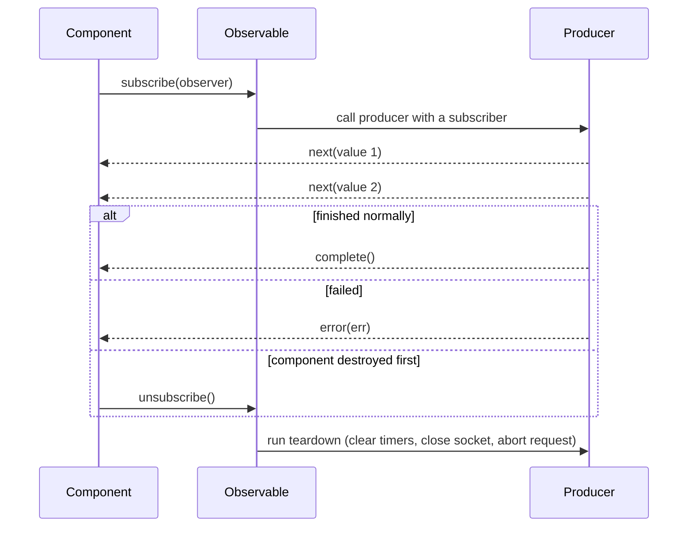
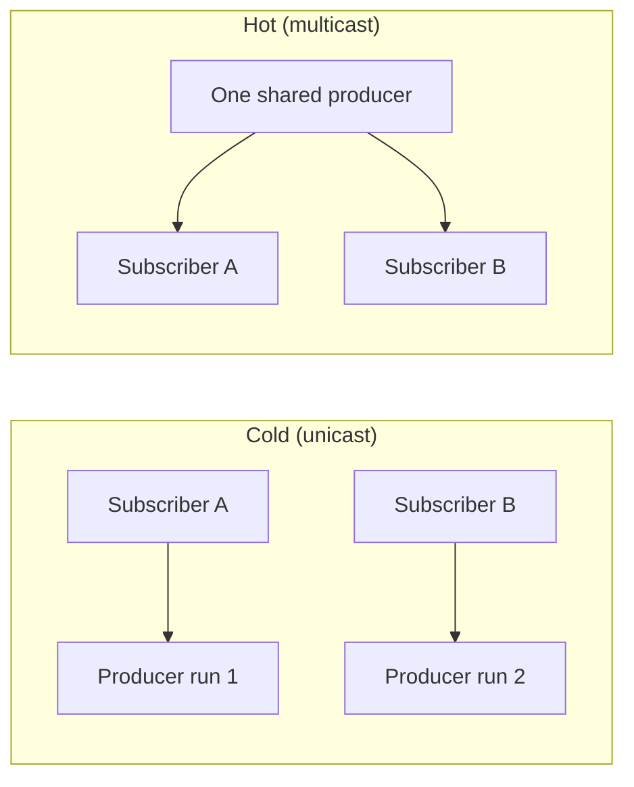
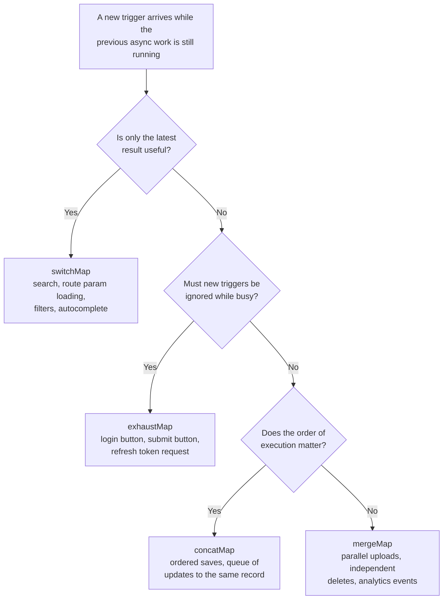
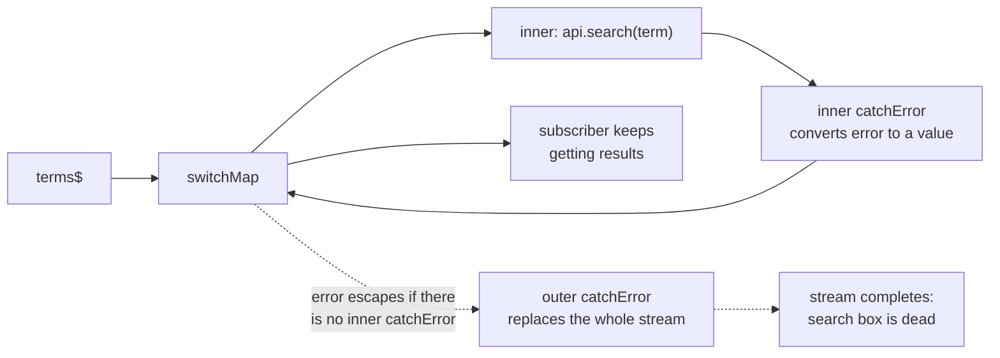

# RxJS in Angular

> RxJS is the library Angular uses for anything that happens over time: HTTP responses, form value changes, router events, user input and app state. In this document you will learn Observables, Subjects and the most important operators from the ground up, how to avoid memory leaks, and how to explain all of it clearly in an interview.

**Before this:** [Callbacks and promises](../02-javascript/17-callbacks-and-promises.md) · [Event loop](../02-javascript/16-event-loop.md) · [Angular fundamentals](01-angular-fundamentals.md) · **Interview questions:** [jump to the interview section](#interview-questions)

## Table of contents

1. [What RxJS is and why Angular uses it](#what-rxjs-is-and-why-angular-uses-it)
2. [Observables](#observables)
3. [Observable vs Promise](#observable-vs-promise)
4. [Creating Observables](#creating-observables)
5. [Subscribing, observers and teardown](#subscribing-observers-and-teardown)
6. [Cold vs hot and unicast vs multicast](#cold-vs-hot-and-unicast-vs-multicast)
7. [Subjects](#subjects)
8. [Operators and how to read marble diagrams](#operators-and-how-to-read-marble-diagrams)
9. [Transformation operators](#transformation-operators)
10. [Filtering operators](#filtering-operators)
11. [Combination operators](#combination-operators)
12. [Higher-order mapping: switchMap, mergeMap, concatMap, exhaustMap](#higher-order-mapping-switchmap-mergemap-concatmap-exhaustmap)
13. [Error handling: catchError and retry](#error-handling-catcherror-and-retry)
14. [Sharing: share and shareReplay](#sharing-share-and-sharereplay)
15. [Utility operators: tap, finalize, startWith](#utility-operators-tap-finalize-startwith)
16. [Unsubscribe strategies in Angular](#unsubscribe-strategies-in-angular)
17. [RxJS 7 changes you must know](#rxjs-7-changes-you-must-know)
18. [Full example: a typeahead search](#full-example-a-typeahead-search)
19. [RxJS and signals in Angular 16](#rxjs-and-signals-in-angular-16)
20. [Common mistakes](#common-mistakes)
21. [Best practices](#best-practices)
22. [How to explain this in an interview](#how-to-explain-this-in-an-interview)
23. [Interview questions](#interview-questions)
24. [Summary](#summary)
25. [References](#references)

---

## What RxJS is and why Angular uses it

**RxJS** (Reactive Extensions for JavaScript) is a library for working with **streams of values over time**. A stream can be mouse clicks, keystrokes, HTTP responses, timer ticks or messages from a WebSocket.

Think about the async things in a normal Angular app:

- A user types in a search box. You get a new value on every key press.
- You call an API. You get one response later, or an error.
- The route changes. You get a new route parameter.
- A WebSocket sends prices. You get many values, forever.

Promises can only handle "one value, later". Callbacks get messy fast. RxJS gives you **one model for all of these**: the Observable. And it gives you **operators**, which are small functions to filter, transform, combine and cancel those streams.

Angular uses RxJS in its core APIs:

| Angular API | What it returns |
| --- | --- |
| `HttpClient.get()` | `Observable<T>` that emits one response and completes |
| `FormControl.valueChanges` | `Observable` that emits on every value change |
| `ActivatedRoute.paramMap` | `Observable<ParamMap>` that emits when route params change |
| `Router.events` | `Observable<Event>` with navigation events |
| `@Output()` with `EventEmitter` | `EventEmitter` extends RxJS `Subject` |

**Version note:** Angular 16 supports RxJS 6.5.3+ and RxJS 7.4+ (its peer dependency is `^6.5.3 || ^7.4.0`). New Angular 16 projects use **RxJS 7.8**. All examples in this document use RxJS 7 syntax.

---

## Observables

### What it is

An **Observable** is an object that can send you **zero, one or many values over time**, and then maybe finish (complete) or fail (error).

It sends three kinds of notifications:

| Notification | Meaning | How many times |
| --- | --- | --- |
| `next(value)` | "Here is a new value" | 0 to infinite |
| `error(err)` | "Something failed, I am stopping" | at most once |
| `complete()` | "I am done, no more values" | at most once |

After `error` or `complete`, the Observable sends nothing more. These two are called **terminal** notifications.

### Why it exists

You need a way to say: "When values arrive, do this. When I do not care anymore, stop everything and clean up." An Observable gives you both parts: a way to receive values, and a way to **cancel**.

### Analogy

An Observable is like a **YouTube channel subscription**:

- The channel (Observable) publishes videos (values) over time.
- Nothing reaches you until you subscribe.
- You can unsubscribe at any time, and you stop getting videos.
- The channel can close down (complete).

Where the analogy breaks down: a normal YouTube channel publishes even when nobody watches. Most Observables (cold ones) do **nothing at all** until someone subscribes. And each subscriber can get **its own separate run** of the producer. You will see this in [Cold vs hot](#cold-vs-hot-and-unicast-vs-multicast).

### How it works inside

An Observable is basically a **function that is waiting to be called**. The function is called the **producer**. When you call `subscribe()`, RxJS calls the producer and gives it a **subscriber** object. The producer calls `subscriber.next()`, `subscriber.error()` or `subscriber.complete()`.

The producer can return a **teardown function**. RxJS calls it when the subscription ends (by unsubscribe, complete or error). That is where you clear timers, close sockets or abort requests.

```js
import { Observable } from 'rxjs';

const numbers$ = new Observable(subscriber => {
  console.log('Producer started');
  subscriber.next(1);
  subscriber.next(2);
  subscriber.complete();
  return () => console.log('Teardown');
});

console.log('Before subscribe');
numbers$.subscribe({
  next: value => console.log('Value', value),
  complete: () => console.log('Done'),
});
console.log('After subscribe');
```

Output:

```text
Before subscribe
Producer started
Value 1
Value 2
Done
Teardown
After subscribe
```

**Step-by-step walkthrough:**

1. `new Observable(...)` only stores the producer function. Nothing runs yet.
2. `Before subscribe` is printed.
3. `subscribe()` calls the producer. `Producer started` is printed.
4. The producer calls `next(1)` and `next(2)`. The `next` handler prints both values **synchronously**.
5. The producer calls `complete()`. The `complete` handler prints `Done`.
6. The producer returns the teardown function. The subscription is already closed, so RxJS runs the teardown right away. `Teardown` is printed.
7. `subscribe()` returns, and `After subscribe` is printed.

Two important lessons from this example:

- **Observables are lazy.** The producer runs only when you subscribe.
- **Observables are not always async.** This one emitted everything synchronously, before `subscribe()` returned.

The `$` at the end of `numbers$` is a naming convention. It means "this variable holds an Observable". It is not required, but most Angular teams use it.

---

## Observable vs Promise

Both handle async results. They are not the same thing.

| | Promise | Observable |
| --- | --- | --- |
| Number of values | Exactly one (or a rejection) | Zero, one or many |
| Start | **Eager**: the executor runs immediately when you create it | **Lazy**: the producer runs only on `subscribe()` |
| Cancellation | No built-in cancel | `unsubscribe()` stops it and runs teardown |
| Sync or async | `then` callbacks are always async (microtask) | Can emit synchronously or asynchronously |
| Sharing | One result shared by everyone who calls `then` | Cold Observables run once **per subscriber** (unless shared) |
| Operators | `then`, `catch`, `finally` | 100+ operators: `map`, `filter`, `switchMap`, `retry`... |
| Part of | JavaScript language (ECMAScript) | A library (RxJS) |

### Eager vs lazy

```js
import { Observable } from 'rxjs';

const promise = new Promise(resolve => {
  console.log('Promise executor runs');
  resolve(42);
});

const value$ = new Observable(subscriber => {
  console.log('Observable producer runs');
  subscriber.next(42);
  subscriber.complete();
});

console.log('Nothing subscribed yet');
```

Output:

```text
Promise executor runs
Nothing subscribed yet
```

The Promise started work immediately. The Observable did nothing, because nobody subscribed.

**Real-world impact:** in Angular, `this.http.post('/api/orders', order)` alone sends **no request**. You must subscribe (or use the `async` pipe). Forgetting to subscribe to an HTTP call is a common bug.

### Cancellation

```js
import { interval } from 'rxjs';

const sub = interval(100).subscribe(n => console.log('tick', n));
setTimeout(() => sub.unsubscribe(), 350);
// tick 0
// tick 1
// tick 2
// (nothing more: the timer inside interval was cleared)
```

With a Promise you can ignore the result, but you cannot stop the work. With `HttpClient`, unsubscribing **aborts the HTTP request** in the browser. (The server may still have processed it. Cancel means "I stop waiting", not "undo".)

### When to use which

- Use a **Promise** (or `async/await`) for a single one-time result where cancellation does not matter. Example: reading a config file once in a Node.js script.
- Use an **Observable** when values arrive many times, when you need cancellation, or when you need to combine, debounce or retry streams. In Angular, most async work is already an Observable, so you stay in RxJS.

You can convert between them. See [RxJS 7 changes](#rxjs-7-changes-you-must-know) for `firstValueFrom` and `lastValueFrom`, and use `from(promise)` to turn a Promise into an Observable.

---

## Creating Observables

You rarely write `new Observable()` yourself. RxJS has **creation functions**.

| Function | What it emits | Completes? |
| --- | --- | --- |
| `of(a, b, c)` | The given values, one by one, synchronously | Yes, right after |
| `from(array)` | Each item of an array or iterable | Yes |
| `from(promise)` | The resolved value | Yes |
| `fromEvent(element, 'click')` | DOM events (or Node `EventEmitter` events) | No, never |
| `interval(1000)` | 0, 1, 2, ... every 1000 ms | No, never |
| `timer(500)` | One `0` after 500 ms | Yes |
| `timer(0, 1000)` | 0 now, then 1, 2, ... every 1000 ms | No |
| `EMPTY` | Nothing | Yes, immediately |
| `NEVER` | Nothing | Never |
| `throwError(() => err)` | Nothing | Errors immediately |
| `defer(() => obs$)` | Runs the factory on each subscribe | Depends on the result |

```js
import { of, from, timer, defer } from 'rxjs';

of('Ann', 'Bob').subscribe(name => console.log(name));
// Ann
// Bob

from([10, 20]).subscribe(n => console.log(n));
// 10
// 20

from(fetch('/api/user')).subscribe(response => console.log(response.status)); // browser example

timer(500).subscribe(() => console.log('Half a second passed'));
```

### fromEvent in an Angular component

```ts
import { AfterViewInit, Component, ElementRef, OnDestroy, ViewChild } from '@angular/core';
import { Subscription, fromEvent, map } from 'rxjs';

@Component({
  selector: 'app-mouse-tracker',
  template: `<div #area class="area">Move the mouse here</div>`,
})
export class MouseTrackerComponent implements AfterViewInit, OnDestroy {
  @ViewChild('area') area!: ElementRef<HTMLDivElement>;
  private sub?: Subscription;

  ngAfterViewInit(): void {
    this.sub = fromEvent<MouseEvent>(this.area.nativeElement, 'mousemove')
      .pipe(map(event => ({ x: event.offsetX, y: event.offsetY })))
      .subscribe(position => console.log(position));
  }

  ngOnDestroy(): void {
    this.sub?.unsubscribe(); // removes the event listener
  }
}
```

`fromEvent` adds the listener on subscribe and removes it on unsubscribe. This is the teardown idea in practice.

### defer: create work at subscribe time

`defer` is useful when you want something fresh for every subscriber. A common case is wrapping a Promise-returning function so it stays lazy:

```js
import { defer, from } from 'rxjs';

// ❌ Wrong: fetch() runs immediately, even if nobody subscribes
const eager$ = from(fetch('/api/settings'));

// ✅ Correct: fetch() runs on each subscribe
const lazy$ = defer(() => fetch('/api/settings'));
```

### new Observable: wrapping a non-RxJS API

When an API is callback-based, wrap it yourself and always return a teardown:

```ts
import { Observable } from 'rxjs';

export function fromWebSocket(url: string): Observable<MessageEvent> {
  return new Observable<MessageEvent>(subscriber => {
    const socket = new WebSocket(url);
    socket.onmessage = event => subscriber.next(event);
    socket.onerror = () => subscriber.error(new Error('WebSocket error'));
    socket.onclose = () => subscriber.complete();

    return () => socket.close(); // runs on unsubscribe
  });
}
```

Each subscriber opens its own socket (cold). To share one socket between many components, see [Sharing](#sharing-share-and-sharereplay).

---

## Subscribing, observers and teardown

### The observer object

An **observer** is an object with up to three callbacks:

```js
import { of } from 'rxjs';

of(1, 2).subscribe({
  next: value => console.log('next', value),
  error: err => console.error('error', err),
  complete: () => console.log('complete'),
});
// next 1
// next 2
// complete
```

You can pass only a `next` function: `obs$.subscribe(value => ...)`.

> **RxJS 7 note:** passing three separate functions, `subscribe(next, error, complete)`, is **deprecated**. Use the observer object when you need `error` or `complete`.

### The Subscription object

`subscribe()` returns a **Subscription**. It has one main method: `unsubscribe()`.

```js
import { interval, Subscription } from 'rxjs';

const subs = new Subscription();
subs.add(interval(1000).subscribe(n => console.log('A', n)));
subs.add(interval(500).subscribe(n => console.log('B', n)));

// Later: stop both at once
subs.unsubscribe();
```

### Which subscriptions must you clean up?

| Source | Completes by itself? | Need to unsubscribe? |
| --- | --- | --- |
| `HttpClient` calls | Yes, after the response | Usually no, but unsubscribing cancels a slow request (useful on navigation) |
| `of`, `from(array)` | Yes, immediately | No |
| `interval`, `fromEvent` | Never | **Yes** |
| `FormControl.valueChanges` | Never | Yes, unless the control dies with the component (still a good habit) |
| `ActivatedRoute.paramMap` | The router completes it when the route component is destroyed | Not strictly, but a consistent pattern is simpler |
| Your own `Subject` / store selectors | Usually never | **Yes** |
| `Router.events` | Never | **Yes** |

The safe rule: **if you subscribe manually, decide how it ends.** See [Unsubscribe strategies](#unsubscribe-strategies-in-angular).

### Errors stop the stream

When an Observable errors, it is finished. Values after the error are never delivered. If you do not pass an `error` callback, RxJS reports the error as an unhandled error (it is rethrown asynchronously). In Angular, it reaches the global `ErrorHandler`, and you see it in the console.



---

## Cold vs hot and unicast vs multicast

This is one of the most misunderstood RxJS ideas. It is about **who owns the producer**, not about sync vs async.

### Cold Observable

A **cold** Observable creates its producer **inside** the subscription. Every subscriber gets **its own independent run**.

```js
import { Observable } from 'rxjs';

let requestCount = 0;
const user$ = new Observable(subscriber => {
  requestCount++;
  console.log(`HTTP request #${requestCount}`);
  subscriber.next({ id: 1, name: 'Ann' });
  subscriber.complete();
});

user$.subscribe(user => console.log('A got', user.name));
user$.subscribe(user => console.log('B got', user.name));
```

Output:

```text
HTTP request #1
A got Ann
HTTP request #2
B got Ann
```

Two subscribers, two "requests". **`HttpClient` Observables are cold.** If your template uses `user$ | async` in two places, Angular sends **two HTTP requests**.

### Hot Observable

A **hot** Observable has a producer that exists **outside** the subscription. Subscribers share it. If you subscribe late, you miss earlier values.

```js
import { Subject } from 'rxjs';

const messages$ = new Subject();
messages$.subscribe(m => console.log('Early subscriber:', m));
messages$.next('hello');
messages$.subscribe(m => console.log('Late subscriber:', m));
messages$.next('world');
```

Output:

```text
Early subscriber: hello
Early subscriber: world
Late subscriber: world
```

Examples of hot sources: DOM events from one element shared through a Subject, WebSocket messages pushed into a Subject, router events, `Subject`s in your services.

### Unicast vs multicast

- **Unicast**: one producer run per subscriber. Cold Observables are unicast.
- **Multicast**: one producer run shared by many subscribers. Subjects are multicast.

You turn a cold Observable into a multicast one with `share()` or `shareReplay()`.

### Analogy

- **Cold** = a movie on Netflix. Each person who presses play gets the movie from the start, on their own stream.
- **Hot** = a live TV broadcast. Everyone watches the same signal. If you turn on the TV late, you missed the beginning.



---

## Subjects

### What it is

A **Subject** is an Observable **and** an observer at the same time:

- Like an Observable, you can `subscribe()` to it.
- Like an observer, you can call `next()`, `error()` and `complete()` on it.

It keeps a list of subscribers and sends each value to all of them. It is **multicast** and **hot**.

### Why it exists

Subjects are the bridge between non-reactive code and streams. You use them to:

- Push values from imperative code (`this.refresh$.next()` on a button click).
- Share one stream between many subscribers.
- Hold application state in a service.

### The four Subject types

```js
import { Subject, BehaviorSubject, ReplaySubject, AsyncSubject } from 'rxjs';

// 1. Subject: no memory. Late subscribers miss earlier values.
const subject = new Subject();
subject.next(1);
subject.subscribe(v => console.log('Subject:', v));
subject.next(2);
// Subject: 2

// 2. BehaviorSubject: needs an initial value, remembers the latest value.
const behavior = new BehaviorSubject(0);
behavior.next(1);
behavior.subscribe(v => console.log('BehaviorSubject:', v));
behavior.next(2);
console.log('Current value:', behavior.value);
// BehaviorSubject: 1
// BehaviorSubject: 2
// Current value: 2

// 3. ReplaySubject: remembers the last N values and replays them.
const replay = new ReplaySubject(2);
replay.next(1);
replay.next(2);
replay.next(3);
replay.subscribe(v => console.log('ReplaySubject:', v));
// ReplaySubject: 2
// ReplaySubject: 3

// 4. AsyncSubject: emits only the last value, and only when it completes.
const asyncSubject = new AsyncSubject();
asyncSubject.subscribe(v => console.log('AsyncSubject:', v));
asyncSubject.next(1);
asyncSubject.next(2);
asyncSubject.complete();
// AsyncSubject: 2
```

| Type | Initial value | What a new subscriber gets | Typical use |
| --- | --- | --- | --- |
| `Subject` | No | Only future values | Events: "refresh clicked", "save requested", a `destroy$` signal |
| `BehaviorSubject` | **Required** | The latest value immediately, then future values | Current state: logged-in user, selected filter, cart |
| `ReplaySubject(n)` | No | The last `n` values, then future values | Late subscribers need history: last 5 notifications, cached result |
| `AsyncSubject` | No | Only the final value, when it completes | Rare. One final result shared by many (like a Promise) |

### After completion

- A completed `Subject` gives a late subscriber only the `complete` notification.
- A completed `ReplaySubject` still replays its buffer, then completes.
- A completed `BehaviorSubject` gives a late subscriber only `complete` (not the last value).

### Real-world usage: an observable data service

This is the classic Angular pattern for state shared between components, before reaching for NgRx (see [State management and NgRx](11-state-management-and-ngrx.md)).

```ts
import { Injectable } from '@angular/core';
import { BehaviorSubject, Observable, map } from 'rxjs';

export interface CartItem {
  productId: string;
  name: string;
  price: number;
  quantity: number;
}

@Injectable({ providedIn: 'root' })
export class CartService {
  // Private: only this service can push new values.
  private readonly itemsSubject = new BehaviorSubject<CartItem[]>([]);

  // Public: components can only read.
  readonly items$: Observable<CartItem[]> = this.itemsSubject.asObservable();

  readonly total$: Observable<number> = this.items$.pipe(
    map(items => items.reduce((sum, item) => sum + item.price * item.quantity, 0)),
  );

  add(item: CartItem): void {
    const current = this.itemsSubject.value;
    const existing = current.find(i => i.productId === item.productId);
    const next = existing
      ? current.map(i => (i.productId === item.productId ? { ...i, quantity: i.quantity + item.quantity } : i))
      : [...current, item];
    this.itemsSubject.next(next); // new array: immutable update
  }

  remove(productId: string): void {
    this.itemsSubject.next(this.itemsSubject.value.filter(i => i.productId !== productId));
  }
}
```

Key points in this code:

- The `BehaviorSubject` is **private**. `asObservable()` hides `next()` from the outside. Only the service changes state.
- Every update creates a **new array**. This works well with `OnPush` change detection (see [Change detection and signals](10-change-detection-and-signals.md)).
- `total$` is **derived** with `map`. You never store the total separately, so it can never be out of sync.

### Common Subject mistakes

```ts
// ❌ Wrong: exposing the Subject. Any component can call cartService.items$.next([])
readonly items$ = new BehaviorSubject<CartItem[]>([]);

// ✅ Correct: keep the Subject private, expose a read-only Observable
private readonly itemsSubject = new BehaviorSubject<CartItem[]>([]);
readonly items$ = this.itemsSubject.asObservable();
```

```ts
// ❌ Wrong: mutating the current value. Subscribers get no new emission,
// and OnPush components see the same array reference.
this.itemsSubject.value.push(item);

// ✅ Correct: emit a new array
this.itemsSubject.next([...this.itemsSubject.value, item]);
```

Another mistake is using a Subject when a simple Observable pipeline would work. If you find yourself subscribing to one stream only to call `next()` on a Subject, you can usually use an operator instead.

---

## Operators and how to read marble diagrams

### What an operator is

A **pipeable operator** is a function that takes an Observable and returns a **new** Observable. It does not change the original. You chain operators with `.pipe()`:

```js
import { of, filter, map } from 'rxjs';

of(1, 2, 3, 4)
  .pipe(
    filter(n => n % 2 === 0), // keep even numbers
    map(n => n * 10),          // multiply by 10
  )
  .subscribe(n => console.log(n));
// 20
// 40
```

Each operator subscribes to the one before it. Nothing runs until the final `subscribe()`.

### Marble diagrams

RxJS docs explain operators with **marble diagrams**. Time goes from left to right.

```text
source:   --1--2--3--|        -  = time passing
                              1  = a value (next)
map(x => x * 10)              |  = complete
                              X  = error
result:   --10-20-30-|
```

This document uses small text timelines like this. Read them from left to right.

---

## Transformation operators

### map

`map` changes every value. It is like `Array.prototype.map`, but over time.

```js
import { of, map } from 'rxjs';

of(10, 20, 30)
  .pipe(map(price => price * 1.2)) // add 20% tax
  .subscribe(v => console.log(v));
// 12
// 24
// 36
```

Angular example: take only what the component needs from an API response.

```ts
readonly productNames$ = this.http
  .get<Product[]>('/api/products')
  .pipe(map(products => products.map(p => p.name)));
```

### scan

`scan` keeps an **accumulator**, like `Array.prototype.reduce`, but it emits the accumulated value **every time** (reduce only emits once, at the end).

```js
import { of, scan } from 'rxjs';

const cartActions$ = of(
  { type: 'add', price: 10 },
  { type: 'add', price: 25 },
  { type: 'remove', price: 10 },
);

cartActions$
  .pipe(scan((total, action) => (action.type === 'add' ? total + action.price : total - action.price), 0))
  .subscribe(total => console.log('Cart total:', total));
// Cart total: 10
// Cart total: 35
// Cart total: 25
```

`scan` is the core idea behind Redux-style state: `state = reducer(state, action)` for every action. NgRx works on the same principle.

---

## Filtering operators

### filter

Keeps only values that pass a test.

```js
of(1, 2, 3, 4, 5, 6).pipe(filter(n => n % 2 === 0)).subscribe(v => console.log(v));
// 2
// 4
// 6
```

### take, first

- `take(n)` emits the first `n` values, then **completes** (and unsubscribes from the source).
- `first()` emits the first value, then completes. `first(predicate)` emits the first value that matches.

```js
import { of, take, first } from 'rxjs';

of('a', 'b', 'c').pipe(take(2)).subscribe({
  next: v => console.log('take', v),
  complete: () => console.log('take complete'),
});
// take a
// take b
// take complete

of(5, 20, 8).pipe(first(n => n > 10)).subscribe(v => console.log(v)); // 20
```

**The important difference:** when the source completes **without any value**:

```js
import { of, take, first } from 'rxjs';

of().pipe(take(1)).subscribe({ complete: () => console.log('take(1): completes quietly') });
// take(1): completes quietly

of().pipe(first()).subscribe({ error: e => console.log('first():', e.name) });
// first(): EmptyError
```

`first()` says "there **must** be a value". `take(1)` says "give me at most one".

### takeUntil

`takeUntil(notifier$)` passes values until `notifier$` emits. Then it completes. It is the classic way to stop subscriptions when a component is destroyed. See [Unsubscribe strategies](#unsubscribe-strategies-in-angular).

### distinctUntilChanged

Skips a value if it is the **same as the previous** value (compared with `===` by default).

```js
import { of, distinctUntilChanged } from 'rxjs';

of('a', 'a', 'b', 'b', 'a').pipe(distinctUntilChanged()).subscribe(v => console.log(v));
// a
// b
// a     <- emitted again, because the previous value was 'b'
```

It is not "unique values forever". It compares only with the **last** value. For objects, pass a compare function, because two different objects are never `===`:

```js
of({ id: 1, name: 'Ann' }, { id: 1, name: 'Ann B' }, { id: 2, name: 'Bob' })
  .pipe(distinctUntilChanged((prev, curr) => prev.id === curr.id))
  .subscribe(user => console.log(user.name));
// Ann
// Bob
```

### debounceTime and throttleTime

These control **how often** values pass. The concept is explained deeply in [Debounce, throttle and performance](../02-javascript/20-debounce-throttle-and-performance.md). Here is the RxJS version.

- `debounceTime(ms)`: wait until the source is **quiet** for `ms`, then emit the **latest** value. Every new value restarts the timer.
- `throttleTime(ms)`: emit the **first** value, then **ignore** values for `ms`.

A user types in a search box at these times (the input stays open, so the stream never completes):

| Time | Value typed |
| --- | --- |
| 0 ms | `a` |
| 50 ms | `an` |
| 100 ms | `ang` |
| 400 ms | `angu` |

```text
input:          a-an-ang--------angu-------------
debounceTime(200):            ang(300ms)    angu(600ms)
throttleTime(200):  a(0ms)                  angu(400ms)
```

- `debounceTime(200)` emits `ang` at 300 ms (100 + 200 quiet ms) and `angu` at 600 ms.
- `throttleTime(200)` emits `a` at 0 ms, ignores `an` and `ang` (inside the 200 ms window), then emits `angu` at 400 ms.

One detail: if the source **completes** while `debounceTime` is waiting, it emits the pending value immediately.

When to use which:

| Use case | Operator | Why |
| --- | --- | --- |
| Search as you type | `debounceTime(300)` | Call the API only after the user pauses |
| Auto-save a draft | `debounceTime(1000)` | Save after the user stops typing |
| Scroll or resize handler | `throttleTime(100)` | React regularly while it continues, not on every event |
| Prevent double click on "Pay" | `exhaustMap` (better) or `throttleTime` | Ignore repeated clicks |

---

## Combination operators

These functions combine several Observables into one.

### combineLatest

Emits an array with the **latest value from each** source, every time **any** source emits. It waits until **every** source has emitted at least once.

```js
import { BehaviorSubject, combineLatest, map } from 'rxjs';

const products$ = new BehaviorSubject([
  { name: 'Laptop', category: 'tech' },
  { name: 'Chair', category: 'home' },
]);
const category$ = new BehaviorSubject('all');

combineLatest([products$, category$])
  .pipe(map(([products, category]) => (category === 'all' ? products : products.filter(p => p.category === category))))
  .subscribe(list => console.log(list.map(p => p.name)));
// [ 'Laptop', 'Chair' ]

category$.next('tech');
// [ 'Laptop' ]
```

Use it for **view models** that depend on several changing inputs (filters + data + user).

### forkJoin

Waits until **all** sources **complete**, then emits **one** value with the **last** value of each. It is like `Promise.all`.

```js
import { forkJoin, of } from 'rxjs';

forkJoin({ user: of('Ann'), orders: of(1, 2, 3) }).subscribe(v => console.log(v));
// { user: 'Ann', orders: 3 }
```

Use it to load several independent HTTP calls in parallel:

```ts
forkJoin({
  user: this.http.get<User>('/api/me'),
  permissions: this.http.get<string[]>('/api/me/permissions'),
}).subscribe(({ user, permissions }) => this.init(user, permissions));
```

Gotchas:

- If any source **errors**, `forkJoin` errors (like `Promise.all`), and the other requests are cancelled.
- If any source **never completes** (like `valueChanges`), `forkJoin` **never emits**.
- If any source completes **without emitting** (like `EMPTY`), `forkJoin` completes **without emitting**.

### merge

Subscribes to all sources at once and passes every value **as it arrives**, interleaved.

```js
import { merge, timer, map } from 'rxjs';

merge(
  timer(100).pipe(map(() => 'slow')),
  timer(0).pipe(map(() => 'fast')),
).subscribe(v => console.log(v));
// fast
// slow
```

Use it to treat several event sources the same way, for example "refresh when the user clicks Refresh **or** every 30 seconds":

```ts
readonly orders$ = merge(this.refreshClicks$, interval(30_000)).pipe(
  switchMap(() => this.orderApi.getOrders()),
);
```

### concat

Subscribes to sources **one after another**. It starts the next only when the previous **completes**.

```js
import { concat, of } from 'rxjs';

concat(of(1, 2), of(3)).subscribe(v => console.log(v));
// 1
// 2
// 3
```

Use it for ordered steps, or to show cached data first and then fresh data: `concat(cached$, fresh$)`.

### withLatestFrom

When the **main** source emits, take the latest value from the other source. The other source does **not** trigger emissions by itself.

```js
import { Subject, withLatestFrom } from 'rxjs';

const filter$ = new Subject();
const exportClick$ = new Subject();

exportClick$
  .pipe(withLatestFrom(filter$))
  .subscribe(([, filter]) => console.log(`Export clicked with filter: ${filter}`));

exportClick$.next('click 1'); // ignored: filter$ has no value yet
filter$.next('active');
exportClick$.next('click 2'); // Export clicked with filter: active
filter$.next('archived');
filter$.next('all');
exportClick$.next('click 3'); // Export clicked with filter: all
```

Use it when an action (a click, a save) needs current state, but state changes alone should not trigger the action.

### zip

Pairs values by **index**: first with first, second with second. It waits for a partner.

```js
import { zip, of } from 'rxjs';

zip(of(1, 2, 3), of('a', 'b')).subscribe(v => console.log(v));
// [ 1, 'a' ]
// [ 2, 'b' ]
```

`zip` is rarely needed in Angular apps. It can buffer values without limit if one source is much faster.

### Comparison table

| Operator | Emits when | Needs completion? | Like |
| --- | --- | --- | --- |
| `combineLatest` | Any source emits (after all emitted once) | No | Spreadsheet cell formula |
| `forkJoin` | All sources complete | **Yes** | `Promise.all` |
| `merge` | Any source emits | No | Many roads into one |
| `concat` | Sources in order, one at a time | Yes (each one) | A queue |
| `withLatestFrom` | Only the main source emits | No | "Read current state on action" |
| `zip` | Each source has a value at the same index | No | A zipper |

---

## Higher-order mapping: switchMap, mergeMap, concatMap, exhaustMap

This is the most important RxJS topic for Angular interviews.

### The problem

Often one stream **triggers** async work that is itself an Observable:

- Every search term → an HTTP request.
- Every "Save" click → an HTTP request.
- Every route param change → load the product.

If you use `map`, you get an **Observable of Observables** (a "higher-order Observable"). That is not what you want:

```ts
// ❌ Wrong: result$ is Observable<Observable<Product[]>>
const result$ = searchTerm$.pipe(map(term => this.api.search(term)));
```

A beginner then subscribes inside a subscribe:

```ts
// ❌ Wrong: nested subscribe. No cancellation, no ordering control, scattered error handling, leaks.
searchTerm$.subscribe(term => {
  this.api.search(term).subscribe(results => (this.results = results));
});
```

If the user types `an` and then `ang`, two requests run. If the `an` response arrives **after** the `ang` response, the screen shows the **wrong (old) results**. This is a **race condition**.

### The solution: flattening operators

A **flattening operator** (also called a higher-order mapping operator) does two things:

1. It maps each outer value to an **inner Observable**.
2. It subscribes to the inner Observable and passes its values out. You get a flat `Observable<Product[]>`.

The four operators differ in only **one question: what happens when a new outer value arrives while the previous inner Observable is still running?**

| Operator | New value arrives while inner work is running | Mental model |
| --- | --- | --- |
| `switchMap` | **Cancel** the old inner, start the new one | "Only the latest matters" |
| `mergeMap` | Run **both in parallel** | "Do everything, in any order" |
| `concatMap` | **Queue** the new one; start it after the old one completes | "One at a time, in order" |
| `exhaustMap` | **Ignore** the new value | "Busy, do not disturb" |

A short way to remember: **switch = replace, merge = overlap, concat = queue, exhaust = ignore.**

### A timeline you can run

Clicks arrive at 0 ms, 100 ms and 200 ms. Each save takes 150 ms.

```js
import { merge, timer, map, switchMap, mergeMap, concatMap, exhaustMap } from 'rxjs';

const at = (ms, value) => timer(ms).pipe(map(() => value));
const clicks$ = merge(at(0, 1), at(100, 2), at(200, 3));
const save = id => timer(150).pipe(map(() => `saved ${id}`));

clicks$.pipe(switchMap(id => save(id))).subscribe(console.log);
// Try each operator in turn: switchMap, mergeMap, concatMap, exhaustMap
```

Results (verified with Node.js and RxJS 7.8):

| Operator | Output |
| --- | --- |
| `switchMap` | `saved 3` at 350 ms |
| `mergeMap` | `saved 1` at 150 ms, `saved 2` at 250 ms, `saved 3` at 350 ms |
| `concatMap` | `saved 1` at 150 ms, `saved 2` at 300 ms, `saved 3` at 450 ms |
| `exhaustMap` | `saved 1` at 150 ms, `saved 3` at 350 ms |

```text
clicks:      1---------2---------3-----------------------
             0ms       100ms     200ms

switchMap:   [1 cancelled][2 cancelled][3 ......] saved 3 (350)

mergeMap:    [1 ......] saved 1 (150)
                       [2 ......] saved 2 (250)
                                 [3 ......] saved 3 (350)

concatMap:   [1 ......] saved 1 (150)
                       (2 waits) [2 ......] saved 2 (300)
                                           [3 ......] saved 3 (450)

exhaustMap:  [1 ......] saved 1 (150)
                       (2 ignored: 1 is still busy)
                                 [3 ......] saved 3 (350)
```

**Step-by-step for `exhaustMap`:**

1. At 0 ms, click 1 arrives. Nothing is running, so save 1 starts.
2. At 100 ms, click 2 arrives. Save 1 is still running (it ends at 150 ms). Click 2 is **dropped**.
3. At 150 ms, save 1 finishes. `saved 1` is emitted.
4. At 200 ms, click 3 arrives. Nothing is running, so save 3 starts.
5. At 350 ms, `saved 3` is emitted.

### When to use each one



**switchMap: search and route params**

```ts
// Product details page: when the :id param changes, cancel the old request
readonly product$ = this.route.paramMap.pipe(
  map(params => params.get('id')!),
  switchMap(id => this.productApi.getById(id)),
);
```

If the user clicks "next product" quickly, older requests are cancelled. Only the latest product is shown.

**mergeMap: parallel independent work**

```ts
// Upload many files at the same time, but at most 3 at once
uploadAll(files: File[]): Observable<UploadResult> {
  return from(files).pipe(mergeMap(file => this.uploadApi.upload(file), 3));
}
```

The second argument of `mergeMap` is the **concurrency limit**. With 4 files and a limit of 2, files 1 and 2 start first. Files 3 and 4 start when slots free up:

```js
import { of, timer, map, mergeMap } from 'rxjs';

of(1, 2, 3, 4)
  .pipe(mergeMap(id => timer(100).pipe(map(() => `file ${id}`)), 2))
  .subscribe(console.log);
// file 1 (at ~100 ms)
// file 2 (at ~100 ms)
// file 3 (at ~200 ms)
// file 4 (at ~200 ms)
```

**concatMap: ordered saves**

```ts
// Every edit to the same document must reach the server in order
this.edits$.pipe(concatMap(patch => this.documentApi.save(patch))).subscribe();
```

With `mergeMap` here, edit 2 might reach the server before edit 1. Then edit 1 overwrites it with older data. With `switchMap`, edits would be cancelled and lost.

**exhaustMap: login and submit buttons**

```ts
// Ignore extra clicks while the login request is running
this.loginClicks$
  .pipe(exhaustMap(() => this.authService.login(this.form.getRawValue())))
  .subscribe(() => this.router.navigate(['/dashboard']));
```

The user double-clicks "Login". Only one request is sent. (Also disable the button, for good UX.)

### Trade-offs and traps

- **`switchMap` for writes is dangerous.** Cancelling a POST means "stop waiting for the response". The server may still save it. You lose the result and may not know if it succeeded. Use `concatMap` or `exhaustMap` for writes.
- **`concatMap` can build an unbounded queue.** If triggers arrive faster than the work finishes, the queue keeps growing.
- **`exhaustMap` drops user intent silently.** Show a "Saving..." state so the user knows why the click did nothing.
- **`mergeMap` without a limit** can fire hundreds of requests at once. Pass a concurrency number.
- **`switchMap` only cancels work that is still running.** If the inner Observable is synchronous (like `of(x)`), it completes immediately, so nothing is ever cancelled. See [Q11](#q11-what-does-this-switchmap-code-print).

---

## Error handling: catchError and retry

### The rule you must remember

**An error ends the stream.** After `error`, no more values come. In a long-living stream (a search box, button clicks), one unhandled HTTP error can **kill the whole feature**.

### catchError

`catchError` catches an error and **replaces** the failed stream with a new Observable.

```js
import { throwError, of, catchError } from 'rxjs';

throwError(() => new Error('Server down'))
  .pipe(catchError(err => of(`Fallback because: ${err.message}`)))
  .subscribe(v => console.log(v));
// Fallback because: Server down
```

What you can return from `catchError`:

| Return | Effect |
| --- | --- |
| `of(fallbackValue)` | Emit a fallback value, then complete |
| `EMPTY` | Complete quietly, emit nothing |
| `throwError(() => newError)` | Rethrow (maybe a friendlier error) |
| The caught source (the second argument) | Resubscribe (a manual retry; easy to create an infinite loop) |

### Inner vs outer catchError

This is a very common interview question.

```js
import { Subject, of, throwError, switchMap, catchError } from 'rxjs';

const search = term =>
  term === 'bad' ? throwError(() => new Error('Server error')) : of(`results for ${term}`);

// ❌ Wrong: catchError on the OUTER stream
const terms$ = new Subject();
terms$
  .pipe(
    switchMap(term => search(term)),
    catchError(() => of('Search failed')),
  )
  .subscribe({ next: console.log, complete: () => console.log('Search stream completed') });

terms$.next('cat');
terms$.next('bad');
terms$.next('dog');
```

Output:

```text
results for cat
Search failed
Search stream completed
```

`dog` is never searched. The error from the inner Observable travelled into the outer stream. `catchError` replaced the **whole outer stream** with `of('Search failed')`, and that completed. The search box is now dead.

```js
// ✅ Correct: catchError INSIDE switchMap, on the inner Observable
const terms2$ = new Subject();
terms2$
  .pipe(switchMap(term => search(term).pipe(catchError(() => of(`Search failed for ${term}`)))))
  .subscribe(console.log);

terms2$.next('cat');
terms2$.next('bad');
terms2$.next('dog');
```

Output:

```text
results for cat
Search failed for bad
results for dog
```

Only the inner request was replaced. The outer stream keeps living.



### retry

`retry` resubscribes to the source when it errors. For a cold HTTP Observable, resubscribing means **sending the request again**.

Since RxJS 7.3, `retry` accepts a config object with a `delay`:

```js
import { defer, of, throwError, retry } from 'rxjs';

let attempt = 0;
const flaky$ = defer(() => {
  attempt++;
  console.log(`Attempt ${attempt}`);
  return attempt < 3 ? throwError(() => new Error('Network error')) : of('Data loaded');
});

flaky$.pipe(retry({ count: 3, delay: 100 })).subscribe(console.log);
// Attempt 1
// Attempt 2
// Attempt 3
// Data loaded
```

**Exponential backoff:** pass a function as `delay`. It receives the error and the retry number, and returns an Observable. When that Observable emits, RxJS retries. If it errors, the error is passed on.

```ts
import { HttpErrorResponse } from '@angular/common/http';
import { retry, throwError, timer } from 'rxjs';

export function retryWithBackoff<T>(maxRetries = 3) {
  return retry<T>({
    count: maxRetries,
    delay: (error: unknown, retryCount: number) => {
      // Never retry 4xx: the request itself is wrong and will fail again.
      if (error instanceof HttpErrorResponse && error.status >= 400 && error.status < 500) {
        return throwError(() => error);
      }
      return timer(2 ** retryCount * 500); // 1 s, 2 s, 4 s
    },
  });
}

// usage: this.http.get<Order[]>('/api/orders').pipe(retryWithBackoff<Order[]>())
```

Rules for retries:

- Only retry **safe** requests (GET) or **idempotent** requests (safe to repeat). Retrying a POST that is not idempotent can create two orders.
- Do not retry 400/401/403/404/422. They fail the same way every time.
- Add a delay. Instant retries hammer a server that is already struggling.
- Put `retry` **before** `catchError`, so `catchError` handles only the final failure.

> **Deprecated in RxJS 7:** `retryWhen`. Use `retry({ delay })` instead.

### Error handling order in a pipe

```ts
this.http.get<Order[]>('/api/orders').pipe(
  retry({ count: 2, delay: 1000 }), // 1. try again on failure
  catchError(() => {                // 2. final failure: decide what the UI gets
    this.notifications.error('Could not load orders');
    return of([] as Order[]);
  }),
);
```

HTTP error handling in depth (status codes, `HttpErrorResponse`, interceptors) is in [HttpClient and interceptors](08-httpclient-and-interceptors.md).

---

## Sharing: share and shareReplay

### The problem

Cold Observables run once per subscriber. In Angular this causes **duplicate HTTP requests**:

```html
<!-- ❌ Two subscriptions = two HTTP requests -->
<h1>{{ (user$ | async)?.name }}</h1>


<!-- ✅ One subscription -->
<ng-container *ngIf="user$ | async as user">
  <h1>{{ user.name }}</h1>
  
</ng-container>
```

When several components or services need the same stream, you need sharing operators.

### share

`share()` makes a cold Observable **multicast**. The first subscriber starts the source. Later subscribers join the **same** run. When all subscribers leave, `share` unsubscribes from the source (this is called **reference counting**).

```js
import { timer, map, take, share } from 'rxjs';

let runs = 0;
const ticker$ = timer(0, 50).pipe(
  map(v => { runs++; return v; }),
  take(3),
  share(),
);

ticker$.subscribe(v => console.log('A', v));
ticker$.subscribe(v => console.log('B', v));
// A 0, B 0, A 1, B 1, A 2, B 2  -> map ran 3 times, not 6
```

`share()` does **not** replay. A subscriber who joins late misses earlier values.

### shareReplay

`shareReplay` is `share` plus a **ReplaySubject**. Late subscribers get the last `bufferSize` values immediately.

```js
import { Observable, shareReplay } from 'rxjs';

let requestCount = 0;
const user$ = new Observable(subscriber => {
  requestCount++;
  console.log(`HTTP request #${requestCount}`);
  subscriber.next({ id: 1, name: 'Ann' });
  subscriber.complete();
}).pipe(shareReplay({ bufferSize: 1, refCount: true }));

user$.subscribe(u => console.log('A got', u.name));
user$.subscribe(u => console.log('B got', u.name));
```

Output:

```text
HTTP request #1
A got Ann
B got Ann
```

Only one request. B got the replayed value. The source **completed**, so `shareReplay` keeps the cached value and does not run the source again.

A simple cache in a service:

```ts
@Injectable({ providedIn: 'root' })
export class CountryService {
  private readonly http = inject(HttpClient);

  // One request for the whole app session. Every subscriber gets the cached list.
  readonly countries$ = this.http
    .get<Country[]>('/api/countries')
    .pipe(shareReplay({ bufferSize: 1, refCount: true }));
}
```

### The refCount pitfall

`shareReplay(1)` is shorthand for `shareReplay({ bufferSize: 1, refCount: false })`. With `refCount: false`, the **source subscription stays alive even after every subscriber has unsubscribed**.

For a source that completes (like an HTTP call), this is harmless: the request finished anyway.

For a source that **never completes** (interval, WebSocket, `valueChanges`, a store selector), this is a **memory leak**:

```js
import { interval, tap, shareReplay } from 'rxjs';

const prices$ = interval(100).pipe(
  tap(v => console.log('source tick', v)),
  shareReplay(1), // refCount: false
);

const sub = prices$.subscribe();
setTimeout(() => sub.unsubscribe(), 250);
// source tick 0
// source tick 1
// (unsubscribed here)
// source tick 2
// source tick 3
// ... keeps running forever
```

With `shareReplay({ bufferSize: 1, refCount: true })`, the ticks stop right after the last subscriber leaves. (Both versions were verified in Node.js with RxJS 7.8.)

**Rule:** for long-living sources, write `shareReplay({ bufferSize: 1, refCount: true })`.

### shareReplay is not a full cache

- It never expires. Stale data stays forever, unless you rebuild the Observable.
- If the source errors, the error is not cached. The next subscriber runs the source again.
- It has no per-user or per-tenant separation. A `providedIn: 'root'` service keeps the cache after logout. Clear it on logout.

For real caching strategies, see [Caching strategies and invalidation](../09-system-design/03-caching-strategies-and-invalidation.md).

---

## Utility operators: tap, finalize, startWith

### tap

`tap` runs a **side effect** for each value and passes the value through unchanged. Use it for logging, debugging or setting a flag. Do not use it to transform data (use `map`).

```js
import { of, tap, map } from 'rxjs';

of('Ann', 'Bob')
  .pipe(
    tap(name => console.log('tap saw', name)),
    map(name => name.toUpperCase()),
  )
  .subscribe(v => console.log('value', v));
// tap saw Ann
// value ANN
// tap saw Bob
// value BOB
```

Since RxJS 7.3, the `tap` observer object also accepts `subscribe`, `unsubscribe` and `finalize` handlers.

### finalize

`finalize` runs a callback when the stream ends **for any reason**: complete, error or unsubscribe. It is like `finally` for Promises. It is perfect for hiding a loading spinner.

```ts
loadOrders(): void {
  this.loading = true;
  this.orderApi
    .getOrders()
    .pipe(finalize(() => (this.loading = false))) // runs on success, error and cancel
    .subscribe({
      next: orders => (this.orders = orders),
      error: () => (this.errorMessage = 'Could not load orders'),
    });
}
```

If you hide the spinner only in `next`, it stays visible forever after an error or a cancel.

### startWith

`startWith(value)` emits a value first, before the source emits. Use it for initial or loading states.

```js
import { of, map, startWith, tap, finalize } from 'rxjs';

of('Ann', 'Bob')
  .pipe(
    tap(name => console.log('tap saw', name)),
    map(name => name.toUpperCase()),
    startWith('LOADING'),
    finalize(() => console.log('finalize: cleanup')),
  )
  .subscribe({ next: v => console.log('value', v), complete: () => console.log('complete') });
```

Output:

```text
value LOADING
tap saw Ann
value ANN
tap saw Bob
value BOB
complete
finalize: cleanup
```

Notice the order: `finalize` runs **after** the subscriber's `complete` callback.

A common Angular use: `valueChanges` does not emit the current value on subscribe. Add `startWith(control.value)` when you need it:

```ts
readonly filteredUsers$ = this.searchControl.valueChanges.pipe(
  startWith(this.searchControl.value),
  map(term => this.filterUsers(term)),
);
```

---

## Unsubscribe strategies in Angular

### Why leaks happen

A component subscribes to a long-living stream (an interval, a store, a service Subject, `Router.events`). The user navigates away, and Angular destroys the component. But the **subscription is still alive**. The source still holds a reference to the callback, and the callback holds a reference to the component. The component cannot be garbage collected. Worse, the callback keeps running. It may update a dead component or send requests.

How references keep objects alive is explained in [Memory management and garbage collection](../02-javascript/19-memory-management-and-garbage-collection.md).

### Strategy 1: the async pipe (best default)

The `async` pipe subscribes when the view is created and unsubscribes when the view is destroyed. On every new value it calls `markForCheck()`, so it works with `OnPush`.

```ts
@Component({
  selector: 'app-order-list',
  template: `
    <ng-container *ngIf="orders$ | async as orders; else loading">
      <app-order-row *ngFor="let order of orders; trackBy: trackById" [order]="order"></app-order-row>
    </ng-container>
    <ng-template #loading><p>Loading orders...</p></ng-template>
  `,
  changeDetection: ChangeDetectionStrategy.OnPush,
})
export class OrderListComponent {
  readonly orders$ = inject(OrderService).getOrders();

  trackById(index: number, order: Order): string {
    return order.id;
  }
}
```

No `subscribe`, no `ngOnDestroy`, no leak. The pipe is covered in more depth in [Directives and pipes](03-directives-and-pipes.md).

### Strategy 2: takeUntil with a destroy$ Subject (works in every version)

```ts
@Component({ selector: 'app-live-prices', template: `{{ price }}` })
export class LivePricesComponent implements OnInit, OnDestroy {
  price = 0;
  private readonly destroy$ = new Subject<void>();

  constructor(private readonly priceService: PriceService) {}

  ngOnInit(): void {
    this.priceService.prices$
      .pipe(takeUntil(this.destroy$)) // keep takeUntil LAST in the pipe
      .subscribe(price => (this.price = price));
  }

  ngOnDestroy(): void {
    this.destroy$.next();
    this.destroy$.complete();
  }
}
```

**Put `takeUntil` last.** If an operator like `switchMap` comes after `takeUntil`, the inner subscription that `switchMap` creates is not stopped:

```ts
// ❌ Wrong: switchMap after takeUntil keeps the inner interval alive
source$.pipe(takeUntil(this.destroy$), switchMap(() => interval(1000))).subscribe();

// ✅ Correct
source$.pipe(switchMap(() => interval(1000)), takeUntil(this.destroy$)).subscribe();
```

### Strategy 3: takeUntilDestroyed (Angular 16)

Angular 16 added `DestroyRef` and the `takeUntilDestroyed` operator in `@angular/core/rxjs-interop`. In Angular 16 it is a **developer preview** API. It became **stable in Angular 19**.

`takeUntilDestroyed()` completes the stream when the current component, directive or service is destroyed. Without an argument, you must call it in an **injection context** (a constructor or a field initializer):

```ts
import { Component, DestroyRef, OnInit, inject } from '@angular/core';
import { takeUntilDestroyed } from '@angular/core/rxjs-interop';

@Component({ selector: 'app-live-prices', template: `{{ price }}` })
export class LivePricesComponent implements OnInit {
  price = 0;
  private readonly priceService = inject(PriceService);
  private readonly destroyRef = inject(DestroyRef);

  constructor() {
    // ✅ Injection context: no argument needed
    this.priceService.prices$.pipe(takeUntilDestroyed()).subscribe(p => (this.price = p));
  }

  ngOnInit(): void {
    // ✅ Not an injection context: pass the DestroyRef explicitly
    this.priceService.alerts$.pipe(takeUntilDestroyed(this.destroyRef)).subscribe(a => console.log(a));
  }
}
```

If you call `takeUntilDestroyed()` without an argument inside `ngOnInit`, Angular throws error NG0203. `DestroyRef`, the exact error message and the comparison with the `destroy$` pattern are in [Lifecycle hooks: DestroyRef and takeUntilDestroyed](04-lifecycle-hooks.md#destroyref-and-takeuntildestroyed). Injection context rules are in [Dependency injection](05-dependency-injection.md#the-injection-context-rule).

### Strategy 4: take(1) or first() for one value

When you need only one value (for example, the current filter at the moment of a click), complete the stream yourself:

```ts
onExport(): void {
  this.filterService.filter$
    .pipe(take(1))
    .subscribe(filter => this.exportService.export(filter));
}
```

### Strategy 5: store and unsubscribe a Subscription

This is fine for one or two subscriptions. It becomes noisy with many.

```ts
private readonly subs = new Subscription();

ngOnInit(): void {
  this.subs.add(this.source$.subscribe(value => this.handle(value)));
}

ngOnDestroy(): void {
  this.subs.unsubscribe();
}
```

### Which strategy to choose

| Situation | Strategy |
| --- | --- |
| Show data in the template | `async` pipe |
| Need values in TypeScript, Angular 16+ | `takeUntilDestroyed()` |
| Need values in TypeScript, older code base | `takeUntil(this.destroy$)` |
| Need only one value | `take(1)` / `first()` |
| Want a signal instead (Angular 16+) | `toSignal()` (it unsubscribes automatically) |

---

## RxJS 7 changes you must know

Angular 16 apps use RxJS 7. These changes come up in code reviews and interviews.

**1. `toPromise()` is deprecated. Use `firstValueFrom` or `lastValueFrom` (added in RxJS 7.0).**

```js
import { of, EMPTY, firstValueFrom, lastValueFrom } from 'rxjs';

const price$ = of(10, 20, 30);
console.log(await firstValueFrom(price$)); // 10  (resolves on the first value, then unsubscribes)
console.log(await lastValueFrom(price$));  // 30  (waits for completion)

await firstValueFrom(EMPTY);                           // rejects with EmptyError
await firstValueFrom(EMPTY, { defaultValue: 'none' }); // 'none'
```

`toPromise()` resolved with `undefined` when the source completed without a value. That hid bugs. The new functions reject with `EmptyError`, unless you pass `defaultValue`. `toPromise()` is planned for removal in RxJS 8.

Warning: `lastValueFrom` on a stream that never completes (like `valueChanges`) **never resolves**.

**2. Import operators from `'rxjs'` (RxJS 7.2+).**

```ts
// Old style (still works)
import { map, filter } from 'rxjs/operators';

// RxJS 7.2+ style
import { map, filter, Observable } from 'rxjs';
```

**3. `subscribe(next, error, complete)` with three functions is deprecated.** Use an observer object.

**4. `throwError` takes a factory:** `throwError(() => new Error('x'))`. Passing the error value directly is deprecated.

**5. `retry` accepts `{ count, delay, resetOnSuccess }` (7.3).** `retryWhen` is deprecated.

**6. `share` is configurable (7.0):** `share({ connector, resetOnError, resetOnComplete, resetOnRefCountZero })`. The old `multicast`, `publish`, `publishReplay` and `refCount` operators are deprecated. Use `share`, `shareReplay` or `connectable`.

**7. `combineLatest` takes an array or an object:** `combineLatest([a$, b$])` or `combineLatest({ a: a$, b: b$ })`. Passing separate arguments is deprecated. The operator forms `combineLatestWith`, `mergeWith`, `concatWith` and `zipWith` replace the old operator versions of `combineLatest`, `merge`, `concat` and `zip`.

---

## Full example: a typeahead search

This example puts many operators together. It is a classic machine-coding and interview task.

**Requirements:**

- Search products as the user types.
- Do not call the API on every key press. Wait for 300 ms of quiet.
- Do not search again if the term did not change.
- Ignore terms shorter than 2 characters.
- Cancel old requests when a new term arrives (no race conditions).
- Show loading, results, empty and error states. An error must not break later searches.

**The API service:**

```ts
import { HttpClient, HttpParams } from '@angular/common/http';
import { Injectable, inject } from '@angular/core';
import { Observable } from 'rxjs';

export interface Product {
  id: string;
  name: string;
  price: number;
}

@Injectable({ providedIn: 'root' })
export class ProductApi {
  private readonly http = inject(HttpClient);

  search(term: string): Observable<Product[]> {
    const params = new HttpParams().set('q', term).set('limit', 10);
    return this.http.get<Product[]>('/api/products/search', { params });
  }
}
```

**The component (Angular 16, standalone, OnPush):**

```ts
import { AsyncPipe, CurrencyPipe, NgFor, NgIf } from '@angular/common';
import { ChangeDetectionStrategy, Component, inject } from '@angular/core';
import { FormControl, ReactiveFormsModule } from '@angular/forms';
import { Observable, catchError, debounceTime, distinctUntilChanged, map, of, startWith, switchMap } from 'rxjs';
import { Product, ProductApi } from './product-api';

interface SearchViewModel {
  loading: boolean;
  error: string | null;
  products: Product[] | null; // null = no search yet
}

const IDLE: SearchViewModel = { loading: false, error: null, products: null };

@Component({
  selector: 'app-product-search',
  standalone: true,
  imports: [ReactiveFormsModule, AsyncPipe, NgIf, NgFor, CurrencyPipe],
  changeDetection: ChangeDetectionStrategy.OnPush,
  template: `
    <label for="search">Search products</label>
    <input id="search" type="search" [formControl]="query" autocomplete="off" />

    <ng-container *ngIf="vm$ | async as vm">
      <p *ngIf="vm.loading" role="status">Searching...</p>
      <p *ngIf="vm.error" role="alert">{{ vm.error }}</p>
      <p *ngIf="vm.products?.length === 0">No products found.</p>
      <ul *ngIf="vm.products?.length">
        <li *ngFor="let product of vm.products; trackBy: trackById">
          {{ product.name }} - {{ product.price | currency }}
        </li>
      </ul>
    </ng-container>
  `,
})
export class ProductSearchComponent {
  private readonly productApi = inject(ProductApi);
  readonly query = new FormControl('', { nonNullable: true });

  readonly vm$: Observable<SearchViewModel> = this.query.valueChanges.pipe(
    map(term => term.trim()),        // 1. clean the input
    debounceTime(300),               // 2. wait for a pause in typing
    distinctUntilChanged(),          // 3. skip if the term did not change
    switchMap(term => {              // 4. cancel the previous request
      if (term.length < 2) {
        return of(IDLE);
      }
      return this.productApi.search(term).pipe(
        map((products): SearchViewModel => ({ loading: false, error: null, products })),
        catchError(() => of<SearchViewModel>({ loading: false, error: 'Search failed. Please try again.', products: null })), // 5. inner catchError
        startWith<SearchViewModel>({ loading: true, error: null, products: null }), // 6. loading first
      );
    }),
    startWith(IDLE),
  );

  trackById(index: number, product: Product): string {
    return product.id;
  }
}
```

**Step-by-step walkthrough** (the user types `lap`, pauses, then changes it to `lapt`):

1. `valueChanges` emits `l`, `la`, `lap` quickly. `map` trims each value.
2. `debounceTime(300)` drops `l` and `la`, because a new value came within 300 ms. 300 ms after `lap`, it emits `lap`.
3. `distinctUntilChanged()` lets `lap` pass, because it is new.
4. `switchMap` calls `productApi.search('lap')`. The inner pipe first emits the loading view model because of `startWith`. The template shows "Searching...".
5. The user types `t`. 300 ms later, `lapt` arrives at `switchMap`. If the `lap` request is still running, `switchMap` **unsubscribes** from it, and `HttpClient` aborts the request. A new request for `lapt` starts.
6. The response arrives. `map` turns it into a success view model. The `async` pipe marks the OnPush component for check, and the list renders.
7. If the request fails, the **inner** `catchError` returns an error view model. The outer stream is still alive, so the next search works.
8. When the component is destroyed, the `async` pipe unsubscribes from everything. No leak.

The template reads a flat **view model** (`vm`) instead of a union type. Angular 16 templates cannot narrow a union type inside `*ngIf`/`*ngSwitchCase` well. A flat view model keeps the template simple and type-safe.

---

## RxJS and signals in Angular 16

Angular 16 introduced **signals** as a developer preview. Signals are explained in [Change detection and signals](10-change-detection-and-signals.md). Here you only need the bridge between the two worlds. It lives in `@angular/core/rxjs-interop` (also developer preview in v16).

| Need | Use |
| --- | --- |
| Async events over time, cancellation, debouncing, combining HTTP calls | RxJS |
| Synchronous state that the template reads | Signals |
| Turn an Observable into a signal | `toSignal(obs$)` |
| Turn a signal into an Observable | `toObservable(sig)` |

### toSignal

```ts
import { Component, inject } from '@angular/core';
import { toSignal } from '@angular/core/rxjs-interop';
import { interval, map } from 'rxjs';

@Component({
  selector: 'app-clock',
  standalone: true,
  template: `
    <p>Seconds since open: {{ seconds() }}</p>
    <p>User: {{ user()?.name ?? 'Loading...' }}</p>
  `,
})
export class ClockComponent {
  private readonly userService = inject(UserService);

  // initialValue avoids `undefined` before the first emission
  readonly seconds = toSignal(interval(1000).pipe(map(n => n + 1)), { initialValue: 0 });

  // Without initialValue, the type is Signal<User | undefined>
  readonly user = toSignal(this.userService.currentUser$);
}
```

How `toSignal` behaves:

- It **subscribes immediately** (not lazily). It **unsubscribes automatically** when the component (the injection context) is destroyed. You need no `async` pipe and no manual cleanup.
- You must call it in an **injection context** (a field initializer or a constructor), or pass `{ injector }`.
- Before the first emission, the value is `undefined`, unless you pass `initialValue`. For sources that emit synchronously on subscribe (like a `BehaviorSubject`), pass `{ requireSync: true }` to get a type without `undefined`.
- If the Observable errors, reading the signal **throws** that error. Handle errors in the pipe with `catchError` first.

### toObservable

```ts
import { Component, inject, signal } from '@angular/core';
import { toObservable, toSignal } from '@angular/core/rxjs-interop';
import { debounceTime, distinctUntilChanged, switchMap } from 'rxjs';

@Component({
  selector: 'app-user-search',
  standalone: true,
  template: `
    <input (input)="query.set($any($event.target).value)" />
    <p>{{ results().length }} users found</p>
  `,
})
export class UserSearchComponent {
  private readonly userApi = inject(UserApi);
  readonly query = signal('');

  // Signal -> Observable -> RxJS operators -> back to a signal
  readonly results = toSignal(
    toObservable(this.query).pipe(
      debounceTime(300),
      distinctUntilChanged(),
      switchMap(term => this.userApi.search(term)),
    ),
    { initialValue: [] as User[] },
  );
}
```

`toObservable` uses an `effect` inside, so values arrive **asynchronously**. If you set the signal three times in a row synchronously, the Observable sees only the **last** value. It also needs an injection context.

> **Newer Angular:** the interop functions became stable in later versions (`takeUntilDestroyed` is stable since v19). Newer versions also added `outputFromObservable` / `outputToObservable` (v17.3) and `rxResource` (v19, experimental at first) to load data with Observables into signals. None of these exist in Angular 16.

---

## Common mistakes

**1. Nested subscribes.**

```ts
// ❌ Wrong
this.route.paramMap.subscribe(params => {
  this.productApi.getById(params.get('id')!).subscribe(product => (this.product = product));
});

// ✅ Correct
this.product$ = this.route.paramMap.pipe(switchMap(params => this.productApi.getById(params.get('id')!)));
```

Nested subscribes cause race conditions, leaks (nobody cleans up the inner subscription) and scattered error handling.

**2. Forgetting to subscribe.** `this.http.delete('/api/items/1')` alone does nothing. Cold Observables need a subscriber.

**3. Subscribing twice by accident.** Two `async` pipes on the same HTTP Observable send two requests. Use `*ngIf="data$ | async as data"` once, or `shareReplay`.

**4. `catchError` in the wrong place.** On the outer stream, it ends the stream after the first error. Put it on the inner Observable.

**5. `shareReplay(1)` on an endless source.** The source subscription never ends. Use `refCount: true`.

**6. `takeUntil` not last.** Operators after it can keep inner subscriptions alive.

**7. Using `switchMap` for writes.** Cancelling a save loses its result and can leave the server state unknown.

**8. Manual subscribe that only copies a value into a field** (`subscribe(x => (this.x = x))`) in an OnPush component, with the update coming from a timer or a service. The view does not update, because nothing marks it for check. Use the `async` pipe or `toSignal`.

**9. Thinking "Observable means async".** `of(1, 2, 3)` emits synchronously. A `BehaviorSubject` emits synchronously on subscribe.

**10. Mutating values inside streams.** Changing an object in `tap` changes it for every subscriber that holds the same reference. Return new objects from `map`.

**11. `forkJoin` with a never-completing stream.** It never emits. Use `combineLatest`, or add `take(1)` to the endless source.

---

## Best practices

- **Prefer the `async` pipe** (or `toSignal`) over manual subscriptions. Then Angular owns the subscription lifetime.
- **Keep streams declarative.** Build `vm$` pipelines from sources instead of setting fields inside `subscribe`. Declarative code is easier to test and has fewer race conditions.
- **Choose the flattening operator by intent:** replace (`switchMap`), overlap (`mergeMap`), queue (`concatMap`), ignore (`exhaustMap`).
- **Handle errors inside inner Observables** in long-living streams, so one failure does not end the feature.
- **Expose read-only Observables** from services (`asObservable()`). Keep Subjects private, so only the owner changes state.
- **Give every manual subscription an end:** `takeUntilDestroyed`, `takeUntil`, `take(1)` or a stored `Subscription`.
- **Use `shareReplay({ bufferSize: 1, refCount: true })`** when sharing, unless you really want the cache to outlive all subscribers.
- **Limit concurrency** in `mergeMap` (`mergeMap(fn, 3)`) for bulk operations, so you do not flood the server.
- **Use `finalize`** for cleanup that must happen on success, error and cancel (spinners, locks).
- **Name Observables with `$`**, so readers know what needs subscribing.
- **Do not over-use RxJS.** For simple synchronous state in Angular 16+, a signal or a plain field is often clearer.

---

## How to explain this in an interview

### Explaining Observables

1. **Define it:** "An Observable is a lazy stream that can emit zero, one or many values over time, and then complete or error."
2. **Why it exists:** "Promises handle one value and cannot be cancelled. UI apps have many async events: typing, clicks, sockets, HTTP. Observables give one model for all of them, plus cancellation and operators."
3. **How it works:** "An Observable wraps a producer function. Nothing runs until I subscribe. On subscribe, the producer starts pushing values to my observer. I can unsubscribe, and then the producer's teardown logic runs."
4. **Small example:** "`HttpClient.get` returns a cold Observable. No request is sent until I subscribe. If I unsubscribe early, Angular aborts the request."
5. **Where it is useful:** "Search boxes with debounce and switchMap, combining HTTP calls, router params, form value changes, and service state with a BehaviorSubject."
6. **Trade-offs / gotchas:** "Leaks if I subscribe manually and forget to clean up, duplicate requests with cold Observables, and an error ends the stream. The learning curve is real, so for simple synchronous state I use signals or plain fields."

### Explaining switchMap vs mergeMap vs concatMap vs exhaustMap

1. **Define it:** "All four map each outer value to an inner Observable and flatten the result into one stream."
2. **Why it exists:** "To avoid nested subscribes, and to control what happens when a new trigger arrives while the previous async work is still running."
3. **How it works:** "switchMap cancels the previous inner and switches to the new one. mergeMap runs them in parallel. concatMap queues them and runs one at a time, in order. exhaustMap ignores new triggers until the current one completes."
4. **Small example:** "For a typeahead I use switchMap, so an old slow response can never overwrite newer results. For a login button I use exhaustMap, so a double click sends one request."
5. **Where it is useful:** "switchMap for search and route params, mergeMap for parallel uploads with a concurrency limit, concatMap for ordered saves, exhaustMap for submit buttons."
6. **Trade-offs / gotchas:** "I do not use switchMap for writes, because cancelling a POST does not undo it on the server. concatMap can build a long queue. exhaustMap silently drops clicks, so I show a busy state."

---

## Interview questions

### Q1. What is an Observable, and how is it different from a Promise?

**What the interviewer is checking:** Do you know the real differences (laziness, many values, cancellation, sync emission), or only "Observables are like Promises with more values"?

**Short spoken answer (30–60 seconds):**
> An Observable is a lazy stream of values over time. It can emit zero, one or many values, and then it completes or errors. A Promise represents one future value. There are three big differences. First, a Promise is eager: its executor runs when you create it. An Observable is lazy: nothing happens until someone subscribes. Second, an Observable can emit many values, like keystrokes or WebSocket messages. Third, an Observable can be cancelled with unsubscribe, and its teardown runs. For example, unsubscribing from an HttpClient call aborts the request. Also, Observables can emit synchronously, while Promise callbacks are always async. In Angular I use Observables for most async work, and I convert to a Promise with firstValueFrom when an API needs one.

**Detailed explanation:**
- A Promise starts its work immediately and caches one result. Every `then` gets the same result.
- A cold Observable runs its producer once **per subscriber**. Two subscribers mean two HTTP calls.
- Promises are part of the JavaScript language. Observables come from the RxJS library. (There is a TC39 proposal for Observables in the language, but it is not part of ECMAScript.)
- Observables have operators for time (`debounceTime`), combination (`combineLatest`) and concurrency control (`switchMap`), which Promises do not have.

**Code:**

```js
import { Observable } from 'rxjs';

const p = new Promise(resolve => { console.log('promise starts'); resolve(1); });
const o$ = new Observable(s => { console.log('observable starts'); s.next(1); s.complete(); });
// Prints only: promise starts
```

**Follow-up questions:**
- **Can a Promise be cancelled?** — Not by itself. You can ignore its result, or use an `AbortController` with `fetch` to abort the underlying request. Observables have cancellation built in through `unsubscribe()`.
- **Is every Observable asynchronous?** — No. `of(1, 2, 3)` and a `BehaviorSubject` emit synchronously during `subscribe()`.
- **How do you convert between them?** — `from(promise)` or `defer(() => promise)` to get an Observable; `firstValueFrom(obs$)` or `lastValueFrom(obs$)` to get a Promise.

**Common mistakes:** Saying "Observables are always async". Saying "the only difference is multiple values". Forgetting laziness, which explains why an HTTP call without `subscribe` sends nothing.

**Where this is used in real projects:** Every Angular API that returns data over time: `HttpClient`, `valueChanges`, `ActivatedRoute`, `Router.events`.

---

### Q2. What does "Observables are lazy" mean? Why does it matter in Angular?

**Short answer:** The producer function runs only when someone subscribes, and it runs again for each new subscriber (for cold Observables). In Angular this means `this.http.post(url, body)` without `subscribe()` (or an `async` pipe) sends **no request**. It also means two subscriptions send **two** requests.

```ts
// ❌ Bug: the order is never saved
saveOrder(order: Order): void {
  this.http.post('/api/orders', order);
}

// ✅ Correct
saveOrder(order: Order): void {
  this.http.post('/api/orders', order).subscribe();
}
```

Follow-up: **Why is laziness useful?** — You can build and pass around a pipeline (with retry, debounce and so on) without starting work. Retrying is possible because resubscribing starts a fresh run.

---

### Q3. What is the difference between cold and hot Observables?

**What the interviewer is checking:** Do you understand producer ownership and sharing, and can you connect it to real bugs like duplicate requests?

**Short spoken answer (30–60 seconds):**
> It is about where the producer lives. A cold Observable creates its producer inside the subscription, so every subscriber gets its own independent execution. HttpClient calls are cold: subscribe twice and you send two requests. A hot Observable has a producer that already exists outside the subscription, and subscribers share it. Subjects, DOM events through a shared Subject and WebSocket messages are hot examples. If you subscribe late to a hot source, you miss earlier values. I can make a cold Observable hot, or multicast, with share or shareReplay. That is how I avoid duplicate HTTP calls when many components need the same data.

**Detailed explanation:**
- Cold = unicast = one producer per subscriber. Hot = multicast = one shared producer.
- "Hot vs cold" is not "async vs sync". A cold Observable can be async (HTTP) and a hot one can emit synchronously (Subject).
- `share()` makes the source multicast with reference counting, without replay. `shareReplay()` also replays the last values to late subscribers.

**Follow-up questions:**
- **Is `fromEvent` hot or cold?** — Technically cold: each subscription adds its own event listener. But the events themselves come from a shared source (the DOM), so many people call it "warm". The key point: each subscriber adds a separate listener.
- **How do you share an HTTP result between two components?** — Put it in a service with `shareReplay({ bufferSize: 1, refCount: true })`, or store it in a `BehaviorSubject` or a signal.
- **Why might `share()` still send two requests?** — If the first subscriber completes (the HTTP call finished) before the second subscribes, `share()` resets and the second subscriber starts a new run. `shareReplay` keeps the completed result.

**Common mistakes:** Defining hot as "async" and cold as "sync". Not knowing that `HttpClient` is cold.

**Where this is used in real projects:** Avoiding duplicate API calls, sharing one WebSocket connection, caching lookup data like country lists.

---

### Q4. Explain Subject, BehaviorSubject, ReplaySubject and AsyncSubject. When do you use each?

**What the interviewer is checking:** Can you match the Subject type to a real use case, and do you know the encapsulation rule?

**Short spoken answer (30–60 seconds):**
> A Subject is both an Observable and an observer, so I can push values with next and many subscribers receive them. It is multicast. A plain Subject has no memory: late subscribers only get future values, so I use it for events like "refresh clicked" or a destroy signal. A BehaviorSubject needs an initial value and always gives the latest value to new subscribers, so it is perfect for current state like the logged-in user or the cart. A ReplaySubject replays the last N values, useful when late subscribers need history. An AsyncSubject emits only the final value when it completes, which is rare in practice. In services, I keep the Subject private and expose it with asObservable, so only the service can change state.

**Detailed explanation:** See the table in [Subjects](#subjects). Key details: `BehaviorSubject.value` gives the current value synchronously. After `complete()`, a `BehaviorSubject` gives late subscribers only `complete`, while a `ReplaySubject` still replays its buffer.

**Follow-up questions:**
- **BehaviorSubject vs ReplaySubject(1)?** — Both give the latest value to new subscribers. `BehaviorSubject` requires an initial value and has a `.value` getter. `ReplaySubject(1)` has no initial value, so a subscriber gets nothing until the first `next`. Use `ReplaySubject(1)` when there is no sensible initial value.
- **Why not expose the Subject directly?** — Any component could call `next()` and change shared state from anywhere. Debugging becomes hard. `asObservable()` makes the stream read-only.
- **Is `EventEmitter` a Subject?** — Yes, Angular's `EventEmitter` extends `Subject`. Use it only for `@Output()`, not as a general service event bus.

**Common mistakes:** Using `BehaviorSubject` with a fake initial value like `null` everywhere, and then forgetting null checks. Mutating `subject.value` instead of calling `next()` with a new object.

**Where this is used in real projects:** Observable data services (`CartService`, `AuthService.currentUser$`), `destroy$` Subjects, notification streams.

---

### Q5. What does this code print?

```js
import { BehaviorSubject } from 'rxjs';

const status$ = new BehaviorSubject('idle');
status$.next('loading');
status$.subscribe(v => console.log('A', v));
status$.next('done');
status$.subscribe(v => console.log('B', v));
```

**Answer:**

```text
A loading
A done
B done
```

**Step-by-step explanation:**

1. The BehaviorSubject starts with `idle`.
2. `next('loading')` replaces the current value. Nobody is subscribed yet.
3. Subscriber A subscribes and **immediately** receives the current value: `A loading`.
4. `next('done')` is delivered to A: `A done`.
5. Subscriber B subscribes and immediately gets the current value: `B done`. It never sees `idle` or `loading`.

If this were a plain `Subject`, the output would be only `A done`.

---

### Q6. What is the output order?

```js
import { of, from } from 'rxjs';

console.log('A');
of('B').subscribe(v => console.log(v));
Promise.resolve('C').then(v => console.log(v));
from(Promise.resolve('D')).subscribe(v => console.log(v));
setTimeout(() => console.log('E'), 0);
console.log('F');
```

**Answer:**

```text
A
B
F
C
D
E
```

**Step-by-step explanation:**

1. `A` is printed (synchronous).
2. `of('B')` emits **synchronously** during `subscribe()`, so `B` is printed right away.
3. `Promise.resolve('C').then(...)` queues a microtask.
4. `from(promise)` subscribes by calling `promise.then(...)`. That queues another microtask, after C's.
5. `setTimeout` queues a macrotask (timer).
6. `F` is printed (synchronous).
7. The call stack is empty. Microtasks run in order: `C`, then `D`.
8. Then the timer task runs: `E`.

This tests two ideas together: `of` is synchronous, and microtasks run before timers. The event loop is explained in [Event loop](../02-javascript/16-event-loop.md).

---

### Q7. What is the difference between switchMap, mergeMap, concatMap and exhaustMap?

**What the interviewer is checking:** The single most common RxJS question. They want the behavior **and** the correct real-world choice, plus the danger of switchMap for writes.

**Short spoken answer (30–60 seconds):**
> All four take each outer value, map it to an inner Observable, subscribe to it and flatten the results. The difference is what happens when a new outer value arrives while the previous inner is still running. switchMap cancels the previous one and switches to the new one. I use it for search and for loading data from route params, because only the latest result matters. mergeMap runs everything in parallel. I use it for independent work like uploading files, ideally with a concurrency limit. concatMap queues the new one and runs them one by one in order. I use it when order matters, like saving edits to the same record. exhaustMap ignores new values while one is running. I use it for login or submit buttons to prevent double submits. One warning: I avoid switchMap for writes, because cancelling a POST does not undo it on the server.

**Detailed explanation:** See [Higher-order mapping](#higher-order-mapping-switchmap-mergemap-concatmap-exhaustmap) for the runnable timeline. Summary: replace, overlap, queue, ignore.

**Follow-up questions:**
- **What does cancelling an HTTP request with switchMap really do?** — `HttpClient` aborts the XHR or fetch in the browser, so the response is ignored. If the request already reached the server, the server may still finish it. Cancel means "stop waiting".
- **What is the concurrency argument of mergeMap?** — `mergeMap(fn, 3)` runs at most 3 inner Observables at once and buffers the rest. `concatMap(fn)` behaves like `mergeMap(fn, 1)`.
- **Which operator for a "refresh token" request when many requests get 401 at once?** — You want one refresh, not many. Use a shared in-flight refresh (for example with a flag plus a `BehaviorSubject`, or `exhaustMap`/`shareReplay`), so other requests wait for the same result. This is shown in [HttpClient and interceptors](08-httpclient-and-interceptors.md).
- **What happens to the inner errors?** — An inner error goes into the outer stream and ends it, unless you catch it inside the inner pipe.

**Common mistakes:** Using `mergeMap` for search (race conditions). Using `switchMap` for saves (lost writes). Not knowing `exhaustMap` exists.

**Where this is used in real projects:** Typeahead (switchMap), bulk uploads (mergeMap), auto-save queues (concatMap), login and payment buttons (exhaustMap).

---

### Q8. Our search box stops working after one failed request. Why, and how do you fix it?

**What the interviewer is checking:** Do you understand that an error ends a stream, and do you know where to put `catchError`?

**Short spoken answer (30–60 seconds):**
> In RxJS an error is a terminal notification. When the HTTP call inside switchMap fails, the error travels into the outer stream and the whole stream ends. If catchError is placed on the outer stream, it replaces the entire search stream with a fallback, which completes, so later keystrokes are ignored. The fix is to put catchError inside the switchMap, on the inner HTTP Observable. Then only that one request is replaced with an error state, and the outer stream keeps listening for new terms. I usually return a view model like "error: true" so the UI can show a message.

**Code:** See [Inner vs outer catchError](#inner-vs-outer-catcherror).

**Follow-up questions:**
- **What if I add `retry()` to the outer stream?** — It resubscribes to the whole outer chain. For `valueChanges` that works, but it hides errors and can loop forever. Retry the inner HTTP call instead, with a count and a delay.
- **Where should the error message come from?** — The inner `catchError` maps the error to a UI state. Global concerns (logging, 401 handling) belong in an HTTP interceptor.

**Common mistakes:** Adding `catchError` at the end of the pipe "to be safe". Swallowing errors with `EMPTY` so the user sees nothing.

**Where this is used in real projects:** Every long-living stream with HTTP calls inside: typeahead, filters, polling, auto-save.

---

### Q9. How do you prevent memory leaks from subscriptions in Angular?

**What the interviewer is checking:** Do you know which subscriptions leak, and the modern and classic cleanup patterns?

**Short spoken answer (30–60 seconds):**
> A leak happens when a component subscribes to a long-living stream, like an interval, a store or a service Subject, and the subscription outlives the component. My first choice is the async pipe, because Angular subscribes and unsubscribes with the view, and it works with OnPush. If I need the values in TypeScript, in Angular 16 I use takeUntilDestroyed from rxjs-interop. I call it in the constructor, or pass a DestroyRef when I am in ngOnInit. In older code the pattern is takeUntil with a destroy Subject that emits in ngOnDestroy, and takeUntil must be the last operator. For one value I use take(1). HTTP calls complete by themselves, but cleaning them up still cancels slow requests on navigation.

**Detailed explanation:** See [Unsubscribe strategies](#unsubscribe-strategies-in-angular).

**Follow-up questions:**
- **Why must `takeUntil` be last?** — Operators after it (like `switchMap`) create inner subscriptions that `takeUntil` cannot see. They keep running.
- **Do I need to unsubscribe from `ActivatedRoute.paramMap`?** — The router completes those Observables when the routed component is destroyed. Many teams still apply the same cleanup pattern everywhere for consistency.
- **Why does `takeUntilDestroyed()` fail in `ngOnInit`?** — Without an argument it calls `inject(DestroyRef)`, which only works in an injection context. Pass `this.destroyRef` instead.
- **How would you find a leak?** — Take heap snapshots in Chrome DevTools before and after navigating away several times. Look for detached component instances that keep growing. Or add a `finalize` log and see if it never runs.

**Common mistakes:** Saying "always unsubscribe from everything, including `of()`" without understanding why. Forgetting `complete()` on `destroy$`. Putting `takeUntil` first.

**Where this is used in real projects:** Every component that uses services with Subjects, store selectors, intervals, WebSockets or `Router.events`.

---

### Q10. What does shareReplay do, and what is the refCount pitfall?

**What the interviewer is checking:** Deep understanding of multicasting and subscription lifetime.

**Short spoken answer (30–60 seconds):**
> shareReplay multicasts a source and replays the last N values to late subscribers. I use it to avoid repeated HTTP calls, for example a country list loaded once and shared. The pitfall is refCount. shareReplay(1) means refCount false, so the subscription to the source stays alive even after all subscribers unsubscribe. For an HTTP call that completes, this is fine. For an endless source like an interval, a WebSocket or valueChanges, it is a memory leak: the source keeps running forever. So for long-living sources I write shareReplay with bufferSize 1 and refCount true. Then the source is unsubscribed when the last subscriber leaves.

**Code:** See [The refCount pitfall](#the-refcount-pitfall).

**Follow-up questions:**
- **With `refCount: true`, does a completed HTTP result get re-fetched for a new subscriber?** — No. When the source completed, `shareReplay` keeps the replay buffer and does not resubscribe. It resubscribes only if the source had not completed and the subscriber count dropped to zero.
- **What happens if the source errors?** — The error is not cached. The next subscriber triggers a new subscription to the source.
- **How would you add expiry?** — Rebuild the cached Observable after a time, or use the `windowTime` option of `shareReplay` (values older than the window are not replayed), or keep state in a service with a timestamp.

**Common mistakes:** Using `shareReplay(1)` everywhere by habit. Thinking `shareReplay` is a full cache with invalidation.

**Where this is used in real projects:** Caching configuration and lookup data, sharing user profile streams, sharing an expensive derived stream between components.

---

### Q11. What does this switchMap code print?

```js
import { of, delay, switchMap } from 'rxjs';

// Version 1
of(1, 2, 3)
  .pipe(switchMap(id => of(`user ${id}`)))
  .subscribe(console.log);

// Version 2
of(1, 2, 3)
  .pipe(switchMap(id => of(`user ${id}`).pipe(delay(10))))
  .subscribe(console.log);
```

**Answer:**

Version 1 prints:

```text
user 1
user 2
user 3
```

Version 2 prints only:

```text
user 3
```

**Step-by-step explanation:**

1. In version 1, the inner `of(...)` is **synchronous**. When `1` arrives, the inner Observable emits `user 1` and completes immediately, before `2` arrives. There is nothing running to cancel. So all three results are printed.
2. In version 2, each inner Observable waits 10 ms. `of(1, 2, 3)` emits all three values synchronously. When `2` arrives, inner 1 is still waiting, so `switchMap` cancels it. When `3` arrives, inner 2 is cancelled. Only inner 3 finishes.

**Lesson:** `switchMap` cancels only work that is **still running**. It does not "always keep only the last value".

---

### Q12. What is the difference between combineLatest, forkJoin and withLatestFrom?

**What the interviewer is checking:** Can you choose the right combination operator, and do you know the completion requirements?

**Short spoken answer (30–60 seconds):**
> forkJoin waits until all sources complete and then emits once with the last value of each. It is like Promise.all, perfect for several independent HTTP calls. It never emits if one source never completes. combineLatest emits every time any source emits, after each source has emitted at least once. I use it to build view models from data plus filters. withLatestFrom is driven by one main stream: when the main stream emits, it takes the latest value from the other stream, but changes in the other stream alone do not trigger anything. I use it when an action like a click needs the current state.

**Detailed explanation:** See the table in [Combination operators](#combination-operators).

**Follow-up questions:**
- **What happens if one forkJoin source errors?** — `forkJoin` errors immediately and unsubscribes from the others. To keep partial results, add `catchError` to each inner source.
- **combineLatest never emits. Why?** — One of the sources has not emitted yet. A common cause is a plain `Subject` or `valueChanges` without `startWith`.
- **What if I need to wait for all, but the sources are endless?** — Add `take(1)` to each, or use `combineLatest` with `take(1)` after it.

**Common mistakes:** Using `forkJoin` with `valueChanges` or a store selector (it hangs). Using `combineLatest` when you want an action to read state (it fires on every state change).

**Where this is used in real projects:** Dashboard initial load (forkJoin), filtered and sorted tables (combineLatest), "export with current filters" buttons (withLatestFrom).

---

### Q13. What does this print?

```js
import { combineLatest, of } from 'rxjs';

combineLatest([of(1, 2), of('a', 'b')]).subscribe(v => console.log(v));
```

**Answer:**

```text
[ 2, 'a' ]
[ 2, 'b' ]
```

**Step-by-step explanation:**

1. `combineLatest` subscribes to `of(1, 2)` first. It emits `1` and `2` **synchronously** and completes. Nothing is emitted yet, because the second source has no value. The latest value of source 1 is now `2`.
2. Then it subscribes to `of('a', 'b')`. When `'a'` arrives, both sources have a value: `[2, 'a']`.
3. When `'b'` arrives: `[2, 'b']`.

Many candidates expect `[1, 'a']`, `[2, 'b']`. That would be `zip`, which pairs by index.

---

### Q14. What is the difference between debounceTime and throttleTime? Where do you use each?

**Short answer:** `debounceTime(ms)` waits until the source has been quiet for `ms` and then emits the latest value. Every new value restarts the timer. `throttleTime(ms)` emits the first value, then ignores values for `ms`. Use debounce for "do it after the user stops" (search, auto-save, validation). Use throttle for "do it at most every X ms while it continues" (scroll, resize, mouse move).

**Follow-up:**
- **Why use `distinctUntilChanged` after `debounceTime` in search?** — The user can type `ab`, delete `b`, type `b` again within a pause. The debounced value is still `ab`, so there is no need for a new request.
- **What happens when the source completes during a debounce?** — `debounceTime` emits the pending value immediately.

The general concept, with plain JavaScript implementations, is in [Debounce, throttle and performance](../02-javascript/20-debounce-throttle-and-performance.md).

---

### Q15. Code review: what is wrong with this component?

```ts
@Component({ selector: 'app-dashboard', template: `{{ stats?.total }}`, changeDetection: ChangeDetectionStrategy.OnPush })
export class DashboardComponent implements OnInit, OnDestroy {
  stats?: Stats;
  private destroy$ = new Subject<void>();

  constructor(private statsApi: StatsApi, private route: ActivatedRoute) {}

  ngOnInit(): void {
    this.route.paramMap.pipe(takeUntil(this.destroy$)).subscribe(params => {
      interval(5000)
        .pipe(mergeMap(() => this.statsApi.load(params.get('teamId')!)))
        .subscribe(stats => (this.stats = stats));
    });
  }

  ngOnDestroy(): void {
    this.destroy$.next();
  }
}
```

**What the interviewer is checking:** Can you spot several RxJS bugs at once, in a realistic code review?

**Answer (the problems):**

1. **Nested subscribe.** The inner `interval` subscription is never cleaned up. `takeUntil` only applies to the outer `paramMap` stream. The polling continues after the component is destroyed: a leak.
2. **Another leak on param change.** Each time `teamId` changes, a **new** interval starts, and the old one keeps running. After three team changes, three pollers run.
3. **`mergeMap` for polling.** If one request takes longer than 5 seconds, responses can arrive out of order and show stale stats. `switchMap` (or `exhaustMap`, to skip a tick while busy) fits better.
4. **OnPush without notification.** Setting `this.stats` inside `subscribe` from a timer does not mark the OnPush component for check, so the view does not update.
5. **No error handling.** One failed request kills the polling stream.
6. **`destroy$` is not completed** (minor, but a good habit).

**Fixed version:**

```ts
@Component({
  selector: 'app-dashboard',
  template: `{{ (stats$ | async)?.total }}`,
  changeDetection: ChangeDetectionStrategy.OnPush,
})
export class DashboardComponent {
  private readonly statsApi = inject(StatsApi);
  private readonly route = inject(ActivatedRoute);

  readonly stats$ = this.route.paramMap.pipe(
    map(params => params.get('teamId')!),
    distinctUntilChanged(),
    switchMap(teamId =>
      timer(0, 5000).pipe(
        exhaustMap(() => this.statsApi.load(teamId).pipe(catchError(() => EMPTY))),
      ),
    ),
  );
}
```

The `async` pipe handles subscription and change detection. `switchMap` stops the old poller when the team changes. `exhaustMap` skips a tick if the previous request is still running. The inner `catchError` keeps polling alive after an error.

**Follow-up questions:**
- **Why `timer(0, 5000)` instead of `interval(5000)`?** — `timer(0, 5000)` fires immediately and then every 5 seconds. `interval(5000)` waits 5 seconds for the first value.
- **How would you pause polling when the browser tab is hidden?** — See [Q16](#q16-implement-polling-that-pauses-when-the-browser-tab-is-hidden).

---

### Q16. Implement polling that pauses when the browser tab is hidden.

**What the interviewer is checking:** Practical composition of creation functions and flattening operators.

**Short spoken answer (30–60 seconds):**
> I turn the page visibility into a stream with fromEvent on visibilitychange, starting with the current state. Then I switchMap on it: when the page is visible I switch to a timer that fires now and every N seconds; when hidden I switch to EMPTY, which stops the timer. Inside, I use exhaustMap to call the API so I never overlap requests, and catchError on the inner call so one failure does not stop polling. I share the result and let the async pipe or takeUntilDestroyed manage the lifetime.

**Code:**

```ts
import { DOCUMENT } from '@angular/common';
import { Injectable, inject } from '@angular/core';
import { EMPTY, Observable, catchError, distinctUntilChanged, exhaustMap, fromEvent, map, shareReplay, startWith, switchMap, timer } from 'rxjs';

@Injectable({ providedIn: 'root' })
export class OrderPollingService {
  private readonly document = inject(DOCUMENT);
  private readonly orderApi = inject(OrderApi);

  private readonly visible$ = fromEvent(this.document, 'visibilitychange').pipe(
    map(() => this.document.visibilityState === 'visible'),
    startWith(this.document.visibilityState === 'visible'),
    distinctUntilChanged(),
  );

  readonly orders$: Observable<Order[]> = this.visible$.pipe(
    switchMap(visible => (visible ? timer(0, 10_000) : EMPTY)),
    exhaustMap(() => this.orderApi.getOrders().pipe(catchError(() => EMPTY))),
    shareReplay({ bufferSize: 1, refCount: true }),
  );
}
```

**Follow-up questions:**
- **Why inject `DOCUMENT` instead of using `document`?** — It keeps the service testable and safe for server-side rendering, where the global `document` does not exist.
- **Why `refCount: true`?** — When no component is listening, polling stops completely.
- **How would you add a manual "Refresh now" button?** — `merge(timer(0, 10_000), this.refreshClicks$)` inside the visible branch.

**Where this is used in real projects:** Dashboards, order status pages, notification counts.

---

### Q17. What is the difference between take(1) and first()?

**Short answer:** Both emit one value and complete. The difference is the empty case. If the source completes without emitting, `take(1)` completes quietly, but `first()` errors with `EmptyError`. `first(predicate)` also lets you wait for the first value that matches a condition.

```js
import { of, take, first } from 'rxjs';

of().pipe(take(1)).subscribe({ complete: () => console.log('completed') });  // completed
of().pipe(first()).subscribe({ error: e => console.log(e.name) });          // EmptyError
```

Use `first()` when a missing value is a real error. Use `take(1)` when "nothing" is acceptable.

---

### Q18. Why was toPromise deprecated? What do you use instead?

**Short answer:** `toPromise()` resolved with the **last** value when the source completed, and with `undefined` if the source completed without a value. That hid bugs, and its type was misleading. RxJS 7 added `firstValueFrom` (resolves on the first value and unsubscribes) and `lastValueFrom` (resolves on completion with the last value). Both reject with `EmptyError` if there was no value, unless you pass `{ defaultValue }`.

```ts
async ngOnInit(): Promise<void> {
  const user = await firstValueFrom(this.userService.currentUser$);
  this.greeting = `Hello ${user.name}`;
}
```

Follow-up: **What happens with `lastValueFrom(this.form.valueChanges)`?** — It never resolves, because `valueChanges` never completes.

---

### Q19. How do you retry a failed HTTP request with backoff? What should you never retry?

**What the interviewer is checking:** Practical resilience knowledge and judgment about idempotency.

**Short spoken answer (30–60 seconds):**
> In RxJS 7.3 and later I use retry with a config object: a count, and a delay function that returns a timer. For exponential backoff the delay grows, like 1, 2 and 4 seconds. Inside the delay function I check the error: I rethrow client errors like 400, 401, 403, 404 and 422, because they will fail again. I only retry GET requests or requests that are idempotent, because retrying a non-idempotent POST could create a duplicate order. I put retry before catchError, so catchError handles the final failure and shows a message.

**Code:** See [retry](#retry).

**Follow-up questions:**
- **How can a POST be made safe to retry?** — Send an idempotency key (a unique ID per operation) that the server uses to detect duplicates.
- **Where should retry logic live?** — For a specific call, in the service. For a global policy (for example, retry GETs on network errors), in an HTTP interceptor. Be careful not to retry twice in both places.
- **What is jitter?** — A small random delay added to backoff, so many clients do not retry at exactly the same moment. Reliability patterns like this are covered in [Reliability and resilience](../10-testing-security-production/09-reliability-and-resilience.md).

**Common mistakes:** Infinite `retry()` without a count. Retrying instantly. Retrying 401 (the user needs to log in, not to retry).

**Where this is used in real projects:** Flaky mobile networks, gateway timeouts, cold-starting servers.

---

### Q20. In Angular 16, when do you use RxJS and when do you use signals?

**What the interviewer is checking:** Senior-level judgment about the newer reactivity model, and accurate version knowledge.

**Short spoken answer (30–60 seconds):**
> Signals are for synchronous state that the template reads: a value that always exists and changes over time, like a selected tab or a counter. They are simple and Angular knows exactly which views depend on them. RxJS is for asynchronous events and orchestration: HTTP, debouncing, cancellation with switchMap, retries, combining streams. In Angular 16 signals are a developer preview, so on a production app I use them carefully. The two connect with toSignal and toObservable from rxjs-interop. A common pattern is to keep the async pipeline in RxJS and turn the final result into a signal with toSignal, so the template reads a signal and no manual subscription is needed.

**Detailed explanation:**
- A signal always has a current value. An Observable may have no value yet.
- Signals have no concept of time or cancellation. You cannot debounce a signal without converting it to an Observable.
- `toSignal` subscribes immediately and cleans up automatically with the injection context.
- In Angular 16, `signal`, `computed`, `effect`, `toSignal`, `toObservable` and `takeUntilDestroyed` are all developer preview.

**Follow-up questions:**
- **What happens if the Observable passed to `toSignal` errors?** — Reading the signal throws the error. Catch errors in the pipe before `toSignal`.
- **Why does `toObservable` not emit every value?** — It uses an effect, which runs asynchronously, so several synchronous `set` calls produce one emission with the last value.
- **Can signals replace NgRx or RxJS completely?** — Not in Angular 16. Signals cover synchronous state well. Async orchestration still needs RxJS. Newer Angular versions added `resource` APIs and NgRx added SignalStore, but those are not part of Angular 16.

**Common mistakes:** Saying signals replace RxJS. Not knowing signals are developer preview in v16. Calling `toSignal` inside a method (outside an injection context) on every call.

**Where this is used in real projects:** Modernizing Angular 16 components gradually: keep services with Observables, expose signals to templates with `toSignal`.

---

### Q21. How would you share one WebSocket connection across many components?

**What the interviewer is checking:** Applying hot/cold and sharing knowledge to a real architecture problem.

**Short spoken answer (30–60 seconds):**
> A WebSocket Observable is cold: every subscriber would open its own connection. I create the connection once in a root service and use share, so all components use the same connection, and it closes automatically when the last component unsubscribes. I add retry with a delay, so a dropped connection reconnects. Components then filter the messages they care about, for example by message type, and use the async pipe or takeUntilDestroyed.

**Code:**

```ts
import { Injectable } from '@angular/core';
import { Observable, filter, retry, share } from 'rxjs';
import { webSocket } from 'rxjs/webSocket';

interface ServerMessage {
  type: 'price' | 'notification';
  payload: unknown;
}

@Injectable({ providedIn: 'root' })
export class LiveUpdatesService {
  private readonly messages$: Observable<ServerMessage> = webSocket<ServerMessage>('wss://example.com/live').pipe(
    retry({ delay: 3000 }), // reconnect 3 s after an error, forever
    share(),                // one connection for all subscribers
  );

  messagesOfType(type: ServerMessage['type']): Observable<ServerMessage> {
    return this.messages$.pipe(filter(message => message.type === type));
  }
}
```

**Follow-up questions:**
- **Why `share()` and not `shareReplay(1)`?** — Live messages are events, not state. A late subscriber should not get an old price as if it were new. If you need "latest price" state, keep it in a `BehaviorSubject` or `scan` it into state.
- **What does `retry` do here if the server closes the socket normally?** — Nothing. A normal close is `complete`, not `error`. To reconnect on close too, use `repeat({ delay: 3000 })` as well.

**Where this is used in real projects:** Live dashboards, trading screens, chat, notifications. See also [Real-time chat and notifications](../09-system-design/10-case-study-real-time-chat-and-notifications.md).

---

### Q22. Do you need to unsubscribe from HttpClient calls?

**What the interviewer is checking:** A follow-up that exposes shallow "always unsubscribe" answers.

**Short answer:** `HttpClient` Observables complete after the response (for normal requests), and completion cleans up the subscription. So they do not leak in the usual sense. But there are good reasons to cancel anyway: if the user leaves the page while a slow request is running, the callback still runs on a destroyed component, and the request still uses bandwidth. Using the `async` pipe, `switchMap` or `takeUntilDestroyed` cancels the request when it is no longer needed. One detail: requests with `reportProgress` or `observe: 'events'` emit several events instead of one. They still complete at the end, so the same rules apply.

---

### Q23. How does a pipeable operator work inside? Write your own map.

**What the interviewer is checking:** Internal understanding: an operator is a function from Observable to Observable that subscribes to its source.

**Short spoken answer (30–60 seconds):**
> A pipeable operator is just a function that takes a source Observable and returns a new Observable. When someone subscribes to the new one, it subscribes to the source, transforms each value and passes it on. It forwards errors and completion, and when the outer subscription is unsubscribed, it unsubscribes from the source. pipe simply calls these functions one after another.

**Code:**

```js
import { Observable, of } from 'rxjs';

function myMap(project) {
  return source =>
    new Observable(subscriber => {
      const subscription = source.subscribe({
        next: value => {
          let result;
          try {
            result = project(value);
          } catch (err) {
            subscriber.error(err); // an error in the project function becomes a stream error
            return;
          }
          subscriber.next(result);
        },
        error: err => subscriber.error(err),
        complete: () => subscriber.complete(),
      });
      return () => subscription.unsubscribe(); // teardown: unsubscribe from the source
    });
}

of(1, 2, 3).pipe(myMap(n => n * 2)).subscribe(v => console.log(v));
// 2
// 4
// 6
```

**Follow-up questions:**
- **How do you create a reusable operator from existing ones?** — Use the `pipe` function from RxJS:

  ```js
  import { pipe, map, filter, debounceTime, distinctUntilChanged } from 'rxjs';

  export const searchTerm = (ms = 300) =>
    pipe(map(term => term.trim()), filter(term => term.length >= 2), debounceTime(ms), distinctUntilChanged());

  // usage: this.query.valueChanges.pipe(searchTerm())
  ```

- **Why is the teardown important?** — Without it, unsubscribing from the result would not stop the source. An interval would keep running.

**Where this is used in real projects:** Shared custom operators in a code base, such as `searchTerm()`, `retryWithBackoff()` or `filterNil()`.

---

## Summary

- An **Observable** is a lazy stream of zero or more values over time that can complete or error. Nothing runs until you subscribe.
- **Promise vs Observable:** eager vs lazy, one value vs many, no cancel vs `unsubscribe()`, always async vs possibly synchronous.
- **Cold** Observables (like `HttpClient`) run once per subscriber. **Hot** sources (Subjects) are shared. `share` and `shareReplay` turn cold into multicast.
- **Subjects:** `Subject` for events, `BehaviorSubject` for current state, `ReplaySubject` for history, `AsyncSubject` for one final value. Keep them private and expose `asObservable()`.
- **Flattening operators:** `switchMap` = replace (search), `mergeMap` = overlap (parallel uploads), `concatMap` = queue (ordered saves), `exhaustMap` = ignore (submit buttons). Avoid `switchMap` for writes.
- **Errors end streams.** Put `catchError` on the inner Observable in long-living streams. Use `retry({ count, delay })` with backoff, only for safe requests.
- **`forkJoin`** needs every source to complete. **`combineLatest`** needs every source to emit once. **`withLatestFrom`** reads state without being triggered by it.
- **`shareReplay(1)` keeps the source alive** after all subscribers leave. Use `{ bufferSize: 1, refCount: true }` for endless sources.
- **Cleanup:** `async` pipe first, then `takeUntilDestroyed` (Angular 16, developer preview; stable in v19), `takeUntil(destroy$)` as the last operator, or `take(1)`.
- **RxJS 7:** `firstValueFrom`/`lastValueFrom` replace `toPromise`, operators import from `'rxjs'`, `retry` takes a config, `throwError` takes a factory.
- **Signals interop (v16, developer preview):** `toSignal` turns a stream into a signal and cleans up automatically. `toObservable` turns a signal into a stream through an effect.

## References

- RxJS documentation — Overview and Observable guide: https://rxjs.dev/guide/overview
- RxJS — Observable: https://rxjs.dev/guide/observable
- RxJS — Subjects: https://rxjs.dev/guide/subject
- RxJS — Operators: https://rxjs.dev/guide/operators
- RxJS — Conversion to Promises (`firstValueFrom`, `lastValueFrom`): https://rxjs.dev/deprecations/to-promise
- RxJS — API reference for `retry`, `shareReplay`, `switchMap`, `exhaustMap`: https://rxjs.dev/api
- RxJS 7 changelog (operators exported from `rxjs` in 7.2; `retry` delay config and `tap` handlers in 7.3): https://github.com/ReactiveX/rxjs/blob/7.x/CHANGELOG.md
- Angular 16 — Observables in Angular: https://v16.angular.io/guide/observables-in-angular
- Angular 16 — RxJS interop (developer preview): https://v16.angular.io/guide/rxjs-interop
- Angular — `takeUntilDestroyed` API (stable since v19): https://angular.dev/api/core/rxjs-interop/takeUntilDestroyed
- Angular — `toSignal` API: https://angular.dev/api/core/rxjs-interop/toSignal
- Angular blog — Angular v16 release announcement: https://blog.angular.io/angular-v16-is-here-4d7a28ec680d
