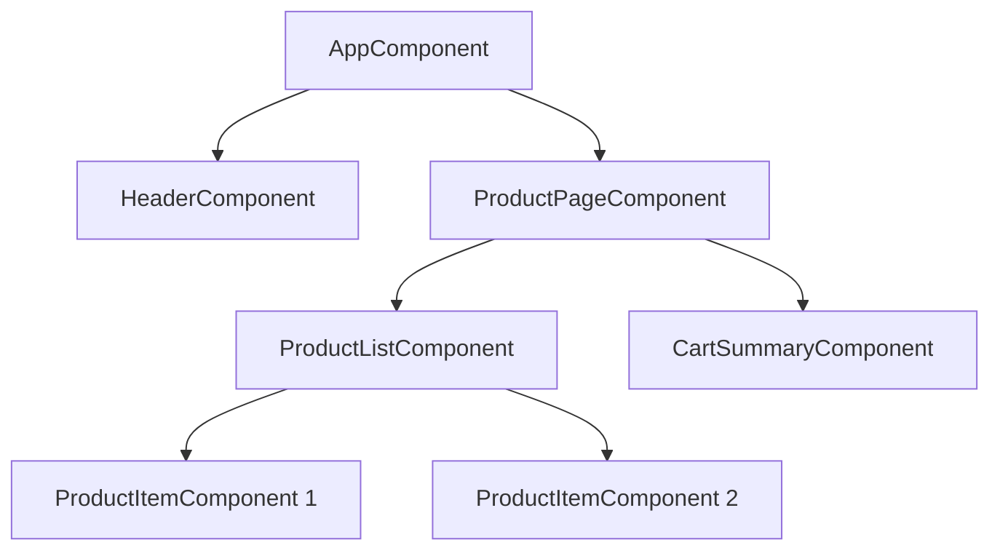
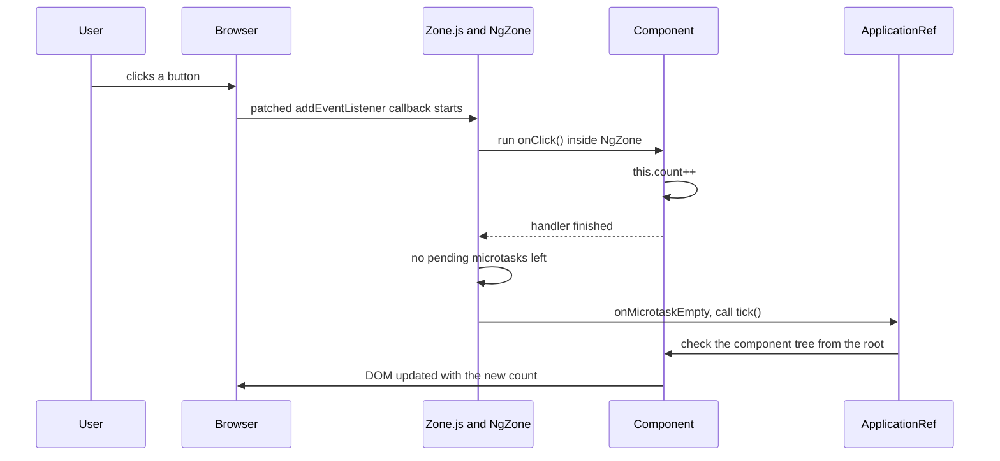
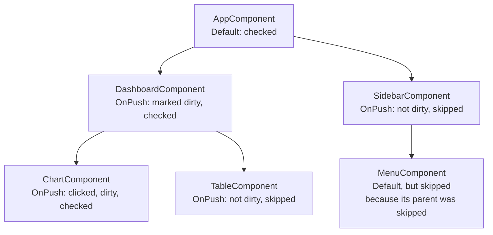
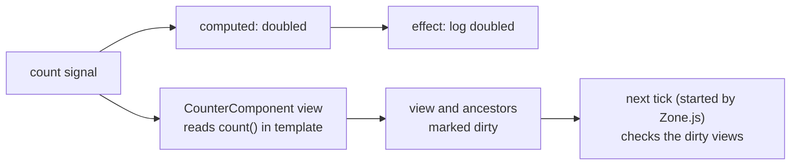

# Change Detection and Signals

> Change detection is how Angular keeps the screen in sync with your data. In this document you will learn exactly when and how Angular checks components, how Zone.js triggers it, how `OnPush` makes apps faster, how to control it with `ChangeDetectorRef`, and how the new signals in Angular 16 fit in. These are some of the most important topics in Angular interviews.

**Before this:** [Components and templates](02-components-and-templates.md) · [Lifecycle hooks](04-lifecycle-hooks.md) · [RxJS](09-rxjs.md) · [Event loop](../02-javascript/16-event-loop.md) · **Interview questions:** [jump to the interview section](#interview-questions)

## Table of contents

1. [What change detection is](#what-change-detection-is)
2. [How Angular checks the component tree](#how-angular-checks-the-component-tree)
3. [Zone.js: what starts change detection](#zonejs-what-starts-change-detection)
4. [The Default strategy](#the-default-strategy)
5. [The OnPush strategy](#the-onpush-strategy)
6. [Immutability with OnPush](#immutability-with-onpush)
7. [ChangeDetectorRef](#changedetectorref)
8. [Running code outside Angular](#running-code-outside-angular)
9. [ExpressionChangedAfterItHasBeenCheckedError](#expressionchangedafterithasbeencheckederror)
10. [trackBy and list rendering](#trackby-and-list-rendering)
11. [Signals in Angular 16](#signals-in-angular-16)
12. [How signals relate to change detection](#how-signals-relate-to-change-detection)
13. [Newer Angular: signal APIs and zoneless](#newer-angular-signal-apis-and-zoneless)
14. [Common mistakes](#common-mistakes)
15. [Best practices](#best-practices)
16. [How to explain this in an interview](#how-to-explain-this-in-an-interview)
17. [Interview questions](#interview-questions)
18. [Summary](#summary)
19. [References](#references)

---

## What change detection is

### What it is

**Change detection** is the process Angular uses to find out which data changed and to update the DOM so the screen shows the new data.

Your template says what the screen should look like:

```html
<h1>Hello {{ user.name }}</h1>
<p [class.vip]="user.isVip">Orders: {{ orders.length }}</p>
```

Your TypeScript code changes `user` and `orders`. Something must notice those changes and update the `<h1>` and `<p>`. That something is change detection.

### Why it exists

In plain JavaScript you update the DOM by hand: `element.textContent = user.name`. In a big app, you would need to remember every place where every value is shown. That is slow to write and full of bugs.

Angular lets you just change your data. It then updates the DOM for you. You write **what** to show, Angular handles **when** and **how** to update it.

### Simple explanation

Each component's template has **bindings**: `{{ user.name }}`, `[class.vip]="user.isVip"`, `[disabled]="isSaving"`. For each binding, Angular remembers the **last value** it put in the DOM.

During change detection, Angular:

1. Evaluates each binding expression again.
2. Compares the new value with the remembered value (with `===`, more exactly `Object.is`).
3. If the value changed, it updates the DOM and remembers the new value.
4. If nothing changed, it does nothing for that binding.

### Analogy

Think of a **security guard doing rounds** in a building. Every time something might have happened (a door alarm, a phone call), the guard walks through every room, from the top floor down, and checks whether anything is different from last time. If a window is open, he closes it.

- The rooms are your components.
- "Something might have happened" is a browser event, a timer or an HTTP response.
- Checking every room is the **Default** strategy.
- `OnPush` is a sign on a door that says "skip this room unless someone reports a problem here".

Where the analogy breaks down: Angular does not look at the DOM itself. It compares the **binding values** in your component with the values it saved last time. It never reads the DOM to find differences.

---

## How Angular checks the component tree

### The component tree

An Angular app is a **tree of components**. `AppComponent` is the root. Its template contains child components, and so on.



### Top-down, one direction

When change detection runs, Angular starts at the **root** and walks **down** the tree. For each component it:

1. Updates the inputs of child components from the parent's bindings (`[product]="p"`), and calls `ngOnChanges` if inputs changed.
2. Calls lifecycle hooks such as `ngDoCheck` (the order is explained in [Lifecycle hooks](04-lifecycle-hooks.md)).
3. Re-evaluates the bindings in the component's template and updates the DOM where values changed.
4. Moves to the children and repeats.

Data flows **from parent to child** during this walk. This is called **unidirectional data flow**. A child must not change its parent's data during the check, because the parent was already checked. That rule is behind the [ExpressionChangedAfterItHasBeenCheckedError](#expressionchangedafterithasbeencheckederror).

### One full run is called a "tick"

`ApplicationRef.tick()` runs change detection for the whole app, starting from the root views. In **development mode**, Angular runs a **second check** right after each tick (`checkNoChanges`). The second check does not update anything. It only verifies that no binding value changed during the first pass. If one did, you get the ExpressionChanged error. In **production mode** (`ng build`), this second check does not run.

### Is it slow to check everything?

Usually not. Ivy (Angular's rendering engine since v9) compiles templates into efficient instructions. Comparing values with `===` is very fast. Problems start when:

- You have thousands of components and bindings on screen.
- Templates call **expensive functions** (`{{ calculateTotal() }}`), because they run on every check.
- Change detection runs very often (for example on every `mousemove` or `scroll` event).

`OnPush`, pure pipes, `trackBy` and running code outside the zone fix these problems. They are explained below and in [Performance](12-performance.md).

---

## Zone.js: what starts change detection

### The question

When you write `this.count++` in a click handler, how does Angular know it must run change detection? You never call anything like `angular.update()`.

The answer is **Zone.js**.

### What Zone.js is

**Zone.js** is a library that **patches** (wraps) the browser's async APIs:

- DOM events (`addEventListener`)
- Timers (`setTimeout`, `setInterval`)
- Promises (`then`)
- `XMLHttpRequest` and `fetch`
- `requestAnimationFrame`, and more

"Patching" means Zone.js replaces these functions with versions that do the same thing, but also notify Zone.js when the callback starts and ends.

Angular creates a zone called **NgZone**. Code that runs inside this zone is tracked. When a tracked async task finishes and there are no more pending microtasks, NgZone emits `onMicrotaskEmpty`. Angular listens to that and calls `ApplicationRef.tick()`.

### How it works step by step



**Walkthrough:**

1. The user clicks. The browser calls the event listener. Because Zone.js patched `addEventListener`, the call goes through Zone.js.
2. Zone.js runs `onClick()` inside NgZone. Your code changes `this.count`.
3. The handler ends. Zone.js checks for pending microtasks (like Promise callbacks). There are none.
4. NgZone emits `onMicrotaskEmpty`. Angular calls `ApplicationRef.tick()`.
5. Angular walks the component tree, sees `count` changed, and updates the DOM.

The same happens after an HTTP response, a `setTimeout` callback, or a resolved Promise inside the zone.

### Zone.js does not know what changed

This is the key weakness. Zone.js only knows "**some** async work finished". It does not know **which** data changed, or whether **anything** changed at all. So with the Default strategy Angular checks the **whole tree** after every tracked event, even a `mousemove` that changed nothing.

That is why Angular added `OnPush`, and later **signals**, which tell Angular exactly what changed.

### Where Zone.js is set up

In an Angular 16 CLI project, `zone.js` is listed in the `polyfills` option of `angular.json`. It loads before your app.

You can configure NgZone at bootstrap. **Event coalescing** combines several events that happen in the same moment (for example, a click that bubbles through several elements with listeners) into one change detection run:

```ts
// NgModule app (main.ts)
platformBrowserDynamic().bootstrapModule(AppModule, { ngZoneEventCoalescing: true });

// Standalone app (main.ts), Angular 16
bootstrapApplication(AppComponent, {
  providers: [provideZoneChangeDetection({ eventCoalescing: true })],
});
```

---

## The Default strategy

With `ChangeDetectionStrategy.Default` (you get it when you do not set anything), a component is checked **on every tick**, as long as its parent is checked.

```ts
@Component({
  selector: 'app-clock',
  template: `<p>{{ now | date: 'mediumTime' }}</p>`,
  // changeDetection: ChangeDetectionStrategy.Default  (implicit)
})
export class ClockComponent implements OnInit {
  now = new Date();

  ngOnInit(): void {
    setInterval(() => (this.now = new Date()), 1000); // Zone.js sees the timer, tick runs, view updates
  }
}
```

**Advantages:**

- It "just works". Any change to any field is picked up on the next tick.
- Mutating objects and arrays works (`this.items.push(x)` shows up).

**Disadvantages:**

- Every component is checked after every event, even if nothing relevant changed.
- In large screens (big tables, dashboards), this wastes CPU and can make typing or scrolling feel slow.
- It hides bad patterns, such as mutating shared objects from anywhere.

---

## The OnPush strategy

### What it is

`ChangeDetectionStrategy.OnPush` tells Angular: **"Skip this component (and everything below it) during a tick, unless it was marked as needing a check."**

```ts
@Component({
  selector: 'app-product-card',
  changeDetection: ChangeDetectionStrategy.OnPush,
  template: `
    <h3>{{ product.name }}</h3>
    <p>{{ product.price | currency }}</p>
    <button (click)="addToCart.emit(product)">Add to cart</button>
  `,
})
export class ProductCardComponent {
  @Input({ required: true }) product!: Product;
  @Output() addToCart = new EventEmitter<Product>();
}
```

### Exactly when is an OnPush component checked?

Internally, every component view has a **dirty** flag. An OnPush component is checked during a tick **only if it is dirty**. These things mark it dirty (in Angular 16):

| # | Trigger | Example |
| --- | --- | --- |
| 1 | An `@Input()` gets a **new value** through a template binding (compared with `===`) | Parent sets `[product]="newProductObject"` |
| 2 | An **event handler bound in its template** (or in a child component's template) runs | `(click)="..."` in this component or a child |
| 3 | **`markForCheck()`** is called on it (or on a descendant) | The `async` pipe calls it when a new value arrives |
| 4 | A **signal read in its template** changes (new in v16) | `{{ count() }}` and `count.set(5)` somewhere |

And one direct way:

| 5 | **`detectChanges()`** is called on its `ChangeDetectorRef` | Runs change detection for it right now, dirty or not |

Things that do **not** mark an OnPush component dirty:

- A `setTimeout`, `setInterval`, Promise or HTTP callback that changes a field. (Zone.js still runs a tick, but the OnPush component is skipped.)
- **Mutating** an input object (`this.product.price = 10` in the parent). The reference is the same, so the input did not "change".
- Changing an `@Input()` property **from TypeScript** (`childRef.product = x`) instead of through a template binding.

### Verified behavior

These results come from running a real Angular 16.2 app (JIT compiled in Node.js with jsdom) where an OnPush child shows `{{ user.name }}`, a counter field and a signal:

| Action | Does the OnPush child view update? |
| --- | --- |
| Parent mutates `user.name` (same object) | No |
| Parent assigns a new `user` object | Yes |
| A `setTimeout` in the child changes a field | No (the Default parent updates; the child's `ngDoCheck` still runs) |
| Same, followed by `cdr.markForCheck()` | Yes |
| A `setTimeout` updates a signal that the child template reads | Yes |
| A `(click)` handler in the child template changes a field | Yes |
| `cdr.detectChanges()` after changing a field | Yes, immediately |

### Marking goes up to the root

`markForCheck()` (and events, and signal changes) mark the component **and all its ancestors** up to the root as dirty. Why the ancestors? Because change detection always starts at the root. If an OnPush parent stayed clean, Angular would skip it and never reach the dirty child.



In this picture, a click inside `ChartComponent` marked `ChartComponent`, `DashboardComponent` and `AppComponent` dirty. On the next tick:

- `AppComponent` (Default) is checked.
- `SidebarComponent` (OnPush, clean) is skipped, and so is its **whole subtree**, even `MenuComponent`, which uses Default.
- `DashboardComponent` is checked because it is dirty.
- `ChartComponent` is checked. `TableComponent` is skipped.

After a component is checked, its dirty flag is cleared.

### ngDoCheck still runs on a skipped OnPush component

`ngDoCheck` of a child is called while the **parent** is being checked. So an OnPush child's `ngDoCheck` runs whenever its parent is checked, even if the child's own template is then skipped. You can use this to detect a change Angular does not see (like a mutation) and call `markForCheck()`. But keep `ngDoCheck` very cheap, because it runs on every tick of the parent.

### How the async pipe works with OnPush

The `async` pipe subscribes to an Observable. When a new value arrives, it stores the value and calls `markForCheck()`. That is why this works:

```ts
@Component({
  selector: 'app-notifications',
  changeDetection: ChangeDetectionStrategy.OnPush,
  template: `<span class="badge">{{ unreadCount$ | async }}</span>`,
})
export class NotificationsComponent {
  readonly unreadCount$ = inject(NotificationService).unreadCount$;
}
```

And this does **not** work:

```ts
// ❌ Wrong with OnPush: the view does not update when the service emits
@Component({
  selector: 'app-notifications',
  changeDetection: ChangeDetectionStrategy.OnPush,
  template: `<span class="badge">{{ unreadCount }}</span>`,
})
export class NotificationsComponent implements OnInit {
  unreadCount = 0;
  private readonly notifications = inject(NotificationService);
  private readonly destroyRef = inject(DestroyRef);

  ngOnInit(): void {
    this.notifications.unreadCount$
      .pipe(takeUntilDestroyed(this.destroyRef))
      .subscribe(count => (this.unreadCount = count)); // field changes, but nothing marks the view dirty
  }
}
```

Fixes: use the `async` pipe, use `toSignal()`, or call `this.cdr.markForCheck()` inside `subscribe`. How the `async` pipe subscribes, stores values and unsubscribes is explained step by step in [Directives and pipes: the async pipe in depth](03-directives-and-pipes.md#the-async-pipe-in-depth).

### Advantages and disadvantages of OnPush

**Advantages:**

- Far fewer components checked per tick. Big performance gains in large screens.
- Forces clear data flow: inputs in, events out, immutable updates.
- Works naturally with `async` pipe, NgRx, `BehaviorSubject` services and signals.

**Disadvantages:**

- Mutation bugs: "I changed the data, but the screen did not update".
- Manual subscriptions need `markForCheck()`.
- Third-party code that mutates objects can break your views.

Many teams make **OnPush the default** for all new components. You can set it in `angular.json` schematics so `ng generate component` adds it automatically:

```json
"schematics": {
  "@schematics/angular:component": {
    "changeDetection": "OnPush"
  }
}
```

---

## Immutability with OnPush

OnPush compares inputs by **reference**. So when data changes, you must create a **new object or array** instead of changing the old one. This is called an **immutable update**.

```ts
// Parent component
export class TodoPageComponent {
  todos: Todo[] = [{ id: 1, title: 'Write docs', done: false }];

  // ❌ Wrong with an OnPush <app-todo-list [todos]="todos">: same array reference
  addTodoWrong(title: string): void {
    this.todos.push({ id: Date.now(), title, done: false });
  }

  // ✅ Correct: new array
  addTodo(title: string): void {
    this.todos = [...this.todos, { id: Date.now(), title, done: false }];
  }

  // ✅ Correct: new array and a new object for the changed item
  toggle(id: number): void {
    this.todos = this.todos.map(t => (t.id === id ? { ...t, done: !t.done } : t));
  }

  // ✅ Correct: filter returns a new array
  remove(id: number): void {
    this.todos = this.todos.filter(t => t.id !== id);
  }
}
```

Useful immutable patterns:

| Change | Mutable (avoid with OnPush) | Immutable |
| --- | --- | --- |
| Add item | `arr.push(x)` | `[...arr, x]` |
| Remove item | `arr.splice(i, 1)` | `arr.filter(...)` |
| Update item | `arr[i].done = true` | `arr.map(item => item.id === id ? { ...item, done: true } : item)` |
| Update field | `obj.name = 'Bob'` | `{ ...obj, name: 'Bob' }` |
| Update nested | `obj.address.city = 'X'` | `{ ...obj, address: { ...obj.address, city: 'X' } }` |
| Sort | `arr.sort(fn)` (mutates) | `[...arr].sort(fn)` |

The spread operator only makes a **shallow copy**. Nested objects are still shared, so copy every level you change. Copying in depth is explained in [Objects and copying](../02-javascript/07-objects-and-copying.md).

Bonus: immutable data also makes `trackBy`, memoized selectors (NgRx) and `distinctUntilChanged` work reliably.

---

## ChangeDetectorRef

`ChangeDetectorRef` gives a component manual control over its own view. Inject it:

```ts
private readonly cdr = inject(ChangeDetectorRef);
// or: constructor(private cdr: ChangeDetectorRef) {}
```

### The methods

| Method | What it does | When to use |
| --- | --- | --- |
| `markForCheck()` | Marks this view **and all ancestors** dirty. It does **not** run change detection; the next tick will check them. | OnPush component got new data outside an input or template event (manual subscribe, WebSocket callback) |
| `detectChanges()` | Runs change detection **now**, synchronously, for this view and its children. | You need the DOM updated immediately; detached views; code outside NgZone; tests |
| `detach()` | Removes this view from the change detection tree. Ticks skip it until reattached. | Views that update rarely or on your own schedule (live charts, huge tables) |
| `reattach()` | Puts a detached view back into the tree. | Re-enable automatic checks |
| `checkNoChanges()` | Runs the dev-mode check: throws if a binding changed. | Rare; mostly tests. Deprecated in newer Angular (the v17 docs already mark it deprecated) |

### markForCheck vs detectChanges

This is a classic interview question.

```ts
@Component({
  selector: 'app-stock-ticker',
  changeDetection: ChangeDetectionStrategy.OnPush,
  template: `<span>{{ price }}</span>`,
})
export class StockTickerComponent implements OnInit {
  price = 0;
  private readonly cdr = inject(ChangeDetectorRef);
  private readonly socket = inject(PriceSocketService);
  private readonly destroyRef = inject(DestroyRef);

  ngOnInit(): void {
    this.socket.prices$.pipe(takeUntilDestroyed(this.destroyRef)).subscribe(price => {
      this.price = price;
      this.cdr.markForCheck(); // "please check me in the next tick"
    });
  }
}
```

- `markForCheck()` is **cheap and safe**. It only sets flags. The actual check happens in the next tick, together with everything else. Use it by default.
- `detectChanges()` runs a check **right now**. It is useful when no tick will come (for example, code running outside NgZone, or a detached view), or in tests. Calling it in many places can cause many extra checks, and calling it during another check can cause errors.

### detach and reattach: manual control

```ts
@Component({
  selector: 'app-live-chart',
  changeDetection: ChangeDetectionStrategy.OnPush,
  template: `<canvas #canvas></canvas><p>Last update: {{ lastUpdate | date: 'mediumTime' }}</p>`,
})
export class LiveChartComponent implements OnInit, OnDestroy {
  lastUpdate = new Date();
  private readonly cdr = inject(ChangeDetectorRef);
  private intervalId?: ReturnType<typeof setInterval>;

  ngOnInit(): void {
    this.cdr.detach(); // ticks will skip this view
    this.intervalId = setInterval(() => {
      this.lastUpdate = new Date();
      this.cdr.detectChanges(); // update once per second, on our schedule
    }, 1000);
  }

  ngOnDestroy(): void {
    clearInterval(this.intervalId);
  }
}
```

Be careful: a detached view does not update for **anything**, including input changes and its own click handlers, until you call `detectChanges()` or `reattach()`.

---

## Running code outside Angular

### The problem

Some events fire very often: `mousemove`, `scroll`, `resize`, `requestAnimationFrame` loops, WebSocket messages, third-party chart libraries with internal timers. If they run inside NgZone, **each one triggers a full tick**. That can mean hundreds of change detection runs per second.

### runOutsideAngular

`NgZone.runOutsideAngular(fn)` runs `fn` outside the Angular zone. Async work started inside it (listeners, timers) does not trigger change detection. When you **do** need to update the view, re-enter with `ngZone.run(fn)`.

```ts
@Component({
  selector: 'app-scroll-progress',
  template: `<div class="bar" [style.width.%]="progress"></div>`,
})
export class ScrollProgressComponent implements OnInit, OnDestroy {
  progress = 0;
  private readonly zone = inject(NgZone);
  private removeListener?: () => void;

  ngOnInit(): void {
    this.zone.runOutsideAngular(() => {
      const onScroll = () => {
        const max = document.documentElement.scrollHeight - window.innerHeight;
        const next = Math.round((window.scrollY / max) * 100);
        if (next !== this.progress) {
          // Only enter the zone (and trigger a tick) when the value really changed
          this.zone.run(() => (this.progress = next));
        }
      };
      window.addEventListener('scroll', onScroll, { passive: true });
      this.removeListener = () => window.removeEventListener('scroll', onScroll);
    });
  }

  ngOnDestroy(): void {
    this.removeListener?.();
  }
}
```

**Walkthrough:**

1. The scroll listener is added inside `runOutsideAngular`, so Zone.js does not trigger ticks for scroll events.
2. Every scroll event computes the progress. Most events produce the same rounded number, so nothing happens.
3. Only when the number changes, `zone.run()` updates the field inside the zone. When `run` finishes, Angular runs one tick and the bar width updates.

The verified harness from earlier showed this too: a change made in a `setTimeout` started with `runOutsideAngular` did not appear on screen until the next tick.

Typical uses:

- High-frequency DOM events (scroll, mousemove, drag).
- Initializing third-party libraries (charts, maps, editors) that use their own timers.
- Polling or animation loops whose results you push into the view only sometimes.

---

## ExpressionChangedAfterItHasBeenCheckedError

This error (code **NG0100**) appears only in **development mode**. It means: "A binding value changed **after** Angular already checked it in this tick."

Remember the dev-mode second check. Angular checks the tree, then checks again without updating. If the second check finds a different value, Angular throws, because the screen now shows a value that is already out of date. It also tells you that your data flow is not one-directional.

Typical causes:

- A child changes parent data in `ngAfterViewInit` or `ngAfterViewChecked` (the parent was already checked).
- A getter or template function returns a new value every time (`{{ Math.random() }}`, `{{ new Date() }}`).
- A service value is changed during a lifecycle hook of a component that renders later in the same tick.

```ts
// ❌ Causes NG0100: the parent's {{ title }} was already checked when this runs
@Component({ selector: 'app-child', template: `` })
export class ChildComponent implements AfterViewInit {
  private readonly page = inject(PageTitleService);
  ngAfterViewInit(): void {
    this.page.title = 'Loaded'; // parent template shows page.title
  }
}
```

Common fixes: move the logic earlier (`ngOnInit`, or the constructor), derive the value instead of setting it in a hook, or (for parent/child timing) use an Observable or signal so the update happens in the next tick. Avoid "fixing" it with `setTimeout` without understanding why. The full explanation with every fix is in [Lifecycle hooks](04-lifecycle-hooks.md).

---

## trackBy and list rendering

Short reminder: by default `*ngFor` tracks items by **object identity**. Immutable updates and fresh API responses create **new objects**, so without `trackBy` Angular destroys and recreates every row. The full explanation is in [Directives and pipes: trackBy](03-directives-and-pipes.md#trackby), and a measured comparison is in [Performance: trackBy for lists](12-performance.md#trackby-for-lists). This matters for change detection because immutable data (which OnPush needs) is exactly what makes `trackBy` necessary.

```ts
@Component({
  selector: 'app-order-table',
  changeDetection: ChangeDetectionStrategy.OnPush,
  template: `
    <tr *ngFor="let order of orders; trackBy: trackById">
      <td>{{ order.id }}</td>
      <td>{{ order.status }}</td>
    </tr>
  `,
})
export class OrderTableComponent {
  @Input() orders: Order[] = [];

  trackById(index: number, order: Order): string {
    return order.id; // same id = same DOM row, only changed bindings are updated
  }
}
```

With `trackBy`, Angular reuses the row for the same `id` and only updates the bindings that changed.

> **Newer Angular (17+):** the built-in `@for` block **requires** a `track` expression: `@for (order of orders; track order.id) { ... }`. `*ngFor` with `trackBy` is the Angular 16 way.

---

## Signals in Angular 16

> **Version status:** signals (`signal`, `computed`, `effect`) are a **developer preview** in Angular 16. A developer preview API works, but it can still change in minor versions. `signal` and `computed` became stable in Angular 17. `effect` became stable in Angular 20.

### What a signal is

A **signal** is a wrapper around a value that **notifies interested code when the value changes**. You read it by calling it like a function. You change it with `set` or `update`.

```ts
import { signal } from '@angular/core';

const count = signal(0);   // WritableSignal<number>
console.log(count());      // 0  (read by calling it)
count.set(5);
console.log(count());      // 5
count.update(c => c + 1);
console.log(count());      // 6
```

### Why signals exist

Zone.js tells Angular "something async happened", but not **what** changed. So Angular must check many components. A signal knows exactly **who reads it**. When it changes, Angular knows exactly which computed values, effects and component views depend on it. This is called **fine-grained reactivity**.

Signals also give a simpler way to hold synchronous state than `BehaviorSubject`: no subscribe, no unsubscribe, always a current value.

### Analogy

A signal is like a **cell in a spreadsheet**. `A1 = 10`. Cell `B1 = A1 * 2`. When you change `A1`, the spreadsheet knows that `B1` depends on it and updates only `B1`, not every cell in the sheet. `computed` is the formula cell. `effect` is like a macro that runs whenever its input cells change.

### The API in Angular 16

| API | What it does |
| --- | --- |
| `signal(initial)` | Creates a `WritableSignal` |
| `sig()` | Reads the value (and registers a dependency if called inside a reactive context) |
| `sig.set(value)` | Replaces the value |
| `sig.update(fn)` | Sets the value to `fn(current)` |
| `sig.mutate(fn)` | Changes the current value in place (**Angular 16 only — removed in Angular 17**) |
| `sig.asReadonly()` | Returns a read-only `Signal` (no `set`) |
| `computed(fn)` | A read-only signal derived from other signals |
| `effect(fn)` | Runs side effects when the signals it reads change |
| `untracked(fn)` | Reads signals without creating a dependency |
| `isSignal(value)` | Checks if a value is a signal |

### computed: derived values

`computed` creates a read-only signal from other signals. It has two important properties:

- **Lazy:** it does not run until someone reads it.
- **Memoized:** it caches the result. It recalculates only if a dependency changed.

```ts
import { signal, computed } from '@angular/core';

const price = signal(100);
const quantity = signal(2);
let runs = 0;
const total = computed(() => {
  runs++;
  console.log('computing total');
  return price() * quantity();
});

console.log('before first read, runs =', runs); // before first read, runs = 0
console.log(total());   // computing total, then 200
console.log(total());   // 200 (cached, no recalculation)
quantity.set(3);
console.log('after set, runs =', runs); // after set, runs = 1  (still lazy)
console.log(total());   // computing total, then 300
```

(Verified by running Angular 16.2's `@angular/core` in Node.js.)

**Dependencies are dynamic.** A computed only depends on the signals it **actually read** in its last run:

```ts
const showDetails = signal(false);
const name = signal('Ann');
const details = signal('Admin');
const card = computed(() => (showDetails() ? `${name()} (${details()})` : name()));

card();                 // 'Ann'  -> depends on showDetails and name only
details.set('Owner');   // card does not need to recalculate
showDetails.set(true);
card();                 // 'Ann (Owner)' -> now depends on details too
```

**Equal results stop the update.** If a computed recalculates and gets the same value as before, signals that depend on it are not notified:

```ts
const n = signal(2);
const isEven = computed(() => n() % 2 === 0);
const label = computed(() => (isEven() ? 'even' : 'odd'));

label();     // 'even'
n.set(4);    // isEven recalculates: still true -> label does NOT recalculate
n.set(5);    // isEven becomes false -> label recalculates: 'odd'
```

You cannot write to a signal inside a `computed`. Angular throws error NG0600. A computed must be a pure calculation.

### Equality: an important Angular 16 detail

When you call `set`, Angular compares the new value with the old one. If they are "equal", nothing is notified.

- **In Angular 16**, the default check uses `Object.is` for primitives, but **objects and arrays are always treated as changed**, even when you set the same reference. (This is what made `mutate()` work.)
- **In Angular 17 and later**, the default check is simply `Object.is` for everything. Setting the same object reference again does **not** notify anyone.

```ts
const user = signal({ name: 'Ann' });
const upper = computed(() => user().name.toUpperCase());
upper();

user.set(user()); // same reference
// Angular 16: upper recalculates (objects always count as changed)
// Angular 17+: nothing happens (Object.is says equal)
```

This is why you should **always create new objects** when you update signal state. Then your code works the same in every version.

You can pass a custom equality function:

```ts
const position = signal({ x: 1, y: 2 }, { equal: (a, b) => a.x === b.x && a.y === b.y });
position.set({ x: 1, y: 2 }); // equal -> no notification
position.set({ x: 2, y: 2 }); // different -> dependents update
```

### mutate (Angular 16 only)

```ts
const todos = signal([{ title: 'Write docs', done: false }]);
todos.mutate(list => {
  list[0].done = true; // changes the array in place and notifies dependents
});
```

`mutate` was **removed in Angular 17**. Use `update` with an immutable change instead, which works in all versions:

```ts
todos.update(list => list.map((t, i) => (i === 0 ? { ...t, done: true } : t)));
```

### effect: side effects

`effect` runs a function **at least once**, and again whenever any signal it read changes. Use it for side effects that are not part of the view: logging, saving to `localStorage`, syncing with a non-Angular library.

```ts
import { Component, effect, signal } from '@angular/core';

@Component({
  selector: 'app-theme-switcher',
  standalone: true,
  template: `<button (click)="toggle()">Theme: {{ theme() }}</button>`,
})
export class ThemeSwitcherComponent {
  readonly theme = signal<'light' | 'dark'>((localStorage.getItem('theme') as 'light' | 'dark') ?? 'light');

  constructor() {
    effect(() => {
      // Reads theme() -> re-runs whenever theme changes
      localStorage.setItem('theme', this.theme());
      document.body.dataset['theme'] = this.theme();
    });
  }

  toggle(): void {
    this.theme.update(t => (t === 'light' ? 'dark' : 'light'));
  }
}
```

Rules for `effect` in Angular 16:

- It must be created in an **injection context** (constructor or field initializer), or you pass `{ injector }`.
- It is **destroyed automatically** with the component (or service) that created it. It returns an `EffectRef` with `destroy()` if you need to stop it earlier. `manualCleanup: true` turns off the automatic destroy.
- It runs **asynchronously**. In Angular 16, effects are queued when their signals change and run during the next change detection. Several changes in a row produce one run with the latest values.
- **Writing to signals inside an effect throws** (NG0600) unless you pass `{ allowSignalWrites: true }`. (Angular 19 removed this restriction. The flag still exists there, but it is deprecated and does nothing.)
- The effect function receives an `onCleanup` function to register cleanup that runs before the next run and on destroy.

```ts
effect(onCleanup => {
  const id = this.userId();
  const timer = setInterval(() => console.log('polling user', id), 5000);
  onCleanup(() => clearInterval(timer)); // runs before the next run and on destroy
});
```

**Do not use effects to copy one signal into another.** Use `computed` for derived state. Effects that write signals are hard to follow and can create loops.

### untracked

`untracked(fn)` reads signals without making them dependencies:

```ts
const a = signal(1);
const b = signal(10);
const sum = computed(() => a() + untracked(() => b()));

sum();       // 11
b.set(20);
sum();       // 11 (b is not a dependency, the cached value is used)
a.set(2);
sum();       // 22 (a changed -> recalculates and reads the current b)
```

It is most useful in effects, when you want to react to one signal but only read another, for example `effect(() => { const user = this.user(); untracked(() => this.logger.log(user, this.settings())); })`.

### A signal-based component and service (Angular 16)

```ts
import { Injectable, computed, signal } from '@angular/core';

export interface CartLine { productId: string; name: string; price: number; quantity: number; }

@Injectable({ providedIn: 'root' })
export class CartStore {
  private readonly lines = signal<CartLine[]>([]);

  readonly items = this.lines.asReadonly();
  readonly count = computed(() => this.lines().reduce((n, l) => n + l.quantity, 0));
  readonly total = computed(() => this.lines().reduce((sum, l) => sum + l.price * l.quantity, 0));

  add(line: CartLine): void {
    this.lines.update(lines => {
      const existing = lines.find(l => l.productId === line.productId);
      return existing
        ? lines.map(l => (l.productId === line.productId ? { ...l, quantity: l.quantity + line.quantity } : l))
        : [...lines, line];
    });
  }

  remove(productId: string): void {
    this.lines.update(lines => lines.filter(l => l.productId !== productId));
  }
}
```

```ts
@Component({
  selector: 'app-cart-badge',
  standalone: true,
  imports: [CurrencyPipe],
  changeDetection: ChangeDetectionStrategy.OnPush,
  template: `<span>{{ cart.count() }} items - {{ cart.total() | currency }}</span>`,
})
export class CartBadgeComponent {
  readonly cart = inject(CartStore);
}
```

The template reads `cart.count()` and `cart.total()`. When `add()` runs anywhere in the app, the badge is marked for check, even though it is OnPush and has no inputs.

Compare this with the `BehaviorSubject` version in [RxJS](09-rxjs.md#real-world-usage-an-observable-data-service): no `asObservable`, no `async` pipe, no subscriptions. The Observable/signal bridge (`toSignal`, `toObservable`) is explained in [RxJS and signals in Angular 16](09-rxjs.md#rxjs-and-signals-in-angular-16).

### Signals vs RxJS vs plain fields

| | Plain field | Signal | Observable |
| --- | --- | --- | --- |
| Always has a value | Yes | Yes | No |
| Notifies changes | No (Zone.js + check) | Yes, synchronously tracks readers | Yes, pushes to subscribers |
| Time operators (debounce, retry) | No | No | Yes |
| Cancellation | No | No | Yes |
| Cleanup needed | No | No | Yes (subscriptions) |
| Works with OnPush without extra code | No | Yes | With `async` pipe |
| Status in v16 | Stable | Developer preview | Stable |

---

## How signals relate to change detection

### Angular 16

When a component template reads a signal (`{{ count() }}`), Angular registers that **component view** as a consumer of the signal. When the signal changes, Angular **marks the view for check**, the same way `markForCheck()` does: the view and its ancestors become dirty.

This is why signals work with `OnPush` without the `async` pipe and without `markForCheck()`.

But in Angular 16, **Zone.js still decides when change detection runs**. A signal change marks views dirty; it does not start a tick by itself. In practice this is fine, because you usually change signals in event handlers, timers or HTTP callbacks, which Zone.js already tracks. If you set a signal inside `runOutsideAngular`, the view is marked dirty but will update only on the next tick.



### Newer Angular

- **Angular 17** made signal-driven updates more targeted: a signal change marks only the component that reads it for refresh. Its ancestors are only traversed to reach it, not re-checked (when they are OnPush and not dirty).
- With **zoneless** change detection (see below), a signal change itself **schedules** change detection. Zone.js is no longer needed.

---

## Newer Angular: signal APIs and zoneless

None of these exist in Angular 16. You should still know them for interviews, because many companies use newer versions. The full version-by-version list is in [Angular 16 vs newer versions](16-angular-16-vs-newer-versions.md).

> **Newer Angular (17+):**
> - **Angular 17:** signals (`signal`, `computed`) became stable; `mutate` was removed; default equality became `Object.is`. Built-in control flow (`@if`, `@for` with required `track`).
> - **Signal inputs** — `name = input<string>()` and `input.required<string>()` replace `@Input()` with a read-only signal (added in v17.1, stable in v19).
> - **`model()`** — a two-way bindable signal input, for `[(value)]` (added in v17.2, stable in v19).
> - **`output()`** — a function-based replacement for `@Output()` + `EventEmitter` (added in v17.3, stable in v19).
> - **Signal queries** — `viewChild()`, `viewChildren()`, `contentChild()`, `contentChildren()` return signals (added in v17.2, stable in v19).
> - **`linkedSignal`** — a writable signal that resets when a source signal changes (added in v19, stable in v20).
> - **`resource` / `rxResource` / `httpResource`** — load async data into signals (added experimentally in v19 / v19.2; `resource` is stable since v22).
> - **`effect`** became stable in v20, and v19 changed effect timing and allowed signal writes by default.
> - **Zoneless change detection** — experimental in v18 (`provideExperimentalZonelessChangeDetection()`), developer preview in v20.0, **stable in v20.2** (`provideZonelessChangeDetection()`), and the **default for new apps in v21**. Without Zone.js, change detection is scheduled by `markForCheck()` (also called by the `async` pipe), signal changes read in templates, template/host event listeners, and `ComponentRef.setInput()`.

A small example of what newer code looks like (not valid in Angular 16):

```ts
// Angular 19+ style, for comparison only
export class ProductCardComponent {
  product = input.required<Product>();
  addToCart = output<Product>();
  priceWithTax = computed(() => this.product().price * 1.2);
}
```

In Angular 16 you write the same with `@Input({ required: true }) product!: Product;` and `@Output() addToCart = new EventEmitter<Product>();`.

---

## Common mistakes

**1. Mutating input objects with OnPush.** `this.user.name = 'Bob'` in the parent does not update an OnPush child. Create a new object.

**2. Manual subscribe in an OnPush component without `markForCheck`.** The field changes but the view does not. Use the `async` pipe or `toSignal`.

**3. Expensive function calls in templates.** `{{ getTotal() }}` runs on **every** check of that component. Use a pure pipe, a precomputed field, or a `computed` signal.

```html
<!-- ❌ Wrong: filters the whole list on every change detection run -->
<li *ngFor="let p of filterProducts(products, term)">{{ p.name }}</li>

<!-- ✅ Correct: computed once when inputs change (field, pure pipe, or computed signal) -->
<li *ngFor="let p of filteredProducts(); trackBy: trackById">{{ p.name }}</li>
```

**4. Calling `detectChanges()` everywhere "to be safe".** It runs extra checks synchronously and hides design problems. Use `markForCheck()` or fix the data flow.

**5. Thinking OnPush means "never checked".** It is still checked on input reference changes, template events, `markForCheck` and signal changes.

**6. Fixing ExpressionChanged errors with `setTimeout` everywhere.** It hides the problem and adds an extra tick. Fix the data flow.

**7. High-frequency events inside the zone.** A `mousemove` listener inside NgZone runs a tick on every mouse move. Use `runOutsideAngular`.

**8. Using `effect` to derive state.** `effect(() => this.total.set(this.a() + this.b()))` should be `total = computed(() => this.a() + this.b())`.

**9. Relying on Angular 16 object equality.** Code that sets the same mutated object back into a signal works in v16 but breaks in v17+. Always set new objects.

**10. Forgetting that a Default child under a skipped OnPush parent is skipped too.** Making a child Default does not force it to be checked.

---

## Best practices

- **Use OnPush for new components**, and set it as the schematic default. It makes performance predictable.
- **Treat inputs and state as immutable.** Create new objects and arrays on every change.
- **Prefer the `async` pipe or signals** for data in templates. Both work with OnPush automatically.
- **Keep templates cheap.** No heavy function calls; use pure pipes, precomputed fields or `computed`.
- **Always use `trackBy`** with `*ngFor` on lists that are reloaded or updated immutably.
- **Use `markForCheck()` as the default manual tool**, `detectChanges()` only when you really need a synchronous update.
- **Run high-frequency or third-party work outside NgZone**, and re-enter with `zone.run()` only when the view must change.
- **Use signals for local and shared synchronous state** in Angular 16, knowing they are a developer preview. Keep RxJS for async streams.
- **Use `computed` for derived state, `effect` only for side effects** that leave the reactive world.
- **Profile before optimizing.** Angular DevTools shows how long each change detection run takes and which components are checked. See [Performance](12-performance.md).

---

## How to explain this in an interview

### Explaining change detection

1. **Define it:** "Change detection is how Angular keeps the DOM in sync with component data. It re-evaluates template bindings and updates the DOM where values changed."
2. **Why it exists:** "So I only change my data and Angular updates the view, instead of me updating the DOM by hand."
3. **How it works:** "Zone.js patches async APIs like events, timers, promises and XHR. When an async task in the Angular zone finishes, Angular calls ApplicationRef.tick, which walks the component tree from the root down and compares each binding with its previous value. In dev mode it runs a second check to catch values that changed during the check."
4. **Small example:** "If a click handler sets this.count++, Zone.js sees the click finished, Angular runs a tick, sees count changed from 1 to 2, and updates that text node."
5. **Where it is useful:** "It is automatic, so most of the time I do not think about it. I do think about it in big screens like tables and dashboards."
6. **Trade-offs / gotchas:** "Zone.js does not know what changed, so with the Default strategy Angular checks everything. I use OnPush, immutable data, the async pipe, trackBy and runOutsideAngular to keep it fast."

### Explaining OnPush

1. **Define it:** "OnPush tells Angular to skip a component and its subtree unless the component is marked dirty."
2. **Why it exists:** "To avoid checking the whole tree on every event."
3. **How it works:** "An OnPush component is checked when an input reference changes, when an event bound in its template or a child fires, when markForCheck is called, for example by the async pipe, or in Angular 16 when a signal read in its template changes. Marking also marks all ancestors, so the check can reach it."
4. **Small example:** "If the parent does user.name = 'Bob', an OnPush child does not update, because the reference is the same. If the parent does user = { ...user, name: 'Bob' }, it updates."
5. **Where it is useful:** "Lists, tables, dashboards, presentational components, anything with NgRx or observable services."
6. **Trade-offs / gotchas:** "Mutation bugs, and manual subscriptions need markForCheck. The fix is immutable updates and the async pipe or signals."

### Explaining signals

1. **Define it:** "A signal is a reactive value. I read it by calling it, and I change it with set or update. computed derives values, effect runs side effects."
2. **Why it exists:** "Zone.js only knows something happened. Signals know exactly who depends on them, so Angular can update only what changed, and eventually run without Zone.js."
3. **How it works:** "When a computed, an effect or a template reads a signal, it is registered as a dependency. When the signal changes, dependents are notified. computed is lazy and memoized. A template that reads a signal is marked for check."
4. **Small example:** "A cart service with a lines signal and a computed total. Any OnPush component that shows total() updates when an item is added, with no subscriptions."
5. **Where it is useful:** "Component state, shared state in services, derived values."
6. **Trade-offs / gotchas:** "In Angular 16 signals are a developer preview, mutate exists only in 16, objects are always treated as changed in 16, and effects cannot write signals unless allowSignalWrites is set. Signals have no time operators, so async work stays in RxJS."

---

## Interview questions

### Q1. What is change detection in Angular and how does it work?

**What the interviewer is checking:** Whether you can explain the full chain: data change → Zone.js → tick → top-down binding comparison → DOM update.

**Short spoken answer (30–60 seconds):**
> Change detection is how Angular keeps the view in sync with the data. Each template has bindings, and Angular remembers the last value of each one. When change detection runs, Angular walks the component tree from the root down, re-evaluates the bindings, compares them with the old values, and updates only the DOM nodes whose values changed. It is started by Zone.js: Zone.js patches async APIs like DOM events, timers, promises and XHR, and when an async task in the Angular zone finishes, Angular calls ApplicationRef.tick. In development mode it runs a second check to make sure nothing changed during the first pass, which is where the ExpressionChanged error comes from.

**Detailed explanation:** See [How Angular checks the component tree](#how-angular-checks-the-component-tree) and [Zone.js](#zonejs-what-starts-change-detection). Angular compares binding values, not the DOM. It is one-directional: parent to child.

**Follow-up questions:**
- **Does Angular compare the DOM?** — No. It compares the current binding values with the values it stored from the last check, and writes to the DOM only when a value differs.
- **Why is data flow one-directional?** — So one pass from top to bottom is enough. If children could change parent data during the check, Angular would need repeated passes and could loop.
- **What happens in production mode?** — The second verification pass (`checkNoChanges`) does not run, so ExpressionChanged errors are not thrown.

**Common mistakes:** Saying Angular uses a virtual DOM (it does not; Ivy updates the real DOM directly from compiled instructions). Saying Zone.js "detects changes" (it only signals that async work finished).

**Where this is used in real projects:** Understanding it is needed to fix "the view does not update" bugs and to tune slow screens.

---

### Q2. What is Zone.js and why does Angular need it?

**What the interviewer is checking:** Understanding of the trigger mechanism and its limits.

**Short spoken answer (30–60 seconds):**
> Zone.js is a library that patches the browser's async APIs, like addEventListener, setTimeout, promises and XHR, so it can track when async callbacks start and finish. Angular runs the app inside a zone called NgZone. When a tracked task finishes and the microtask queue is empty, NgZone emits onMicrotaskEmpty and Angular runs ApplicationRef.tick. That is why changing a field in a click handler or an HTTP callback updates the view automatically. The limitation is that Zone.js does not know what changed, so Angular has to check a lot. Newer Angular versions can run without Zone.js, using signals and markForCheck as the triggers.

**Follow-up questions:**
- **What happens with code outside the zone?** — Changes made there do not trigger a tick. The view updates only on the next tick, or when you call `zone.run()` or `detectChanges()`.
- **Name a case where Zone.js is a problem.** — High-frequency events like `mousemove` or a third-party library with internal timers cause a tick on every event. Fix with `runOutsideAngular`.
- **Can Angular 16 run without Zone.js?** — With an NgModule app you can call `bootstrapModule(AppModule, { ngZone: 'noop' })`, but then you must trigger change detection yourself everywhere. Official zoneless support came later (experimental v18, stable v20.2).

**Common mistakes:** Thinking Zone.js is part of the browser or of JavaScript. Thinking it compares data.

**Where this is used in real projects:** Performance tuning, integrating libraries like charts or maps, debugging views that do not update after third-party callbacks.

---

### Q3. What is the difference between Default and OnPush, and exactly when is an OnPush component checked?

**What the interviewer is checking:** The precise list of triggers. Shallow answers say only "when inputs change".

**Short spoken answer (30–60 seconds):**
> With Default, a component is checked on every tick. With OnPush, Angular skips the component and its whole subtree unless the component is marked dirty. In Angular 16 that happens in four cases: an input gets a new reference through a template binding, an event handler bound in its template or in a child's template fires, markForCheck is called — which is what the async pipe does when a new value arrives — or a signal read in its template changes. Also, detectChanges checks it directly. A timer or HTTP callback that just changes a field does not mark it, and mutating an input object does not count as an input change, because the reference is the same.

**Code or diagram:** See the verified table and the tree diagram in [The OnPush strategy](#the-onpush-strategy).

**Follow-up questions:**
- **If an OnPush component is skipped, are its Default children checked?** — No. The whole subtree is skipped.
- **Does `ngDoCheck` run on a skipped OnPush component?** — Yes. It is called when the parent is checked, before Angular decides to skip the child's template. That is why it must be cheap.
- **Why does `markForCheck` mark ancestors too?** — Change detection starts at the root. If an OnPush ancestor stayed clean, the traversal would never reach the dirty child.
- **Does setting an `@Input` from TypeScript (`componentRef.instance.value = x`) mark it?** — No. Only template bindings (or `ComponentRef.setInput()` for dynamic components) do.

**Common mistakes:** "OnPush is checked only when inputs change." Forgetting events and the async pipe. Thinking OnPush compares deeply.

**Where this is used in real projects:** Most large Angular apps use OnPush everywhere for performance.

---

### Q4. What does this OnPush component show after one second?

```ts
@Component({
  selector: 'app-timer',
  changeDetection: ChangeDetectionStrategy.OnPush,
  template: `<p>{{ seconds }}</p>`,
})
export class TimerComponent implements OnInit {
  seconds = 0;
  ngOnInit(): void {
    setTimeout(() => (this.seconds = 1), 1000);
  }
}
```

**Answer:** It still shows `0`.

**Step-by-step explanation:**

1. The component renders `0` on the first check.
2. After one second, the `setTimeout` callback runs inside NgZone and sets `seconds = 1`.
3. Zone.js triggers a tick. Angular walks the tree.
4. The component is OnPush and nothing marked it dirty: no input change, no template event, no `markForCheck`, no signal. Angular skips it.
5. The DOM keeps `0`. It will show `1` only when something else marks this component dirty.

This was confirmed in a real Angular 16.2 app (see [Verified behavior](#verified-behavior)).

**Fixes:** call `this.cdr.markForCheck()` in the callback, or make `seconds` a signal (`seconds = signal(0)`, `this.seconds.set(1)`, template `{{ seconds() }}`), or use an Observable with the `async` pipe (`seconds$ = timer(1000).pipe(map(() => 1), startWith(0))`).

---

### Q5. What is the difference between markForCheck and detectChanges?

**What the interviewer is checking:** Whether you understand "schedule" vs "run now".

**Short spoken answer (30–60 seconds):**
> markForCheck only marks the component and all its ancestors as dirty. It does not run anything; the next tick will check them. It is cheap and safe, and it is what the async pipe uses. detectChanges runs change detection right now, synchronously, for this component and its children, even if it is OnPush or detached. I use markForCheck by default, for example after a manual subscription in an OnPush component. I use detectChanges when no tick is coming, like code running outside NgZone or a detached view, and in tests.

**Follow-up questions:**
- **Can calling `detectChanges()` cause problems?** — Calling it inside another change detection run or in lifecycle hooks can cause ExpressionChanged errors or extra work. Calling it in many places multiplies checks.
- **Does `detectChanges()` check ancestors?** — No. Only this view and its descendants.
- **What do `detach()` and `reattach()` do?** — `detach()` removes the view from automatic checking. It updates only when you call `detectChanges()`. `reattach()` puts it back.

**Common mistakes:** Saying both do the same thing. Saying `markForCheck` triggers change detection immediately.

**Where this is used in real projects:** WebSocket updates in OnPush components (`markForCheck`), canvas or chart widgets updated on a schedule (`detach` + `detectChanges`).

---

### Q6. Why do we need immutability with OnPush? Find the bug.

```ts
// parent template: <app-todo-list [todos]="todos"></app-todo-list>  (TodoListComponent is OnPush)
addTodo(title: string): void {
  this.todos.push({ id: Date.now(), title, done: false });
}
```

**Short answer:** OnPush compares inputs by reference (`===`). `push` changes the same array, so the reference does not change, the child is not marked dirty, and the new todo does not appear. Fix: `this.todos = [...this.todos, { id: Date.now(), title, done: false }];`. For updates use `map` with spread, for removal `filter`.

Follow-up: **Is the spread operator a deep copy?** — No, it is shallow. When you change a nested object, copy each level on the path to the change.

---

### Q7. How would you fix a page where typing in an input is slow because of a big table on the same page?

**What the interviewer is checking:** Practical performance debugging with change detection tools.

**Short spoken answer (30–60 seconds):**
> Every keystroke is an event in the zone, so Angular runs a tick and checks the whole tree, including the big table. First I measure with Angular DevTools to confirm change detection is the cost. Then I make the table and its row components OnPush, pass data immutably, and add trackBy to the ngFor so rows are reused. I remove any function calls from the table template and use pure pipes or precomputed values. If the input only filters the table, I debounce the input so the table data changes less often. For very long tables I use CDK virtual scrolling. If some third-party code inside the table runs timers, I start it outside NgZone.

**Follow-up questions:**
- **How does Angular DevTools help?** — Its profiler records change detection runs and shows how long each component took and how often it was checked.
- **Would `detach()` help?** — It can, for a table that updates only on demand, but it is a manual approach with more risk. OnPush is usually enough.

**Where this is used in real projects:** Admin portals, analytics dashboards, large data grids. See [Performance](12-performance.md).

---

### Q8. When and why would you use runOutsideAngular?

**Short spoken answer (30–60 seconds):**
> I use it for work that fires very often but rarely needs to change the view, like scroll, mousemove or resize listeners, animation loops, or third-party libraries with their own timers. Code started inside runOutsideAngular does not trigger change detection. When I do need to update the view, I re-enter the zone with ngZone.run, or I mark the component and let the next tick handle it. This can reduce hundreds of ticks per second to only the ones that matter.

**Code:** See [Running code outside Angular](#running-code-outside-angular).

**Follow-up questions:**
- **What happens if you update a field inside runOutsideAngular?** — The view does not update until something else runs a tick. That was confirmed in the verified harness.
- **Do signals help here?** — In Angular 16 a signal change marks the view dirty, but it still waits for a Zone.js tick. In zoneless newer versions, the signal change schedules change detection itself.

---

### Q9. What causes ExpressionChangedAfterItHasBeenCheckedError and how do you fix it?

**What the interviewer is checking:** Understanding of unidirectional data flow and the dev-mode check.

**Short spoken answer (30–60 seconds):**
> In development mode, after each change detection run, Angular checks the bindings a second time without updating anything. If a value is different in the second pass, it throws this error, because the data changed after it was already rendered. The usual cause is a child or a lifecycle hook like ngAfterViewInit changing data that a parent or an earlier binding already displayed, or a template expression that returns a new value every time. I fix it by moving the change earlier, like ngOnInit, by deriving the value instead of setting it in a hook, or by redesigning the data flow so the parent owns the state. I avoid just wrapping it in setTimeout.

**Follow-up questions:**
- **Why does it not appear in production?** — The second check runs only in dev mode. The bug is still there: the screen shows stale data until the next tick.
- **Can a getter cause it?** — Yes, if it returns a new object or a changing value on every call, like `new Date()`.

More examples and fixes are in [Lifecycle hooks](04-lifecycle-hooks.md).

---

### Q10. Why is calling a function in a template a performance problem?

**Short answer:** Angular re-evaluates every binding on every check of the component. A function call like `{{ getTotal(cart) }}` runs each time, maybe dozens of times per second with the Default strategy. If it loops over big arrays, it gets slow. Use a **pure pipe** (re-runs only when its input references change), a field computed when the data changes, or a `computed` signal (memoized). Calling a signal getter like `{{ total() }}` is fine, because it only returns the cached value. The full spoken answer with follow-ups is in [Directives and pipes Q10](03-directives-and-pipes.md#q10-why-should-you-avoid-method-calls-in-templates-when-is-it-acceptable) and [Performance Q5](12-performance.md#q5-why-is-calling-a-method-in-a-template-a-performance-problem-what-do-you-use-instead).

---

### Q11. What is trackBy and why does it matter?

**Short answer:** `*ngFor` tracks items by object reference by default. When you load a new array from the API or update immutably, all objects are new, so Angular destroys and recreates every DOM row. `trackBy` gives a stable identity (usually an `id`) so Angular reuses existing rows and only updates changed bindings. It saves DOM work and keeps state like focus and component instances. In Angular 17+, `@for` requires a `track` expression. The full spoken answer with follow-ups is in [Directives and pipes Q3](03-directives-and-pipes.md#q3-what-is-trackby-and-why-is-it-important) and [Performance Q4](12-performance.md#q4-what-does-trackby-do-and-why-does-it-matter).

```html
<li *ngFor="let user of users; trackBy: trackById">{{ user.name }}</li>
```

---

### Q12. What are signals and why did Angular add them?

**What the interviewer is checking:** Understanding of fine-grained reactivity and the v16 status.

**Short spoken answer (30–60 seconds):**
> A signal is a reactive value container. I read it by calling it, and change it with set or update. computed creates derived signals that are lazy and cached, and effect runs side effects when the signals it reads change. Angular added signals because Zone.js only knows that something happened, not what changed, so Angular has to check many components. A signal knows exactly who reads it. When a template reads a signal and the signal changes, Angular marks exactly that component for check, which works perfectly with OnPush. Long term, signals make change detection without Zone.js possible. In Angular 16 they are a developer preview.

**Follow-up questions:**
- **How does a signal know its dependencies?** — When code runs in a reactive context (a `computed`, an `effect`, or a template), every signal read during that run is recorded as a dependency. Next time, the dependencies are recorded again, so they are dynamic.
- **Are signal updates synchronous?** — Setting a signal and reading a computed is synchronous. Effects and view updates happen later (effects run during change detection in v16).
- **What is `mutate`?** — An Angular 16-only method to change a signal value in place. It was removed in v17. Use `update` with a new object.

**Common mistakes:** Saying signals replace RxJS. Not knowing the developer preview status. Not knowing computed is lazy.

**Where this is used in real projects:** Local component state, service-based stores, derived values for templates.

---

### Q13. What does this code print? (Angular 16)

```ts
const price = signal(10);
const qty = signal(2);
let runs = 0;
const total = computed(() => {
  runs++;
  return price() * qty();
});

price.set(20);
price.set(30);
console.log(runs);
console.log(total());
console.log(total());
console.log(runs);
```

**Answer:**

```text
0
60
60
1
```

**Step-by-step explanation:**

1. Creating `total` does not run the function. `computed` is lazy.
2. `price.set(20)` and `price.set(30)` only mark `total` as stale. Nobody has read it, so it does not run. `runs` is `0`.
3. The first `total()` runs the function once with the current values: `30 * 2 = 60`. `runs` becomes `1`.
4. The second `total()` returns the cached `60`. Dependencies did not change.
5. `runs` is `1`.

(Verified pattern: running Angular 16.2 signals in Node.js gives the same lazy and memoized behavior.)

---

### Q14. computed vs effect: when do you use each?

**Short spoken answer (30–60 seconds):**
> computed is for deriving a value from other signals. It is pure, lazy and cached, and I cannot write signals inside it. effect is for side effects that leave the signal world: logging, writing to localStorage, calling a third-party library, syncing a form. An effect always runs at least once and then whenever its dependencies change, asynchronously. A common mistake is using an effect to set another signal, like total.set(a() + b()). That should be a computed. In Angular 16 effects need an injection context and cannot write signals unless I pass allowSignalWrites.

**Follow-up questions:**
- **How do you stop an effect?** — It is destroyed with its component or service automatically. You can also call `destroy()` on the returned `EffectRef`.
- **How do you clean up inside an effect?** — Use the `onCleanup` callback parameter; it runs before the next execution and on destroy.

---

### Q15. In Angular 16, a component calls `user.set(user())` after changing `user().name` in place. The view updates. After upgrading to Angular 17 it stops updating. Why?

**What the interviewer is checking:** Precise version knowledge and why immutability matters.

**Short answer:** In Angular 16 the default signal equality treats objects and arrays as always changed, so setting the same (mutated) reference still notified dependents. Angular 17 changed the default equality to `Object.is`, so the same reference counts as "no change" and nothing is notified. Also `mutate` was removed in 17. The fix, which works in every version: create a new object, `user.update(u => ({ ...u, name: 'Bob' }))`.

---

### Q16. How do signals interact with change detection and OnPush in Angular 16?

**Short spoken answer (30–60 seconds):**
> When a template reads a signal, the component's view becomes a consumer of that signal. When the signal changes, Angular marks that view and its ancestors for check, like markForCheck. So an OnPush component updates when a signal it reads changes, without inputs or the async pipe. But in Angular 16 the signal does not start change detection by itself; Zone.js still triggers the tick. That is usually fine because signals are set in event handlers or callbacks Zone.js tracks. In Angular 17, the marking became more local, and in zoneless apps a signal change schedules change detection directly.

---

### Q17. A teammate wants to call `cdr.detectChanges()` in every subscription "so the view always updates". What do you say?

**What the interviewer is checking:** Code review judgment.

**Short answer:** It works but it is the wrong tool. Each call runs a synchronous check immediately, possibly many times per event, outside the normal batching of ticks, and it can throw ExpressionChanged errors if called during a check. It hides the real issue: OnPush components need a notification. Better options: the `async` pipe (subscribes, cleans up and marks for check), `toSignal`, or `markForCheck()` if a manual subscription is really needed. Reserve `detectChanges()` for detached views, code outside NgZone and tests.

---

### Q18. What changes when an Angular app goes zoneless (newer Angular)?

**Short spoken answer (30–60 seconds):**
> In a zoneless app, Zone.js is not loaded, so Angular no longer runs change detection after every async task. Instead, change detection is scheduled only by explicit notifications: markForCheck, which the async pipe calls, a signal read in a template changing, a template or host event listener, or ComponentRef.setInput. Code that relied on Zone.js — for example setting a plain field in a setTimeout in a Default component — no longer updates the view. The benefits are fewer checks, smaller bundles, better stack traces and no patching of browser APIs. Zoneless was experimental in v18, became stable in v20.2, and is the default for new apps since v21. Apps that already use OnPush, the async pipe and signals migrate easily.

**Follow-up questions:**
- **How do you prepare an Angular 16 app for zoneless?** — Use OnPush everywhere, update views through the `async` pipe, signals or `markForCheck()`, and avoid relying on `NgZone.onStable`/`onMicrotaskEmpty`.

---

## Summary

- **Change detection** re-evaluates template bindings, compares them with previous values and updates only changed DOM nodes. It walks the component tree **top-down**, parent to child.
- **Zone.js** patches async APIs; when a task in NgZone finishes, Angular calls `ApplicationRef.tick()`. Zone.js does not know **what** changed.
- In **dev mode** a second check runs; a changed value throws **NG0100 ExpressionChangedAfterItHasBeenCheckedError**.
- **Default** checks every component on every tick. **OnPush** skips the component and its subtree unless it is dirty.
- An OnPush component is marked dirty by: a **new input reference** via a template binding, a **template event** in it or its children, **`markForCheck()`** (the `async` pipe calls it), or a **signal read in its template** changing. `detectChanges()` checks it directly. Timers and mutations do not.
- Use **immutable updates** with OnPush: new arrays and objects, never `push` or property mutation.
- **`markForCheck()`** schedules a check (ancestors too); **`detectChanges()`** runs one now; **`detach()`/`reattach()`** give manual control.
- **`runOutsideAngular`** keeps high-frequency work from triggering ticks; re-enter with `zone.run()`.
- **`trackBy`** keeps DOM rows when arrays are replaced.
- **Signals (v16 developer preview):** `signal`, `computed` (lazy, memoized), `effect` (side effects, async, needs injection context, no signal writes without `allowSignalWrites`), `untracked`, `mutate` (v16 only). In v16 objects are always treated as changed; v17+ uses `Object.is`.
- A signal read in a template **marks the view for check**; in v16 Zone.js still starts the tick. Newer Angular added signal inputs, `model`, `output`, signal queries, `linkedSignal`, `resource`, stable `effect` (v20) and **zoneless** (stable v20.2, default v21).

## References

- Angular 16 — Change detection guide (Zone pollution, slow computations, skipping subtrees): https://v16.angular.io/guide/change-detection
- Angular 16 — Skipping component subtrees (OnPush): https://v16.angular.io/guide/change-detection-skipping-subtrees
- Angular 16 — Resolving Zone pollution (`runOutsideAngular`): https://v16.angular.io/guide/change-detection-zone-pollution
- Angular 16 — NgZone guide: https://v16.angular.io/guide/zone
- Angular 16 — Signals guide (developer preview): https://v16.angular.io/guide/signals
- Angular 16 — `ChangeDetectorRef` API: https://v16.angular.io/api/core/ChangeDetectorRef
- Angular — Signals guide (current): https://angular.dev/guide/signals
- Angular — Zoneless guide: https://angular.dev/guide/zoneless
- Angular — `effect` API (stable since v20.0): https://angular.dev/api/core/effect
- Angular — `linkedSignal` API (stable since v20.0): https://angular.dev/api/core/linkedSignal
- Angular — `provideZonelessChangeDetection` API (stable since v20.2): https://angular.dev/api/core/provideZonelessChangeDetection
- Angular 17.0.0 release notes (`mutate` removed, core signal APIs stable): https://github.com/angular/angular/releases/tag/17.0.0
- Angular blog — Angular v16 is here: https://blog.angular.io/angular-v16-is-here-4d7a28ec680d
