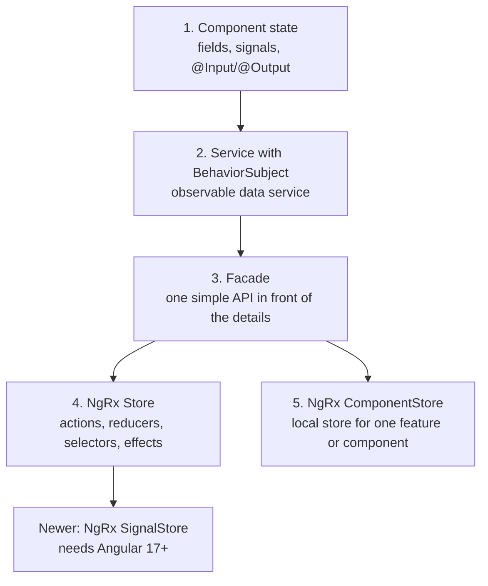
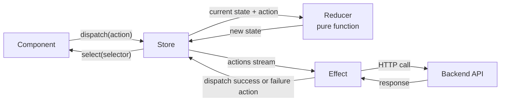
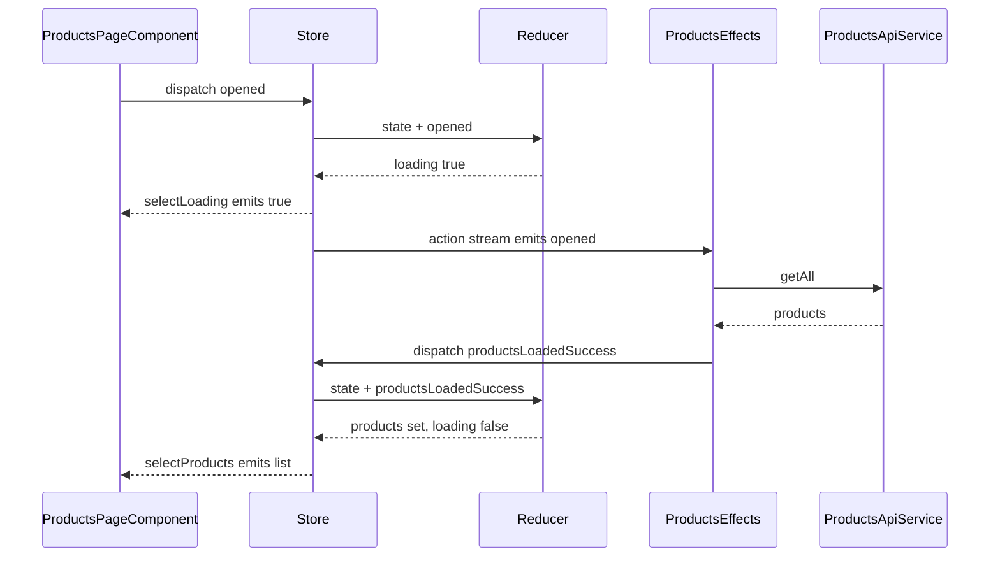

# State management and NgRx

> In this document you will learn what "state" means in an Angular app, the different ways to manage it (from a simple component field to NgRx Store), and how to choose the right one. State management questions are common in Angular interviews because they show whether you can design a real application, not just write components.

**Before this:** [RxJS](09-rxjs.md) · [Change detection and signals](10-change-detection-and-signals.md) · [Dependency injection](05-dependency-injection.md) · **Interview questions:** [jump to the interview section](#interview-questions)

## Table of contents

1. [What state is](#what-state-is)
2. [Types of state in an Angular app](#types-of-state-in-an-angular-app)
3. [The state management ladder](#the-state-management-ladder)
4. [Level 1: Component state](#level-1-component-state)
5. [Level 2: A service with BehaviorSubject](#level-2-a-service-with-behaviorsubject)
6. [Level 3: The facade pattern](#level-3-the-facade-pattern)
7. [Level 4: NgRx Store, the big picture](#level-4-ngrx-store-the-big-picture)
8. [Build a tiny store to understand NgRx](#build-a-tiny-store-to-understand-ngrx)
9. [Setting up NgRx in Angular 16](#setting-up-ngrx-in-angular-16)
10. [Actions](#actions)
11. [Reducers](#reducers)
12. [Selectors](#selectors)
13. [Effects](#effects)
14. [NgRx Entity](#ngrx-entity)
15. [Router Store](#router-store)
16. [Store DevTools and runtime checks](#store-devtools-and-runtime-checks)
17. [Facades over NgRx](#facades-over-ngrx)
18. [Level 5: NgRx ComponentStore](#level-5-ngrx-componentstore)
19. [NgRx and signals](#ngrx-and-signals)
20. [When not to use NgRx](#when-not-to-use-ngrx)
21. [Testing reducers, selectors and effects](#testing-reducers-selectors-and-effects)
22. [Common mistakes](#common-mistakes)
23. [Best practices](#best-practices)
24. [How to explain this in an interview](#how-to-explain-this-in-an-interview)
25. [Interview questions](#interview-questions)
26. [Summary](#summary)
27. [References](#references)

---

## What state is

**State** is any data that your app remembers and that can change over time. When state changes, the screen should change too.

Examples of state:

- The list of products you loaded from the server.
- The user who is logged in.
- Whether a dropdown is open or closed.
- The text the user typed into a search box.
- Which page of a table is selected.

A simple way to think about it:

> **UI = f(state)**. The screen is a function of the state. If you know the state, you know what the screen should show.

State management is the set of decisions about:

1. **Where** a piece of state lives (in a component, a service, or a store).
2. **Who** is allowed to change it.
3. **How** other parts of the app find out that it changed.

When an app is small, these questions are easy. When an app has 50 screens, 10 developers and data that many screens share, bad answers create bugs: two screens show different values for the same thing, data is loaded twice, or nobody knows which code changed a value.

**Analogy:** Think of a shared office whiteboard. If everyone writes on it whenever they want, nobody knows who changed what. If there is one person who writes on the board, and everyone else sends them requests ("please change the meeting time to 3pm"), the board is always consistent and you can keep a log of every request. NgRx works like the second office. A plain service is closer to the first office, but you can add rules to it.

## Types of state in an Angular app

Not all state is the same. Before you choose a tool, sort your state into these groups.

| Type | What it is | Example | Usual home |
| --- | --- | --- | --- |
| **Local UI state** | Belongs to one component, nobody else cares | Is the menu open? Which tab is active? | Component field or signal |
| **Shared client state** | Created in the browser, used by several components | Selected theme, shopping cart draft, filters shared by a list and a chart | Service or store |
| **Server state (cache)** | A copy of data that really lives on the server | Products, orders, users | Service with caching, or a store |
| **Form state** | Values, validity, dirty/touched flags of a form | A checkout form | Angular Forms (`FormGroup`) |
| **URL / router state** | Data in the URL | `/products/42?sort=price` | The router (the URL is the source of truth) |
| **Session state** | Who is logged in, tokens, permissions | Current user and roles | A root service (auth service) or store |
| **Persisted state** | State that must survive a reload | "Remember my last filters" | `localStorage` plus a service that loads it |

Two important ideas come from this table:

- **Server state is a cache, not your data.** The server owns it. Your app only holds a copy that can become stale. You must decide when to reload it.
- **The URL is already a state container.** If a value should survive a page refresh or be shareable by link (current page, search term, selected id), put it in the URL. Do not copy it into a store and keep two versions in sync.

```ts
// ❌ Wrong: the selected product id is stored in a service AND in the URL.
// They can disagree after the user presses the browser Back button.
this.productState.selectedId = 42;
this.router.navigate(['/products', 42]);

// ✅ Correct: the URL is the source of truth. Components read the id from the route.
this.router.navigate(['/products', 42]);
// In the details component:
// this.route.paramMap.pipe(map(p => p.get('id')))
```

## The state management ladder

Think of state management as a ladder. Start on the lowest step that solves your problem. Climb only when you feel real pain.



| Step | Use it when | Cost |
| --- | --- | --- |
| Component state | Only one component needs the data | Almost zero |
| Service + BehaviorSubject | A few components share data | Low: one class, a few methods |
| Facade | Components should not know where data comes from | Low to medium |
| NgRx Store | Large app, many features share and change the same data, you want strict rules and great debugging | High: more files and concepts |
| NgRx ComponentStore | One complex feature or component needs a reactive local store | Medium |

The rest of this document walks up the ladder, one step at a time.

## Level 1: Component state

The simplest state is a field in a component.

```ts
import { Component } from '@angular/core';

@Component({
  selector: 'app-faq-item',
  template: `
    <button type="button" (click)="toggle()">{{ question }}</button>
    <p *ngIf="isOpen">{{ answer }}</p>
  `,
})
export class FaqItemComponent {
  question = 'How do I reset my password?';
  answer = 'Click "Forgot password" on the login page.';
  isOpen = false; // local UI state

  toggle(): void {
    this.isOpen = !this.isOpen;
  }
}
```

Nobody outside this component cares whether the answer is open. So the state lives here. This is correct and you should not move it into a store.

**Parent and child sharing.** When a parent and its direct child share data, use `@Input` and `@Output`. The parent owns the state, the child shows it and sends events back up.

```ts
// Parent owns the state
@Component({
  selector: 'app-cart-page',
  template: `
    <app-quantity-picker [quantity]="quantity" (quantityChange)="quantity = $event" />
    <p>Total: {{ quantity * price | currency }}</p>
  `,
})
export class CartPageComponent {
  quantity = 1;
  price = 19.99;
}

// Child only displays and emits
@Component({
  selector: 'app-quantity-picker',
  template: `
    <button type="button" (click)="quantityChange.emit(quantity - 1)" [disabled]="quantity <= 1">-</button>
    {{ quantity }}
    <button type="button" (click)="quantityChange.emit(quantity + 1)">+</button>
  `,
})
export class QuantityPickerComponent {
  @Input({ required: true }) quantity!: number;
  @Output() quantityChange = new EventEmitter<number>();
}
```

The self-closing tag `<app-quantity-picker ... />` and `@Input({ required: true })` both work in Angular 16.

**Signals for component state (Angular 16 developer preview).** Angular 16 added signals as a developer preview. A **signal** is a value holder that tells Angular when it changes. You can use it for local state:

```ts
import { Component, computed, signal } from '@angular/core';

@Component({
  selector: 'app-counter',
  standalone: true,
  template: `
    <button type="button" (click)="increment()">+</button>
    <p>Count: {{ count() }}, double: {{ double() }}</p>
  `,
})
export class CounterComponent {
  count = signal(0);
  double = computed(() => this.count() * 2);

  increment(): void {
    this.count.update(c => c + 1);
  }
}
```

Signals are covered in depth in [Change detection and signals](10-change-detection-and-signals.md). In Angular 16 they are a developer preview, so many teams still use RxJS for shared state.

**When component state stops being enough:**

- Two components that are not parent and child need the same data.
- You pass the same input through three or four levels of components only to reach a deep child. This is called **prop drilling**.
- The data must survive when the component is destroyed (for example, the user navigates away and comes back).

That is when you move up to a service.

## Level 2: A service with BehaviorSubject

### What it is

An **observable data service** (also called a "service with a subject" or a "store service") is an Angular service that:

1. Keeps state in a private `BehaviorSubject`.
2. Exposes the state as a read-only `Observable`.
3. Offers methods to change the state.

A **BehaviorSubject** is an RxJS Subject that always holds a current value. When someone subscribes, they get the current value immediately, then every new value. It is a perfect fit for state because a component that appears later still gets the latest data. (See [Subjects in the RxJS doc](09-rxjs.md#subjects).)

### Why it exists

It solves the sharing problem with very little code:

- One instance (a singleton when `providedIn: 'root'`) holds the data, so every component sees the same value.
- Components subscribe with the `async` pipe, so they update automatically.
- Only the service can change the state, because the subject is private.

### Full example: a cart service

```ts
// cart.models.ts
export interface CartItem {
  productId: string;
  name: string;
  price: number;
  quantity: number;
}

export interface CartState {
  items: CartItem[];
  saving: boolean;
  error: string | null;
}
```

```ts
// cart.store.ts
import { Injectable, inject } from '@angular/core';
import { HttpClient } from '@angular/common/http';
import { BehaviorSubject, Observable, distinctUntilChanged, finalize, map } from 'rxjs';
import { CartItem, CartState } from './cart.models';

const initialState: CartState = { items: [], saving: false, error: null };

@Injectable({ providedIn: 'root' })
export class CartStore {
  private readonly http = inject(HttpClient);

  // 1. Private, writable state. Nobody outside can call .next() on it.
  private readonly state$ = new BehaviorSubject<CartState>(initialState);

  // 2. Public, read-only slices ("selectors")
  readonly items$: Observable<CartItem[]> = this.select(s => s.items);
  readonly saving$ = this.select(s => s.saving);
  readonly error$ = this.select(s => s.error);
  readonly totalPrice$ = this.items$.pipe(
    map(items => items.reduce((sum, i) => sum + i.price * i.quantity, 0)),
  );
  readonly itemCount$ = this.items$.pipe(
    map(items => items.reduce((sum, i) => sum + i.quantity, 0)),
  );

  // 3. Methods that change state. Always create NEW objects (immutability).
  addItem(item: CartItem): void {
    const { items } = this.state$.value;
    const existing = items.find(i => i.productId === item.productId);
    const nextItems = existing
      ? items.map(i =>
          i.productId === item.productId ? { ...i, quantity: i.quantity + item.quantity } : i,
        )
      : [...items, item];
    this.setState({ items: nextItems });
  }

  removeItem(productId: string): void {
    this.setState({ items: this.state$.value.items.filter(i => i.productId !== productId) });
  }

  checkout(): void {
    this.setState({ saving: true, error: null });
    this.http
      .post('/api/orders', { items: this.state$.value.items })
      .pipe(finalize(() => this.setState({ saving: false })))
      .subscribe({
        next: () => this.setState({ items: [] }),
        error: () => this.setState({ error: 'Checkout failed. Please try again.' }),
      });
  }

  // Helpers
  private select<T>(project: (s: CartState) => T): Observable<T> {
    return this.state$.pipe(map(project), distinctUntilChanged());
  }

  private setState(partial: Partial<CartState>): void {
    this.state$.next({ ...this.state$.value, ...partial });
  }
}
```

```ts
// cart-badge.component.ts: one consumer
@Component({
  selector: 'app-cart-badge',
  template: `<span class="badge">{{ itemCount$ | async }}</span>`,
  changeDetection: ChangeDetectionStrategy.OnPush,
})
export class CartBadgeComponent {
  itemCount$ = inject(CartStore).itemCount$;
}

// product-card.component.ts: another consumer, far away in the tree
@Component({
  selector: 'app-product-card',
  template: `
    <h3>{{ product.name }}</h3>
    <button type="button" (click)="add()">Add to cart</button>
  `,
  changeDetection: ChangeDetectionStrategy.OnPush,
})
export class ProductCardComponent {
  @Input({ required: true }) product!: { id: string; name: string; price: number };
  private cart = inject(CartStore);

  add(): void {
    this.cart.addItem({ productId: this.product.id, name: this.product.name, price: this.product.price, quantity: 1 });
  }
}
```

### Step-by-step walkthrough

1. The app starts. Angular creates one `CartStore` (because of `providedIn: 'root'`). `state$` holds `{ items: [], saving: false, error: null }`.
2. `CartBadgeComponent` renders. The `async` pipe subscribes to `itemCount$`. The BehaviorSubject gives the current state at once, so the badge shows `0`.
3. The user clicks "Add to cart" in `ProductCardComponent`. It calls `cart.addItem(...)`.
4. `addItem` builds a **new** items array and calls `setState`, which calls `state$.next(newState)`.
5. Every subscriber runs its `map`. `itemCount$` now produces `1`. `distinctUntilChanged` lets it through because `1 !== 0`.
6. The `async` pipe receives `1` and marks the badge component for check. The badge shows `1`, even though it uses `OnPush`.

You can run the same idea in plain Node.js with RxJS. This tiny version shows the flow:

```js
import { BehaviorSubject, map, distinctUntilChanged } from 'rxjs';

const state$ = new BehaviorSubject({ items: [] });
const count$ = state$.pipe(map(s => s.items.length), distinctUntilChanged());

count$.subscribe(n => console.log('count:', n)); // count: 0  (current value at once)

state$.next({ ...state$.value, items: [...state$.value.items, 'Book'] }); // count: 1
state$.next({ ...state$.value });                                         // (nothing: still 1)
state$.next({ ...state$.value, items: [] });                              // count: 0
```

### Why immutability matters here

If you change the array in place (`items.push(...)`), three things break:

```ts
// ❌ Wrong: mutates the existing array
addItem(item: CartItem): void {
  this.state$.value.items.push(item);
  this.state$.next(this.state$.value); // same object, same array
}
```

1. `distinctUntilChanged()` compares references. The array reference did not change, so a selector like `map(s => s.items)` does not emit.
2. An `OnPush` child that receives `items` through `@Input` does not update, because the input reference is the same.
3. Any other code holding the old array sees it change "by magic". This makes bugs hard to find.

```ts
// ✅ Correct: always create a new array and a new state object
this.setState({ items: [...this.state$.value.items, item] });
```

### Advantages and disadvantages

| Advantages | Disadvantages |
| --- | --- |
| Very little code, easy to learn | No standard structure: each developer writes it differently |
| Uses only Angular + RxJS, no extra library | No built-in DevTools, time travel or action log |
| Works well with `async` pipe and `OnPush` | Side effects (HTTP) are mixed with state updates |
| Easy to test: it is a normal class | As the app grows, services start to depend on each other in a web |

### Common mistakes with service state

- **Exposing the subject.** `public cart$ = new BehaviorSubject(...)` lets any component call `cart$.next(...)`. Keep it private and expose `asObservable()` or a piped observable.
- **Subscribing in the service constructor and never cleaning up.** A root service lives for the whole app, so this is usually fine, but a service provided in a component must clean up in `ngOnDestroy`.
- **Using `.value` in components.** `store.state$.value` is a snapshot. The component will not update when the value changes. Use the observable with the `async` pipe.
- **Providing the service in a component by accident.** If you add `providers: [CartStore]` to a component, that component gets its **own** cart. Two components then show different carts. See [Dependency injection](05-dependency-injection.md) for how provider scope works.

## Level 3: The facade pattern

### What it is

A **facade** is a class that gives components one simple API and hides how the work is really done. The component calls `ordersFacade.loadOrders()` and reads `ordersFacade.orders$`. It does not know whether the data comes from a BehaviorSubject service, NgRx Store, a cache or an HTTP call.

The facade pattern itself is explained in [Structural patterns](../04-oop-solid-design-patterns/07-structural-patterns.md). Here we look at how Angular teams use it for state.

### Why it exists

- **Components stay simple.** They only know "what" (load orders, select order), not "how".
- **You can change the state technology later.** You can replace a BehaviorSubject service with NgRx (or NgRx with something else) without touching the components.
- **One place for a feature's workflow.** If loading orders also needs the current user and a filter, the facade combines them.

### Example

```ts
// orders.facade.ts
@Injectable({ providedIn: 'root' })
export class OrdersFacade {
  private api = inject(OrdersApiService);
  private auth = inject(AuthService);

  private readonly state$ = new BehaviorSubject<{ orders: Order[]; loading: boolean; error: string | null }>({
    orders: [],
    loading: false,
    error: null,
  });

  readonly orders$ = this.state$.pipe(map(s => s.orders), distinctUntilChanged());
  readonly loading$ = this.state$.pipe(map(s => s.loading), distinctUntilChanged());
  readonly error$ = this.state$.pipe(map(s => s.error), distinctUntilChanged());

  // One view model for the page: fewer async pipes in the template
  readonly vm$ = combineLatest({ orders: this.orders$, loading: this.loading$, error: this.error$ });

  loadOrders(): void {
    this.patch({ loading: true, error: null });
    this.auth.currentUser$
      .pipe(
        take(1),
        switchMap(user => this.api.getOrdersForCustomer(user.id)),
      )
      .subscribe({
        next: orders => this.patch({ orders, loading: false }),
        error: () => this.patch({ loading: false, error: 'Could not load orders' }),
      });
  }

  private patch(partial: Partial<{ orders: Order[]; loading: boolean; error: string | null }>): void {
    this.state$.next({ ...this.state$.value, ...partial });
  }
}
```

```ts
// orders-page.component.ts
@Component({
  selector: 'app-orders-page',
  template: `
    <ng-container *ngIf="facade.vm$ | async as vm">
      <app-spinner *ngIf="vm.loading" />
      <p *ngIf="vm.error" role="alert">{{ vm.error }}</p>
      <app-orders-table [orders]="vm.orders" />
    </ng-container>
  `,
  changeDetection: ChangeDetectionStrategy.OnPush,
})
export class OrdersPageComponent implements OnInit {
  readonly facade = inject(OrdersFacade);

  ngOnInit(): void {
    this.facade.loadOrders();
  }
}
```

The page component has no HTTP code, no RxJS operators and no knowledge of the user service. If you later move orders into NgRx, only `OrdersFacade` changes.

### Advantages and disadvantages

| Advantages | Disadvantages |
| --- | --- |
| Components are thin and easy to test (mock one facade) | One more layer to write and read |
| You can swap the state technology later | A "facade per HTTP call" adds noise and no value |
| A good boundary for a feature team | It can hide too much: with NgRx, a facade can hide which actions are dispatched, which makes debugging harder if method names do not match action names |

**Best practice:** create a facade per **feature** (orders, products, checkout), not per component or per endpoint.

## Level 4: NgRx Store, the big picture

### What it is

**NgRx** is a set of libraries for reactive state management in Angular. The main library, `@ngrx/store`, follows the **Redux pattern**:

- **Store**: one object that holds the global state of the app.
- **Actions**: plain objects that describe "something happened" (`[Products Page] Opened`).
- **Reducers**: pure functions that take the current state and an action, and return the **new** state.
- **Selectors**: pure functions that read and derive slices of state, with memoization.
- **Effects** (`@ngrx/effects`): classes or functions that listen for actions and run **side effects** such as HTTP calls, then dispatch new actions with the results.

NgRx is built on RxJS. `store.select(...)` returns an Observable, and effects are Observable pipelines.

> **Versions:** NgRx major versions follow Angular major versions. For Angular 16 you use **NgRx 16** (`@ngrx/store@16`). NgRx 16 requires Angular 16, TypeScript 5 and RxJS 6.5+ or 7.5+.

### Why it exists

In a large app, many components read and change the same data. NgRx gives that data strict rules:

1. **Single source of truth.** All shared state lives in one store, so two screens cannot disagree.
2. **State is read-only.** The only way to change state is to dispatch an action. Components cannot change state directly.
3. **Changes are made by pure functions.** Reducers have no side effects, so given the same state and action you always get the same result. This makes them easy to test and makes time-travel debugging possible.
4. **Side effects are isolated.** HTTP calls, local storage and navigation live in effects, not in components or reducers.
5. **Everything is visible.** Every change is an action with a name. Redux DevTools shows each action and the state before and after.

### Analogy

Think of a bank account:

- The **store** is the account balance.
- An **action** is a transaction slip: "Deposit 100". It describes what happened. It does not change the balance by itself.
- The **reducer** is the bank's rule book: "For a deposit, new balance = old balance + amount." It never phones anyone. It only calculates.
- An **effect** is the bank employee who must phone another bank to confirm a transfer, and then writes a new slip: "Transfer confirmed" or "Transfer failed".
- A **selector** is your banking app screen that shows "balance" or "total spent this month", calculated from the account data.

Where the analogy breaks: a real bank can reject a slip. In NgRx, a reducer always handles an action. If it does not know the action, it returns the state unchanged.

### Data flow diagram



### Step-by-step walkthrough of one user action

The user opens the products page:

1. `ProductsPageComponent.ngOnInit` dispatches `ProductsPageActions.opened()`.
2. The store passes the current state and the action to every reducer. The products reducer sets `loading: true`. The store now has new state.
3. Selectors re-run. `selectLoading` now returns `true`. The component's `loading$` emits `true` and a spinner appears.
4. **After** the reducers have run, the store pushes the action into the `Actions` stream. The products effect is listening for `opened`. It calls `productsApi.getAll()`.
5. The HTTP request finishes. The effect maps the response to `ProductsApiActions.productsLoadedSuccess({ products })` and NgRx dispatches it.
6. The reducer handles the success action: `products` gets the new list and `loading` becomes `false`.
7. Selectors re-run. `selectProducts` emits the list, `selectLoading` emits `false`. The spinner disappears and the list appears.

Notice that the component only did two things: dispatch an action and select data. It never called HTTP and never changed state directly.



## Build a tiny store to understand NgRx

The best way to understand NgRx is to build a very small version of it. This is plain JavaScript with RxJS. It is **not** the real NgRx code, but the idea is the same.

```js
import { BehaviorSubject, map, distinctUntilChanged } from 'rxjs';

function createStore(reducer, initialState) {
  const state$ = new BehaviorSubject(initialState);
  return {
    dispatch(action) {
      const next = reducer(state$.value, action); // reducer computes new state
      console.log(`[dispatch] ${action.type}`);
      state$.next(next);                          // store saves it and notifies
    },
    select(selector) {
      return state$.pipe(map(selector), distinctUntilChanged());
    },
  };
}

const initialState = { items: [], loading: false };

function cartReducer(state, action) {
  switch (action.type) {
    case '[Cart] Add Item':
      return { ...state, items: [...state.items, action.item] };
    case '[Cart] Clear':
      return { ...state, items: [] };
    default:
      return state; // unknown action: return the SAME state
  }
}

const store = createStore(cartReducer, initialState);
store.select(s => s.items.length).subscribe(n => console.log('items count:', n));
store.dispatch({ type: '[Cart] Add Item', item: { id: 1, name: 'Book' } });
store.dispatch({ type: '[Cart] Unknown' });
store.dispatch({ type: '[Cart] Add Item', item: { id: 2, name: 'Pen' } });
store.dispatch({ type: '[Cart] Clear' });
```

Output (verified with Node.js):

```text
items count: 0
[dispatch] [Cart] Add Item
items count: 1
[dispatch] [Cart] Unknown
[dispatch] [Cart] Add Item
items count: 2
[dispatch] [Cart] Clear
items count: 0
```

What to notice:

- `items count: 0` prints first, because a BehaviorSubject gives its current value to a new subscriber at once.
- The unknown action prints `[dispatch]` but **no** `items count` line. The reducer returned the same state, so `items.length` did not change, and `distinctUntilChanged` blocked the duplicate.
- The real NgRx Store adds: many reducers combined into one state tree, typed action creators, memoized selectors, effects, DevTools and runtime checks. But the heart is this loop: **dispatch → reducer → new state → selectors → view**.

## Setting up NgRx in Angular 16

Install the packages that match your Angular major version:

```bash
ng add @ngrx/store@16
ng add @ngrx/effects@16
ng add @ngrx/store-devtools@16
# optional
npm install @ngrx/entity@16 @ngrx/router-store@16 @ngrx/component-store@16
```

### NgModule-based app (most Angular 16 apps)

```ts
// app.module.ts
import { isDevMode, NgModule } from '@angular/core';
import { StoreModule } from '@ngrx/store';
import { EffectsModule } from '@ngrx/effects';
import { StoreDevtoolsModule } from '@ngrx/store-devtools';

@NgModule({
  imports: [
    BrowserModule,
    HttpClientModule,
    StoreModule.forRoot({}),           // root store, can start empty
    EffectsModule.forRoot([]),         // root effects
    StoreDevtoolsModule.instrument({ maxAge: 25, logOnly: !isDevMode() }),
  ],
  declarations: [AppComponent],
  bootstrap: [AppComponent],
})
export class AppModule {}
```

```ts
// products.module.ts: a lazy-loaded feature registers its own slice
@NgModule({
  imports: [
    CommonModule,
    StoreModule.forFeature(productsFeature),   // adds state under the key 'products'
    EffectsModule.forFeature([ProductsEffects]),
    RouterModule.forChild(productsRoutes),
  ],
  declarations: [ProductsPageComponent, ProductListComponent],
})
export class ProductsModule {}
```

### Standalone app (`bootstrapApplication`)

```ts
// main.ts
bootstrapApplication(AppComponent, {
  providers: [
    provideHttpClient(),
    provideRouter(routes),
    provideStore(),
    provideEffects(),
    provideStoreDevtools({ maxAge: 25, logOnly: !isDevMode() }),
  ],
});

// app.routes.ts: register a feature slice when its route loads
export const routes: Routes = [
  {
    path: 'products',
    loadComponent: () => import('./products/products-page.component').then(m => m.ProductsPageComponent),
    providers: [provideState(productsFeature), provideEffects(ProductsEffects)],
  },
];
```

Both styles create the same store. The feature state is added when the feature loads. This keeps lazy loading working: the products reducer code is not in the main bundle.

## Actions

### What an action is

An **action** is a plain object with a `type` string and optional data (the **payload**). It describes an event that happened.

```ts
{ type: '[Products Page] Search Changed', term: 'laptop' }
```

The convention for `type` is `[Source] Event`:

- **Source**: where it happened (`Products Page`, `Products API`, `Cart Drawer`).
- **Event**: what happened, in past tense or as an event (`Opened`, `Search Changed`, `Loaded Success`).

### createAction

`createAction` creates a typed **action creator**: a function that builds the action object.

```ts
import { createAction, props } from '@ngrx/store';

export const searchChanged = createAction(
  '[Products Page] Search Changed',
  props<{ term: string }>(),
);

export const productsPageOpened = createAction('[Products Page] Opened');

// Usage
store.dispatch(searchChanged({ term: 'laptop' }));
// dispatches { type: '[Products Page] Search Changed', term: 'laptop' }
```

### createActionGroup

When one source has many events, `createActionGroup` removes repetition. It builds one action creator per event and converts the event name to a camelCase method name.

```ts
import { createActionGroup, emptyProps, props } from '@ngrx/store';
import { Product } from './product.model';

export const ProductsPageActions = createActionGroup({
  source: 'Products Page',
  events: {
    'Opened': emptyProps(),
    'Search Changed': props<{ term: string }>(),
    'Product Selected': props<{ id: string }>(),
  },
});

export const ProductsApiActions = createActionGroup({
  source: 'Products API',
  events: {
    'Products Loaded Success': props<{ products: Product[] }>(),
    'Products Loaded Failure': props<{ error: string }>(),
  },
});

// Generated creators:
ProductsPageActions.opened();                       // type '[Products Page] Opened'
ProductsPageActions.searchChanged({ term: 'lap' }); // type '[Products Page] Search Changed'
ProductsApiActions.productsLoadedSuccess({ products: [] });
```

### Good action hygiene

Think of actions as **events**, not **commands**.

```ts
// ❌ Wrong: generic "command" actions reused from many places
setProducts({ products });   // who called this? why?
setLoading({ loading: true });

// ✅ Correct: unique events that tell the story
ProductsPageActions.opened();                 // the user opened the page
ProductsApiActions.productsLoadedSuccess(...); // the API answered
CartDrawerActions.checkoutClicked();          // the user clicked checkout
```

Why events are better:

- In DevTools you can read the story of what the user did.
- Several reducers can react to the same event. For example, `checkoutSucceeded` can clear the cart **and** add an order to the orders history. The component dispatches one action and does not need to know who reacts.
- Each action has exactly one source, so when you search the code for `opened` you find one place that dispatches it.

**Rule:** do not reuse the same action from many different places. Create separate actions with different sources, even if they cause the same state change.

## Reducers

### What a reducer is

A **reducer** is a pure function: `(state, action) => newState`.

A **pure function**:

- Returns the same output for the same input.
- Does not change its inputs.
- Does not do side effects (no HTTP, no `localStorage`, no `Date.now()`, no `Math.random()`, no navigation).

### createReducer and on

```ts
import { createReducer, on } from '@ngrx/store';
import { ProductsApiActions, ProductsPageActions } from './products.actions';
import { Product } from './product.model';

export interface ProductsState {
  products: Product[];
  query: string;
  selectedId: string | null;
  loading: boolean;
  error: string | null;
}

export const initialState: ProductsState = {
  products: [],
  query: '',
  selectedId: null,
  loading: false,
  error: null,
};

export const productsReducer = createReducer(
  initialState,
  on(ProductsPageActions.opened, (state): ProductsState => ({ ...state, loading: true, error: null })),
  on(ProductsPageActions.searchChanged, (state, { term }): ProductsState => ({ ...state, query: term })),
  on(ProductsPageActions.productSelected, (state, { id }): ProductsState => ({ ...state, selectedId: id })),
  on(ProductsApiActions.productsLoadedSuccess, (state, { products }): ProductsState => ({
    ...state,
    products,
    loading: false,
  })),
  on(ProductsApiActions.productsLoadedFailure, (state, { error }): ProductsState => ({
    ...state,
    loading: false,
    error,
  })),
);
```

Notes:

- The `(state): ProductsState =>` return type annotation is optional but recommended. Without it, TypeScript allows extra properties in the returned object and you can create typos like `laoding: false` without an error.
- `on` can take several action creators: `on(actionA, actionB, (state) => ...)`.
- Any action that has no `on` returns the current state unchanged.

### Immutability: updating nested state

Updating nested objects and arrays is where people make mistakes. Here are the common patterns.

```ts
// Add to an array
on(CartActions.itemAdded, (state, { item }) => ({ ...state, items: [...state.items, item] })),

// Remove from an array
on(CartActions.itemRemoved, (state, { id }) => ({
  ...state,
  items: state.items.filter(i => i.id !== id),
})),

// Update one item in an array
on(CartActions.quantityChanged, (state, { id, quantity }) => ({
  ...state,
  items: state.items.map(i => (i.id === id ? { ...i, quantity } : i)),
})),

// Update a nested object
on(SettingsActions.themeChanged, (state, { theme }) => ({
  ...state,
  preferences: { ...state.preferences, theme },
})),
```

```ts
// ❌ Wrong: mutating state in a reducer
on(CartActions.itemAdded, (state, { item }) => {
  state.items.push(item); // mutation!
  return state;           // same reference: selectors and OnPush will not see the change
}),
```

In development mode NgRx turns on **runtime checks** that freeze the state, so this code throws an error like "Cannot add property 0, object is not extensible". That is good: you find the bug early. (See [Store DevTools and runtime checks](#store-devtools-and-runtime-checks).)

### createFeature

`createFeature` combines a feature name, its reducer and auto-generated selectors in one object.

```ts
import { createFeature, createSelector } from '@ngrx/store';

export const productsFeature = createFeature({
  name: 'products',
  reducer: productsReducer,
  // Optional (NgRx 15.2+): add derived selectors next to the generated ones
  extraSelectors: ({ selectProducts, selectQuery, selectSelectedId }) => ({
    selectVisibleProducts: createSelector(selectProducts, selectQuery, (products, query) =>
      products.filter(p => p.name.toLowerCase().includes(query.toLowerCase())),
    ),
    selectSelectedProduct: createSelector(selectProducts, selectSelectedId, (products, id) =>
      products.find(p => p.id === id) ?? null,
    ),
  }),
});

// Generated for you:
// productsFeature.name                      -> 'products'
// productsFeature.reducer
// productsFeature.selectProductsState       -> the whole feature slice
// productsFeature.selectProducts, selectQuery, selectSelectedId, selectLoading, selectError
// Plus the extra ones:
// productsFeature.selectVisibleProducts, productsFeature.selectSelectedProduct
```

You register it with `StoreModule.forFeature(productsFeature)` or `provideState(productsFeature)`. This removes a lot of boilerplate.

### How the state tree looks

With `products` and `cart` features loaded, the store state is one object:

```json
{
  "products": { "products": [], "query": "", "selectedId": null, "loading": false, "error": null },
  "cart": { "items": [], "saving": false }
}
```

Each reducer only manages its own slice. NgRx calls every registered reducer for every action and puts the results together.

## Selectors

### What a selector is

A **selector** is a pure function that takes the whole state and returns a piece of it, or a value calculated from it.

```ts
import { createFeatureSelector, createSelector } from '@ngrx/store';

export const selectProductsState = createFeatureSelector<ProductsState>('products');

export const selectProducts = createSelector(selectProductsState, s => s.products);
export const selectQuery = createSelector(selectProductsState, s => s.query);

export const selectVisibleProducts = createSelector(
  selectProducts,
  selectQuery,
  (products, query) => products.filter(p => p.name.toLowerCase().includes(query.toLowerCase())),
);

export const selectProductCount = createSelector(selectVisibleProducts, products => products.length);
```

Components use them like this:

```ts
@Component({
  selector: 'app-products-page',
  template: `
    <input type="search" [value]="(query$ | async) ?? ''" (input)="onSearch($any($event.target).value)" />
    <app-spinner *ngIf="loading$ | async" />
    <app-product-list [products]="(products$ | async) ?? []" (selected)="onSelect($event)" />
  `,
  changeDetection: ChangeDetectionStrategy.OnPush,
})
export class ProductsPageComponent implements OnInit {
  private store = inject(Store);

  products$ = this.store.select(productsFeature.selectVisibleProducts);
  loading$ = this.store.select(productsFeature.selectLoading);
  query$ = this.store.select(productsFeature.selectQuery);

  ngOnInit(): void {
    this.store.dispatch(ProductsPageActions.opened());
  }

  onSearch(term: string): void {
    this.store.dispatch(ProductsPageActions.searchChanged({ term }));
  }

  onSelect(id: string): void {
    this.store.dispatch(ProductsPageActions.productSelected({ id }));
  }
}
```

### Memoization: how selectors avoid extra work

**Memoization** means "remember the last result, and reuse it if the inputs did not change".

`createSelector` remembers the **last inputs** and the **last result**. When the state changes, it first runs the input selectors. If every input returns the **same reference** as last time, the projector function does not run again. The selector returns the old result (the same object reference).

Why this matters:

- Filtering or sorting thousands of items is expensive. Memoization runs it only when the inputs changed.
- The selector returns the same array reference when nothing relevant changed. So `OnPush` children do not re-render and `distinctUntilChanged` does not emit.

Here is a simplified version of the idea, runnable in Node.js:

```js
// Simplified version of how NgRx createSelector memoizes (last inputs only, compared by reference)
function createSelector(...args) {
  const projector = args.pop();
  const inputs = args;
  let lastInputs = null;
  let lastResult;
  return (state) => {
    const values = inputs.map(fn => fn(state));
    const same = lastInputs !== null && values.every((v, i) => v === lastInputs[i]);
    if (same) return lastResult;
    lastInputs = values;
    lastResult = projector(...values);
    return lastResult;
  };
}

let runs = 0;
const selectProducts = (state) => state.products;
const selectQuery = (state) => state.query;
const selectVisible = createSelector(selectProducts, selectQuery, (products, query) => {
  runs++;
  return products.filter(p => p.name.toLowerCase().includes(query));
});

const products = [{ name: 'Laptop' }, { name: 'Lamp' }, { name: 'Phone' }];
let state = { products, query: 'la', loading: false };

const a = selectVisible(state);
state = { ...state, loading: true };   // unrelated change
const b = selectVisible(state);
state = { ...state, query: 'ph' };      // relevant change
const c = selectVisible(state);
console.log(runs);                // 2
console.log(a === b);             // true
console.log(c.map(p => p.name));  // [ 'Phone' ]
```

Walkthrough:

1. First call: no last inputs, so the projector runs (`runs = 1`). Result: Laptop and Lamp.
2. `loading` changes. The input selectors return the same `products` array and the same `'la'` string. The projector does **not** run. `b` is the exact same array as `a`.
3. `query` changes to `'ph'`. One input changed, so the projector runs (`runs = 2`).

### The mutation trap

Memoization trusts references. If you mutate the array, the selector cannot see the change:

```js
state.products.push({ name: 'Lantern' }); // ❌ same array reference
const d = selectVisible(state);
console.log(runs, d === c); // 2 true  -> stale result, 'Lantern' is ignored
```

This is one more reason reducers must be immutable.

### Selectors with parameters

Old NgRx versions allowed "selectors with props". That API was deprecated in NgRx 11, so do not use it in new code. Today you use a **factory function** that returns a selector:

```ts
export const selectProductById = (id: string) =>
  createSelector(selectProducts, products => products.find(p => p.id === id) ?? null);

// Usage
product$ = this.store.select(selectProductById('p-42'));
```

Each call to `selectProductById('p-42')` creates a **new** selector with its own memory. Create it once (for example, in a field or in `ngOnInit`), not inside a template method that runs on every change detection.

### View model selectors

A component often needs several values. You can combine them in one selector so the template has one `async` pipe:

```ts
export const selectProductsPageVm = createSelector(
  productsFeature.selectVisibleProducts,
  productsFeature.selectLoading,
  productsFeature.selectError,
  (products, loading, error) => ({ products, loading, error }),
);
```

```html
<ng-container *ngIf="vm$ | async as vm">
  <app-spinner *ngIf="vm.loading" />
  <p *ngIf="vm.error" role="alert">{{ vm.error }}</p>
  <app-product-list [products]="vm.products" />
</ng-container>
```

NgRx 16 also lets you pass a dictionary of selectors to `createSelector`, which gives the same result with less code:

```ts
export const selectProductsPageVm = createSelector({
  products: productsFeature.selectVisibleProducts,
  loading: productsFeature.selectLoading,
  error: productsFeature.selectError,
});
```

## Effects

### What an effect is

An **effect** listens to the stream of all dispatched actions, filters the ones it cares about, does a side effect (usually HTTP), and returns new actions. NgRx dispatches those new actions automatically.

Effects keep components and reducers pure:

- Components only dispatch events and read selectors.
- Reducers only calculate new state.
- Effects do all the "dirty" work: HTTP, timers, `localStorage`, navigation, analytics, notifications.

### A class-based effect (works in every NgRx version)

```ts
import { Injectable, inject } from '@angular/core';
import { Actions, createEffect, ofType } from '@ngrx/effects';
import { catchError, exhaustMap, map, of } from 'rxjs';
import { ProductsApiActions, ProductsPageActions } from './products.actions';
import { ProductsApiService } from './products-api.service';

@Injectable()
export class ProductsEffects {
  private actions$ = inject(Actions);
  private api = inject(ProductsApiService);

  loadProducts$ = createEffect(() =>
    this.actions$.pipe(
      ofType(ProductsPageActions.opened),   // 1. only this action
      exhaustMap(() =>                      // 2. ignore new 'opened' while loading
        this.api.getAll().pipe(
          map(products => ProductsApiActions.productsLoadedSuccess({ products })), // 3. success action
          catchError((err: unknown) =>
            of(ProductsApiActions.productsLoadedFailure({ error: toMessage(err) })), // 4. failure action
          ),
        ),
      ),
    ),
  );
}

function toMessage(err: unknown): string {
  return err instanceof Error ? err.message : 'Unknown error';
}
```

Step by step:

1. `this.actions$` is an Observable of every action dispatched in the app. An effect receives an action **after** the reducers have handled it.
2. `ofType(ProductsPageActions.opened)` lets only that action through, and it narrows the TypeScript type.
3. `exhaustMap` starts the HTTP call. If another `opened` arrives while the request is running, it is ignored.
4. On success, `map` turns the response into a success action. NgRx dispatches it.
5. On error, `catchError` **inside** the inner pipe turns the error into a failure action. The outer effect stream stays alive.

### Choosing the flattening operator

Each operator answers the question: "What should happen if a new action arrives while the previous request is still running?" The operators are explained in detail in [RxJS](09-rxjs.md#higher-order-mapping-switchmap-mergemap-concatmap-exhaustmap). This table maps them to effects:

| Operator | Behavior when a new action arrives | Use in effects for | Example |
| --- | --- | --- | --- |
| `switchMap` | Cancel the old request, start the new one | Reads where only the latest result matters | Search, filters, load details for the selected id |
| `concatMap` | Queue: wait for the old one, then run the new one | Writes that must happen in order | Update quantity, then update again; reorder items |
| `mergeMap` | Run all in parallel | Independent writes where order does not matter | Delete several different items, upload several files |
| `exhaustMap` | Ignore new actions until the current one finishes | Actions that should run once at a time | Login button, "Load page" on init, submit order |

You can see the difference with fake 50 ms requests and three actions sent 10 ms apart (verified with Node.js and RxJS 7.8):

```js
import { Subject, of, delay, switchMap, mergeMap, concatMap, exhaustMap } from 'rxjs';

function run(name, flatten) {
  return new Promise(resolve => {
    const actions$ = new Subject();
    const results = [];
    const fakeHttp = (id) => of(`saved ${id}`).pipe(delay(50));
    actions$.pipe(flatten(a => fakeHttp(a.id))).subscribe({
      next: r => results.push(r),
      complete: () => { console.log(name.padEnd(10), results.join(', ')); resolve(); },
    });
    actions$.next({ id: 1 });
    setTimeout(() => actions$.next({ id: 2 }), 10);
    setTimeout(() => actions$.next({ id: 3 }), 20);
    setTimeout(() => actions$.complete(), 30);
  });
}

await run('switchMap', switchMap);   // switchMap  saved 3
await run('mergeMap', mergeMap);     // mergeMap   saved 1, saved 2, saved 3
await run('concatMap', concatMap);   // concatMap  saved 1, saved 2, saved 3
await run('exhaustMap', exhaustMap); // exhaustMap saved 1
```

> **Careful with `switchMap` for writes.** `switchMap` unsubscribes from the old HTTP request, and Angular cancels the browser request. But the server may have already received it and saved the data. The client then ignores the response. For saves, prefer `concatMap` (ordered) or `mergeMap` (independent) so you never lose a result.

### Error handling: catchError must be inside

This is the most common effect bug. If you put `catchError` on the outer stream, the first error turns the effect into a stream that **completes**, and the effect stops listening for actions forever.

```js
import { Subject, of, throwError, switchMap, map, catchError } from 'rxjs';

const api = (id) => id === 2 ? throwError(() => new Error('500')) : of({ id });

// ❌ catchError on the outer stream
const actions1$ = new Subject();
actions1$.pipe(
  switchMap(a => api(a.id)),
  map(p => ({ type: 'loadSuccess', p: p.id })),
  catchError(() => of({ type: 'loadFailure' })),
).subscribe({ next: a => console.log('wrong:', JSON.stringify(a)), complete: () => console.log('wrong: effect completed') });
[1, 2, 3].forEach(id => actions1$.next({ id }));

// ✅ catchError inside the inner stream
const actions2$ = new Subject();
actions2$.pipe(
  switchMap(a => api(a.id).pipe(
    map(p => ({ type: 'loadSuccess', p: p.id })),
    catchError(() => of({ type: 'loadFailure' })),
  )),
).subscribe(a => console.log('right:', JSON.stringify(a)));
[1, 2, 3].forEach(id => actions2$.next({ id }));
```

Output (verified with Node.js):

```text
wrong: {"type":"loadSuccess","p":1}
wrong: {"type":"loadFailure"}
wrong: effect completed
right: {"type":"loadSuccess","p":1}
right: {"type":"loadFailure"}
right: {"type":"loadSuccess","p":3}
```

The wrong version never handles action 3. In a real app, the products page would never load again until a full page reload.

> **NgRx detail:** if an effect stream **errors** (no `catchError` at all), NgRx's default effects error handler reports the error and resubscribes the effect (up to 10 times). But if you write an outer `catchError` that returns `of(failureAction)`, the stream **completes** normally, and NgRx does not resubscribe. So always handle errors in the inner observable.

### Effects that do not dispatch

Some effects only do something, like navigating or showing a toast. Set `dispatch: false`, otherwise NgRx will try to dispatch whatever the effect emits (and you can create an infinite loop if you return the same action).

```ts
checkoutSuccessNavigate$ = createEffect(
  () =>
    this.actions$.pipe(
      ofType(CheckoutApiActions.checkoutSucceeded),
      tap(({ orderId }) => this.router.navigate(['/orders', orderId])),
    ),
  { dispatch: false },
);
```

### Using state inside an effect

Sometimes the effect needs data from the store, for example the current query. In NgRx 16 use `concatLatestFrom` from `@ngrx/effects`. It reads the latest store value **only when the action arrives**, unlike `withLatestFrom`, which subscribes immediately.

```ts
import { concatLatestFrom } from '@ngrx/effects';

search$ = createEffect(() =>
  this.actions$.pipe(
    ofType(ProductsPageActions.searchChanged),
    debounceTime(300),
    concatLatestFrom(() => this.store.select(productsFeature.selectQuery)),
    switchMap(([, query]) =>
      this.api.search(query).pipe(
        map(products => ProductsApiActions.productsLoadedSuccess({ products })),
        catchError((err: unknown) => of(ProductsApiActions.productsLoadedFailure({ error: toMessage(err) }))),
      ),
    ),
  ),
);
```

> **Newer NgRx (18+):** `concatLatestFrom` moved to the new `@ngrx/operators` package, together with `tapResponse` and `mapResponse`.

### Functional effects (NgRx 16)

NgRx 16 added **functional effects**: effects written as plain functions with `inject()` instead of a class.

```ts
// products.effects.ts
import { inject } from '@angular/core';
import { Actions, createEffect, ofType } from '@ngrx/effects';

export const loadProducts = createEffect(
  (actions$ = inject(Actions), api = inject(ProductsApiService)) =>
    actions$.pipe(
      ofType(ProductsPageActions.opened),
      exhaustMap(() =>
        api.getAll().pipe(
          map(products => ProductsApiActions.productsLoadedSuccess({ products })),
          catchError((err: unknown) => of(ProductsApiActions.productsLoadedFailure({ error: toMessage(err) }))),
        ),
      ),
    ),
  { functional: true },
);
```

```ts
// Registration
import * as productsEffects from './products.effects';

provideEffects(productsEffects);                 // standalone
EffectsModule.forFeature(productsEffects);       // NgModule
```

The default parameter values (`actions$ = inject(Actions)`) run in an injection context. In tests you can call the function and pass fake objects directly: `loadProducts(actionsMock, apiMock)`.

## NgRx Entity

### What it is

Lists of records (products, users, orders) need the same operations again and again: add one, update one, remove one, find by id. Doing this with arrays is slow (`find` is O(n)) and repetitive.

`@ngrx/entity` stores a collection in a **normalized** shape:

```json
{
  "ids": ["p1", "p2"],
  "entities": {
    "p1": { "id": "p1", "name": "Laptop" },
    "p2": { "id": "p2", "name": "Phone" }
  }
}
```

- `ids` keeps the order.
- `entities` is a dictionary, so finding by id is O(1).

An **entity adapter** gives you ready-made, immutable update functions and selectors.

### Example

```ts
import { createEntityAdapter, EntityAdapter, EntityState } from '@ngrx/entity';
import { createFeature, createReducer, createSelector, on } from '@ngrx/store';

export interface Product { id: string; name: string; price: number; }

export interface ProductsState extends EntityState<Product> {
  selectedId: string | null;
  loading: boolean;
}

export const adapter: EntityAdapter<Product> = createEntityAdapter<Product>({
  // selectId: p => p.sku,           // only if the id field is not called 'id'
  sortComparer: (a, b) => a.name.localeCompare(b.name), // keep ids sorted by name
});

const initialState: ProductsState = adapter.getInitialState({ selectedId: null, loading: false });

export const productsFeature = createFeature({
  name: 'products',
  reducer: createReducer(
    initialState,
    on(ProductsPageActions.opened, (state): ProductsState => ({ ...state, loading: true })),
    on(ProductsApiActions.productsLoadedSuccess, (state, { products }) =>
      adapter.setAll(products, { ...state, loading: false }),
    ),
    on(ProductAdminActions.productCreated, (state, { product }) => adapter.addOne(product, state)),
    on(ProductAdminActions.priceChanged, (state, { id, price }) =>
      adapter.updateOne({ id, changes: { price } }, state),
    ),
    on(ProductAdminActions.productDeleted, (state, { id }) => adapter.removeOne(id, state)),
  ),
  extraSelectors: ({ selectProductsState, selectEntities, selectSelectedId }) => ({
    ...adapter.getSelectors(selectProductsState), // selectAll, selectEntities, selectIds, selectTotal
    selectSelectedProduct: createSelector(selectEntities, selectSelectedId, (entities, id) =>
      id ? entities[id] ?? null : null,
    ),
  }),
});
```

Common adapter methods: `addOne`, `addMany`, `setAll`, `setOne`, `upsertOne`, `upsertMany`, `updateOne`, `updateMany`, `removeOne`, `removeMany`, `removeAll`, `map`.

**When to use Entity:** when you keep a collection that you update item by item. If you only load a list and show it, a plain array is fine.

## Router Store

`@ngrx/router-store` copies the router state into the store. Then selectors and effects can read the URL like any other state.

```ts
// NgModule
StoreModule.forRoot({ router: routerReducer }),
StoreRouterConnectingModule.forRoot(),

// Standalone
provideStore({ router: routerReducer }),
provideRouterStore(),
```

```ts
import { getRouterSelectors } from '@ngrx/router-store';

export const { selectRouteParam, selectQueryParam, selectUrl, selectRouteData } = getRouterSelectors();

export const selectProductIdFromUrl = selectRouteParam('id');

export const selectProductFromUrl = createSelector(
  productsFeature.selectEntities,
  selectProductIdFromUrl,
  (entities, id) => (id ? entities[id] ?? null : null),
);
```

Router Store also dispatches router actions such as `routerNavigatedAction`, so an effect can react to navigation. Use it when many selectors depend on the URL. For a few components, reading `ActivatedRoute` directly is simpler.

## Store DevTools and runtime checks

### Redux DevTools

`@ngrx/store-devtools` connects your store to the **Redux DevTools** browser extension. You can:

- See every action in order, with its payload.
- See the state before and after each action, and the difference.
- "Time travel": jump back to an older state and replay actions.
- Export and import state to reproduce a bug.

```ts
StoreDevtoolsModule.instrument({
  maxAge: 25,             // keep the last 25 actions
  logOnly: !isDevMode(),  // in production, allow only logging features
});
```

Security note: the DevTools extension can read your whole state. Do not put secrets (tokens, passwords) in the store, and consider not enabling DevTools in production at all.

### Runtime checks

In development mode, NgRx checks your code for rule breaks:

| Check | Default | What it catches |
| --- | --- | --- |
| `strictStateImmutability` | on | Code that mutates state |
| `strictActionImmutability` | on | Code that mutates an action after dispatch |
| `strictStateSerializability` | off | Non-serializable values in state (Date, class instances, functions) |
| `strictActionSerializability` | off | Non-serializable values in actions |
| `strictActionWithinNgZone` | off | Actions dispatched outside NgZone |
| `strictActionTypeUniqueness` | off | Two actions with the same `type` string |

```ts
StoreModule.forRoot(reducers, {
  runtimeChecks: {
    strictStateSerializability: true,
    strictActionSerializability: true,
    strictActionTypeUniqueness: true,
  },
});
```

Keeping state serializable (plain objects, arrays, strings, numbers, booleans, null) is a good rule. It makes DevTools, persistence and SSR state transfer work. Store dates as ISO strings or timestamps, not `Date` objects.

## Facades over NgRx

A facade can sit in front of NgRx, exactly like it sat in front of a BehaviorSubject service.

```ts
@Injectable({ providedIn: 'root' })
export class ProductsFacade {
  private store = inject(Store);

  readonly products$ = this.store.select(productsFeature.selectVisibleProducts);
  readonly loading$ = this.store.select(productsFeature.selectLoading);
  readonly selected$ = this.store.select(productsFeature.selectSelectedProduct);

  pageOpened(): void {
    this.store.dispatch(ProductsPageActions.opened());
  }

  searchChanged(term: string): void {
    this.store.dispatch(ProductsPageActions.searchChanged({ term }));
  }

  productSelected(id: string): void {
    this.store.dispatch(ProductsPageActions.productSelected({ id }));
  }
}
```

**Pros:** components do not import NgRx at all. They are easier to test, and new team members learn one small API.

**Cons and the debate:** some NgRx experts warn that facades can hide good action design. If the facade has methods like `loadProducts()` and `setFilter()`, developers start to think in commands and reuse the same action from many places. Then DevTools no longer tells the story of where things happened.

**A balanced rule:** if you use a facade over NgRx, name its methods after **events** (`pageOpened`, `searchChanged`), keep one method per action, and do not put logic in the facade that belongs in effects or reducers.

## Level 5: NgRx ComponentStore

### What it is

`@ngrx/component-store` is a small, standalone library for **local** reactive state. It is a service that you usually provide in a component (or a route), so its state lives and dies with that component. There are no actions, no reducers and no global store.

It is like a well-structured version of the BehaviorSubject service from Level 2, with helpers for reading, updating and side effects.

### Why it exists

- Some features are complex (a big table with sorting, paging, filters and inline edit) but nobody else in the app needs their state.
- Putting that state in the global store adds boilerplate and leaves data behind after the user leaves the page.
- A plain service would work, but ComponentStore gives a standard structure and handles subscriptions for you.

### Example

```ts
import { Injectable, inject } from '@angular/core';
import { ComponentStore, tapResponse } from '@ngrx/component-store';
import { Observable, switchMap, tap } from 'rxjs';

export interface Todo { id: number; title: string; done: boolean; }

interface TodosState {
  todos: Todo[];
  filter: 'all' | 'open' | 'done';
  loading: boolean;
  error: string | null;
}

@Injectable()
export class TodosStore extends ComponentStore<TodosState> {
  private api = inject(TodosApiService);

  constructor() {
    super({ todos: [], filter: 'all', loading: false, error: null });
  }

  // Selectors (memoized, return Observables)
  readonly todos$ = this.select(s => s.todos);
  readonly filter$ = this.select(s => s.filter);
  readonly visibleTodos$ = this.select(this.todos$, this.filter$, (todos, filter) =>
    filter === 'all' ? todos : todos.filter(t => (filter === 'done' ? t.done : !t.done)),
  );
  readonly vm$ = this.select({
    todos: this.visibleTodos$,
    filter: this.filter$,
    loading: this.select(s => s.loading),
  });

  // Updaters (synchronous state changes)
  readonly setFilter = this.updater((state, filter: TodosState['filter']): TodosState => ({ ...state, filter }));
  readonly toggle = this.updater((state, id: number): TodosState => ({
    ...state,
    todos: state.todos.map(t => (t.id === id ? { ...t, done: !t.done } : t)),
  }));

  // Effects (async work)
  readonly loadTodos = this.effect<void>(trigger$ =>
    trigger$.pipe(
      tap(() => this.patchState({ loading: true, error: null })),
      switchMap(() =>
        this.api.getAll().pipe(
          tapResponse(
            todos => this.patchState({ todos, loading: false }),
            (err: unknown) => this.patchState({ loading: false, error: 'Could not load todos' }),
          ),
        ),
      ),
    ),
  );
}
```

```ts
@Component({
  selector: 'app-todos-page',
  providers: [TodosStore], // one store per page instance; destroyed with the component
  template: `
    <ng-container *ngIf="store.vm$ | async as vm">
      <select [value]="vm.filter" (change)="store.setFilter($any($event.target).value)">
        <option value="all">All</option>
        <option value="open">Open</option>
        <option value="done">Done</option>
      </select>
      <p *ngIf="vm.loading">Loading...</p>
      <ul>
        <li *ngFor="let todo of vm.todos; trackBy: trackById" (click)="store.toggle(todo.id)">
          {{ todo.done ? '[x]' : '[ ]' }} {{ todo.title }}
        </li>
      </ul>
    </ng-container>
  `,
  changeDetection: ChangeDetectionStrategy.OnPush,
})
export class TodosPageComponent implements OnInit {
  readonly store = inject(TodosStore);

  ngOnInit(): void {
    this.store.loadTodos();
  }

  trackById(_: number, todo: Todo): number {
    return todo.id;
  }
}
```

Main parts of ComponentStore:

| API | Purpose |
| --- | --- |
| `select()` | Create a memoized Observable from state or other selectors |
| `updater()` | Create a method that changes state synchronously and immutably |
| `setState()` / `patchState()` | Replace or partially update the state |
| `effect()` | Create a method that runs an Observable pipeline for side effects; ComponentStore unsubscribes when it is destroyed |
| `get()` | Read the current state synchronously (use rarely) |

> **Newer NgRx (18+):** `tapResponse` moved to `@ngrx/operators`. In NgRx 16 it is imported from `@ngrx/component-store`.

### Store vs ComponentStore

| | NgRx Store | NgRx ComponentStore |
| --- | --- | --- |
| Scope | Global, one per app | Local, one per component or route instance |
| Lifetime | Whole app session | Destroyed with the component that provides it |
| Changes made by | Actions + reducers | Updaters and `patchState` |
| Side effects | Effects listen to actions | `effect()` methods called directly |
| DevTools | Full action log | Not connected by default |
| Boilerplate | More | Less |
| Best for | Shared, long-lived, cross-feature state | Complex local state of one feature or widget |

## NgRx and signals

### In Angular 16 (NgRx 16)

Angular 16 introduced signals as a developer preview, and NgRx 16 added a bridge:

```ts
// Store: get a Signal instead of an Observable
@Component({
  selector: 'app-product-count',
  standalone: true,
  template: `<p>{{ count() }} products</p>`,
})
export class ProductCountComponent {
  private store = inject(Store);
  count = this.store.selectSignal(productsFeature.selectProductCount);
}
```

- `store.selectSignal(selector)` returns a read-only `Signal`. No `async` pipe needed.
- ComponentStore in NgRx 16 also has `selectSignal(...)` and a `state` signal.
- You can also use Angular's `toSignal(this.store.select(...))` from `@angular/core/rxjs-interop`.

Because signals are a developer preview in Angular 16, many teams keep using Observables and the `async` pipe in production Angular 16 code. Both approaches read from the same store.

### Newer: NgRx SignalStore

> **Newer Angular and NgRx (17+):** NgRx released **SignalStore** (`@ngrx/signals`) together with NgRx 17. It needs Angular 17 or newer, so you **cannot** use it in an Angular 16 app. It started as a developer preview and is stable in current NgRx versions. NgRx 19 added an experimental Events plugin (`@ngrx/signals/events`) for Redux-style events on top of SignalStore, and NgRx 21 made that plugin stable.

SignalStore is a signal-based store built from small "features":

```ts
// NgRx 17+ / Angular 17+ only
import { computed, inject } from '@angular/core';
import { patchState, signalStore, withComputed, withMethods, withState } from '@ngrx/signals';

export const CartStore = signalStore(
  { providedIn: 'root' },
  withState({ items: [] as CartItem[], saving: false }),
  withComputed(({ items }) => ({
    count: computed(() => items().reduce((n, i) => n + i.quantity, 0)),
  })),
  withMethods(store => ({
    addItem(item: CartItem): void {
      patchState(store, { items: [...store.items(), item] });
    },
  })),
);
```

In an interview you can describe it as "the signal-based successor of the service-with-a-subject and ComponentStore styles, with a plugin system". If the job uses Angular 17+, SignalStore is often the default choice for new feature state, while the classic NgRx Store stays common in large existing apps.

## When not to use NgRx

NgRx adds files and concepts: for one feature you often write actions, a reducer, selectors and effects. That cost is worth it only when you get something back.

**Signs you probably do not need NgRx:**

- The app is small or medium, and most data belongs to one screen.
- Data is mostly "load from server and show", with little sharing between screens.
- The team is new to RxJS. NgRx will slow them down a lot.
- You only want caching of server data. A service with `shareReplay` or a server-state library is simpler.
- You only need a global "current user" and "theme". Two small services are enough.

**Signs NgRx can help:**

- Many features read and change the same data (cart, user permissions, notifications, a shared selection).
- Complex flows: a user action triggers several side effects in order, retries, optimistic updates and undo.
- Many developers or teams work on the same app and you want one consistent pattern.
- You need to debug "how did the app get into this state?" with an action log.
- You want to persist, restore or sync state (for example, across browser tabs) in a controlled way.

| Question | If yes, lean toward |
| --- | --- |
| Does only one component use it? | Component state |
| Do a few nearby components share it? | Service + BehaviorSubject (or signals) |
| Is it complex but local to one page or widget? | ComponentStore |
| Is it shared across many features, long-lived, with complex flows? | NgRx Store |
| Is it really server data that needs caching and refresh? | Data service with caching (or NgRx if the rest of the app already uses it) |
| Should it survive refresh or be shareable by link? | The URL |

A healthy large app usually **mixes** these. NgRx for truly global state, ComponentStore or services for feature state, and plain fields for UI state. "Everything in the global store" is an anti-pattern.

## Testing reducers, selectors and effects

The full testing guide is in [Angular testing](14-testing.md). Here is the short version for NgRx, because each part is easy to test.

### Reducers: pure functions

```ts
describe('productsReducer', () => {
  it('sets loading on page opened', () => {
    const state = productsReducer(initialState, ProductsPageActions.opened());
    expect(state.loading).toBe(true);
    expect(state).not.toBe(initialState); // a new object
  });

  it('stores products on success', () => {
    const products = [{ id: 'p1', name: 'Laptop', price: 999 }];
    const state = productsReducer({ ...initialState, loading: true }, ProductsApiActions.productsLoadedSuccess({ products }));
    expect(state).toEqual({ ...initialState, products, loading: false });
  });
});
```

### Selectors: test the projector

Every memoized selector has a `.projector` property: the last function you passed. You can test it without building a whole state tree.

```ts
it('filters by query', () => {
  const products = [{ id: '1', name: 'Laptop', price: 1 }, { id: '2', name: 'Phone', price: 2 }];
  const result = productsFeature.selectVisibleProducts.projector(products, 'pho');
  expect(result.map(p => p.id)).toEqual(['2']);
});
```

### Effects: provideMockActions

```ts
import { provideMockActions } from '@ngrx/effects/testing';
import { Observable, of, throwError } from 'rxjs';

describe('ProductsEffects', () => {
  let actions$: Observable<Action>;
  let effects: ProductsEffects;
  let api: jasmine.SpyObj<ProductsApiService>;

  beforeEach(() => {
    api = jasmine.createSpyObj('ProductsApiService', ['getAll']);
    TestBed.configureTestingModule({
      providers: [
        ProductsEffects,
        provideMockActions(() => actions$),
        { provide: ProductsApiService, useValue: api },
      ],
    });
    effects = TestBed.inject(ProductsEffects);
  });

  it('dispatches success with products', (done) => {
    const products = [{ id: 'p1', name: 'Laptop', price: 999 }];
    api.getAll.and.returnValue(of(products));
    actions$ = of(ProductsPageActions.opened());

    effects.loadProducts$.subscribe(action => {
      expect(action).toEqual(ProductsApiActions.productsLoadedSuccess({ products }));
      done();
    });
  });

  it('dispatches failure on error', (done) => {
    api.getAll.and.returnValue(throwError(() => new Error('500')));
    actions$ = of(ProductsPageActions.opened());

    effects.loadProducts$.subscribe(action => {
      expect(action).toEqual(ProductsApiActions.productsLoadedFailure({ error: '500' }));
      done();
    });
  });
});
```

For components that use the store, `provideMockStore` from `@ngrx/store/testing` gives a `MockStore` where you set state or override selectors. See [Angular testing](14-testing.md).

## Common mistakes

1. **Putting everything in the global store.** Dropdown open flags and form drafts do not belong in NgRx. They add actions and noise for no benefit.
2. **Mutating state in reducers or services.** Selectors, `distinctUntilChanged` and `OnPush` compare references, so mutations are invisible to them. NgRx runtime checks catch this in dev mode only.
3. **Side effects in reducers.** No HTTP, no `localStorage`, no `Date.now()` or random ids in a reducer. Generate ids and timestamps in the component or effect and put them in the action.
4. **`catchError` on the outer effect stream.** The effect completes after the first error and stops working.
5. **Wrong flattening operator.** `switchMap` for saves can drop responses. `mergeMap` for search can show old results after new ones.
6. **Reusing generic actions everywhere** (`setLoading`, `setProducts`). You lose the "story" in DevTools and couple unrelated features.
7. **Subscribing to the store in a component and copying values into fields.** You must then manage the subscription and you lose `OnPush` benefits. Use the `async` pipe or `selectSignal`.
8. **Computing derived data in components** instead of selectors. The same filter logic ends up in three components, and it runs on every change detection.
9. **Storing non-serializable values** (class instances, `Date`, `Map`, functions) in state. DevTools and persistence break, and equality checks behave in surprising ways.
10. **Storing duplicated data.** Storing both `products` and `filteredProducts` means they can disagree. Store the source data and derive the filtered list with a selector.
11. **Providing a store service at the wrong level.** A BehaviorSubject service listed in a component's `providers` creates a separate instance for each component.
12. **Effects that dispatch the action they listen to**, without `dispatch: false`. This creates an infinite loop.

## Best practices

- **Start low on the ladder.** Use the simplest tool that works. Move state up only when it is really shared. Reason: less code and fewer concepts to maintain.
- **Keep one source of truth per piece of data.** Reason: duplicated state always drifts apart.
- **Treat actions as unique events with a clear source.** Reason: readable DevTools history and loose coupling.
- **Keep reducers pure and immutable, and add return types to `on` handlers.** Reason: predictable state and TypeScript catches typos.
- **Derive data with memoized selectors.** Reason: logic in one place, computed only when inputs change.
- **Handle errors inside the inner observable of every effect.** Reason: the effect keeps working after a failure.
- **Choose the flattening operator on purpose** (switch for reads, concat for ordered writes, merge for parallel writes, exhaust for "once at a time"). Reason: correct behavior under fast user input.
- **Use `createFeature` and `createActionGroup`.** Reason: much less boilerplate and consistent naming.
- **Use `OnPush` and the `async` pipe (or `selectSignal`) in components that read the store.** Reason: fewer change detection runs and no manual subscriptions.
- **Keep secrets out of the store** and keep state serializable. Reason: DevTools exposes the whole state; serializable state works with DevTools, persistence and SSR.
- **Register feature state with the lazy feature** (`forFeature` / `provideState` on the route). Reason: smaller main bundle.
- **Put the URL in charge of URL-shaped state.** Reason: refresh, Back button and shared links work for free.

## How to explain this in an interview

1. **Define it:** "State is the data the app remembers and that drives the UI. State management decides where each piece of state lives, who can change it and how others are notified."
2. **Why it exists:** "Without rules, shared data gets duplicated and changed from many places. Screens disagree and bugs are hard to trace."
3. **How it works:** "I use a ladder. Local state stays in the component. Shared state goes into a service that keeps a private BehaviorSubject and exposes read-only observables. For large apps I use NgRx: components dispatch actions, pure reducers create new state, memoized selectors read it, and effects handle HTTP and dispatch success or failure actions."
4. **Small example:** "On a products page, the component dispatches `opened`. The reducer sets loading to true. An effect with `exhaustMap` calls the API and dispatches `loadedSuccess`. The reducer stores the products, and the component gets them through `selectVisibleProducts` with the async pipe."
5. **Where it is useful:** "NgRx shines in big apps with shared, long-lived state and complex flows, like carts, permissions and notifications, and when many developers need one consistent pattern and good debugging with DevTools."
6. **Trade-offs / gotchas:** "NgRx costs boilerplate and has a learning curve, so I do not put local UI state in it. Reducers must be immutable, `catchError` belongs inside the inner observable in effects, and the flattening operator must match the use case."

---

## Interview questions

### Q1. What is state management, and what types of state exist in an Angular app?

**What the interviewer is checking:** whether you think about state as different categories with different homes, instead of "put everything in a store".

**Short spoken answer (30–60 seconds):**
> State is any data that the app remembers and that can change, like the logged-in user, a product list or whether a menu is open. State management is about deciding where each piece lives, who can change it and how the UI is notified. I separate it into types: local UI state that belongs to one component, shared client state like a cart, server state which is really a cached copy of backend data, form state that Angular Forms already manages, and URL state like the current page or selected id, where the router is the source of truth. Each type has a different best home. For example, I would never copy route params into a store, and I would not put a dropdown's open flag into NgRx.

**Detailed explanation:** The key insight is that "state" is not one thing. Server state has freshness problems (it can become stale), so it needs a reload or cache strategy. URL state must survive refresh and be shareable. Local UI state should die with the component. Choosing the home by type avoids most state bugs.

**Follow-up questions:**
- **Why is server state different from client state?** — The server owns it. Your copy can be stale, so you need rules for when to refetch, how to handle errors, and how to update after writes. Client state is fully owned by the browser.
- **Where would you keep table paging and sorting?** — If users should be able to refresh or share the link, in the URL query params. Otherwise in the component or a feature store.
- **What is "prop drilling"?** — Passing an input through several components that do not use it, only to reach a deep child. It is a sign that the data should move to a shared service.

**Common mistakes:** Answering only "I use NgRx". Not mentioning URL state or server state. Treating all state the same.

**Where this is used in real projects:** Every design review of a new feature starts by listing the state, its type and its owner.

### Q2. How do you share state between components that are not parent and child, without NgRx?

**What the interviewer is checking:** the observable data service pattern, encapsulation and immutability.

**Short spoken answer (30–60 seconds):**
> I create a service provided in root that keeps the state in a private BehaviorSubject. I expose read-only observables, usually with `map` and `distinctUntilChanged` for each slice, and I add methods like `addItem` or `removeItem` that compute a new immutable state and call `next`. Components read the observables with the async pipe, so they update automatically and work well with OnPush. Because the subject is private, only the service can change the state. I use BehaviorSubject because it always has a current value, so a component that subscribes later still gets the latest data immediately.

**Detailed explanation:** See [Level 2](#level-2-a-service-with-behaviorsubject). The pattern is a mini store: private writable state, public read-only selectors, and methods as the only way to write.

**Code:**

```ts
private readonly state$ = new BehaviorSubject<CartState>(initialState);
readonly items$ = this.state$.pipe(map(s => s.items), distinctUntilChanged());

addItem(item: CartItem): void {
  this.state$.next({ ...this.state$.value, items: [...this.state$.value.items, item] });
}
```

**Follow-up questions:**
- **Why not a plain `Subject`?** — A Subject has no current value. A component that subscribes after the last `next` gets nothing until the next change.
- **Why not expose the BehaviorSubject directly?** — Any component could call `next` and change the state from anywhere. You lose control and traceability.
- **Why `distinctUntilChanged`?** — So a slice only emits when it really changed, not on every update of an unrelated field.
- **What if the service is in a component's `providers` array?** — Each instance of that component gets its own service instance, so state is no longer shared.

**Common mistakes:** Public subjects. Mutating arrays. Reading `.value` in components and expecting updates.

**Where this is used in real projects:** Carts, user preferences, notification counters, feature filters in small and medium apps.

### Q3. What is NgRx and what problem does it solve?

**What the interviewer is checking:** the Redux principles, not just the names of the building blocks.

**Short spoken answer (30–60 seconds):**
> NgRx is a reactive state management library for Angular based on the Redux pattern and RxJS. All shared state lives in one store. The state is read-only, and the only way to change it is to dispatch an action, which is a plain object that describes an event. Reducers are pure functions that take the current state and the action and return a new state. Selectors read and derive data with memoization, and effects handle side effects like HTTP calls by listening to actions and dispatching new ones. It solves the problem of shared state being changed from many places: you get one source of truth, predictable updates, easy testing and a full action history in Redux DevTools. The cost is extra code and a learning curve.

**Detailed explanation:** The three Redux principles are single source of truth, read-only state, and changes through pure functions. NgRx adds effects for side effects, memoized selectors, typed action creators, entity helpers and DevTools integration.

**Follow-up questions:**
- **Why must reducers be pure?** — So the same state and action always give the same result. That makes testing trivial, enables time-travel debugging, and lets memoized selectors trust references.
- **In what order do reducers and effects receive an action?** — Reducers run first and the state is updated. Then the action is emitted on the `Actions` stream that effects listen to.
- **Is NgRx tied to Angular?** — Yes, NgRx is built for Angular and uses Angular DI. The Redux pattern itself is framework-agnostic.

**Common mistakes:** Saying NgRx "makes the app faster" (it does not by itself). Forgetting effects. Describing actions as commands.

**Where this is used in real projects:** Large enterprise apps: banking portals, admin dashboards, e-commerce with complex carts and checkout.

### Q4. Walk me through what happens when a component dispatches an action that loads data.

**What the interviewer is checking:** whether you really understand the data flow and timing.

**Short spoken answer (30–60 seconds):**
> Say the products page dispatches `opened` in ngOnInit. The store calls all reducers with the current state and the action. The products reducer returns a new state with loading set to true. Selectors re-run, so the component's loading observable emits true and shows a spinner. After the reducers, the action goes into the Actions stream. An effect filtered with `ofType(opened)` calls the API inside an `exhaustMap`. When the response comes back, the effect maps it to a `productsLoadedSuccess` action, which NgRx dispatches. The reducer stores the products and sets loading to false, and the selectors push the new list to the component through the async pipe.

**Code or diagram:** see the [sequence diagram](#data-flow-diagram) above.

**Follow-up questions:**
- **Where does the HTTP call happen, and why not in the component?** — In the effect. Components stay presentational and testable, and the same flow can be triggered from anywhere by dispatching the action.
- **What if the API fails?** — `catchError` inside the inner observable maps the error to a failure action. The reducer stores the error and sets loading to false.
- **How does an OnPush component get the update?** — The async pipe receives a new value and calls `markForCheck`.

**Common mistakes:** Saying the effect runs before the reducer. Forgetting the failure path.

**Where this is used in real projects:** Every "load on page open" flow in an NgRx app.

### Q5. What is the difference between `createAction` and `createActionGroup`? What makes a good action?

**What the interviewer is checking:** practical NgRx API knowledge and action design ("good action hygiene").

**Short spoken answer (30–60 seconds):**
> `createAction` creates one typed action creator with a type string and optional props. `createActionGroup` creates several action creators for one source at once: you give a source like "Products Page" and a map of event names, and it builds methods like `opened()` or `searchChanged({ term })` with types like "[Products Page] Search Changed". A good action is a unique event, not a command. It says where it came from and what happened, like "[Checkout Page] Submit Clicked". I do not reuse one generic `setLoading` action from many places, because then DevTools cannot tell the story and different features get coupled.

**Code:**

```ts
export const CheckoutPageActions = createActionGroup({
  source: 'Checkout Page',
  events: {
    'Submit Clicked': props<{ paymentMethodId: string }>(),
    'Coupon Applied': props<{ code: string }>(),
  },
});
// CheckoutPageActions.submitClicked({ paymentMethodId: 'pm_1' })
```

**Follow-up questions:**
- **Can several reducers react to the same action?** — Yes. That is a strength: `checkoutSucceeded` can clear the cart and add an order in two different features.
- **What is `emptyProps()`?** — It declares an event with no payload in `createActionGroup`.
- **Why the `[Source]` prefix?** — It makes action types unique and readable in DevTools and logs.

**Common mistakes:** Command-style actions. Reusing actions across sources. Huge payloads with whole state objects.

**Where this is used in real projects:** Action naming conventions are a standard part of NgRx code reviews.

### Q6. Why must reducers be immutable? Show how to update an item in an array.

**What the interviewer is checking:** immutability and its link to memoization, `OnPush` and DevTools.

**Short spoken answer (30–60 seconds):**
> Reducers must return a new object instead of changing the old one, because the whole system compares references. Memoized selectors only recompute when an input reference changes. distinctUntilChanged and OnPush also compare references. If I mutate the array, the reference stays the same, so selectors return stale data and the UI does not update. Immutability also keeps history: DevTools can show the state before and after each action. To update one item, I map over the array and spread the changed item.

**Code:**

```ts
on(CartActions.quantityChanged, (state, { id, quantity }): CartState => ({
  ...state,
  items: state.items.map(item => (item.id === id ? { ...item, quantity } : item)),
})),
```

**Follow-up questions:**
- **How does NgRx help you catch mutations?** — Runtime checks `strictStateImmutability` and `strictActionImmutability` are on by default in dev mode. They freeze state and actions, so a mutation throws.
- **Isn't copying slow?** — Spread copies only the changed path (shallow copies). Unchanged items keep their references, which is cheap and helps memoization.
- **Do you deep clone the state?** — No. Deep cloning changes every reference and breaks memoization. Copy only the path you change.

**Common mistakes:** `state.items.push()` then `return { ...state }` (the array is still the same reference). Deep cloning everything.

**Where this is used in real projects:** Every reducer and every BehaviorSubject service update.

### Q7. What does this code print?

```js
let runs = 0;
const selectProducts = (s) => s.products;
const selectQuery = (s) => s.query;
// createSelector = simplified memoized version from this document
const selectVisible = createSelector(selectProducts, selectQuery, (products, query) => {
  runs++;
  return products.filter(p => p.name.toLowerCase().includes(query));
});

const products = [{ name: 'Laptop' }, { name: 'Lamp' }, { name: 'Phone' }];
let state = { products, query: 'la', loading: false };

const a = selectVisible(state);
state = { ...state, loading: true };
const b = selectVisible(state);
state = { ...state, query: 'ph' };
const c = selectVisible(state);
state.products.push({ name: 'Lantern' });
const d = selectVisible(state);
console.log(runs, a === b, c.map(p => p.name), d === c);
```

**Answer:**

```text
2 true [ 'Phone' ] true
```

**Step by step:**

1. `a`: first call, the projector runs. `runs = 1`.
2. `loading` changed, but `products` and `query` are the same references, so the projector does not run. `b` is the same array as `a`.
3. `query` changed to `'ph'`, so the projector runs. `runs = 2`. `c` contains only Phone.
4. `push` mutates the same array. The input reference did not change, so the memoized result is returned. `d === c` is `true` and Lantern is ignored. This is the mutation bug.

(Verified with Node.js using the simplified selector from [Selectors](#selectors). Real NgRx selectors behave the same way for this case.)

### Q8. How do selectors work and why are they memoized?

**What the interviewer is checking:** understanding of `createSelector`, composition and memoization.

**Short spoken answer (30–60 seconds):**
> A selector is a pure function that takes the state and returns a slice or a derived value. With `createSelector` I compose selectors: I give input selectors and a projector function. The selector remembers the last inputs and the last result. If the input selectors return the same references as before, it skips the projector and returns the previous result. That saves work for expensive filtering or sorting, and it keeps the output reference stable, so OnPush children and distinctUntilChanged don't trigger for nothing. Derived data like filtered lists or totals should live in selectors, not in components.

**Follow-up questions:**
- **How many results does a selector remember?** — By default only the last one (inputs and result). If two components use the same selector with different parameters, they keep invalidating each other's memory. That is why parameterized selectors use factories, one selector per parameter.
- **How do you pass a parameter to a selector?** — With a factory: `selectProductById = (id) => createSelector(selectEntities, e => e[id])`. Selectors with props were deprecated.
- **How do you test a selector?** — Call `selector.projector(...inputs)` with plain values.
- **Can you reset memoization?** — Yes, memoized selectors have `release()`, and you can override results in tests with `MockStore.overrideSelector`.

**Common mistakes:** Calling `createSelector` inside a template method (new selector each time, no memoization). Doing filtering in components.

**Where this is used in real projects:** Filtered tables, cart totals, permission checks ("can the user edit this order?").

### Q9. What is an effect, and how do you choose between switchMap, mergeMap, concatMap and exhaustMap in it?

**What the interviewer is checking:** side-effect isolation and correct concurrency behavior.

**Short spoken answer (30–60 seconds):**
> An effect listens to the stream of actions, filters with `ofType`, performs a side effect such as an HTTP call, and maps the result to new actions that NgRx dispatches. The flattening operator decides what happens when a new action arrives while a request is still running. switchMap cancels the old one and keeps the latest, which is great for search or loading details for the selected item. concatMap queues requests and keeps order, which I use for writes like updating the same item several times. mergeMap runs everything in parallel, for independent writes like deleting different items. exhaustMap ignores new actions while one is running, which fits login or submit buttons and loading on page open.

**Code:** see [Choosing the flattening operator](#choosing-the-flattening-operator) (verified output).

**Follow-up questions:**
- **Why is switchMap risky for saves?** — It unsubscribes from the old request. The server may still process it, but the app ignores its response, so success or failure is lost.
- **What does exhaustMap do with a click that is ignored?** — It is dropped completely. Show the user that the action is in progress (for example, disable the button) so the ignored click is not confusing.
- **Can mergeMap be limited?** — Yes, `mergeMap(fn, 3)` runs at most three inner observables at the same time.

**Common mistakes:** Using mergeMap for search (old results can overwrite new ones). Using switchMap for every effect.

**Where this is used in real projects:** Typeahead search, autosave, bulk delete, login, checkout.

### Q10. Find the bug in this effect.

```ts
loadOrders$ = createEffect(() =>
  this.actions$.pipe(
    ofType(OrdersPageActions.opened),
    switchMap(() => this.api.getOrders()),
    map(orders => OrdersApiActions.loadSuccess({ orders })),
    catchError(error => of(OrdersApiActions.loadFailure({ error: error.message }))),
  ),
);
```

**What the interviewer is checking:** the classic "effect dies after first error" bug.

**Short spoken answer (30–60 seconds):**
> The `catchError` is on the outer stream. When `getOrders` fails once, catchError replaces the whole effect stream with `of(loadFailure)`. That observable emits one action and completes, so the effect is finished and never reacts to `opened` again. NgRx only resubscribes effects that error, not effects that complete. The fix is to move `map` and `catchError` inside the switchMap, on the inner HTTP observable, so only that request is replaced and the outer stream keeps listening.

**Fixed code:**

```ts
loadOrders$ = createEffect(() =>
  this.actions$.pipe(
    ofType(OrdersPageActions.opened),
    switchMap(() =>
      this.api.getOrders().pipe(
        map(orders => OrdersApiActions.loadSuccess({ orders })),
        catchError((error: unknown) =>
          of(OrdersApiActions.loadFailure({ error: error instanceof Error ? error.message : 'Unknown error' })),
        ),
      ),
    ),
  ),
);
```

**Follow-up questions:**
- **What happens if there is no catchError at all?** — The effect errors. NgRx's default error handler logs it and resubscribes the effect (up to 10 times by default), but the user still gets no failure action, so the UI can stay in "loading" forever.
- **Is `switchMap` right here?** — For loading on page open, `exhaustMap` or `switchMap` are both reasonable. switchMap restarts if the user reopens the page quickly; exhaustMap ignores repeated opens while one load is running.

**Common mistakes:** Only saying "add error handling" without explaining why the stream completes.

**Where this is used in real projects:** This exact bug causes "the page only works once until I refresh" reports.

### Q11. What is NgRx Entity and when would you use it?

**What the interviewer is checking:** normalized state and practical knowledge of adapters.

**Short spoken answer (30–60 seconds):**
> NgRx Entity is a helper for collections. It stores records in a normalized shape: an `ids` array for order and an `entities` dictionary keyed by id. Looking up by id is constant time instead of searching an array. The entity adapter gives immutable update methods like addOne, setAll, updateOne, upsertMany and removeOne, plus ready selectors: selectAll, selectEntities, selectIds and selectTotal. You can give a custom `selectId` and a `sortComparer`. I use it when a feature keeps a collection that changes item by item, like an admin table with create, edit and delete.

**Follow-up questions:**
- **Why normalize?** — Updates touch one entry, lookups are fast, and the same record is not duplicated in several arrays.
- **What does `sortComparer` change?** — The adapter keeps `ids` sorted with it on every update, so `selectAll` returns a sorted list. It costs some work on writes.
- **Difference between `setAll` and `addMany`?** — `setAll` replaces the whole collection. `addMany` adds only records whose ids are not there yet.

**Common mistakes:** Using Entity for a read-only list (unneeded complexity). Forgetting that `updateOne` takes `{ id, changes }`.

**Where this is used in real projects:** CRUD admin screens, chat messages, notification lists.

### Q12. What is ComponentStore and how is it different from the global Store?

**What the interviewer is checking:** choosing local vs global state tools.

**Short spoken answer (30–60 seconds):**
> ComponentStore is a lightweight NgRx library for local reactive state. It is a service, usually provided in a component's providers, so its state is created with that component and destroyed with it. Instead of actions and reducers, it has `select` for memoized observables, `updater` and `patchState` for synchronous changes, and `effect` for async work, and it cleans up its subscriptions when destroyed. The global Store is one app-wide state tree changed only through actions and reducers, with effects and DevTools. I use ComponentStore for complex but local state, like a data grid with paging, sorting and inline editing, and the global Store for state many features share.

**Follow-up questions:**
- **What happens to ComponentStore state when the user navigates away?** — If it is provided in the page component, it is destroyed with it. Coming back creates fresh state.
- **Can a ComponentStore read from the global Store?** — Yes, inject `Store` and combine its selectors with local ones in `select`.
- **What replaced ComponentStore in newer NgRx?** — For Angular 17+ apps, NgRx SignalStore is the signal-based option for the same kind of local or feature state. ComponentStore still works.

**Common mistakes:** Providing ComponentStore in root (then it is just a global service). Mutating state inside updaters.

**Where this is used in real projects:** Complex tables, wizards, editors and dashboards' widgets.

### Q13. When would you NOT use NgRx?

**What the interviewer is checking:** senior judgment and trade-offs.

**Short spoken answer (30–60 seconds):**
> I avoid NgRx when the cost is bigger than the benefit. For a small or medium app where most data belongs to one screen, or where screens just load and display server data, a few services with BehaviorSubjects or signals are simpler and faster to build. I also avoid putting local UI state, form drafts or URL state into NgRx even in apps that use it. NgRx makes sense when many features share and change the same state, when flows are complex with several side effects, retries or optimistic updates, and when a big team needs one consistent pattern and good debugging. In practice I mix tools: NgRx for truly global state, component stores or services for features, and component fields for UI.

**Follow-up questions:**
- **Your team is new to RxJS. Would you introduce NgRx?** — Probably not at first. NgRx is RxJS-heavy. I would start with simple services and add NgRx only for the parts that need it, with training.
- **How would you migrate a service-based feature to NgRx later?** — Put a facade in front of the feature first. Components use the facade. Then reimplement the facade with NgRx without touching components.

**Common mistakes:** "Always use NgRx in Angular" or "never use NgRx". No criteria.

**Where this is used in real projects:** Architecture decisions at the start of a project and during refactoring.

### Q14. What is the facade pattern in Angular state management? What are its pros and cons?

**What the interviewer is checking:** abstraction trade-offs.

**Short spoken answer (30–60 seconds):**
> A facade is a service that gives components a small, simple API, like `products$`, `loading$` and `pageOpened()`, and hides where the state comes from. Behind it there can be a BehaviorSubject service, NgRx or anything else. The benefit is that components are thin and easy to test with one mock, and you can change the state technology later without touching components. The downside is an extra layer. With NgRx, a facade can also hide action design: if the methods look like commands, developers start reusing the same action from many places and DevTools loses the story. So I create one facade per feature and name methods after events.

**Follow-up questions:**
- **Does a facade replace selectors?** — No. The facade exposes selectors' results. Derived logic still belongs in selectors.
- **Would you create a facade for every component?** — No, that is boilerplate without value. One per feature or bounded context.

**Common mistakes:** Putting business logic in the facade that should be in effects or reducers.

**Where this is used in real projects:** Enterprise apps and Nx monorepos often have a `data-access` library per domain that exports a facade.

### Q15. Your product list shows stale data after you add a product. The reducer looks like this. What is wrong?

```ts
on(ProductAdminActions.productCreated, (state, { product }) => {
  const products = state.products;
  products.push(product);
  return { ...state, products };
}),
```

**What the interviewer is checking:** spotting a subtle mutation.

**Short spoken answer (30–60 seconds):**
> The state object is new because of the spread, but the `products` array is the same reference, and it was mutated with push. Every selector that depends on `selectProducts` gets the same array reference, so memoization returns the old result and OnPush children with `[products]` inputs do not update. In dev mode NgRx's immutability check would throw because the array is frozen. The fix is to create a new array: `products: [...state.products, product]`, or use an entity adapter's `addOne`.

**Follow-up questions:**
- **Why didn't this throw in production?** — Runtime checks run only in development mode. In production the mutation silently creates stale UI.
- **How do you protect against this in a BehaviorSubject service?** — Same rule: create new arrays and objects. You can also use `Object.freeze` in dev builds or TypeScript `readonly` arrays (`ReadonlyArray<Product>`), which make `push` a compile error.

**Common mistakes:** Thinking `{ ...state }` is a deep copy.

**Where this is used in real projects:** A common real bug in code reviews.

### Q16. How do NgRx and signals work together in Angular 16, and what changed in newer versions?

**What the interviewer is checking:** version awareness.

**Short spoken answer (30–60 seconds):**
> In Angular 16 signals are a developer preview. NgRx 16 added `store.selectSignal(selector)`, which returns a Signal instead of an Observable, and ComponentStore got `selectSignal` and a `state` signal. You can also use `toSignal` from the rxjs-interop package. So in a 16 app I can read store data as signals in templates without the async pipe, but the store itself is still RxJS-based. In newer versions, NgRx released SignalStore in `@ngrx/signals`, which needs Angular 17 or newer. It is a fully signal-based store built from features like `withState`, `withComputed` and `withMethods`, and NgRx later added an events plugin to bring Redux-style events to it.

**Follow-up questions:**
- **Would you use signals from the store in production Angular 16?** — It works, but signals are a developer preview in 16, so the API could change. Many teams keep using Observables and the async pipe there.
- **Is the classic Store deprecated because of SignalStore?** — No. The classic Store is still supported and common in large apps. SignalStore is an additional option.

**Common mistakes:** Claiming SignalStore works with Angular 16.

**Where this is used in real projects:** Teams planning an upgrade from Angular 16 often pilot SignalStore in new features after moving to 17+.

### Q17. How do you test reducers, selectors and effects?

**What the interviewer is checking:** practical testing skills for NgRx.

**Short spoken answer (30–60 seconds):**
> Reducers are pure functions, so I call them with a state and an action and check the returned state, including that it is a new object. For selectors I use the `projector` property to test the derivation logic with plain inputs, without building a full state tree. For effects I use `provideMockActions` to feed actions, mock the API service with a spy, subscribe to the effect and check that it emits the right success or failure action. For marble-style timing tests I can use RxJS TestScheduler. Components that read the store get `provideMockStore`, where I set state or override selectors.

**Follow-up questions:**
- **How do you test a functional effect?** — Call it with fake parameters: `loadProducts(of(ProductsPageActions.opened()), apiMock)` and subscribe. No TestBed needed.
- **What do you not test?** — NgRx internals, like "does the store call my reducer". Test your logic.

**Common mistakes:** Testing implementation details like private methods. Not testing the failure path of effects.

**Where this is used in real projects:** NgRx code is usually among the best-tested parts of an app because the pieces are pure.

### Q18. Scenario: two screens show different values for the same customer's address after an edit. How do you fix it?

**What the interviewer is checking:** diagnosing duplicated state and designing a single source of truth.

**Short spoken answer (30–60 seconds):**
> This usually means the address is stored in two places, for example each screen loaded its own copy, or one screen keeps a local copy in a component field. After the edit, only one copy was updated. I would find every place that holds customer data and make one owner: a customer service or store slice that keeps customers by id. Both screens select from it. The edit flow updates that owner after the save succeeds, or re-fetches the customer. If one screen needs a different shape, I derive it with a selector instead of storing another copy. I would also check provider scope, because a service provided at component level creates separate instances.

**Follow-up questions:**
- **Optimistic or pessimistic update here?** — For an address, pessimistic (update after the server confirms) is usually safer. Optimistic updates need a rollback action on failure.
- **What if the data can change on the server from other users?** — Then you need a refresh strategy: refetch on focus or navigation, polling, or server push (WebSocket).

**Common mistakes:** Adding more sync code between the two copies instead of removing the duplication.

**Where this is used in real projects:** CRM and admin portals with list and detail screens.

### Q19. Where do side effects like localStorage, navigation and analytics go in an NgRx app?

**Short answer:** In effects, usually with `{ dispatch: false }` when they do not produce a new action. Reducers must stay pure. For example, a "persist cart" effect listens to cart actions, reads the cart with `concatLatestFrom`, and writes to `localStorage`. A navigation effect listens to `checkoutSucceeded` and calls `router.navigate`. Generate ids and timestamps outside reducers (in the component or effect) and pass them in the action, so the reducer stays deterministic.

### Q20. What are NgRx runtime checks and Redux DevTools used for?

**Short answer:** Runtime checks run in development mode and catch rule breaks: state and action mutation (on by default), non-serializable state or actions, actions dispatched outside NgZone and duplicate action types (opt-in). Redux DevTools, connected with `StoreDevtoolsModule.instrument` or `provideStoreDevtools`, shows every action, the state diff, and allows time travel and state export. Limit `maxAge`, use `logOnly` in production, and never store secrets in state because DevTools can read everything.

---

## Summary

- **State** is data that changes and drives the UI. Sort it by type: local UI, shared client, server cache, form, URL and session state. Each type has a natural home.
- Use the **ladder**: component state → service with private `BehaviorSubject` → facade → NgRx Store or ComponentStore. Climb only when you need to.
- A **service with BehaviorSubject** is a mini store: private writable subject, public read-only observables, methods that create new immutable state.
- **NgRx Store** follows Redux: one store, read-only state, actions describe events, **pure reducers** create new state, **memoized selectors** read it, **effects** run side effects and dispatch new actions.
- Reducers run **before** effects see an action.
- **Immutability** is required because selectors, `distinctUntilChanged` and `OnPush` compare references.
- In effects, choose **switchMap** (latest read), **concatMap** (ordered writes), **mergeMap** (parallel writes) or **exhaustMap** (ignore while busy), and put **`catchError` inside** the inner observable.
- **NgRx Entity** normalizes collections (`ids` + `entities`) and gives ready update methods and selectors.
- **ComponentStore** is for complex local state that lives and dies with a component.
- In Angular 16, NgRx 16 offers `selectSignal`. **SignalStore** (`@ngrx/signals`) needs Angular 17+.
- Do **not** use NgRx for everything: local UI state, form drafts and URL state stay out of the global store.

## References

- NgRx documentation (Store, Effects, Entity, Router Store, ComponentStore, Signals): https://ngrx.io/docs
- NgRx Store guide (actions, reducers, selectors, feature creators): https://ngrx.io/guide/store
- NgRx Effects guide: https://ngrx.io/guide/effects
- NgRx Entity guide: https://ngrx.io/guide/entity
- NgRx ComponentStore guide: https://ngrx.io/guide/component-store
- NgRx runtime checks: https://ngrx.io/guide/store/configuration/runtime-checks
- Announcing NgRx v16 (selectSignal, functional effects, `createFeature` extra selectors): https://dev.to/ngrx/announcing-ngrx-v16-integration-with-angular-signals-functional-effects-standalone-schematics-and-more-5gk6
- Announcing NgRx 21 (Events plugin stable): https://dev.to/ngrx/announcing-ngrx-21-celebrating-a-10-year-journey-with-a-fresh-new-look-and-ngrxsignalsevents-5ekp
- Angular 16 signals guide: https://v16.angular.io/guide/signals
- RxJS operators reference: https://rxjs.dev/api
- Redux core concepts (the pattern NgRx follows): https://redux.js.org/understanding/thinking-in-redux/three-principles
