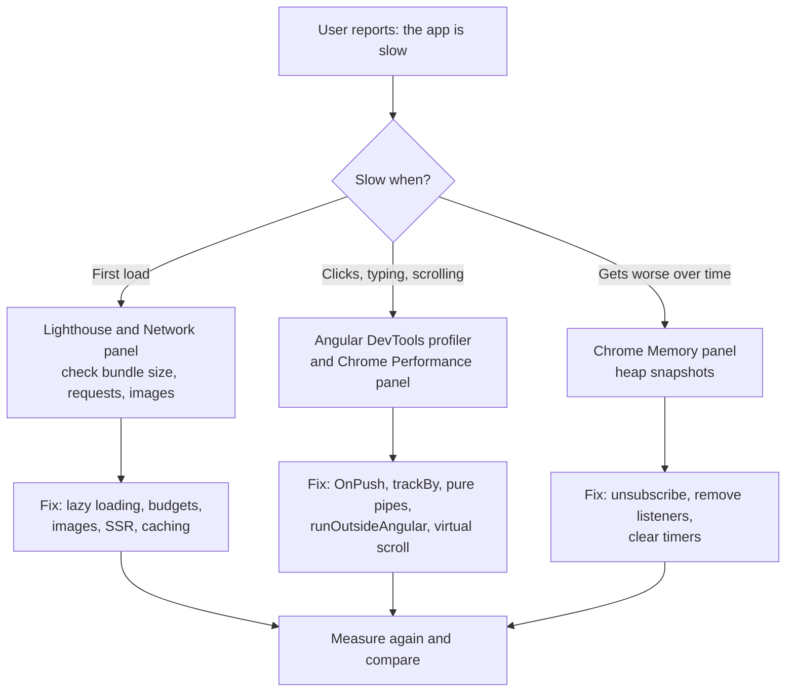
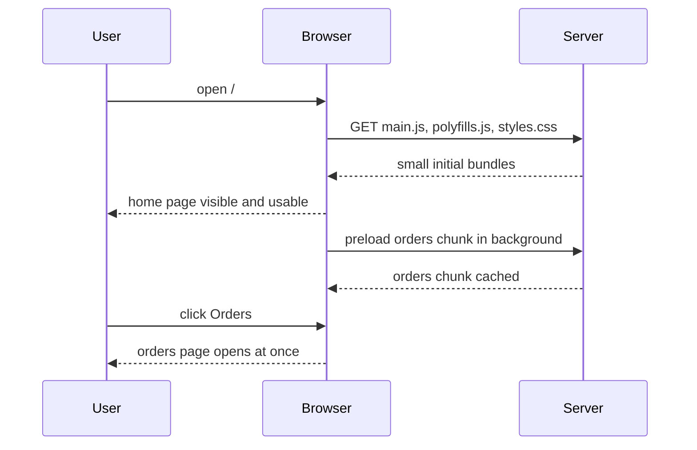
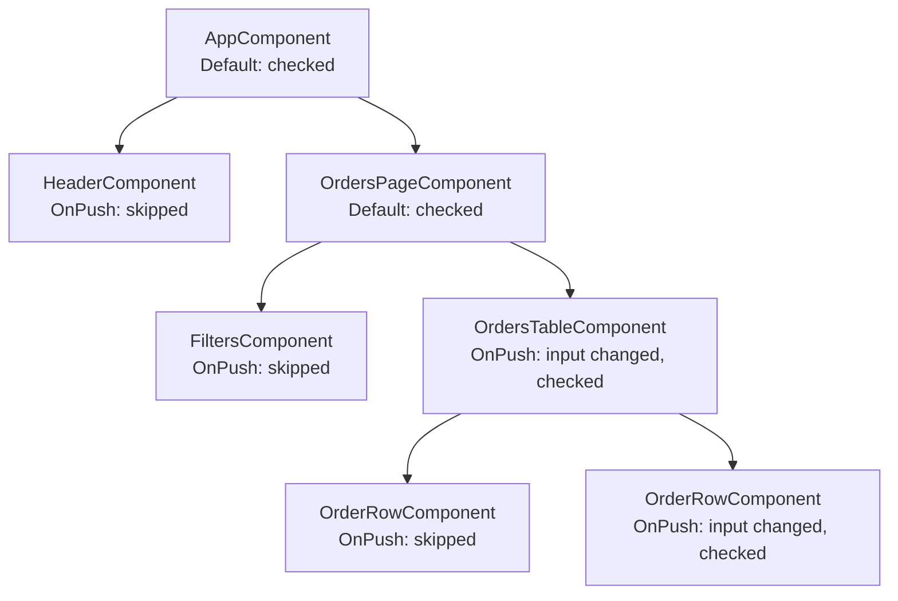

# Angular performance

> In this document you will learn how to find and fix performance problems in an Angular 16 app: slow first load, slow interactions, long lists, heavy calculations and memory leaks. "Our Angular app is slow, what do you do?" is a classic interview question, and a strong answer shows a clear method: measure, find the cause, apply the right fix, measure again.

**Before this:** [Change detection and signals](10-change-detection-and-signals.md) · [Routing, guards and lazy loading](06-routing-guards-and-lazy-loading.md) · [Web performance and Core Web Vitals](../05-frontend-engineering/05-web-performance-and-core-web-vitals.md) · **Interview questions:** [jump to the interview section](#interview-questions)

## Table of contents

1. [Three kinds of performance problems](#three-kinds-of-performance-problems)
2. [Measure first](#measure-first)
3. [Load performance: production builds](#load-performance-production-builds)
4. [Load performance: lazy loading and preloading](#load-performance-lazy-loading-and-preloading)
5. [Load performance: bundle analysis and budgets](#load-performance-bundle-analysis-and-budgets)
6. [Load performance: tree-shakable providers and heavy libraries](#load-performance-tree-shakable-providers-and-heavy-libraries)
7. [Load performance: images with NgOptimizedImage](#load-performance-images-with-ngoptimizedimage)
8. [Load performance: SSR and hydration](#load-performance-ssr-and-hydration)
9. [Load performance: deferrable views in newer Angular](#load-performance-deferrable-views-in-newer-angular)
10. [Runtime performance: change detection](#runtime-performance-change-detection)
11. [OnPush](#onpush)
12. [trackBy for lists](#trackby-for-lists)
13. [Pure pipes instead of template method calls](#pure-pipes-instead-of-template-method-calls)
14. [runOutsideAngular for high-frequency events](#runoutsideangular-for-high-frequency-events)
15. [Event coalescing and fewer change detection runs](#event-coalescing-and-fewer-change-detection-runs)
16. [Large lists: virtual scrolling](#large-lists-virtual-scrolling)
17. [Heavy computation: web workers](#heavy-computation-web-workers)
18. [Memory leaks](#memory-leaks)
19. [Profiling with Angular DevTools and Chrome](#profiling-with-angular-devtools-and-chrome)
20. [Performance checklist](#performance-checklist)
21. [Common mistakes](#common-mistakes)
22. [Best practices](#best-practices)
23. [How to explain this in an interview](#how-to-explain-this-in-an-interview)
24. [Interview questions](#interview-questions)
25. [Summary](#summary)
26. [References](#references)

---

## Three kinds of performance problems

When someone says "the app is slow", they can mean very different things. Always ask: **slow when?**

| Kind | What the user feels | Typical causes in Angular | Typical fixes |
| --- | --- | --- | --- |
| **Load performance** | The first page takes long to appear or to become usable | Big JavaScript bundles, no lazy loading, large images, slow API on startup, no caching | Lazy loading, smaller bundles, image optimization, SSR, caching |
| **Runtime performance** | Clicking, typing or scrolling feels laggy | Too many change detection runs, expensive template expressions, re-rendering whole lists, long tasks on the main thread | OnPush, trackBy, pure pipes, `runOutsideAngular`, virtual scrolling, web workers |
| **Memory** | The app gets slower over time, the tab uses more and more memory, it crashes after hours | Subscriptions never cleaned up, event listeners left behind, timers still running, caches that never shrink | Unsubscribe strategies, cleanup in `ngOnDestroy`, bounded caches |

A useful mental model is the browser's **main thread**. It is one thread that runs your JavaScript, calculates styles and layout, and paints the page. If your code keeps it busy for more than about 50 ms (a **long task**), the browser cannot respond to the user during that time. Most runtime performance work in Angular is about giving the main thread less work. The rendering pipeline itself is explained in [Browser architecture and rendering](../01-cs-and-web-fundamentals/07-browser-architecture-and-rendering.md).

## Measure first

**Never optimize by guessing.** Many "optimizations" add complexity and change nothing the user can feel. A good engineer measures, finds the biggest cause, fixes that, and measures again.



The main tools:

| Tool | What it tells you |
| --- | --- |
| **Lighthouse** (Chrome DevTools) | Load metrics: LCP, CLS, Total Blocking Time, plus suggestions |
| **Chrome Network panel** | Which files load, how big they are, how long they take |
| **Chrome Performance panel** | What the main thread does over time: scripts, long tasks, layout, paint |
| **Chrome Memory panel** | Heap snapshots and allocation timelines to find leaks |
| **Angular DevTools** (browser extension) | Component tree and a **profiler** that shows each change detection cycle and how long each component took |
| **`ng.profiler.timeChangeDetection()`** | A quick number: how long one change detection cycle takes (needs `enableDebugTools`) |
| **source-map-explorer / webpack-bundle-analyzer** | What is inside your bundles |
| **Real user monitoring** (for example web-vitals library sending to your analytics) | How fast the app is for real users on real devices |

Core Web Vitals (LCP, INP, CLS) and general web performance are covered in [Web performance and Core Web Vitals](../05-frontend-engineering/05-web-performance-and-core-web-vitals.md). This document focuses on the Angular-specific parts.

**Measure in production mode.** Development builds are much slower: they are not minified, and Angular runs extra checks (for example, the second change detection pass that detects `ExpressionChangedAfterItHasBeenCheckedError`). Always profile a production build (`ng build` and serve the `dist` folder) before you draw conclusions. For profiling, you can build with source maps so you can read function names: `ng build --source-map`.

## Load performance: production builds

`ng build` in Angular 16 uses the **production** configuration by default. It turns on many optimizations for you:

| Optimization | What it does |
| --- | --- |
| **AOT compilation** | Templates are compiled to JavaScript at build time. The browser does not download the Angular compiler and does not compile templates at startup. AOT is the default since Angular 9 (Ivy). |
| **Minification** | Removes whitespace, shortens names |
| **Tree shaking** | Removes code that is never imported or used |
| **Build optimizer** | Angular-specific transformations that help tree shaking (for example, removing Angular decorators metadata that is only needed at compile time) |
| **Dead code elimination of dev-only code** | Code behind `ngDevMode` checks is removed |
| **CSS optimization** | Minifies styles and can inline critical CSS |
| **Output hashing** | File names contain a content hash (`main.3f2a1b.js`), so browsers can cache them for a long time |

Things you should check in `angular.json`:

```json
"configurations": {
  "production": {
    "budgets": [
      { "type": "initial", "maximumWarning": "500kb", "maximumError": "1mb" },
      { "type": "anyComponentStyle", "maximumWarning": "2kb", "maximumError": "4kb" }
    ],
    "outputHashing": "all"
  },
  "development": {
    "buildOptimizer": false,
    "optimization": false,
    "vendorChunk": true,
    "extractLicenses": false,
    "sourceMap": true,
    "namedChunks": true
  }
},
"defaultConfiguration": "production"
```

On the server side, make sure the hosting serves files with **compression** (gzip or Brotli) and with long **cache headers** for hashed files (`Cache-Control: public, max-age=31536000, immutable`) and short or no caching for `index.html`. Otherwise every deployment forces users to re-download everything, or worse, old `index.html` files point to deleted bundles.

> **Build speed (not runtime speed):** Angular 16 shipped a new **esbuild-based builder** (`@angular-devkit/build-angular:browser-esbuild`) as a developer preview. It makes builds much faster. It does not by itself make the app faster for users.
>
> **Newer Angular (17+):** the esbuild + Vite **application builder** (`@angular-devkit/build-angular:application`, later `@angular/build:application`) became the default for new projects. Output goes to `dist/<app>/browser`. See [Angular 16 vs newer versions](16-angular-16-vs-newer-versions.md).

## Load performance: lazy loading and preloading

### What it is

**Lazy loading** means the code for a feature is downloaded only when the user navigates to it. The Angular CLI splits each lazy route into its own JavaScript file (a **chunk**). The main bundle stays small, so the first page appears faster.

Routing and lazy loading are explained in depth in [Routing, guards and lazy loading](06-routing-guards-and-lazy-loading.md). Here is the performance view.

```ts
// app-routing.module.ts (Angular 16)
const routes: Routes = [
  { path: '', component: HomeComponent },
  {
    path: 'orders',
    loadChildren: () => import('./orders/orders.module').then(m => m.OrdersModule), // NgModule feature
  },
  {
    path: 'reports',
    loadComponent: () => import('./reports/reports.component').then(m => m.ReportsComponent), // standalone
  },
  {
    path: 'admin',
    loadChildren: () => import('./admin/admin.routes').then(m => m.ADMIN_ROUTES), // standalone route file
  },
];
```

### The rule that breaks lazy loading

A lazy chunk stays lazy only if **nothing in the eager code imports it statically**.

```ts
// ❌ Wrong: a static import in AppModule pulls ReportsComponent into the main bundle
import { ReportsComponent } from './reports/reports.component';

@NgModule({ declarations: [AppComponent], imports: [BrowserModule, ReportsComponent] })
export class AppModule {}
```

```ts
// ✅ Correct: only the dynamic import() refers to it
{ path: 'reports', loadComponent: () => import('./reports/reports.component').then(m => m.ReportsComponent) }
```

The same is true for a "barrel" file (`index.ts` that re-exports many things). Importing one small thing from a barrel can pull in the whole feature if the bundler cannot prove the rest is unused.

### Preloading

Lazy loading has a cost: the first time the user opens the feature, they wait for the download. **Preloading** downloads lazy chunks in the background **after** the app has started, so later navigation is instant.

```ts
@NgModule({
  imports: [RouterModule.forRoot(routes, { preloadingStrategy: PreloadAllModules })],
  exports: [RouterModule],
})
export class AppRoutingModule {}

// Standalone:
// provideRouter(routes, withPreloading(PreloadAllModules))
```

`PreloadAllModules` is fine for small and medium apps. For big apps, write a custom strategy that preloads only routes marked with `data: { preload: true }`, or only on fast connections:

```ts
@Injectable({ providedIn: 'root' })
export class SelectivePreloadingStrategy implements PreloadingStrategy {
  preload(route: Route, load: () => Observable<unknown>): Observable<unknown> {
    const connection = (navigator as Navigator & { connection?: { saveData?: boolean; effectiveType?: string } }).connection;
    const slowNetwork = connection?.saveData || connection?.effectiveType === '2g';
    return route.data?.['preload'] && !slowNetwork ? load() : of(null);
  }
}
```

### Timeline



## Load performance: bundle analysis and budgets

### Look inside your bundles

You cannot make bundles smaller if you do not know what is in them.

**Option 1: source-map-explorer**

```bash
ng build --source-map
npx source-map-explorer dist/my-app/*.js
```

It opens a treemap: each rectangle is a module, and its size is the module's share of the bundle. Look for:

- Big libraries you did not expect (a whole charting library on the login page).
- The same library twice in different versions.
- Locale data or icon sets loaded fully when you use a few items.
- Feature code in `main.js` that should be in a lazy chunk.

**Option 2: webpack-bundle-analyzer** (works with the default webpack builder in Angular 16)

```bash
ng build --stats-json
npx webpack-bundle-analyzer dist/my-app/stats.json
```

> **Newer Angular (17+):** with the application builder, the output folder is `dist/my-app/browser` and `--stats-json` produces an esbuild metafile. Tools like esbuild's online analyzer read it.

### Budgets: stop bundles from growing silently

**Budgets** are size limits in `angular.json`. The build prints a warning or fails when a limit is passed. This catches the day someone adds a 300 KB library by accident.

```json
"budgets": [
  { "type": "initial", "maximumWarning": "500kb", "maximumError": "1mb" },
  { "type": "anyComponentStyle", "maximumWarning": "2kb", "maximumError": "4kb" },
  { "type": "anyScript", "maximumWarning": "150kb" },
  { "type": "bundle", "name": "admin", "maximumWarning": "200kb" }
]
```

| Budget type | Measures |
| --- | --- |
| `initial` | All JavaScript and CSS needed to start the app |
| `anyComponentStyle` | The styles of any single component |
| `anyScript` / `any` | Any single script / any file |
| `bundle` | A named bundle (lazy chunk) |
| `allScript` / `all` | All scripts / the whole app |

Run `ng build` in CI so a budget error fails the pull request.

## Load performance: tree-shakable providers and heavy libraries

### Tree-shakable providers

A service declared like this is **tree-shakable**:

```ts
@Injectable({ providedIn: 'root' })
export class ReportExportService { /* ... */ }
```

If no code ever injects `ReportExportService`, the build tool can remove it from the bundle. And if only a lazy feature injects it, it is bundled into that lazy chunk, not into `main.js`.

Compare with listing it in a module:

```ts
// ❌ Less optimal: always included in the bundle of AppModule, even if nothing injects it
@NgModule({ providers: [ReportExportService] })
export class AppModule {}
```

Provider details are in [Dependency injection](05-dependency-injection.md).

### Heavy libraries

Some common cases:

| Problem | Better option |
| --- | --- |
| `moment` with all locales (large and not tree-shakable) | Native `Intl` APIs, Angular `DatePipe`, or smaller libraries like `date-fns` / `dayjs` |
| `import _ from 'lodash'` (whole library) | `lodash-es` with named imports, or native array methods |
| A big chart library loaded on app start | Load it only in the lazy feature that shows charts |
| Icon font with thousands of icons | SVG icons for the icons you use |
| CommonJS packages | Prefer ES module packages. The CLI warns about CommonJS dependencies because they block tree shaking. Use `allowedCommonJsDependencies` only after you decide to accept the cost. |

You can also load a heavy library **only when needed** with a dynamic import:

```ts
async exportToExcel(rows: Order[]): Promise<void> {
  const XLSX = await import('xlsx'); // downloaded only when the user clicks Export
  const sheet = XLSX.utils.json_to_sheet(rows);
  // ...
}
```

## Load performance: images with NgOptimizedImage

Images are often the biggest bytes on a page and often the **Largest Contentful Paint (LCP)** element. Angular provides the `NgOptimizedImage` directive (stable since Angular 15) to apply image best practices automatically.

```ts
import { NgOptimizedImage } from '@angular/common';

@Component({
  selector: 'app-hero-banner',
  standalone: true,
  imports: [NgOptimizedImage],
  template: `
    <!-- The LCP image: load it first -->
    

    <!-- Other images are lazy-loaded automatically -->
    
  `,
})
export class HeroBannerComponent {}
```

What it does for you:

- Uses `ngSrc` instead of `src`, so it controls loading.
- Requires `width` and `height` (or `fill`), which prevents layout shift (CLS).
- Lazy-loads non-priority images (`loading="lazy"`).
- For `priority` images: sets `fetchpriority="high"`, and in SSR it can add a preload hint.
- With an image CDN **loader** (built-in loaders exist for Cloudflare, Cloudinary, ImageKit and Imgix), it generates `srcset` for responsive images.
- In development mode, it warns when an image is much bigger than displayed, when the LCP image is not marked `priority`, and when the aspect ratio is wrong.

## Load performance: SSR and hydration

### What it is

With **client-side rendering (CSR)**, the server sends an almost empty `index.html`. The user sees nothing useful until the JavaScript downloads, runs and renders. With **server-side rendering (SSR)**, the server runs Angular and sends real HTML, so the user sees content earlier and search engines can read it. Rendering strategies in general are in [Rendering strategies: CSR, SSR, SSG](../05-frontend-engineering/09-rendering-strategies-csr-ssr-ssg.md).

**Hydration** is what happens when the JavaScript arrives in the browser: Angular attaches to the existing server HTML instead of destroying it and rendering again.

- Before Angular 16, Angular Universal used **destructive** hydration: the client app threw away the server DOM and rebuilt it. Users could see a flicker, and the work was done twice.
- **Angular 16** added **non-destructive hydration** as a **developer preview**: Angular reuses the server DOM nodes and only attaches event listeners and state.

```ts
// Angular 16: enable hydration (developer preview)
// app.module.ts
import { provideClientHydration } from '@angular/platform-browser';

@NgModule({
  declarations: [AppComponent],
  imports: [BrowserModule],
  providers: [provideClientHydration()],
  bootstrap: [AppComponent],
})
export class AppModule {}

// or, standalone
bootstrapApplication(AppComponent, { providers: [provideClientHydration()] });
```

In Angular 16, SSR itself is added with Angular Universal: `ng add @nguniversal/express-engine`.

Things to know about hydration in Angular 16:

- The server HTML and the client DOM must match. Direct DOM manipulation (for example, `element.innerHTML = ...` or third-party libraries that move nodes) can break hydration. You can skip a component with the `ngSkipHydration` attribute.
- `provideClientHydration()` also turns on an **HTTP transfer cache**: HTTP GET responses made on the server are sent with the HTML, so the browser does not call the same API again.
- In Angular 16, i18n was not supported with hydration.

> **Newer Angular:** hydration became stable in **17**, and SSR moved to the `@angular/ssr` package (`ng new --ssr`). **18** added event replay (`withEventReplay()`) as a developer preview, so clicks before hydration are not lost. **19** added **incremental hydration** (`@defer (hydrate on ...)`) as a developer preview. It became stable in 20 and is the default in **22**. See [Angular 16 vs newer versions](16-angular-16-vs-newer-versions.md).

**Trade-offs of SSR:** you need a Node.js server (or prerendering), code must not touch `window` or `document` directly on the server, and server CPU cost grows with traffic. SSR helps load metrics and SEO, but a page can look ready before it is interactive.

## Load performance: deferrable views in newer Angular

> **Newer Angular (17+):** `@defer` blocks lazy-load **part of a template** (the components, directives and pipes used inside the block) when a trigger happens. They are not available in Angular 16.

```html
<!-- Angular 17+ only -->
@defer (on viewport) {
  <app-reviews [productId]="product.id" />
} @placeholder {
  <p>Reviews will load when you scroll here.</p>
} @loading (minimum 300ms) {
  <app-spinner />
} @error {
  <p>Could not load reviews.</p>
}
```

**In Angular 16, how do you get a similar result?** Use lazy routes for whole pages. For part of a page, load a standalone component dynamically with `import()` and `ViewContainerRef.createComponent`:

```ts
@Component({
  selector: 'app-product-page',
  template: `
    <h1>{{ product.name }}</h1>
    <button type="button" (click)="showReviews()">Show reviews</button>
    <ng-container #reviewsHost></ng-container>
  `,
})
export class ProductPageComponent {
  @Input({ required: true }) product!: { id: string; name: string };
  @ViewChild('reviewsHost', { read: ViewContainerRef }) reviewsHost!: ViewContainerRef;

  async showReviews(): Promise<void> {
    const { ReviewsComponent } = await import('./reviews.component'); // separate chunk
    const ref = this.reviewsHost.createComponent(ReviewsComponent);
    ref.setInput('productId', this.product.id);
  }
}
```

## Runtime performance: change detection

Change detection is explained in full in [Change detection and signals](10-change-detection-and-signals.md). Here is the short version you need for performance.

- With **Zone.js**, Angular is notified after **every** async event: clicks, keypresses, `setTimeout`, `setInterval`, HTTP responses, promise resolutions, `mousemove`, `scroll`.
- After each such event, Angular runs change detection **from the root component down**, checking every binding in every component (with the **Default** strategy).
- Each check is fast, but the total cost is: **number of change detection runs × number of components checked × cost of each binding**.

So there are three ways to make runtime faster:

1. **Run change detection less often** (`runOutsideAngular`, event coalescing, debounce).
2. **Check fewer components** per run (`OnPush`).
3. **Make each binding cheaper** (pure pipes instead of methods, `trackBy`, avoid heavy getters).

## OnPush

### What it is

`ChangeDetectionStrategy.OnPush` tells Angular: "skip this component and its children during change detection, unless something relevant happened to it."

An OnPush component is checked only when:

1. One of its `@Input` references changes (compared with `===`).
2. An event handler bound in its template (or in a child's template) runs, like `(click)`.
3. The `async` pipe in its template receives a new value (it calls `markForCheck()`).
4. You call `ChangeDetectorRef.markForCheck()` (or `detectChanges()`) yourself.
5. A signal read in its template changes (Angular 16, signals developer preview).

```ts
@Component({
  selector: 'app-orders-table',
  standalone: true,
  imports: [CommonModule],
  template: `
    <table>
      <tr *ngFor="let order of orders; trackBy: trackById">
        <td>{{ order.customer }}</td>
        <td>{{ order.total | currency }}</td>
      </tr>
    </table>
  `,
  changeDetection: ChangeDetectionStrategy.OnPush,
})
export class OrdersTableComponent {
  @Input({ required: true }) orders: readonly Order[] = [];
  trackById(_index: number, order: Order): number {
    return order.id;
  }
}
```

### The diagram



In this example a new `orders` array arrived. Only the table and the one row whose order object changed are checked. The header, the filters and the unchanged rows are skipped. In a page with hundreds of components, that is a big saving.

### OnPush needs immutable data

```ts
// ❌ Wrong: mutates the array; OrdersTableComponent (OnPush) does not update
addOrder(order: Order): void {
  this.orders.push(order);
}

// ✅ Correct: new array reference; OnPush sees the change
addOrder(order: Order): void {
  this.orders = [...this.orders, order];
}
```

### When data arrives outside the normal flow

If an OnPush component changes its own state from a source that is not an input, a template event or the async pipe (for example, a WebSocket callback), call `markForCheck()`:

```ts
@Component({
  selector: 'app-live-price',
  standalone: true,
  template: `{{ price }}`,
  changeDetection: ChangeDetectionStrategy.OnPush,
})
export class LivePriceComponent implements OnInit, OnDestroy {
  price = 0;
  private cdr = inject(ChangeDetectorRef);
  private socket?: WebSocket;

  ngOnInit(): void {
    this.socket = new WebSocket('wss://example.com/prices');
    this.socket.onmessage = (msg: MessageEvent<string>) => {
      this.price = Number(msg.data);
      this.cdr.markForCheck(); // "please check me (and my ancestors) on the next run"
    };
  }

  ngOnDestroy(): void {
    this.socket?.close();
  }
}
```

A cleaner way is to expose the data as an Observable and use the `async` pipe, which calls `markForCheck()` for you.

**Best practice:** make OnPush the default for new components (you can set it in `angular.json` schematics options so `ng generate component` adds it), and combine it with the `async` pipe and immutable updates.

> **Newer Angular (22+):** components without a `changeDetection` setting now use **OnPush by default**. The old default was renamed `ChangeDetectionStrategy.Eager`.

## trackBy for lists

### The problem

`*ngFor` must decide which DOM rows to keep, move, create or remove when the array changes. By default, it compares items by **identity** (the object reference). When you reload data from the server, every object is new, even if the data is the same. So Angular destroys every row and creates every row again. For a table with 500 rows, this is slow and also loses focus, scroll position inside rows and CSS animations.

### The fix

Give `*ngFor` a `trackBy` function that returns a stable, unique key, usually the id.

```html
<tr *ngFor="let order of orders; trackBy: trackById">...</tr>
```

```ts
trackById(_index: number, order: Order): number {
  return order.id;
}
```

Now Angular keeps the existing row for the same id and only updates the bindings that changed.

A small simulation shows the difference (verified with Node.js):

```js
function diff(oldItems, newItems, trackBy) {
  const oldKeys = new Set(oldItems.map(trackBy));
  let created = 0, kept = 0;
  for (const item of newItems) oldKeys.has(trackBy(item)) ? kept++ : created++;
  return { created, kept };
}
const before = [{ id: 1, name: 'A' }, { id: 2, name: 'B' }, { id: 3, name: 'C' }];
const afterRefresh = before.map(u => ({ ...u })); // same data, new objects (like a new HTTP response)

console.log('by identity:', diff(before, afterRefresh, x => x));    // by identity: { created: 3, kept: 0 }
console.log('by id:      ', diff(before, afterRefresh, x => x.id)); // by id:       { created: 0, kept: 3 }
```

Rules for a good `trackBy`:

- Return something **unique and stable** (database id, SKU). Do not return the index if items can be added, removed or reordered: then the "key" of an item changes and Angular reuses the wrong rows.
- Keep it cheap. It runs for every item on every change.

> **Newer Angular (17+):** the built-in `@for` block **requires** a `track` expression: `@for (order of orders; track order.id) { ... }`. This makes the optimization impossible to forget.

## Pure pipes instead of template method calls

### The problem

Template expressions run on **every** change detection run of that component. If you call a method in a template, the method runs every time:

```html
<!-- ❌ Runs on every change detection cycle: every click, timer, HTTP response... -->
<p>Total: {{ getTotal() }}</p>
```

If `getTotal()` loops over 10,000 orders, every click anywhere in the app (for a Default component) pays that cost.

### The fix: a pure pipe

A **pure pipe** (the default for pipes) is re-run **only when its input value changes** (for objects and arrays: when the **reference** changes).

```ts
@Pipe({ name: 'orderTotal', standalone: true })
export class OrderTotalPipe implements PipeTransform {
  transform(orders: readonly Order[]): number {
    return orders.reduce((sum, o) => sum + o.total, 0);
  }
}
```

```html
<!-- ✅ Recalculated only when the orders array reference changes -->
<p>Total: {{ orders | orderTotal | currency }}</p>
```

Simulation of five change detection cycles (verified with Node.js):

```js
let methodCalls = 0;
let pipeCalls = 0;
const component = {
  orders: [{ total: 10 }, { total: 20 }],
  getTotal() { methodCalls++; return this.orders.reduce((s, o) => s + o.total, 0); },
};
function createPurePipe(transform) {
  let lastArg, lastResult, first = true;
  return (arg) => {
    if (!first && arg === lastArg) return lastResult; // same input: reuse the result
    first = false; lastArg = arg; lastResult = transform(arg);
    return lastResult;
  };
}
const totalPipe = createPurePipe(orders => { pipeCalls++; return orders.reduce((s, o) => s + o.total, 0); });

function changeDetection() {
  component.getTotal();          // {{ getTotal() }}
  totalPipe(component.orders);   // {{ orders | orderTotal }}
}
for (let i = 0; i < 5; i++) changeDetection();
console.log({ methodCalls, pipeCalls }); // { methodCalls: 5, pipeCalls: 1 }

component.orders = [...component.orders, { total: 5 }]; // new reference
changeDetection();
console.log({ methodCalls, pipeCalls }); // { methodCalls: 6, pipeCalls: 2 }
```

Other ways to avoid repeated work in templates:

| Approach | When |
| --- | --- |
| Pure pipe | Reusable formatting or calculation from inputs |
| Calculate once in `ngOnChanges` or when data arrives, store in a field | Component-specific derived data |
| Memoized selector (NgRx) or `map` in an Observable | Derived data from a store or stream |
| `computed()` signal (Angular 16 developer preview) | Derived data from signals; recalculated only when dependencies change |

**Impure pipes** (`pure: false`) run on **every** change detection cycle, like methods. The built-in `async` pipe is impure by design, but it is cheap. Avoid writing impure pipes that do heavy work. Pipes are covered in [Directives and pipes](03-directives-and-pipes.md).

Also watch out for **getters** used in templates (`get fullName()`). A getter is a method call. Cheap getters are fine. Getters that filter or sort arrays are not.

## runOutsideAngular for high-frequency events

### The problem

Zone.js triggers change detection after **every** event handler that runs inside Angular's zone. Some events fire very often:

- `mousemove`, `pointermove`, `scroll`, `resize`, `wheel`, `touchmove`
- `requestAnimationFrame` loops
- `setInterval` every few milliseconds
- WebSocket messages arriving many times per second

If you listen to `scroll` inside Angular, you can trigger dozens of change detection runs per second for the whole app.

### The fix

`NgZone.runOutsideAngular()` runs code outside Angular's zone. Events registered inside it do **not** trigger change detection. When you really need to update the UI, enter the zone again with `NgZone.run()`, or call `markForCheck()`.

```ts
@Directive({ selector: '[appScrollPosition]', standalone: true })
export class ScrollPositionDirective implements OnInit {
  @Output() scrolledPastHeader = new EventEmitter<boolean>();

  private zone = inject(NgZone);
  private el = inject(ElementRef<HTMLElement>);
  private destroyRef = inject(DestroyRef);

  ngOnInit(): void {
    this.zone.runOutsideAngular(() => {
      fromEvent(this.el.nativeElement, 'scroll', { passive: true })
        .pipe(
          throttleTime(100),                                             // at most 10 times per second
          map(() => (this.el.nativeElement as HTMLElement).scrollTop > 200),
          distinctUntilChanged(),                                        // only when true/false flips
          takeUntilDestroyed(this.destroyRef),                           // Angular 16 developer preview
        )
        .subscribe(past => this.zone.run(() => this.scrolledPastHeader.emit(past))); // re-enter only when needed
    });
  }
}
```

Step by step:

1. The scroll listener is registered outside the zone, so every scroll event runs **without** change detection.
2. `throttleTime` and `distinctUntilChanged` reduce hundreds of events to a few meaningful changes.
3. Only when the "past header" state flips do we call `zone.run(...)`. That one emission triggers one change detection run.

Another example: drawing on a canvas while the mouse moves. The canvas is not an Angular binding, so the UI never needs change detection:

```ts
ngOnInit(): void {
  this.zone.runOutsideAngular(() =>
    this.host.nativeElement.addEventListener('mousemove', this.onMove),
  );
}

ngOnDestroy(): void {
  this.host.nativeElement.removeEventListener('mousemove', this.onMove); // always clean up
}
```

**Common uses:** drag and drop, charts and canvas, scroll-based effects, polling timers, third-party libraries (maps, editors, chart libraries) that set their own timers and listeners.

> **Newer Angular:** in zoneless apps (experimental in 18, stable in 20.2, default for new apps in 21), Zone.js is gone. Change detection is triggered by signals, template events, the `async` pipe and `markForCheck()`, so `runOutsideAngular` is no longer needed for this purpose.

## Event coalescing and fewer change detection runs

When one user action fires several events (for example, a click on a button inside a `div` where both have `(click)` handlers), Zone.js can trigger change detection several times. **Event coalescing** groups them into one run.

```ts
// main.ts, NgModule app (Angular 16)
platformBrowserDynamic()
  .bootstrapModule(AppModule, { ngZoneEventCoalescing: true, ngZoneRunCoalescing: true })
  .catch(err => console.error(err));

// main.ts, standalone app (Angular 16)
bootstrapApplication(AppComponent, {
  providers: [provideZoneChangeDetection({ eventCoalescing: true })],
});
```

Other ways to reduce how often change detection runs:

- **Debounce or throttle** user input with RxJS (`debounceTime(300)` on a search box) so you process the final value, not every keystroke.
- **Batch updates**: update state once with the final result instead of several times in a loop.
- **Detach** a component that updates rarely: `cdr.detach()` and call `cdr.detectChanges()` only when you know data changed. This is advanced. Use it only for special widgets, because forgetting to call `detectChanges()` shows stale data.

## Large lists: virtual scrolling

### The problem

Rendering 10,000 rows creates 10,000 sets of DOM nodes. Even with OnPush and trackBy, the first render is slow, the page uses a lot of memory, and scrolling can stutter because the browser must lay out a huge document.

### What virtual scrolling is

**Virtual scrolling** renders **only the rows that are visible** (plus a small buffer). As you scroll, it reuses the DOM nodes for new rows. The scroll bar still looks like the full list, because the viewport has a spacer element with the full height.

The Angular CDK (Component Dev Kit, `@angular/cdk`) provides it:

```ts
import { ScrollingModule } from '@angular/cdk/scrolling';

@Component({
  selector: 'app-customer-list',
  standalone: true,
  imports: [ScrollingModule],
  template: `
    <cdk-virtual-scroll-viewport itemSize="48" class="viewport">
      <div *cdkVirtualFor="let customer of customers; trackBy: trackById" class="row">
        {{ customer.name }} - {{ customer.email }}
      </div>
    </cdk-virtual-scroll-viewport>
  `,
  styles: [`
    .viewport { height: 600px; }
    .row { height: 48px; display: flex; align-items: center; }
  `],
  changeDetection: ChangeDetectionStrategy.OnPush,
})
export class CustomerListComponent {
  @Input({ required: true }) customers: readonly Customer[] = [];
  trackById(_: number, c: Customer): string {
    return c.id;
  }
}
```

Important details:

- The viewport needs a **fixed height** (CSS), otherwise it cannot know how many rows fit.
- `itemSize` is the row height in pixels. The default `FixedSizeVirtualScrollStrategy` needs rows of the **same height**. Variable-height rows need a custom strategy (the CDK has an experimental autosize strategy in `@angular/cdk-experimental`).
- `minBufferPx` and `maxBufferPx` control how many extra pixels of rows are rendered above and below the visible area.
- `Ctrl+F` browser search only finds rendered rows, and screen readers see only the rendered rows. Consider accessibility (announce the total count, provide search in the app).

### Alternatives

| Technique | Good for | Trade-off |
| --- | --- | --- |
| **Pagination** (server-side) | Tables, admin screens, very large data | User clicks to see more; simplest and loads less data |
| **Infinite scroll** | Feeds, product lists | DOM still grows unless combined with virtual scrolling |
| **Virtual scrolling** | Long lists already in memory | Fixed heights, accessibility work |
| **Server-side filtering** | Huge datasets | Requires API support |

Often the best answer is **pagination or server-side filtering**: do not send 10,000 rows to the browser at all.

## Heavy computation: web workers

### The problem

JavaScript in the browser runs on the main thread. A calculation that takes 800 ms (parsing a big CSV, generating a report, image processing, complex filtering) freezes the page: no clicks, no scrolling, no animations.

### What a web worker is

A **web worker** runs JavaScript on a **separate thread**. It cannot touch the DOM and cannot use Angular services. It talks to the main thread by sending messages (`postMessage`). The data is copied (structured clone) or transferred.

Angular CLI can generate one:

```bash
ng generate web-worker report
```

This creates `report.worker.ts` and configures the build (`tsconfig.worker.json`).

```ts
// report.worker.ts: runs in a separate thread
/// <reference lib="webworker" />

addEventListener('message', ({ data }: MessageEvent<Order[]>) => {
  const totalsByCustomer: Record<string, number> = {};
  for (const order of data) {
    totalsByCustomer[order.customer] = (totalsByCustomer[order.customer] ?? 0) + order.total;
  }
  postMessage(totalsByCustomer);
});
```

```ts
// report.component.ts: main thread
@Component({ /* ... */ })
export class ReportComponent implements OnDestroy {
  totals: Record<string, number> | null = null;
  private worker?: Worker;
  private cdr = inject(ChangeDetectorRef);

  build(orders: Order[]): void {
    if (typeof Worker === 'undefined') {
      // Fallback (old browsers, SSR): compute on the main thread
      return;
    }
    this.worker = new Worker(new URL('./report.worker', import.meta.url), { type: 'module' });
    this.worker.onmessage = ({ data }: MessageEvent<Record<string, number>>) => {
      this.totals = data;
      this.cdr.markForCheck();
    };
    this.worker.postMessage(orders);
  }

  ngOnDestroy(): void {
    this.worker?.terminate();
  }
}
```

Trade-offs:

- Copying large data between threads costs time. For very large binary data, use transferable objects (like `ArrayBuffer`).
- Workers add complexity. Use them only for work that really takes long. First check if a better algorithm (or doing the work on the server) solves the problem.
- On the server (SSR), `Worker` is not available, so guard the code.

## Memory leaks

### What a memory leak is

A **memory leak** happens when your app keeps references to objects it does not need anymore, so the garbage collector cannot free them. In a single-page app, the page never reloads, so leaks add up as the user navigates. General garbage collection is explained in [Memory management and garbage collection](../02-javascript/19-memory-management-and-garbage-collection.md).

### Common leak sources in Angular

| Source | Why it leaks | Fix |
| --- | --- | --- |
| Subscriptions to long-lived Observables (`interval`, store, router events, a root service's subject, `valueChanges` of a form that lives longer) | The subscription keeps the component alive and keeps running | `async` pipe, `takeUntilDestroyed()` (Angular 16), `takeUntil(destroy$)`, `take(1)` |
| `addEventListener` on `window` or `document` | The listener holds the component | `removeEventListener` in `ngOnDestroy`, or `@HostListener('window:resize')` (Angular removes it automatically) |
| `setInterval` / `setTimeout` loops | Callbacks keep running after the component is gone | `clearInterval` in `ngOnDestroy` |
| Third-party libraries (charts, maps, editors) | They keep DOM and listeners | Call the library's `destroy()` / `dispose()` in `ngOnDestroy` |
| Caches in root services that only grow | Every item stays in memory forever | Limit size, use expiry, clear on logout |
| Detached DOM nodes held in variables | DOM removed from the page but still referenced | Do not store DOM nodes in long-lived services |
| Manually created components (`createComponent`) | Never destroyed | Call `componentRef.destroy()` or `viewContainerRef.clear()` |

HTTP calls from `HttpClient` **complete** after one response, so a subscription to one HTTP call does not leak forever. But if the component is destroyed before the response, the callback still runs. Unsubscribing also cancels the request, which saves bandwidth.

### Cleanup example (Angular 16)

```ts
@Component({ /* ... */ })
export class DashboardComponent {
  private notifications = inject(NotificationService);

  constructor() {
    // takeUntilDestroyed() must be called in an injection context (constructor or field initializer)
    interval(30_000)
      .pipe(
        switchMap(() => this.notifications.fetchUnread()),
        takeUntilDestroyed(), // developer preview in Angular 16, stable in 19
      )
      .subscribe(count => this.notifications.setUnreadCount(count));
  }

  @HostListener('window:resize')
  onResize(): void {
    // Angular adds and removes this listener for you
  }
}
```

The different unsubscribe strategies are compared in [RxJS](09-rxjs.md#unsubscribe-strategies-in-angular).

### How to find a leak

1. Open Chrome DevTools, **Memory** panel.
2. Take a heap snapshot on the starting page.
3. Navigate to the suspect page and back, five to ten times.
4. Click the garbage collection icon, then take another snapshot.
5. Compare snapshots ("Comparison" view). Search for your component class name (for example `DashboardComponent`). If there are many instances although only one or zero should exist, something holds them.
6. Look at the **Retainers** section to see which object keeps the instance alive (often a subscription or an event listener).

The Performance monitor (DevTools, More tools) is also useful: watch "JS heap size" and "DOM nodes" while you navigate. If they keep going up and never drop, you have a leak.

## Profiling with Angular DevTools and Chrome

### Angular DevTools

**Angular DevTools** is a browser extension (Chrome and Firefox) from the Angular team. It works with apps in development mode.

- **Components tab:** shows the component tree, inputs, outputs and properties. You can edit values to test.
- **Profiler tab:** click Record, use the app, click Stop. You get a bar for each change detection cycle.
  - The height of a bar shows how long the cycle took.
  - Click a bar to see which components were checked and how long each took (as a bar chart, a flame graph or a tree map).
  - You can see what **triggered** the cycle (for example, a `click` or `setTimeout` event).

What to look for:

- **Too many cycles:** dozens per second while the user does nothing → a timer, `mousemove` or polling inside the zone. Fix with `runOutsideAngular`, or fix the source.
- **Long cycles:** one cycle takes more than a few milliseconds → find the expensive component. Usually template methods, big lists without trackBy, or many Default components that could be OnPush.
- **Components checked that did not change** → candidates for OnPush.

### Quick check: `ng.profiler.timeChangeDetection()`

```ts
// main.ts (development only)
platformBrowserDynamic()
  .bootstrapModule(AppModule)
  .then(moduleRef => {
    if (isDevMode()) {
      const appRef = moduleRef.injector.get(ApplicationRef);
      enableDebugTools(appRef.components[0]); // from @angular/platform-browser
    }
  });
```

Then, in the browser console:

```text
ng.profiler.timeChangeDetection()
// prints the average time of one change detection cycle, for example: 0.05 ms per check
```

### Chrome Performance panel

Use it to see the full picture: scripting, style calculation, layout and paint. Record while you reproduce the slow interaction, then look for **long tasks** (red corners) and expand the call tree to find your functions. Angular's change detection appears as calls to `tick` / `detectChanges` / your template functions (component template functions are named after the component, for example `OrdersTableComponent_Template`).

Debugging and profiling in general is covered in [Debugging and profiling](../10-testing-security-production/07-debugging-and-profiling.md).

## Performance checklist

Use this list when you review an Angular app or answer "how would you speed it up?".

**Load**

- [ ] Production build (`ng build`), AOT, budgets set and enforced in CI.
- [ ] Features lazy-loaded; no static imports of lazy code; preloading strategy chosen.
- [ ] Bundles analyzed (source-map-explorer); no unexpected large libraries; ES module versions used.
- [ ] Services use `providedIn: 'root'` (tree-shakable).
- [ ] Images use `NgOptimizedImage`; LCP image marked `priority`; width and height set.
- [ ] Compression (Brotli/gzip) and long cache headers for hashed files; short cache for `index.html`.
- [ ] Startup work minimized (no slow API calls blocking `APP_INITIALIZER` unless needed).
- [ ] SSR and hydration considered for public, SEO-relevant pages.

**Runtime**

- [ ] OnPush on components, with immutable data and the `async` pipe.
- [ ] `trackBy` on every `*ngFor` over data from the server.
- [ ] No heavy methods or getters in templates; pure pipes or precomputed values instead.
- [ ] High-frequency events and third-party libraries run outside the Angular zone.
- [ ] Search inputs debounced; event coalescing enabled.
- [ ] Long lists paginated or virtualized.
- [ ] Heavy calculations moved to a web worker or the server.

**Memory**

- [ ] Every manual subscription cleaned up (`takeUntilDestroyed`, `takeUntil`, `async` pipe).
- [ ] Global listeners, timers and third-party widgets destroyed in `ngOnDestroy`.
- [ ] Caches bounded and cleared on logout.

**Process**

- [ ] Measured before and after each change, in a production build.
- [ ] Real user metrics (Core Web Vitals) monitored in production.

## Common mistakes

1. **Optimizing without measuring.** You can spend days on OnPush while the real problem is a 3 MB bundle or a slow API.
2. **Profiling a development build.** Dev mode runs extra checks and is not minified, so the numbers are misleading.
3. **Using OnPush but mutating data.** The component stops updating, and people "fix" it by calling `detectChanges()` everywhere instead of fixing the data flow.
4. **Using the index as trackBy for lists that change order.** Angular reuses the wrong rows.
5. **Heavy methods in templates** (`{{ calculateStatistics() }}`), called on every cycle.
6. **Breaking lazy loading with a static import** or a barrel file in eager code.
7. **`PreloadAllModules` in a huge app on mobile networks.** It downloads everything in the background and competes with the user's actual requests.
8. **Rendering thousands of rows** instead of paginating or virtualizing.
9. **Forgetting cleanup** for subscriptions, listeners, timers and third-party widgets.
10. **Calling `runOutsideAngular` and then changing bound state without `zone.run()` or `markForCheck()`.** The UI does not update.
11. **Adding a heavy library to the main bundle** for one small feature (for example, a full date library for one formatted date).

## Best practices

- **Measure first, in production mode, and measure again after each fix.** Reason: you fix the real bottleneck and can prove the improvement.
- **Make OnPush the default** and treat data as immutable. Reason: Angular checks far fewer components per cycle.
- **Always add `trackBy` to lists of server data.** Reason: Angular keeps DOM rows instead of recreating them.
- **Keep templates cheap**: pure pipes, precomputed fields, memoized selectors. Reason: template expressions run on every check.
- **Lazy-load every feature that is not needed on the first screen**, and choose preloading on purpose. Reason: smaller initial bundle, faster first page.
- **Set budgets and run the production build in CI.** Reason: bundle size regressions are caught before they ship.
- **Run high-frequency work outside the Angular zone.** Reason: avoids dozens of useless change detection cycles per second.
- **Paginate or virtualize long lists.** Reason: the DOM stays small.
- **Clean up everything you start** (subscriptions, listeners, timers, workers, widgets). Reason: no leaks in a long-running SPA.
- **Prefer fixing the data flow over manual change detection tricks.** Reason: `detectChanges()` calls scattered through the code are hard to maintain.

## How to explain this in an interview

1. **Define it:** "Angular performance has three parts: load time (how fast the first page appears), runtime (how fast interactions feel) and memory (does it stay fast over time)."
2. **Why it matters:** "Slow load hurts conversions and SEO. Laggy interactions make the app feel broken. Leaks crash long sessions, which are common in enterprise apps."
3. **How I work:** "I measure first in a production build: Lighthouse and the Network panel for load, Angular DevTools profiler and the Performance panel for runtime, heap snapshots for memory. Then I fix the biggest cause and measure again."
4. **Small example:** "In one table screen, every click caused a 40 ms change detection cycle. The profiler showed a template method that filtered 5,000 rows. I moved the filter into a pure pipe, added trackBy and OnPush, and the cycle dropped to a few milliseconds."
5. **Typical fixes:** "For load: lazy loading, bundle analysis, budgets, NgOptimizedImage, SSR with hydration. For runtime: OnPush with immutable data, trackBy, pure pipes, runOutsideAngular for scroll and mousemove, virtual scrolling, web workers. For memory: unsubscribe with the async pipe or takeUntilDestroyed and clean up listeners."
6. **Trade-offs / gotchas:** "OnPush needs immutable updates, or the UI goes stale. Virtual scrolling needs fixed row heights and has accessibility costs. Preloading everything can waste bandwidth. And every optimization adds complexity, so I only apply it where measurements show a real problem."

---

## Interview questions

### Q1. Our Angular app is slow. What do you do?

**What the interviewer is checking:** a structured method, not a random list of tricks.

**Short spoken answer (30–60 seconds):**
> First I ask what "slow" means: the first load, interactions like typing and scrolling, or getting slower over time. Then I measure in a production build. For load, I use Lighthouse and the Network panel and analyze the bundles with source-map-explorer. For interactions, I record with the Angular DevTools profiler to see how often change detection runs and which components are expensive, plus the Chrome Performance panel for long tasks. For memory, I compare heap snapshots after navigating back and forth. Then I fix the biggest cause: lazy loading and smaller bundles for load; OnPush, trackBy, pure pipes and runOutsideAngular for runtime; proper unsubscribing for leaks. After each change I measure again to confirm it helped.

**Detailed explanation:** The interviewer wants to hear the loop **measure → identify → fix → verify**. Listing fixes without measuring sounds junior. Mentioning production mode and real user monitoring sounds senior.

**Follow-up questions:**
- **The profiler shows 60 change detection cycles per second while idle. What is the likely cause?** — Something triggers Zone.js constantly: a `setInterval`, `requestAnimationFrame`, `mousemove` listener or a third-party library timer inside the zone. Find it in the profiler's trigger info and move it outside with `runOutsideAngular`.
- **Lighthouse shows a 2.5 MB main bundle. What next?** — Analyze it with source-map-explorer, lazy-load features, remove or replace heavy libraries, check for static imports of lazy code, and add budgets so it does not grow back.
- **How do you know your fix worked for real users?** — Monitor Core Web Vitals (LCP, INP, CLS) in production with real user monitoring and compare before and after the release.

**Common mistakes:** Jumping to "use OnPush" without asking what is slow. Not mentioning measurement.

**Where this is used in real projects:** Performance tickets, release reviews and incident follow-ups.

### Q2. What is OnPush and when is an OnPush component checked?

**What the interviewer is checking:** exact knowledge of OnPush triggers and the immutability requirement.

**Short spoken answer (30–60 seconds):**
> OnPush is a change detection strategy that lets Angular skip a component and its subtree unless something relevant happened. An OnPush component is checked when one of its input references changes, when an event bound in its template or its children's templates fires, when the async pipe in its template gets a new value, when I call markForCheck, or in Angular 16 when a signal it reads in the template changes. Because inputs are compared by reference, I must update data immutably: create a new array instead of pushing into the old one. The benefit is that change detection checks far fewer components on each cycle.

**Follow-up questions:**
- **Does a `setTimeout` inside an OnPush component update its view?** — Change detection runs (Zone.js), but the OnPush component is skipped unless it was marked for check. So if the timeout changes a field, call `markForCheck()` or use an Observable with the async pipe.
- **Difference between `markForCheck()` and `detectChanges()`?** — `markForCheck()` marks the component and its ancestors to be checked in the **next** cycle. `detectChanges()` runs change detection **now**, synchronously, for that component and its children.
- **Is OnPush only about inputs?** — No. Template events and the async pipe also trigger checks. This is a common wrong answer.

**Common mistakes:** "OnPush only updates when inputs change". Forgetting the immutability requirement.

**Where this is used in real projects:** Many teams make OnPush the default for all components. Details: [Change detection and signals](10-change-detection-and-signals.md).

### Q3. Why does this OnPush component not update?

```ts
@Component({
  selector: 'app-tags',
  template: `<span *ngFor="let tag of tags">{{ tag }}</span>`,
  changeDetection: ChangeDetectionStrategy.OnPush,
})
export class TagsComponent {
  @Input() tags: string[] = [];
}

// Parent
addTag(tag: string): void {
  this.tags.push(tag);
}
```

**What the interviewer is checking:** reference equality and immutability.

**Short spoken answer (30–60 seconds):**
> The parent mutates the array with push. The `tags` input still points to the same array, so Angular compares the old and new input with `===`, sees no change, and skips the OnPush child. The fix is to create a new array in the parent: `this.tags = [...this.tags, tag]`. Then the input reference changes and the child is checked. I would not fix it with `detectChanges` in the child, because the real problem is the mutation.

**Follow-up questions:**
- **Would it update if the parent passed it through the async pipe?** — The async pipe marks the **parent** for check, but the child's input reference is still the same, so the OnPush child is still skipped. Immutability is still required.
- **How can TypeScript help?** — Type the input as `readonly string[]` so `push` is a compile error in code that receives it.

**Common mistakes:** Suggesting `ChangeDetectionStrategy.Default` as the fix.

**Where this is used in real projects:** The most common OnPush bug in code reviews.

### Q4. What does trackBy do and why does it matter?

**What the interviewer is checking:** DOM reuse in `*ngFor`.

**Short spoken answer (30–60 seconds):**
> By default, ngFor tracks items by object identity. When I reload data from the server, every object is new, so Angular destroys all the rows and creates them again, even if the data is the same. That is slow for big lists and it loses focus and scroll state inside rows. With trackBy I give a function that returns a stable unique key like the id. Then Angular keeps the existing DOM rows for the same ids and only updates the bindings that changed, adds new rows and removes missing ones. I avoid using the index as the key when items can be inserted, removed or reordered.

**Code:**

```html
<li *ngFor="let user of users; trackBy: trackById">{{ user.name }}</li>
```

```ts
trackById(_index: number, user: User): string { return user.id; }
```

**Follow-up questions:**
- **What happens if trackBy returns duplicate keys?** — Angular cannot match rows correctly and may reuse the wrong DOM. In Angular 17+ `@for` warns about duplicate keys in dev mode.
- **What changed in newer Angular?** — The `@for` block (17+) requires `track`, for example `track user.id`.

**Common mistakes:** Saying trackBy reduces change detection runs. It reduces DOM work, not the number of cycles.

**Where this is used in real projects:** Tables, lists refreshed by polling, real-time feeds.

### Q5. Why is calling a method in a template a performance problem? What do you use instead?

**What the interviewer is checking:** how template expressions are evaluated.

**Short spoken answer (30–60 seconds):**
> Template expressions are evaluated on every change detection cycle of that component. If I write `{{ getTotal() }}`, the method runs after every click, timer and HTTP response that triggers a check, even if the data did not change. For cheap methods it is fine, but for loops over big arrays it adds up. Instead I use a pure pipe, which Angular only re-runs when the input reference changes, or I calculate the value once when the data arrives and store it in a field, or use a memoized selector or a computed signal.

**Code:** see [Pure pipes instead of template method calls](#pure-pipes-instead-of-template-method-calls) (simulation: 5 cycles → 5 method calls but 1 pipe call).

**Follow-up questions:**
- **Are getters any better?** — No, a getter is a method call and runs on every check.
- **When is a pure pipe not re-run even though the data changed?** — When you mutate the array or object. The reference is the same, so the pure pipe returns the cached result.
- **What is an impure pipe?** — A pipe with `pure: false`. It runs on every check, like a method. The async pipe is impure.

**Common mistakes:** Saying "never call methods in templates" without nuance. Cheap methods are fine; the problem is expensive work repeated.

**Where this is used in real projects:** Formatting, totals, status labels in tables.

### Q6. What is runOutsideAngular and when would you use it?

**What the interviewer is checking:** how Zone.js triggers change detection, and how to escape it.

**Short spoken answer (30–60 seconds):**
> Zone.js patches async APIs and tells Angular to run change detection after every event handler, timer or promise inside Angular's zone. For high-frequency events like scroll, mousemove or a requestAnimationFrame loop, that means dozens of change detection runs per second. NgZone.runOutsideAngular runs code outside the zone, so those events don't trigger change detection. When I actually need to update the UI, I go back into the zone with zone.run, or call markForCheck. I use it for scroll and drag handling, canvas drawing, polling timers and third-party libraries like charts or maps that have their own timers.

**Follow-up questions:**
- **What happens if you change a bound field inside `runOutsideAngular` and do nothing else?** — The view does not update until something else triggers change detection.
- **Do you still need this in zoneless Angular?** — No. Without Zone.js, events outside templates do not trigger change detection anyway. Zoneless is stable since 20.2 and the default for new apps in 21.

**Common mistakes:** Forgetting to remove listeners registered outside the zone.

**Where this is used in real projects:** Dashboards with charts, maps, drag-and-drop boards, infinite scroll.

### Q7. How does lazy loading improve performance, and how can it accidentally break?

**What the interviewer is checking:** code splitting and bundle hygiene.

**Short spoken answer (30–60 seconds):**
> Lazy loading splits each feature route into its own chunk that downloads only when the user navigates there. The initial bundle is smaller, so the first page loads and becomes interactive faster. In Angular 16 I use `loadChildren` for NgModules or route files and `loadComponent` for standalone components. It breaks when eager code statically imports something from the lazy feature, for example importing a component or a module in AppModule, or importing from a feature barrel file. Then the bundler puts the code into the main bundle. I check this with source-map-explorer and protect it with budgets.

**Follow-up questions:**
- **What does preloading add?** — After the app starts, it downloads lazy chunks in the background, so navigation is instant later. `PreloadAllModules` or a custom strategy that preloads only marked routes.
- **Does lazy loading help a user who only visits one page?** — Yes: they never download the other features.

**Common mistakes:** Thinking lazy loading reduces total code size. It reduces the **initial** download.

**Where this is used in real projects:** Admin sections, reports, settings and rarely used flows are typical lazy features.

### Q8. How do you analyze and control bundle size?

**What the interviewer is checking:** practical tooling.

**Short spoken answer (30–60 seconds):**
> I build with source maps and run source-map-explorer on the output to see a treemap of what is inside each bundle. With the webpack builder in Angular 16 I can also use `--stats-json` with webpack-bundle-analyzer. I look for unexpected big libraries, duplicate versions, full locale or icon sets, CommonJS packages and feature code that should be lazy. Then I fix it: lazy-load the feature, replace heavy libraries, use named imports from ES module packages, or load a library with dynamic import only when needed. To keep it under control I set budgets in angular.json, for example initial warning at 500 KB and error at 1 MB, and run the production build in CI so a regression fails the pipeline.

**Follow-up questions:**
- **Why does the CLI warn about CommonJS dependencies?** — CommonJS modules are hard to tree-shake, so they often bring their whole code into the bundle.
- **What is the `anyComponentStyle` budget?** — A limit on the CSS size of any single component. It catches big styles imported into components, such as a whole CSS framework.

**Common mistakes:** Only looking at gzipped total size, not what is inside.

**Where this is used in real projects:** CI pipelines, release checklists.

### Q9. What is virtual scrolling? When would you use it, and what are its limits?

**Short spoken answer (30–60 seconds):**
> Virtual scrolling renders only the rows that are visible plus a small buffer, and reuses DOM nodes as you scroll, while the scrollbar still represents the full list. In Angular I use the CDK: `cdk-virtual-scroll-viewport` with `itemSize` and `*cdkVirtualFor`. It keeps the DOM small, so the first render is fast and scrolling is smooth for thousands of items. Limits: the viewport needs a fixed height, the default strategy needs equal row heights, browser find and screen readers only see the rendered rows, and the data is still in memory. Often pagination or server-side filtering is the better first choice.

**Follow-up questions:**
- **Can you use trackBy with `*cdkVirtualFor`?** — Yes, and you should, for the same reason as with `*ngFor`.
- **Variable row heights?** — The default strategy assumes fixed size. Variable heights need a custom `VirtualScrollStrategy` or the experimental autosize strategy.

**Common mistakes:** Forgetting the viewport height, so nothing renders correctly.

**Where this is used in real projects:** Long dropdowns, log viewers, chat histories, big customer lists.

### Q10. What causes memory leaks in Angular apps and how do you find them?

**What the interviewer is checking:** leak sources and debugging method.

**Short spoken answer (30–60 seconds):**
> The most common cause is subscriptions to long-lived Observables that are never unsubscribed, like interval, store selections, router events or subjects in root services. Others are event listeners on window or document, setInterval timers, third-party widgets that are never destroyed and caches that only grow. To avoid them I use the async pipe, `takeUntilDestroyed` in Angular 16, or `takeUntil` with a destroy subject, and I clean up listeners and widgets in ngOnDestroy. To find a leak, I take a heap snapshot, navigate to the page and back several times, force garbage collection, take another snapshot, and compare. If my component class has many instances, I look at the retainers to see what holds it.

**Follow-up questions:**
- **Do you need to unsubscribe from HttpClient calls?** — They complete after one response, so they do not leak forever. Unsubscribing is still useful to cancel the request when the user leaves, and to avoid running callbacks on a destroyed component.
- **Does `@HostListener('window:scroll')` leak?** — No, Angular removes it when the component is destroyed. But it runs inside the zone, so it triggers change detection on each event.

**Common mistakes:** Saying "always unsubscribe from everything" without understanding which Observables complete.

**Where this is used in real projects:** Long-running enterprise dashboards and kiosk apps.

### Q11. What is the output, and what does it tell you about change detection cost?

```js
let methodCalls = 0;
let pipeCalls = 0;
// component.getTotal() increments methodCalls
// totalPipe is a pure pipe that increments pipeCalls only when its input reference changes
for (let i = 0; i < 5; i++) changeDetection();
console.log({ methodCalls, pipeCalls });
component.orders = [...component.orders, { total: 5 }];
changeDetection();
console.log({ methodCalls, pipeCalls });
```

(Full code: [Pure pipes instead of template method calls](#pure-pipes-instead-of-template-method-calls).)

**Answer:**

```text
{ methodCalls: 5, pipeCalls: 1 }
{ methodCalls: 6, pipeCalls: 2 }
```

**Explanation:** The method runs once per change detection cycle (5 times). The pure pipe runs only the first time and then returns its cached result, because the `orders` reference does not change. After a new array is assigned, both run once more: the method because it always runs, the pipe because the input reference changed. (Verified with Node.js using the simulation in this document. Angular's real pure pipes cache by input identity in the same way.)

### Q12. What did Angular 16 add for SSR and hydration, and what changed later?

**What the interviewer is checking:** version-aware knowledge of SSR.

**Short spoken answer (30–60 seconds):**
> Before 16, Angular Universal re-rendered the whole page on the client and threw away the server HTML, which could cause a flicker and double work. Angular 16 added non-destructive hydration as a developer preview with `provideClientHydration()`: Angular reuses the server DOM and only attaches listeners. It also caches HTTP GET responses made on the server and transfers them to the client so the API is not called twice. The server and client DOM must match, so direct DOM manipulation can break it, and `ngSkipHydration` can opt a component out. In 17 hydration became stable and SSR moved to `@angular/ssr`. Later versions added event replay, incremental hydration with defer blocks, and in 22 incremental hydration became the default.

**Follow-up questions:**
- **Does SSR make the app interactive faster?** — It shows content faster (better LCP), but the page becomes interactive only after the JavaScript loads and hydrates. Event replay (18+) helps by replaying early clicks.
- **What code breaks on the server?** — Direct use of `window`, `document`, `localStorage`. Guard it with `isPlatformBrowser(inject(PLATFORM_ID))` or run it only in browser lifecycle code.

**Common mistakes:** Claiming hydration was stable in 16.

**Where this is used in real projects:** Public pages that need SEO and fast first paint: shops, marketing pages, blogs.

### Q13. What is NgOptimizedImage and why use it?

**Short answer:** It is a directive from `@angular/common` (stable since Angular 15) that you use with `ngSrc` instead of `src`. It enforces `width` and `height` (preventing layout shift), lazy-loads non-priority images, marks `priority` images with high fetch priority (good for LCP), can generate responsive `srcset` with an image CDN loader, and warns in development about oversized or wrongly prioritized images. It turns image best practices into defaults.

### Q14. You need to process a 50 MB CSV in the browser without freezing the UI. How?

**What the interviewer is checking:** main-thread awareness and web workers.

**Short spoken answer (30–60 seconds):**
> Parsing 50 MB on the main thread would block it for seconds, so the page would freeze. I would move the parsing into a web worker, which runs on a separate thread. Angular CLI can generate one with `ng generate web-worker`. The component reads the file, sends it to the worker with postMessage, ideally as a transferable ArrayBuffer to avoid copying, and the worker parses in chunks and posts back progress and results. The component updates a progress bar and calls markForCheck if it uses OnPush. I would also ask whether the server should do this instead, and I would terminate the worker in ngOnDestroy.

**Follow-up questions:**
- **Can the worker use Angular services or the DOM?** — No. It has no DOM and no Angular DI. Only plain TypeScript code and messages.
- **What if the browser does not support workers or the code runs in SSR?** — Check `typeof Worker !== 'undefined'` and fall back to the main thread or the server.

**Common mistakes:** Suggesting `setTimeout` chunking only, without mentioning workers (chunking helps but still uses the main thread).

**Where this is used in real projects:** Import screens, report generation, client-side encryption, image processing.

### Q15. How do you reduce the number of change detection runs in an Angular 16 app?

**Short spoken answer (30–60 seconds):**
> I look at what triggers them. High-frequency events like scroll, mousemove and resize, and third-party library timers, go outside the zone with `runOutsideAngular`, and I re-enter only when the UI must change. I debounce or throttle user input with RxJS. I enable event coalescing with `ngZoneEventCoalescing` in `bootstrapModule` or `provideZoneChangeDetection({ eventCoalescing: true })` for standalone apps, so one user action does not cause several runs. And OnPush does not reduce the number of runs, but it reduces how many components each run checks. In newer Angular, signals and zoneless change detection remove Zone.js as a trigger completely.

**Follow-up questions:**
- **How do you see what triggered a cycle?** — The Angular DevTools profiler shows the source event of each cycle.
- **Is `detach()` a good general solution?** — No. It is for special cases like a widget that refreshes only on a schedule. Forgetting `detectChanges()` shows stale data.

**Common mistakes:** Mixing up "fewer runs" (zone techniques) with "cheaper runs" (OnPush, pure pipes).

**Where this is used in real projects:** Real-time dashboards, editors, drag-and-drop UIs.

### Q16. What are tree-shakable providers?

**Short answer:** A service declared with `@Injectable({ providedIn: 'root' })` (or another `providedIn`) registers itself. Because the registration lives in the service file, the build can remove the service completely if nothing injects it, and it bundles it into a lazy chunk if only lazy code uses it. Services listed in an NgModule's `providers` array are always included in that module's bundle, even if unused. So `providedIn: 'root'` is the default choice for singleton services. See [Dependency injection](05-dependency-injection.md).

### Q17. Scenario: a dashboard table with 2,000 rows lags on every keystroke in a filter box. Walk through your fix.

**What the interviewer is checking:** combining several techniques in the right order.

**Short spoken answer (30–60 seconds):**
> I would first record with the Angular DevTools profiler while typing. Likely findings: change detection runs on every keystroke and each run re-filters 2,000 rows in a template method, and ngFor without trackBy recreates rows. My fixes, in order: debounce the input with `debounceTime(250)` and `distinctUntilChanged`, so filtering runs once after typing stops. Move filtering out of the template into an Observable pipeline, a memoized selector or a pure pipe, so it only runs when the term or the data changes. Add trackBy by id, and make the table and row components OnPush with immutable data. If it is still heavy, paginate or use CDK virtual scrolling so only visible rows are in the DOM. Then I profile again to confirm.

**Follow-up questions:**
- **What if the data set grows to 200,000 rows?** — Move filtering and paging to the server. The browser should not hold that much data.
- **Where would you put the filter term?** — In the URL query params if users should share or refresh the view, otherwise in the component or feature store.

**Common mistakes:** Jumping straight to web workers or virtual scrolling before fixing the obvious template and debounce problems.

**Where this is used in real projects:** Admin portals, analytics dashboards, CRM lists.

### Q18. Is OnPush always better? What are the downsides?

**Short spoken answer (30–60 seconds):**
> OnPush is a good default, but it has costs. Code must treat inputs as immutable, otherwise views go stale, and the bugs are confusing for developers who don't know the rules. State changed from outside Angular's normal flow, like a WebSocket callback or a third-party library, needs `markForCheck` or an Observable with the async pipe. Mixing OnPush with mutable shared objects is the worst case. For a tiny app the gain may not be measurable. But in medium and large apps, OnPush with immutable data and the async pipe gives both performance and a clearer data flow, so I use it by default and teach the team the rules.

**Follow-up questions:**
- **What changed in Angular 22?** — OnPush became the default when `changeDetection` is not set, and `Default` was renamed `ChangeDetectionStrategy.Eager`.

**Common mistakes:** Claiming OnPush has no downsides.

**Where this is used in real projects:** Team coding standards and lint rules (for example, angular-eslint's `prefer-on-push-component-change-detection`).

---

## Summary

- Ask **"slow when?"**: load, runtime or memory. Each has different tools and fixes.
- **Measure first** in a production build: Lighthouse, Network and Performance panels, Angular DevTools profiler, heap snapshots. Measure again after each fix.
- **Load:** production build with AOT, lazy loading plus a preloading strategy, bundle analysis with source-map-explorer, **budgets** in CI, tree-shakable providers, lighter libraries, `NgOptimizedImage`, compression and caching, SSR with **hydration (developer preview in 16, stable in 17)**.
- **Runtime:** fewer change detection runs (`runOutsideAngular`, event coalescing, debounce), fewer components checked (**OnPush** with immutable data and the `async` pipe), cheaper bindings (**trackBy**, **pure pipes**, no heavy template methods).
- **Long lists:** paginate, filter on the server, or use **CDK virtual scrolling** (fixed height viewport and row size).
- **Heavy work:** move it to a **web worker** or the server.
- **Memory:** clean up subscriptions (`async` pipe, `takeUntilDestroyed`), listeners, timers and third-party widgets; find leaks by comparing heap snapshots.
- **Newer Angular:** `@defer` (17), required `track` in `@for` (17), zoneless (stable in 20.2), incremental hydration (default in 22) and OnPush as default (22).

## References

- Angular 16 docs, performance and change detection guides: https://v16.angular.io/guide/change-detection
- Skipping component subtrees (OnPush), Angular 16: https://v16.angular.io/guide/change-detection-skipping-subtrees
- Resolving zone pollution (`runOutsideAngular`), Angular 16: https://v16.angular.io/guide/change-detection-zone-pollution
- Lazy-loading feature modules, Angular 16: https://v16.angular.io/guide/lazy-loading-ngmodules
- Building and serving, budgets: https://v16.angular.io/guide/build#configuring-size-budgets
- Image optimization (`NgOptimizedImage`), Angular 16: https://v16.angular.io/guide/image-directive
- Hydration guide, Angular 16 (developer preview): https://v16.angular.io/guide/hydration
- Web workers in Angular, Angular 16: https://v16.angular.io/guide/web-worker
- Angular DevTools: https://angular.dev/tools/devtools
- Angular CDK scrolling (virtual scroll): https://material.angular.io/cdk/scrolling/overview
- Deferrable views (`@defer`, Angular 17+): https://angular.dev/guide/templates/defer
- Chrome DevTools memory problems guide: https://developer.chrome.com/docs/devtools/memory-problems
- web.dev Core Web Vitals: https://web.dev/articles/vitals
- source-map-explorer: https://github.com/danvk/source-map-explorer
