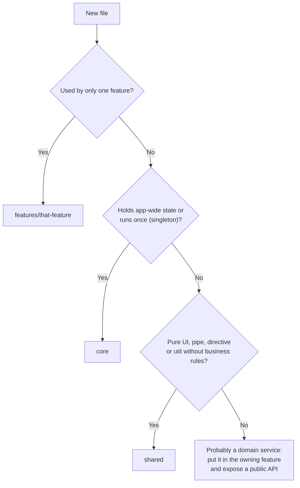
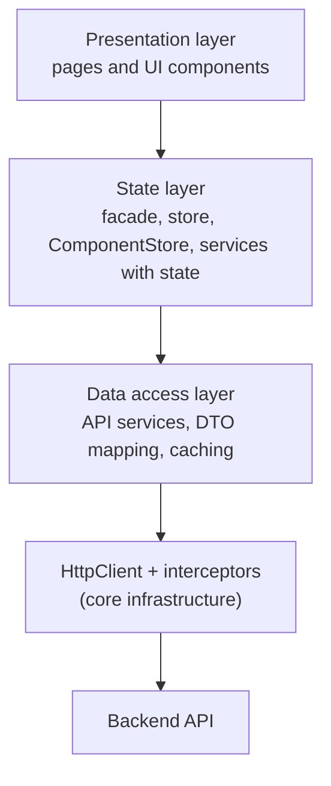
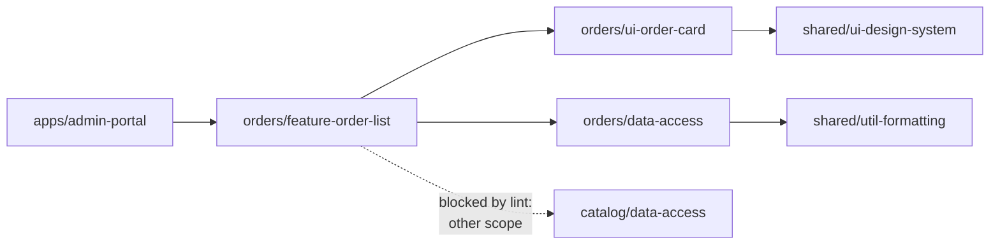
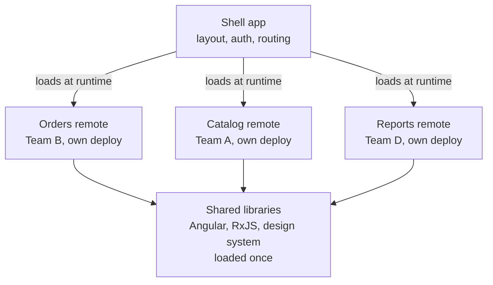
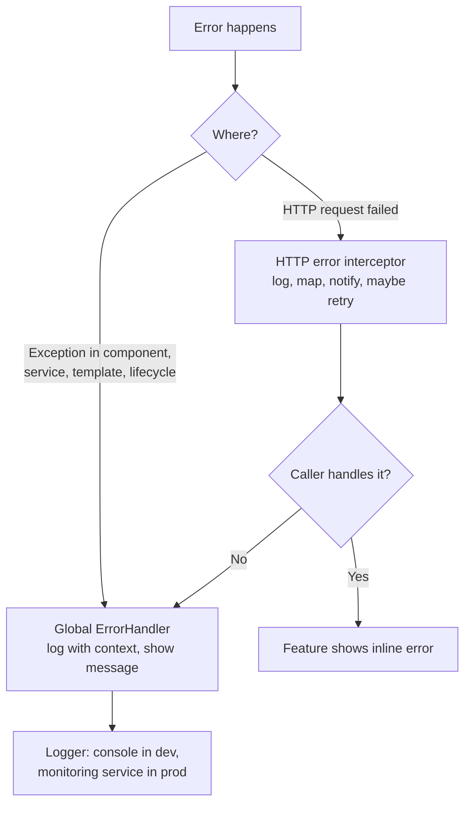
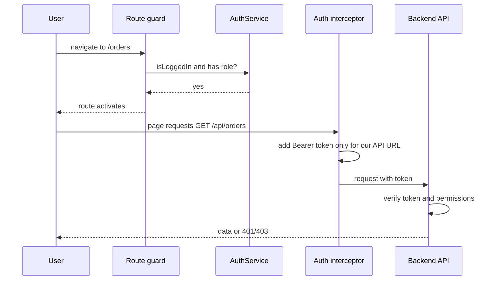

# Enterprise Angular architecture

> In this document you will learn how to structure a large Angular 16 application so that many developers can work on it for years: folder structure, layers, feature boundaries, monorepos with Nx, micro-frontends, configuration, error handling, logging, authentication, i18n and theming. Senior Angular interviews almost always include "how would you structure a big app?" questions, and this document gives you the vocabulary and the reasoning.

**Before this:** [Dependency injection](05-dependency-injection.md) · [Routing, guards and lazy loading](06-routing-guards-and-lazy-loading.md) · [State management and NgRx](11-state-management-and-ngrx.md) · **Interview questions:** [jump to the interview section](#interview-questions)

## Table of contents

1. [What architecture means in an Angular app](#what-architecture-means-in-an-angular-app)
2. [Folder structure: core, shared and features](#folder-structure-core-shared-and-features)
3. [Feature modules vs standalone features](#feature-modules-vs-standalone-features)
4. [Smart and presentational components](#smart-and-presentational-components)
5. [Layers: presentation, state and data access](#layers-presentation-state-and-data-access)
6. [The facade pattern as a feature boundary](#the-facade-pattern-as-a-feature-boundary)
7. [Domain-based boundaries](#domain-based-boundaries)
8. [Nx monorepos and library types](#nx-monorepos-and-library-types)
9. [Shared component library and design system](#shared-component-library-and-design-system)
10. [Micro-frontends](#micro-frontends)
11. [Configuration and environments](#configuration-and-environments)
12. [Global error handling](#global-error-handling)
13. [Logging and monitoring](#logging-and-monitoring)
14. [Authentication architecture](#authentication-architecture)
15. [Internationalization](#internationalization)
16. [Multi-tenant theming](#multi-tenant-theming)
17. [Coding standards and automation](#coding-standards-and-automation)
18. [Common mistakes](#common-mistakes)
19. [Best practices](#best-practices)
20. [How to explain this in an interview](#how-to-explain-this-in-an-interview)
21. [Interview questions](#interview-questions)
22. [Summary](#summary)
23. [References](#references)

---

## What architecture means in an Angular app

**Architecture** is the set of decisions that are expensive to change later: how the code is split into parts, which part may depend on which, where state lives, and how cross-cutting concerns (errors, logging, auth, config) are handled.

Why it matters in big apps:

- **Many developers.** Without clear boundaries, every change touches many files owned by other people, and merge conflicts and bugs grow.
- **Long life.** Enterprise apps live 5 to 10 years. The code must stay understandable after the original developers leave.
- **Change.** Features are added, removed and rewritten. Good boundaries let you change one feature without breaking others.

Good architecture has two classic properties (see [Coupling, cohesion and design principles](../04-oop-solid-design-patterns/04-coupling-cohesion-and-design-principles.md)):

- **High cohesion:** code that changes together lives together (everything about "orders" is in the orders feature).
- **Low coupling:** parts depend on each other through small, stable interfaces, not on each other's internals.

**Analogy:** a large office building. Each department (feature) has its own floor. Shared facilities (shared UI) like meeting rooms are used by everyone but belong to no department. Building services (core) like security and electricity are installed once for the whole building. Departments talk through the reception (public APIs), not by walking into each other's offices and moving papers around.

## Folder structure: core, shared and features

The most common Angular structure has three kinds of folders. This is a **convention**, not an Angular rule, but most Angular teams and interviewers know it.

```text
src/app/
├── core/                      # singletons, used once by the app shell
│   ├── auth/                  # AuthService, auth interceptor, auth guard
│   ├── config/                # ConfigService, APP_INITIALIZER
│   ├── error-handling/        # GlobalErrorHandler, HTTP error interceptor
│   ├── logging/               # LoggerService
│   ├── layout/                # shell: header, sidebar, footer
│   └── core.module.ts         # (NgModule apps) imported once in AppModule
├── shared/                    # reusable, no business logic, no singletons
│   ├── ui/                    # button, card, dialog, data-table wrappers
│   ├── pipes/                 # date-ago, file-size
│   ├── directives/            # autofocus, has-permission
│   └── shared.module.ts       # (NgModule apps) exports common pieces
├── features/                  # one folder per business feature, lazy-loaded
│   ├── orders/
│   │   ├── pages/             # smart, routed components
│   │   ├── components/        # presentational components for this feature
│   │   ├── data-access/       # API service, state (store/facade)
│   │   ├── models/            # interfaces, DTO mapping
│   │   ├── orders.routes.ts   # or orders-routing.module.ts
│   │   └── orders.module.ts   # (NgModule apps)
│   ├── customers/
│   └── reports/
├── app.component.ts
└── app.module.ts / app.config.ts
```

### The rules that make it work

| Folder | Contains | May import | Must NOT import |
| --- | --- | --- | --- |
| `core` | App-wide singletons and the shell | Angular, `shared` (for UI in the layout) | `features` |
| `shared` | Dumb, reusable UI, pipes, directives, utils | Angular, other `shared` items | `core` services with state, `features` |
| `features/x` | Everything for one business area | `core` services (by injection), `shared` | Other features' internals |

Why these rules:

- If `shared` imports a feature, then every feature that uses `shared` also pulls in that feature. You get circular dependencies and lazy loading breaks.
- If one feature imports another feature's internals, you cannot change or delete one without breaking the other.
- If singletons live in `shared` and `shared` is imported by lazy modules that also **provide** them, you can get several instances (see [Dependency injection](05-dependency-injection.md)).

### The "import CoreModule only once" guard (NgModule apps)

```ts
@NgModule({
  providers: [
    { provide: ErrorHandler, useClass: GlobalErrorHandler },
    { provide: HTTP_INTERCEPTORS, useClass: AuthInterceptor, multi: true },
  ],
})
export class CoreModule {
  constructor(@Optional() @SkipSelf() parentModule?: CoreModule) {
    if (parentModule) {
      throw new Error('CoreModule is already loaded. Import it in AppModule only.');
    }
  }
}
```

`@SkipSelf()` asks the parent injector for `CoreModule`. If it exists, someone imported `CoreModule` again in a lazy module, which would create a second set of providers.

In modern Angular, most core services use `@Injectable({ providedIn: 'root' })`, so the "core module" is often just a folder plus a function that returns providers.

### Where should a new file go? A quick decision



## Feature modules vs standalone features

Angular 16 supports two ways to build a feature. Both are valid and both are used in real Angular 16 apps.

### NgModule feature

```ts
// features/orders/orders.module.ts
@NgModule({
  declarations: [OrdersPageComponent, OrderDetailsPageComponent, OrdersTableComponent],
  imports: [CommonModule, SharedModule, OrdersRoutingModule, StoreModule.forFeature(ordersFeature)],
})
export class OrdersModule {}

// app-routing.module.ts
{ path: 'orders', loadChildren: () => import('./features/orders/orders.module').then(m => m.OrdersModule) }
```

### Standalone feature (Angular 15+ stable)

```ts
// features/orders/orders.routes.ts
export const ORDERS_ROUTES: Routes = [
  {
    path: '',
    providers: [OrdersFacade, provideState(ordersFeature), provideEffects(OrdersEffects)], // feature-level providers
    children: [
      { path: '', component: OrdersPageComponent },
      { path: ':id', loadComponent: () => import('./pages/order-details-page.component').then(m => m.OrderDetailsPageComponent) },
    ],
  },
];

// app.routes.ts
{ path: 'orders', loadChildren: () => import('./features/orders/orders.routes').then(m => m.ORDERS_ROUTES) }
```

| | NgModule feature | Standalone feature |
| --- | --- | --- |
| Dependencies | Declared once in the module | Each component lists its own `imports` |
| Feature providers | Module `providers` (lazy module injector) | Route `providers` (route environment injector) |
| Boilerplate | More files | Fewer files |
| Learning curve for existing teams | Familiar | New mental model |
| Public API | The module's `exports` | The file's TypeScript exports |

**Advice for an Angular 16 codebase:** do not rewrite all modules at once. New features can be standalone, and both styles work together (a standalone component can import an NgModule, and an NgModule can import a standalone component). Angular provides a migration schematic (`ng generate @angular/core:standalone`) when you decide to move.

> **Newer Angular:** standalone became the default for `ng new` in 17 and the default for components, directives and pipes (no `standalone: true` needed) in 19. NgModules still work. See [Angular 16 vs newer versions](16-angular-16-vs-newer-versions.md).

## Smart and presentational components

This split is introduced in [Components and templates](02-components-and-templates.md). In architecture, it becomes a rule for the whole team.

| | Smart (container) component | Presentational (dumb, UI) component |
| --- | --- | --- |
| Knows about | Services, store, router, facades | Only its `@Input`s |
| Talks to the outside by | Calling services, dispatching actions | Emitting `@Output` events |
| Typical location | `features/x/pages` | `features/x/components` or `shared/ui` |
| Change detection | Often OnPush with `async` pipe | Always OnPush |
| Testing | Mock the facade | Set inputs, check DOM and outputs |
| Reusable? | Rarely | Yes |

```ts
// Smart: knows where data comes from
@Component({
  selector: 'app-orders-page',
  template: `
    <app-orders-filter [status]="(status$ | async) ?? 'all'" (statusChange)="facade.statusChanged($event)" />
    <app-orders-table [orders]="(orders$ | async) ?? []" (rowClick)="open($event)" />
  `,
  changeDetection: ChangeDetectionStrategy.OnPush,
})
export class OrdersPageComponent {
  readonly facade = inject(OrdersFacade);
  private router = inject(Router);
  orders$ = this.facade.orders$;
  status$ = this.facade.status$;

  open(order: Order): void {
    this.router.navigate(['/orders', order.id]);
  }
}

// Presentational: only inputs and outputs
@Component({
  selector: 'app-orders-table',
  template: `
    <table>
      <tr *ngFor="let order of orders; trackBy: trackById" (click)="rowClick.emit(order)">
        <td>{{ order.number }}</td><td>{{ order.total | currency }}</td>
      </tr>
    </table>
  `,
  changeDetection: ChangeDetectionStrategy.OnPush,
})
export class OrdersTableComponent {
  @Input({ required: true }) orders: readonly Order[] = [];
  @Output() rowClick = new EventEmitter<Order>();
  trackById(_: number, o: Order): string { return o.id; }
}
```

Benefits: presentational components are reusable, easy to test and safe to put in a design system. Smart components are few and contain the wiring.

Do not take it too far: a tiny component that needs one value from a service does not need a separate container. The goal is clear responsibilities, not more files.

## Layers: presentation, state and data access

Inside each feature, use layers. Each layer has one job and depends only on the layer below it.



| Layer | Responsibility | Should not |
| --- | --- | --- |
| **Presentation** | Render data, handle user events, routing | Call `HttpClient`, contain business rules |
| **State** | Hold feature state, coordinate workflows, derive view data | Know about the DOM or templates |
| **Data access** | Talk to the API, map DTOs to domain models, handle caching | Hold UI state |
| **Infrastructure (core)** | Auth headers, error handling, logging, config | Know about specific features |

### Map DTOs at the boundary

A **DTO** (data transfer object) is the shape the API sends. Do not let API shapes leak into your components. Map them in the data access layer.

```ts
// What the API sends
interface OrderDto {
  order_id: string;
  created_at: string;         // ISO string
  total_cents: number;
  status: 'NEW' | 'PAID' | 'SHIPPED';
}

// What the app uses
export interface Order {
  id: string;
  createdAt: Date;
  total: number;
  status: 'new' | 'paid' | 'shipped';
}

@Injectable({ providedIn: 'root' })
export class OrdersApiService {
  private http = inject(HttpClient);
  private config = inject(ConfigService);

  getOrders(): Observable<Order[]> {
    return this.http
      .get<OrderDto[]>(`${this.config.value.apiUrl}/orders`)
      .pipe(map(dtos => dtos.map(toOrder)));
  }
}

function toOrder(dto: OrderDto): Order {
  return {
    id: dto.order_id,
    createdAt: new Date(dto.created_at),
    total: dto.total_cents / 100,
    status: dto.status.toLowerCase() as Order['status'],
  };
}
```

Why: when the backend renames a field, you change one mapping function, not 30 templates. It also lets you validate data at runtime at this boundary (see [Runtime validation and type-safe APIs](../03-typescript/11-runtime-validation-and-type-safe-apis.md)). Remember that `http.get<OrderDto[]>` is only a TypeScript promise: it does not check the response at runtime.

## The facade pattern as a feature boundary

A **facade** gives the presentation layer one small API for a feature and hides the state and data access layers behind it. The details and trade-offs are in [State management and NgRx](11-state-management-and-ngrx.md#level-3-the-facade-pattern).

In architecture terms, the facade is the **public API of the feature's state**:

- Pages inject `OrdersFacade`, never `Store` or `OrdersApiService` directly.
- You can change the state technology (BehaviorSubject service to NgRx, or NgRx to SignalStore after upgrading) without touching pages.
- Tests of pages mock one class.

Create one facade per feature or domain, not one per component.

## Domain-based boundaries

As the app grows, "features" grow into **domains**: groups of features that belong to the same business area and the same team. This idea comes from **Domain-Driven Design (DDD)**, where a **bounded context** is a part of the business with its own language and rules.

Example for an e-commerce back office:

| Domain | Features | Owned by |
| --- | --- | --- |
| Catalog | products, categories, pricing | Team A |
| Orders | order list, order details, returns | Team B |
| Customers | customer list, profile, support notes | Team C |
| Shared kernel | auth, layout, design system, utils | Platform team |

Rules for domains:

- A domain does not import another domain's internals. If Orders needs a customer name, it either gets it from the Orders API (the backend joins the data), or it uses a small **public API** that the Customers domain exports on purpose.
- Cross-domain communication goes through **contracts**: routes (navigate to `/customers/42`), public services, or events.
- Each domain can be lazy-loaded and, in a monorepo, can be one or more libraries owned by one team.

**Why this matters in interviews:** it shows you think about team structure (Conway's law: systems mirror the communication structure of the organization) and not only code.

## Nx monorepos and library types

### What a monorepo is

A **monorepo** is one Git repository that contains several apps and libraries. **Nx** is a popular build system for monorepos with first-class Angular support.

Why teams use Nx with Angular:

- **Libraries with clear boundaries** instead of folders that anyone can import.
- **Enforced dependency rules** with a lint rule.
- **Affected commands:** `nx affected -t test` runs tests only for projects changed by a commit and the projects that depend on them.
- **Caching:** build and test results are cached locally and (optionally) remotely, so CI is faster.
- **Code generators** that create libraries and components with the team's conventions.
- **Dependency graph** visualization (`nx graph`).

### Library types

The Nx team recommends classifying libraries by **type**:

| Type | Contains | May depend on |
| --- | --- | --- |
| **feature** | Smart components and routes for a use case | ui, data-access, util |
| **ui** | Presentational components, no services with state | ui, util |
| **data-access** | API services, state (NgRx, facades), models | data-access, util |
| **util** | Pure functions, helpers, types, validators | util |

And by **scope** (the domain): `scope:orders`, `scope:catalog`, `scope:shared`.

```text
libs/
├── orders/
│   ├── feature-order-list/       # type:feature, scope:orders
│   ├── feature-order-details/    # type:feature, scope:orders
│   ├── data-access/              # type:data-access, scope:orders
│   └── ui-order-card/            # type:ui, scope:orders
├── catalog/
│   └── ...
└── shared/
    ├── ui-design-system/         # type:ui, scope:shared
    ├── data-access-auth/         # type:data-access, scope:shared
    └── util-formatting/          # type:util, scope:shared
apps/
├── admin-portal/                 # thin app shell: routes to feature libs
└── customer-portal/
```

### Module boundary rules

Each library has **tags** in its `project.json`, and the `@nx/enforce-module-boundaries` ESLint rule checks every import:

```json
// .eslintrc.json (root)
"@nx/enforce-module-boundaries": [
  "error",
  {
    "depConstraints": [
      { "sourceTag": "type:feature", "onlyDependOnLibsWithTags": ["type:feature", "type:ui", "type:data-access", "type:util"] },
      { "sourceTag": "type:ui", "onlyDependOnLibsWithTags": ["type:ui", "type:util"] },
      { "sourceTag": "type:data-access", "onlyDependOnLibsWithTags": ["type:data-access", "type:util"] },
      { "sourceTag": "type:util", "onlyDependOnLibsWithTags": ["type:util"] },
      { "sourceTag": "scope:orders", "onlyDependOnLibsWithTags": ["scope:orders", "scope:shared"] },
      { "sourceTag": "scope:catalog", "onlyDependOnLibsWithTags": ["scope:catalog", "scope:shared"] }
    ]
  }
]
```

Now, if a developer imports the catalog data-access library inside the orders feature, the lint fails in CI. The architecture is **enforced by tools**, not by hope.

Each library also has a public entry point (`index.ts`). Other projects may import only what it exports, through a path alias like `@acme/orders/data-access`. Deep imports into a library's internal files are blocked by the same rule.



**Trade-offs of a monorepo:** one big repository needs good tooling (Nx caching, affected commands), CI must scale, and all projects usually upgrade Angular together (which is also a benefit: no version drift).

## Shared component library and design system

A **design system** is a set of reusable UI components, design tokens (colors, spacing, typography) and usage guidelines, so all screens look and behave the same.

How large Angular teams build one:

- **Base:** Angular Material, or the **Angular CDK** for behavior without styling (overlay, a11y, drag-drop, virtual scroll), plus your own styling.
- **Design tokens as CSS custom properties**, so themes can change at runtime.
- **Presentational components only**: inputs, outputs, content projection, OnPush. No HTTP and no feature logic.
- **Accessibility built in**: keyboard support, focus management, ARIA. Fixing it once in the library fixes it everywhere. See [Accessibility](../05-frontend-engineering/04-accessibility.md).
- **Documentation and visual testing** with Storybook, and component tests with harnesses.
- **Packaging:** in a monorepo it is a library (`libs/shared/ui-design-system`). Across repositories, publish it as an npm package built with `ng-packagr` (`ng generate library`), with semantic versioning and a changelog.

```ts
// A design system button: inputs, content projection, no business logic
@Component({
  selector: 'ds-button',
  standalone: true,
  template: `
    <button [type]="type" [class]="'ds-btn ds-btn--' + variant" [disabled]="disabled || loading">
      <span *ngIf="loading" class="ds-spinner" aria-hidden="true"></span>
      <ng-content />
    </button>
  `,
  imports: [NgIf],
  changeDetection: ChangeDetectionStrategy.OnPush,
})
export class DsButtonComponent {
  @Input() variant: 'primary' | 'secondary' | 'danger' = 'primary';
  @Input() type: 'button' | 'submit' = 'button';
  @Input({ transform: booleanAttribute }) disabled = false;   // Angular 16.1+
  @Input({ transform: booleanAttribute }) loading = false;
}
```

Usage: `<ds-button variant="danger" loading (click)="delete()">Delete</ds-button>`.

## Micro-frontends

### What they are

**Micro-frontends** split one web app into several smaller frontend apps that are **built and deployed independently**, often by different teams, and composed at runtime in a **shell** (host) app.



### Why they exist

- Large organizations with many teams want each team to **release on its own schedule** without waiting for one big release.
- Different parts of a product may need to be upgraded or rewritten separately.

### Module Federation

**Webpack Module Federation** (webpack 5) lets one build load JavaScript modules from another build at runtime and share libraries (like Angular) so they load only once. For Angular, the community package `@angular-architects/module-federation` adds schematics and helpers. This fits Angular 16 well, because Angular 16 projects use the webpack builder by default.

```ts
// Shell routes: the Orders feature comes from another deployment at runtime
import { loadRemoteModule } from '@angular-architects/module-federation';

export const routes: Routes = [
  {
    path: 'orders',
    loadChildren: () =>
      loadRemoteModule({
        type: 'module',
        remoteEntry: 'https://orders.example.com/remoteEntry.js',
        exposedModule: './Routes',
      }).then(m => m.ORDERS_ROUTES),
  },
];
```

### Native Federation

**Native Federation** (`@angular-architects/native-federation`) offers the same mental model (host, remotes, shared dependencies) but is built on web standards (ES modules and import maps) and works with any bundler, including Angular's esbuild-based builders. It is the usual choice when you move to the esbuild application builder (default from Angular 17).

### Trade-offs

| Advantages | Disadvantages |
| --- | --- |
| Independent deployments per team | Much more complexity: versioning, shared dependency mismatches, runtime loading errors |
| Smaller, focused codebases | Harder to keep a consistent UX; needs a strong design system |
| Different release speeds per domain | Shared state and communication between apps is hard (prefer URL, events, a small shared library) |
| Can migrate parts gradually | Performance cost if shared libraries are not deduplicated |
| | Local development and end-to-end testing are harder |

**Senior advice:** micro-frontends solve an **organizational** problem (many teams, independent releases), not a technical one. For one or two teams, a well-structured monolith or an Nx monorepo with lazy-loaded libraries is simpler and usually better. Choose micro-frontends only when independent deployment is a real requirement.

Alternatives: Nx monorepo with lazy features (one deployment, strong boundaries), Angular Elements (Web Components) for embedding Angular widgets into other apps, or iframes for strong isolation (with UX and communication costs).

## Configuration and environments

### Build-time configuration: `environment.ts`

Angular 16 projects use environment files with file replacement in `angular.json`:

```ts
// src/environments/environment.ts (development)
export const environment = {
  production: false,
  apiUrl: 'http://localhost:3000/api',
};

// src/environments/environment.prod.ts
export const environment = {
  production: true,
  apiUrl: 'https://api.example.com',
};
```

```json
"configurations": {
  "production": {
    "fileReplacements": [
      { "replace": "src/environments/environment.ts", "with": "src/environments/environment.prod.ts" }
    ]
  }
}
```

The values are **compiled into the bundle**. Problem: you need **a different build for every environment** (dev, test, staging, production, each customer). Enterprise teams prefer **build once, deploy many times**: the exact same artifact that passed testing goes to production.

### Runtime configuration with APP_INITIALIZER

Load a `config.json` when the app starts, before anything else runs. The deployment pipeline (or the server) writes the right `config.json` for each environment.

```ts
// core/config/config.service.ts
export interface AppConfig {
  apiUrl: string;
  featureFlags: Record<string, boolean>;
  sentryDsn?: string;
}

@Injectable({ providedIn: 'root' })
export class ConfigService {
  private http = inject(HttpClient);
  private config: AppConfig | null = null;

  load(): Promise<void> {
    return firstValueFrom(this.http.get<AppConfig>('/assets/config.json')).then(c => {
      this.config = c;
    });
  }

  get value(): AppConfig {
    if (!this.config) throw new Error('Config not loaded');
    return this.config;
  }

  isEnabled(flag: string): boolean {
    return this.value.featureFlags[flag] ?? false;
  }
}

export function initConfig(config: ConfigService): () => Promise<void> {
  return () => config.load();
}
```

```ts
// app.module.ts (Angular 16)
providers: [
  { provide: APP_INITIALIZER, useFactory: initConfig, deps: [ConfigService], multi: true },
],
```

How it works:

1. Angular collects all `APP_INITIALIZER` functions (it is a **multi provider**).
2. During bootstrap, it calls them and **waits** for returned Promises or Observables to finish.
3. Only then does it create the root component. So every service can safely read `config.value`.

Caveats:

- Startup is delayed by the config request. Keep the file small and cacheable for a short time (or `no-cache`, so a new deployment's config is picked up).
- If the request fails, the app does not start. Show a friendly error page, or fall back to defaults.
- Do **not** put secrets in `config.json` or `environment.ts`. Everything in the frontend is public.

An alternative is to fetch the config in `main.ts` before bootstrapping, and provide it as a value:

```ts
// main.ts
fetch('/assets/config.json')
  .then(r => r.json() as Promise<AppConfig>)
  .then(config =>
    platformBrowserDynamic([{ provide: APP_CONFIG, useValue: config }]).bootstrapModule(AppModule),
  );
```

> **Newer Angular (19+):** `APP_INITIALIZER` is deprecated in favor of `provideAppInitializer(() => inject(ConfigService).load())`.

### Feature flags

Use flags from runtime config (or a feature flag service) to turn features on per environment or tenant. Combine with a guard (`canMatch` to hide a route) and a structural directive (`*appFeature="'newCheckout'"`). Remember: flags in the frontend hide UI, they do not protect data. The server must check too.

## Global error handling

There are two kinds of errors, and they need two tools.



### ErrorHandler

Angular sends every uncaught error (in change detection, event handlers, lifecycle hooks, and unhandled errors inside the zone) to the `ErrorHandler` service. The default one just logs to the console. Replace it:

```ts
@Injectable()
export class GlobalErrorHandler implements ErrorHandler {
  // Inject only the Injector here. Get the other services later, inside handleError
  // (see the note below about cyclic dependencies).
  private injector = inject(Injector);
  private zone = inject(NgZone);

  handleError(error: unknown): void {
    if (error instanceof HttpErrorResponse) {
      return; // already handled and logged by the HTTP interceptor
    }
    const logger = this.injector.get(LoggerService);
    const notifications = this.injector.get(NotificationService);

    const err = error instanceof Error ? error : new Error(String(error));
    logger.error(err.message, { stack: err.stack, url: location.href });

    // ErrorHandler can be called outside Angular's zone; re-enter to update the UI
    this.zone.run(() => notifications.showError('Something went wrong. Please try again.'));
  }
}

// providers: [{ provide: ErrorHandler, useClass: GlobalErrorHandler }]
```

Notes:

- `ErrorHandler` is created very early. Injecting services that depend on `HttpClient` or the `Router` directly (in the constructor or a field) can create cyclic dependency errors. That is why the example injects only `Injector` and gets `LoggerService` lazily with `this.injector.get(LoggerService)` inside `handleError`.
- Errors in an RxJS subscription without an `error` callback are reported too, because RxJS rethrows them asynchronously inside the zone.
- Do not show the raw error to users. Show a friendly message and log the details.

### HTTP error interceptor

```ts
export const httpErrorInterceptor: HttpInterceptorFn = (req, next) => {
  const logger = inject(LoggerService);
  const router = inject(Router);

  return next(req).pipe(
    catchError((error: HttpErrorResponse) => {
      if (error.status === 401) {
        router.navigate(['/login'], { queryParams: { returnUrl: router.url } });
      } else if (error.status === 0 || error.status >= 500) {
        logger.error(`HTTP ${error.status} ${req.method} ${req.url}`, { correlationId: req.headers.get('X-Correlation-Id') });
      }
      return throwError(() => error); // rethrow so the feature can show its own message
    }),
  );
};
```

Key rule: an interceptor should **not** swallow errors by returning an empty success value. Rethrow them, so the feature that made the request can show the right message (for example, "This email is already used" for a 409). Interceptors are covered in [HttpClient and interceptors](08-httpclient-and-interceptors.md).

## Logging and monitoring

A `LoggerService` in `core` gives one place to send logs:

```ts
@Injectable({ providedIn: 'root' })
export class LoggerService {
  private config = inject(ConfigService);

  error(message: string, context?: Record<string, unknown>): void {
    if (isDevMode()) {
      console.error(message, context);
      return;
    }
    // In production: send to a monitoring tool (Sentry, Datadog, Application Insights, your own endpoint).
    // Use navigator.sendBeacon or a batched HTTP call. Never log tokens or personal data.
  }

  warn(message: string, context?: Record<string, unknown>): void { /* ... */ }
  info(message: string, context?: Record<string, unknown>): void { /* ... */ }
}
```

What enterprise frontends usually log and monitor:

- **Errors** with stack traces (uploaded **source maps** to the monitoring tool, not to the public server), browser, app version, user id (pseudonymous), current route.
- **Correlation ids**: an interceptor adds an `X-Correlation-Id` header to each request so frontend errors can be matched to backend logs.
- **Performance**: Core Web Vitals and slow API calls.
- **Business events** (carefully, respecting privacy and consent).

Never log passwords, tokens or personal data. More on this in [Production Node.js](../07-nodejs-backend/14-production-nodejs.md).

## Authentication architecture

Auth in an Angular app is a combination of several pieces in `core`. The architecture of SSO and OIDC is in [Auth architecture and multi-tenancy](../09-system-design/06-auth-architecture-and-multi-tenancy.md), and Angular-specific security is in [Angular security](15-security.md).



| Piece | Responsibility |
| --- | --- |
| `AuthService` | Holds the session (user, roles, token expiry) as an Observable or signal; login, logout, refresh |
| Auth interceptor | Adds the token to requests **for your own API only**; handles 401 by refreshing or logging out |
| Guards (`canActivate`, `canMatch`) | Hide routes the user cannot use; redirect to login |
| Permission directive (`*appHasPermission`) | Hide buttons the user cannot use |
| Backend | The **real** security: checks the token and permissions on every request |

The auth interceptor itself is shown in [HttpClient and interceptors](08-httpclient-and-interceptors.md#1-auth-token-only-for-your-own-api). The key security rule (attach the token only to your own API origin, and compare origins carefully) is explained in [Angular security](15-security.md#attach-tokens-only-to-your-own-api).

Important architecture points:

- **Guards are UX, not security.** Anyone can change JavaScript in the browser. The server must authorize every request.
- **Token storage** is a trade-off: an httpOnly secure cookie (set by the server, not readable by JavaScript, needs CSRF protection) vs memory or `localStorage` (readable by any script, so an XSS bug can steal it). Many enterprise apps use a backend-for-frontend (BFF) with cookies. Details in [Angular security](15-security.md).
- Use a well-tested library for OIDC/OAuth flows (for example `angular-oauth2-oidc`, `angular-auth-oidc-client` or your identity provider's SDK) instead of writing the protocol yourself.

## Internationalization

**Internationalization (i18n)** is preparing the app for many languages and regions. **Localization (l10n)** is the actual translation and regional formatting.

### Option 1: Angular's built-in i18n (`@angular/localize`)

```html
<h1 i18n="@@ordersTitle">Orders</h1>
<p i18n>You have {count, plural, =0 {no orders} =1 {one order} other {{{count}} orders}}</p>
<button i18n-title title="Delete order" i18n>Delete</button>
```

```bash
ng add @angular/localize
ng extract-i18n --output-path src/locale    # creates messages.xlf
# translators produce messages.de.xlf, messages.fr.xlf
ng build --localize                          # one build per locale: dist/app/de, dist/app/fr
```

- Translations are **compiled in at build time**, so there is no runtime cost and no flash of untranslated text.
- You get **one bundle per language**. Switching language means loading a different URL (`/de/`, `/fr/`), usually configured on the web server.
- Supports ICU expressions for plurals and gender, and translations in code with `$localize`.

### Option 2: runtime libraries (ngx-translate, Transloco)

```html
<h1>{{ 'orders.title' | transloco }}</h1>
```

- Translations are JSON files loaded at runtime. One build, language switch without reload.
- Small runtime cost, keys instead of real text in templates, and you must handle loading states.

| | `@angular/localize` | Transloco / ngx-translate |
| --- | --- | --- |
| When translated | Build time | Runtime |
| Builds | One per locale | One |
| Switch language | Reload to another URL | Instantly |
| Performance | Best | Slight runtime cost |
| Translations change without rebuild | No | Yes (load new JSON) |

Whatever you choose, also handle: locale-aware formatting with Angular pipes (`date`, `currency`, `number`, `percent` use the `LOCALE_ID` and registered locale data), right-to-left languages (`dir="rtl"`, CSS logical properties like `margin-inline-start`), text expansion (German text is often 30% longer), and time zones.

## Multi-tenant theming

A **multi-tenant** app serves several customers (tenants) from one codebase, often with different branding: logo, colors, sometimes features.

Recommended approach: **design tokens as CSS custom properties**, set at runtime from tenant config.

```css
/* styles.scss: defaults */
:root {
  --brand-primary: #1f6feb;
  --brand-on-primary: #ffffff;
  --radius: 8px;
}

.ds-btn--primary {
  background: var(--brand-primary);
  color: var(--brand-on-primary);
  border-radius: var(--radius);
}
```

```ts
@Injectable({ providedIn: 'root' })
export class ThemeService {
  private document = inject(DOCUMENT);

  apply(theme: { primary: string; onPrimary: string; logoUrl: string }): void {
    const root = this.document.documentElement;
    root.style.setProperty('--brand-primary', theme.primary);
    root.style.setProperty('--brand-on-primary', theme.onPrimary);
  }
}
```

The tenant is usually detected from the subdomain (`acme.app.com`) or the login, the tenant config is loaded in an `APP_INITIALIZER` (together with app config), and the theme is applied before the first render to avoid a flash.

Why CSS custom properties: they change at runtime without rebuilding, they work with any component library, and they cascade, so you can theme a single section. Validate tenant colors for contrast (accessibility). For data isolation between tenants, see [Auth architecture and multi-tenancy](../09-system-design/06-auth-architecture-and-multi-tenancy.md): theming is cosmetic, the backend must isolate data.

## Coding standards and automation

Rules that only live in a wiki are forgotten. Automate them.

| Area | Tool / rule |
| --- | --- |
| Formatting | Prettier, run on commit (husky + lint-staged) |
| Linting | angular-eslint (`ng add @angular-eslint/schematics`), with rules such as `prefer-on-push-component-change-detection`, `no-output-native`, template accessibility rules |
| Architecture | Nx `enforce-module-boundaries`, or `eslint-plugin-boundaries` / dependency-cruiser without Nx |
| Type safety | `strict: true`, `strictTemplates: true` in `angularCompilerOptions` |
| Naming | Angular style guide: `feature-name.component.ts`, `OrdersPageComponent`, one class per file, selector prefix (`app-`, `ds-`) |
| Commits | Conventional commits, which also enable automatic changelogs |
| Code review | Checklist: OnPush, unsubscribe strategy, trackBy, no business logic in templates, tests |
| Testing | Unit tests for services, reducers and presentational components; e2e for critical journeys; coverage thresholds as a signal, not a goal |
| Dependencies | Keep Angular on a supported version; `ng update` regularly; `npm audit` in CI |
| Documentation | Architecture Decision Records (ADRs) for important choices |

> **Newer Angular (20+):** the official style guide was updated: the CLI no longer adds suffixes like `.component` to new file names by default, and it recommends `inject()` and `protected` members for template-only fields. Existing Angular 16 code using the old style is still correct.

## Common mistakes

1. **A giant `SharedModule`** that imports and exports everything (Material, forms, all components). Every feature then depends on everything, bundles grow and it becomes impossible to know what is really used. Prefer small, focused modules or standalone components that import exactly what they need.
2. **Features importing each other's internals.** Changes ripple everywhere. Use public APIs, routes or shared libraries.
3. **Business logic in components.** It cannot be reused or tested in isolation. Move it to services, facades or selectors.
4. **API DTOs used directly in templates.** A backend change breaks many screens. Map at the data access layer.
5. **Build-time environment files for every environment.** You cannot promote the same build through environments. Use runtime config.
6. **Secrets in the frontend** (API keys with write access, client secrets in `environment.ts`). The bundle is public.
7. **Treating guards and hidden buttons as security.** The server must authorize.
8. **Interceptors that swallow errors** and return empty data. Features cannot show the right message and bugs are hidden.
9. **Micro-frontends for a single team.** All of the complexity, none of the benefits.
10. **Folder conventions without enforcement.** After a year, the boundaries are gone. Use lint rules.
11. **Big-bang rewrites** (for example, converting all modules to standalone at once in a large codebase). Migrate incrementally, feature by feature.

## Best practices

- **Organize by feature and domain, not by technical type.** Reason: code that changes together stays together.
- **Use core, shared and features with clear import rules, and enforce them with lint.** Reason: boundaries survive team changes.
- **Lazy-load every feature.** Reason: smaller initial bundle and natural boundaries.
- **Split smart and presentational components, and use OnPush everywhere.** Reason: reusable, testable UI and better performance.
- **Use layers and map DTOs in data access.** Reason: backend changes stay local.
- **Expose a facade (or another small public API) per feature.** Reason: pages stay simple and the state technology can change.
- **Build once, configure at runtime.** Reason: the tested artifact is the deployed artifact.
- **Centralize cross-cutting concerns in core:** `ErrorHandler`, HTTP interceptors, logging, auth. Reason: consistent behavior and one place to change it.
- **Attach tokens only to your own API, and let the server enforce permissions.** Reason: avoid token leaks and false security.
- **Choose micro-frontends only for real independent-deployment needs.** Reason: they cost a lot of complexity.
- **Write ADRs for big decisions** (NgRx or not, monorepo or not, i18n approach). Reason: future developers understand why.

## How to explain this in an interview

1. **Define it:** "Architecture in an Angular app is how I split code into features and layers, which parts may depend on which, and how cross-cutting concerns like config, errors, logging and auth are handled."
2. **Why it exists:** "Enterprise apps have many developers and live for years. Without boundaries, every change touches everything and the app becomes hard to change."
3. **How I do it:** "I organize by feature with core, shared and features folders. Features are lazy-loaded. Inside a feature I separate smart pages, presentational components, a facade or store for state, and a data-access layer that maps DTOs. Core holds singletons: ErrorHandler, interceptors, auth, config loaded at runtime with APP_INITIALIZER. In a large organization I use an Nx monorepo with feature, ui, data-access and util libraries and enforce the dependency rules with lint."
4. **Small example:** "In an admin portal, the orders feature has a page that injects OrdersFacade. The facade uses NgRx, and the effects call OrdersApiService, which maps API DTOs to Order models. The page passes orders to a presentational table component from our design system."
5. **Where it is useful:** "Multi-team products, long-lived enterprise portals, apps that must be deployed to many environments or tenants."
6. **Trade-offs / gotchas:** "More structure means more files, so I scale it to the app size. Micro-frontends solve team independence but add a lot of complexity, so I only use them when independent deployment is a real requirement. And guards and feature flags are UX only: the backend enforces security."

---

## Interview questions

### Q1. How would you structure a large Angular application?

**What the interviewer is checking:** whether you can design for many developers and long life, with clear reasoning.

**Short spoken answer (30–60 seconds):**
> I organize by feature, not by file type. At the top I have core for app-wide singletons like auth, config, error handling and the layout shell, shared for reusable presentational components, pipes and directives without business logic, and a features folder with one lazy-loaded folder per business area. Features can use core services and shared UI, but not each other's internals, and shared never imports features. Inside each feature I separate smart page components, presentational components, a state layer like a facade or NgRx feature, and a data-access layer that calls the API and maps DTOs. For a big organization I move this into an Nx monorepo with library types and lint rules that enforce the boundaries.

**Detailed explanation:** See [Folder structure](#folder-structure-core-shared-and-features), [Layers](#layers-presentation-state-and-data-access) and [Nx](#nx-monorepos-and-library-types). The key is **dependency direction** and **enforcement**.

**Follow-up questions:**
- **What goes into core vs shared?** — Core: singletons used once (auth service, interceptors, error handler, layout). Shared: reusable, stateless building blocks used by many features (UI components, pipes, directives, utils).
- **How do you stop people from breaking the rules?** — Lint rules (Nx `enforce-module-boundaries` or eslint-plugin-boundaries), code review checklists and library public APIs.
- **Would you use the same structure for a small app?** — A lighter version: features and shared folders, maybe no facades. Structure should match the size.

**Common mistakes:** Only describing folders, without dependency rules. A huge SharedModule.

**Where this is used in real projects:** Starting a new enterprise project, or refactoring a messy one.

### Q2. What is the difference between smart and presentational components, and why separate them?

**What the interviewer is checking:** component responsibility design.

**Short spoken answer (30–60 seconds):**
> Smart or container components know where data comes from. They inject services, facades or the store, handle routing, and pass data down. Presentational components only receive data through inputs and report user actions through outputs; they don't inject business services. I separate them because presentational components become reusable, easy to test by setting inputs and checking outputs, and safe to use with OnPush and in a design system. Smart components are few and contain the wiring. I don't split tiny components just for the pattern; the goal is clear responsibilities.

**Follow-up questions:**
- **Can a presentational component have local state?** — Yes, UI state like "is this panel expanded". It should not hold business or server state.
- **Where do smart components usually live?** — As routed pages in the feature folder.

**Common mistakes:** Presentational components that inject `HttpClient` "just for one call".

**Where this is used in real projects:** Every feature in a large app; design system components are always presentational.

### Q3. How do you handle environment configuration for an app deployed to dev, staging, production and several customers?

**What the interviewer is checking:** build-once-deploy-many and runtime config.

**Short spoken answer (30–60 seconds):**
> Angular's environment files are compiled into the bundle, so each environment needs its own build. For enterprise deployments I prefer building once and promoting the same artifact, so I load configuration at runtime. The app fetches a config.json with the API URL, feature flags and monitoring settings in an APP_INITIALIZER, and Angular waits for it before creating the root component. The pipeline or server provides the right config.json per environment or tenant. I keep environment.ts only for build-level settings like production mode. And I never put secrets in either, because everything in the frontend is public.

**Code:** see [Runtime configuration with APP_INITIALIZER](#runtime-configuration-with-app_initializer).

**Follow-up questions:**
- **What if loading the config fails?** — The initializer rejects and the app does not start. Catch it and show an error page, or use safe defaults.
- **How does `APP_INITIALIZER` work?** — It is a multi-provider token. Angular runs all registered functions during bootstrap and waits for returned Promises or Observables.
- **What replaced it in newer Angular?** — `provideAppInitializer()` in 19; `APP_INITIALIZER` was deprecated.

**Common mistakes:** One build per environment as the only solution. Secrets in config.

**Where this is used in real projects:** Any app deployed by a CI/CD pipeline to several stages or customers.

### Q4. How do you implement global error handling in Angular?

**What the interviewer is checking:** knowledge of `ErrorHandler` and interceptors, and how they work together.

**Short spoken answer (30–60 seconds):**
> I use two layers. For HTTP, an interceptor catches HttpErrorResponse: it handles cross-cutting cases like 401 by redirecting to login or refreshing a token, logs 5xx errors with a correlation id, and rethrows the error so the feature can show a specific message. For everything else, I replace Angular's ErrorHandler with my own class. Angular calls it for uncaught errors in templates, lifecycle hooks, event handlers and subscriptions without error callbacks. It logs the error with context to a monitoring tool and shows a friendly notification, inside `zone.run` so the UI updates. I make sure the interceptor doesn't swallow errors and the handler doesn't double-log HTTP errors.

**Follow-up questions:**
- **Why rethrow in the interceptor?** — The caller knows the context ("this email already exists"). Swallowing errors hides bugs and leaves screens in loading state.
- **Why can injecting services in an ErrorHandler cause problems?** — It is created early; dependencies on `HttpClient` or the router can create cycles. Get them lazily through `Injector` inside `handleError`.
- **Does ErrorHandler catch errors in a `setTimeout` outside Angular's zone?** — Not automatically; errors outside the zone are not routed to it. You can add a `window.onerror` / `unhandledrejection` listener too.

**Common mistakes:** Only mentioning try/catch. Interceptors that return `of([])` on every error.

**Where this is used in real projects:** Every production app, together with Sentry or a similar tool.

### Q5. What are micro-frontends, and when would you (not) use them with Angular?

**What the interviewer is checking:** senior trade-off thinking.

**Short spoken answer (30–60 seconds):**
> Micro-frontends split one product's frontend into several apps that are built and deployed independently, usually by different teams, and loaded at runtime by a shell app. With Angular 16 the common tool is webpack Module Federation through the angular-architects package; with the esbuild builders in newer Angular, Native Federation, which uses ES modules and import maps. Shared libraries like Angular and the design system are loaded once. The benefit is team autonomy and independent releases. The costs are big: version alignment of shared dependencies, runtime loading failures, harder testing and local development, and keeping UX consistent. I use them only when independent deployment across several teams is a real requirement. Otherwise an Nx monorepo with lazy-loaded libraries gives strong boundaries with much less complexity.

**Follow-up questions:**
- **How do micro-frontends share state?** — As little as possible: the URL, browser events or a small shared service from a shared library (singleton through federation config). Avoid a shared global store.
- **What about different Angular versions per remote?** — Possible with Web Components or multiple framework instances, but heavy and fragile. Most teams align on one version.

**Common mistakes:** Presenting micro-frontends as a performance optimization.

**Where this is used in real projects:** Large companies with many product teams sharing one portal.

### Q6. What is Nx and how does it help architecture?

**What the interviewer is checking:** whether you know how to enforce boundaries with tools in a large codebase.

**Short spoken answer (30–60 seconds):**
> Nx is a build system for monorepos with good Angular support. It lets me split the code into libraries with types like feature, ui, data-access and util, and scopes for domains, and the enforce-module-boundaries lint rule checks every import against tags, so for example a ui library cannot depend on data-access, and the orders domain cannot import catalog internals. Nx also computes a project graph, runs only affected builds and tests for a change, and caches results locally or remotely, so CI stays fast as the repo grows. Generators keep new libraries consistent.

**Follow-up questions:**
- **What does "affected" mean?** — Nx uses the Git diff and the project graph to find changed projects and everything that depends on them, and runs tasks only for those.
- **What is a library's public API?** — Its `index.ts`. Other projects import only from it through a path alias; deep imports are blocked by lint.

**Common mistakes:** Calling Nx "just a folder structure".

**Where this is used in real projects:** Organizations with several Angular apps sharing code.

### Q7. How do you design authentication in an Angular app?

**What the interviewer is checking:** separation of concerns and security understanding.

**Short spoken answer (30–60 seconds):**
> I put the pieces in core. An AuthService owns the session state, like the current user, roles and token expiry, exposed as an observable, plus login, logout and refresh. An HTTP interceptor attaches the token only to requests for our own API URL, and on 401 it refreshes the token or logs out. Guards like canActivate or canMatch redirect unauthenticated users and hide routes, and a permission directive hides buttons. But I always say: guards and hidden buttons are only UX. The backend must validate the token and check permissions on every request. For the protocol I use a proven OIDC library, and for token storage I prefer httpOnly cookies through a backend-for-frontend when possible, because tokens in localStorage can be stolen by XSS.

**Follow-up questions:**
- **Why only attach tokens to your own API?** — Otherwise any third-party request (analytics, CDN, external API) receives your user's token.
- **How do you handle many requests failing with 401 at once?** — The interceptor starts one refresh and queues the others until the new token arrives. See [HttpClient and interceptors](08-httpclient-and-interceptors.md).

**Common mistakes:** "The guard protects the data."

**Where this is used in real projects:** Every enterprise app with SSO.

### Q8. Built-in Angular i18n or a runtime library like Transloco?

**What the interviewer is checking:** whether you can compare two approaches and choose based on requirements.

**Short spoken answer (30–60 seconds):**
> Angular's built-in i18n with @angular/localize marks text with the i18n attribute, extracts it to translation files and compiles one build per locale. It has no runtime cost and supports ICU plurals, but switching language means loading another URL, and changing a translation needs a rebuild. Runtime libraries like Transloco or ngx-translate load JSON translations at runtime, allow instant language switching with one build, and let translators update texts without a deployment, at a small runtime cost. I choose built-in i18n for performance-critical public sites with few language switches, and a runtime library for enterprise apps where users switch languages or translations change often. In both cases I use Angular's locale-aware pipes and plan for RTL and longer text.

**Follow-up questions:**
- **How do you translate text in TypeScript code with built-in i18n?** — With the `$localize` tagged template: ``$localize`Order saved` ``. It is translated at build time like template text.
- **How does the `currency` pipe know the format?** — It uses `LOCALE_ID` and the locale data registered with `registerLocaleData` (the CLI does this for you with `--localize`).

**Common mistakes:** Forgetting date, number and currency formatting and RTL.

### Q9. How would you support several tenants with different branding?

**Short answer:** Detect the tenant (subdomain or login), load its config at startup (in an `APP_INITIALIZER` together with app config), and apply branding with design tokens as CSS custom properties set on `document.documentElement` (`--brand-primary` etc.), plus the tenant's logo and enabled features. Components use only tokens, never hard-coded colors. Check contrast for accessibility. Data isolation between tenants is the backend's job; theming is cosmetic.

### Q10. Where should business logic live in an Angular app?

**What the interviewer is checking:** separation of concerns and testability.

**Short spoken answer (30–60 seconds):**
> Not in templates and mostly not in components. Rules like "an order can be cancelled only if it's not shipped" belong in the state layer: a service, a facade, NgRx reducers and selectors, or pure functions in a util library that are easy to unit test. Components call those and display the result. Data mapping and validation of API responses belong in the data-access layer. This way the logic is reusable across screens, testable without the DOM, and the backend can enforce the same rule independently, because the frontend rule is for UX only.

**Follow-up questions:**
- **Is it wrong to have any logic in a component?** — No. Simple view logic (toggle a panel, format a label) is fine. Business rules that other screens or tests need belong outside.
- **How do you test a rule like "can cancel only if not shipped"?** — Put it in a pure function (`canCancel(order)`) and unit test it with plain inputs, without TestBed.

**Common mistakes:** Duplicating the same rule in several components.

### Q11. Code review: what is wrong with this SharedModule?

```ts
@NgModule({
  imports: [CommonModule, FormsModule, ReactiveFormsModule, MatTableModule, MatDialogModule, /* 30 more */],
  declarations: [ButtonComponent, OrdersWidgetComponent, ChartComponent, /* 40 more */],
  exports: [CommonModule, FormsModule, ReactiveFormsModule, MatTableModule, MatDialogModule, ButtonComponent, OrdersWidgetComponent, ChartComponent],
  providers: [OrdersService, CartService],
})
export class SharedModule {}
```

**What the interviewer is checking:** whether you can spot module design problems and the DI side effect of providers in shared modules.

**Short spoken answer (30–60 seconds):**
> Three problems. First, it is a "god module": every feature that imports it depends on everything, so changes ripple and it is hard to see what each feature really uses. Second, it contains feature-specific things, like OrdersWidgetComponent, which belongs to the orders feature, and a chart component that pulls a heavy library into every importer. Third, it provides stateful services. When a lazy-loaded module imports SharedModule, that lazy module's injector gets its own instances of OrdersService and CartService, so you can end up with two carts. I would move feature components into their features, provide services with `providedIn: 'root'`, and split shared into small focused modules or standalone components that import only what they need.

**Common mistakes:** Only noticing the size.

### Q12. How do you migrate an Angular 16 NgModule codebase toward standalone, safely?

**What the interviewer is checking:** whether you plan a low-risk, incremental migration.

**Short answer:** Incrementally. Write new features as standalone. Use the official schematic `ng generate @angular/core:standalone`, which runs in steps: convert declarations to standalone, remove unnecessary NgModules, then switch bootstrapping to `bootstrapApplication`. Migrate one feature at a time, run tests after each step, and remember that NgModules and standalone components interoperate (a standalone component can import an NgModule and vice versa), so there is no need for a big-bang rewrite. Move module `providers` to `providedIn: 'root'` or route `providers`.

**Follow-up questions:**
- **What are the three steps of the standalone schematic?** — (1) Convert all components, directives and pipes to standalone. (2) Remove unnecessary NgModule classes. (3) Bootstrap the project with `bootstrapApplication`. Run tests and build after each step.
- **What can go wrong with providers during the move?** — A service provided in a lazy NgModule gets a new place. If you move it to `providedIn: 'root'`, it becomes one app-wide instance. If it must stay per feature, use route `providers` instead.

---

## Summary

- Architecture = decisions that are expensive to change: boundaries, dependency direction, state ownership and cross-cutting concerns.
- Organize by **feature**: `core` (singletons, shell), `shared` (stateless reusable UI), `features` (lazy-loaded business areas). Shared never imports features; features never import each other's internals.
- Both **NgModule features** and **standalone features** work in Angular 16; migrate incrementally.
- Split **smart** (wiring) and **presentational** (inputs/outputs, OnPush) components.
- Use **layers**: presentation → state (facade/store) → data access (API + DTO mapping) → core infrastructure.
- **Nx** gives libraries by type (feature, ui, data-access, util) and scope, with **lint-enforced** boundaries, affected commands and caching.
- **Micro-frontends** (Module Federation for webpack in Angular 16, Native Federation for esbuild) solve team independence at a high complexity cost.
- **Build once, configure at runtime** with `APP_INITIALIZER` (replaced by `provideAppInitializer` in 19). No secrets in the frontend.
- **Errors:** HTTP interceptor (handle, log, rethrow) plus a custom **`ErrorHandler`** for everything else; log to monitoring with context and correlation ids.
- **Auth:** AuthService + interceptor (token only to your API) + guards (UX only); the backend enforces security.
- **i18n:** build-time `@angular/localize` vs runtime libraries; **theming** with CSS custom properties per tenant.
- Enforce standards with tools: strict TypeScript, `strictTemplates`, angular-eslint, Prettier, boundary lint rules, ADRs.

## References

- Angular 16 style guide: https://v16.angular.io/guide/styleguide
- Angular 16 NgModule FAQ and feature modules: https://v16.angular.io/guide/feature-modules
- Angular 16 standalone components and migration: https://v16.angular.io/guide/standalone-components and https://v16.angular.io/guide/standalone-migration
- `ErrorHandler` API: https://v16.angular.io/api/core/ErrorHandler
- `APP_INITIALIZER` API: https://v16.angular.io/api/core/APP_INITIALIZER
- Angular i18n (16): https://v16.angular.io/guide/i18n-overview
- Nx: library types and enforcing module boundaries: https://nx.dev/concepts/decisions/project-dependency-rules and https://nx.dev/features/enforce-module-boundaries
- Angular Architects Module Federation plugin: https://github.com/angular-architects/module-federation-plugin
- Webpack Module Federation: https://webpack.js.org/concepts/module-federation/
- Angular CDK: https://material.angular.io/cdk/categories
- OWASP Top 10 (security context for auth decisions): https://owasp.org/www-project-top-ten/
