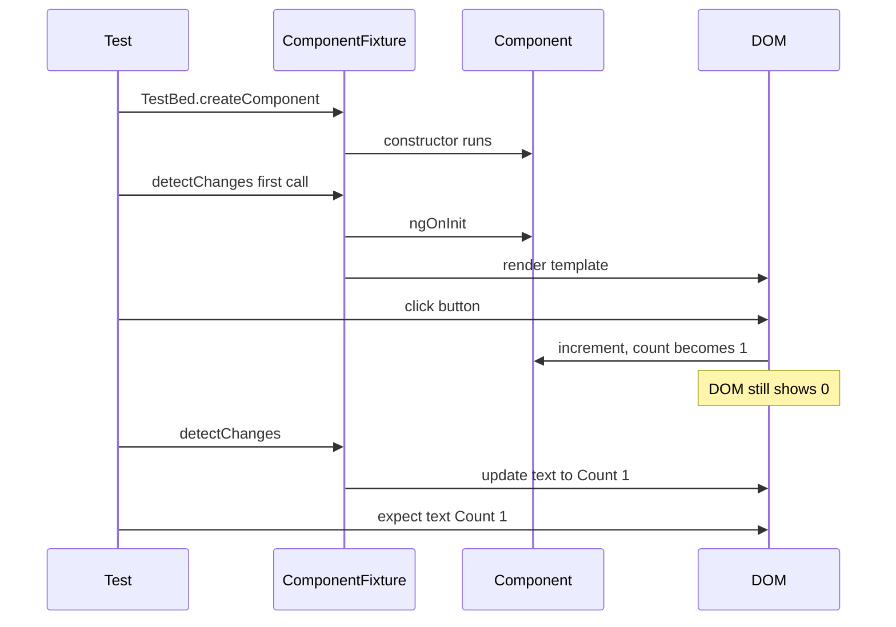

# Testing Angular applications

> In this document you will learn how to test an Angular 16 app: components, services, HTTP calls, pipes, directives, guards, interceptors, async code and NgRx, using TestBed, Jasmine and Karma (and Jest as an option). Interviewers use testing questions to see whether you write reliable code and whether you know the Angular testing tools beyond the generated spec file.

**Before this:** [Testing fundamentals](../10-testing-security-production/01-testing-fundamentals.md) · [Unit testing with Jest and Vitest](../10-testing-security-production/02-unit-testing-jest-and-vitest.md) · [Dependency injection](05-dependency-injection.md) · **Interview questions:** [jump to the interview section](#interview-questions)

## Table of contents

1. [What to test in an Angular app](#what-to-test-in-an-angular-app)
2. [Angular 16 testing tools](#angular-16-testing-tools)
3. [Jasmine basics in five minutes](#jasmine-basics-in-five-minutes)
4. [Testing a plain service without TestBed](#testing-a-plain-service-without-testbed)
5. [TestBed: the Angular testing module](#testbed-the-angular-testing-module)
6. [Component tests: ComponentFixture and detectChanges](#component-tests-componentfixture-and-detectchanges)
7. [Querying the DOM with DebugElement](#querying-the-dom-with-debugelement)
8. [Testing inputs and outputs](#testing-inputs-and-outputs)
9. [Mocking dependencies](#mocking-dependencies)
10. [Testing services that use HttpClient](#testing-services-that-use-httpclient)
11. [Async testing: fakeAsync, tick, flush and waitForAsync](#async-testing-fakeasync-tick-flush-and-waitforasync)
12. [Testing pipes and directives](#testing-pipes-and-directives)
13. [Testing guards and interceptors](#testing-guards-and-interceptors)
14. [Testing routed components](#testing-routed-components)
15. [Component harnesses](#component-harnesses)
16. [Testing NgRx with MockStore](#testing-ngrx-with-mockstore)
17. [End-to-end testing](#end-to-end-testing)
18. [Common mistakes](#common-mistakes)
19. [Best practices](#best-practices)
20. [How to explain this in an interview](#how-to-explain-this-in-an-interview)
21. [Interview questions](#interview-questions)
22. [Summary](#summary)
23. [References](#references)

---

## What to test in an Angular app

General testing ideas (the test pyramid, unit vs integration vs e2e, test doubles) are in [Testing fundamentals](../10-testing-security-production/01-testing-fundamentals.md). Here is how they map to Angular.

| Level | What it tests in Angular | Tools | How many |
| --- | --- | --- | --- |
| **Unit** | A service, pipe, reducer, selector, util function, guard | Jasmine/Jest, often without TestBed | Many |
| **Component / integration** | A component with its template, maybe with child components and real services | TestBed, ComponentFixture, harnesses | Many |
| **End-to-end (e2e)** | The real app in a real browser, often with a real or stubbed backend | Playwright, Cypress | Few, for critical journeys |

What is worth testing:

- **Business logic**: services, facades, reducers, selectors, validators, mapping functions. These give the best value for the effort.
- **Component behavior that users see**: "when I click Save with an empty name, an error appears", "the list shows three rows".
- **Integration points**: the HTTP call goes to the right URL with the right body; the interceptor adds the header; the guard redirects.
- **Edge cases and failures**: empty lists, server errors, slow responses.

What is usually not worth testing:

- Angular itself ("does `*ngIf` work?").
- Private methods directly. Test them through the public behavior.
- Exact CSS or HTML structure that changes often. Test meaning (text, roles, states), not markup details.

A good rule: **test behavior, not implementation**. A good test still passes after a refactor that does not change behavior.

## Angular 16 testing tools

| Tool | Role | Angular 16 status |
| --- | --- | --- |
| **Jasmine** | Test framework: `describe`, `it`, `expect`, spies | Default in new CLI projects |
| **Karma** | Test runner: starts a real browser (Chrome) and runs the tests in it | Default in new CLI projects. The Karma project itself was deprecated in 2023, and the Angular team announced a move to other runners |
| **Jest** | Alternative framework and runner, runs in Node with jsdom (a fake DOM) | CLI builder `@angular-devkit/build-angular:jest` is **experimental** in Angular 16. Many teams use the community `jest-preset-angular` instead |
| **TestBed** | Angular's testing utility: creates a testing module, compiles components, provides DI | Core part of `@angular/core/testing` |
| **HttpClientTestingModule / provideHttpClientTesting** | Fake HTTP backend you control | `@angular/common/http/testing` |
| **Component harnesses** | Stable API to interact with components (Angular CDK and Material) | `@angular/cdk/testing` |
| **Protractor** | Old e2e tool | Deprecated. The CLI no longer sets it up; use Playwright or Cypress |

Commands:

```bash
ng test                       # runs Karma in watch mode
ng test --no-watch --code-coverage   # single run with coverage report in coverage/
ng test --browsers=ChromeHeadless    # useful in CI
```

> **Newer Angular:** an experimental Web Test Runner builder arrived in 17.1. An experimental Vitest-based `@angular/build:unit-test` builder arrived in 20. In **21**, Vitest became the **default** for new projects and the unit-test builder became stable; Karma is still supported as an option, and the experimental Jest and Web Test Runner builders were announced for removal. Migration helpers followed: the `refactor-jasmine-vitest` schematic (21, stable in 22) and the `migrate-karma-to-vitest` update migration (22). TestBed itself works the same way with all runners. See [Angular 16 vs newer versions](16-angular-16-vs-newer-versions.md).

## Jasmine basics in five minutes

If you know Jest, Jasmine looks very similar. The main differences are spies.

```ts
describe('PriceCalculator', () => {        // a group of tests (a "suite")
  let calculator: PriceCalculator;

  beforeEach(() => {                        // runs before each test
    calculator = new PriceCalculator();
  });

  it('adds tax', () => {                    // one test (a "spec")
    expect(calculator.withTax(100, 0.2)).toBe(120);
  });

  it('never returns a negative price', () => {
    expect(calculator.withTax(-5, 0.2)).toBe(0);
  });
});
```

Common matchers: `toBe` (===), `toEqual` (deep equality), `toBeTrue()`, `toBeNull()`, `toContain`, `toBeGreaterThan`, `toThrowError`, `toHaveBeenCalled()`, `toHaveBeenCalledWith(...)`, `toHaveBeenCalledTimes(n)`.

**Spies** replace or watch functions:

```ts
// Watch a real method and replace its result
const spy = spyOn(service, 'getPrice').and.returnValue(42);

// Create a fake object with spy methods
const api = jasmine.createSpyObj<ProductsApi>('ProductsApi', ['getAll', 'save']);
api.getAll.and.returnValue(of([{ id: '1', name: 'Laptop' }]));

expect(api.save).toHaveBeenCalledWith({ id: '1', name: 'Laptop' });
```

| Jasmine | Jest equivalent |
| --- | --- |
| `spyOn(obj, 'm').and.returnValue(x)` | `jest.spyOn(obj, 'm').mockReturnValue(x)` |
| `jasmine.createSpyObj('Name', ['a', 'b'])` | `{ a: jest.fn(), b: jest.fn() }` |
| `spy.and.callFake(fn)` | `mock.mockImplementation(fn)` |
| `spy.calls.count()` | `mock.mock.calls.length` |
| `jasmine.any(Number)` | `expect.any(Number)` |

## Testing a plain service without TestBed

If a class has no Angular-specific behavior, create it with `new` and pass fakes. This is the fastest and simplest test.

```ts
// cart.service.ts
@Injectable({ providedIn: 'root' })
export class CartService {
  private items: CartItem[] = [];

  add(item: CartItem): void {
    const existing = this.items.find(i => i.id === item.id);
    this.items = existing
      ? this.items.map(i => (i.id === item.id ? { ...i, qty: i.qty + item.qty } : i))
      : [...this.items, item];
  }

  total(): number {
    return this.items.reduce((sum, i) => sum + i.price * i.qty, 0);
  }
}
```

```ts
// cart.service.spec.ts
describe('CartService', () => {
  let service: CartService;

  beforeEach(() => {
    service = new CartService();
  });

  it('starts empty', () => {
    expect(service.total()).toBe(0);
  });

  it('merges the same product', () => {
    service.add({ id: 'p1', price: 10, qty: 1 });
    service.add({ id: 'p1', price: 10, qty: 2 });
    expect(service.total()).toBe(30);
  });
});
```

If the service uses constructor injection, pass fakes to the constructor. If it uses the `inject()` function, you need an injection context, so use TestBed (next section) or `TestBed.runInInjectionContext`.

## TestBed: the Angular testing module

### What it is

**TestBed** creates a special Angular module for your test. You configure it like an `NgModule`: which components to declare or import, and which providers to use. Then you ask it to create components or inject services, with real Angular DI and template compilation.

```ts
import { TestBed } from '@angular/core/testing';

describe('PricingService', () => {
  let service: PricingService;

  beforeEach(() => {
    TestBed.configureTestingModule({
      providers: [
        PricingService,
        { provide: TaxRatesService, useValue: { rateFor: () => 0.2 } }, // a fake dependency
      ],
    });
    service = TestBed.inject(PricingService);
  });

  it('applies the tax rate', () => {
    expect(service.finalPrice(100, 'DE')).toBe(120);
  });
});
```

Main TestBed methods:

| Method | Purpose |
| --- | --- |
| `configureTestingModule({...})` | Set `declarations`, `imports`, `providers`, `schemas` for the test |
| `compileComponents()` | Compile components that use external `templateUrl`/`styleUrls` (async). Not needed with the Angular CLI, because the CLI compiles templates before tests run. New CLI 16 specs no longer generate this call, but you will see it in older code |
| `createComponent(Component)` | Create the component and return a `ComponentFixture` |
| `inject(Token)` | Get an instance from the test injector |
| `overrideComponent`, `overrideProvider`, `overrideModule` | Replace parts of a component or module for this test |
| `runInInjectionContext(fn)` | Run a function where `inject()` works (for functional guards, interceptors, resolvers) |
| `resetTestingModule()` | Called automatically between tests |

### NgModule components vs standalone components

```ts
// Component declared in an NgModule (non-standalone): declare it
TestBed.configureTestingModule({
  declarations: [OrdersTableComponent],
  imports: [CommonModule],
});

// Standalone component: import it
TestBed.configureTestingModule({
  imports: [OrdersTableComponent],
});
```

## Component tests: ComponentFixture and detectChanges

### The component we test

```ts
@Component({
  selector: 'app-counter',
  template: `
    <p class="count">Count: {{ count }}</p>
    <button type="button" class="increment" (click)="increment()">+</button>
    <p class="warning" *ngIf="count >= max">Maximum reached</p>
  `,
})
export class CounterComponent {
  @Input() max = 3;
  count = 0;

  increment(): void {
    if (this.count < this.max) this.count++;
  }
}
```

### The test

```ts
describe('CounterComponent', () => {
  let fixture: ComponentFixture<CounterComponent>;
  let component: CounterComponent;
  let el: HTMLElement;

  beforeEach(() => {
    TestBed.configureTestingModule({ declarations: [CounterComponent] });
    fixture = TestBed.createComponent(CounterComponent);
    component = fixture.componentInstance; // the class instance
    el = fixture.nativeElement;            // the host DOM element
    fixture.detectChanges();               // first change detection: runs ngOnInit and renders
  });

  it('shows the initial count', () => {
    expect(el.querySelector('.count')?.textContent).toContain('Count: 0');
  });

  it('increments when the button is clicked', () => {
    el.querySelector<HTMLButtonElement>('.increment')!.click();
    fixture.detectChanges(); // update the DOM after the state change
    expect(el.querySelector('.count')?.textContent).toContain('Count: 1');
  });

  it('shows a warning at the maximum', () => {
    component.max = 1;
    el.querySelector<HTMLButtonElement>('.increment')!.click();
    fixture.detectChanges();
    expect(el.querySelector('.warning')).not.toBeNull();
  });
});
```

### What `detectChanges()` does

**In tests, change detection does not run automatically** (unless you turn on auto detection). `fixture.detectChanges()` runs it once:

1. The **first** call runs `ngOnChanges` (only if inputs were set through the template or `setInput`), `ngOnInit`, `ngDoCheck`, renders the template, and runs the content and view hooks.
2. Later calls update the DOM with the latest component state and run `ngDoCheck`, `ngAfterContentChecked`, `ngAfterViewChecked`.
3. In development mode (tests run in dev mode), it also runs the "check no changes" pass, so `ExpressionChangedAfterItHasBeenCheckedError` can appear in tests.



Why manual? It gives you control: you can set inputs or mocks **before** `ngOnInit` runs, and you can check the DOM before and after.

Alternatives:

```ts
fixture.autoDetectChanges();  // run change detection automatically after async events (Zone.js)

// or for all tests in this module
TestBed.configureTestingModule({
  providers: [{ provide: ComponentFixtureAutoDetect, useValue: true }],
});
```

Even with auto detection, if you change a component property directly in the test (not through an event), you still need `detectChanges()`.

### The OnPush trap in tests

If the component uses `ChangeDetectionStrategy.OnPush`, changing an input property directly and calling `fixture.detectChanges()` may **not** update the view after the first render, because the host view does not see an input change:

```ts
// ❌ May not update an OnPush component after the first detectChanges
component.title = 'New title';
fixture.detectChanges();

// ✅ Correct: setInput marks the component like a real input change (ComponentRef.setInput, Angular 14.1+)
fixture.componentRef.setInput('title', 'New title');
fixture.detectChanges();
```

`setInput` also triggers `ngOnChanges` with a proper `SimpleChanges` object, which a direct property assignment does not.

## Querying the DOM with DebugElement

`fixture.nativeElement` is the real DOM element. `fixture.debugElement` is Angular's wrapper around it, with extra testing features.

```ts
import { By } from '@angular/platform-browser';

const button = fixture.debugElement.query(By.css('button.increment'));
const rows = fixture.debugElement.queryAll(By.css('tr.order-row'));
const childComponents = fixture.debugElement.queryAll(By.directive(OrderRowComponent));

// Trigger an Angular event handler (no real DOM event)
button.triggerEventHandler('click', null);

// Access a child component instance
const firstRow = childComponents[0].componentInstance as OrderRowComponent;

// Access the injector of an element
const service = button.injector.get(SomeService);
```

| `nativeElement` | `debugElement` |
| --- | --- |
| Real DOM API (`querySelector`, `click()`, `textContent`) | Angular API (`query(By.css)`, `By.directive`, `triggerEventHandler`, `componentInstance`, `injector`) |
| Close to what the user does | Can reach Angular internals (child component instances, injectors) |
| Works the same in any environment with a DOM | Works also on platforms without a real DOM |

Tips:

- `element.click()` dispatches a real DOM event, which runs bound handlers and also native behavior (like submitting a form). `triggerEventHandler` only calls the Angular handler and does not create a real event, so `$event` is whatever you pass.
- For inputs: set `input.value = 'abc'`, then `input.dispatchEvent(new Event('input'))`, then `fixture.detectChanges()`.
- Prefer stable selectors: test ids (`data-testid="save-button"`), roles or labels, not CSS classes used for styling.

## Testing inputs and outputs

### Testing directly on the component

```ts
@Component({
  selector: 'app-rating',
  template: `
    <button *ngFor="let star of stars; let i = index" type="button" class="star"
            [class.filled]="i < value" (click)="select(i + 1)" [attr.aria-label]="'Rate ' + (i + 1)">
      *
    </button>
  `,
  changeDetection: ChangeDetectionStrategy.OnPush,
})
export class RatingComponent {
  @Input() value = 0;
  @Output() valueChange = new EventEmitter<number>();
  stars = [1, 2, 3, 4, 5];

  select(value: number): void {
    this.valueChange.emit(value);
  }
}
```

```ts
describe('RatingComponent', () => {
  let fixture: ComponentFixture<RatingComponent>;

  beforeEach(() => {
    TestBed.configureTestingModule({ declarations: [RatingComponent] });
    fixture = TestBed.createComponent(RatingComponent);
  });

  it('fills stars up to the value', () => {
    fixture.componentRef.setInput('value', 3);
    fixture.detectChanges();
    const filled = fixture.nativeElement.querySelectorAll('.star.filled');
    expect(filled.length).toBe(3);
  });

  it('emits the selected value', () => {
    fixture.detectChanges();
    let emitted: number | undefined;
    fixture.componentInstance.valueChange.subscribe(v => (emitted = v));

    fixture.nativeElement.querySelectorAll('.star')[3].click();

    expect(emitted).toBe(4);
  });
});
```

### Testing with a host component

To test the component as a parent would use it (including template bindings and content projection), create a small test host:

```ts
@Component({
  template: `<app-rating [value]="rating" (valueChange)="rating = $event" />`,
})
class TestHostComponent {
  rating = 2;
}

it('works with two-way style binding from a parent', () => {
  TestBed.configureTestingModule({ declarations: [RatingComponent, TestHostComponent] });
  const hostFixture = TestBed.createComponent(TestHostComponent);
  hostFixture.detectChanges();

  hostFixture.nativeElement.querySelectorAll('.star')[4].click();
  hostFixture.detectChanges();

  expect(hostFixture.componentInstance.rating).toBe(5);
  expect(hostFixture.nativeElement.querySelectorAll('.star.filled').length).toBe(5);
});
```

## Mocking dependencies

### Why mock

A component test should test the component, not the backend or the whole app. You replace real dependencies with **test doubles** (fakes, stubs, spies) that you control.

### Option 1: `useValue` with a spy object (Jasmine)

```ts
describe('OrdersPageComponent', () => {
  let facade: jasmine.SpyObj<OrdersFacade>;

  beforeEach(() => {
    facade = jasmine.createSpyObj<OrdersFacade>('OrdersFacade', ['loadOrders'], {
      // properties (third argument): observables the template reads
      orders$: of([{ id: '1', number: 'A-1', total: 50 }]),
      loading$: of(false),
    });

    TestBed.configureTestingModule({
      declarations: [OrdersPageComponent],
      providers: [{ provide: OrdersFacade, useValue: facade }],
      schemas: [NO_ERRORS_SCHEMA], // see the warning below
    });
  });

  it('loads orders on init', () => {
    const fixture = TestBed.createComponent(OrdersPageComponent);
    fixture.detectChanges();
    expect(facade.loadOrders).toHaveBeenCalledTimes(1);
  });
});
```

### Option 2: with Jest

```ts
const facade = {
  loadOrders: jest.fn(),
  orders$: of([]),
  loading$: of(false),
};
TestBed.configureTestingModule({
  providers: [{ provide: OrdersFacade, useValue: facade }],
});
expect(facade.loadOrders).toHaveBeenCalled();
```

### Option 3: a fake class with `useClass`

```ts
class FakeAuthService implements Pick<AuthService, 'isLoggedIn' | 'currentUser$'> {
  isLoggedIn = () => true;
  currentUser$ = of({ id: 'u1', name: 'Asha', roles: ['admin'] });
}

providers: [{ provide: AuthService, useClass: FakeAuthService }];
```

### Mocking child components

When a component's template uses child components, you can:

1. **Import the real children** (an integration test). Most realistic, but you also need their dependencies.
2. **Declare stub components** with the same selector and inputs:

   ```ts
   @Component({ selector: 'app-orders-table', template: '' })
   class OrdersTableStubComponent {
     @Input() orders: unknown[] = [];
   }
   ```

3. **Use `NO_ERRORS_SCHEMA` or `CUSTOM_ELEMENTS_SCHEMA`** so Angular ignores unknown elements. Quick, but dangerous: it also hides typos in element names and bindings. Prefer stubs.

For standalone components, replace a child import with `TestBed.overrideComponent(ParentComponent, { remove: { imports: [RealChild] }, add: { imports: [ChildStub] } })`.

## Testing services that use HttpClient

### The tools

`HttpClientTestingModule` (or `provideHttpClient()` + `provideHttpClientTesting()`) replaces the real HTTP backend with a fake one. `HttpTestingController` lets you:

- assert that a request was made (`expectOne`, `match`, `expectNone`),
- check its method, URL, headers and body,
- answer it with data (`flush`) or an error,
- verify that no unexpected requests are left (`verify`).

### Example service

```ts
@Injectable({ providedIn: 'root' })
export class ProductsApiService {
  private http = inject(HttpClient);

  search(term: string): Observable<Product[]> {
    return this.http.get<Product[]>('/api/products', { params: { q: term } });
  }

  create(product: NewProduct): Observable<Product> {
    return this.http.post<Product>('/api/products', product);
  }
}
```

### Test

```ts
import { HttpClientTestingModule, HttpTestingController } from '@angular/common/http/testing';

describe('ProductsApiService', () => {
  let service: ProductsApiService;
  let httpMock: HttpTestingController;

  beforeEach(() => {
    TestBed.configureTestingModule({
      imports: [HttpClientTestingModule],
      // Standalone style (Angular 15+): providers: [provideHttpClient(), provideHttpClientTesting()]
    });
    service = TestBed.inject(ProductsApiService);
    httpMock = TestBed.inject(HttpTestingController);
  });

  afterEach(() => {
    httpMock.verify(); // fails if a request was made but not handled
  });

  it('searches with the query param', () => {
    let result: Product[] | undefined;
    service.search('lap').subscribe(products => (result = products));

    const req = httpMock.expectOne(r => r.url === '/api/products' && r.params.get('q') === 'lap');
    expect(req.request.method).toBe('GET');

    req.flush([{ id: '1', name: 'Laptop', price: 999 }]); // the response arrives now

    expect(result).toEqual([{ id: '1', name: 'Laptop', price: 999 }]);
  });

  it('posts the new product', () => {
    service.create({ name: 'Mouse', price: 20 }).subscribe();

    const req = httpMock.expectOne('/api/products');
    expect(req.request.method).toBe('POST');
    expect(req.request.body).toEqual({ name: 'Mouse', price: 20 });
    req.flush({ id: '2', name: 'Mouse', price: 20 });
  });

  it('passes server errors to the caller', () => {
    let status: number | undefined;
    service.search('x').subscribe({ error: (e: HttpErrorResponse) => (status = e.status) });

    httpMock.expectOne(r => r.url === '/api/products').flush('Server error', {
      status: 500,
      statusText: 'Internal Server Error',
    });

    expect(status).toBe(500);
  });

  it('handles network errors', () => {
    let error: HttpErrorResponse | undefined;
    service.search('x').subscribe({ error: e => (error = e) });
    httpMock.expectOne(r => r.url === '/api/products').error(new ProgressEvent('error'));
    expect(error?.status).toBe(0);
  });
});
```

Step by step for the first test:

1. `service.search('lap').subscribe(...)` makes the request. Nothing is sent to a real server; the testing backend holds it.
2. `expectOne` finds exactly one matching request (it fails if there are zero or more than one).
3. `flush(data)` answers the request **synchronously**. The `subscribe` callback runs immediately, so `result` is set on the next line.
4. `verify()` in `afterEach` makes sure no extra request was made.

## Async testing: fakeAsync, tick, flush and waitForAsync

Async code (timers, promises, debounced streams) is a common source of flaky tests. Angular gives you tools based on Zone.js to control time.

### fakeAsync and tick

`fakeAsync` runs the test in a special zone where **time is fake**. Timers do not really wait. You move time forward with `tick(ms)`.

```ts
@Component({
  selector: 'app-search',
  template: `<input type="search" (input)="term$.next($any($event.target).value)" />
             <li *ngFor="let p of results">{{ p.name }}</li>`,
})
export class SearchComponent implements OnInit {
  private api = inject(ProductsApiService);
  term$ = new Subject<string>();
  results: Product[] = [];

  ngOnInit(): void {
    this.term$
      .pipe(debounceTime(300), distinctUntilChanged(), switchMap(t => this.api.search(t)))
      .subscribe(r => (this.results = r));
  }
}
```

```ts
it('searches 300 ms after the user stops typing', fakeAsync(() => {
  const api = TestBed.inject(ProductsApiService) as jasmine.SpyObj<ProductsApiService>;
  api.search.and.returnValue(of([{ id: '1', name: 'Laptop', price: 1 }]));
  const fixture = TestBed.createComponent(SearchComponent);
  fixture.detectChanges();

  const input: HTMLInputElement = fixture.nativeElement.querySelector('input');
  input.value = 'lap';
  input.dispatchEvent(new Event('input'));

  tick(299);
  expect(api.search).not.toHaveBeenCalled(); // not yet

  tick(1);
  expect(api.search).toHaveBeenCalledOnceWith('lap');

  fixture.detectChanges();
  expect(fixture.nativeElement.textContent).toContain('Laptop');
}));
```

(This assumes `ProductsApiService` was provided as a spy object with `jasmine.createSpyObj('ProductsApiService', ['search'])` in `beforeEach`.)

### The helpers

| Helper | What it does |
| --- | --- |
| `fakeAsync(fn)` | Runs the test with fake timers. At the end, it throws if timers are still pending ("1 timer(s) still in the queue") |
| `tick(ms)` | Moves fake time forward by `ms` and runs timers that are due, plus pending microtasks |
| `flush()` | Runs all pending timers until the queue is empty (moves time as far as needed) |
| `flushMicrotasks()` | Runs pending microtasks (resolved promises) without moving time |
| `discardPeriodicTasks()` | Throws away remaining `setInterval` timers so the test can finish |
| `waitForAsync(fn)` | Runs the test in a zone that waits for all **real** async work to finish. Use with `fixture.whenStable()` |
| `fixture.whenStable()` | A Promise that resolves when all pending async tasks in the zone are done |

### waitForAsync and whenStable

Use this when you cannot fake time, for example a real Promise from a library:

```ts
it('shows the user name after loading', waitForAsync(() => {
  const fixture = TestBed.createComponent(ProfileComponent); // ngOnInit awaits a Promise
  fixture.detectChanges();

  fixture.whenStable().then(() => {
    fixture.detectChanges();
    expect(fixture.nativeElement.textContent).toContain('Asha');
  });
}));
```

**Which one to choose?** Prefer `fakeAsync` with `tick`: it is synchronous, fast and deterministic. Use `waitForAsync` only when fake time does not work. For pure RxJS logic outside components, the RxJS `TestScheduler` with marble tests is another good option (see [RxJS](09-rxjs.md)).

Limitations: `fakeAsync` cannot control real `XMLHttpRequest` calls (use `HttpTestingController` instead) and requires `zone.js/testing` (included by the CLI test setup).

> **Newer Angular:** `fakeAsync` depends on Zone.js. In zoneless apps and with the Vitest runner (default in 21), teams use Vitest fake timers or `await fixture.whenStable()`. For apps that still use Zone.js, `zone.js/testing` gained Vitest support in 2026 (zone.js 0.16.2), and the CLI 22 Vitest runner detects Zone.js at runtime, so existing `fakeAsync` tests can keep working.

## Testing pipes and directives

### Pipes: just call `transform`

A pure pipe is a class with a `transform` method. Test it like a function.

```ts
@Pipe({ name: 'fileSize', standalone: true })
export class FileSizePipe implements PipeTransform {
  transform(bytes: number | null | undefined): string {
    if (bytes == null || bytes < 0) return '';
    if (bytes < 1024) return `${bytes} B`;
    if (bytes < 1024 * 1024) return `${(bytes / 1024).toFixed(1)} KB`;
    return `${(bytes / (1024 * 1024)).toFixed(1)} MB`;
  }
}
```

```ts
describe('FileSizePipe', () => {
  const pipe = new FileSizePipe();

  it('formats bytes, kilobytes and megabytes', () => {
    expect(pipe.transform(500)).toBe('500 B');
    expect(pipe.transform(2048)).toBe('2.0 KB');
    expect(pipe.transform(5 * 1024 * 1024)).toBe('5.0 MB');
  });

  it('returns an empty string for missing values', () => {
    expect(pipe.transform(null)).toBe('');
    expect(pipe.transform(-1)).toBe('');
  });
});
```

If the pipe injects services, create it inside `TestBed.runInInjectionContext(() => new MyPipe())` or provide fakes through its constructor.

### Directives: test through a host component

A directive has no template of its own, so test it on a small host template:

```ts
@Directive({ selector: '[appHighlightOverdue]', standalone: true })
export class HighlightOverdueDirective implements OnChanges {
  @Input('appHighlightOverdue') dueDate!: Date;
  @HostBinding('class.overdue') isOverdue = false;

  ngOnChanges(): void {
    this.isOverdue = this.dueDate.getTime() < Date.now();
  }
}
```

```ts
@Component({
  standalone: true,
  imports: [HighlightOverdueDirective],
  template: `
    <span id="past" [appHighlightOverdue]="past">Past</span>
    <span id="future" [appHighlightOverdue]="future">Future</span>
  `,
})
class HostComponent {
  past = new Date(Date.now() - 86_400_000);
  future = new Date(Date.now() + 86_400_000);
}

it('adds the overdue class only for past dates', () => {
  const fixture = TestBed.configureTestingModule({ imports: [HostComponent] }).createComponent(HostComponent);
  fixture.detectChanges();
  expect(fixture.nativeElement.querySelector('#past').classList).toContain('overdue');
  expect(fixture.nativeElement.querySelector('#future').classList).not.toContain('overdue');
});
```

For structural directives (`*appHasRole`), the host template uses the directive, and the test checks whether the element exists in the DOM for different fake user roles.

## Testing guards and interceptors

### Functional guards with `TestBed.runInInjectionContext`

Functional guards use `inject()`, so they must run in an injection context. `TestBed.runInInjectionContext` provides one.

```ts
// auth.guard.ts
export const authGuard: CanActivateFn = (_route, state) => {
  const auth = inject(AuthService);
  const router = inject(Router);
  return auth.isLoggedIn() ? true : router.createUrlTree(['/login'], { queryParams: { returnUrl: state.url } });
};
```

```ts
describe('authGuard', () => {
  let auth: jasmine.SpyObj<AuthService>;

  beforeEach(() => {
    auth = jasmine.createSpyObj<AuthService>('AuthService', ['isLoggedIn']);
    TestBed.configureTestingModule({
      providers: [{ provide: AuthService, useValue: auth }, provideRouter([])],
    });
  });

  const runGuard = (url: string) =>
    TestBed.runInInjectionContext(() =>
      authGuard({} as ActivatedRouteSnapshot, { url } as RouterStateSnapshot),
    );

  it('allows logged-in users', () => {
    auth.isLoggedIn.and.returnValue(true);
    expect(runGuard('/orders')).toBeTrue();
  });

  it('redirects others to login with returnUrl', () => {
    auth.isLoggedIn.and.returnValue(false);
    const result = runGuard('/orders') as UrlTree;
    expect(TestBed.inject(Router).serializeUrl(result)).toBe('/login?returnUrl=%2Forders');
  });
});
```

Class-based guards (`implements CanActivate`) are tested by injecting the class with `TestBed.inject(AuthGuard)` and calling `canActivate(...)`.

### Interceptors with HttpTestingController

Register the interceptor and the testing backend together, make a request through `HttpClient`, and inspect the request that reached the backend.

```ts
// Functional interceptor (Angular 15+)
export const authInterceptor: HttpInterceptorFn = (req, next) => {
  const token = inject(AuthService).getToken();
  // Trailing slash: '/api' alone would also match '/api-public/...' or '/apidocs'
  if (!token || !req.url.startsWith('/api/')) return next(req);
  return next(req.clone({ setHeaders: { Authorization: `Bearer ${token}` } }));
};
```

```ts
describe('authInterceptor', () => {
  let http: HttpClient;
  let httpMock: HttpTestingController;

  beforeEach(() => {
    TestBed.configureTestingModule({
      providers: [
        provideHttpClient(withInterceptors([authInterceptor])),
        provideHttpClientTesting(), // must come after provideHttpClient
        { provide: AuthService, useValue: { getToken: () => 'abc123' } },
      ],
    });
    http = TestBed.inject(HttpClient);
    httpMock = TestBed.inject(HttpTestingController);
  });

  afterEach(() => httpMock.verify());

  it('adds the token to our API', () => {
    http.get('/api/orders').subscribe();
    const req = httpMock.expectOne('/api/orders');
    expect(req.request.headers.get('Authorization')).toBe('Bearer abc123');
    req.flush([]);
  });

  it('does not send the token to other hosts', () => {
    http.get('https://cdn.example.com/data.json').subscribe();
    const req = httpMock.expectOne('https://cdn.example.com/data.json');
    expect(req.request.headers.has('Authorization')).toBeFalse();
    req.flush({});
  });
});
```

For a **class-based** interceptor in an NgModule app, use `imports: [HttpClientTestingModule]` and `providers: [{ provide: HTTP_INTERCEPTORS, useClass: AuthInterceptor, multi: true }]`.

## Testing routed components

`RouterTestingHarness` (Angular 15.2+) navigates in a test and returns the activated component. In Angular 16, prefer it with `provideRouter` over the older `RouterTestingModule`.

```ts
it('shows the order from the URL', async () => {
  TestBed.configureTestingModule({
    providers: [
      provideRouter([{ path: 'orders/:id', component: OrderDetailsComponent }]),
      { provide: OrdersApiService, useValue: { getById: (id: string) => of({ id, number: 'A-' + id }) } },
    ],
  });

  const harness = await RouterTestingHarness.create();
  const component = await harness.navigateByUrl('/orders/42', OrderDetailsComponent);

  expect(component).toBeTruthy();
  expect(harness.routeNativeElement?.textContent).toContain('A-42');
});
```

Alternatively, for unit tests, provide a fake `ActivatedRoute`:

```ts
providers: [{ provide: ActivatedRoute, useValue: { paramMap: of(convertToParamMap({ id: '42' })) } }];
```

## Component harnesses

### What they are

A **component harness** is a class that knows how to interact with a component the way a user would: "click this button", "select this option", "get the value of this input". The Angular CDK provides the infrastructure (`@angular/cdk/testing`), and Angular Material ships harnesses for all its components.

### Why they exist

Without harnesses, your test depends on the component's internal DOM:

```ts
// ❌ Fragile: depends on Material's internal CSS classes, breaks when the library changes
fixture.nativeElement.querySelector('.mat-mdc-select-trigger').click();
```

With harnesses:

```ts
// ✅ Stable: uses the public testing API
import { TestbedHarnessEnvironment } from '@angular/cdk/testing/testbed';
import { MatSelectHarness } from '@angular/material/select/testing';
import { MatButtonHarness } from '@angular/material/button/testing';

it('filters by status', async () => {
  const fixture = TestBed.createComponent(OrdersFilterComponent);
  const loader = TestbedHarnessEnvironment.loader(fixture);

  const select = await loader.getHarness(MatSelectHarness.with({ selector: '[data-testid=status]' }));
  await select.open();
  await select.clickOptions({ text: 'Shipped' });

  const apply = await loader.getHarness(MatButtonHarness.with({ text: 'Apply' }));
  await apply.click();

  expect(fixture.componentInstance.status).toBe('shipped');
});
```

Benefits:

- Tests read like user actions.
- When the component's internal DOM changes, only the harness changes, not hundreds of tests.
- Harnesses call `detectChanges` and wait for stability for you (that is why their methods are `async`).
- The same harness can run in unit tests (TestBed) and in some e2e environments.

You can write your own harness for your design system components by extending `ComponentHarness`:

```ts
export class DsButtonHarness extends ComponentHarness {
  static hostSelector = 'ds-button';
  private button = this.locatorFor('button');

  async click(): Promise<void> {
    return (await this.button()).click();
  }

  async isDisabled(): Promise<boolean> {
    return (await this.button()).getProperty<boolean>('disabled');
  }
}
```

## Testing NgRx with MockStore

Reducers, selectors and effects are tested as pure units; see [State management and NgRx](11-state-management-and-ngrx.md#testing-reducers-selectors-and-effects). For **components that use the store**, use `MockStore` from `@ngrx/store/testing`.

```ts
import { MockStore, provideMockStore } from '@ngrx/store/testing';

describe('ProductsPageComponent', () => {
  let store: MockStore;
  let fixture: ComponentFixture<ProductsPageComponent>;

  beforeEach(() => {
    TestBed.configureTestingModule({
      declarations: [ProductsPageComponent],
      providers: [
        provideMockStore({
          selectors: [
            { selector: productsFeature.selectVisibleProducts, value: [{ id: '1', name: 'Laptop', price: 999 }] },
            { selector: productsFeature.selectLoading, value: false },
          ],
        }),
      ],
    });
    store = TestBed.inject(MockStore);
    spyOn(store, 'dispatch');
    fixture = TestBed.createComponent(ProductsPageComponent);
    fixture.detectChanges();
  });

  it('dispatches opened on init', () => {
    expect(store.dispatch).toHaveBeenCalledWith(ProductsPageActions.opened());
  });

  it('shows a spinner while loading', () => {
    store.overrideSelector(productsFeature.selectLoading, true);
    store.refreshState(); // re-emit selectors with the overridden values
    fixture.detectChanges();
    expect(fixture.nativeElement.querySelector('app-spinner')).not.toBeNull();
  });
});
```

`MockStore` does not run reducers or effects. You control exactly what the selectors return, so the component test stays focused on the component.

## End-to-end testing

### Protractor is gone

Angular projects used **Protractor** for e2e tests for years. It was deprecated (Angular 12 stopped generating it for new projects, and the project reached end of life in 2023). In Angular 16, `ng e2e` asks you which e2e package to add (for example Cypress, Playwright, WebdriverIO or Nightwatch through community builders).

### Playwright or Cypress

Both run the real app in a real browser and are the usual choices today. The details, including the Playwright API, auto-waiting, fixtures and mocking the network, are in [Component and e2e testing with Playwright](../10-testing-security-production/04-component-and-e2e-testing-playwright.md).

A short Playwright example for an Angular app:

```ts
import { test, expect } from '@playwright/test';

test('user can add a product to the cart', async ({ page }) => {
  await page.goto('/products');
  await page.getByRole('searchbox', { name: 'Search products' }).fill('laptop');
  await page.getByRole('button', { name: 'Add Laptop to cart' }).click();
  await expect(page.getByTestId('cart-count')).toHaveText('1');
});
```

What to cover with e2e tests: a few critical journeys (login, checkout, creating the main business object), smoke tests after deployment, and flows that cross many components and the router. Keep them few, because they are slower and more fragile than unit tests.

## Common mistakes

1. **Forgetting `fixture.detectChanges()`** after changing state, then wondering why the DOM did not update.
2. **Changing an OnPush component's input directly** instead of using `fixture.componentRef.setInput()`.
3. **Using `NO_ERRORS_SCHEMA` everywhere.** It hides typos in element names, inputs and outputs. Prefer stubs or real imports.
4. **Not calling `httpMock.verify()`**, so unexpected or missing requests go unnoticed.
5. **Real timers in tests** (`setTimeout` with `done`), leading to slow and flaky tests. Use `fakeAsync` and `tick`.
6. **Pending timers at the end of `fakeAsync`** ("periodic timers still in the queue"). Use `discardPeriodicTasks()` or unsubscribe/destroy the component (`fixture.destroy()`).
7. **Testing implementation details** (private methods, internal variables, exact CSS classes). Tests break on every refactor.
8. **Huge test setups copied into every spec.** Extract helpers or builder functions.
9. **Over-mocking**: mocking so much that the test only checks that mocks call mocks. Some tests should use real collaborators (for example, real pipes and presentational children).
10. **Selecting elements by styling classes** (`.btn-primary`). Prefer roles, labels or `data-testid`.
11. **Ignoring the error and empty paths.** Most production bugs are in those paths.
12. **Chasing 100% coverage** with tests that assert nothing meaningful.

## Best practices

- **Test behavior through the public API and the DOM.** Reason: tests survive refactoring and describe what users see.
- **Use the lightest tool that works**: plain `new` for pure classes, TestBed when you need DI or templates, e2e only for critical journeys. Reason: fast feedback.
- **Mock at the boundaries** (HTTP, facades, store, browser APIs) and keep the code under test real. Reason: meaningful tests that are still isolated.
- **Use `HttpTestingController` and always `verify()`.** Reason: precise control and no hidden requests.
- **Control time with `fakeAsync` / `tick`.** Reason: fast, deterministic async tests.
- **Use `setInput` for inputs**, especially with OnPush. Reason: matches real Angular behavior, triggers `ngOnChanges`.
- **Use harnesses for Material and design system components.** Reason: stable tests that do not depend on internal DOM.
- **Test functional guards, resolvers and interceptors in an injection context** (`TestBed.runInInjectionContext`, `provideHttpClient(withInterceptors(...))`). Reason: they use `inject()`.
- **Run tests in CI headless with coverage**, and treat coverage as a signal. Reason: catch regressions early without gaming numbers.
- **Name tests as sentences** (`it('shows an error when the name is empty')`). Reason: failures explain themselves.

## How to explain this in an interview

1. **Define it:** "Angular testing uses TestBed to create a testing module with real dependency injection and template compilation, so I can test components and services in isolation or together."
2. **Why it exists:** "Components depend on DI, templates and change detection. TestBed gives me those, while letting me replace dependencies like HTTP or the store with fakes."
3. **How it works:** "I configure the module with the component and fake providers, create a ComponentFixture, call detectChanges to run ngOnInit and render, interact with the DOM, call detectChanges again, and assert on the DOM or on spies. For HTTP I use HttpTestingController to assert requests and flush responses. For timers and debounced streams I use fakeAsync and tick."
4. **Small example:** "For a search component, I type into the input, `tick(300)` for the debounce, check that the API spy was called with the term, then detectChanges and check that the results appear."
5. **Where it is useful:** "Services, reducers and pipes get fast unit tests; components get TestBed tests focused on user-visible behavior; a few Playwright tests cover login and checkout end to end."
6. **Trade-offs / gotchas:** "Too much mocking makes tests meaningless, NO_ERRORS_SCHEMA hides mistakes, OnPush components need setInput, and fakeAsync depends on Zone.js. In Angular 16 the default runner is Karma with Jasmine; Jest is experimental, and newer Angular moved to Vitest by default."

---

## Interview questions

### Q1. What is TestBed and why do we need it?

**What the interviewer is checking:** understanding of the Angular testing model.

**Short spoken answer (30–60 seconds):**
> TestBed is Angular's main testing utility. It creates a dynamic testing module, like an NgModule just for the test, where I declare or import the component and list providers. It gives me real dependency injection and compiles templates, so I can create a component with `TestBed.createComponent` and get a ComponentFixture to control change detection and access the DOM, or get services with `TestBed.inject`. The key benefit is that I can replace real dependencies with fakes through providers, for example a spy object instead of the real API service. For plain classes without Angular features, I skip TestBed and just use `new`, which is faster.

**Follow-up questions:**
- **Do you still need `compileComponents()`?** — Not with the Angular CLI, which compiles templates before tests run. It is needed only in setups that compile external templates at test time.
- **How do you override a provider for one test?** — `TestBed.overrideProvider(Token, { useValue: fake })` before creating the component, or configure the module differently in that `describe`.
- **What does `TestBed.runInInjectionContext` do?** — Runs a function inside the test injector's context so `inject()` works. Used for functional guards, resolvers and interceptors.

**Common mistakes:** Thinking TestBed is required for every test.

**Where this is used in real projects:** Every Angular component and service spec.

### Q2. What does `fixture.detectChanges()` do, and why is it not automatic?

**What the interviewer is checking:** change detection in tests.

**Short spoken answer (30–60 seconds):**
> It runs Angular change detection once for the component under test. The first call runs ngOnInit and the first render, plus the other lifecycle hooks, and later calls update the DOM with the current component state. It is manual by default so I control timing: I can set up inputs and mocks before ngOnInit runs, and check the DOM before and after an action. Because tests run in dev mode, it also runs the check-no-changes pass, so ExpressionChangedAfterItHasBeenChecked errors show up in tests. If I want automatic updates after async events, I can use `fixture.autoDetectChanges()` or the ComponentFixtureAutoDetect provider, but direct property changes still need a manual call.

**Follow-up questions:**
- **Why does my OnPush component not update after I set a property and call detectChanges?** — The host does not see an input change, so the OnPush view is not marked dirty. Use `fixture.componentRef.setInput('name', value)`.
- **When is the constructor called?** — In `TestBed.createComponent`, before the first `detectChanges`.

**Common mistakes:** Calling `detectChanges` in `beforeEach` before setting inputs that `ngOnInit` needs.

**Where this is used in real projects:** Every component test.

### Q3. How do you test a service that calls HttpClient?

**What the interviewer is checking:** practical use of `HttpTestingController`.

**Short spoken answer (30–60 seconds):**
> I configure TestBed with HttpClientTestingModule, or `provideHttpClient()` plus `provideHttpClientTesting()` in standalone style. Then I inject the service and HttpTestingController. In the test I call the service method and subscribe. Then I use `expectOne` with the URL or a matcher function to get the pending request, assert the method, params, headers and body, and answer it with `flush(data)` or with an error status. Flush is synchronous, so I can assert the result right after. In afterEach I call `verify()` to make sure there are no unexpected requests left.

**Code:** see [Testing services that use HttpClient](#testing-services-that-use-httpclient).

**Follow-up questions:**
- **How do you simulate a network error?** — `req.error(new ProgressEvent('error'))`, which produces an `HttpErrorResponse` with status 0.
- **How do you test a retry?** — With `retry(2)`, each retry creates a new request, so you `expectOne` and fail it three times (or use `match`), then check the final error.
- **Why not mock `HttpClient` with a spy?** — You can, but HttpTestingController also checks the real request construction (params, headers, body serialization) and works with interceptors.

**Common mistakes:** Forgetting to subscribe (no subscription means no request, because HttpClient observables are cold). Forgetting `verify()`.

**Where this is used in real projects:** API service layers and interceptors.

### Q4. Explain fakeAsync, tick, flush and waitForAsync.

**What the interviewer is checking:** async testing control.

**Short spoken answer (30–60 seconds):**
> fakeAsync runs the test in a Zone.js zone with fake time. Timers like setTimeout, setInterval and RxJS debounceTime don't really wait. `tick(ms)` moves time forward and runs timers that are due, plus pending microtasks. `flush()` runs all remaining timers until the queue is empty, and `flushMicrotasks()` only resolves pending promises. At the end, fakeAsync fails if timers are still pending, which helps find leaks; `discardPeriodicTasks()` clears intervals. waitForAsync is different: it runs with real time and waits for all async work, and I use it with `fixture.whenStable()` when I can't fake time. I prefer fakeAsync because it's fast and deterministic.

**Follow-up questions:**
- **Can fakeAsync control an HTTP request?** — Not a real one. Use HttpTestingController, whose `flush` is synchronous.
- **What error do you get with an unfinished interval?** — "1 periodic timer(s) still in the queue". Unsubscribe, destroy the fixture, or call `discardPeriodicTasks()`.
- **How do you test RxJS timing without Angular?** — RxJS `TestScheduler` with marble diagrams.

**Common mistakes:** Using real `setTimeout` with `done`, making tests slow and flaky.

**Where this is used in real projects:** Debounced search, autosave, polling, toasts that disappear.

### Q5. What will this test do, and why?

```ts
it('shows the title', () => {
  const fixture = TestBed.createComponent(TitleComponent); // template: <h1>{{ title }}</h1>, title = 'Orders'
  expect(fixture.nativeElement.querySelector('h1').textContent).toBe('Orders');
});
```

**What the interviewer is checking:** the most common TestBed mistake.

**Short spoken answer (30–60 seconds):**
> It fails. `createComponent` creates the component and its DOM, but change detection has not run yet, so the interpolation is not rendered and the h1 text is an empty string. I need to call `fixture.detectChanges()` before the expect. After that, Angular renders the binding and the text is "Orders".

**Answer:** The assertion fails: expected `''` to be `'Orders'`. Add `fixture.detectChanges();` after `createComponent`.

**Follow-up questions:**
- **Why does the `h1` exist if change detection did not run?** — `createComponent` already creates the component's DOM elements. Only the bindings (the text `{{ title }}`) are filled in by change detection.
- **Would `fixture.autoDetectChanges()` fix it?** — Yes. Calling it runs a first change detection right away, and then runs it again after async events.

### Q6. How do you mock dependencies in Angular tests? What are the options?

**What the interviewer is checking:** whether you know the DI-based mocking options and when each fits.

**Short spoken answer (30–60 seconds):**
> I replace them through providers. The most common is `{ provide: RealService, useValue: fake }`, where the fake is a Jasmine spy object from `jasmine.createSpyObj`, or an object with `jest.fn()` functions in Jest. I can also use `useClass` with a hand-written fake class when the fake needs behavior. For HTTP I don't mock the service, I use HttpTestingController. For the NgRx store I use `provideMockStore`. For child components I prefer stub components with the same selector and inputs; NO_ERRORS_SCHEMA works but hides mistakes. I try to mock only boundaries, like HTTP, the store or browser APIs, and keep the logic under test real.

**Follow-up questions:**
- **How do you mock a property, like an observable on a facade?** — `jasmine.createSpyObj('Facade', ['load'], { orders$: of([]) })` (the third argument defines properties), or a plain object.
- **How do you replace a child component in a standalone component test?** — `TestBed.overrideComponent(Parent, { remove: { imports: [Child] }, add: { imports: [ChildStub] } })`.

**Common mistakes:** Mocking everything, including the code under test.

### Q7. How do you test a functional route guard?

**What the interviewer is checking:** whether you know that functional guards need an injection context in tests.

**Short spoken answer (30–60 seconds):**
> A functional guard is a function that uses `inject()`, so it needs an injection context. I configure TestBed with fake providers, for example a fake AuthService and `provideRouter([])`, and then call the guard inside `TestBed.runInInjectionContext(() => authGuard(route, state))`, passing simple route and state objects. Then I assert the result: `true` for allowed users, or a UrlTree to the login page for others, which I can check with `router.serializeUrl`. If the guard returns an observable, I subscribe or use `firstValueFrom`. For class-based guards I just inject the class and call `canActivate`.

**Code:** see [Functional guards with TestBed.runInInjectionContext](#functional-guards-with-testbedrunininjectioncontext).

**Follow-up questions:**
- **What happens if you call the guard without `runInInjectionContext`?** — `inject()` throws error NG0203: "inject() must be called from an injection context".
- **How do you test the guard together with real routing?** — Use `RouterTestingHarness` with `provideRouter` and a route that has the guard, navigate, and check which component or URL you end up on.

### Q8. How do you test an HTTP interceptor?

**Short answer:** Register it with the real `HttpClient` and the testing backend: `provideHttpClient(withInterceptors([authInterceptor]))` followed by `provideHttpClientTesting()` (or for class interceptors, `HttpClientTestingModule` plus `{ provide: HTTP_INTERCEPTORS, useClass: X, multi: true }`). Make a request with `HttpClient`, get it with `httpMock.expectOne(url)`, and assert what the interceptor changed (headers, URL) or how it reacts to `flush` with an error status (for example, a 401 triggers logout or refresh). Test both the "should modify" and the "should not modify" cases, like not sending the token to third-party hosts.

### Q9. What are component harnesses and why use them?

**What the interviewer is checking:** whether you know how to write tests that survive library upgrades.

**Short spoken answer (30–60 seconds):**
> Harnesses are classes from the Angular CDK testing package that interact with a component through a stable, user-level API, like `select.clickOptions({ text: 'Shipped' })` or `button.click()`, instead of querying internal DOM and CSS classes. Angular Material ships harnesses for all its components, and I can write my own for design system components by extending ComponentHarness. Tests become more readable and much less fragile: if Material changes its internal DOM in an upgrade, the harness is updated, not my tests. Harness methods are async because they run change detection and wait for the component to be stable.

**Follow-up questions:**
- **How do you get a harness in a test?** — `const loader = TestbedHarnessEnvironment.loader(fixture);` then `await loader.getHarness(MatButtonHarness.with({ text: 'Save' }))`.
- **Why must harness tests be `async`?** — Every harness method returns a Promise, because it runs change detection and waits for the component to become stable.

**Common mistakes:** Querying `.mat-mdc-*` classes directly in tests.

### Q10. How do you test a component that reads from the NgRx store?

**Short answer:** Use `provideMockStore` with initial state or selector overrides, inject `MockStore`, spy on `dispatch`, and test the component: it dispatches the right actions (for example `opened` on init) and renders what selectors return. Change selector values with `store.overrideSelector(selector, value)` and `store.refreshState()`, then `detectChanges`. Reducers, selectors and effects are tested separately as pure units.

### Q11. What changed in Angular testing after version 16?

**What the interviewer is checking:** version awareness.

**Short spoken answer (30–60 seconds):**
> In Angular 16 the default is Jasmine with Karma, and Jest support through the CLI builder is experimental. Karma itself was deprecated, so the Angular team explored new runners: Web Test Runner arrived experimentally in 17.1, and in 20 there was an experimental Vitest-based unit-test builder. In 21 Vitest became the default test runner for new projects and the unit-test builder became stable; Karma is still supported, and the experimental Jest and Web Test Runner builders were announced for removal. Also, zoneless became the default for new apps in 21, so generated tests use `await fixture.whenStable()` instead of relying on Zone.js. TestBed, HttpTestingController and harnesses stay the same, so most test knowledge carries over.

**Common mistakes:** Claiming Jest was the default in Angular 16.

### Q12. What would you NOT write unit tests for, and how do you decide what to test?

**Short answer:** I prioritize business logic (services, reducers, selectors, validators, mappers), user-visible component behavior, and integration points (HTTP calls, guards, interceptors), including error and empty states. I don't test Angular itself, private methods directly, or exact markup that changes often, and I don't write tests only to raise coverage. A few e2e tests cover the most critical journeys. The question I ask is: "If this breaks, would a user or the business notice, and would a test catch it cheaply?"

### Q13. Debugging: this test passes alone but fails when run with others. What could cause it?

**What the interviewer is checking:** test isolation and a systematic way to debug flaky tests.

**Short spoken answer (30–60 seconds):**
> Usually shared state between tests. Common causes: a module-level variable or a singleton object mutated in one test and reused in another, a fake object defined outside `beforeEach` so spies keep call counts, timers or subscriptions left running from a previous test, global objects like localStorage or window properties not cleaned up, or test order dependence with randomized Jasmine order. I fix it by creating all fakes and state inside `beforeEach`, cleaning up globals in `afterEach`, destroying fixtures, and making each test independent. Running with a fixed random seed helps reproduce it.

**Follow-up questions:**
- **How do you run Jasmine with a fixed order or seed in Karma?** — In `karma.conf.js`, set `client: { jasmine: { random: false } }` to turn off random order, or `seed: '12345'` to repeat the failing order.
- **Does TestBed leak state between tests?** — TestBed resets the testing module before each test, so injected services are new. Leaks usually come from module-level variables, globals or timers outside TestBed.

---

## Summary

- Test at three levels: **unit** (services, pipes, reducers), **component/integration** (TestBed), **e2e** (Playwright or Cypress) for a few critical journeys. Test **behavior**, not implementation.
- Angular 16 defaults: **Jasmine + Karma**; Jest builder is **experimental**. Newer Angular made **Vitest** the default (21).
- **TestBed** creates a testing module with real DI; `TestBed.inject` gets services; `createComponent` returns a **ComponentFixture**.
- Change detection is **manual** in tests: call `fixture.detectChanges()` to run `ngOnInit`, render and update the DOM. Use **`componentRef.setInput()`** for inputs, especially with OnPush.
- Query with `nativeElement` (real DOM) or `debugElement` (`By.css`, `By.directive`, `triggerEventHandler`).
- Mock boundaries with `useValue` spy objects, `useClass` fakes or stub components; avoid overusing `NO_ERRORS_SCHEMA`.
- HTTP: **HttpTestingController** (`expectOne`, `flush`, `error`, `verify`).
- Async: **`fakeAsync` + `tick`/`flush`** for fake time; `waitForAsync` + `whenStable` for real async.
- Functional guards, resolvers and interceptors need an injection context: **`TestBed.runInInjectionContext`** and `provideHttpClient(withInterceptors(...))` + `provideHttpClientTesting()`.
- Use **harnesses** for Material and design system components, **RouterTestingHarness** for routed components and **MockStore** for NgRx components.
- **Protractor is deprecated**; use Playwright or Cypress for e2e.

## References

- Angular 16 testing guide: https://v16.angular.io/guide/testing
- Testing components basics (16): https://v16.angular.io/guide/testing-components-basics
- Testing services and HttpClient (16): https://v16.angular.io/guide/testing-services and https://v16.angular.io/guide/http-test-requests
- Testing utility APIs (TestBed, ComponentFixture, fakeAsync): https://v16.angular.io/guide/testing-utility-apis
- Component harnesses overview (Angular CDK): https://material.angular.io/cdk/test-harnesses/overview
- NgRx testing (MockStore, provideMockActions): https://ngrx.io/guide/store/testing
- Moving Angular CLI to Jest and Web Test Runner (Angular blog, 2023): https://blog.angular.dev/moving-angular-cli-to-jest-and-web-test-runner-ef85ef69ceca
- Angular unit testing with Vitest (current docs): https://angular.dev/guide/testing
- Jasmine documentation: https://jasmine.github.io/
- Playwright documentation: https://playwright.dev/docs/intro
