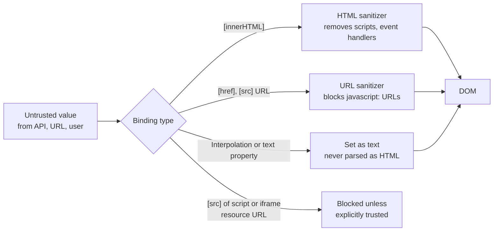
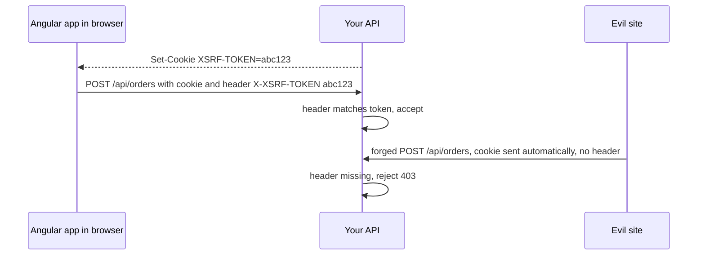

# Angular security

> In this document you will learn what Angular does for you automatically to prevent attacks (especially XSS), where those protections end, and what you must still do yourself: safe use of `DomSanitizer`, Content Security Policy, XSRF protection, token handling and server-side authorization. Security questions in Angular interviews test whether you know the framework's guarantees and, more importantly, their limits.

**Before this:** [Browser storage and web security basics](../01-cs-and-web-fundamentals/08-browser-storage-and-web-security-basics.md) · [Web security: XSS, CSRF, CORS, CSP](../10-testing-security-production/05-web-security-xss-csrf-cors-csp.md) · [Components and templates](02-components-and-templates.md) · **Interview questions:** [jump to the interview section](#interview-questions)

## Table of contents

1. [The frontend security mindset](#the-frontend-security-mindset)
2. [XSS in one page](#xss-in-one-page)
3. [Angular's built-in XSS protection](#angulars-built-in-xss-protection)
4. [Security contexts and what Angular does in each](#security-contexts-and-what-angular-does-in-each)
5. [innerHTML binding](#innerhtml-binding)
6. [DomSanitizer and bypassSecurityTrust](#domsanitizer-and-bypasssecuritytrust)
7. [Dangerous DOM access: ElementRef, Renderer2 and third-party code](#dangerous-dom-access-elementref-renderer2-and-third-party-code)
8. [Other XSS entry points](#other-xss-entry-points)
9. [Trusted Types](#trusted-types)
10. [Content Security Policy with Angular](#content-security-policy-with-angular)
11. [XSRF protection with HttpClient](#xsrf-protection-with-httpclient)
12. [Route guards are UX, not security](#route-guards-are-ux-not-security)
13. [Token storage choices](#token-storage-choices)
14. [Attach tokens only to your own API](#attach-tokens-only-to-your-own-api)
15. [Secrets and configuration](#secrets-and-configuration)
16. [SSR-related risks](#ssr-related-risks)
17. [Dependencies and keeping Angular updated](#dependencies-and-keeping-angular-updated)
18. [Security checklist](#security-checklist)
19. [Common mistakes](#common-mistakes)
20. [Best practices](#best-practices)
21. [How to explain this in an interview](#how-to-explain-this-in-an-interview)
22. [Interview questions](#interview-questions)
23. [Summary](#summary)
24. [References](#references)

---

## The frontend security mindset

Three facts guide all frontend security decisions:

1. **The browser belongs to the user, not to you.** Anyone can open DevTools, change your JavaScript, call your API with curl and skip every check you wrote in Angular. So the frontend can **never** enforce security alone. The server must check everything.
2. **Your job in the frontend is to not create holes.** The main frontend risk is that your app runs code an attacker controls (XSS), or that your app sends the user's credentials to the wrong place.
3. **Defense in depth.** Use several layers: Angular's sanitization, a Content Security Policy, safe token handling, server-side validation and authorization. If one layer fails, another one stops the attack.

Angular helps a lot with point 2, as long as you do not turn its protections off.

## XSS in one page

The attacks are explained in depth in [Web security: XSS, CSRF, CORS, CSP](../10-testing-security-production/05-web-security-xss-csrf-cors-csp.md). Here is a short reminder.

**Cross-site scripting (XSS)** happens when an attacker manages to run their own JavaScript inside your page. Then the script runs with your app's permissions: it can read data on the page, call your API as the user, steal tokens from `localStorage`, or show a fake login form.

How the attacker's code gets in:

- **Stored XSS:** the attacker saves malicious content in your database (a product review, a user name), and your app later renders it for other users.
- **Reflected XSS:** malicious content in a URL is put into the page.
- **DOM-based XSS:** frontend code takes data from an unsafe source (URL, `postMessage`, API) and writes it into a dangerous sink (`innerHTML`, `eval`, `href="javascript:..."`).

Example of a malicious "user name":

```text

```

If your app inserts this as HTML, the browser tries to load the image, fails, and runs the `onerror` code.

## Angular's built-in XSS protection

### What it is

Angular's security rule is simple: **all values are untrusted by default**. When a value goes into the DOM through a template binding, Angular **escapes** or **sanitizes** it.

- **Escaping** turns special characters into text, so the browser shows them instead of interpreting them.
- **Sanitizing** removes dangerous parts from a value (like `<script>` tags or `onerror` attributes) and keeps the safe parts.

### Interpolation is always escaped

```ts
@Component({
  selector: 'app-review',
  template: `<p>{{ review.author }} wrote: {{ review.text }}</p>`,
})
export class ReviewComponent {
  review = {
    author: '',
    text: '<b>Great product</b>',
  };
}
```

The page shows the literal text ` wrote: <b>Great product</b>`. Nothing runs and nothing is bold. Interpolation (`{{ }}`) and property bindings to text properties (`[textContent]`) set **text**, never HTML.

### Templates are trusted, data is not

Angular treats **templates as trusted code**, because they are written by your developers and compiled by the Angular compiler. **Data** that flows into templates is untrusted. This leads to one important rule:

> **Never create templates from user data.** Do not build template strings at runtime from user input and compile them (for example with the JIT compiler). This would turn data into code.

With AOT compilation (the default since Angular 9), templates are compiled at build time, which removes this risk in normal apps.

### How it works inside



The Angular compiler knows, for every element and property, which **security context** applies, and it inserts the right sanitization call into the compiled template code.

## Security contexts and what Angular does in each

| Context | Where it applies | What Angular 16 does |
| --- | --- | --- |
| **HTML** | `[innerHTML]` | Sanitizes: keeps safe tags and attributes, removes `<script>`, event handler attributes (`onclick`, `onerror`), `<iframe>` and other unsafe elements |
| **Style** | `[style]`, `[style.x]` bindings | Values are passed through. Modern browsers do not run JavaScript from CSS, so Angular removed style sanitization in version 10 |
| **URL** | `[href]`, `[src]` of ``, `<a>`, etc. | Sanitizes: values that start with `javascript:` get the prefix `unsafe:`, so they do nothing |
| **Resource URL** | URLs that are loaded and run as code: `<script src>`, `<iframe src>`, `<object data>`, `<embed src>`, `<base href>` | **Throws an error** for bound values unless you explicitly trust them |
| **Script** | Script content | Never allowed from bindings |

You can see the URL rule in action. Angular 16 uses this pattern internally to decide if a URL is safe (verified with Node.js using the same regular expression):

```js
const SAFE_URL_PATTERN = /^(?!javascript:)(?:[a-z0-9+.-]+:|[^&:\/?#]*(?:[\/?#]|$))/i;
const sanitizeUrl = (url) => (String(url).match(SAFE_URL_PATTERN) ? url : 'unsafe:' + url);

console.log(sanitizeUrl('https://shop.example.com/p/1')); // https://shop.example.com/p/1
console.log(sanitizeUrl('/orders/42'));                   // /orders/42
console.log(sanitizeUrl('mailto:help@example.com'));      // mailto:help@example.com
console.log(sanitizeUrl('javascript:alert(1)'));          // unsafe:javascript:alert(1)
console.log(sanitizeUrl('JavaScript:alert(1)'));          // unsafe:JavaScript:alert(1)
```

So `<a [href]="user.website">` is safe even if a user sets their website to `javascript:alert(1)`. In development mode Angular also logs a warning: "WARNING: sanitizing unsafe URL value".

Resource URLs are stricter because they **load code**:

```html
<!-- ❌ Throws: "unsafe value used in a resource URL context" -->
<iframe [src]="videoUrl"></iframe>
```

You must decide on purpose that the URL is safe (see [DomSanitizer](#domsanitizer-and-bypasssecuritytrust)).

## innerHTML binding

Sometimes you really need to show HTML: content from a CMS, rich text from an editor, formatted help pages. Bind to `[innerHTML]`:

```ts
@Component({
  selector: 'app-article',
  template: `<article [innerHTML]="article.bodyHtml"></article>`,
})
export class ArticleComponent {
  article = {
    bodyHtml: `
      <h2>Release notes</h2>
      <p>Now with <strong>dark mode</strong>.</p>
      
      <script>alert('xss')</script>
      <a href="javascript:alert('xss')">Click</a>
    `,
  };
}
```

What Angular renders (simplified):

```html
<h2>Release notes</h2>
<p>Now with <strong>dark mode</strong>.</p>

<a href="unsafe:javascript:alert('xss')">Click</a>
```

- The `onerror` attribute is removed.
- The `<script>` element is removed.
- The `javascript:` link is neutralized.
- In development mode the console shows "WARNING: sanitizing HTML stripped some content".

Things to know:

- The sanitizer works with an allow-list of tags and attributes. It also removes `style` attributes, `<style>` elements and `id` attributes (they are not on the list), and component selectors in the HTML are **not** turned into Angular components (it is plain HTML, no bindings or directives).
- Sanitizing on the client is a safety net. It is still better to sanitize HTML **on the server** when it is saved, and to use a well-maintained server-side sanitizer.
- If you need to keep certain tags that Angular removes, use a dedicated library like DOMPurify with a strict configuration, then mark the result as trusted. Do not just bypass the sanitizer.

## DomSanitizer and bypassSecurityTrust

### What it is

`DomSanitizer` is the Angular service that does the sanitization. It also lets you **mark a value as trusted**, which tells Angular "do not sanitize this, I have checked it":

| Method | Context |
| --- | --- |
| `bypassSecurityTrustHtml(value)` | HTML |
| `bypassSecurityTrustStyle(value)` | Style |
| `bypassSecurityTrustUrl(value)` | URL |
| `bypassSecurityTrustResourceUrl(value)` | Resource URL |
| `bypassSecurityTrustScript(value)` | Script |
| `sanitize(context, value)` | Sanitizes a value yourself (returns a safe string or throws) |

### The risk

The name says it all: these methods **bypass security**. If the value contains attacker-controlled data, you have created an XSS hole yourself. Angular cannot protect you after you call them.

```ts
// ❌ Wrong: trusting user content. This is an XSS vulnerability.
this.bio = this.sanitizer.bypassSecurityTrustHtml(user.bioHtml);
```

### Safe use: trust only values you build from known-safe parts

A common real case is embedding a video. The iframe `src` is a resource URL, so Angular blocks bound values. Do not trust a URL that comes from the user directly. Validate an **id** and build the URL yourself:

```ts
@Component({
  selector: 'app-video',
  template: `<iframe *ngIf="embedUrl" [src]="embedUrl" title="Product video" allowfullscreen></iframe>`,
})
export class VideoComponent implements OnChanges {
  @Input({ required: true }) videoId!: string;
  embedUrl: SafeResourceUrl | null = null;
  private sanitizer = inject(DomSanitizer);

  ngOnChanges(): void {
    // ✅ Validate strictly: only letters, digits, '-' and '_' are allowed in the id
    if (!/^[A-Za-z0-9_-]{11}$/.test(this.videoId)) {
      this.embedUrl = null;
      return;
    }
    // ✅ The trusted URL is built from a fixed origin + a validated id
    this.embedUrl = this.sanitizer.bypassSecurityTrustResourceUrl(
      `https://www.youtube-nocookie.com/embed/${this.videoId}`,
    );
  }
}
```

Rules for `bypassSecurityTrust*`:

1. Use it only when there is no other way.
2. Never pass raw user input, URL parameters or API data directly.
3. Build the value from **constants plus validated pieces** (allow-lists, strict regular expressions), or from the output of a trusted sanitizer library.
4. Keep these calls in **one small, reviewed place** (a pipe or service like `SafeEmbedService`), so they are easy to audit. Search the codebase for `bypassSecurityTrust` during security reviews.
5. Remember that a `SafeValue` is only safe for the context it was created for.

### A "safe HTML" pipe is usually a red flag

You will find this pipe in many projects:

```ts
// ❌ Dangerous pattern: marks ANY input as trusted HTML
@Pipe({ name: 'safeHtml' })
export class SafeHtmlPipe implements PipeTransform {
  private sanitizer = inject(DomSanitizer);
  transform(value: string): SafeHtml {
    return this.sanitizer.bypassSecurityTrustHtml(value);
  }
}
```

It turns off Angular's protection for every value it touches, often with user content. If you see it in a code review, ask what data flows through it. Usually plain `[innerHTML]` (with Angular's sanitizer) is enough.

## Dangerous DOM access: ElementRef, Renderer2 and third-party code

Angular's protection works for **template bindings**. When you write to the DOM yourself, Angular cannot check it.

```ts
// ❌ Wrong: direct DOM write bypasses Angular's sanitization
@Component({ selector: 'app-comment', template: `<div #box></div>` })
export class CommentComponent implements AfterViewInit {
  @Input({ required: true }) html!: string;
  @ViewChild('box') box!: ElementRef<HTMLDivElement>;

  ngAfterViewInit(): void {
    this.box.nativeElement.innerHTML = this.html; // XSS if html contains attacker content
  }
}
```

```ts
// ✅ Correct: use a binding, so Angular sanitizes
@Component({ selector: 'app-comment', template: `<div [innerHTML]="html"></div>` })
export class CommentComponent {
  @Input({ required: true }) html!: string;
}
```

Notes:

- `Renderer2.setProperty(el, 'innerHTML', value)` also does **not** sanitize. Renderer2 is about platform abstraction (it works on the server too), not security.
- `document.write`, `insertAdjacentHTML`, `outerHTML`, `eval`, `new Function`, `setTimeout('code string')` are dangerous sinks. Avoid them with untrusted data.
- Third-party libraries (rich text editors, chart tooltips, markdown renderers, jQuery plugins) often use `innerHTML` internally. Check their documentation for sanitization options and keep them updated.
- If you must insert HTML manually, sanitize it first: `this.sanitizer.sanitize(SecurityContext.HTML, value)`.

## Other XSS entry points

| Entry point | Risk | Defense |
| --- | --- | --- |
| Server-side rendering of templates by the backend (for example, a Java or .NET page that renders user input into the HTML that contains the Angular app) | The server can inject `{{ }}` expressions or scripts into the page before Angular starts (template injection) | Do not mix server templates with Angular templates; serve `index.html` as a static file |
| JIT compilation of dynamic templates | Data becomes code | Use AOT (default); never compile templates from user input |
| `[href]` built with string concatenation that leads to `javascript:` | Usually blocked by the URL sanitizer, but logic errors happen | Prefer router links and validated URLs |
| `postMessage` handlers | Messages from any window | Check `event.origin` against an allow-list and validate the data |
| URL parameters used in code (`location.hash` into `innerHTML`) | DOM XSS | Treat the URL as untrusted input |
| Markdown or rich text rendering | HTML in the output | Render with a library that sanitizes, then bind with `[innerHTML]` |

## Trusted Types

### What it is

**Trusted Types** is a browser security feature (first shipped in Chromium-based browsers; check MDN for current support in other browsers) that blocks dangerous DOM sinks like `element.innerHTML = string` unless the value is a special "trusted" object created by an approved **policy**. You enable it with a CSP header. Then any code (yours or a library's) that writes raw strings into those sinks fails, which turns DOM XSS bugs into visible errors.

### Angular support

Angular supports Trusted Types (since version 11). Angular creates its own policies, so its sanitized values are accepted:

| Policy name | Used for |
| --- | --- |
| `angular` | Values that passed Angular's sanitizer and Angular internals |
| `angular#unsafe-bypass` | Values passed through `bypassSecurityTrust*` |
| `angular#unsafe-jit` | The JIT compiler (not needed with AOT) |
| `angular#bundler` | Used by the Angular CLI bundler when loading lazy chunks |

Example header (set by your web server):

```text
Content-Security-Policy: trusted-types angular angular#bundler; require-trusted-types-for 'script';
```

- Leave out `angular#unsafe-bypass` if your app does not use `bypassSecurityTrust*`. Then any bypass call fails, which enforces the "no bypass" rule.
- Add the policy names of third-party libraries that support Trusted Types.
- Start with `Content-Security-Policy-Report-Only` to find violations without breaking the app.

## Content Security Policy with Angular

### What it is

A **Content Security Policy (CSP)** is an HTTP header that tells the browser which sources of scripts, styles, images and other resources are allowed. Even if an attacker injects a `<script>` tag, the browser refuses to run it if it is not allowed by the policy. CSP is a strong second layer of defense against XSS.

### A strict CSP for an Angular app

```text
Content-Security-Policy:
  default-src 'self';
  script-src 'self';
  style-src 'self' 'nonce-RANDOM_VALUE';
  img-src 'self' data: https://images.example-cdn.com;
  connect-src 'self' https://api.example.com;
  font-src 'self';
  object-src 'none';
  base-uri 'self';
  frame-ancestors 'none';
```

(In a real header these are on one line.)

Angular-specific points:

- **Scripts:** a production Angular build produces only script files (no inline scripts are required by Angular itself), so `script-src 'self'` works. Avoid `'unsafe-eval'`: AOT does not need it. Some old libraries do.
- **Styles:** Angular adds component styles at runtime as `<style>` elements. Without help, this needs `style-src 'unsafe-inline'`, which weakens the policy. **Angular 16 added CSP nonce support for these inline styles.**

### CSP nonce in Angular 16

A **nonce** ("number used once") is a random value the server generates **for each response**. It puts the value in the CSP header and on the allowed elements. The browser allows only inline styles or scripts with the matching nonce.

Angular 16 gives you two ways to tell Angular the nonce:

```html
<!-- Option 1: ngCspNonce attribute on the root element in index.html -->
<!-- The server replaces RANDOM_NONCE with a new random value on every request -->
<app-root ngCspNonce="RANDOM_NONCE"></app-root>
```

```ts
// Option 2: the CSP_NONCE injection token (from @angular/core, Angular 16+)
import { CSP_NONCE } from '@angular/core';

bootstrapApplication(AppComponent, {
  providers: [{ provide: CSP_NONCE, useValue: (globalThis as { myRandomNonce?: string }).myRandomNonce ?? null }],
});
```

Angular then adds the nonce to every `<style>` element it creates.

Important: the nonce must be **unique and unpredictable for every response**. A nonce hard-coded in `index.html` at build time gives no protection. This means `index.html` must be served by a server that can change it per request (a Node server, a reverse proxy like nginx with a module, or an edge function).

The Angular CLI 16 also added CSP support for the inline styles and critical CSS link tags it generates during the build.

> **Newer Angular (19+):** the CLI can generate a hash-based strict CSP for scripts automatically with `"security": { "autoCsp": true }` in `angular.json`.

### Deploying CSP safely

1. Start with `Content-Security-Policy-Report-Only` and a `report-to` / `report-uri` endpoint.
2. Watch the reports, fix violations (third-party scripts, inline handlers).
3. Switch to enforcing mode.
4. Keep the policy in version control and review changes.

## XSRF protection with HttpClient

### What CSRF is

**Cross-site request forgery (CSRF or XSRF)** tricks a logged-in user's browser into sending a request to your API from another site. It works when your API authenticates with **cookies**, because the browser attaches cookies automatically. Details: [Web security: XSS, CSRF, CORS, CSP](../10-testing-security-production/05-web-security-xss-csrf-cors-csp.md).

### What Angular does

Angular's `HttpClient` supports the common **cookie-to-header** defense:

1. The server sets a cookie named `XSRF-TOKEN` with a random value (readable by JavaScript, so not `httpOnly`).
2. Angular's XSRF interceptor reads the cookie and copies its value into the request header `X-XSRF-TOKEN`.
3. The server checks that the header matches the cookie (or its session). A malicious site cannot read your cookie (same-origin policy), so it cannot set the header.



Details of Angular 16's implementation (checked in the 16.2 source):

- It is enabled by default when you use `HttpClientModule` or `provideHttpClient()`.
- It adds the header only for **mutating** requests: it skips `GET` and `HEAD`.
- It adds the header only for **relative URLs**. Requests to absolute URLs (`https://...`), even to your own domain, do not get the header, because the token for one origin must not be sent to another.
- It does not overwrite a header with the same name if you set it yourself.

Configuration:

```ts
// NgModule (Angular 16)
imports: [
  HttpClientModule,
  HttpClientXsrfModule.withOptions({ cookieName: 'MY-XSRF', headerName: 'X-MY-XSRF' }),
],

// Standalone
provideHttpClient(withXsrfConfiguration({ cookieName: 'MY-XSRF', headerName: 'X-MY-XSRF' }));
// provideHttpClient(withNoXsrfProtection()); // turn it off (only if your API does not use cookies)
```

Remember: Angular only does the **client half**. The server must issue the token and verify it. Modern defenses also include `SameSite=Lax` or `Strict` cookies on the session cookie. If your API uses bearer tokens in the `Authorization` header (not cookies), CSRF is not the main concern, but token theft through XSS is.

## Route guards are UX, not security

Guards (`canActivate`, `canMatch`, and so on) decide whether the router shows a route. Routing is explained in [Routing, guards and lazy loading](06-routing-guards-and-lazy-loading.md).

What guards really do:

- Improve user experience: redirect to login, hide pages the user cannot use, prevent loading a lazy module (`canMatch`).

What guards do **not** do:

- Protect data. The JavaScript for an "admin" route is downloaded to the browser (or can be). An attacker can change the guard to return `true`, or just call the API directly.

```ts
// ✅ Guard for UX
export const adminGuard: CanMatchFn = () => {
  const auth = inject(AuthService);
  return auth.hasRole('admin') || inject(Router).createUrlTree(['/forbidden']);
};
```

```text
// ✅ The real protection: the server checks on every request
GET /api/admin/users
Authorization: Bearer eyJ...
-> server verifies the token signature and expiry, checks role 'admin', else 403
```

The same applies to hidden buttons (`*appHasPermission`), disabled form fields and client-side validation: they are for UX. The server must validate input and authorize every action.

Also, do not put secret information in route data or in lazy bundles thinking that a guard hides it. The bundles are public files.

## Token storage choices

If your app uses tokens (for example from OAuth 2.0 / OpenID Connect), where you keep them is a trade-off. Full discussion: [Secure auth, secrets and dependencies](../10-testing-security-production/06-secure-auth-secrets-and-dependencies.md).

| Option | XSS impact | CSRF impact | Notes |
| --- | --- | --- | --- |
| `localStorage` / `sessionStorage` | Any XSS can read and steal the token | Not sent automatically, so no CSRF | Simple, survives reloads (`localStorage`), but theft is easy if XSS exists |
| In memory (a variable in a service) | XSS can still use the token while the page is open, but it is harder to steal permanently | No CSRF | Lost on reload; combine with a silent refresh using a secure cookie or the identity provider session |
| `httpOnly`, `Secure`, `SameSite` cookie set by the server | JavaScript cannot read it, so XSS cannot steal it (but XSS can still send requests from the page) | Sent automatically, so you need CSRF protection (SameSite + XSRF token) | Often used with a **backend-for-frontend (BFF)** that holds the real tokens server-side |

Practical guidance:

- Many security teams recommend the **BFF pattern** for browser apps: the Angular app talks to its own backend with an `httpOnly` session cookie; the backend talks to APIs with tokens. Tokens never reach JavaScript.
- If tokens must be in the browser, keep access tokens **short-lived**, keep them in memory when possible, use refresh token rotation, and invest heavily in XSS prevention (sanitization, CSP, Trusted Types).
- Never store tokens in a cookie you create from JavaScript (not `httpOnly`), in URLs, or in logs.

## Attach tokens only to your own API

An auth interceptor that adds the token to **every** request leaks it to any third party your app calls: analytics, CDNs, map tiles, public APIs.

```ts
// ❌ Wrong: sends the token everywhere
export const authInterceptor: HttpInterceptorFn = (req, next) =>
  next(req.clone({ setHeaders: { Authorization: `Bearer ${inject(AuthService).getToken()}` } }));
```

```ts
// ✅ Correct: only for an allow-list of your own API origins
export const authInterceptor: HttpInterceptorFn = (req, next) => {
  const token = inject(AuthService).getToken();
  const apiUrl = inject(APP_CONFIG).apiUrl; // e.g. 'https://api.example.com'
  const isOwnApi = req.url.startsWith(`${apiUrl}/`) || req.url.startsWith('/api/');
  if (!token || !isOwnApi) {
    return next(req);
  }
  return next(req.clone({ setHeaders: { Authorization: `Bearer ${token}` } }));
};
```

Be careful with simple `startsWith` checks: `https://api.example.com.evil.net` starts with `https://api.example.com`. Compare full origins (for example with `new URL(req.url, location.origin).origin === allowedOrigin`) or include the trailing slash, as in the example. Interceptors are covered in [HttpClient and interceptors](08-httpclient-and-interceptors.md).

## Secrets and configuration

Everything you ship to the browser is **public**: `environment.ts`, `config.json`, lazy chunks, source maps.

- Never put secrets in the frontend: database passwords, private API keys, OAuth client secrets, signing keys.
- Public identifiers (an OAuth client id for a public client, a maps API key restricted by domain) are fine, but restrict them on the provider side.
- If the frontend needs a call that requires a secret, put it behind your backend.
- Do not deploy public **source maps** to production unless you accept that anyone can read your original code. Upload them privately to your error monitoring tool instead.
- Production builds remove dev-only code (`isDevMode()` branches), but do not rely on that to hide anything sensitive.

## SSR-related risks

Server-side rendering (Angular Universal in Angular 16, `@angular/ssr` in 17+) runs your Angular code **on the server**. This adds server-side risks:

| Risk | What can go wrong | Defense |
| --- | --- | --- |
| **Data leaking between users** | A root service caches user data in memory. On the server, one Node process serves many users, so user B can see user A's data | Do not store per-user state in long-lived server-side singletons; scope state per request |
| **Transfer state** | Data fetched on the server is serialized into the HTML (`TransferState`, HTTP transfer cache). Sensitive data ends up in the page source | Do not transfer secrets; be careful with authenticated requests (newer Angular excludes requests with auth headers from the transfer cache by default since 18) |
| **SSRF (server-side request forgery)** | Server code makes HTTP requests to URLs influenced by the user (for example, a URL from a query param), reaching internal services | Validate and allow-list URLs; never fetch arbitrary user URLs on the server |
| **Host header attacks** | Code builds absolute URLs from the request's `Host` header | Configure trusted hosts; do not trust the `Host` header for security decisions |
| **Server crashes and DoS** | Rendering is CPU heavy; errors can crash the process | Timeouts, rate limiting, error handling, caching |
| **Browser-only APIs** | `window`, `localStorage`, `document.cookie` do not exist on the server | Guard with `isPlatformBrowser`; never read tokens from browser storage during SSR |

Angular still sanitizes bindings during server rendering, so the template XSS protection still applies to the HTML the server produces.

## Dependencies and keeping Angular updated

Your app includes hundreds of npm packages. A vulnerable or malicious package can break all your other defenses. See [Secure auth, secrets and dependencies](../10-testing-security-production/06-secure-auth-secrets-and-dependencies.md).

- Run `npm audit` (or a tool like Snyk, Dependabot or Renovate) in CI, and fix high-severity issues.
- Commit `package-lock.json` and use `npm ci` in CI for reproducible installs.
- Review new dependencies before adding them: maintenance, popularity, size, permissions (install scripts).
- **Keep Angular updated.** Angular fixes security issues only in **supported** versions. Each major version gets about 6 months of active support and 12 months of long-term support (18 months total for versions up to 21; from 22 the policy is 24 months). **Angular 16 is no longer supported** (its LTS ended in November 2024), so it no longer receives security patches. An Angular 16 app in production should have an upgrade plan. See [Angular 16 vs newer versions](16-angular-16-vs-newer-versions.md).
- Use `ng update` to upgrade one major version at a time, with the official update guide (angular.dev/update-guide).
- Do not modify Angular's own files in `node_modules` or fork it; you would lose security fixes.

## Security checklist

**XSS**

- [ ] Data shown with interpolation or bindings, never with manual `innerHTML`, `insertAdjacentHTML` or `document.write`.
- [ ] `[innerHTML]` only for content that needs HTML, ideally also sanitized on the server.
- [ ] No `bypassSecurityTrust*` with untrusted data; all uses reviewed and kept in one place.
- [ ] No "safe HTML" pipe that trusts everything.
- [ ] AOT only; no dynamic template compilation.
- [ ] Third-party HTML-rendering libraries configured to sanitize and kept updated.

**Headers and browser features**

- [ ] Content Security Policy deployed (report-only first), with a per-request nonce for Angular styles (`ngCspNonce` or `CSP_NONCE`).
- [ ] Trusted Types considered (Angular policies allowed, `angular#unsafe-bypass` only if needed).
- [ ] HTTPS everywhere, HSTS, `frame-ancestors` or `X-Frame-Options` against clickjacking.

**Auth and API**

- [ ] Server authorizes every request; guards and hidden buttons are UX only.
- [ ] Tokens stored with a deliberate choice (BFF + httpOnly cookie preferred); short-lived access tokens.
- [ ] Interceptor attaches tokens only to your own API origins.
- [ ] XSRF protection configured if the API uses cookies (server issues and checks the token, SameSite cookies).
- [ ] No secrets in `environment.ts`, `config.json` or bundles; no public source maps.

**Operations**

- [ ] Supported Angular version; regular `ng update`.
- [ ] `npm audit` / dependency scanning in CI.
- [ ] SSR: no per-user state in server singletons; nothing sensitive in transfer state; URL allow-lists for server requests.

## Common mistakes

1. **Calling `bypassSecurityTrustHtml` on user content** "because Angular removed my styles". This creates XSS.
2. **Writing to `nativeElement.innerHTML`** or using `Renderer2.setProperty(..., 'innerHTML', ...)` with untrusted data.
3. **Believing route guards protect data.** They only change navigation.
4. **Adding the bearer token to every HTTP request**, including third-party domains.
5. **Using a static CSP nonce** baked into `index.html`.
6. **`style-src 'unsafe-inline'` and `script-src 'unsafe-eval'`** added "to make it work" without trying the nonce support.
7. **Storing long-lived tokens in `localStorage`** without strong XSS defenses.
8. **Secrets in `environment.prod.ts`.** They are in the public bundle.
9. **Turning off XSRF protection** while the API uses cookie authentication.
10. **Assuming Angular protects the server.** SQL injection, broken access control and input validation are backend problems.
11. **Running an unsupported Angular version for years** without a plan.

## Best practices

- **Let Angular bind the data.** Use interpolation and property bindings. Reason: Angular escapes and sanitizes automatically.
- **Treat every `bypassSecurityTrust*` call as a security decision** that needs validation and code review. Reason: it disables the protection completely for that value.
- **Avoid direct DOM manipulation**; when unavoidable, sanitize first with `DomSanitizer.sanitize`. Reason: manual writes skip Angular's checks.
- **Deploy a strict CSP with a per-request nonce**, and consider Trusted Types. Reason: they stop many XSS attacks even when a bug exists.
- **Enforce authorization on the server.** Reason: the browser is controlled by the user.
- **Choose token storage deliberately**, prefer a BFF with httpOnly cookies, and send tokens only to your API. Reason: limits damage from XSS and stops token leaks.
- **Keep dependencies and Angular updated and scanned.** Reason: most real-world compromises use known vulnerabilities.
- **Sanitize rich content on the server too.** Reason: defense in depth, and other clients (mobile apps, emails) may show the same content.

## How to explain this in an interview

1. **Define it:** "Angular treats all values as untrusted. Templates are trusted code, but data bound into them is escaped or sanitized depending on the security context."
2. **Why it exists:** "To prevent XSS: an attacker getting their script to run in our page, where it can act as the user and steal data."
3. **How it works:** "Interpolation always sets text. `[innerHTML]` goes through an HTML sanitizer that strips scripts and event handlers. URLs in `href` and `src` are sanitized so `javascript:` URLs are neutralized. Resource URLs like iframe `src` are blocked unless I explicitly trust them with DomSanitizer."
4. **Small example:** "If a review contains ``, interpolation shows it as text, and `[innerHTML]` removes the `onerror` attribute. If I need an iframe for a video, I validate the video id and build the URL from a fixed origin before calling `bypassSecurityTrustResourceUrl`."
5. **Where it matters:** "User-generated content, CMS pages, rich text, embeds, and anything that touches the DOM directly or uses third-party widgets."
6. **Trade-offs / gotchas:** "Bypass methods and direct DOM writes turn the protection off. Angular protects only the frontend rendering: the server must still authorize every request, guards are UX only, tokens should go only to our API, and I add a CSP with a nonce, which Angular 16 supports through `ngCspNonce` or `CSP_NONCE`."

---

## Interview questions

### Q1. How does Angular protect against XSS?

**What the interviewer is checking:** knowledge of the default protection and security contexts.

**Short spoken answer (30–60 seconds):**
> Angular treats all values as untrusted by default. Templates themselves are trusted because they're compiled from our source code, preferably ahead of time. When data is bound into the DOM, Angular escapes or sanitizes it based on the security context. Interpolation and text bindings always insert text, so HTML in the data is shown, not executed. For `[innerHTML]`, Angular runs an HTML sanitizer that removes scripts, event handler attributes and other dangerous content. URL bindings like href and src are sanitized so `javascript:` URLs get an `unsafe:` prefix. Resource URLs, like iframe or script src, are blocked unless I explicitly mark them as trusted. This covers bindings only: direct DOM writes and bypass methods are on me.

**Detailed explanation:** See [Security contexts](#security-contexts-and-what-angular-does-in-each). Style values are not sanitized since Angular 10, because modern browsers don't execute JavaScript from CSS.

**Follow-up questions:**
- **What is the difference between escaping and sanitizing?** — Escaping turns the whole value into text. Sanitizing parses the value as HTML (or URL) and removes only the dangerous parts.
- **Does Angular sanitize during SSR?** — Yes, the same template bindings are sanitized when rendering on the server.
- **Why is AOT relevant to security?** — With AOT, templates are compiled at build time, so there is no runtime template compilation that could turn data into code.

**Common mistakes:** Saying "Angular prevents all XSS". It prevents XSS through template bindings only.

**Where this is used in real projects:** Any app that displays user-generated content.

### Q2. What happens with this template, and is it safe?

```ts
@Component({
  selector: 'app-profile',
  template: `
    <p>{{ user.bio }}</p>
    <div [innerHTML]="user.bio"></div>
    <a [href]="user.website">Website</a>
  `,
})
export class ProfileComponent {
  user = {
    bio: '<b>Hi</b>',
    website: 'javascript:alert(2)',
  };
}
```

**What the interviewer is checking:** applying sanitization rules to concrete code.

**Short spoken answer (30–60 seconds):**
> The first paragraph shows the bio as literal text, including the tags, so nothing runs. The `[innerHTML]` div renders "Hi" in bold and an image without the onerror attribute, because Angular's HTML sanitizer strips event handlers; in dev mode it logs a "sanitizing HTML stripped some content" warning. The link gets `href="unsafe:javascript:alert(2)"`, so clicking it does nothing, and Angular warns about an unsafe URL. So this template is safe. It would become unsafe if someone wrapped the bio in `bypassSecurityTrustHtml` or wrote it with `nativeElement.innerHTML`.

**Common mistakes:** Thinking `[innerHTML]` executes scripts, or thinking `href` is not sanitized.

### Q3. What is DomSanitizer, and when is `bypassSecurityTrust*` acceptable?

**What the interviewer is checking:** responsible use of escape hatches.

**Short spoken answer (30–60 seconds):**
> DomSanitizer is the service Angular uses to sanitize values for each security context. It also has bypassSecurityTrust methods for HTML, style, URL, resource URL and script, which mark a value as trusted so Angular skips sanitization. That's only acceptable when I fully control the value: for example, I validate a YouTube video id with a strict regex and build the iframe URL from a fixed origin, then call bypassSecurityTrustResourceUrl. I never pass user input or API data directly, I keep these calls in one small reviewed service or pipe, and I treat each one as a security decision. A generic "safeHtml" pipe that trusts everything is a red flag in code review.

**Code:** see [Safe use](#safe-use-trust-only-values-you-build-from-known-safe-parts).

**Follow-up questions:**
- **How do you sanitize a value yourself?** — `sanitizer.sanitize(SecurityContext.HTML, value)` returns a safe string.
- **The CMS sends HTML with inline styles that Angular removes. What do you do?** — Prefer CSS classes. If styles must stay, sanitize with a strict DOMPurify configuration (on the server ideally), then trust the sanitized output. Do not trust the raw HTML.

**Common mistakes:** "I use bypass to fix the console warning."

### Q4. Why is using ElementRef to set innerHTML dangerous?

**What the interviewer is checking:** whether you know where Angular's protection stops.

**Short answer:** Angular's sanitization runs only for template bindings. `elementRef.nativeElement.innerHTML = value` (or `Renderer2.setProperty(el, 'innerHTML', value)`) writes straight into the DOM, so any attacker-controlled HTML runs, for example through `onerror`. Use `[innerHTML]` binding instead, or sanitize first with `DomSanitizer.sanitize(SecurityContext.HTML, value)`. Direct DOM access also breaks SSR and hydration, which is another reason to avoid it.

### Q5. How do you use a Content Security Policy with Angular 16?

**What the interviewer is checking:** CSP knowledge and the Angular 16 nonce feature.

**Short spoken answer (30–60 seconds):**
> A CSP header tells the browser which scripts, styles and other resources are allowed, so injected scripts don't run even if there's an XSS bug. Angular's production build works with `script-src 'self'` and doesn't need unsafe-eval with AOT. The tricky part is styles: Angular inserts component styles as inline style elements at runtime. Angular 16 added nonce support for that: the server generates a random nonce per response, puts it in the CSP header, and either sets the `ngCspNonce` attribute on the app root element or provides it through the `CSP_NONCE` injection token. Angular adds that nonce to the style elements it creates. The nonce must change on every response, so index.html must be served dynamically. I roll it out in report-only mode first.

**Follow-up questions:**
- **Why is a static nonce useless?** — An attacker can read it from the page and add it to their injected tags. It must be unpredictable per response.
- **What are Trusted Types?** — A CSP feature that blocks raw strings in DOM sinks like innerHTML unless they come from an approved policy. Angular provides policies named `angular`, `angular#unsafe-bypass`, `angular#unsafe-jit` and `angular#bundler`.

**Common mistakes:** Adding `'unsafe-inline'` for styles without mentioning the nonce option.

### Q6. How does Angular help with CSRF? What does the server need to do?

**What the interviewer is checking:** whether you know the cookie-to-header pattern, its limits in Angular, and the server's part.

**Short spoken answer (30–60 seconds):**
> HttpClient implements the cookie-to-header pattern. If the server sets a cookie called XSRF-TOKEN, Angular's built-in interceptor reads it and sends its value in an X-XSRF-TOKEN header. It does this only for mutating requests, not GET or HEAD, and only for relative URLs, so the token isn't sent to other origins. A malicious site can make the browser send cookies, but it can't read our cookie to set the header, so the server can reject requests where the header is missing or doesn't match. The server must generate the token, set the cookie, and verify the header; Angular only does the client part. Names are configurable with HttpClientXsrfModule.withOptions or withXsrfConfiguration. SameSite cookies add another layer.

**Follow-up questions:**
- **Does it work for requests to `https://api.example.com` from `https://app.example.com`?** — Angular does not add the header to absolute URLs. You would need a custom interceptor, careful CORS configuration, or a same-origin proxy (`/api`).
- **Do you need XSRF protection with bearer tokens in headers?** — Mostly no, because the browser does not attach them automatically. But then XSS-based token theft is the main risk.

### Q7. Are route guards a security feature?

**What the interviewer is checking:** understanding of client vs server trust.

**Short spoken answer (30–60 seconds):**
> No, guards are a UX feature. They decide whether the router activates a route, so they're great for redirecting to login, hiding admin pages and avoiding loading lazy code with canMatch. But all frontend code runs in the user's browser, so anyone can modify it or call the API directly with curl. Real security is on the server: every API request must verify the token and check that this user is allowed to do this action on this resource. The same goes for hidden buttons and client validation. I also don't put sensitive data in frontend bundles assuming a guard hides it.

**Common mistakes:** "The admin pages are protected by an AuthGuard."

### Q8. Where should an Angular app store access tokens?

**What the interviewer is checking:** whether you can explain the XSS versus CSRF trade-off of each storage option.

**Short spoken answer (30–60 seconds):**
> It's a trade-off. localStorage is simple and survives reloads, but any XSS can read and steal the token. In-memory storage is harder to steal persistently but is lost on reload, so it needs a silent refresh. An httpOnly, Secure, SameSite cookie can't be read by JavaScript at all, so XSS can't exfiltrate it, but the browser sends it automatically, so I need CSRF protection. For new enterprise apps I prefer a backend-for-frontend: the Angular app uses an httpOnly session cookie with its own backend, and the backend holds the real tokens. If tokens must be in the browser, I use short-lived access tokens, refresh token rotation and strong XSS defenses like CSP.

**Follow-up questions:**
- **Does an httpOnly cookie make XSS harmless?** — No. Injected script can still make requests from the page as the user while it runs. It only prevents stealing the token for later use elsewhere.

### Q9. Find the security bug in this interceptor.

```ts
export const authInterceptor: HttpInterceptorFn = (req, next) => {
  const token = localStorage.getItem('token');
  return next(req.clone({ setHeaders: { Authorization: `Bearer ${token}` } }));
};
```

**What the interviewer is checking:** code review for token leaks and unsafe origin checks.

**Short spoken answer (30–60 seconds):**
> It adds the token to every request, including requests to third-party domains like analytics, CDNs or public APIs, so it leaks the user's token to them. It also sends "Bearer null" when there is no token. I'd check that the request goes to our own API origin, using a proper origin comparison, not a loose startsWith that `api.example.com.evil.net` could pass, and only then clone with the header. I'd also question reading the token from localStorage, which is exposed to XSS, and prefer an AuthService that keeps it in memory or a BFF with cookies.

**Code:** see [Attach tokens only to your own API](#attach-tokens-only-to-your-own-api).

**Follow-up questions:**
- **Why is `req.url.startsWith('https://api.example.com')` not enough?** — `https://api.example.com.evil.net/x` also starts with that text. Add the trailing slash (`'https://api.example.com/'`) or compare `new URL(req.url, location.origin).origin` with the allowed origin.
- **How would you test that the fix works?** — With `provideHttpClient(withInterceptors([authInterceptor]))` and `provideHttpClientTesting()`: make one request to your API and one to another host, and check that only the first has the `Authorization` header. See [Testing guards and interceptors](14-testing.md#testing-guards-and-interceptors).

### Q10. What security risks does server-side rendering add?

**What the interviewer is checking:** awareness that SSR moves Angular code into a shared server process.

**Short answer:** Server-side singletons are shared by all users in one Node process, so caching per-user data in a root service can leak it between users. Transfer state serializes server-fetched data into the HTML, so nothing sensitive should be in it (Angular 18+ excludes requests with auth headers from the HTTP transfer cache by default). Server code that fetches user-influenced URLs can cause SSRF. Trusting the `Host` header can lead to poisoned links. And rendering is CPU heavy, so you need timeouts and rate limiting. Browser-only APIs like `localStorage` must be guarded with `isPlatformBrowser`.

### Q11. Why does keeping Angular updated matter for security, and what is the status of Angular 16?

**What the interviewer is checking:** whether you treat upgrades as a security task, and know the support policy.

**Short spoken answer (30–60 seconds):**
> Angular publishes security fixes only for supported versions. Versions up to 21 got about six months of active support and twelve months of LTS, so 18 months in total; from Angular 22 the team moved to a yearly major release with 24 months of support. Angular 16 was released in May 2023 and its LTS ended in November 2024, so it no longer gets security patches. A production Angular 16 app should have an upgrade plan, updating one major version at a time with `ng update` and the official update guide, plus dependency scanning with npm audit or Dependabot in CI.

**Follow-up questions:**
- **`npm audit` reports a vulnerability in a dev dependency. Is it urgent?** — Check if the code runs in production or only at build time, and whether the vulnerable function is reachable. Build-time tools matter too (supply-chain risk), but a runtime library in the bundle is usually more urgent.
- **Can you get security fixes for Angular 16 at all?** — Not from the Angular team anymore. Some companies buy extended support from third-party vendors, but the real fix is to upgrade.

### Q12. Scenario: a security scan reports XSS in your Angular app. How do you investigate?

**What the interviewer is checking:** a calm, systematic process: reproduce, find the sink, fix the root cause, prevent regressions.

**Short spoken answer (30–60 seconds):**
> First I reproduce it with the reported payload and find the sink. In Angular apps the usual suspects are: calls to bypassSecurityTrust methods, a "safe HTML" pipe, direct writes with nativeElement.innerHTML or Renderer2, third-party libraries that render HTML like editors or tooltips, and server-side template rendering of index.html. I search the codebase for those patterns. Then I fix the root cause: remove the bypass or sanitize properly, use bindings instead of DOM writes, configure the library's sanitization, and add a regression test with the payload. I also check whether the data should be sanitized on the server when saved, and I strengthen the CSP so a future bug has less impact.

**Follow-up questions:**
- **What do you search for in the codebase?** — `bypassSecurityTrust`, `innerHTML`, `outerHTML`, `insertAdjacentHTML`, `document.write`, `Renderer2` with `setProperty`, `eval`, `new Function`, and pipes named like `safeHtml`.
- **The scanner reports XSS in `{{ value }}` interpolation. Is it real?** — Usually a false positive, because interpolation always sets text. Check if the same value also reaches a dangerous sink somewhere else, or if the server renders it into `index.html`.

---

## Summary

- The browser is controlled by the user: **the server must authorize everything**. Frontend security is about not creating holes and adding layers.
- Angular treats **all bound values as untrusted**: interpolation sets text; `[innerHTML]` is **sanitized**; URLs are sanitized (`javascript:` gets `unsafe:`); **resource URLs** (iframe, script) are blocked unless trusted. Style values are not sanitized since v10.
- **Templates are trusted code**: never build templates from user data; use AOT.
- `DomSanitizer.bypassSecurityTrust*` **turns protection off**: only for values built from constants and validated parts, kept in one reviewed place.
- **Direct DOM writes** (`nativeElement.innerHTML`, `Renderer2.setProperty`) skip sanitization.
- **Trusted Types** and a strict **CSP** add defense in depth. **Angular 16** supports a per-request **CSP nonce** for its inline styles with `ngCspNonce` or the `CSP_NONCE` token.
- **XSRF:** HttpClient copies the `XSRF-TOKEN` cookie into the `X-XSRF-TOKEN` header for mutating, relative-URL requests; the server must issue and verify it.
- **Guards are UX**, not security. **Tokens**: prefer BFF + httpOnly cookies; send tokens **only to your own API**.
- **No secrets** in the frontend; watch **SSR** risks (shared server state, transfer state, SSRF).
- Keep **dependencies scanned** and **Angular supported**. Angular 16 is out of support.

## References

- Angular 16 security guide: https://v16.angular.io/guide/security
- Angular security guide (current, includes Trusted Types, CSP and autoCsp): https://angular.dev/best-practices/security
- `DomSanitizer` API (16): https://v16.angular.io/api/platform-browser/DomSanitizer
- `CSP_NONCE` API: https://angular.dev/api/core/CSP_NONCE
- HttpClient XSRF protection (16): https://v16.angular.io/guide/http-security-xsrf-protection
- Angular version support policy and releases: https://angular.dev/reference/releases
- OWASP Cross Site Scripting Prevention Cheat Sheet: https://cheatsheetseries.owasp.org/cheatsheets/Cross_Site_Scripting_Prevention_Cheat_Sheet.html
- OWASP CSRF Prevention Cheat Sheet: https://cheatsheetseries.owasp.org/cheatsheets/Cross-Site_Request_Forgery_Prevention_Cheat_Sheet.html
- MDN Content Security Policy: https://developer.mozilla.org/en-US/docs/Web/HTTP/CSP
- MDN Trusted Types API: https://developer.mozilla.org/en-US/docs/Web/API/Trusted_Types_API
- web.dev Strict CSP: https://web.dev/articles/strict-csp
