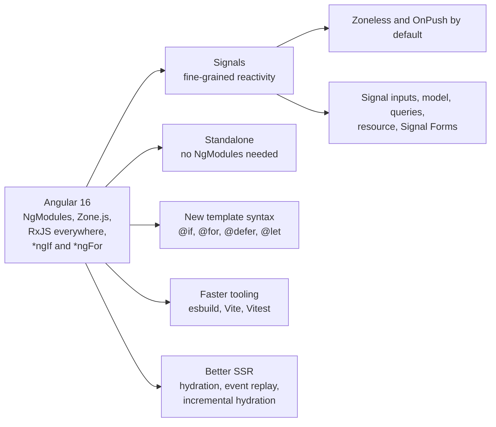
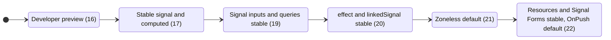
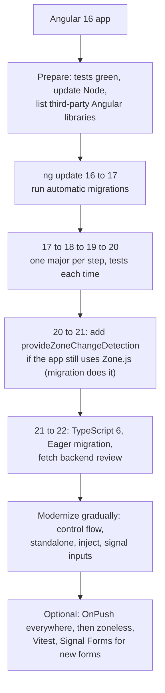

# Angular 16 vs newer versions

> This document explains what Angular 16 introduced, what changed in every major version after it (17 to 22, current as of October 2026), how the same code looks in Angular 16 and in modern Angular, and how to migrate. Many jobs use a newer Angular than your project. Interviewers will ask about signals, control flow, standalone, zoneless and SSR, and you need to answer with confidence and with correct version facts.

**Before this:** [Angular fundamentals](01-angular-fundamentals.md) · [Change detection and signals](10-change-detection-and-signals.md) · **Interview questions:** [jump to the interview section](#interview-questions)

## Table of contents

1. [Why versions matter in interviews](#why-versions-matter-in-interviews)
2. [Release schedule and support policy](#release-schedule-and-support-policy)
3. [The big picture: where Angular is going](#the-big-picture-where-angular-is-going)
4. [What Angular 16 introduced](#what-angular-16-introduced)
5. [Angular 17](#angular-17)
6. [Angular 18](#angular-18)
7. [Angular 19](#angular-19)
8. [Angular 20](#angular-20)
9. [Angular 21](#angular-21)
10. [Angular 22](#angular-22)
11. [Feature status timeline](#feature-status-timeline)
12. [In Angular 16 you write X, in newer Angular you write Y](#in-angular-16-you-write-x-in-newer-angular-you-write-y)
13. [Side-by-side example: one component, two versions](#side-by-side-example-one-component-two-versions)
14. [Migrating from Angular 16 to the latest version](#migrating-from-angular-16-to-the-latest-version)
15. [What to say in an interview when the job uses newer Angular](#what-to-say-in-an-interview-when-the-job-uses-newer-angular)
16. [Common mistakes](#common-mistakes)
17. [Interview questions](#interview-questions)
18. [Summary](#summary)
19. [References](#references)

---

## Why versions matter in interviews

Angular changed more between versions 16 and 22 than in the five years before. The core ideas (components, dependency injection, templates, services, routing, RxJS) are the same. But the **recommended way** to write a component in 2026 looks quite different from 2023:

- **Signals** instead of many RxJS subjects for local state.
- **Built-in control flow** (`@if`, `@for`) instead of `*ngIf`, `*ngFor`.
- **Standalone components** by default instead of NgModules.
- **Zoneless** change detection instead of Zone.js.
- **Signal-based inputs, outputs and queries** instead of decorators.
- **Vitest** instead of Karma.

If your daily work is Angular 16, an interviewer for an Angular 20+ job wants to know two things: do you understand the fundamentals deeply, and can you work with modern APIs without a long ramp-up? This document gives you both the facts and the words.

> **Accuracy note:** all version facts below were checked against the official Angular changelog and release notes, angular.dev, and the Angular blog. "Developer preview" means usable but the API may still change. "Experimental" means it may change a lot or be removed. "Stable" means it follows normal semantic versioning and deprecation rules.

## Release schedule and support policy

| Version | Released | Notes |
| --- | --- | --- |
| 16 | May 2023 | Signals preview, the "Angular renaissance" starts |
| 17 | 8 November 2023 | Control flow, `@defer`, new builder, angular.dev |
| 18 | 22 May 2024 | Zoneless experimental, control flow stable |
| 19 | 19 November 2024 | Standalone by default, `linkedSignal`, `resource` |
| 20 | 28 May 2025 | Signals core stable, zoneless preview |
| 21 | 19 November 2025 | Zoneless by default, Signal Forms experimental, Vitest default |
| 22 | 3 June 2026 | OnPush default, Signal Forms and resources stable, yearly majors begin |

Minor releases in the 22 line so far: **22.1** (end of July 2026) and **22.2** (late September 2026).

**Support policy:**

- Up to version 21, Angular released a major version about **every 6 months**. Each major got **6 months of active support** (new features, bug fixes) plus **12 months of long-term support (LTS)** (critical fixes and security patches only), so **18 months** in total.
- Starting with **Angular 22**, majors are planned **once a year** (around June), with **12 months active + 12 months LTS = 24 months** of support, and minor releases about every two months. Angular 23 is planned for around June 2027.
- As of October 2026: **22 is active**, **21 and 20 are in LTS**, and **19 and older (including 16) are unsupported**. Angular 16's LTS ended in November 2024.

What this means for an Angular 16 app: it receives **no security fixes** anymore. Upgrading is not just about new features.

## The big picture: where Angular is going

The changes from 16 to 22 follow a few clear themes. If you remember these themes, you can explain almost any new API.



1. **Reactivity with signals.** Signals tell Angular exactly what changed. This allows change detection without Zone.js and updates only the components that need it.
2. **Less boilerplate.** Standalone components, functional guards and interceptors, `inject()`, and the `@Service` decorator.
3. **Better templates.** Built-in control flow that is faster and type-safe, lazy loading inside templates with `@defer`, and more JavaScript expressions in templates.
4. **Modern tooling.** esbuild and Vite for builds and the dev server, Vitest for tests.
5. **Better server rendering.** Non-destructive hydration, event replay, incremental hydration.

## What Angular 16 introduced

Angular 16 (May 2023) started this new era. Here is what it added, with the status in 16.

| Feature | Status in 16 | Short description |
| --- | --- | --- |
| **Signals**: `signal`, `computed`, `effect` | Developer preview | Reactive values that notify Angular when they change. `WritableSignal` had `set`, `update` and `mutate` |
| **RxJS interop**: `toSignal`, `toObservable` (`@angular/core/rxjs-interop`) | Developer preview | Convert between Observables and signals |
| **`DestroyRef`** | Stable | Inject it to register cleanup callbacks: `inject(DestroyRef).onDestroy(...)` |
| **`takeUntilDestroyed()`** | Developer preview | RxJS operator that completes a stream when the component, directive or service is destroyed |
| **Required inputs**: `@Input({ required: true })` | Stable | Compile error if a parent does not pass the input |
| **Router input binding**: `withComponentInputBinding()` / `bindToComponentInputs: true` | Stable | Route params, query params, data and resolver results are bound to component `@Input`s with the same name |
| **Non-destructive hydration**: `provideClientHydration()` | Developer preview | Reuse server-rendered DOM instead of re-rendering; includes HTTP transfer cache |
| **Standalone project schematics**: `ng new --standalone` | Available | Create a new app without NgModules |
| **Standalone migration**: `ng generate @angular/core:standalone` | Available | Convert an existing app step by step |
| **esbuild-based builder** (`browser-esbuild`) with a Vite dev server | Developer preview | Much faster builds |
| **Jest builder** (`@angular-devkit/build-angular:jest`) | Experimental | Run unit tests with Jest instead of Karma |
| **CSP nonce for inline styles**: `ngCspNonce` attribute, `CSP_NONCE` token | Stable | Strict Content Security Policy without `'unsafe-inline'` for styles |
| **Self-closing component tags**: `<app-user-card />` | Supported | First added in 15.1; works in 16 |
| **`runInInjectionContext`**, `assertInInjectionContext` | Stable | Run code where `inject()` works |
| **`provideZoneChangeDetection({ eventCoalescing: true })`** | Stable | Configure NgZone in standalone apps |
| **TypeScript 5.0 support**, ngcc removed (Ivy-only libraries) | Stable | View Engine libraries no longer work |
| **Functional guard helpers** (`mapToCanActivate` etc.) | Stable | Class-based guards and resolvers were deprecated in 15.2 in favor of functional ones |
| **Input transforms**: `@Input({ transform: booleanAttribute })` (16.1) | Stable | Convert input values, for example `disabled=""` to `true` |
| **`withFetch()`** fetch backend for HttpClient (16.1) | Developer preview | Use `fetch` instead of XHR (useful for SSR) |
| **`afterRender`, `afterNextRender`** (16.2) | Developer preview | Run code after Angular renders (DOM measurements, third-party libraries) |

Compatibility of Angular 16.1/16.2: Node.js ^16.14.0 or ^18.10.0, TypeScript 4.9.3 to 5.1, RxJS ^6.5.3 or ^7.4.0.

An Angular 16 component using the new features (all verified to compile with Angular 16.2):

```ts
@Component({
  selector: 'app-product-badge',
  standalone: true,
  template: `<span [class.disabled]="disabled">{{ label }} ({{ count }})</span>`,
  changeDetection: ChangeDetectionStrategy.OnPush,
})
export class ProductBadgeComponent {
  @Input({ required: true }) label!: string;                 // 16.0
  @Input({ transform: numberAttribute }) count = 0;          // 16.1
  @Input({ transform: booleanAttribute }) disabled = false;  // 16.1
}

// usage: <app-product-badge label="Cart" count="3" disabled />
```

## Angular 17

Released 8 November 2023. The Angular team called this period the "Angular renaissance" and launched the new documentation site **angular.dev** (beta in 17, official home from 18).

| Change | Status in 17 |
| --- | --- |
| **Built-in control flow**: `@if`, `@else`, `@for` (with required `track`) and `@empty`, `@switch`/`@case`/`@default` | Developer preview |
| **Deferrable views**: `@defer` with `@placeholder`, `@loading`, `@error` and triggers (`on idle`, `on viewport`, `on interaction`, `on hover`, `on timer`, `when condition`, `prefetch`) | Developer preview |
| **Signals**: `signal`, `computed` and related APIs | **Stable** (`effect`, `toSignal`, `toObservable` stayed developer preview) |
| `mutate()` removed from `WritableSignal` | Breaking change: use `update()` with a new value |
| **Application builder** (esbuild + Vite) default for new projects; migration available (17.1) | Stable |
| **Standalone by default for `ng new`** (new projects have no NgModules) | Stable |
| **SSR**: `ng new --ssr`; new package `@angular/ssr` replaces Angular Universal (`@nguniversal`) | Stable |
| **Hydration** | Graduated from developer preview |
| Router **View Transitions API** support (`withViewTransitions()`) | Experimental |
| `withFetch()` fetch backend | Stable |
| `styleUrl` (single string) and `styles` as a string | Stable |
| Animations can be lazy-loaded: `provideAnimationsAsync()` | Available |
| Requirements: Node.js 18.13+, TypeScript 5.2+ | Breaking |

Minor releases added important signal APIs (all developer preview at that time):

- **17.1**: **signal inputs**: `input()`, `input.required()` (with `alias` and `transform`), experimental Web Test Runner builder.
- **17.2**: **`model()`** (two-way binding signal) and **signal queries**: `viewChild()`, `viewChildren()`, `contentChild()`, `contentChildren()`.
- **17.3**: **`output()`** function, plus `outputFromObservable()` and `outputToObservable()`; `HostAttributeToken`; `RouterTestingModule` deprecated in favor of `provideRouter`.

```html
<!-- Angular 17+ control flow -->
@if (user(); as u) {
  <p>Welcome, {{ u.name }}</p>
} @else {
  <a routerLink="/login">Log in</a>
}

@for (order of orders(); track order.id) {
  <app-order-row [order]="order" />
} @empty {
  <p>No orders yet.</p>
}
```

Why the new control flow is better than `*ngIf`/`*ngFor`: no import needed (built into the compiler), better type narrowing, `track` is required (so you never forget `trackBy`), faster list diffing, and it works without Zone.js-specific directives. A schematic converts old templates: `ng generate @angular/core:control-flow`.

## Angular 18

Released 22 May 2024. angular.dev became the official documentation site.

| Change | Status in 18 |
| --- | --- |
| **Control flow and `@defer`** | **Stable** |
| **Zoneless change detection**: `provideExperimentalZonelessChangeDetection()` | Experimental |
| Hybrid scheduling: with Zone.js, change detection also runs for signal updates and `markForCheck` outside the zone | Default |
| **Event replay** for SSR: `withEventReplay()` (records clicks before hydration and replays them) | Developer preview |
| i18n support for hydration: `withI18nSupport()` | Developer preview |
| **Fallback content in `<ng-content>`** | Stable |
| **Unified form events**: `control.events` emits `ValueChangeEvent`, `StatusChangeEvent`, `TouchedChangeEvent`, `PristineChangeEvent`, `FormSubmittedEvent`, `FormResetEvent` | Stable |
| **Route redirects as functions** (`redirectTo: (route) => ...`) and **`RedirectCommand`** returned from guards and resolvers | Stable |
| `HttpClientModule`, `HttpClientTestingModule`, `HttpClientXsrfModule`, `HttpClientJsonpModule` **deprecated** in favor of `provideHttpClient()` / `provideHttpClientTesting()` | Deprecation |
| HTTP transfer cache no longer caches requests with authorization headers by default | Breaking (safer) |
| Angular Material 3 (M3) design | Stable in Angular Material 18 |
| New builders package `@angular/build` (no webpack dependency); new projects use a `public` folder instead of `assets` | Tooling |
| Requirements: TypeScript 5.4+ | Breaking |

Minor releases:

- **18.1**: **`@let`** template variables (developer preview): `@let total = price() * quantity();`.
- **18.2**: smaller improvements (for example, automatic migration helpers and typing fixes).

## Angular 19

Released 19 November 2024.

| Change | Status in 19 |
| --- | --- |
| **Standalone is the default**: components, directives and pipes are standalone without `standalone: true`. NgModule declarations need `standalone: false` (added automatically by `ng update`). New compiler option `strictStandalone` | Stable (breaking default) |
| **Signal inputs, `model()`, `output()`, signal queries**, `outputFromObservable`, `outputToObservable` | **Stable** |
| **`takeUntilDestroyed()`** | **Stable** |
| **`@let`** | **Stable** |
| **Event replay** (`withEventReplay()`) | **Stable** |
| **`linkedSignal()`**: a writable signal that resets when its source changes | New, not yet stable |
| **`resource()`** and **`rxResource()`**: load async data with signals (`value`, `isLoading`, `error`, `reload`) | Experimental |
| **Incremental hydration**: `withIncrementalHydration()` and `@defer (hydrate on viewport)` | Developer preview |
| **Route-level render modes** for SSR (`RenderMode.Server`, `RenderMode.Prerender`, `RenderMode.Client`) | Developer preview |
| **`effect()` timing changed**: component effects run during change detection; `allowSignalWrites` no longer needed (deprecated) | Developer preview, breaking |
| `APP_INITIALIZER`, `ENVIRONMENT_INITIALIZER`, `PLATFORM_INITIALIZER` **deprecated**, replaced by `provideAppInitializer()`, `provideEnvironmentInitializer()`, `providePlatformInitializer()` | Deprecation |
| `afterRenderEffect()` | Developer preview |
| HMR for styles enabled by default in `ng serve` (templates experimentally) | Tooling |
| Diagnostic for unused standalone imports | Stable |
| `security.autoCsp` option generates a hash-based CSP | Tooling |
| Migrations: `ng generate @angular/core:signals` (inputs, outputs, queries), `@angular/core:inject` | Tooling |
| Requirements: TypeScript 5.5+ | Breaking |

Minor releases:

- **19.1**: HMR for templates by default, small API improvements.
- **19.2**: **`httpResource()`** (experimental), streaming `resource`/`rxResource`, **template literals** in templates (`` `Hello ${name()}` ``), self-closing tag migration.

## Angular 20

Released 28 May 2025.

| Change | Status in 20 |
| --- | --- |
| **`effect()`, `toSignal()`, `toObservable()`, `linkedSignal()`, `afterNextRender()`, `afterRenderEffect()`, `PendingTasks`** | **Stable** |
| `afterRender()` **renamed** `afterEveryRender()` | Stable (breaking rename) |
| **Zoneless**: renamed `provideZonelessChangeDetection()`; `ng new --zoneless` | Developer preview |
| **Incremental hydration**, `withI18nSupport()` | **Stable** |
| `resource()`, `rxResource()`, `httpResource()` | Still experimental; options renamed (`request` → `params`, rxResource `loader` → `stream`) |
| **`*ngIf`, `*ngFor`, `*ngSwitch` deprecated** (use `@if`, `@for`, `@switch`) | Deprecation |
| Template expressions: `**` exponent, `in`, `void`, tagged template literals | Stable |
| Dynamic components: `createComponent` with `bindings` (`inputBinding()`, `outputBinding()`, `twoWayBinding()`) and `directives` | Stable |
| `TestBed.get()` and `InjectFlags` removed; `TestBed.flushEffects()` deprecated (use `TestBed.tick()`) | Breaking |
| `@angular/platform-browser-dynamic` deprecated (use `@angular/platform-browser`); HammerJS integration deprecated | Deprecation |
| `ng-reflect-*` attributes no longer added by default | Breaking |
| New **style guide**: `ng generate component user` creates `user.ts` and class `User` (no `.component` suffix) by default | Tooling |
| **Vitest** unit-test builder (`@angular/build:unit-test`) | Experimental |
| Requirements: Node.js 20.19+ / 22.12+ / 24, TypeScript 5.8+ | Breaking |

Minor releases:

- **20.1**: smaller improvements.
- **20.2**: **zoneless becomes stable** (`provideZonelessChangeDetection()`); new **`animate.enter` / `animate.leave`** animation API; **`@angular/animations` deprecated**; ARIA bindings without `attr.` (`[aria-label]`); `Router.getCurrentNavigation()` deprecated in favor of the `currentNavigation` signal; AI tooling (`ng g ai-config`, MCP server tools).
- **20.3**: maintenance.

## Angular 21

Released 19 November 2025.

| Change | Status in 21 |
| --- | --- |
| **Zoneless by default for new apps.** Apps that need Zone.js must add `provideZoneChangeDetection()` (the update migration adds it) | Stable (breaking default) |
| **Signal Forms**: `form()` in `@angular/forms/signals`, schema-based validation (`required`, `email`, `minLength`, `validate`, `validateAsync`, `validateHttp`), `compatForm` for migration | Experimental |
| **Vitest is the default test runner**; `@angular/build:unit-test` stable; Karma still supported; experimental Jest and Web Test Runner builders announced for removal | Stable |
| **Angular Aria** (`@angular/aria`): headless accessible directives (accordion, combobox, listbox, menu, tabs, tree, grid, toolbar...) | Developer preview |
| **`HttpClient` provided in root by default** (`provideHttpClient()` only needed for configuration like interceptors) | Stable |
| `SimpleChanges` is generic (`SimpleChanges<MyComponent>`) | Stable |
| Regular expressions in templates; `@defer (on viewport({ rootMargin }))` options | Stable |
| Host binding type checking on by default (`typeCheckHostBindings`) | Stable |
| Optional migrations: `ngClass` → `[class]`, `ngStyle` → `[style]`, `CommonModule` → standalone imports | Tooling |
| Angular CLI **MCP server** for AI assistants; Tailwind option in `ng new` | Tooling |
| `moduleId` and the `interpolation` component option removed | Breaking |
| Requirements: TypeScript 5.9+ | Breaking |

Minor releases:

- **21.1**: Signal Forms `[field]` renamed `[formField]`; spread syntax in template expressions; multiple consecutive `@case` blocks; standalone `isActive()` router function; `ChangeDetectionStrategy.Default` deprecated.
- **21.2**: **arrow functions** and `instanceof` in templates; exhaustive `@switch` checks with `@default never;`; **`ChangeDetectionStrategy.Eager`** added as the new name for `Default`; resource snapshots; more Signal Forms features (`[formRoot]`, submission options).

## Angular 22

Released 3 June 2026. This is the **current major version** (with minor releases 22.1 and 22.2) as of October 2026, and the first major in the new yearly cadence.

| Change | Status in 22 |
| --- | --- |
| **OnPush is the default** change detection strategy. `Default` was renamed **`ChangeDetectionStrategy.Eager`**; a migration adds `Eager` to existing components without a strategy | Stable (breaking default) |
| **Signal Forms** | **Stable** |
| **`resource()`, `rxResource()`, `httpResource()`** (the asynchronous reactivity APIs) | **Stable** |
| **Angular Aria** | **Stable** |
| **`HttpClient` uses the Fetch API by default** (`FetchBackend`); `withFetch()` deprecated; use `withXhr()` to keep XHR (for example, for upload progress) | Stable (breaking default) |
| **`@Service()` decorator**: shorter equivalent of `@Injectable({ providedIn: 'root' })`, works with `inject()` (no constructor injection); `ng generate service` uses it | Stable |
| **`injectAsync()`**: lazy-load a service with a dynamic import | New |
| **`debounced()`** for signals (returns a resource) | Experimental |
| **Incremental hydration is the default** with `provideClientHydration()` | Stable (breaking default) |
| `strictTemplates` on by default; better null narrowing with `?.` in templates; comments inside elements; `@defer (on idle(500ms))` | Stable |
| Router: `paramsInheritanceStrategy` defaults to `'always'`; `canMatch` receives `currentSnapshot`; `withComponentInputBinding()` options | Breaking / stable |
| Removed: `ComponentFactoryResolver` and `ComponentFactory`, Hammer.js integration, `provideRoutes()`, `ChangeDetectorRef.checkNoChanges` | Breaking |
| `TestBed.getLastFixture()`; Karma-to-Vitest migration schematic | Tooling |
| WebMCP tools for AI agents (`provideExperimentalWebMcpTool`) and Angular agent skills | Experimental |
| Requirements: **TypeScript 6.0**; Node.js ^22.22.3, ^24.15.0 or ^26 | Breaking |

Note: `*ngIf`, `*ngFor` and `*ngSwitch` are **still deprecated but not removed** in 22. The official docs state an intent to remove them in a future major release.

Minor releases:

- **22.1** (July 2026): `linkedSignal` with a custom setter; **JSONP support deprecated**; `@Injectable` → `@Service` migration (`ng generate @angular/core:service`); HTTP interceptors automatically untracked inside effects; Rolldown stable for chunk optimization.
- **22.2** (September 2026): **`@boundary { } @error { }`** template blocks to catch rendering errors and show fallback UI (developer preview); **router resources** (`withRouterResources()`, a signal-based alternative to resolvers, developer preview); throwing `RedirectCommand` from guards and resolvers; `TestBed.createDirective()`; `private` component members usable in templates; `withAutoCleanupInjectors()` stable.

## Feature status timeline

This table is useful to revise quickly. "DP" = developer preview, "Exp" = experimental.

| Feature | 16 | 17 | 18 | 19 | 20 | 21 | 22 |
| --- | --- | --- | --- | --- | --- | --- | --- |
| `signal`, `computed` | DP | Stable | Stable | Stable | Stable | Stable | Stable |
| `effect`, `toSignal`, `toObservable` | DP | DP | DP | DP | Stable | Stable | Stable |
| `takeUntilDestroyed` | DP | DP | DP | Stable | Stable | Stable | Stable |
| Signal `input()`, `model()`, `output()`, signal queries | — | DP (17.1–17.3) | DP | Stable | Stable | Stable | Stable |
| `@if`, `@for`, `@switch` | — | DP | Stable | Stable | Stable | Stable | Stable |
| `*ngIf`, `*ngFor`, `*ngSwitch` | Normal | Normal | Normal | Normal | Deprecated | Deprecated | Deprecated |
| `@defer` | — | DP | Stable | Stable | Stable | Stable | Stable |
| `@let` | — | — | DP (18.1) | Stable | Stable | Stable | Stable |
| Standalone default | No | `ng new` only | `ng new` only | Yes | Yes | Yes | Yes |
| Hydration | DP | Stable | Stable | Stable | Stable | Stable | Stable |
| Event replay | — | — | DP | Stable | Stable | Stable | Stable |
| Incremental hydration | — | — | — | DP | Stable | Stable | Default |
| Zoneless | — | — | Exp | Exp | DP (stable in 20.2) | Default for new apps | Default for new apps |
| `linkedSignal` | — | — | — | New | Stable | Stable | Stable |
| `resource`, `rxResource`, `httpResource` | — | — | — | Exp (httpResource 19.2) | Exp | Exp | Stable |
| Signal Forms | — | — | — | — | — | Exp | Stable |
| OnPush as default | No | No | No | No | No | No | Yes |
| Default unit test runner | Karma | Karma | Karma | Karma | Karma (Vitest Exp) | Vitest | Vitest |
| Default build system for new apps | webpack (esbuild DP) | esbuild + Vite | esbuild + Vite | esbuild + Vite | esbuild + Vite | esbuild + Vite | esbuild + Vite |



## In Angular 16 you write X, in newer Angular you write Y

| Topic | Angular 16 | Newer Angular | Since |
| --- | --- | --- | --- |
| Conditional | `<p *ngIf="user; else login">` | `@if (user) { <p> } @else { ... }` | 17 (stable 18) |
| Loop | `*ngFor="let o of orders; trackBy: trackById"` | `@for (o of orders; track o.id) { } @empty { }` | 17 (stable 18) |
| Switch | `[ngSwitch]` / `*ngSwitchCase` | `@switch (status) { @case ('paid') { } }` | 17 (stable 18) |
| Lazy part of a template | dynamic `import()` + `ViewContainerRef.createComponent` | `@defer (on viewport) { <app-reviews /> }` | 17 (stable 18) |
| Template variable | `*ngIf="data$ \| async as data"` trick | `@let data = data$ \| async;` | 18.1 (stable 19) |
| Input | `@Input() name = '';` | `name = input('');` → read with `name()` | 17.1 (stable 19) |
| Required input | `@Input({ required: true }) id!: string;` | `id = input.required<string>();` | 17.1 (stable 19) |
| Output | `@Output() saved = new EventEmitter<Order>();` | `saved = output<Order>();` | 17.3 (stable 19) |
| Two-way binding | `@Input() value` + `@Output() valueChange` | `value = model(0);` | 17.2 (stable 19) |
| View query | `@ViewChild('chart') chart!: ElementRef;` | `chart = viewChild<ElementRef>('chart');` | 17.2 (stable 19) |
| React to input changes | `ngOnChanges(changes: SimpleChanges)` | `computed(() => ...)` or `effect()` on signal inputs | 17.1+ |
| Standalone flag | `standalone: true` (or NgModule `declarations`) | Not needed: standalone is the default | 19 |
| App bootstrap | `platformBrowserDynamic().bootstrapModule(AppModule)` | `bootstrapApplication(App, appConfig)` | available since 14/15; default in `ng new` since 17 |
| Service | `@Injectable({ providedIn: 'root' })` | `@Service()` (or keep `@Injectable`) | 22 |
| Constructor DI | `constructor(private http: HttpClient) {}` | `private http = inject(HttpClient);` | `inject()` since 14; recommended by style guide in 20 |
| Startup logic | `{ provide: APP_INITIALIZER, useFactory, multi: true }` | `provideAppInitializer(() => inject(Config).load())` | 19 |
| HTTP setup | `HttpClientModule` | `provideHttpClient()` (and in 21+ not needed unless configuring) | 15 / 18 deprecation / 21 |
| HTTP backend | XHR (`withFetch()` DP in 16.1) | Fetch by default, `withXhr()` to opt out | 22 |
| Interceptors | class + `HTTP_INTERCEPTORS` | `withInterceptors([fnInterceptor])` (available in 16 too) | 15 |
| Guards | class guards or functional guards | functional guards (`CanActivateFn`) | 14.2+ |
| Load async data in a component | Observable + `async` pipe | `resource()` / `httpResource()` / `rxResource()` | 19 (stable 22) |
| Derived writable state | `BehaviorSubject` + subscription logic | `linkedSignal()` | 19 (stable 20) |
| Unsubscribe | `takeUntil(destroy$)` or `takeUntilDestroyed()` (DP) | `takeUntilDestroyed()` (stable), or signals instead of subscriptions | 19 |
| Change detection | Zone.js + Default strategy (OnPush opt-in) | Zoneless + OnPush default | 21 / 22 |
| Forms | Reactive forms (`FormGroup`, typed forms) | Reactive forms still supported; **Signal Forms** (`form()`, `[formField]`) | 21 exp / 22 stable |
| Animations | `@angular/animations` (`trigger`, `state`, `transition`) | `animate.enter` / `animate.leave` with CSS | 20.2 |
| SSR | Angular Universal (`@nguniversal/express-engine`) | `@angular/ssr`, `ng new --ssr` | 17 |
| Hydration | `provideClientHydration()` (DP) | stable, plus `withEventReplay()`, incremental hydration (default in 22) | 17 / 19 / 22 |
| Builder | webpack `browser` builder (esbuild DP) | `application` builder (esbuild + Vite) | 17 |
| Unit tests | Karma + Jasmine | Vitest (`@angular/build:unit-test`) | 21 |
| `ngClass` / `ngStyle` | common | prefer `[class.x]`, `[class]`, `[style.x]` bindings (migrations in 21) | style guide 20 |
| File names | `user-card.component.ts`, `UserCardComponent` | `user-card.ts`, `UserCard` (new projects) | 20 |
| Error UI in templates | try/catch in code, `ErrorHandler` | `@boundary { } @error { }` | 22.2 (DP) |

## Side-by-side example: one component, two versions

### Angular 16

```ts
@Component({
  selector: 'app-order-list',
  standalone: true,
  imports: [NgIf, NgFor, AsyncPipe, CurrencyPipe, OrderRowComponent],
  changeDetection: ChangeDetectionStrategy.OnPush,
  template: `
    <h2>{{ title }}</h2>
    <ng-container *ngIf="orders$ | async as orders; else loading">
      <app-order-row
        *ngFor="let order of orders; trackBy: trackById"
        [order]="order"
        (selected)="select.emit(order)" />
      <p *ngIf="orders.length === 0">No orders.</p>
      <p>Total: {{ total(orders) | currency }}</p>
    </ng-container>
    <ng-template #loading><p>Loading...</p></ng-template>
  `,
})
export class OrderListComponent implements OnChanges {
  @Input({ required: true }) customerId!: string;
  @Input() title = 'Orders';
  @Output() select = new EventEmitter<Order>();

  private api = inject(OrdersApiService);
  orders$!: Observable<Order[]>;

  ngOnChanges(changes: SimpleChanges): void {
    if (changes['customerId']) {
      this.orders$ = this.api.getOrders(this.customerId);
    }
  }

  total(orders: Order[]): number {
    return orders.reduce((sum, o) => sum + o.total, 0);
  }

  trackById(_: number, order: Order): string {
    return order.id;
  }
}
```

### Angular 22 (modern style)

```ts
@Component({
  selector: 'app-order-list',
  imports: [CurrencyPipe, OrderRow],          // standalone by default (19+), OnPush by default (22+)
  template: `
    <h2>{{ title() }}</h2>
    @if (orders.isLoading()) {
      <p>Loading...</p>
    } @else if (orders.error()) {
      <p role="alert">Could not load orders.</p>
    } @else {
      @for (order of orders.value() ?? []; track order.id) {
        <app-order-row [order]="order" (selected)="select.emit(order)" />
      } @empty {
        <p>No orders.</p>
      }
      <p>Total: {{ total() | currency }}</p>
    }
  `,
})
export class OrderList {
  customerId = input.required<string>();
  title = input('Orders');
  select = output<Order>();

  // httpResource re-fetches automatically when customerId() changes (stable in 22)
  orders = httpResource<Order[]>(() => `/api/customers/${this.customerId()}/orders`);

  total = computed(() => (this.orders.value() ?? []).reduce((sum, o) => sum + o.total, 0));
}
```

What changed:

1. No `standalone: true` (default since 19) and no `changeDetection` (OnPush is the default in 22).
2. `@Input`/`@Output` became `input()`, `input.required()` and `output()`. Inputs are signals, read with `()`.
3. `ngOnChanges` disappeared: `httpResource` reacts to the `customerId` signal automatically.
4. `*ngIf`/`*ngFor`/`ng-template` became `@if`/`@for`/`@empty`, with required `track`.
5. The total is a `computed` signal, recalculated only when the data changes (no method call in the template).
6. Loading and error states come from the resource (`isLoading()`, `error()`, `value()`).
7. No Zone.js is needed: signals tell Angular exactly what to update.

The **concepts** are the same: inputs, outputs, a service call, a derived total, list tracking, OnPush. That is the key message for interviews.

## Migrating from Angular 16 to the latest version

### The rules

1. **Upgrade one major version at a time**: 16 → 17 → 18 → 19 → 20 → 21 → 22. `ng update` only supports moving one major at a time, because migrations are written for each step.
2. **Use the official update guide**: https://angular.dev/update-guide (choose "from 16 to 17", then the next step, and so on). It lists manual steps for your app's complexity.
3. **Check the compatibility table** for each step: Node.js and TypeScript versions change (for example, 17 needs Node 18.13+ and TS 5.2+; 20 needs Node 20.19+ and TS 5.8+; 22 needs TS 6.0 and Node 22.22+).
4. **Update third-party libraries** that depend on Angular (Angular Material/CDK, NgRx, ngx-translate or Transloco, PrimeNG, etc.) to versions that support each Angular major. Libraries are usually the slowest part.
5. **Keep tests green at every step.** Commit after each major. Deploy intermediate versions if the project allows it.

### Commands for each step

```bash
# Example: from 16 to 17 (repeat for each major)
npx ng update @angular/core@17 @angular/cli@17
npx ng update @angular/material@17      # if used
npx ng update @ngrx/store@17            # if used (NgRx majors follow Angular)
npm run test && npm run build
```

`ng update` updates `package.json`, runs automatic migrations (code changes written by the Angular team), and reports what it changed.

### Optional modernization schematics

These are **not required** for upgrading. Run them when you are ready, ideally one at a time, each in its own pull request:

| Schematic | What it does | Available since |
| --- | --- | --- |
| `ng generate @angular/core:standalone` | Converts NgModule components to standalone, removes unnecessary modules, switches to `bootstrapApplication` | 15.2 / 16 |
| `ng generate @angular/core:control-flow` | Converts `*ngIf`/`*ngFor`/`*ngSwitch` to `@if`/`@for`/`@switch` | 17 |
| `ng update @angular/cli --name use-application-builder` | Moves the project to the esbuild application builder | 17.1 |
| `ng generate @angular/core:inject` | Converts constructor injection to `inject()` | 19 |
| `ng generate @angular/core:signals` | Converts `@Input`, `@Output` and queries to signal APIs (runs input, output and query migrations) | 19 |
| `ng generate @angular/core:self-closing-tag` | Converts `<app-x></app-x>` to `<app-x />` | 19.2 |
| `ng generate @angular/core:ngclass-to-class-migration` | Converts `ngClass` to `[class]` bindings | 21 |
| `ng generate refactor-jasmine-vitest` / `migrate-karma-to-vitest` | Moves tests from Jasmine/Karma to Vitest | 21 / 22 |

Steps that need **manual work** or care:

- **Zone.js to zoneless**: not automatic for existing apps. Make components OnPush-compatible first (immutable data, `async` pipe or signals, `markForCheck` where needed), remove reliance on `setTimeout`-triggered change detection, then switch to `provideZonelessChangeDetection()` and remove `zone.js` from polyfills. Tests that use `fakeAsync` need attention.
- **Hydration**: fix DOM manipulation that breaks hydration before enabling it.
- **Universal to `@angular/ssr`**: handled by migrations in 17, but check custom server code.
- **Animations**: `@angular/animations` still works but is deprecated since 20.2; plan the move to `animate.enter`/`animate.leave`.
- **Breaking defaults in 22**: review components that relied on Default change detection (the migration adds `Eager`), upload progress code (fetch has no upload progress, use `withXhr()`), and router `paramsInheritanceStrategy`.

### A realistic migration plan



A good order for modernization after the version upgrade: control flow (safe and mechanical) → standalone → `inject()` → signal inputs/outputs/queries → OnPush everywhere → zoneless → new features with signals, resources and Signal Forms.

## What to say in an interview when the job uses newer Angular

### The message

Your goal is to show: "My fundamentals are solid, I follow how Angular evolves, and I already know how the modern APIs map to what I use every day."

### A sample answer

> "My current project is on Angular 16, so I use NgModules and standalone components side by side, OnPush with the async pipe, RxJS for async flows, and I've used signals and `takeUntilDestroyed`, which were developer previews in 16. I follow the newer releases closely. I know that in 17 Angular added the built-in control flow and `@defer`, in 19 standalone became the default and signal inputs, model and queries became stable, in 20 effect and linkedSignal became stable and zoneless reached stable in 20.2, in 21 zoneless became the default for new apps with Vitest and experimental Signal Forms, and in 22 OnPush became the default and Signal Forms and resources became stable. The concepts map directly: `@Input` becomes `input()`, `*ngFor` with trackBy becomes `@for` with track, a BehaviorSubject in a component often becomes a signal, and HTTP loading state can become `httpResource`. I'd also be comfortable leading an upgrade: one major at a time with `ng update` and the official migrations."

### Tips

- **Be honest** about what you used in production vs what you studied. "I've built a side project with Angular 20 signals" is much stronger than pretending.
- **Connect new APIs to concepts you know.** Signals vs RxJS (sync state vs async event streams), `@for` vs `*ngFor` + trackBy, zoneless vs OnPush + `markForCheck`.
- **Know the "why"** of each change: performance (zoneless, fine-grained updates), developer experience (less boilerplate), safety (required `track`, type narrowing).
- **Mention migration experience** if you have any (even running `ng update` on a side project).
- Build a small project with the latest Angular before the interview: a signal-based component, `@for`, `httpResource`, a Signal Form and a Vitest test. One evening is enough to speak from experience.

### Do signals replace RxJS?

A very common follow-up. A good answer:

> "Not completely. Signals are great for **state**: synchronous values that the template reads, derived values with `computed`, and they let Angular update precisely without Zone.js. RxJS is still the best tool for **events over time**: debouncing a search box, combining streams, cancelling requests with `switchMap`, websockets, retries. Angular gives interop functions (`toSignal`, `toObservable`, `rxResource`), so in practice you use signals at the component and template level and RxJS for complex async flows. In newer Angular, resources cover the common 'load data when inputs change' case, which used to need RxJS."

## Common mistakes

1. **Wrong version facts**: "signals are stable in 16" (developer preview), "zoneless is stable in 18" (experimental in 18, stable in 20.2), "standalone is the default in 17" (default for `ng new` in 17, default for declarations in 19), "`*ngIf` was removed" (deprecated since 20, still present in 22).
2. **Skipping majors** with `ng update` (it does not work and skips migrations).
3. **Forgetting third-party libraries** when planning an upgrade.
4. **Big-bang modernization**: converting control flow, standalone, signals and zoneless in one pull request. Small steps are safer.
5. **Assuming zoneless is a switch**: code that relied on Zone.js to update the UI (for example, changing a field in `setTimeout` in a Default component) stops updating.
6. **Thinking signals made RxJS obsolete.** They solve different problems.
7. **Using deprecated APIs in new code** in a modern project (`HttpClientModule`, `APP_INITIALIZER`, `*ngFor`), which shows you have not followed recent Angular.

---

## Interview questions

### Q1. What were the most important features of Angular 16?

**What the interviewer is checking:** whether you know the version you claim to work with.

**Short spoken answer (30–60 seconds):**
> Angular 16 started the signals era: it introduced signal, computed and effect as a developer preview, plus RxJS interop with toSignal and toObservable. It added DestroyRef and the takeUntilDestroyed operator for cleanup, required inputs, and in 16.1 input transforms like booleanAttribute. The router could bind route params and data directly to component inputs with withComponentInputBinding. For SSR it added non-destructive hydration as a developer preview, so the client reuses the server DOM. On tooling, there were standalone schematics for new apps, the esbuild builder in developer preview, experimental Jest support, CSP nonce support for inline styles, and in 16.2 afterRender and afterNextRender.

**Follow-up questions:**
- **What does `withComponentInputBinding` do?** — It binds route path params, query params, route data and resolver results to `@Input`s with matching names, so you do not need to inject `ActivatedRoute` for simple cases.
- **What did `mutate` do on signals?** — It changed the current value in place and notified consumers. It was removed in 17; you use `update` with a new value instead.
- **Were signals production-ready in 16?** — They were a developer preview: usable, but the API could change. `signal` and `computed` became stable in 17.

**Common mistakes:** Listing control flow or `@defer` as Angular 16 features (they are 17).

**Where this is used in real projects:** Teams still on 16 use required inputs, input transforms, `DestroyRef` and functional guards every day.

### Q2. What changed in Angular 17, and why was it called a big release?

**What the interviewer is checking:** knowledge of the "renaissance" release.

**Short spoken answer (30–60 seconds):**
> Angular 17 added the built-in control flow, `@if`, `@for` with a required track expression and `@switch`, and deferrable views with `@defer`, both as developer previews that became stable in 18. Signals, meaning signal and computed, became stable, and mutate was removed. New projects became standalone by default and used the new application builder based on esbuild and Vite, which makes builds much faster. SSR moved to the new `@angular/ssr` package with `ng new --ssr`, and hydration left developer preview. The team also launched angular.dev. The minor versions then added signal inputs in 17.1, model and signal queries in 17.2, and the output function in 17.3.

**Follow-up questions:**
- **Why is `@for` with `track` better than `*ngFor`?** — `track` is required, so DOM reuse is always correct; the compiler generates faster code; no import is needed; and type narrowing works better.
- **How do you migrate templates?** — `ng generate @angular/core:control-flow`.

### Q3. What is zoneless Angular, and what is its status in each version?

**What the interviewer is checking:** precise version knowledge and understanding of change detection.

**Short spoken answer (30–60 seconds):**
> Zoneless means running Angular without Zone.js. Instead of Zone.js telling Angular "something async happened, check everything", Angular schedules change detection only when it knows something changed: a signal read by a template changes, a template event handler runs, the async pipe gets a value, `markForCheck` is called, or `setInput` is used. Benefits are smaller bundles, fewer unnecessary checks, cleaner stack traces and native async/await. It was experimental in 18 with `provideExperimentalZonelessChangeDetection`, developer preview in 20 with the renamed `provideZonelessChangeDetection`, stable in 20.2, and the default for new apps in 21, where apps that need Zone.js add `provideZoneChangeDetection`. To migrate, components should already work with OnPush rules.

**Follow-up questions:**
- **What breaks when you remove Zone.js?** — Code that changes component fields inside `setTimeout`, promises or third-party callbacks without signals or `markForCheck` no longer updates the view. `fakeAsync` tests also depend on Zone.js.
- **Is `runOutsideAngular` still needed?** — Not for avoiding change detection in zoneless apps.

### Q4. Compare `@Input()` with signal `input()`.

**Short spoken answer (30–60 seconds):**
> `@Input()` is a decorator on a class property; Angular assigns a new value, and I react with ngOnChanges or a setter. `input()` arrived in 17.1 and became stable in 19. It creates a read-only signal, so I read it with `name()`, and I can derive values with computed or react with effect instead of ngOnChanges. Required inputs are `input.required<T>()`, and it supports alias and transform like the decorator. Signal inputs work naturally with OnPush and zoneless change detection, because Angular knows exactly which component reads the signal. One difference: a signal input cannot be written from inside the component; for two-way binding you use `model()`.

**Code:**

```ts
// Angular 16
@Input({ required: true }) userId!: string;
ngOnChanges(c: SimpleChanges) { if (c['userId']) this.load(this.userId); }

// Angular 19+ (stable)
userId = input.required<string>();
user = httpResource<User>(() => `/api/users/${this.userId()}`); // httpResource stable in 22
```

### Q5. What are `linkedSignal` and `resource`, and when were they added?

**Short spoken answer (30–60 seconds):**
> Both arrived in Angular 19. `linkedSignal` is a writable signal whose value is computed from a source, but the user can also set it; when the source changes, it resets. A typical case is a selected item that should reset when the list changes. It became stable in 20. `resource` loads async data reactively: you give it params as a signal-based function and a loader, and it exposes value, isLoading, error and reload, and re-runs when the params change. `rxResource` does the same with an Observable, and `httpResource`, added in 19.2, wraps HttpClient. They were experimental for a while and became stable in Angular 22.

### Q6. What are Signal Forms?

**Short answer:** A new forms API built on signals, in `@angular/forms/signals`. You keep the form model in a signal and create a form with `form(modelSignal, schema => { required(schema.email); ... })`, then bind fields with `[formField]` (named `[field]` before 21.1). Validation rules, async validation (`validateAsync`, `validateHttp`) and field state (valid, touched, errors) are signals. Introduced as **experimental in 21** and **stable in 22**. Reactive and template-driven forms are still supported, and there are compatibility helpers (`compatForm`, `SignalFormControl`) for gradual migration.

### Q7. What changed about change detection defaults in Angular 22?

**Short spoken answer (30–60 seconds):**
> In 22, components that don't specify a change detection strategy use OnPush by default. The old Default strategy was renamed `ChangeDetectionStrategy.Eager` — the alias was added in 21.2, and Default was deprecated in 21.1. `ng update` runs a migration that adds `changeDetection: ChangeDetectionStrategy.Eager` to existing components without an explicit strategy, so their behavior doesn't change. Combined with zoneless being the default for new apps since 21, new Angular apps now follow the "signals plus OnPush" model by default.

### Q8. How would you upgrade an Angular 16 application to the latest version?

**What the interviewer is checking:** practical upgrade experience and planning.

**Short spoken answer (30–60 seconds):**
> I'd go one major version at a time, 16 to 17, then 18, up to 22, using `ng update @angular/core@X @angular/cli@X` and the official update guide for each step, because the automatic migrations are written per version. Before starting I make sure tests pass, I check the Node and TypeScript requirements — for example 20 needs Node 20.19 or newer and 22 needs TypeScript 6 — and I list third-party Angular libraries like Material and NgRx, because they must support each version too. After each step I run tests and the production build, and ideally deploy. Then I modernize separately in small pull requests: control flow migration, standalone migration, inject migration, signal inputs, and later OnPush and zoneless.

**Follow-up questions:**
- **Why not jump straight from 16 to 22?** — `ng update` does not support skipping majors, and each version's migrations expect the previous version's code.
- **What usually blocks upgrades?** — Third-party libraries that are not updated, deprecated APIs (for example `ComponentFactoryResolver`, removed in 22), and custom build configuration (webpack customizations when moving to the esbuild builder).

### Q9. Do signals replace RxJS?

**Short answer:** No. Signals are for synchronous **state** read by templates and derived with `computed`, and they enable fine-grained, zoneless updates. RxJS remains the tool for **streams of events over time**: debounce, `switchMap` cancellation, combining sources, websockets, retries. Use interop (`toSignal`, `toObservable`, `rxResource`) at the boundary. `resource`/`httpResource` now cover the common "load data when inputs change" case. (See [What to say in an interview](#do-signals-replace-rxjs).)

### Q10. What is the support status of Angular 16, and why should a company care?

**Short spoken answer (30–60 seconds):**
> Angular 16 was released in May 2023. It had six months of active support and twelve months of LTS, so support ended in November 2024. Today it receives no bug fixes or security patches, and its official Node versions, 16 and 18, are end-of-life too. That means known vulnerabilities in Angular or its toolchain won't be fixed. A company running Angular 16 in production should plan an upgrade. From Angular 22 the policy changed to yearly majors with 24 months of support, which makes it easier to stay on a supported version.

### Q11. Your new job uses Angular 21 and you have only used Angular 16. How do you prepare?

**Short answer:** Learn the mapping from what I know: `*ngIf`/`*ngFor` → `@if`/`@for` with `track`; `@Input`/`@Output` → `input()`/`output()`/`model()`; `@ViewChild` → `viewChild()`; NgModules → standalone by default; Zone.js → zoneless (so OnPush rules and signals matter more); Karma → Vitest; `APP_INITIALIZER` → `provideAppInitializer`; HTTP loading → `httpResource`; and the basics of Signal Forms. Then build a small app with the latest CLI to practice, and read the angular.dev guides for signals, control flow and zoneless.

### Q12. Which of these statements are true? (a) Standalone components became the default in Angular 17. (b) `*ngFor` was removed in Angular 22. (c) `effect()` became stable in Angular 20. (d) Hydration was stable in Angular 16.

**Answer:** Only **(c)** is fully true.

- (a) Partly: in 17, `ng new` created standalone apps by default, but `standalone: true` was still required in the decorator. Standalone became the default for all components, directives and pipes in **19**.
- (b) False: `*ngFor` was **deprecated in 20** and is still present (deprecated) in 22.
- (c) True: `effect`, `toSignal`, `toObservable` and `linkedSignal` became stable in 20.
- (d) False: hydration was a **developer preview** in 16 and became stable in 17.

---

## Summary

- **Angular 16** (May 2023) introduced signals (developer preview), RxJS interop, `DestroyRef`/`takeUntilDestroyed`, required inputs, input transforms (16.1), router input binding, non-destructive hydration (preview), the esbuild builder (preview), experimental Jest, CSP nonce support and `afterRender` (16.2). It is **no longer supported** (LTS ended November 2024).
- **17**: `@if`/`@for`/`@switch`, `@defer` (preview), stable `signal`/`computed`, application builder, standalone `ng new`, `@angular/ssr`, angular.dev; 17.1–17.3 added `input()`, `model()`, signal queries, `output()`.
- **18**: control flow and `@defer` stable, zoneless experimental, event replay, `ng-content` fallback, form events, `HttpClientModule` deprecated; `@let` in 18.1.
- **19**: standalone by default, signal inputs/outputs/queries/`model`/`@let`/`takeUntilDestroyed` stable, `linkedSignal`, `resource` (experimental), incremental hydration (preview), `provideAppInitializer`.
- **20**: `effect`, `linkedSignal`, `toSignal` stable; zoneless stable in **20.2**; `*ngIf`/`*ngFor`/`*ngSwitch` deprecated; new style guide; Vitest experimental; new animations API in 20.2.
- **21**: zoneless default for new apps, Signal Forms experimental, Vitest default, Angular Aria preview, HttpClient provided by default.
- **22** (June 2026, current): OnPush default (`Eager` for the old behavior), Signal Forms, resources and Angular Aria stable, fetch-based HttpClient by default, `@Service`, TypeScript 6, yearly majors with 24-month support; 22.2 added `@boundary` and router resources (previews).
- **Migrate one major at a time** with `ng update` and the update guide, update third-party libraries, then modernize in small steps with schematics.
- In interviews: show solid fundamentals, map old APIs to new ones, explain the "why", and be precise with version facts.

## References

- Angular release schedule and support policy: https://angular.dev/reference/releases
- Angular version compatibility (Node.js, TypeScript, RxJS): https://angular.dev/reference/versions
- Angular update guide: https://angular.dev/update-guide
- Angular changelog (all versions): https://github.com/angular/angular/blob/main/CHANGELOG.md
- Angular release notes on GitHub (16.0.0 to 22.x): https://github.com/angular/angular/releases
- Angular CLI release notes: https://github.com/angular/angular-cli/releases
- Angular blog (version announcements v16 to v22): https://blog.angular.dev/
- Angular v22 event page: https://angular.dev/events/v22
- Signals guide: https://angular.dev/guide/signals
- Control flow guide: https://angular.dev/guide/templates/control-flow
- Zoneless guide: https://angular.dev/guide/zoneless
- Migrations reference (standalone, control flow, signals, inject): https://angular.dev/reference/migrations
- `NgIf` API (deprecation notice): https://angular.dev/api/common/NgIf
- Angular 16 documentation archive: https://v16.angular.io/docs
- Ninja Squad "What's new in Angular" series (detailed per-version notes used to cross-check facts): https://blog.ninja-squad.com/
