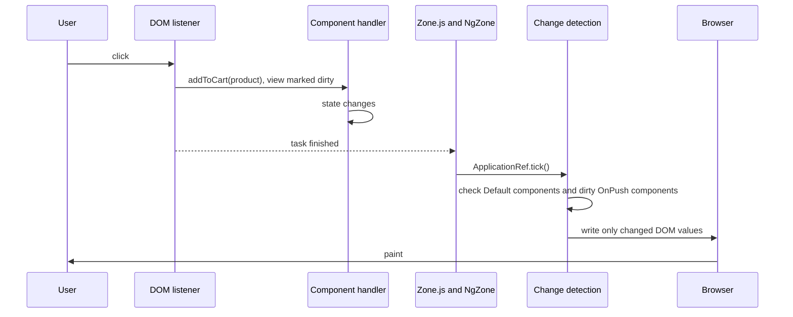
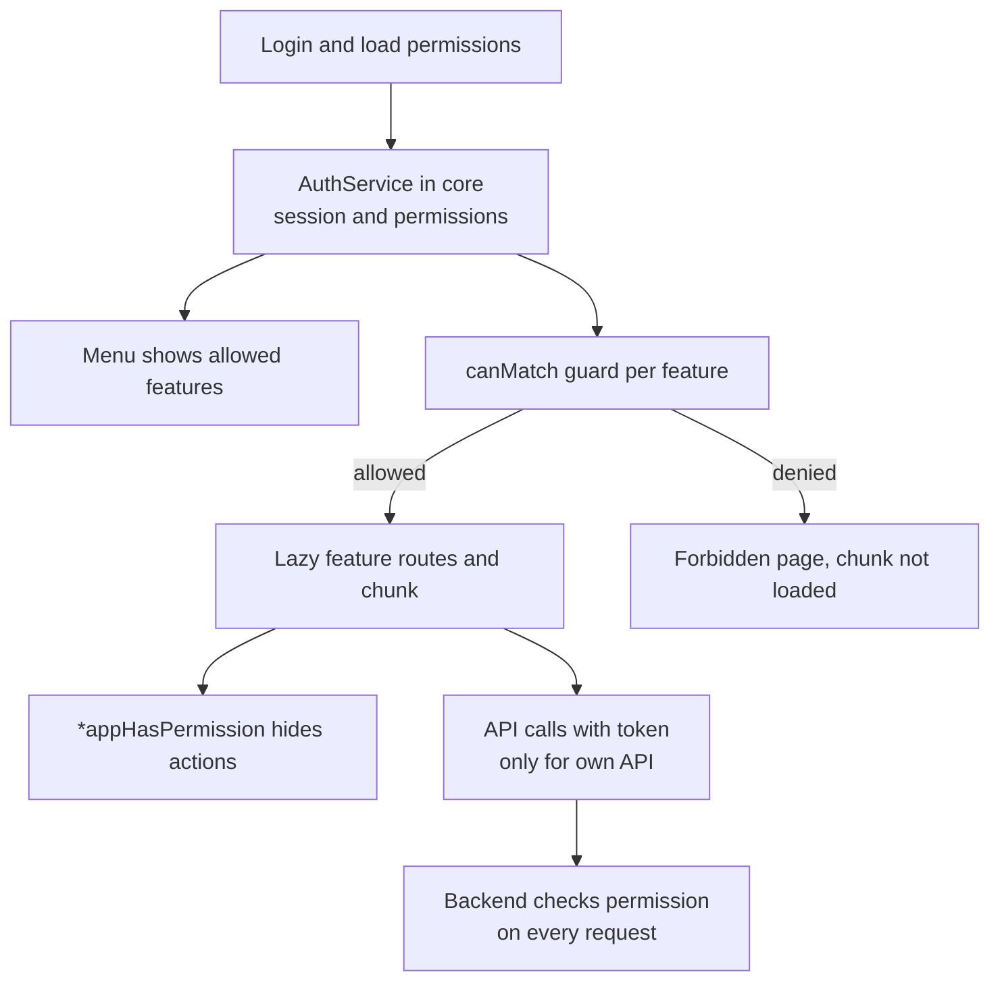
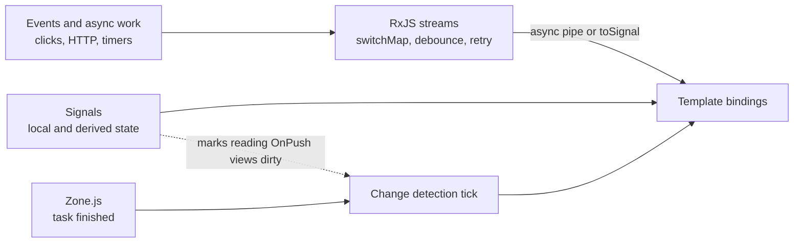

# Angular 16 — Mixed Interview Questions

> This file is mixed, cross-topic interview practice for the whole Angular 16 subject. Each topic document already has its own interview questions; use this file after you have studied the topics, and again right before an interview.

## Table of contents

1. [All topic questions at a glance](#all-topic-questions-at-a-glance)
2. [Mixed and cross-topic questions](#mixed-and-cross-topic-questions)
3. [Rapid revision round](#rapid-revision-round)
4. [Summary](#summary)

## All topic questions at a glance

Every question from the 16 topic documents, in order. Use this list to find a question quickly or to check that you can answer each one out loud.

### [Angular Fundamentals](01-angular-fundamentals.md)

- [Q1. What is Angular, and how is it different from AngularJS?](01-angular-fundamentals.md#q1-what-is-angular-and-how-is-it-different-from-angularjs)
- [Q2. What are the main building blocks of an Angular application?](01-angular-fundamentals.md#q2-what-are-the-main-building-blocks-of-an-angular-application)
- [Q3. What happens when an Angular application starts?](01-angular-fundamentals.md#q3-what-happens-when-an-angular-application-starts)
- [Q4. What is an NgModule? Explain declarations, imports, exports, providers and bootstrap.](01-angular-fundamentals.md#q4-what-is-an-ngmodule-explain-declarations-imports-exports-providers-and-bootstrap)
- [Q5. What are standalone components, and why were they added?](01-angular-fundamentals.md#q5-what-are-standalone-components-and-why-were-they-added)
- [Q6. Your company has a large Angular 16 NgModule app. Should you migrate it to standalone?](01-angular-fundamentals.md#q6-your-company-has-a-large-angular-16-ngmodule-app-should-you-migrate-it-to-standalone)
- [Q7. Explain the different types of data binding in Angular.](01-angular-fundamentals.md#q7-explain-the-different-types-of-data-binding-in-angular)
- [Q8. What is the difference between a DOM property and an HTML attribute? When do you need `[attr.x]`?](01-angular-fundamentals.md#q8-what-is-the-difference-between-a-dom-property-and-an-html-attribute-when-do-you-need-attrx)
- [Q9. How does `[(ngModel)]` work? How would you build your own two-way binding?](01-angular-fundamentals.md#q9-how-does-ngmodel-work-how-would-you-build-your-own-two-way-binding)
- [Q10. What is a template reference variable?](01-angular-fundamentals.md#q10-what-is-a-template-reference-variable)
- [Q11. What is Ivy?](01-angular-fundamentals.md#q11-what-is-ivy)
- [Q12. What is the difference between AOT and JIT compilation?](01-angular-fundamentals.md#q12-what-is-the-difference-between-aot-and-jit-compilation)
- [Q13. What is Zone.js, and why does Angular use it?](01-angular-fundamentals.md#q13-what-is-zonejs-and-why-does-angular-use-it)
- [Q14. Debugging: you get "NG8001: 'app-product-card' is not a known element". How do you fix it?](01-angular-fundamentals.md#q14-debugging-you-get-ng8001-app-product-card-is-not-a-known-element-how-do-you-fix-it)
- [Q15. Code review: a `SharedModule` has `providers: [CartService]` and is imported by three lazy-loaded feature modules. What is the problem?](01-angular-fundamentals.md#q15-code-review-a-sharedmodule-has-providers-cartservice-and-is-imported-by-three-lazy-loaded-feature-modules-what-is-the-problem)
- [Q16. How do you handle environment-specific configuration? Is it safe to put an API key in `environment.ts`?](01-angular-fundamentals.md#q16-how-do-you-handle-environment-specific-configuration-is-it-safe-to-put-an-api-key-in-environmentts)
- [Q17. Angular vs React: when would you choose Angular?](01-angular-fundamentals.md#q17-angular-vs-react-when-would-you-choose-angular)
- [Q18. What is `angular.json` used for?](01-angular-fundamentals.md#q18-what-is-angularjson-used-for)
- [Q19. Output prediction: what does the user see?](01-angular-fundamentals.md#q19-output-prediction-what-does-the-user-see)
- [Q20. Why can't you call `console.log()` or use `window` inside a template?](01-angular-fundamentals.md#q20-why-cant-you-call-consolelog-or-use-window-inside-a-template)

### [Components and Templates](02-components-and-templates.md)

- [Q1. What is a component, and what are the main properties of the `@Component` decorator?](02-components-and-templates.md#q1-what-is-a-component-and-what-are-the-main-properties-of-the-component-decorator)
- [Q2. How does view encapsulation work? What are `:host` and `::ng-deep`?](02-components-and-templates.md#q2-how-does-view-encapsulation-work-what-are-host-and-ng-deep)
- [Q3. What are required inputs and input transforms in Angular 16?](02-components-and-templates.md#q3-what-are-required-inputs-and-input-transforms-in-angular-16)
- [Q4. When would you use an input setter instead of `ngOnChanges`?](02-components-and-templates.md#q4-when-would-you-use-an-input-setter-instead-of-ngonchanges)
- [Q5. How does a child component send data to its parent?](02-components-and-templates.md#q5-how-does-a-child-component-send-data-to-its-parent)
- [Q6. What is the difference between `@ViewChild` and `@ContentChild`?](02-components-and-templates.md#q6-what-is-the-difference-between-viewchild-and-contentchild)
- [Q7. Output prediction: what does this log?](02-components-and-templates.md#q7-output-prediction-what-does-this-log)
- [Q8. What is content projection? How do you build a multi-slot component?](02-components-and-templates.md#q8-what-is-content-projection-how-do-you-build-a-multi-slot-component)
- [Q9. Output prediction: is `HeavyReportComponent` created?](02-components-and-templates.md#q9-output-prediction-is-heavyreportcomponent-created)
- [Q10. What is the difference between `ng-template`, `ng-container` and `ng-content`?](02-components-and-templates.md#q10-what-is-the-difference-between-ng-template-ng-container-and-ng-content)
- [Q11. How does `ngTemplateOutlet` work with a context?](02-components-and-templates.md#q11-how-does-ngtemplateoutlet-work-with-a-context)
- [Q12. How do sibling components communicate?](02-components-and-templates.md#q12-how-do-sibling-components-communicate)
- [Q13. Debugging: an `OnPush` child does not update when the parent changes `user.name`. Why?](02-components-and-templates.md#q13-debugging-an-onpush-child-does-not-update-when-the-parent-changes-username-why)
- [Q14. How do you create a component dynamically in Angular 16?](02-components-and-templates.md#q14-how-do-you-create-a-component-dynamically-in-angular-16)
- [Q15. What are `@HostBinding` and `@HostListener`?](02-components-and-templates.md#q15-what-are-hostbinding-and-hostlistener)
- [Q16. What are smart and presentational components? Why split them?](02-components-and-templates.md#q16-what-are-smart-and-presentational-components-why-split-them)
- [Q17. Code review: what is wrong with this component?](02-components-and-templates.md#q17-code-review-what-is-wrong-with-this-component)
- [Q18. How would you design a reusable data table component?](02-components-and-templates.md#q18-how-would-you-design-a-reusable-data-table-component)
- [Q19. Why does Angular warn about "ExpressionChangedAfterItHasBeenChecked" when a child emits an output in `ngAfterViewInit`?](02-components-and-templates.md#q19-why-does-angular-warn-about-expressionchangedafterithasbeenchecked-when-a-child-emits-an-output-in-ngafterviewinit)
- [Q20. What is the difference between `providers` on a component and `providedIn: 'root'`?](02-components-and-templates.md#q20-what-is-the-difference-between-providers-on-a-component-and-providedin-root)

### [Directives and Pipes](03-directives-and-pipes.md)

- [Q1. What are the types of directives in Angular?](03-directives-and-pipes.md#q1-what-are-the-types-of-directives-in-angular)
- [Q2. What does the `*` in `*ngIf` mean? Show the desugared form.](03-directives-and-pipes.md#q2-what-does-the--in-ngif-mean-show-the-desugared-form)
- [Q3. What is `trackBy`, and why is it important?](03-directives-and-pipes.md#q3-what-is-trackby-and-why-is-it-important)
- [Q4. Write a custom structural directive `*appUnless`.](03-directives-and-pipes.md#q4-write-a-custom-structural-directive-appunless)
- [Q5. How would you build a `*appHasRole` directive? Is it enough to protect admin features?](03-directives-and-pipes.md#q5-how-would-you-build-a-apphasrole-directive-is-it-enough-to-protect-admin-features)
- [Q6. What is the difference between a pure and an impure pipe?](03-directives-and-pipes.md#q6-what-is-the-difference-between-a-pure-and-an-impure-pipe)
- [Q7. Output prediction: what does the template show after the button click?](03-directives-and-pipes.md#q7-output-prediction-what-does-the-template-show-after-the-button-click)
- [Q8. How does the `async` pipe work, and why is it preferred over `subscribe()`?](03-directives-and-pipes.md#q8-how-does-the-async-pipe-work-and-why-is-it-preferred-over-subscribe)
- [Q9. Debugging: the network tab shows the same API request twice when a page loads. The template is below. Why?](03-directives-and-pipes.md#q9-debugging-the-network-tab-shows-the-same-api-request-twice-when-a-page-loads-the-template-is-below-why)
- [Q10. Why should you avoid method calls in templates? When is it acceptable?](03-directives-and-pipes.md#q10-why-should-you-avoid-method-calls-in-templates-when-is-it-acceptable)
- [Q11. What is the difference between `*ngIf` and `[hidden]`?](03-directives-and-pipes.md#q11-what-is-the-difference-between-ngif-and-hidden)
- [Q12. What is the directive composition API?](03-directives-and-pipes.md#q12-what-is-the-directive-composition-api)
- [Q13. How do you create a custom pipe? Give an example.](03-directives-and-pipes.md#q13-how-do-you-create-a-custom-pipe-give-an-example)
- [Q14. Output prediction: what does this show?](03-directives-and-pipes.md#q14-output-prediction-what-does-this-show)
- [Q15. How would you write a directive that closes a dropdown when the user clicks outside it?](03-directives-and-pipes.md#q15-how-would-you-write-a-directive-that-closes-a-dropdown-when-the-user-clicks-outside-it)
- [Q16. Code review: what would you change?](03-directives-and-pipes.md#q16-code-review-what-would-you-change)
- [Q17. What is the difference between `ElementRef` and `Renderer2`?](03-directives-and-pipes.md#q17-what-is-the-difference-between-elementref-and-renderer2)
- [Q18. What are `ngClass` and `ngStyle`, and do you still need them?](03-directives-and-pipes.md#q18-what-are-ngclass-and-ngstyle-and-do-you-still-need-them)
- [Q19. What happens to a component inside `*ngIf` when the condition becomes false and then true again?](03-directives-and-pipes.md#q19-what-happens-to-a-component-inside-ngif-when-the-condition-becomes-false-and-then-true-again)
- [Q20. How do you migrate `*ngIf` and `*ngFor` when upgrading to newer Angular?](03-directives-and-pipes.md#q20-how-do-you-migrate-ngif-and-ngfor-when-upgrading-to-newer-angular)

### [Lifecycle Hooks](04-lifecycle-hooks.md)

- [Q1. What is the difference between the constructor and `ngOnInit`?](04-lifecycle-hooks.md#q1-what-is-the-difference-between-the-constructor-and-ngoninit)
- [Q2. List the lifecycle hooks in order and say how often each runs.](04-lifecycle-hooks.md#q2-list-the-lifecycle-hooks-in-order-and-say-how-often-each-runs)
- [Q3. Output prediction: what is the order of logs for a parent with one child?](04-lifecycle-hooks.md#q3-output-prediction-what-is-the-order-of-logs-for-a-parent-with-one-child)
- [Q4. What is `SimpleChanges`, and what does it contain?](04-lifecycle-hooks.md#q4-what-is-simplechanges-and-what-does-it-contain)
- [Q5. Output prediction: how many times does `ngOnChanges` run?](04-lifecycle-hooks.md#q5-output-prediction-how-many-times-does-ngonchanges-run)
- [Q6. What is ExpressionChangedAfterItHasBeenCheckedError? How do you fix it?](04-lifecycle-hooks.md#q6-what-is-expressionchangedafterithasbeencheckederror-how-do-you-fix-it)
- [Q7. What are `DestroyRef` and `takeUntilDestroyed`?](04-lifecycle-hooks.md#q7-what-are-destroyref-and-takeuntildestroyed)
- [Q8. Debugging: after navigating away from a page, a console log from that page keeps appearing every few seconds. What is wrong?](04-lifecycle-hooks.md#q8-debugging-after-navigating-away-from-a-page-a-console-log-from-that-page-keeps-appearing-every-few-seconds-what-is-wrong)
- [Q9. When would you use `ngDoCheck`?](04-lifecycle-hooks.md#q9-when-would-you-use-ngdocheck)
- [Q10. Which hook would you use to integrate a chart library, and how do you clean it up?](04-lifecycle-hooks.md#q10-which-hook-would-you-use-to-integrate-a-chart-library-and-how-do-you-clean-it-up)
- [Q11. What are `afterRender` and `afterNextRender`?](04-lifecycle-hooks.md#q11-what-are-afterrender-and-afternextrender)
- [Q12. Does a service have lifecycle hooks?](04-lifecycle-hooks.md#q12-does-a-service-have-lifecycle-hooks)
- [Q13. Code review: what is wrong here?](04-lifecycle-hooks.md#q13-code-review-what-is-wrong-here)
- [Q14. In which order are `ngOnDestroy` calls made when a parent is removed?](04-lifecycle-hooks.md#q14-in-which-order-are-ngondestroy-calls-made-when-a-parent-is-removed)
- [Q15. Why should you avoid heavy logic in `ngAfterViewChecked`?](04-lifecycle-hooks.md#q15-why-should-you-avoid-heavy-logic-in-ngafterviewchecked)
- [Q16. Your component shows data from an input object. The parent updates `config.pageSize = 50`, but your `ngOnChanges` never runs. Why, and what are your options?](04-lifecycle-hooks.md#q16-your-component-shows-data-from-an-input-object-the-parent-updates-configpagesize--50-but-your-ngonchanges-never-runs-why-and-what-are-your-options)

### [Dependency Injection in Angular](05-dependency-injection.md)

- [Q1. What is dependency injection, and how does Angular implement it?](05-dependency-injection.md#q1-what-is-dependency-injection-and-how-does-angular-implement-it)
- [Q2. What does `providedIn: 'root'` mean, and what is a tree-shakable provider?](05-dependency-injection.md#q2-what-does-providedin-root-mean-and-what-is-a-tree-shakable-provider)
- [Q3. Explain the injector hierarchy and how Angular resolves a dependency.](05-dependency-injection.md#q3-explain-the-injector-hierarchy-and-how-angular-resolves-a-dependency)
- [Q4. Why does my "singleton" service have two instances?](05-dependency-injection.md#q4-why-does-my-singleton-service-have-two-instances)
- [Q5. What are the provider types? What is the difference between `useClass` and `useExisting`?](05-dependency-injection.md#q5-what-are-the-provider-types-what-is-the-difference-between-useclass-and-useexisting)
- [Q6. What is an `InjectionToken`, and when do you use it?](05-dependency-injection.md#q6-what-is-an-injectiontoken-and-when-do-you-use-it)
- [Q7. What are multi providers? Give real examples.](05-dependency-injection.md#q7-what-are-multi-providers-give-real-examples)
- [Q8. What is the `inject()` function, and what is an injection context?](05-dependency-injection.md#q8-what-is-the-inject-function-and-what-is-an-injection-context)
- [Q9. Explain `@Optional`, `@Self`, `@SkipSelf` and `@Host` with examples.](05-dependency-injection.md#q9-explain-optional-self-skipself-and-host-with-examples)
- [Q10. Output prediction: what does each `LeafComponent` receive?](05-dependency-injection.md#q10-output-prediction-what-does-each-leafcomponent-receive)
- [Q11. What is the difference between `providers` and `viewProviders`?](05-dependency-injection.md#q11-what-is-the-difference-between-providers-and-viewproviders)
- [Q12. When would you provide a service at the component level?](05-dependency-injection.md#q12-when-would-you-provide-a-service-at-the-component-level)
- [Q13. Code review: what is wrong?](05-dependency-injection.md#q13-code-review-what-is-wrong)
- [Q14. How do you provide app-wide services in a standalone Angular 16 app?](05-dependency-injection.md#q14-how-do-you-provide-app-wide-services-in-a-standalone-angular-16-app)
- [Q15. What is `forwardRef`, and does it fix circular dependencies?](05-dependency-injection.md#q15-what-is-forwardref-and-does-it-fix-circular-dependencies)
- [Q16. How do you replace a dependency in a unit test?](05-dependency-injection.md#q16-how-do-you-replace-a-dependency-in-a-unit-test)
- [Q17. Debugging: `NullInjectorError: No provider for HttpClient!` — what do you check?](05-dependency-injection.md#q17-debugging-nullinjectorerror-no-provider-for-httpclient--what-do-you-check)
- [Q18. What is the difference between an element injector and an environment injector?](05-dependency-injection.md#q18-what-is-the-difference-between-an-element-injector-and-an-environment-injector)
- [Q19. How would you design a configurable, reusable library service (for example an analytics client)?](05-dependency-injection.md#q19-how-would-you-design-a-configurable-reusable-library-service-for-example-an-analytics-client)
- [Q20. Why are constructor parameter types enough for Angular to know what to inject?](05-dependency-injection.md#q20-why-are-constructor-parameter-types-enough-for-angular-to-know-what-to-inject)
- [Q21. Scenario: a route-level service keeps old data when the user leaves the page and comes back. Why, and what would you do?](05-dependency-injection.md#q21-scenario-a-route-level-service-keeps-old-data-when-the-user-leaves-the-page-and-comes-back-why-and-what-would-you-do)

### [Routing, Guards and Lazy Loading](06-routing-guards-and-lazy-loading.md)

- [Q1. How does routing work in an Angular single-page application?](06-routing-guards-and-lazy-loading.md#q1-how-does-routing-work-in-an-angular-single-page-application)
- [Q2. What is the difference between `route.snapshot.paramMap` and `route.paramMap`? When does the snapshot cause a bug?](06-routing-guards-and-lazy-loading.md#q2-what-is-the-difference-between-routesnapshotparammap-and-routeparammap-when-does-the-snapshot-cause-a-bug)
- [Q3. What does `withComponentInputBinding` do (Angular 16)?](06-routing-guards-and-lazy-loading.md#q3-what-does-withcomponentinputbinding-do-angular-16)
- [Q4. What is lazy loading and how do you implement it in Angular 16?](06-routing-guards-and-lazy-loading.md#q4-what-is-lazy-loading-and-how-do-you-implement-it-in-angular-16)
- [Q5. What preloading strategies exist? Write a custom one.](06-routing-guards-and-lazy-loading.md#q5-what-preloading-strategies-exist-write-a-custom-one)
- [Q6. What are the guard types, and in what order do they run?](06-routing-guards-and-lazy-loading.md#q6-what-are-the-guard-types-and-in-what-order-do-they-run)
- [Q7. Write an auth guard and a role guard in Angular 16.](06-routing-guards-and-lazy-loading.md#q7-write-an-auth-guard-and-a-role-guard-in-angular-16)
- [Q8. Class-based guards are deprecated, right?](06-routing-guards-and-lazy-loading.md#q8-class-based-guards-are-deprecated-right)
- [Q9. How do you prevent users from leaving a form with unsaved changes?](06-routing-guards-and-lazy-loading.md#q9-how-do-you-prevent-users-from-leaving-a-form-with-unsaved-changes)
- [Q10. What is a resolver? Resolver or loading in the component — which do you prefer?](06-routing-guards-and-lazy-loading.md#q10-what-is-a-resolver-resolver-or-loading-in-the-component--which-do-you-prefer)
- [Q11. Find the bug.](06-routing-guards-and-lazy-loading.md#q11-find-the-bug)
- [Q12. Are route guards enough to secure an admin area?](06-routing-guards-and-lazy-loading.md#q12-are-route-guards-enough-to-secure-an-admin-area)
- [Q13. How do you show a global loading bar during navigation?](06-routing-guards-and-lazy-loading.md#q13-how-do-you-show-a-global-loading-bar-during-navigation)
- [Q14. Your users complain the first click on "Reports" is slow, but later it is fast. Why, and what do you do?](06-routing-guards-and-lazy-loading.md#q14-your-users-complain-the-first-click-on-reports-is-slow-but-later-it-is-fast-why-and-what-do-you-do)
- [Q15. How do you keep filter and pagination state when the user presses Back or shares the link?](06-routing-guards-and-lazy-loading.md#q15-how-do-you-keep-filter-and-pagination-state-when-the-user-presses-back-or-shares-the-link)

### [Angular Forms](07-forms.md)

- [Q1. What is the difference between template-driven and reactive forms? When do you use each?](07-forms.md#q1-what-is-the-difference-between-template-driven-and-reactive-forms-when-do-you-use-each)
- [Q2. What are typed forms? What does `nonNullable` do?](07-forms.md#q2-what-are-typed-forms-what-does-nonnullable-do)
- [Q3. What is the difference between setValue and patchValue?](07-forms.md#q3-what-is-the-difference-between-setvalue-and-patchvalue)
- [Q4. What does this code print?](07-forms.md#q4-what-does-this-code-print)
- [Q5. How do you write a custom validator? And a cross-field validator?](07-forms.md#q5-how-do-you-write-a-custom-validator-and-a-cross-field-validator)
- [Q6. How do async validators work? How do you debounce a "username taken" check?](07-forms.md#q6-how-do-async-validators-work-how-do-you-debounce-a-username-taken-check)
- [Q7. What is ControlValueAccessor? Implement one.](07-forms.md#q7-what-is-controlvalueaccessor-implement-one)
- [Q8. Build a dynamic form where the user can add and remove order lines.](07-forms.md#q8-build-a-dynamic-form-where-the-user-can-add-and-remove-order-lines)
- [Q9. How and when should you show validation errors?](07-forms.md#q9-how-and-when-should-you-show-validation-errors)
- [Q10. Debugging: a teammate says "my form is valid but the submit button stays disabled" — or "the form value is missing a field". What do you check?](07-forms.md#q10-debugging-a-teammate-says-my-form-is-valid-but-the-submit-button-stays-disabled--or-the-form-value-is-missing-a-field-what-do-you-check)
- [Q11. What does `updateOn` do? Give use cases.](07-forms.md#q11-what-does-updateon-do-give-use-cases)
- [Q12. How do you react to changes in one field to update another, without infinite loops?](07-forms.md#q12-how-do-you-react-to-changes-in-one-field-to-update-another-without-infinite-loops)
- [Q13. Code review: what is wrong here?](07-forms.md#q13-code-review-what-is-wrong-here)
- [Q14. How do you warn the user about unsaved changes before leaving the page?](07-forms.md#q14-how-do-you-warn-the-user-about-unsaved-changes-before-leaving-the-page)

### [HttpClient and Interceptors](08-httpclient-and-interceptors.md)

- [Q1. How do you set up HttpClient in Angular 16, and what is the difference between HttpClientModule and provideHttpClient?](08-httpclient-and-interceptors.md#q1-how-do-you-set-up-httpclient-in-angular-16-and-what-is-the-difference-between-httpclientmodule-and-providehttpclient)
- [Q2. Why does this code not send a request?](08-httpclient-and-interceptors.md#q2-why-does-this-code-not-send-a-request)
- [Q3. What is an HTTP interceptor? Give real examples.](08-httpclient-and-interceptors.md#q3-what-is-an-http-interceptor-give-real-examples)
- [Q4. Functional vs class-based interceptors: what is the difference?](08-httpclient-and-interceptors.md#q4-functional-vs-class-based-interceptors-what-is-the-difference)
- [Q5. In what order do interceptors run?](08-httpclient-and-interceptors.md#q5-in-what-order-do-interceptors-run)
- [Q6. How do you handle HTTP errors in Angular? Where should each kind be handled?](08-httpclient-and-interceptors.md#q6-how-do-you-handle-http-errors-in-angular-where-should-each-kind-be-handled)
- [Q7. Implement token refresh in an interceptor so that many failing requests trigger only one refresh.](08-httpclient-and-interceptors.md#q7-implement-token-refresh-in-an-interceptor-so-that-many-failing-requests-trigger-only-one-refresh)
- [Q8. What is HttpContext and when do you use it?](08-httpclient-and-interceptors.md#q8-what-is-httpcontext-and-when-do-you-use-it)
- [Q9. How do you cancel an HTTP request?](08-httpclient-and-interceptors.md#q9-how-do-you-cancel-an-http-request)
- [Q10. Debugging: the auth interceptor works everywhere except in one lazy-loaded feature. Why?](08-httpclient-and-interceptors.md#q10-debugging-the-auth-interceptor-works-everywhere-except-in-one-lazy-loaded-feature-why)
- [Q11. How does Angular's XSRF protection work, and when does it not work?](08-httpclient-and-interceptors.md#q11-how-does-angulars-xsrf-protection-work-and-when-does-it-not-work)
- [Q12. Write a loading interceptor that works with parallel requests.](08-httpclient-and-interceptors.md#q12-write-a-loading-interceptor-that-works-with-parallel-requests)
- [Q13. Code review: what is wrong with this interceptor?](08-httpclient-and-interceptors.md#q13-code-review-what-is-wrong-with-this-interceptor)
- [Q14. How would you cache GET responses in Angular?](08-httpclient-and-interceptors.md#q14-how-would-you-cache-get-responses-in-angular)
- [Q15. How do you make HttpClient responses type-safe?](08-httpclient-and-interceptors.md#q15-how-do-you-make-httpclient-responses-type-safe)
- [Q16. Your API is slow and users double-click "Place order". What do you do on the frontend?](08-httpclient-and-interceptors.md#q16-your-api-is-slow-and-users-double-click-place-order-what-do-you-do-on-the-frontend)

### [RxJS in Angular](09-rxjs.md)

- [Q1. What is an Observable, and how is it different from a Promise?](09-rxjs.md#q1-what-is-an-observable-and-how-is-it-different-from-a-promise)
- [Q2. What does "Observables are lazy" mean? Why does it matter in Angular?](09-rxjs.md#q2-what-does-observables-are-lazy-mean-why-does-it-matter-in-angular)
- [Q3. What is the difference between cold and hot Observables?](09-rxjs.md#q3-what-is-the-difference-between-cold-and-hot-observables)
- [Q4. Explain Subject, BehaviorSubject, ReplaySubject and AsyncSubject. When do you use each?](09-rxjs.md#q4-explain-subject-behaviorsubject-replaysubject-and-asyncsubject-when-do-you-use-each)
- [Q5. What does this code print?](09-rxjs.md#q5-what-does-this-code-print)
- [Q6. What is the output order?](09-rxjs.md#q6-what-is-the-output-order)
- [Q7. What is the difference between switchMap, mergeMap, concatMap and exhaustMap?](09-rxjs.md#q7-what-is-the-difference-between-switchmap-mergemap-concatmap-and-exhaustmap)
- [Q8. Our search box stops working after one failed request. Why, and how do you fix it?](09-rxjs.md#q8-our-search-box-stops-working-after-one-failed-request-why-and-how-do-you-fix-it)
- [Q9. How do you prevent memory leaks from subscriptions in Angular?](09-rxjs.md#q9-how-do-you-prevent-memory-leaks-from-subscriptions-in-angular)
- [Q10. What does shareReplay do, and what is the refCount pitfall?](09-rxjs.md#q10-what-does-sharereplay-do-and-what-is-the-refcount-pitfall)
- [Q11. What does this switchMap code print?](09-rxjs.md#q11-what-does-this-switchmap-code-print)
- [Q12. What is the difference between combineLatest, forkJoin and withLatestFrom?](09-rxjs.md#q12-what-is-the-difference-between-combinelatest-forkjoin-and-withlatestfrom)
- [Q13. What does this print?](09-rxjs.md#q13-what-does-this-print)
- [Q14. What is the difference between debounceTime and throttleTime? Where do you use each?](09-rxjs.md#q14-what-is-the-difference-between-debouncetime-and-throttletime-where-do-you-use-each)
- [Q15. Code review: what is wrong with this component?](09-rxjs.md#q15-code-review-what-is-wrong-with-this-component)
- [Q16. Implement polling that pauses when the browser tab is hidden.](09-rxjs.md#q16-implement-polling-that-pauses-when-the-browser-tab-is-hidden)
- [Q17. What is the difference between take(1) and first()?](09-rxjs.md#q17-what-is-the-difference-between-take1-and-first)
- [Q18. Why was toPromise deprecated? What do you use instead?](09-rxjs.md#q18-why-was-topromise-deprecated-what-do-you-use-instead)
- [Q19. How do you retry a failed HTTP request with backoff? What should you never retry?](09-rxjs.md#q19-how-do-you-retry-a-failed-http-request-with-backoff-what-should-you-never-retry)
- [Q20. In Angular 16, when do you use RxJS and when do you use signals?](09-rxjs.md#q20-in-angular-16-when-do-you-use-rxjs-and-when-do-you-use-signals)
- [Q21. How would you share one WebSocket connection across many components?](09-rxjs.md#q21-how-would-you-share-one-websocket-connection-across-many-components)
- [Q22. Do you need to unsubscribe from HttpClient calls?](09-rxjs.md#q22-do-you-need-to-unsubscribe-from-httpclient-calls)
- [Q23. How does a pipeable operator work inside? Write your own map.](09-rxjs.md#q23-how-does-a-pipeable-operator-work-inside-write-your-own-map)

### [Change Detection and Signals](10-change-detection-and-signals.md)

- [Q1. What is change detection in Angular and how does it work?](10-change-detection-and-signals.md#q1-what-is-change-detection-in-angular-and-how-does-it-work)
- [Q2. What is Zone.js and why does Angular need it?](10-change-detection-and-signals.md#q2-what-is-zonejs-and-why-does-angular-need-it)
- [Q3. What is the difference between Default and OnPush, and exactly when is an OnPush component checked?](10-change-detection-and-signals.md#q3-what-is-the-difference-between-default-and-onpush-and-exactly-when-is-an-onpush-component-checked)
- [Q4. What does this OnPush component show after one second?](10-change-detection-and-signals.md#q4-what-does-this-onpush-component-show-after-one-second)
- [Q5. What is the difference between markForCheck and detectChanges?](10-change-detection-and-signals.md#q5-what-is-the-difference-between-markforcheck-and-detectchanges)
- [Q6. Why do we need immutability with OnPush? Find the bug.](10-change-detection-and-signals.md#q6-why-do-we-need-immutability-with-onpush-find-the-bug)
- [Q7. How would you fix a page where typing in an input is slow because of a big table on the same page?](10-change-detection-and-signals.md#q7-how-would-you-fix-a-page-where-typing-in-an-input-is-slow-because-of-a-big-table-on-the-same-page)
- [Q8. When and why would you use runOutsideAngular?](10-change-detection-and-signals.md#q8-when-and-why-would-you-use-runoutsideangular)
- [Q9. What causes ExpressionChangedAfterItHasBeenCheckedError and how do you fix it?](10-change-detection-and-signals.md#q9-what-causes-expressionchangedafterithasbeencheckederror-and-how-do-you-fix-it)
- [Q10. Why is calling a function in a template a performance problem?](10-change-detection-and-signals.md#q10-why-is-calling-a-function-in-a-template-a-performance-problem)
- [Q11. What is trackBy and why does it matter?](10-change-detection-and-signals.md#q11-what-is-trackby-and-why-does-it-matter)
- [Q12. What are signals and why did Angular add them?](10-change-detection-and-signals.md#q12-what-are-signals-and-why-did-angular-add-them)
- [Q13. What does this code print? (Angular 16)](10-change-detection-and-signals.md#q13-what-does-this-code-print-angular-16)
- [Q14. computed vs effect: when do you use each?](10-change-detection-and-signals.md#q14-computed-vs-effect-when-do-you-use-each)
- [Q15. In Angular 16, a component calls `user.set(user())` after changing `user().name` in place. The view updates. After upgrading to Angular 17 it stops updating. Why?](10-change-detection-and-signals.md#q15-in-angular-16-a-component-calls-usersetuser-after-changing-username-in-place-the-view-updates-after-upgrading-to-angular-17-it-stops-updating-why)
- [Q16. How do signals interact with change detection and OnPush in Angular 16?](10-change-detection-and-signals.md#q16-how-do-signals-interact-with-change-detection-and-onpush-in-angular-16)
- [Q17. A teammate wants to call `cdr.detectChanges()` in every subscription "so the view always updates". What do you say?](10-change-detection-and-signals.md#q17-a-teammate-wants-to-call-cdrdetectchanges-in-every-subscription-so-the-view-always-updates-what-do-you-say)
- [Q18. What changes when an Angular app goes zoneless (newer Angular)?](10-change-detection-and-signals.md#q18-what-changes-when-an-angular-app-goes-zoneless-newer-angular)

### [State management and NgRx](11-state-management-and-ngrx.md)

- [Q1. What is state management, and what types of state exist in an Angular app?](11-state-management-and-ngrx.md#q1-what-is-state-management-and-what-types-of-state-exist-in-an-angular-app)
- [Q2. How do you share state between components that are not parent and child, without NgRx?](11-state-management-and-ngrx.md#q2-how-do-you-share-state-between-components-that-are-not-parent-and-child-without-ngrx)
- [Q3. What is NgRx and what problem does it solve?](11-state-management-and-ngrx.md#q3-what-is-ngrx-and-what-problem-does-it-solve)
- [Q4. Walk me through what happens when a component dispatches an action that loads data.](11-state-management-and-ngrx.md#q4-walk-me-through-what-happens-when-a-component-dispatches-an-action-that-loads-data)
- [Q5. What is the difference between `createAction` and `createActionGroup`? What makes a good action?](11-state-management-and-ngrx.md#q5-what-is-the-difference-between-createaction-and-createactiongroup-what-makes-a-good-action)
- [Q6. Why must reducers be immutable? Show how to update an item in an array.](11-state-management-and-ngrx.md#q6-why-must-reducers-be-immutable-show-how-to-update-an-item-in-an-array)
- [Q7. What does this code print?](11-state-management-and-ngrx.md#q7-what-does-this-code-print)
- [Q8. How do selectors work and why are they memoized?](11-state-management-and-ngrx.md#q8-how-do-selectors-work-and-why-are-they-memoized)
- [Q9. What is an effect, and how do you choose between switchMap, mergeMap, concatMap and exhaustMap in it?](11-state-management-and-ngrx.md#q9-what-is-an-effect-and-how-do-you-choose-between-switchmap-mergemap-concatmap-and-exhaustmap-in-it)
- [Q10. Find the bug in this effect.](11-state-management-and-ngrx.md#q10-find-the-bug-in-this-effect)
- [Q11. What is NgRx Entity and when would you use it?](11-state-management-and-ngrx.md#q11-what-is-ngrx-entity-and-when-would-you-use-it)
- [Q12. What is ComponentStore and how is it different from the global Store?](11-state-management-and-ngrx.md#q12-what-is-componentstore-and-how-is-it-different-from-the-global-store)
- [Q13. When would you NOT use NgRx?](11-state-management-and-ngrx.md#q13-when-would-you-not-use-ngrx)
- [Q14. What is the facade pattern in Angular state management? What are its pros and cons?](11-state-management-and-ngrx.md#q14-what-is-the-facade-pattern-in-angular-state-management-what-are-its-pros-and-cons)
- [Q15. Your product list shows stale data after you add a product. The reducer looks like this. What is wrong?](11-state-management-and-ngrx.md#q15-your-product-list-shows-stale-data-after-you-add-a-product-the-reducer-looks-like-this-what-is-wrong)
- [Q16. How do NgRx and signals work together in Angular 16, and what changed in newer versions?](11-state-management-and-ngrx.md#q16-how-do-ngrx-and-signals-work-together-in-angular-16-and-what-changed-in-newer-versions)
- [Q17. How do you test reducers, selectors and effects?](11-state-management-and-ngrx.md#q17-how-do-you-test-reducers-selectors-and-effects)
- [Q18. Scenario: two screens show different values for the same customer's address after an edit. How do you fix it?](11-state-management-and-ngrx.md#q18-scenario-two-screens-show-different-values-for-the-same-customers-address-after-an-edit-how-do-you-fix-it)
- [Q19. Where do side effects like localStorage, navigation and analytics go in an NgRx app?](11-state-management-and-ngrx.md#q19-where-do-side-effects-like-localstorage-navigation-and-analytics-go-in-an-ngrx-app)
- [Q20. What are NgRx runtime checks and Redux DevTools used for?](11-state-management-and-ngrx.md#q20-what-are-ngrx-runtime-checks-and-redux-devtools-used-for)

### [Angular performance](12-performance.md)

- [Q1. Our Angular app is slow. What do you do?](12-performance.md#q1-our-angular-app-is-slow-what-do-you-do)
- [Q2. What is OnPush and when is an OnPush component checked?](12-performance.md#q2-what-is-onpush-and-when-is-an-onpush-component-checked)
- [Q3. Why does this OnPush component not update?](12-performance.md#q3-why-does-this-onpush-component-not-update)
- [Q4. What does trackBy do and why does it matter?](12-performance.md#q4-what-does-trackby-do-and-why-does-it-matter)
- [Q5. Why is calling a method in a template a performance problem? What do you use instead?](12-performance.md#q5-why-is-calling-a-method-in-a-template-a-performance-problem-what-do-you-use-instead)
- [Q6. What is runOutsideAngular and when would you use it?](12-performance.md#q6-what-is-runoutsideangular-and-when-would-you-use-it)
- [Q7. How does lazy loading improve performance, and how can it accidentally break?](12-performance.md#q7-how-does-lazy-loading-improve-performance-and-how-can-it-accidentally-break)
- [Q8. How do you analyze and control bundle size?](12-performance.md#q8-how-do-you-analyze-and-control-bundle-size)
- [Q9. What is virtual scrolling? When would you use it, and what are its limits?](12-performance.md#q9-what-is-virtual-scrolling-when-would-you-use-it-and-what-are-its-limits)
- [Q10. What causes memory leaks in Angular apps and how do you find them?](12-performance.md#q10-what-causes-memory-leaks-in-angular-apps-and-how-do-you-find-them)
- [Q11. What is the output, and what does it tell you about change detection cost?](12-performance.md#q11-what-is-the-output-and-what-does-it-tell-you-about-change-detection-cost)
- [Q12. What did Angular 16 add for SSR and hydration, and what changed later?](12-performance.md#q12-what-did-angular-16-add-for-ssr-and-hydration-and-what-changed-later)
- [Q13. What is NgOptimizedImage and why use it?](12-performance.md#q13-what-is-ngoptimizedimage-and-why-use-it)
- [Q14. You need to process a 50 MB CSV in the browser without freezing the UI. How?](12-performance.md#q14-you-need-to-process-a-50-mb-csv-in-the-browser-without-freezing-the-ui-how)
- [Q15. How do you reduce the number of change detection runs in an Angular 16 app?](12-performance.md#q15-how-do-you-reduce-the-number-of-change-detection-runs-in-an-angular-16-app)
- [Q16. What are tree-shakable providers?](12-performance.md#q16-what-are-tree-shakable-providers)
- [Q17. Scenario: a dashboard table with 2,000 rows lags on every keystroke in a filter box. Walk through your fix.](12-performance.md#q17-scenario-a-dashboard-table-with-2000-rows-lags-on-every-keystroke-in-a-filter-box-walk-through-your-fix)
- [Q18. Is OnPush always better? What are the downsides?](12-performance.md#q18-is-onpush-always-better-what-are-the-downsides)

### [Enterprise Angular architecture](13-enterprise-architecture.md)

- [Q1. How would you structure a large Angular application?](13-enterprise-architecture.md#q1-how-would-you-structure-a-large-angular-application)
- [Q2. What is the difference between smart and presentational components, and why separate them?](13-enterprise-architecture.md#q2-what-is-the-difference-between-smart-and-presentational-components-and-why-separate-them)
- [Q3. How do you handle environment configuration for an app deployed to dev, staging, production and several customers?](13-enterprise-architecture.md#q3-how-do-you-handle-environment-configuration-for-an-app-deployed-to-dev-staging-production-and-several-customers)
- [Q4. How do you implement global error handling in Angular?](13-enterprise-architecture.md#q4-how-do-you-implement-global-error-handling-in-angular)
- [Q5. What are micro-frontends, and when would you (not) use them with Angular?](13-enterprise-architecture.md#q5-what-are-micro-frontends-and-when-would-you-not-use-them-with-angular)
- [Q6. What is Nx and how does it help architecture?](13-enterprise-architecture.md#q6-what-is-nx-and-how-does-it-help-architecture)
- [Q7. How do you design authentication in an Angular app?](13-enterprise-architecture.md#q7-how-do-you-design-authentication-in-an-angular-app)
- [Q8. Built-in Angular i18n or a runtime library like Transloco?](13-enterprise-architecture.md#q8-built-in-angular-i18n-or-a-runtime-library-like-transloco)
- [Q9. How would you support several tenants with different branding?](13-enterprise-architecture.md#q9-how-would-you-support-several-tenants-with-different-branding)
- [Q10. Where should business logic live in an Angular app?](13-enterprise-architecture.md#q10-where-should-business-logic-live-in-an-angular-app)
- [Q11. Code review: what is wrong with this SharedModule?](13-enterprise-architecture.md#q11-code-review-what-is-wrong-with-this-sharedmodule)
- [Q12. How do you migrate an Angular 16 NgModule codebase toward standalone, safely?](13-enterprise-architecture.md#q12-how-do-you-migrate-an-angular-16-ngmodule-codebase-toward-standalone-safely)

### [Testing Angular applications](14-testing.md)

- [Q1. What is TestBed and why do we need it?](14-testing.md#q1-what-is-testbed-and-why-do-we-need-it)
- [Q2. What does `fixture.detectChanges()` do, and why is it not automatic?](14-testing.md#q2-what-does-fixturedetectchanges-do-and-why-is-it-not-automatic)
- [Q3. How do you test a service that calls HttpClient?](14-testing.md#q3-how-do-you-test-a-service-that-calls-httpclient)
- [Q4. Explain fakeAsync, tick, flush and waitForAsync.](14-testing.md#q4-explain-fakeasync-tick-flush-and-waitforasync)
- [Q5. What will this test do, and why?](14-testing.md#q5-what-will-this-test-do-and-why)
- [Q6. How do you mock dependencies in Angular tests? What are the options?](14-testing.md#q6-how-do-you-mock-dependencies-in-angular-tests-what-are-the-options)
- [Q7. How do you test a functional route guard?](14-testing.md#q7-how-do-you-test-a-functional-route-guard)
- [Q8. How do you test an HTTP interceptor?](14-testing.md#q8-how-do-you-test-an-http-interceptor)
- [Q9. What are component harnesses and why use them?](14-testing.md#q9-what-are-component-harnesses-and-why-use-them)
- [Q10. How do you test a component that reads from the NgRx store?](14-testing.md#q10-how-do-you-test-a-component-that-reads-from-the-ngrx-store)
- [Q11. What changed in Angular testing after version 16?](14-testing.md#q11-what-changed-in-angular-testing-after-version-16)
- [Q12. What would you NOT write unit tests for, and how do you decide what to test?](14-testing.md#q12-what-would-you-not-write-unit-tests-for-and-how-do-you-decide-what-to-test)
- [Q13. Debugging: this test passes alone but fails when run with others. What could cause it?](14-testing.md#q13-debugging-this-test-passes-alone-but-fails-when-run-with-others-what-could-cause-it)

### [Angular security](15-security.md)

- [Q1. How does Angular protect against XSS?](15-security.md#q1-how-does-angular-protect-against-xss)
- [Q2. What happens with this template, and is it safe?](15-security.md#q2-what-happens-with-this-template-and-is-it-safe)
- [Q3. What is DomSanitizer, and when is `bypassSecurityTrust*` acceptable?](15-security.md#q3-what-is-domsanitizer-and-when-is-bypasssecuritytrust-acceptable)
- [Q4. Why is using ElementRef to set innerHTML dangerous?](15-security.md#q4-why-is-using-elementref-to-set-innerhtml-dangerous)
- [Q5. How do you use a Content Security Policy with Angular 16?](15-security.md#q5-how-do-you-use-a-content-security-policy-with-angular-16)
- [Q6. How does Angular help with CSRF? What does the server need to do?](15-security.md#q6-how-does-angular-help-with-csrf-what-does-the-server-need-to-do)
- [Q7. Are route guards a security feature?](15-security.md#q7-are-route-guards-a-security-feature)
- [Q8. Where should an Angular app store access tokens?](15-security.md#q8-where-should-an-angular-app-store-access-tokens)
- [Q9. Find the security bug in this interceptor.](15-security.md#q9-find-the-security-bug-in-this-interceptor)
- [Q10. What security risks does server-side rendering add?](15-security.md#q10-what-security-risks-does-server-side-rendering-add)
- [Q11. Why does keeping Angular updated matter for security, and what is the status of Angular 16?](15-security.md#q11-why-does-keeping-angular-updated-matter-for-security-and-what-is-the-status-of-angular-16)
- [Q12. Scenario: a security scan reports XSS in your Angular app. How do you investigate?](15-security.md#q12-scenario-a-security-scan-reports-xss-in-your-angular-app-how-do-you-investigate)

### [Angular 16 vs newer versions](16-angular-16-vs-newer-versions.md)

- [Q1. What were the most important features of Angular 16?](16-angular-16-vs-newer-versions.md#q1-what-were-the-most-important-features-of-angular-16)
- [Q2. What changed in Angular 17, and why was it called a big release?](16-angular-16-vs-newer-versions.md#q2-what-changed-in-angular-17-and-why-was-it-called-a-big-release)
- [Q3. What is zoneless Angular, and what is its status in each version?](16-angular-16-vs-newer-versions.md#q3-what-is-zoneless-angular-and-what-is-its-status-in-each-version)
- [Q4. Compare `@Input()` with signal `input()`.](16-angular-16-vs-newer-versions.md#q4-compare-input-with-signal-input)
- [Q5. What are `linkedSignal` and `resource`, and when were they added?](16-angular-16-vs-newer-versions.md#q5-what-are-linkedsignal-and-resource-and-when-were-they-added)
- [Q6. What are Signal Forms?](16-angular-16-vs-newer-versions.md#q6-what-are-signal-forms)
- [Q7. What changed about change detection defaults in Angular 22?](16-angular-16-vs-newer-versions.md#q7-what-changed-about-change-detection-defaults-in-angular-22)
- [Q8. How would you upgrade an Angular 16 application to the latest version?](16-angular-16-vs-newer-versions.md#q8-how-would-you-upgrade-an-angular-16-application-to-the-latest-version)
- [Q9. Do signals replace RxJS?](16-angular-16-vs-newer-versions.md#q9-do-signals-replace-rxjs)
- [Q10. What is the support status of Angular 16, and why should a company care?](16-angular-16-vs-newer-versions.md#q10-what-is-the-support-status-of-angular-16-and-why-should-a-company-care)
- [Q11. Your new job uses Angular 21 and you have only used Angular 16. How do you prepare?](16-angular-16-vs-newer-versions.md#q11-your-new-job-uses-angular-21-and-you-have-only-used-angular-16-how-do-you-prepare)
- [Q12. Which of these statements are true? (a) Standalone components became the default in Angular 17. (b) `*ngFor` was removed in Angular 22. (c) `effect()` became stable in Angular 20. (d) Hydration was stable in Angular 16.](16-angular-16-vs-newer-versions.md#q12-which-of-these-statements-are-true-a-standalone-components-became-the-default-in-angular-17-b-ngfor-was-removed-in-angular-22-c-effect-became-stable-in-angular-20-d-hydration-was-stable-in-angular-16)

## Mixed and cross-topic questions

These questions combine two or more topics, the way real Angular interviews do. One scenario can test change detection, RxJS and dependency injection at the same time. Every RxJS and signal output in this section was checked with Node.js 22, RxJS 7.8.2 and `@angular/core` 16.2.12.

### Q1. Walk me through what happens between a button click and the updated screen in an Angular 16 app.

**What the interviewer is checking:** whether you can connect event binding, Zone.js, change detection, OnPush and the DOM into one story, instead of knowing each piece separately.

**Short spoken answer (30–60 seconds):**
> When the user clicks, the browser runs the listener that Angular added for my `(click)` binding. Angular calls my handler, for example `addToCart(product)`, which changes some state. Because the listener ran inside Angular's zone, Zone.js tells Angular that a task finished, and Angular runs a change detection tick. The tick walks the component tree from the root, top-down. Default components are always checked. OnPush components are checked only if they are dirty, and the click itself marked the clicked component and its ancestors dirty. For every checked component, Angular compares each template binding with the previous value and updates only the DOM nodes whose values changed. In development mode it then runs a second check to catch ExpressionChanged errors. After that the browser paints.

**Detailed explanation:**

1. **Event binding.** The compiled template registered a DOM listener for `(click)`. Angular wraps your handler, so it also marks the component view (and its ancestors) dirty.
2. **Your code runs.** It changes a field, calls a service, or emits an output. A service may push a new value into a `BehaviorSubject`.
3. **Zone.js notices the end of the task.** Zone.js patched `addEventListener`, so NgZone knows a task ran. When the zone becomes stable (`onMicrotaskEmpty`), Angular calls `ApplicationRef.tick()`.
4. **The tick.** Angular checks the tree from the root. Default components are always checked. OnPush components are checked only when dirty (new input reference, template event, `async` pipe, `markForCheck()`, or a signal read in the template).
5. **Bindings are compared.** For each binding, Angular compares the new value with the old one (`Object.is`-style identity). Only changed values cause DOM writes.
6. **Dev-mode check.** In development, a second pass checks that nothing changed during the tick. If something did, you get NG0100.
7. **The browser renders.** Style, layout and paint happen after the JavaScript task ends.



**Follow-up questions:**
- **What if the state changes in a `setTimeout` inside an OnPush component?** — Zone.js still triggers a tick, but the OnPush component is not dirty, so it is skipped. Call `markForCheck()`, or use the `async` pipe or a signal.
- **What if the listener was registered inside `runOutsideAngular`?** — No tick runs. The view updates only when something else triggers change detection, or when you call `zone.run()`.
- **How is this different in zoneless Angular (stable in 20.2, default for new apps in 21)?** — There is no Zone.js. The template event itself, `markForCheck()`, the `async` pipe and signal changes schedule change detection directly.

**Common mistakes:** Saying Angular "watches" variables (it does not; it compares bindings during a tick). Saying OnPush components only update on input changes (template events also mark them dirty). Forgetting that the browser paints after the tick, not during it.

**Where this is used in real projects:** Debugging "the UI did not update" bugs, and explaining performance work (fewer ticks, fewer checked components, cheaper bindings).

Topics: [Angular fundamentals](01-angular-fundamentals.md#zonejs-and-change-detection-in-one-page) · [Change detection and signals](10-change-detection-and-signals.md#the-onpush-strategy) · [Components and templates](02-components-and-templates.md)

---

### Q2. Describe the full journey of an HTTP call: from `this.http.get()` in a service to the data on screen.

**What the interviewer is checking:** whether you understand that `HttpClient` returns a cold Observable, how interceptors form a chain, where errors are handled, and how the result reaches the view.

**Short spoken answer (30–60 seconds):**
> Calling `http.get()` only creates a cold Observable. Nothing is sent until someone subscribes, usually the `async` pipe in the template. On subscribe, the request goes through the interceptor chain in the order they were provided: for example auth adds the token for my own API, logging starts a timer, then the backend sends it with XHR. The response travels back through the interceptors in reverse order, so error handling and timing happen there. The Observable emits one value and completes. The `async` pipe stores the value and calls `markForCheck()`, so even an OnPush component is checked in the next tick, and the template shows the data. If the component is destroyed first, the `async` pipe unsubscribes and the request is cancelled.

**Detailed explanation:**

| Step | What happens | Topic |
| --- | --- | --- |
| 1 | Service method returns `this.http.get<Order[]>('/api/orders')`. No request yet. | Cold Observables |
| 2 | Template subscribes with `orders$ \| async`. | `async` pipe |
| 3 | Interceptors run in provider order on the way out (auth, logging, loading). | Interceptors |
| 4 | `HttpXhrBackend` (or the fetch backend with `withFetch()`) sends the request. | HttpClient |
| 5 | The response passes back through the interceptors in reverse order. `catchError` and `retry` can act here. | Error handling |
| 6 | The Observable emits the body once and completes. | RxJS |
| 7 | The `async` pipe stores the value and calls `markForCheck()`. | Change detection |
| 8 | The next tick checks the component; the DOM updates. | OnPush |
| 9 | If the component is destroyed earlier, the `async` pipe unsubscribes and the XHR is aborted. | Cleanup |

```ts
@Injectable({ providedIn: 'root' })
export class OrdersApi {
  private http = inject(HttpClient);
  getOrders(): Observable<Order[]> {
    return this.http.get<Order[]>('/api/orders'); // cold: nothing sent yet
  }
}

@Component({
  selector: 'app-orders-page',
  standalone: true,
  imports: [NgIf, NgFor, AsyncPipe],
  changeDetection: ChangeDetectionStrategy.OnPush,
  template: `
    <ul *ngIf="orders$ | async as orders; else loading">
      <li *ngFor="let o of orders; trackBy: trackById">{{ o.number }}</li>
    </ul>
    <ng-template #loading><p>Loading...</p></ng-template>
  `,
})
export class OrdersPageComponent {
  orders$ = inject(OrdersApi).getOrders(); // subscribed by the async pipe
  trackById = (_: number, o: Order) => o.id;
}
```

**Follow-up questions:**
- **Is the generic `get<Order[]>` a runtime check?** — No. It only tells TypeScript what to expect. If the server sends a different shape, nothing fails at runtime. Validate at the boundary if the data is untrusted.
- **What happens if two `async` pipes use the same `orders$`?** — Two subscriptions, so two HTTP requests. Use one `async` pipe with `as`, or `shareReplay`.
- **Where should a 401 be handled?** — In an interceptor (refresh or redirect to login). A 409 or validation error should be rethrown so the feature can show a specific message.

**Common mistakes:** Saying `http.get()` sends the request immediately. Forgetting that the response passes the interceptors in reverse order. Subscribing manually and forgetting OnPush (the field changes but the view does not update).

**Where this is used in real projects:** Every data screen. This answer also helps when debugging double requests, missing tokens and stale views.

Topics: [HttpClient and interceptors](08-httpclient-and-interceptors.md) · [RxJS](09-rxjs.md) · [Directives and pipes: the async pipe](03-directives-and-pipes.md#the-async-pipe-in-depth) · [Change detection](10-change-detection-and-signals.md)

---

### Q3. Production bug: users click quickly between customers in a master–detail page, and sometimes the detail panel shows the wrong customer. Why, and how do you fix it?

**What the interviewer is checking:** whether you connect router component reuse, `paramMap`, and the choice of flattening operator, and whether you can explain a race condition.

**Short spoken answer (30–60 seconds):**
> When only the route parameter changes, the router reuses the component, so the code must react to `paramMap`, not the snapshot. That part was probably done. The race comes from the flattening operator. If the code uses `mergeMap`, or a nested subscribe, every customer request stays alive. When customer 1 is slow and customer 2 is fast, customer 2 arrives first and then customer 1 overwrites it. The fix is `switchMap`: when a new id arrives, it unsubscribes from the previous request, which also cancels the HTTP call. So the last click always wins.

**Code:**

```js
import { Subject, mergeMap, switchMap, of, delay } from 'rxjs';

// Fake API: customer 1 is slow (300 ms), customer 2 is fast (100 ms)
const getCustomer = id => of({ id, name: `Customer ${id}` }).pipe(delay(id === 1 ? 300 : 100));

function run(label, flatten) {
  const customerId$ = new Subject();
  customerId$.pipe(flatten(id => getCustomer(id)))
    .subscribe(c => console.log(label, 'screen shows', c.name));
  customerId$.next(1);                       // user opens customer 1
  setTimeout(() => customerId$.next(2), 50); // 50 ms later, user clicks customer 2
}
run('mergeMap: ', mergeMap);
setTimeout(() => run('switchMap:', switchMap), 1000);
```

**Output (verified with Node.js):**

```text
mergeMap:  screen shows Customer 2
mergeMap:  screen shows Customer 1
switchMap: screen shows Customer 2
```

**Step by step:**
1. `mergeMap` starts request 1 at 0 ms and request 2 at 50 ms. Both stay active.
2. Request 2 finishes at about 150 ms, so the screen shows customer 2 (correct for a moment).
3. Request 1 finishes at about 300 ms and overwrites the screen with customer 1. The user clicked customer 2, so this is wrong.
4. `switchMap` unsubscribes from request 1 when id 2 arrives. Only customer 2 is shown.

The Angular version:

```ts
export class CustomerDetailComponent {
  private route = inject(ActivatedRoute);
  private api = inject(CustomersApi);

  customer$ = this.route.paramMap.pipe(
    map(params => params.get('id')!),
    distinctUntilChanged(),
    switchMap(id => this.api.getCustomer(id)), // cancels the previous request
  );
}
```

**Follow-up questions:**
- **Why not `concatMap`?** — It would wait for customer 1 before loading customer 2. The user sees an old customer and waits longer.
- **Would `withComponentInputBinding()` (Angular 16) remove the race?** — No. The input changes, but if you start a request in `ngOnChanges` or a setter with nested subscribes, the same race exists. You still need cancellation, for example a `Subject` of ids with `switchMap`.
- **Can the backend still process the cancelled request?** — Yes. Cancelling aborts the XHR on the client. The server may already be working. That is fine for GET, but it is why you should not use `switchMap` for saves.

**Common mistakes:** Blaming the snapshot only. Using nested `subscribe` calls inside `subscribe`. Using `switchMap` for POST requests where cancelling can lose a save.

**Where this is used in real projects:** Master–detail pages, tabs, search-as-you-type, filters that trigger reloads.

Topics: [Routing: snapshot vs paramMap](06-routing-guards-and-lazy-loading.md#route-parameters-snapshot-vs-parammap) · [RxJS: higher-order mapping](09-rxjs.md#higher-order-mapping-switchmap-mergemap-concatmap-exhaustmap) · [HttpClient: cancelling requests](08-httpclient-and-interceptors.md#cancelling-requests)

---

### Q4. Output prediction: a cart service with a `BehaviorSubject` and an in-place change. What does this print?

```js
import { BehaviorSubject, distinctUntilChanged, map } from 'rxjs';

const cart$ = new BehaviorSubject({ items: ['book'] });

cart$.pipe(distinctUntilChanged()).subscribe(c => console.log('A', c.items.length));
cart$.pipe(map(c => c.items.length), distinctUntilChanged()).subscribe(n => console.log('B', n));

const cart = cart$.value;
cart.items.push('pen');     // mutate
cart$.next(cart);           // same reference

cart$.next({ ...cart, items: [...cart.items, 'lamp'] }); // new reference
```

**What the interviewer is checking:** reference equality in RxJS, why mutation breaks reactive code, and the link to OnPush and memoized selectors.

**Answer (verified with Node.js):**

```text
A 1
B 1
B 2
A 3
B 3
```

**Short spoken answer (30–60 seconds):**
> Both subscribers get the current value at once, so we see A 1 and B 1. Then the code mutates the same object and calls next with the same reference. Subscriber A uses `distinctUntilChanged` on the object, which compares with `===`, so it sees "no change" and prints nothing. Subscriber B first maps to the length, which is now 2, a new number, so it prints B 2. The last `next` passes a new object, so both print 3. The lesson: if a service mutates state, anything that compares references silently misses the update. That includes `distinctUntilChanged`, OnPush inputs, pure pipes and NgRx selectors.

**Step by step:**
1. `BehaviorSubject` replays its current value to each new subscriber: `A 1`, `B 1`.
2. `push('pen')` changes the array inside the same object.
3. `next(cart)`: A compares old object with new object, `===` is `true`, so it skips. B compares `1` with `2`, different, so it prints `B 2`.
4. `next({...})`: new object for A, new number `3` for B. Both print.

**Follow-up questions:**
- **What would an OnPush child with `[cart]="cart$ | async"` show after the mutation?** — The `async` pipe calls `markForCheck()` on the parent, but the child's input is the same reference, so the child is not marked dirty. It keeps showing the old count.
- **How do you prevent this in a team?** — Immutable updates in the service (`{ ...state, items: [...] }`), `readonly` types, and in NgRx the runtime checks (`strictStateImmutability`).

**Common mistakes:** Expecting `A 2`. Thinking `BehaviorSubject` itself filters duplicates (it does not; the operator does).

**Where this is used in real projects:** Service-based state, NgRx reducers, any OnPush UI.

Topics: [State management: a service with BehaviorSubject](11-state-management-and-ngrx.md#level-2-a-service-with-behaviorsubject) · [RxJS: Subjects](09-rxjs.md#subjects) · [Immutability with OnPush](10-change-detection-and-signals.md#immutability-with-onpush)

---

### Q5. Output prediction (Angular 16 signals): what does this print, and what changes in Angular 17?

```ts
import { signal, computed } from '@angular/core';

const cart = signal({ items: ['book'] });
const count = signal(1);

let runs = 0;
const summary = computed(() => {
  runs++;
  return `${cart().items.length} item(s), qty ${count()}`;
});

console.log(summary(), runs);

cart().items.push('pen');
cart.set(cart());              // same object reference
console.log(summary(), runs);

count.set(1);                  // same primitive value
console.log(summary(), runs);

count.set(2);
console.log(summary(), runs);
```

**What the interviewer is checking:** how `computed` is lazy and memoized, how signal equality works in Angular 16, and whether you know the version difference.

**Answer (verified with `@angular/core` 16.2.12):**

```text
1 item(s), qty 1 1
2 item(s), qty 1 2
2 item(s), qty 1 2
2 item(s), qty 2 3
```

**Short spoken answer (30–60 seconds):**
> The first read runs the computed once. Then the code mutates the cart object and sets the same reference back. In Angular 16 the default equality treats objects as always changed, so the computed is marked stale and runs again: it shows 2 items and runs is 2. Setting `count` to 1 again is a primitive with the same value, so equality says "no change" and the computed does not run. Setting `count` to 2 is a real change, so it runs a third time. In Angular 17 and later, default equality is `Object.is` for everything, so setting the same object reference is ignored, and the second line would still show 1 item. That is why code that relied on mutation broke after upgrading.

**Step by step:**
1. `summary()` is lazy: it runs only when read. First read: `runs = 1`.
2. `cart.set(cart())`: same reference. Angular 16's default `equal` returns `false` for objects, so dependents are notified. Next read recomputes: `runs = 2`, shows 2 items.
3. `count.set(1)`: `Object.is(1, 1)` is `true` for primitives, so nothing is notified. The cached value is returned: `runs` stays 2.
4. `count.set(2)`: changed, recompute: `runs = 3`.

**Follow-up questions:**
- **How do you write this correctly in any version?** — `cart.update(c => ({ ...c, items: [...c.items, 'pen'] }))`. A new object is always a change.
- **What did `mutate()` do?** — It changed the value in place and always notified. It existed only in Angular 16 and was removed in 17.
- **Can you change equality?** — Yes, `signal(value, { equal: (a, b) => a.id === b.id })`.

**Common mistakes:** Thinking `computed` runs eagerly on every `set`. Saying signals in Angular 16 are stable (they were a developer preview). Not knowing the 16 → 17 equality change.

**Where this is used in real projects:** Teams on Angular 16 that experiment with signals, and anyone planning the upgrade to 17+.

Topics: [Signals: equality in Angular 16](10-change-detection-and-signals.md#equality-an-important-angular-16-detail) · [Angular 16 vs newer versions](16-angular-16-vs-newer-versions.md)

---

### Q6. Output prediction: `shareReplay` with `refCount: true` and a late subscriber. How many HTTP calls?

```js
import { defer, of, shareReplay, delay } from 'rxjs';
let calls = 0;
const user$ = defer(() => { calls++; console.log('HTTP call', calls); return of({ name: 'Asha' }).pipe(delay(10)); })
  .pipe(shareReplay({ bufferSize: 1, refCount: true }));

user$.subscribe(u => console.log('header', u.name));
user$.subscribe(u => console.log('sidebar', u.name));
setTimeout(() => {
  user$.subscribe(u => console.log('profile', u.name));
}, 50);
```

**What the interviewer is checking:** whether you know exactly when `shareReplay` re-subscribes to the source. This matters for caching HTTP calls in services.

**Answer (verified with Node.js and RxJS 7.8.2):**

```text
HTTP call 1
header Asha
sidebar Asha
profile Asha
```

**Short spoken answer (30–60 seconds):**
> There is only one HTTP call. The first subscriber starts the source. The second subscriber joins the same shared subscription. After 10 ms the value arrives and both print. Then the source completes. When the profile subscribes later, `shareReplay` does not reset after the source completed: it keeps the last value in its internal `ReplaySubject` and replays it. So the profile gets the cached user without a new request. `refCount: true` matters for sources that do not complete, like a WebSocket or `interval`: when the subscriber count drops to zero before completion, the source is unsubscribed, and the next subscriber starts it again.

**Follow-up questions:**
- **So is `shareReplay` a good cache?** — Only a simple one. It never expires and never refreshes. Add a refresh `Subject`, or a time-based cache, if data can change.
- **What happens if the HTTP call fails?** — The error is not cached; the next subscriber triggers a new request. That is usually what you want.
- **What is the refCount pitfall?** — With `shareReplay(1)` (refCount `false`) on an endless source, the source keeps running after all components are destroyed. That is a leak.

**Common mistakes:** Saying `refCount: true` always refetches for late subscribers. Saying `share()` and `shareReplay()` behave the same for late subscribers (`share()` does not replay).

**Where this is used in real projects:** Caching "current user" or configuration in a root service so many components share one request.

Topics: [RxJS: share and shareReplay](09-rxjs.md#sharing-share-and-sharereplay) · [HttpClient: caching GET requests](08-httpclient-and-interceptors.md#4-caching-get-requests)

---

### Q7. Find the bug: a global loading spinner throws `ExpressionChangedAfterItHasBeenCheckedError` on some pages.

```ts
@Injectable({ providedIn: 'root' })
export class LoadingService {
  private count = 0;
  loading = false;
  start() { this.count++; this.loading = true; }
  stop()  { this.count--; this.loading = this.count > 0; }
}

export const loadingInterceptor: HttpInterceptorFn = (req, next) => {
  const loading = inject(LoadingService);
  loading.start();
  return next(req).pipe(finalize(() => loading.stop()));
};

// AppComponent template (top of the page): <app-spinner *ngIf="loading.loading" />
// A child page component: ngOnInit() { this.products$ = this.api.getProducts(); }
// and its template uses: {{ products$ | async }}
```

**What the interviewer is checking:** whether you can connect the interceptor, the `async` pipe subscription during change detection, and the one-way data flow rule that NG0100 protects.

**Short spoken answer (30–60 seconds):**
> The `async` pipe subscribes during change detection of the child page. The subscription starts the HTTP request, which runs the interceptor, which sets `loading = true` on the service. But the AppComponent, which shows the spinner, was already checked earlier in the same tick with `loading = false`. In development, Angular's second check sees the value changed and throws NG0100. The data flowed backwards: a child's check changed state that a parent already rendered. The fix is to make the spinner reactive and update it outside the current check: expose loading as an Observable or signal and emit asynchronously, or keep the spinner state out of the parent's already-checked bindings.

**Detailed explanation:** The tick goes top-down. `AppComponent` renders `loading.loading = false`. Then the child is checked; its `async` pipe subscribes; the interceptor calls `start()`; the value becomes `true`. The dev-mode check pass compares again and finds `true !== false`. In production there is no error, but the spinner may appear one tick late.

**Fix options (best first):**
1. Make the state an Observable and defer the emission to after the current tick:

```ts
@Injectable({ providedIn: 'root' })
export class LoadingService {
  private count = 0;
  private readonly loadingSubject = new BehaviorSubject(false);
  readonly loading$ = this.loadingSubject.pipe(
    debounceTime(0),           // emit after the current change detection, also avoids flicker
    distinctUntilChanged(),
  );
  start() { this.count++; this.loadingSubject.next(true); }
  stop()  { this.count = Math.max(0, this.count - 1); this.loadingSubject.next(this.count > 0); }
}
// <app-spinner *ngIf="loading.loading$ | async" />
```

2. Start the request earlier, outside change detection (for example in a route resolver or in the constructor with the `async` pipe only reading a shared stream).
3. Do **not** "fix" it with `cdr.detectChanges()` in the parent or a random `setTimeout` without understanding the flow.

**Follow-up questions:**
- **Why use a counter instead of a boolean?** — Parallel requests. The first finished request must not hide the spinner while others are running.
- **Should every request show the global spinner?** — No. Use an `HttpContext` token like `SKIP_LOADING` for background polling.
- **Why does the error appear only in development?** — The check-no-changes pass runs only in dev mode.

**Common mistakes:** Wrapping `start()` in `setTimeout` everywhere. Disabling dev mode. Thinking NG0100 is a bug in Angular.

**Where this is used in real projects:** Global spinners, progress bars and "saving..." indicators.

Topics: [Lifecycle hooks: ExpressionChanged error](04-lifecycle-hooks.md#expressionchangedafterithasbeencheckederror) · [Interceptors: loading indicator](08-httpclient-and-interceptors.md#3-loading-indicator) · [HttpContext tokens](08-httpclient-and-interceptors.md#httpcontext-tokens)

---

### Q8. Find the bug: a custom form control inside an OnPush component does not show the value set by `form.patchValue()`.

```ts
@Component({
  selector: 'app-star-rating',
  standalone: true,
  imports: [NgFor],
  changeDetection: ChangeDetectionStrategy.OnPush,
  providers: [{ provide: NG_VALUE_ACCESSOR, useExisting: forwardRef(() => StarRatingComponent), multi: true }],
  template: `<button *ngFor="let s of stars" (click)="select(s)">{{ s <= value ? '★' : '☆' }}</button>`,
})
export class StarRatingComponent implements ControlValueAccessor {
  stars = [1, 2, 3, 4, 5];
  value = 0;
  private onChange: (v: number) => void = () => {};
  onTouched: () => void = () => {};

  writeValue(v: number | null): void { this.value = v ?? 0; }
  registerOnChange(fn: (v: number) => void): void { this.onChange = fn; }
  registerOnTouched(fn: () => void): void { this.onTouched = fn; }
  select(s: number): void { this.value = s; this.onChange(s); this.onTouched(); }
}
```

**What the interviewer is checking:** the connection between ControlValueAccessor, how the forms API calls into your component, and OnPush dirty marking.

**Short spoken answer (30–60 seconds):**
> Clicking works, because the click is a template event and marks the component dirty. But `patchValue` from the parent form calls `writeValue` directly from TypeScript. That is not an input binding, not a template event and not the async pipe, so the OnPush component is not marked dirty and keeps showing the old stars. The fix is to inject `ChangeDetectorRef` and call `markForCheck()` inside `writeValue`. I would also implement `setDisabledState` so `control.disable()` works, and check that the provider uses `useExisting` with `forwardRef` and `multi: true`, which this code does.

**Fixed code:**

```ts
private cdr = inject(ChangeDetectorRef);
disabled = false;

writeValue(v: number | null): void {
  this.value = v ?? 0;
  this.cdr.markForCheck(); // writeValue is called from outside the template
}
setDisabledState(isDisabled: boolean): void {
  this.disabled = isDisabled;
  this.cdr.markForCheck();
}
```

**Follow-up questions:**
- **Why does the first value often appear correctly?** — The initial `writeValue` happens before or during the first check of the new component, which is always checked once. Later programmatic writes are the problem.
- **Why `useExisting` and not `useClass`?** — `useClass` would create a second instance. The forms directive would talk to an instance that is not on the screen.
- **Why `multi: true`?** — `NG_VALUE_ACCESSOR` is a multi token. Without `multi`, you replace other accessors on that element.

**Common mistakes:** Calling `detectChanges()` in `writeValue` (it can run before the view exists). Forgetting `onTouched`, so `touched`-based error messages never show.

**Where this is used in real projects:** Design-system inputs: date pickers, ratings, rich selects, toggles.

Topics: [Forms: ControlValueAccessor](07-forms.md#controlvalueaccessor-custom-form-controls) · [Change detection: ChangeDetectorRef](10-change-detection-and-signals.md#changedetectorref) · [DI: useClass vs useExisting](05-dependency-injection.md#useclass-vs-useexisting-a-classic-trap)

---

### Q9. Code review: find the security problems in this feature.

```ts
// cms-page.component.ts
@Component({
  selector: 'app-cms-page',
  standalone: true,
  imports: [AsyncPipe, SafeHtmlPipe],
  template: `<article [innerHTML]="(page$ | async)?.bodyHtml | safeHtml"></article>`,
})
export class CmsPageComponent {
  page$ = inject(CmsApi).getPage(inject(ActivatedRoute).snapshot.params['slug']);
}

// safe-html.pipe.ts
@Pipe({ name: 'safeHtml', standalone: true })
export class SafeHtmlPipe implements PipeTransform {
  private sanitizer = inject(DomSanitizer);
  transform(html: string | undefined) { return this.sanitizer.bypassSecurityTrustHtml(html ?? ''); }
}

// auth.interceptor.ts
export const authInterceptor: HttpInterceptorFn = (req, next) =>
  next(req.clone({ setHeaders: { Authorization: `Bearer ${localStorage.getItem('token')}` } }));

// routes
{ path: 'admin', canActivate: [() => inject(AuthService).isAdmin()], loadChildren: () => import('./admin/admin.routes') }
```

**What the interviewer is checking:** whether you can spot several real security problems in normal-looking code, and rank them.

**Short spoken answer (30–60 seconds):**
> I see four problems. First and worst, the `safeHtml` pipe calls `bypassSecurityTrustHtml` on CMS content. That turns off Angular's sanitizer, so any script or event handler an editor or attacker puts in the CMS runs in our users' browsers. Plain `[innerHTML]` already sanitizes, so I would remove the pipe, or sanitize on the server with an allow-list. Second, the interceptor sends the token to every URL, including third-party hosts, so it leaks. It should only add the token for our own API origin. Third, the token is in `localStorage`, so any XSS can steal it. That makes problem one even worse. A BFF with an httpOnly cookie, or in-memory short-lived tokens, is safer. Fourth, the admin guard is fine for UX, but it is not security: the admin API must check the role on every request.

**Detailed explanation:**

| # | Problem | Risk | Fix |
| --- | --- | --- | --- |
| 1 | `bypassSecurityTrustHtml` on remote content | Stored XSS | Remove the pipe; let `[innerHTML]` sanitize; or sanitize server-side with an allow-list (for example DOMPurify on the server) |
| 2 | Token on every request | Token sent to CDNs, analytics, other APIs | Check the request origin against an allow-list before adding the header |
| 3 | Token in `localStorage` | Any XSS can read it | BFF + httpOnly `Secure` `SameSite` cookie, or short-lived in-memory token |
| 4 | Guard as protection | Users can bypass client code | Server-side authorization on every admin endpoint |
| 5 (minor) | `Bearer null` when logged out | Noisy 401s, confusing logs | Skip the header if there is no token |

**Follow-up questions:**
- **When is `bypassSecurityTrust*` acceptable?** — Only for values you build from known-safe parts, for example a YouTube embed URL built from a validated video id. Never for user or CMS content.
- **Does a CSP help here?** — Yes, as defense in depth. A strict CSP blocks inline scripts and unknown origins, so an injected `<script>` or `onerror` may not run. It does not replace removing the bypass.
- **Is `routerLink` with a user-provided URL a risk?** — Angular sanitizes `[href]` values such as `javascript:` URLs, but you should still validate redirects (open redirect).

**Common mistakes:** Saying "Angular protects us from XSS automatically" without noting that bypass methods turn the protection off. Fixing only the first problem.

**Where this is used in real projects:** CMS pages, rich-text comments, email templates in admin portals.

Topics: [Security: DomSanitizer](15-security.md#domsanitizer-and-bypasssecuritytrust) · [Security: attach tokens only to your own API](15-security.md#attach-tokens-only-to-your-own-api) · [Security: token storage](15-security.md#token-storage-choices) · [Routing: guards are UX, not security](06-routing-guards-and-lazy-loading.md#guards-are-ux-not-security)

---

### Q10. Production issue: some customers were charged twice for one order. The frontend is Angular 16. What could cause it, and what do you change?

**What the interviewer is checking:** idempotency, retry rules, double-submit protection and the right RxJS operator, plus whether you involve the backend.

**Short spoken answer (30–60 seconds):**
> I look at three causes. One: a retry interceptor or `retry()` on the POST. `retry` re-subscribes to the cold HTTP Observable, so it sends the POST again. If the first request succeeded on the server but the response timed out, that is a second order. Two: double clicks. If the submit uses `mergeMap` or a plain subscribe per click, two clicks mean two POSTs. Three: the user refreshes or presses back and submits again. On the frontend I retry only safe methods like GET, disable the button while saving, and use `exhaustMap` so clicks during a save are ignored. But the real fix is on the backend: an idempotency key per checkout attempt, so the server returns the same order for the same key.

**Code (verified with Node.js and RxJS 7.8.2):**

```js
import { defer, throwError, of, retry, Subject, exhaustMap, mergeMap, delay } from 'rxjs';

// 1) retry re-subscribes, so a cold HTTP Observable sends the POST again
let posts = 0;
const placeOrder$ = defer(() => {
  posts++;
  console.log('POST /api/orders #' + posts);
  // the server saved the order but the response was lost (timeout)
  return posts === 1 ? throwError(() => new Error('timeout')) : of({ orderId: 42 });
});
placeOrder$.pipe(retry(1)).subscribe(r => console.log('result', r));

// 2) double click: mergeMap sends two requests, exhaustMap ignores the second click
setTimeout(() => {
  for (const [label, op] of [['mergeMap', mergeMap], ['exhaustMap', exhaustMap]]) {
    const clicks$ = new Subject();
    let sent = 0;
    clicks$.pipe(op(() => { sent++; return of('ok').pipe(delay(100)); })).subscribe();
    clicks$.next('click'); clicks$.next('click');
    setTimeout(() => console.log(label, 'requests sent:', sent), 200);
  }
}, 10);
```

```text
POST /api/orders #1
POST /api/orders #2
result { orderId: 42 }
mergeMap requests sent: 2
exhaustMap requests sent: 1
```

**The Angular fix:**

```ts
export class CheckoutComponent {
  private api = inject(OrdersApi);
  private submit$ = new Subject<void>();
  private idempotencyKey = crypto.randomUUID(); // one key per checkout attempt
  saving = false;

  constructor() {
    this.submit$.pipe(
      exhaustMap(() => {
        this.saving = true;
        return this.api.placeOrder(this.cart, this.idempotencyKey).pipe(finalize(() => (this.saving = false)));
      }),
      takeUntilDestroyed(),
    ).subscribe(order => this.router.navigate(['/orders', order.id]));
  }
  onSubmit(): void { this.submit$.next(); }
}
// template: <button (click)="onSubmit()" [disabled]="saving">Place order</button>
```

**Follow-up questions:**
- **Which requests may an interceptor retry automatically?** — Idempotent ones: GET, HEAD, and PUT/DELETE if the API is designed for it. Use an `HttpContext` flag to opt out per request.
- **Is a disabled button enough?** — No. It helps, but keyboard submits, slow rendering and two tabs can still send twice. The backend idempotency key is the real protection.
- **Where does the idempotency key go?** — Usually a header like `Idempotency-Key`. The server stores the key with the result and returns the same result for repeats.

**Common mistakes:** Only blaming the user. Using `switchMap` for the save (it can cancel a save the server still completes). Retrying all failed requests globally.

**Where this is used in real projects:** Checkout, payments, form submits that create records.

Topics: [HttpClient: retry for safe requests](08-httpclient-and-interceptors.md#6-retry-for-safe-requests) · [RxJS: higher-order mapping](09-rxjs.md#higher-order-mapping-switchmap-mergemap-concatmap-exhaustmap) · [Forms: submit handling](07-forms.md#submit-handling) · [REST API design](../07-nodejs-backend/07-rest-api-design.md)

---

### Q11. Production issue: memory grows every time users open and close the order details page. How do you find and fix the leak?

**What the interviewer is checking:** a systematic method (measure, find the retainer, fix the cause) and knowledge of the typical Angular leak sources across RxJS, DOM, timers and DI.

**Short spoken answer (30–60 seconds):**
> First I reproduce and measure. In Chrome DevTools I take a heap snapshot, open and close the page ten times, force garbage collection, take another snapshot and compare. If I see ten `OrderDetailsComponent` instances, something still holds them, and the Retainers panel tells me what. Usually it is one of four things: a subscription to a long-lived Observable, like a root service subject, router events or an interval, that never ends; a listener on `window` or `document` that is never removed; a timer; or a third-party chart that was never destroyed. I fix each with the right tool: the `async` pipe, `takeUntilDestroyed`, `DestroyRef.onDestroy` for listeners and timers, and the library's `destroy()` in cleanup. Then I measure again to confirm.

**Detailed explanation:**

| Retainer you see in the snapshot | Cause | Fix |
| --- | --- | --- |
| `Subscriber` → `SafeSubscriber` → your component | `subscribe()` to a root service subject, `router.events`, `interval`, `valueChanges` of a long-lived form | `async` pipe, `takeUntilDestroyed()`, `take(1)` |
| `EventListener` on `Window` | `addEventListener` without removal | `DestroyRef.onDestroy(() => removeEventListener(...))` or `@HostListener('window:...')` |
| Timer list | `setInterval` not cleared | `clearInterval` in cleanup |
| Third-party object (chart, map) | Library keeps DOM and listeners | Call its `destroy()`/`dispose()` in `ngOnDestroy` |
| A root service array or map | Cache that only grows, or a service holding component references | Store data, not components; limit the cache |
| `ComponentRef` | `createComponent` without `destroy()` | `viewContainerRef.clear()` or `ref.destroy()` |

```ts
export class OrderDetailsComponent {
  private destroyRef = inject(DestroyRef);

  constructor() {
    inject(OrderEvents).updates$                     // root service, never completes
      .pipe(takeUntilDestroyed())                    // ✅ ends with the component
      .subscribe(update => this.apply(update));

    const onResize = () => this.chart?.resize();
    window.addEventListener('resize', onResize);
    this.destroyRef.onDestroy(() => {
      window.removeEventListener('resize', onResize); // ✅ listener removed
      this.chart?.destroy();                          // ✅ third-party cleanup
    });
  }
  private chart?: { resize(): void; destroy(): void };
  private apply(update: unknown): void { /* ... */ }
}
```

**Follow-up questions:**
- **Do HTTP subscriptions leak?** — Not forever, because `HttpClient` Observables complete after one response. But if the component is destroyed first, the callback still runs, so unsubscribing (or the `async` pipe) is still better.
- **Can DI cause a leak?** — Yes, if a root service stores references to components or DOM nodes, or if a component-level provider is accidentally provided in root and keeps per-page data forever.
- **Where should `takeUntilDestroyed` go in the pipe?** — Last, so inner subscriptions from `switchMap` are also cut off.

**Common mistakes:** Guessing instead of measuring. Unsubscribing in `ngOnDestroy` but forgetting the DOM listener. Calling `takeUntilDestroyed()` without an argument in `ngOnInit` (NG0203).

**Where this is used in real projects:** Long-running SPAs: dashboards, admin portals, desktop apps built with Electron.

Topics: [Performance: memory leaks](12-performance.md#memory-leaks) · [Lifecycle: DestroyRef and takeUntilDestroyed](04-lifecycle-hooks.md#destroyref-and-takeuntildestroyed) · [RxJS: unsubscribe strategies](09-rxjs.md#unsubscribe-strategies-in-angular) · [Memory management](../02-javascript/19-memory-management-and-garbage-collection.md)

---

### Q12. Production issue: a user can open `/admin/users`, but the table is empty with no message. The network tab shows `403`. What is wrong, and what is the right design?

**What the interviewer is checking:** whether you understand that guards are UX, that the backend is the real authority, and that every data screen needs loading, error and empty states.

**Short spoken answer (30–60 seconds):**
> Two things are wrong, and one thing is right. The right thing: the backend refused with 403, so security works. The first problem is that the guard and the server disagree. The guard probably checks a stale role from the token or local state, while the server checks the current permissions. The second problem is the UI: the error is swallowed, maybe by an interceptor that returns an empty array, or by a `catchError(() => of([]))` in the service. So the user sees "no users" instead of "you do not have access". I would make the guard use the same permission source as the server, refresh permissions on login and role change, and make the screen show three different states: loading, error with a clear message, and empty. A 403 can also redirect to a "forbidden" page globally.

**Detailed explanation:**
- **Guards are UX.** They hide routes and avoid loading code. They can be wrong or bypassed. The server must authorize every request, and here it did.
- **Do not swallow errors.** An interceptor or service that turns errors into empty data hides real problems. Rethrow, and let the feature decide how to show it.
- **Model view states explicitly:**

```ts
type ViewState<T> =
  | { status: 'loading' }
  | { status: 'error'; message: string }
  | { status: 'loaded'; data: T };

users$: Observable<ViewState<User[]>> = this.api.getUsers().pipe(
  map(data => ({ status: 'loaded' as const, data })),
  catchError((e: HttpErrorResponse) =>
    of({ status: 'error' as const, message: e.status === 403 ? 'You do not have access to user management.' : 'Could not load users.' })),
  startWith({ status: 'loading' as const }),
);
```

**Follow-up questions:**
- **Where should a global 403 be handled?** — An error interceptor can redirect to `/forbidden` for navigation-level loads, but feature-specific messages belong in the feature.
- **Should the frontend cache permissions?** — Yes for UX, but refresh them on login, token refresh and role-change events. Never treat them as the source of truth.
- **What about `canMatch` vs `canActivate` here?** — `canMatch` can also prevent downloading the admin chunk. Both are still only UX.

**Common mistakes:** "Fixing" it by removing the server check. Returning `[]` on every error. Showing the same empty state for errors and no data.

**Where this is used in real projects:** Admin portals, multi-role enterprise apps.

Topics: [Routing: guards are UX, not security](06-routing-guards-and-lazy-loading.md#guards-are-ux-not-security) · [HttpClient: error handling](08-httpclient-and-interceptors.md#error-handling) · [Enterprise: global error handling](13-enterprise-architecture.md#global-error-handling) · [Security](15-security.md)

---

### Q13. Production issue: after enabling SSR, the server crashes with `ReferenceError: window is not defined`. How do you fix it properly?

**What the interviewer is checking:** understanding of where code runs in SSR, DI-based platform abstractions, lifecycle timing for browser-only code, and the security side of SSR.

**Short spoken answer (30–60 seconds):**
> With SSR, the same components run in Node.js first, where `window`, `document` and `localStorage` do not exist. Some code touches them directly, maybe in a constructor or a service. The fix is not to sprinkle `typeof window` checks everywhere. I inject `DOCUMENT` instead of using the global `document`, use `isPlatformBrowser(inject(PLATFORM_ID))` for browser-only logic, and wrap browser-only APIs in a small service with a server-safe implementation. For code that measures or touches the DOM, like charts, I use `afterNextRender`, which runs only in the browser (developer preview in 16.2). And I check third-party libraries, because they often access `window` at import time.

**Code:**

```ts
export const BROWSER_STORAGE = new InjectionToken<Storage | null>('BROWSER_STORAGE', {
  providedIn: 'root',
  factory: () => (isPlatformBrowser(inject(PLATFORM_ID)) ? localStorage : null),
});

@Injectable({ providedIn: 'root' })
export class PreferencesService {
  private storage = inject(BROWSER_STORAGE);
  get theme(): string { return this.storage?.getItem('theme') ?? 'light'; }
}

@Component({ selector: 'app-sales-chart', standalone: true, template: `<canvas #c></canvas>` })
export class SalesChartComponent {
  @ViewChild('c', { static: true }) canvas!: ElementRef<HTMLCanvasElement>;
  constructor() {
    afterNextRender(() => drawChart(this.canvas.nativeElement)); // browser only (16.2, developer preview)
  }
}
```

**Follow-up questions:**
- **What security risks does SSR add?** — Server-side requests (SSRF) if URLs come from user input, leaking server-only data into the transferred state, and caching personalized pages for other users.
- **What is hydration in Angular 16?** — `provideClientHydration()` (developer preview in 16) reuses the server-rendered DOM instead of re-creating it. Direct DOM manipulation can break it.
- **Why prefer DI tokens over global checks?** — Tests can provide fakes, and the platform decision lives in one place.

**Common mistakes:** Guarding everything with `typeof window !== 'undefined'` inside components. Using `setTimeout` to "wait for the browser". Forgetting third-party libraries.

**Where this is used in real projects:** Public e-commerce and marketing sites that need SEO and fast first paint.

Topics: [Performance: SSR and hydration](12-performance.md#load-performance-ssr-and-hydration) · [Lifecycle: afterRender and afterNextRender](04-lifecycle-hooks.md#afterrender-and-afternextrender) · [DI: tokens with a default factory](05-dependency-injection.md#tokens-with-a-default-factory) · [Security: SSR-related risks](15-security.md#ssr-related-risks) · [Rendering strategies](../05-frontend-engineering/09-rendering-strategies-csr-ssr-ssg.md)

---

### Q14. Design: an admin portal where different roles see different features. How do you build it in Angular 16?

**What the interviewer is checking:** whether you can combine routing, lazy loading, guards, directives, interceptors, DI and backend authorization into one clear design.

**Short spoken answer (30–60 seconds):**
> I split the portal into lazy-loaded feature areas, for example users, billing and reports, each with its own routes file. After login, an `AuthService` in core holds the session and permissions as an Observable or signal. Route access uses functional `canMatch` guards, so a user without permission does not even download that feature's code, and the router can fall through to a "forbidden" route. Inside pages, a structural directive like `*appHasPermission` hides buttons. An auth interceptor adds the token only to our API. Most important, the backend checks permissions on every request, because everything in the browser can be changed. Permissions come from one place, so the guard, the directive and the menu never disagree.

**Diagram:**



**Code:**

```ts
export const hasPermission = (permission: string): CanMatchFn => () => {
  const auth = inject(AuthService);
  const router = inject(Router);
  return auth.permissions$.pipe(
    take(1),
    map(perms => perms.includes(permission) || router.createUrlTree(['/forbidden'])),
  );
};

export const APP_ROUTES: Routes = [
  { path: 'users', canMatch: [hasPermission('users:read')], loadChildren: () => import('./users/users.routes') },
  { path: 'billing', canMatch: [hasPermission('billing:read')], loadChildren: () => import('./billing/billing.routes') },
  { path: 'forbidden', loadComponent: () => import('./core/forbidden.component') },
];
```

**Follow-up questions:**
- **Why `canMatch` instead of `canActivate`?** — `canMatch` runs during matching, so a denied user does not download the lazy chunk, and the router can try other routes with the same path (for example a "lite" version).
- **How do you handle permission changes during a session?** — Refresh permissions on token refresh or a server event, and re-run guards with `router.navigate` to the current URL if needed. The server stays the source of truth.
- **Where do permission names live?** — A shared, typed constant or enum in a library both the menu and guards use, ideally generated from the backend contract.

**Common mistakes:** Only hiding menu items. Hard-coding role names in many components. Trusting the role inside an unverified token on the client as security.

**Where this is used in real projects:** Enterprise admin portals, back-office tools, multi-tenant SaaS dashboards.

Topics: [Routing and guards](06-routing-guards-and-lazy-loading.md) · [Directives: `*appHasRole`](03-directives-and-pipes.md#example-2-apphasrole-with-else-and-a-service) · [Enterprise: authentication architecture](13-enterprise-architecture.md#authentication-architecture) · [Auth architecture](../09-system-design/06-auth-architecture-and-multi-tenancy.md)

---

### Q15. Design: build the data flow for a dashboard page with filters, a summary card and a large table. Which Angular 16 tools do you use where?

**What the interviewer is checking:** whether you can put RxJS, state management, change detection and performance tools together in a clean, fast design.

**Short spoken answer (30–60 seconds):**
> I keep the filters in the URL query params, so Back and sharing links work. A facade service turns the query params into a filter stream, uses `debounceTime` and `distinctUntilChanged`, and `switchMap` to load data, so old requests are cancelled. It exposes one view model Observable built with `combineLatest`, and uses `shareReplay` so the summary and the table share one request. The page is a smart component with one `async` pipe. The summary card and the table are presentational OnPush components that only take inputs. The table uses `trackBy` and, for thousands of rows, CDK virtual scrolling. Totals are computed once in the stream, not with template methods.

**Code:**

```ts
@Injectable()
export class SalesDashboardFacade {
  private route = inject(ActivatedRoute);
  private api = inject(SalesApi);

  private filters$ = this.route.queryParamMap.pipe(
    map(p => ({ region: p.get('region') ?? 'all', month: p.get('month') ?? 'current' })),
    distinctUntilChanged((a, b) => a.region === b.region && a.month === b.month),
  );

  private sales$ = this.filters$.pipe(
    debounceTime(150),
    switchMap(f => this.api.getSales(f).pipe(
      map(rows => ({ rows, error: null as string | null })),
      catchError(() => of({ rows: [] as Sale[], error: 'Could not load sales.' })),
    )),
    shareReplay({ bufferSize: 1, refCount: true }),
  );

  readonly vm$ = combineLatest([this.filters$, this.sales$]).pipe(
    map(([filters, { rows, error }]) => ({
      filters, rows, error,
      total: rows.reduce((sum, r) => sum + r.amount, 0), // computed once per data change
    })),
  );
}

@Component({
  selector: 'app-sales-dashboard',
  standalone: true,
  providers: [SalesDashboardFacade],                    // one facade per page instance
  changeDetection: ChangeDetectionStrategy.OnPush,
  imports: [NgIf, AsyncPipe, SalesFiltersComponent, SalesSummaryComponent, SalesTableComponent],
  template: `
    <ng-container *ngIf="vm$ | async as vm">
      <app-sales-filters [filters]="vm.filters" />
      <p *ngIf="vm.error" role="alert">{{ vm.error }}</p>
      <app-sales-summary [total]="vm.total" />
      <app-sales-table [rows]="vm.rows" />
    </ng-container>
  `,
})
export class SalesDashboardComponent {
  vm$ = inject(SalesDashboardFacade).vm$;
}
```

**Follow-up questions:**
- **Why is `catchError` inside the `switchMap`?** — If it were outside, the first error would complete the outer stream, and filter changes would stop working.
- **Why is the facade provided on the component?** — Each page instance gets its own state, and it is destroyed with the page. A root service would keep old filters and data.
- **When would you move this to NgRx?** — When many features need the same data, you need devtools and time-travel debugging, or complex cross-feature events. For one page, a facade is enough.

**Common mistakes:** Several `async` pipes on cold streams (several requests). Sorting or summing in template methods. Keeping filters only in component fields, which breaks Back and shared links.

**Where this is used in real projects:** Analytics dashboards, reporting screens, admin lists.

Topics: [RxJS](09-rxjs.md) · [State management: the facade pattern](11-state-management-and-ngrx.md#level-3-the-facade-pattern) · [Performance](12-performance.md) · [DI: component-level providers](05-dependency-injection.md#component-level-providers) · [Case study: analytics dashboard](../09-system-design/09-case-study-analytics-dashboard-and-large-tables.md)

---

### Q16. Design: an address form with Country → State dropdowns loaded from an API, an async postal-code check and a Save button. How do you build it?

**What the interviewer is checking:** whether you combine reactive forms, `valueChanges`, RxJS flattening operators, async validators and safe submit handling.

**Short spoken answer (30–60 seconds):**
> I use a typed reactive form with `NonNullableFormBuilder`. The state list depends on the country, so I build `states$` from `country.valueChanges` with `startWith` the current value, `distinctUntilChanged`, and `switchMap` to the API. When the country changes, I reset the state control with `emitEvent: false` so I don't trigger loops. The postal code gets an async validator that waits a little with `timer`, then calls the API, and I set `updateOn: 'blur'` on that control so it doesn't run on every key. For Save I use `exhaustMap` so double clicks don't send two requests, and I mark all controls as touched if the form is invalid, so the errors appear.

**Code:**

```ts
export class AddressFormComponent {
  private fb = inject(NonNullableFormBuilder);
  private api = inject(AddressApi);

  form = this.fb.group({
    country: ['DE', Validators.required],
    state: ['', Validators.required],
    postalCode: this.fb.control('', {
      validators: [Validators.required],
      asyncValidators: [postalCodeValidator(this.api, () => this.form.controls.country.value)],
      updateOn: 'blur',
    }),
  });

  states$ = this.form.controls.country.valueChanges.pipe(
    startWith(this.form.controls.country.value),
    distinctUntilChanged(),
    tap(() => this.form.controls.state.reset('', { emitEvent: false })),
    switchMap(country => this.api.getStates(country).pipe(catchError(() => of([] as State[])))),
  );
}

export function postalCodeValidator(api: AddressApi, country: () => string): AsyncValidatorFn {
  return control =>
    timer(300).pipe( // a new value cancels the previous timer, because Angular unsubscribes the old validator run
      switchMap(() => api.checkPostalCode(country(), control.value)),
      map(ok => (ok ? null : { postalCode: true })),
      catchError(() => of(null)), // do not block the user if the check service is down
    );
}
```

**Follow-up questions:**
- **Why not `debounceTime` inside the async validator?** — Angular creates a new validator Observable for each value and unsubscribes the previous one. `debounceTime` inside a one-value Observable has nothing to debounce; `timer` works because the old run is cancelled.
- **Why `reset(..., { emitEvent: false })`?** — To clear the state without emitting `valueChanges` that other logic might react to, which avoids loops.
- **What is the form status while the async validator runs?** — `PENDING`. Disable Save while `form.pending` is true, or wait for the status to settle.

**Common mistakes:** Nested subscribes in `valueChanges`. Using `mergeMap` for the state list (old responses can overwrite new ones). Showing errors before the user touched the field.

**Where this is used in real projects:** Checkout, registration, profile and admin forms.

Topics: [Forms: async validators](07-forms.md#async-validators) · [Forms: valueChanges and updateOn](07-forms.md#valuechanges-statuschanges-and-updateon) · [RxJS](09-rxjs.md) · [HttpClient](08-httpclient-and-interceptors.md)

---

### Q17. Design: every page has its own loading spinner, error box and "no data" text, all slightly different. How would you make one reusable pattern?

**What the interviewer is checking:** reuse with content projection and templates, a typed state model, and how this works with change detection.

**Short spoken answer (30–60 seconds):**
> I would model the screen state as a typed union: loading, error or loaded with data. A small operator, for example `toViewState()`, converts any data Observable into that union with `startWith`, `map` and `catchError`. Then a presentational component, `app-async-view`, takes the state as an input and shows a standard spinner and error box. For the success case, it renders a template the page passes in with `ng-template`, using `ngTemplateOutlet` with the data as context. Pages can also pass a custom empty or error template. It is OnPush, works with the `async` pipe, and every page looks and behaves the same, including retry buttons and accessibility roles.

**Code:**

```ts
export type ViewState<T> = { status: 'loading' } | { status: 'error'; error: unknown } | { status: 'loaded'; data: T };

export function toViewState<T>() {
  return (source$: Observable<T>): Observable<ViewState<T>> => source$.pipe(
    map(data => ({ status: 'loaded' as const, data })),
    catchError(error => of({ status: 'error' as const, error })),
    startWith({ status: 'loading' as const }),
  );
}

@Component({
  selector: 'app-async-view',
  standalone: true,
  imports: [NgSwitch, NgSwitchCase, NgTemplateOutlet, SpinnerComponent],
  changeDetection: ChangeDetectionStrategy.OnPush,
  template: `
    <ng-container [ngSwitch]="state.status">
      <app-spinner *ngSwitchCase="'loading'" />
      <div *ngSwitchCase="'error'" role="alert">
        Something went wrong. <button (click)="retry.emit()">Try again</button>
      </div>
      <ng-container *ngSwitchCase="'loaded'">
        <ng-container *ngTemplateOutlet="content; context: { $implicit: $any(state).data }" />
      </ng-container>
    </ng-container>
  `,
})
export class AsyncViewComponent<T> {
  @Input({ required: true }) state!: ViewState<T>;
  @Output() retry = new EventEmitter<void>();
  @ContentChild(TemplateRef) content!: TemplateRef<{ $implicit: T }>;
}
```

```html
<app-async-view [state]="(orders$ | async)!" (retry)="reload()">
  <ng-template let-orders>
    <app-orders-table [orders]="orders" />
  </ng-template>
</app-async-view>
```

**Follow-up questions:**
- **Why `ng-template` and not `<ng-content>`?** — Projected content is always created by the parent, even when hidden. A template is only created when the component renders it, and it can receive the data as context.
- **How do you type the template context?** — A static `ngTemplateContextGuard` on a directive, or keep the context simple and typed in the component.
- **What changes in newer Angular?** — `@switch`/`@if` replace `ngSwitch`, and `resource()`/`httpResource()` (stable in 22) give `isLoading()`, `error()` and `value()` directly.

**Common mistakes:** One boolean `loading` plus `error` plus `data` fields that can contradict each other. Using `<ng-content>` for heavy content that should not be created while loading.

**Where this is used in real projects:** Design systems and shared UI libraries in enterprise apps.

Topics: [Components: ng-template and ngTemplateOutlet](02-components-and-templates.md#ng-template-ng-container-and-ngtemplateoutlet) · [Components: content projection](02-components-and-templates.md#content-projection) · [RxJS: error handling](09-rxjs.md#error-handling-catcherror-and-retry) · [Enterprise: shared component library](13-enterprise-architecture.md#shared-component-library-and-design-system)

---

### Q18. Architecture decision: where should this state live? A product page has a selected tab, filter options, the logged-in user, a cart shown in the header, and a list of products from the API.

**What the interviewer is checking:** whether you choose state tools by scope and lifetime, not by habit.

**Short spoken answer (30–60 seconds):**
> I decide by who needs the state and how long it lives. The selected tab is local UI state, so a component field or a signal is enough. Filters belong in the URL query params, because users want Back, refresh and shareable links. The logged-in user is app-wide and long-lived, so it lives in a root `AuthService`, as an Observable or signal. The cart is shared between the header and pages and changes often, so a root cart service with a `BehaviorSubject`, or NgRx if the app already uses it. The product list is server data, so I treat it as a cache of the server: load it with the filters, share it, and refresh it after changes, instead of copying it into many stores. The rule is: use the simplest tool that fits the scope, and keep one source of truth per piece of state.

**Detailed explanation:**

| State | Scope and lifetime | Good home in Angular 16 |
| --- | --- | --- |
| Selected tab | One component, short | Component field or `signal` |
| Filters, page number, sort | Page, should survive refresh and sharing | URL query params (`queryParamMap`) |
| Logged-in user, permissions | Whole app, whole session | Root service (`BehaviorSubject` or signal), or NgRx |
| Cart | Several features, session | Root service with immutable updates, or NgRx feature |
| Product list | Server data for the current filters | Service stream with `switchMap` + `shareReplay`, or NgRx entity with effects |
| Form draft | One form | The `FormGroup` itself |

**Follow-up questions:**
- **When is NgRx worth it?** — Many features share and change the same data, you need clear event history and devtools, or a large team needs strict patterns. It is too much for a small app.
- **Why not put everything in one global store?** — It couples features, makes local UI state harder to reset, and adds boilerplate for no benefit.
- **What about signals in Angular 16?** — Fine for local and derived UI state, but they are a developer preview in 16. Many teams keep services with Observables and use `toSignal` at the edges.

**Common mistakes:** Copying server data into several places so it goes out of sync. Keeping filters only in memory. Using NgRx for a selected tab.

**Where this is used in real projects:** Every medium or large Angular app.

Topics: [State management ladder](11-state-management-and-ngrx.md#the-state-management-ladder) · [Routing: query parameters](06-routing-guards-and-lazy-loading.md#query-parameters-and-fragments) · [Signals vs RxJS vs plain fields](10-change-detection-and-signals.md#signals-vs-rxjs-vs-plain-fields) · [Components and state management](../05-frontend-engineering/06-components-and-state-management.md)

---

### Q19. Architecture: a dashboard has 20 widgets. Each one polls the API every 5 seconds. The UI feels slow and the backend team complains. What do you change?

**What the interviewer is checking:** performance thinking across RxJS, change detection, HTTP and system design.

**Short spoken answer (30–60 seconds):**
> Today we have 20 timers, 20 requests every 5 seconds per user, and with Zone.js every response triggers a full change detection tick. First I would share the polling: one service polls a combined endpoint or a few grouped endpoints, and widgets subscribe to slices with `map` and `distinctUntilChanged`. I use `timer` with `switchMap` so a slow response is cancelled instead of piling up, and I pause polling when the tab is hidden. Widgets are OnPush with the `async` pipe, so only widgets whose data changed are checked. If updates must be near real-time, I would suggest server push with WebSockets or server-sent events instead of polling. And I'd measure before and after with Angular DevTools and the network panel.

**Code:**

```ts
@Injectable({ providedIn: 'root' })
export class DashboardPoller {
  private api = inject(DashboardApi);
  private document = inject(DOCUMENT);

  private visible$ = fromEvent(this.document, 'visibilitychange').pipe(
    map(() => this.document.visibilityState === 'visible'),
    startWith(this.document.visibilityState === 'visible'),
  );

  readonly snapshot$ = this.visible$.pipe(
    switchMap(visible => (visible ? timer(0, 5000) : EMPTY)),   // pause when hidden
    switchMap(() => this.api.getDashboard().pipe(catchError(() => EMPTY))),
    shareReplay({ bufferSize: 1, refCount: true }),             // one poll for all widgets
  );

  select<T>(pick: (s: DashboardSnapshot) => T): Observable<T> {
    return this.snapshot$.pipe(map(pick), distinctUntilChanged());
  }
}
```

**Follow-up questions:**
- **Why `switchMap` and not `mergeMap` for the poll?** — If one response takes longer than 5 seconds, `mergeMap` would run requests in parallel and results could arrive out of order.
- **Should polling run outside Angular?** — Timers outside the zone avoid extra ticks, but you must re-enter the zone (or call `markForCheck`) when data changes. With the `async` pipe and OnPush, the tick cost is already small.
- **What does `distinctUntilChanged` need here?** — Comparable values. If the API always returns new objects, compare by a version field or select primitives.

**Common mistakes:** Adding more caching layers but keeping 20 timers. Forgetting to stop polling when the user leaves. Ignoring server load.

**Where this is used in real projects:** Monitoring dashboards, trading screens, operations portals.

Topics: [RxJS](09-rxjs.md) · [Performance](12-performance.md) · [Change detection](10-change-detection-and-signals.md) · [Real-time chat and notifications](../09-system-design/10-case-study-real-time-chat-and-notifications.md)

---

### Q20. Senior question: your team will stay on Angular 16 for another year. What coding rules do you set now so that the later upgrade to Angular 22 is cheap?

**What the interviewer is checking:** whether you understand where Angular is going and can turn that into practical rules for today.

**Short spoken answer (30–60 seconds):**
> I write Angular 16 code that already follows the modern model. New components are standalone and OnPush, because 22 makes OnPush the default and zoneless needs OnPush-safe code. State updates are immutable, and the view gets data through the `async` pipe or signals, never by relying on Zone.js to notice a field changed in a `setTimeout`. I use `inject()`, functional guards and functional interceptors with `provideHttpClient`, because `HttpClientModule` is deprecated in 18. I avoid `mutate` on signals because it is removed in 17. I use `trackBy` everywhere so the control-flow migration maps directly to `@for` with `track`. And I keep the test suite healthy, because each major upgrade is a step that needs green tests.

**Detailed explanation:**

| Rule today (Angular 16) | Why it helps later |
| --- | --- |
| Standalone components for new code | Standalone is the default from 19 |
| OnPush + immutable data + `async` pipe or signals | OnPush default in 22; zoneless default for new apps in 21 |
| No logic that depends on Zone.js (`setTimeout` + plain field in Default components) | Zoneless removes that trigger |
| `inject()` and functional guards/interceptors | Matches modern APIs and migrations |
| `provideHttpClient()` instead of `HttpClientModule` | `HttpClientModule` deprecated in 18 |
| `update()` instead of `mutate()` on signals | `mutate` removed in 17 |
| Always `trackBy` | `@for` requires `track` (17+) |
| `takeUntilDestroyed`, `DestroyRef` | Stable from 19; same API |
| Avoid `ComponentFactoryResolver` | Removed in 22 |
| Typed reactive forms | Still supported; easier path to Signal Forms (stable in 22) |

**Follow-up questions:**
- **Should you use signals in production on Angular 16?** — Carefully: they are a developer preview, so the API can change (and `mutate` did). Many teams use them for small local state and keep RxJS for the rest.
- **How do you enforce these rules?** — ESLint rules (`@angular-eslint`), schematics defaults in `angular.json` (OnPush, standalone), code review checklists.
- **What is the upgrade path?** — One major at a time with `ng update`, then modernization schematics in small pull requests.

**Common mistakes:** "We will rewrite everything later." Mixing upgrade and modernization in one big pull request.

**Where this is used in real projects:** Any long-lived enterprise Angular codebase.

Topics: [Angular 16 vs newer versions](16-angular-16-vs-newer-versions.md#migrating-from-angular-16-to-the-latest-version) · [Change detection and signals](10-change-detection-and-signals.md) · [Enterprise: coding standards](13-enterprise-architecture.md#coding-standards-and-automation)

---

### Q21. Compare three ways to make a reusable "quantity picker" work with the parent: `@Input` + `@Output` (`[(quantity)]`), a `ControlValueAccessor`, and a shared service. Which do you choose?

**What the interviewer is checking:** whether you know each communication pattern's purpose and can choose by context.

**Short spoken answer (30–60 seconds):**
> If the picker is a form field, I implement ControlValueAccessor. Then it works with `formControlName` and `ngModel`, gets validation, touched and disabled state for free, and fits every form in the app. If it is a simple UI control outside forms, for example in a cart row that updates immediately, an input named `quantity` with an output named `quantityChange` is enough, and the parent can use the banana-in-a-box syntax `[(quantity)]`. I would not use a shared service for this: a service makes the component depend on one global state and is hard to reuse twice on the same page. Services are for state that many unrelated components share, not for a parent–child value.

**Detailed explanation:**

| | `[(quantity)]` (input + `quantityChange` output) | ControlValueAccessor | Shared service |
| --- | --- | --- | --- |
| Works with reactive and template forms | No | Yes | No |
| Validation, touched, disabled | Manual | Built in (via the form control) | Manual |
| Effort | Lowest | Medium (4 methods + provider) | Medium |
| Reuse many times on one page | Yes | Yes | Hard (shared state) |
| Good for | Simple UI widgets | Form fields in a design system | Cross-feature state |

```ts
// Option 1: two-way binding (Angular 16)
@Input() quantity = 1;
@Output() quantityChange = new EventEmitter<number>();
// parent: <app-qty-picker [(quantity)]="line.qty" />
```

**Follow-up questions:**
- **How does `[(x)]` work?** — It is sugar for `[x]="value" (xChange)="value = $event"`. The output name must be the input name plus `Change`.
- **What replaces this pair in newer Angular?** — `model()` (developer preview in 17.2, stable in 19) creates a writable signal input for two-way binding.
- **Can a CVA also have inputs?** — Yes, for configuration like `min`, `max` and `step`. The value itself goes through the CVA.

**Common mistakes:** Implementing CVA for a widget never used in forms (extra complexity). Using a service as an event bus between parent and child.

**Where this is used in real projects:** Design systems, shopping carts, settings pages.

Topics: [Fundamentals: two-way binding](01-angular-fundamentals.md#two-way-binding) · [Components: component communication patterns](02-components-and-templates.md#component-communication-patterns) · [Forms: ControlValueAccessor](07-forms.md#controlvalueaccessor-custom-form-controls)

---

### Q22. Senior question: when a parent projects `<app-tab>` children into `<app-tabs>`, who creates them, when do lifecycle hooks run, and which injector do the projected children use?

**What the interviewer is checking:** deep understanding of content projection, element injectors and hook timing, which shows up when building reusable component libraries.

**Short spoken answer (30–60 seconds):**
> Projected content belongs to the parent that wrote it in its template. The parent creates the tab components, even if the tabs component never shows them, so `<ng-content>` cannot be used for lazy content. Their element injector is based on where they are declared in the template: they are children of `app-tabs` in the element tree, so they can inject the `TabsComponent` instance, for example to register themselves. The tabs component sees them through `@ContentChildren` and can use them first in `ngAfterContentInit`, which runs before its own `ngAfterViewInit`. If the tabs component offers a service with `viewProviders`, the projected tabs cannot see it; with `providers`, they can.

**Code:**

```ts
@Component({ selector: 'app-tab', standalone: true, template: `<ng-content />` })
export class TabComponent implements OnInit {
  @Input({ required: true }) label!: string;
  private tabs = inject(TabsComponent, { optional: true }); // found through the element injector tree
  ngOnInit(): void { if (!this.tabs) console.warn('app-tab must be used inside app-tabs'); }
}

@Component({
  selector: 'app-tabs',
  standalone: true,
  imports: [NgFor],
  template: `
    <button *ngFor="let t of tabs" (click)="select(t)">{{ t.label }}</button>
    <ng-content />
  `,
})
export class TabsComponent implements AfterContentInit {
  @ContentChildren(TabComponent) tabs!: QueryList<TabComponent>;
  ngAfterContentInit(): void { /* tabs are available here, first time */ }
  select(tab: TabComponent): void { /* ... */ }
}
```

**Follow-up questions:**
- **How do you make tab bodies lazy?** — Put the body in an `<ng-template>` inside each tab and let the tabs component render only the active one with `ngTemplateOutlet`.
- **What is the difference between `providers` and `viewProviders` here?** — `providers` are visible to the component's view and to projected content. `viewProviders` are visible only to the component's own view.
- **When do the `app-tab` components get `ngOnInit`?** — During the parent's view check, before the tabs component's `ngAfterContentInit`.

**Common mistakes:** Thinking the tabs component "owns" or creates the projected children. Reading `@ContentChildren` in the constructor or `ngOnInit`.

**Where this is used in real projects:** Tabs, accordions, steppers, data tables with column definitions.

Topics: [Components: content projection](02-components-and-templates.md#content-projection) · [Lifecycle hooks](04-lifecycle-hooks.md) · [DI: providers vs viewProviders](05-dependency-injection.md#providers-vs-viewproviders)

---

### Q23. Testing strategy: how do you test a smart page component that uses a facade, `HttpClient` and the router?

**What the interviewer is checking:** choosing the right test level and the right fakes, instead of testing everything through TestBed with real dependencies.

**Short spoken answer (30–60 seconds):**
> I test each layer at its own level. The API service gets a test with `provideHttpClient` and `provideHttpClientTesting`, where I check the URL, method and how responses are mapped. The facade is mostly RxJS logic, so I test it with a fake API service, often without TestBed, or with `TestBed.inject` and `useValue`. For the smart component, I replace the facade with a simple fake that exposes Subjects, so I control the view model and check the template and the calls the component makes. For the router I use `provideRouter([])` or `RouterTestingHarness`, and only check navigation calls. Presentational children can be real if they are cheap, or stubbed. Then a few end-to-end tests with Playwright cover the full flow with a real backend or mocked network.

**Code:**

```ts
describe('OrdersPageComponent', () => {
  const vm$ = new BehaviorSubject<OrdersVm>({ orders: [], loading: true, error: null });
  const facade = { vm$, load: jasmine.createSpy('load') };

  beforeEach(() => {
    TestBed.configureTestingModule({
      imports: [OrdersPageComponent],                      // standalone component
      providers: [provideRouter([])],
    }).overrideComponent(OrdersPageComponent, {
      set: { providers: [{ provide: OrdersFacade, useValue: facade }] }, // facade is provided on the component
    });
  });

  it('shows rows when data arrives', () => {
    const fixture = TestBed.createComponent(OrdersPageComponent);
    fixture.detectChanges();
    vm$.next({ orders: [{ id: '1', number: 'A-1' } as Order], loading: false, error: null });
    fixture.detectChanges();
    expect(fixture.nativeElement.textContent).toContain('A-1');
  });
});
```

**Follow-up questions:**
- **Why `overrideComponent` here?** — The facade is in the component's own `providers`, so a module-level provider would not replace it. Element injectors win.
- **Why not use the real facade with a mocked `HttpClient`?** — You can, as an integration test. But then a failure can come from three layers, and the test is slower and harder to read.
- **What about OnPush in tests?** — `fixture.detectChanges()` checks the host; if you change an OnPush component's inputs directly, it may not update. Use a host component or `fixture.componentRef.setInput()` (available from 14.1).

**Common mistakes:** Importing the whole feature module into every test. Testing private methods. Using real timers instead of `fakeAsync`.

**Where this is used in real projects:** Any team with CI and a test pyramid.

Topics: [Testing: mocking dependencies](14-testing.md#mocking-dependencies) · [Testing: services with HttpClient](14-testing.md#testing-services-that-use-httpclient) · [DI: overriding providers in tests](05-dependency-injection.md#overriding-providers-in-tests) · [Angular testing](../06-angular-16/14-testing.md)

---

### Q24. Which bugs does the Angular compiler catch for you at build time, and which ones still reach runtime?

**What the interviewer is checking:** whether you understand the boundary between compile-time checks (AOT, strict templates, TypeScript) and runtime behavior.

**Short spoken answer (30–60 seconds):**
> With AOT and `strictTemplates`, the compiler type-checks templates: unknown elements and properties, wrong input types, missing required inputs in Angular 16, wrong event payload types, and null access without `?.`. Typed reactive forms catch wrong value types in `setValue` and `patchValue`. But many things are still runtime. The generic in `http.get<User>()` is only a promise to the compiler; if the API sends another shape, nothing fails until you use it. DI problems like a missing provider are runtime errors, NG0201 or NullInjectorError. Change detection problems, like NG0100, and route configuration mistakes are runtime too. So I combine strict compile settings with runtime validation at the API boundary and good tests.

**Detailed explanation:**

| Caught at build time (AOT + `strictTemplates`) | Still runtime |
| --- | --- |
| `NG8001` unknown element, `NG8002` unknown property | Missing provider (`NullInjectorError`) |
| Wrong input type, missing required input (16+) | Wrong API response shape (`get<T>` is not validated) |
| Wrong `$event` type in output handlers | NG0100 ExpressionChanged errors |
| Typed forms: wrong value type in `setValue` | Wrong route path, guard logic, lazy import path typos (partly caught by TS) |
| Template null access with strict null checks | Memory leaks, race conditions, XSS from bypass calls |

**Follow-up questions:**
- **How do you validate API data at runtime?** — Map DTOs at the boundary and use a schema library or hand-written guards for untrusted data. See [Runtime validation and type-safe APIs](../03-typescript/11-runtime-validation-and-type-safe-apis.md).
- **Is JIT ever used in Angular 16?** — AOT is the default for builds and `ng serve`. JIT is mostly found in some test setups.
- **What does `strictTemplates` add on top of `fullTemplateTypeCheck`?** — Checking of input types, event types, and the types of local template variables.

**Common mistakes:** Believing TypeScript generics on `HttpClient` validate responses. Turning off strict template checks to "fix" errors.

**Where this is used in real projects:** Setting up `tsconfig.json` and `angular.json` for a new project; code review rules.

Topics: [Fundamentals: Ivy, AOT and JIT](01-angular-fundamentals.md#how-angular-compiles-your-app-ivy-aot-and-jit) · [Components: required inputs](02-components-and-templates.md#required-inputs-angular-16) · [Forms: typed forms](07-forms.md#typed-forms) · [HttpClient: the generic is a promise](08-httpclient-and-interceptors.md#the-generic-is-a-promise-to-the-compiler-not-a-check)

---

### Q25. Debugging: "I see the new value in `console.log`, but the screen does not update." Give me your checklist.

**What the interviewer is checking:** a structured way to debug the most common Angular UI bug, which crosses change detection, RxJS, DI and zones.

**Short spoken answer (30–60 seconds):**
> I check five things in order. One: is the component OnPush, and did the change come from somewhere that does not mark it dirty, like a manual subscribe, a timer or a WebSocket? Then use the `async` pipe, a signal, or `markForCheck`. Two: was the data mutated? If the parent pushes into the same array, an OnPush child or a pure pipe will not see it. Three: did the code run outside Angular's zone, for example in a third-party callback or `runOutsideAngular`? Then no tick runs. Four: is it the same instance? A service provided twice, for example in a lazy module or on a component, means the log and the screen use different objects. Five: is the template bound to what I think, for example a `*ngIf` with an old `as` variable, or a snapshot of route params on a reused component?

**Detailed explanation:**

| Check | How to confirm | Fix |
| --- | --- | --- |
| OnPush not marked dirty | Angular DevTools shows the component was not checked | `async` pipe, signal, `markForCheck()` |
| Mutation | `===` with the old value is `true` | Immutable update |
| Outside the zone | `NgZone.isInAngularZone()` is `false` in the callback | `zone.run()`, or `markForCheck` + later tick |
| Two service instances | Log an instance id in the constructor | Fix providers (`providedIn: 'root'`, remove duplicates) |
| Snapshot / stale binding | Route params via `snapshot` on a reused component | `paramMap` stream or input binding |

**Follow-up questions:**
- **Why not just call `detectChanges()` everywhere?** — It hides the real cause, runs extra checks and can throw if the view is destroyed. Fix the data flow instead.
- **How does a third-party library run outside the zone?** — If it was loaded or initialized outside Angular, or uses its own scheduling (for example some SDKs with web workers or callbacks registered before bootstrap).
- **Does this checklist change in zoneless apps?** — The zone check disappears, and "nothing marked the view" becomes the main cause: use signals, the `async` pipe or `markForCheck`.

**Common mistakes:** Adding `setTimeout` until it works. Switching a component back to Default without understanding why.

**Where this is used in real projects:** Daily debugging in any Angular team.

Topics: [Change detection and signals](10-change-detection-and-signals.md) · [DI: lazy loading and separate instances](05-dependency-injection.md#lazy-loading-and-separate-instances) · [Routing: snapshot vs paramMap](06-routing-guards-and-lazy-loading.md#route-parameters-snapshot-vs-parammap) · [Debugging and code review](../11-coding-interviews/06-debugging-and-code-review.md)

---

### Q26. In Angular 16 there are three "reactive" systems: Zone.js-based change detection, RxJS and signals. How do they fit together?

**What the interviewer is checking:** a clear mental model of Angular reactivity, and the ability to choose the right tool.

**Short spoken answer (30–60 seconds):**
> They solve different problems. Zone.js answers "when should Angular check the screen?" It notices that some async work finished and triggers a tick, but it does not know what changed. RxJS answers "how do I handle events and async values over time?", like HTTP calls, typing, websockets, with operators for cancelling, combining and retrying. Signals, a developer preview in 16, answer "what exactly changed?" They hold a current value, track who reads them, and notify only dependents. In practice, in Angular 16 I use RxJS for async flows and services, the `async` pipe or `toSignal` to bring values to the template, and signals for local and derived state. Zone.js and OnPush decide when the checks run. In newer Angular, signals let the framework go zoneless, but RxJS stays for event streams.

**Diagram:**



**Follow-up questions:**
- **What does `toSignal` do with the subscription?** — It subscribes immediately and unsubscribes when the injection context (for example the component) is destroyed. It must be called in an injection context.
- **When would you use `toObservable`?** — When a signal must feed an RxJS pipeline, for example a search term signal that needs `debounceTime` and `switchMap`.
- **Do signals make OnPush unnecessary?** — No. In Angular 16, a signal read in a template marks that OnPush view for check, which works well with OnPush. Newer Angular makes OnPush the default (22).

**Common mistakes:** "Signals replace RxJS." "Zone.js detects which variable changed." "Signals in 16 are stable."

**Where this is used in real projects:** Choosing patterns for new features in an Angular 16 codebase, and explaining the upgrade story.

Topics: [Change detection and signals](10-change-detection-and-signals.md) · [RxJS and signals in Angular 16](09-rxjs.md#rxjs-and-signals-in-angular-16) · [Do signals replace RxJS?](16-angular-16-vs-newer-versions.md#do-signals-replace-rxjs)

---

## Rapid revision round

Short questions with short answers. Read them out loud the day before the interview. Each one links to the document that explains it.

### R1. What is the difference between a component and a directive?
A component is a directive with a template; it creates its own view. A directive adds behavior to an existing element (attribute directive) or adds and removes views (structural directive). [Directives and pipes](03-directives-and-pipes.md)

### R2. Is a standalone component stable in Angular 16?
Yes. Standalone components are stable since Angular 15. In 16 you still write `standalone: true`; it became the default only in 19. [Angular fundamentals](01-angular-fundamentals.md#standalone-components)

### R3. What does `bootstrapApplication` replace?
It starts a standalone root component without an `AppModule`, replacing `platformBrowserDynamic().bootstrapModule(AppModule)`. Providers go in the second argument. [Angular fundamentals](01-angular-fundamentals.md#how-an-angular-app-starts)

### R4. Property binding or attribute binding for `aria-label`?
Attribute binding, `[attr.aria-label]`. ARIA values are HTML attributes, and Angular 16 reports an unknown-property error for `[aria-label]`. Use property binding for real DOM properties like `[value]` or `[disabled]`. [Angular fundamentals](01-angular-fundamentals.md#properties-vs-attributes)

### R5. What does `[(ngModel)]` expand to?
`[ngModel]="value" (ngModelChange)="value = $event"`. Any input `x` with an output `xChange` supports the `[(x)]` syntax. [Angular fundamentals](01-angular-fundamentals.md#two-way-binding)

### R6. What is the default view encapsulation?
`Emulated`. Angular adds unique attributes to elements and rewrites CSS selectors so component styles do not leak out. [Components and templates](02-components-and-templates.md#view-encapsulation-and-component-styles)

### R7. When is a `@ViewChild` available?
In `ngAfterViewInit` by default (`static: false`). With `{ static: true }` it is available in `ngOnInit`, but only if the element is not inside `*ngIf` or `*ngFor`. [Components and templates](02-components-and-templates.md#timing-and-the-static-option)

### R8. What is the difference between `@ViewChild` and `@ContentChild`?
`@ViewChild` finds things in the component's own template. `@ContentChild` finds things the parent projected into it with `<ng-content>`. [Components and templates](02-components-and-templates.md#content-queries-contentchild-and-contentchildren)

### R9. What does the `*` in `*ngIf` mean?
It is sugar for an `<ng-template>`. `*ngIf="x"` becomes `<ng-template [ngIf]="x">...</ng-template>`, and the directive creates or destroys the view. [Directives and pipes](03-directives-and-pipes.md#how-the-star-syntax-works)

### R10. Can you put `*ngIf` and `*ngFor` on the same element?
No. Only one structural directive per element. Wrap with `<ng-container>` for the second one. [Directives and pipes](03-directives-and-pipes.md#one-structural-directive-per-element)

### R11. Pure or impure pipe: which runs more often?
Impure. A pure pipe runs only when its input value or reference changes. An impure pipe runs on every change detection of the component. [Directives and pipes](03-directives-and-pipes.md#pure-and-impure-pipes)

### R12. What does the `async` pipe return before the first value?
`null`. It then calls `markForCheck()` when a value arrives and unsubscribes when the view is destroyed. [Directives and pipes](03-directives-and-pipes.md#the-async-pipe-in-depth)

### R13. Constructor or `ngOnInit` for loading data?
`ngOnInit`, because inputs are set by then. Use the constructor (or field initializers) for `inject()` and simple setup. [Lifecycle hooks](04-lifecycle-hooks.md#constructor-vs-ngoninit)

### R14. Does `ngOnChanges` run if you mutate an input object?
No. It runs only when the input gets a new value (new reference for objects) through a template binding. [Lifecycle hooks](04-lifecycle-hooks.md#ngonchanges)

### R15. When does NG0100 (ExpressionChangedAfterItHasBeenChecked) appear?
Only in development mode, when a binding changes after Angular checked it in the same tick, usually because a child changed parent data during the check. [Lifecycle hooks](04-lifecycle-hooks.md#expressionchangedafterithasbeencheckederror)

### R16. What is `DestroyRef`?
An injectable object (new and stable in Angular 16) that lets you register cleanup callbacks with `onDestroy()`. `takeUntilDestroyed()` uses it. [Lifecycle hooks](04-lifecycle-hooks.md#destroyref)

### R17. Why does `takeUntilDestroyed()` throw NG0203 in `ngOnInit`?
Without an argument it calls `inject(DestroyRef)`, which only works in an injection context. Pass `this.destroyRef` explicitly outside the constructor. [Lifecycle hooks](04-lifecycle-hooks.md#takeuntildestroyed)

### R18. What does `providedIn: 'root'` give you?
One app-wide instance, created lazily on first injection, and tree-shaken if nobody injects it. [Dependency injection](05-dependency-injection.md#tree-shakable-providers)

### R19. `useClass` vs `useExisting`?
`useClass` creates a new instance. `useExisting` makes the token an alias for an already provided instance. Using `useClass` by mistake creates two instances. [Dependency injection](05-dependency-injection.md#useclass-vs-useexisting-a-classic-trap)

### R20. Why use an `InjectionToken`?
To inject values that are not classes, such as a config object or a function, with type safety. Interfaces do not exist at runtime, so they cannot be tokens. [Dependency injection](05-dependency-injection.md#injectiontoken)

### R21. What does `multi: true` do?
It collects all providers for a token into an array instead of the last one winning. Used for `HTTP_INTERCEPTORS`, `APP_INITIALIZER` and `NG_VALIDATORS`. [Dependency injection](05-dependency-injection.md#multi-providers)

### R22. Why does a lazy-loaded module sometimes get its own service instance?
A lazy module has its own environment injector. If it lists the service in `providers`, it gets a second instance. Use `providedIn: 'root'` for singletons. [Dependency injection](05-dependency-injection.md#lazy-loading-and-separate-instances)

### R23. What do `@Self`, `@SkipSelf` and `@Optional` do?
`@Self` looks only in the current element injector, `@SkipSelf` starts at the parent, `@Optional` returns `null` instead of throwing. [Dependency injection](05-dependency-injection.md#resolution-modifiers)

### R24. Snapshot or `paramMap`?
Use `paramMap` (an Observable) when the same component can stay on screen while the id changes. The snapshot is only the value at creation time. [Routing](06-routing-guards-and-lazy-loading.md#route-parameters-snapshot-vs-parammap)

### R25. What is `withComponentInputBinding()`?
An Angular 16 router feature that binds route params, query params, data and resolver results to component `@Input`s with the same name. [Routing](06-routing-guards-and-lazy-loading.md#binding-route-data-to-component-inputs-v16)

### R26. `canMatch` vs `canActivate`?
`canMatch` runs during route matching, so a `false` result skips the route and prevents downloading its lazy chunk. `canActivate` runs after the route matched. [Routing](06-routing-guards-and-lazy-loading.md#guards)

### R27. Are route guards security?
No. They are UX. The server must authenticate and authorize every request. [Routing](06-routing-guards-and-lazy-loading.md#guards-are-ux-not-security)

### R28. What does `pathMatch: 'full'` do?
The route matches only if the whole remaining URL equals the path. It is required for empty-path redirects, or every URL would match. [Routing](06-routing-guards-and-lazy-loading.md#pathmatch-prefix-vs-full)

### R29. Template-driven or reactive forms?
Reactive forms for complex, dynamic or heavily tested forms: they are synchronous and typed. Template-driven forms for small, simple forms. [Forms](07-forms.md#two-ways-to-build-forms)

### R30. `setValue` vs `patchValue`?
`setValue` needs every control and throws if one is missing. `patchValue` updates only the controls you pass. [Forms](07-forms.md#setvalue-vs-patchvalue)

### R31. Why is a disabled control missing from `form.value`?
Disabled controls are excluded from `value`. Use `getRawValue()` to include them. [Forms](07-forms.md#value-vs-getrawvalue)

### R32. Does `Validators.email` accept `a@b`?
Yes. It follows a practical pattern similar to the HTML email input, which does not require a dot in the domain. Add your own rule if you need one. [Forms](07-forms.md#built-in-validators)

### R33. When does an HTTP request actually start?
On `subscribe()`. `HttpClient` returns a cold Observable; each subscription sends a new request. [HttpClient and interceptors](08-httpclient-and-interceptors.md#httpclient-observables-are-cold-and-complete)

### R34. Functional or class interceptors in Angular 16?
Both work. Functional interceptors with `provideHttpClient(withInterceptors([...]))` are recommended. Class interceptors use the `HTTP_INTERCEPTORS` multi token and `withInterceptorsFromDi()`. [HttpClient and interceptors](08-httpclient-and-interceptors.md#functional-vs-class-based)

### R35. What is `HttpContext` for?
Per-request options that interceptors can read, for example "skip auth" or "skip the global spinner", without adding fake headers. [HttpClient and interceptors](08-httpclient-and-interceptors.md#httpcontext-tokens)

### R36. Does Angular send the XSRF header to absolute URLs?
No. The built-in XSRF interceptor only adds it to mutating requests (not GET/HEAD) with relative URLs. [Security](15-security.md#xsrf-protection-with-httpclient)

### R37. Observable vs Promise in one sentence?
A Promise is eager and gives one value; an Observable is lazy, can give many values, and can be cancelled by unsubscribing. [RxJS](09-rxjs.md#observable-vs-promise)

### R38. `BehaviorSubject` vs `ReplaySubject(1)`?
Both replay the latest value. `BehaviorSubject` needs an initial value and has `.value`; `ReplaySubject(1)` emits nothing until the first `next`. [RxJS](09-rxjs.md#the-four-subject-types)

### R39. Which operator for search-as-you-type?
`switchMap`, usually after `debounceTime` and `distinctUntilChanged`. It cancels the previous request when a new term arrives. [RxJS](09-rxjs.md#when-to-use-each-one)

### R40. Which operator for a "Save" button?
`exhaustMap` to ignore clicks while saving, or `concatMap` if every click must be processed in order. Never `switchMap` for saves. [RxJS](09-rxjs.md#when-to-use-each-one)

### R41. `forkJoin` vs `combineLatest`?
`forkJoin` waits for all sources to complete and emits once with the last values. `combineLatest` emits every time any source emits, after each has emitted once. [RxJS](09-rxjs.md#comparison-table)

### R42. Where do you put `catchError` so a stream keeps working?
Inside the flattening operator (on the inner Observable). An error that reaches the outer stream completes it. [RxJS](09-rxjs.md#inner-vs-outer-catcherror)

### R43. What replaced `toPromise()`?
`firstValueFrom` and `lastValueFrom` (RxJS 7). [RxJS](09-rxjs.md#rxjs-7-changes-you-must-know)

### R44. What starts change detection in a Zone.js app?
Zone.js patches async APIs. When a task in Angular's zone finishes, `NgZone` tells Angular to run a tick from the root. [Change detection](10-change-detection-and-signals.md#zonejs-what-starts-change-detection)

### R45. `markForCheck()` vs `detectChanges()`?
`markForCheck()` marks the view and its ancestors to be checked in the next tick. `detectChanges()` checks this view and its children right now. [Change detection](10-change-detection-and-signals.md#markforcheck-vs-detectchanges)

### R46. Does a signal read in an OnPush template update the view in Angular 16?
Yes. When the signal changes, Angular marks the views that read it for check. [Change detection](10-change-detection-and-signals.md#how-signals-relate-to-change-detection)

### R47. Can an `effect` write to a signal in Angular 16?
Not by default; it throws. You must pass `{ allowSignalWrites: true }`. This flag was deprecated in 19, when effects were allowed to write signals. [Change detection](10-change-detection-and-signals.md#effect-side-effects)

### R48. What does `untracked()` do?
It reads a signal inside `computed` or `effect` without making it a dependency. [Change detection](10-change-detection-and-signals.md#untracked)

### R49. What are the three parts of NgRx data flow?
Actions describe events, reducers create the new state (pure functions), selectors read derived state. Effects handle side effects like HTTP calls. [State management](11-state-management-and-ngrx.md#level-4-ngrx-store-the-big-picture)

### R50. Why are NgRx selectors fast?
They are memoized: they recompute only when their input selectors return new references. [State management](11-state-management-and-ngrx.md#memoization-how-selectors-avoid-extra-work)

### R51. What is a facade?
A service that hides where state comes from (a `BehaviorSubject`, NgRx or an API) and gives components simple Observables and methods. [State management](11-state-management-and-ngrx.md#level-3-the-facade-pattern)

### R52. First three steps when "the app is slow"?
Find out what kind of slow (load, interaction, memory), measure with Lighthouse, Angular DevTools and the Performance panel, then fix the biggest measured problem. [Performance](12-performance.md#measure-first)

### R53. What is a bundle budget?
A size limit in `angular.json`. The build warns or fails when a bundle grows past it. [Performance](12-performance.md#budgets-stop-bundles-from-growing-silently)

### R54. When do you use virtual scrolling?
For long lists (hundreds or thousands of rows) where only visible rows should exist in the DOM, with CDK `cdk-virtual-scroll-viewport`. [Performance](12-performance.md#large-lists-virtual-scrolling)

### R55. What goes into `core` and what into `shared`?
`core`: app-wide singletons used once (auth, interceptors, layout, error handler). `shared`: reusable, stateless UI pieces (components, pipes, directives) with no app-specific services. [Enterprise architecture](13-enterprise-architecture.md#folder-structure-core-shared-and-features)

### R56. Why should an interceptor rethrow errors?
So the feature that made the request can show the right message. Swallowing errors hides real failures. [Enterprise architecture](13-enterprise-architecture.md#http-error-interceptor)

### R57. What is TestBed?
Angular's testing module. It creates an injector and compiles components for tests, like a small `NgModule` for each test. [Testing](14-testing.md#testbed-the-angular-testing-module)

### R58. What does `httpMock.verify()` check?
That no unexpected HTTP requests are still open at the end of the test. [Testing](14-testing.md#testing-services-that-use-httpclient)

### R59. `fakeAsync` + `tick` in one sentence?
`fakeAsync` runs the test in a fake-time zone, and `tick(ms)` moves time forward so timers and debounces run synchronously. [Testing](14-testing.md#async-testing-fakeasync-tick-flush-and-waitforasync)

### R60. Is `{{ userInput }}` safe from XSS?
Yes. Interpolation always escapes. `[innerHTML]` is sanitized. The danger is `bypassSecurityTrust*` and direct DOM access with `ElementRef`. [Security](15-security.md#angulars-built-in-xss-protection)

### R61. Is it safe to put an API key in `environment.ts`?
Only if it is a public key that is meant to be visible and restricted on the provider side. Everything in the bundle is public; secrets belong on the server. [Security](15-security.md#secrets-and-configuration)

### R62. Is Angular 16 still supported?
No. Its long-term support ended in November 2024, so it gets no security fixes. [Angular 16 vs newer versions](16-angular-16-vs-newer-versions.md#release-schedule-and-support-policy)

### R63. When did zoneless become stable and the default?
Experimental in 18, developer preview in 20.0, stable in 20.2, default for new apps in 21. [Angular 16 vs newer versions](16-angular-16-vs-newer-versions.md#feature-status-timeline)

### R64. What became the default change detection strategy in Angular 22?
OnPush. The old Default strategy is now called `ChangeDetectionStrategy.Eager`. [Angular 16 vs newer versions](16-angular-16-vs-newer-versions.md#angular-22)

### R65. Can `ng update` jump from 16 to 22 in one step?
No. Upgrade one major version at a time, so each version's migrations run. [Angular 16 vs newer versions](16-angular-16-vs-newer-versions.md#migrating-from-angular-16-to-the-latest-version)

---

## Summary

- **Change detection is the center of Angular interviews.** Know the tick, Zone.js, Default vs OnPush, what marks a view dirty, and why immutability matters. Many "find the bug" questions end here.
- **RxJS questions are really about timing and cancellation.** Pick the flattening operator by the use case (`switchMap` for search, `exhaustMap` for save, `concatMap` for order), put `catchError` inside, and clean up subscriptions.
- **DI questions test scope and lifetime.** Which injector, how many instances, and why a lazy module or component provider changes the answer.
- **Security answers must separate client and server.** Angular escapes and sanitizes by default; bypass methods, token handling and guards are where apps go wrong. The server is always the real authority.
- **Scenario questions reward a method.** Reproduce, measure, find the cause, fix it with the simplest tool, measure again. Say the steps out loud.
- **Design answers combine layers.** Routes and lazy loading, a facade or store, OnPush presentational components, interceptors for cross-cutting concerns, and clear loading, error and empty states.
- **Version facts must be exact.** Angular 16: signals and `takeUntilDestroyed` in developer preview, required inputs, `DestroyRef`, input binding. Later: control flow (17), standalone default (19), stable `effect` (20), zoneless stable (20.2), zoneless default (21), OnPush default (22).
- **Connect Angular 16 knowledge to modern Angular.** Show that the concepts stay the same and only the APIs change (`@Input` → `input()`, `*ngFor` + `trackBy` → `@for` + `track`, Observable + `async` → signals and resources).
