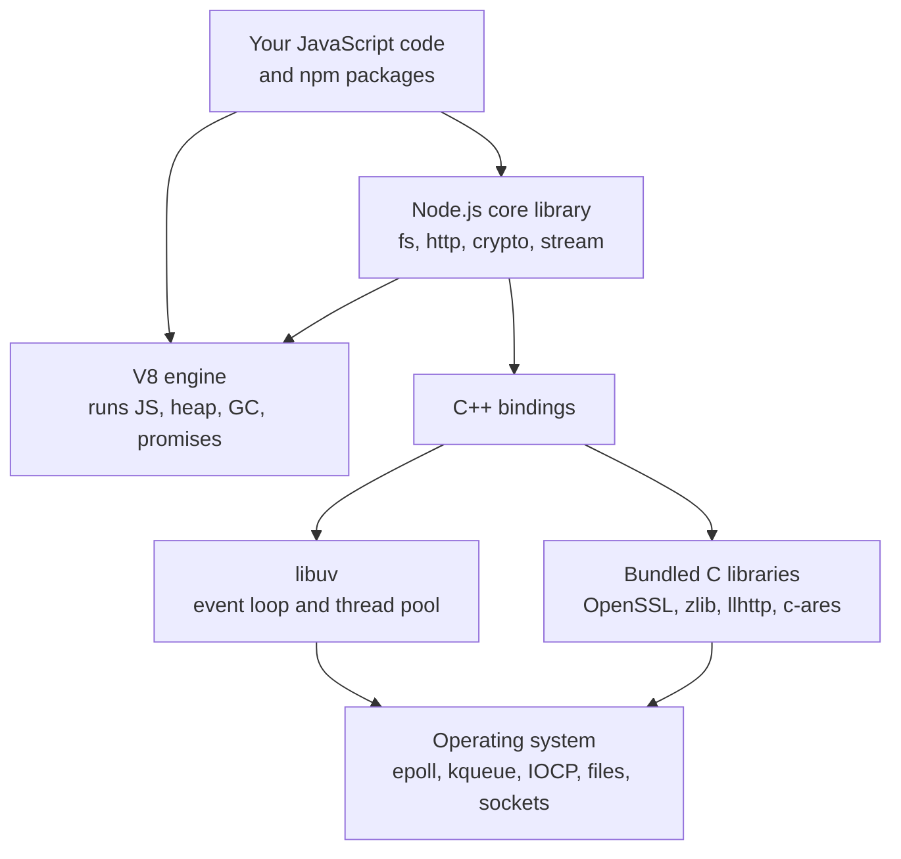
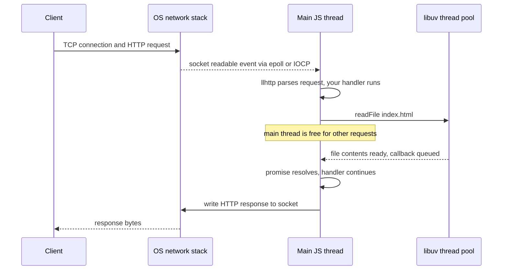
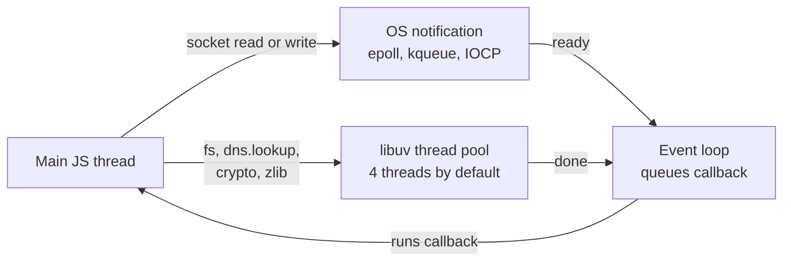

# Node.js Runtime and Architecture

> In this document you will learn what Node.js really is: V8, libuv, the C++ bindings and the core library, and how they work together so that one JavaScript thread can serve thousands of users. Interviewers use this topic to check if you understand *why* Node.js is fast for I/O, *why* it is bad at heavy CPU work, and how it is different from the browser.

**Before this:** [How programs run](../01-cs-and-web-fundamentals/01-how-programs-run.md) · [Operating systems, processes, threads and memory](../01-cs-and-web-fundamentals/03-operating-systems-processes-threads-memory.md) · [The event loop (browser)](../02-javascript/16-event-loop.md) · **Interview questions:** [jump to the interview section](#interview-questions)

## Table of contents

1. [What Node.js is](#what-nodejs-is)
2. [Why Node.js was created](#why-nodejs-was-created)
3. [The building blocks](#the-building-blocks)
4. [How the pieces work together](#how-the-pieces-work-together)
5. [One JavaScript thread and many helpers](#one-javascript-thread-and-many-helpers)
6. [Blocking vs non-blocking code](#blocking-vs-non-blocking-code)
7. [What Node.js is good at and bad at](#what-nodejs-is-good-at-and-bad-at)
8. [Node.js vs the browser](#nodejs-vs-the-browser)
9. [The process object](#the-process-object)
10. [Releases and LTS versions](#releases-and-lts-versions)
11. [Modern built-in features](#modern-built-in-features)
12. [Deno and Bun](#deno-and-bun)
13. [Common mistakes](#common-mistakes)
14. [Best practices](#best-practices)
15. [How to explain this in an interview](#how-to-explain-this-in-an-interview)
16. [Interview questions](#interview-questions)
17. [Summary](#summary)
18. [References](#references)

---

## What Node.js is

### Definition

**Node.js** is a **JavaScript runtime**. A **runtime** is a program that runs your code and gives it extra abilities. Node.js lets you run JavaScript outside the browser: on a server, on your laptop as a command-line tool, or inside a desktop app like Electron.

Node.js is **not** a programming language. The language is JavaScript. Node.js is also **not** a framework like Express or Angular. It is the engine room that frameworks run on.

You can say it in one line:

> Node.js = the V8 JavaScript engine + libuv (event loop and async I/O) + C++ bindings + a JavaScript core library (`fs`, `http`, `crypto`, `stream`, ...).

### A first look

Save this as `hello.js`:

```js
// hello.js
const os = require('node:os');

console.log('Hello from Node.js', process.version); // Hello from Node.js v22.20.0 (your version)
console.log('Platform:', process.platform);          // Platform: linux (or win32, darwin)
console.log('CPU cores:', os.cpus().length);         // CPU cores: 8 (depends on your machine)
```

Run it:

```bash
node hello.js
```

None of these things exist in plain JavaScript. `process`, `require` and the `os` module come from Node.js, not from the ECMAScript language.

### Language vs runtime

This difference matters in interviews, so keep it clear:

| Comes from the JavaScript language (ECMAScript) | Comes from the Node.js runtime |
| --- | --- |
| `let`, `const`, functions, classes | `require`, `module.exports` |
| `Promise`, `async`/`await` | `process`, `Buffer` |
| `Array`, `Map`, `JSON` | `fs`, `http`, `net`, `crypto`, `child_process` |
| Closures, prototypes | `setImmediate`, `process.nextTick` |

Some APIs exist in both the browser and Node.js but are **not** part of the language: `setTimeout`, `console`, `fetch`, `URL`, `TextEncoder`. Each runtime implements them separately.

## Why Node.js was created

Ryan Dahl created Node.js in 2009. He wanted a simple way to build servers that handle **many connections at the same time** without wasting memory.

### The problem with one thread per connection

Many servers at that time created **one thread for each connection**. A **thread** is a line of execution inside a process. Each thread needs its own stack memory (often around 1 MB or more reserved), and switching between thousands of threads costs CPU time.

Most of the time, these threads were doing **nothing**. They were waiting for the database, the disk or the network. A typical request spends far more time waiting for I/O than running code.

```text
Thread-per-connection server

Thread 1: [run 1 ms] [wait for DB 50 ms .....................] [run 1 ms]
Thread 2: [run 1 ms] [wait for file 20 ms ........] [run 1 ms]
Thread 3: [run 1 ms] [wait for API 200 ms ...................................]
...
10,000 connections = 10,000 threads, mostly sleeping, all using memory
```

### The Node.js idea

Node.js uses **one main thread** for your JavaScript and **never waits** for I/O on it. When your code asks for a file or a database result, Node.js hands the work to the operating system (or to a small helper thread pool) and moves on to the next request. When the result is ready, Node.js runs your callback.

```text
Node.js server (one JavaScript thread)

Main thread: [req A 1ms][req B 1ms][req C 1ms][A's DB result 1ms][C's API result 1ms][B's file 1ms]...
The waiting happens in the OS and libuv, not on the main thread.
```

### Why JavaScript

JavaScript was a good fit for this design:

- Developers already wrote **callbacks** and **events** in the browser (`onclick`, `XMLHttpRequest`).
- JavaScript had **no existing blocking I/O library**. So the whole Node.js ecosystem could be built non-blocking from the start.
- Google's **V8** engine (released with Chrome in 2008) made JavaScript fast.

A side benefit came later: the same language on the frontend and the backend. Teams can share validation code, types and tools.

### Analogy

Think of a restaurant.

- **Thread-per-connection** is one waiter per table. The waiter takes the order, then stands in the kitchen doorway until the food is ready. You need 100 waiters for 100 tables, and most of them are just standing.
- **Node.js** is one very fast waiter. They take an order, give it to the kitchen, and go to the next table. When the kitchen rings the bell, the waiter brings the food.

Where the analogy breaks: if a customer asks the single waiter to cook a complicated dish *themselves* (heavy CPU work), every other table waits. That is exactly Node.js's weakness, and you will see it many times in this document.

## The building blocks

### V8

**V8** is Google's JavaScript engine. It is written in C++ and is also used by Chrome and Electron.

V8 does these jobs:

- **Parses** your JavaScript and turns it into bytecode.
- **Runs** it with an interpreter (Ignition) and compiles hot code to fast machine code with optimizing compilers (a **JIT**, just-in-time compiler).
- **Manages memory**: the heap, objects, and the **garbage collector** (see [Memory management and garbage collection](../02-javascript/19-memory-management-and-garbage-collection.md)).
- Implements the **ECMAScript language**: `Promise`, `Map`, `class`, `async`/`await`, and the **microtask queue** for promises.

V8 does **not** know about files, sockets, timers or the event loop. It only runs JavaScript. Everything else comes from the host (Node.js or the browser).

```js
// Which V8 version is inside your Node.js?
console.log(process.versions.v8); // e.g. 12.4.254.21-node.33 (Node 22)
```

### libuv

**libuv** is a C library that gives Node.js:

- The **event loop** (the loop that decides which callback runs next).
- **Asynchronous I/O** for network sockets, using the best tool of each operating system: **epoll** on Linux, **kqueue** on macOS/BSD, **IOCP** on Windows.
- A **thread pool** for work that the OS cannot do asynchronously in a portable way: most file system operations, `dns.lookup()`, some `crypto` functions and `zlib` compression.
- Timers, child processes, signals, pipes and file watching.

```js
console.log(process.versions.uv); // e.g. 1.51.0
```

libuv was created for Node.js, but other projects use it too.

### C++ bindings

**Bindings** are the glue between JavaScript and C/C++. When you call `fs.readFile()`, the JavaScript code in Node's core library calls a C++ function. That C++ function asks libuv to do the work. When libuv finishes, the C++ layer calls back into V8 to run your JavaScript callback.

You normally never see the bindings. But you should know they exist because they explain how a JavaScript call can end up running in the operating system.

### The core library (JavaScript)

Node.js ships with modules written mostly in JavaScript on top of the bindings:

| Module | What it does |
| --- | --- |
| `node:fs` | Read and write files |
| `node:path` | Work with file paths |
| `node:http`, `node:https`, `node:http2` | HTTP servers and clients |
| `node:net`, `node:dgram` | TCP and UDP sockets |
| `node:events` | `EventEmitter` |
| `node:stream` | Streams |
| `node:crypto` | Hashing, random values, encryption |
| `node:child_process` | Run other programs |
| `node:worker_threads` | Run JavaScript in other threads |
| `node:os`, `node:process` | Information about the machine and the process |

The core modules are covered in [Core modules: fs, path, events, Buffer](04-core-modules-fs-path-events-buffer.md) and [Streams](05-streams.md).

### Other libraries inside Node.js

Node.js also bundles other well-known libraries. You do not need to memorize them, but naming one or two shows depth:

- **OpenSSL** for TLS (HTTPS) and `crypto`.
- **zlib** for gzip and deflate compression (and Brotli support through the `zlib` module).
- **llhttp** for parsing HTTP messages fast.
- **c-ares** for asynchronous DNS queries (`dns.resolve*()`).
- **nghttp2** for HTTP/2.
- **undici**, a JavaScript HTTP client that powers the global `fetch()`.

## How the pieces work together

### Architecture diagram



Read it from top to bottom:

1. Your code calls a core module, for example `fs.readFile()`.
2. The core module (JavaScript) calls a C++ binding.
3. The binding asks libuv to do the work.
4. libuv uses the OS directly (network) or its thread pool (files).
5. When the work is done, libuv puts the completion on the event loop.
6. The event loop runs your callback in V8, on the main thread.

### One request, step by step

Here is a small server that reads a file for every request:

```js
// server.js
const http = require('node:http');
const fs = require('node:fs/promises');

const server = http.createServer(async (req, res) => {
  const html = await fs.readFile('./index.html', 'utf8'); // non-blocking
  res.writeHead(200, { 'Content-Type': 'text/html' });
  res.end(html);
});

server.listen(3000);
```

What happens when a browser calls `http://localhost:3000`:



Step-by-step walkthrough:

1. The OS accepts the TCP connection. libuv learns about it through epoll/kqueue/IOCP. No thread was blocked while waiting.
2. On the main thread, Node.js parses the HTTP request and calls your handler.
3. `fs.readFile` is sent to the libuv **thread pool**. Your handler pauses at `await`. The main thread goes back to the event loop and can handle other requests.
4. A pool thread does the blocking `read()` system call.
5. When the read is done, libuv queues the completion. On the next loop turn, Node.js resolves the promise and your handler continues after `await`.
6. `res.end()` writes to the socket. The OS sends the bytes in the background.

## One JavaScript thread and many helpers

### "Node.js is single-threaded" — is that true?

Half true. The correct sentence is:

> Node.js runs **your JavaScript on one main thread**. But the Node.js process uses **several threads** in the background: the libuv thread pool, V8's garbage collector threads, and others.

You can check it yourself on Linux with `ps -o nlwp <pid>` or on Windows in Task Manager. A simple Node.js process has several threads even when your code uses only one.

### Two ways Node.js does async I/O

This is the most important internal detail of this document.

| Kind of work | How libuv does it | Uses the thread pool? |
| --- | --- | --- |
| Network: TCP, UDP, HTTP, sockets, pipes | OS async notification (epoll, kqueue, IOCP) | **No** |
| `fs` operations (except watchers and sync versions) | Thread pool runs the blocking system call | **Yes** |
| `dns.lookup()` (used by `http.get('example.com')` by default) | Thread pool calls `getaddrinfo` | **Yes** |
| `dns.resolve*()` | c-ares, over the network | **No** |
| Async `crypto`: `pbkdf2`, `scrypt`, `randomBytes`, `randomFill`, `generateKeyPair` | Thread pool | **Yes** |
| Async `zlib`: `gzip`, `deflate`, `brotliCompress` | Thread pool | **Yes** |
| Timers (`setTimeout`) | Inside the event loop itself | **No** |

Why the split? Operating systems have good "tell me when this socket is ready" mechanisms for network sockets. For regular files, there is no portable non-blocking API that works well everywhere. So libuv runs file operations as normal blocking calls, but on background threads.



### The thread pool size

The thread pool has **4 threads by default**. You can change it with the `UV_THREADPOOL_SIZE` environment variable (libuv allows up to 1024).

```bash
UV_THREADPOOL_SIZE=8 node server.js
```

Set it **before** Node.js starts. libuv creates the pool when it is first used, so setting `process.env.UV_THREADPOOL_SIZE` from inside your code is not guaranteed to work.

### Seeing the thread pool limit

`crypto.pbkdf2()` is slow on purpose (it is a password-hashing function) and runs in the thread pool. Start 8 of them at once:

```js
// pool.js
const crypto = require('node:crypto');
const start = Date.now();

for (let i = 1; i <= 8; i++) {
  crypto.pbkdf2('secret', 'salt', 200_000, 64, 'sha512', () => {
    console.log(`hash ${i} done after ${Date.now() - start} ms`);
  });
}
```

Output on a 12-core machine with the default pool (your numbers will differ, but the *shape* is the same):

```text
hash 2 done after 248 ms
hash 1 done after 267 ms
hash 4 done after 284 ms
hash 3 done after 285 ms
hash 5 done after 537 ms
hash 6 done after 554 ms
hash 8 done after 588 ms
hash 7 done after 599 ms
```

Walkthrough:

1. The loop starts 8 jobs, but only 4 pool threads exist.
2. Jobs 1–4 run in parallel and finish at about 250 ms.
3. Jobs 5–8 waited in the pool's queue. They start only when a thread is free, and finish at about 550 ms.
4. The finish order inside a batch (2, 1, 4, 3) is not predictable.

With `UV_THREADPOOL_SIZE=8 node pool.js`, all 8 finish at about 250–360 ms in the same run.

**Real-world lesson:** if your server does many `bcrypt`/`pbkdf2` hashes, gzip compressions and file reads at the same time, they all share these 4 threads. A burst of password hashing can make unrelated file reads slow. Measure first, then consider a bigger pool or moving the work to worker threads.

### What the thread pool is not

- It does **not** run your JavaScript. Pool threads run C/C++ work only.
- It is **not** used for network I/O. A server with 10,000 open sockets does not need 10,000 threads.
- It is **not** the same as **worker threads** (`node:worker_threads`). Worker threads run JavaScript in parallel, each with its own V8 instance and event loop. See [Concurrency: worker threads and cluster](12-concurrency-worker-threads-and-cluster.md).

## Blocking vs non-blocking code

### Definitions

- **Blocking** code keeps the main thread busy until it finishes. Nothing else can run: no other requests, no timers, no callbacks.
- **Non-blocking** code starts the work and returns at once. The result comes later, through a callback, a promise or an event.

### Three styles of the same file read

```js
const fs = require('node:fs');
const fsp = require('node:fs/promises');

// 1. Blocking (synchronous)
const a = fs.readFileSync('config.json', 'utf8');
console.log('sync read done');

// 2. Non-blocking with a callback
fs.readFile('config.json', 'utf8', (err, data) => {
  if (err) return console.error(err);
  console.log('callback read done');
});

// 3. Non-blocking with a promise
async function load() {
  const data = await fsp.readFile('config.json', 'utf8');
  console.log('promise read done');
}
load();

console.log('end of script');
```

Output:

```text
sync read done
end of script
callback read done     (these two can come in either order)
promise read done
```

The sync read finishes before the next line runs. The two async reads finish later, after the script ends.

### When sync code is fine

Blocking is not always bad. Use sync APIs when **nothing else needs to run yet**:

- At startup, before the server starts listening (loading config, reading a certificate).
- In small CLI scripts and build tools that do one thing at a time.

```js
// ✅ Correct: sync read once at startup
const config = JSON.parse(fs.readFileSync('./config.json', 'utf8'));
const server = http.createServer(handler);
server.listen(config.port);
```

```js
// ❌ Wrong: sync read on every request blocks all other users
http.createServer((req, res) => {
  const template = fs.readFileSync('./template.html', 'utf8');
  res.end(template);
});
```

### CPU work blocks too

Async APIs only help with **waiting**. They do not make calculation faster. A long loop on the main thread blocks everything.

```js
// server.js
const http = require('node:http');

http.createServer((req, res) => {
  if (req.url === '/slow') {
    // ❌ 3 seconds of CPU work on the main thread
    const start = Date.now();
    while (Date.now() - start < 3000) {}
    res.end('slow done\n');
  } else {
    res.end('fast\n');
  }
}).listen(3000);
```

I tested this: one client calls `/slow`, and 100 ms later another client calls `/fast`. The `/fast` request, which needs almost no work, waited about **2,900 ms**. It had to wait until the `/slow` loop gave the thread back.

Typical blocking operations in real servers:

- `JSON.parse` / `JSON.stringify` on very large payloads (tens of MB).
- Sync crypto: `crypto.pbkdf2Sync`, `bcrypt.hashSync`.
- Badly written regular expressions on user input (catastrophic backtracking).
- Sorting or transforming huge arrays.
- Image resizing, PDF generation, compression with `zlib.gzipSync`.
- Any `...Sync` function inside a request handler.

The [Node.js event loop](02-node-event-loop.md#blocking-the-event-loop) document shows how to find and measure these.

## What Node.js is good at and bad at

### Good fit: I/O-bound work

**I/O-bound** means the program spends most of its time **waiting** for input/output (network, disk, database), not calculating.

| Use case | Why Node.js fits |
| --- | --- |
| REST and GraphQL APIs | Mostly waiting for databases and other services |
| Backend-for-frontend (BFF), API gateways, proxies | Many concurrent connections, little CPU per request |
| Real-time apps: chat, notifications, live dashboards (WebSockets) | Many long-lived connections, cheap to keep open |
| Streaming: file uploads/downloads, video proxying, log processing | Streams move data in small chunks with low memory |
| Server-side rendering for React/Angular apps | Same language as the frontend |
| CLI tools and build tools (npm, webpack, Vite, Angular CLI) | Huge ecosystem, fast startup |
| Desktop apps with Electron | Node.js runs in the main process |

### Bad fit (on the main thread): CPU-bound work

**CPU-bound** means the program spends most of its time **calculating**.

- Video and audio encoding.
- Large image processing.
- Machine learning training.
- Heavy data science and number crunching.
- Big report generation done synchronously.

Node.js *can* do these, but not on the main thread. Options:

1. **Worker threads** for CPU work in JavaScript.
2. **Native addons** or WebAssembly for hot paths.
3. A **separate service** written in a language better suited for the job (Go, Rust, Java, Python with native libraries), connected by a queue.
4. A **job queue** so the HTTP request returns fast and the work happens in the background (see [Background jobs and queues](13-background-jobs-and-queues.md)).

### Scaling across CPU cores

One Node.js process uses one main thread, so it uses about one CPU core for JavaScript. To use all cores:

- Run several Node.js processes (with the `cluster` module, PM2, or multiple containers behind a load balancer).
- Use worker threads for CPU-heavy parts.

Details are in [Concurrency: worker threads and cluster](12-concurrency-worker-threads-and-cluster.md).

## Node.js vs the browser

Both run JavaScript, often with the same V8 engine (in Chrome). But the **environment** is very different.

| Topic | Browser | Node.js |
| --- | --- | --- |
| Global object | `window` (also `globalThis`) | `globalThis` (legacy name `global`) |
| DOM (`document`, `window.location`) | Yes | No |
| File system, sockets, processes | No (sandboxed) | Yes, full access as the OS user |
| `process`, `Buffer` | No | Yes |
| Module systems | ES modules (`<script type="module">`) | CommonJS **and** ES modules |
| Top-level `this` | `window` in classic scripts, `undefined` in modules | `module.exports` (`{}`) in CommonJS, `undefined` in ESM |
| Event loop | HTML spec: tasks, microtasks, rendering steps | libuv phases + `process.nextTick` + microtasks |
| `setTimeout` returns | A number | A `Timeout` object (with `ref()`/`unref()`) |
| Extra timer APIs | `requestAnimationFrame`, `requestIdleCallback` | `setImmediate`, `process.nextTick` |
| Version control | You support many browsers and versions | You choose the exact Node.js version |
| Security model | Strong sandbox, same-origin policy | Trusts your code fully (optional permission model) |

Many **Web APIs** now exist in Node.js too, so the same code can run in both places: `fetch`, `URL`, `URLSearchParams`, `AbortController`, `TextEncoder`/`TextDecoder`, `structuredClone`, `Blob`, Web Streams (`ReadableStream`), `BroadcastChannel`, `performance`, `crypto.randomUUID()` and `crypto.subtle`, and `WebSocket` (client, since Node.js 22).

Quick check you can run:

```js
// globals.cjs
console.log(typeof window, typeof document);     // undefined undefined
console.log(global === globalThis);              // true
console.log(this === module.exports);            // true (CommonJS only)

const t = setTimeout(() => {}, 10);
console.log(typeof t, t.constructor.name);       // object Timeout
clearTimeout(t);

var notGlobal = 1;
console.log(globalThis.notGlobal);               // undefined (top-level var stays in the module)
```

The last line surprises many people. In a browser classic script, top-level `var` creates a property on `window`. In Node.js every file is a module, so top-level variables stay private to that file.

## The process object

`process` is a global object that describes the **current Node.js process** and lets you control it. You do not need to import it (but `import process from 'node:process'` also works).

### Most useful properties and methods

| Member | What it gives you | Example value |
| --- | --- | --- |
| `process.argv` | Command-line arguments (array of strings) | `['/usr/bin/node', '/app/cli.js', 'serve']` |
| `process.env` | Environment variables (all values are **strings**) | `{ PORT: '3000', NODE_ENV: 'production' }` |
| `process.cwd()` | Current working directory (where you started `node`) | `/home/asha/project` |
| `process.platform` | OS name | `'linux'`, `'win32'`, `'darwin'` |
| `process.version`, `process.versions` | Node.js version, and versions of V8, libuv, OpenSSL... | `'v22.20.0'` |
| `process.pid` | Process ID | `48211` |
| `process.memoryUsage()` | `rss`, `heapTotal`, `heapUsed`, `external`, `arrayBuffers` (bytes) | |
| `process.uptime()` | Seconds since the process started | `12.53` |
| `process.hrtime.bigint()` | High-resolution time in nanoseconds (a `bigint`) | `123456789012n` |
| `process.exitCode` | Exit code to use when the process ends naturally | `1` |
| `process.exit(code)` | Stop the process **now** | |
| `process.nextTick(fn)` | Run `fn` right after the current operation (see the [event loop doc](02-node-event-loop.md#processnexttick)) | |
| `process.on(event, fn)` | Listen to process events: `exit`, `uncaughtException`, `unhandledRejection`, `SIGINT`, `SIGTERM`, `warning` | |
| `process.stdin`, `stdout`, `stderr` | Streams for terminal input and output | |

### Command-line arguments

```js
// cli.mjs   run: node cli.mjs serve --port 8080 -v
import { parseArgs } from 'node:util';

console.log(process.argv.slice(2)); // [ 'serve', '--port', '8080', '-v' ]

const { values, positionals } = parseArgs({
  options: {
    port: { type: 'string', short: 'p', default: '3000' },
    verbose: { type: 'boolean', short: 'v', default: false },
  },
  allowPositionals: true,
});

console.log(values);      // [Object: null prototype] { port: '8080', verbose: true }
console.log(positionals); // [ 'serve' ]
```

`process.argv[0]` is the path to the `node` binary and `process.argv[1]` is the script path. Your own arguments start at index 2. `util.parseArgs()` is built in (stable since Node.js 20), so small CLIs do not need a library.

### Environment variables are always strings

```js
// run: PORT=3000 node env.cjs
console.log(process.env.PORT, typeof process.env.PORT); // 3000 string

process.env.FEATURE_ON = false;
console.log(process.env.FEATURE_ON, typeof process.env.FEATURE_ON); // false string
```

```js
// ❌ Wrong: the string 'false' is truthy
if (process.env.ENABLE_CACHE) { enableCache(); }

// ✅ Correct: parse and validate once at startup
const config = {
  port: Number.parseInt(process.env.PORT ?? '3000', 10),
  enableCache: process.env.ENABLE_CACHE === 'true',
};
if (Number.isNaN(config.port)) throw new Error('PORT must be a number');
```

Real projects validate all config at startup and fail fast if something is missing. This is covered in [Production Node.js](14-production-nodejs.md).

### Exit codes and stopping the process

A Node.js process ends **by itself** when the event loop has nothing left to do: no timers, no open sockets, no pending I/O. You rarely need `process.exit()`.

- Exit code `0` means success. Any other number means failure. CI systems and shell scripts check this number.
- An uncaught exception ends the process with code `1`.
- A process killed by a signal ends with `128 + signal number` on Unix (for example, `130` for SIGINT).

```js
// ❌ Risky: may cut off output that is still being written
console.log(bigReport);
process.exit(1);

// ✅ Better: set the code and let Node.js finish naturally
console.log(bigReport);
process.exitCode = 1;
```

`process.exit()` stops immediately, even if writes to `stdout` (when it is a pipe or file) are still pending. Setting `process.exitCode` lets pending work finish.

### Process events for errors

```js
process.on('uncaughtException', (err) => {
  logger.fatal({ err }, 'uncaught exception');
  process.exit(1); // do sync cleanup, log, then exit. Do not continue.
});

process.on('unhandledRejection', (reason) => {
  logger.fatal({ reason }, 'unhandled promise rejection');
  process.exit(1);
});
```

Key facts:

- Since **Node.js 15**, an unhandled promise rejection **crashes the process** by default (like an uncaught exception). Before that, Node.js only printed a warning.
- The official docs call `uncaughtException` a last-resort mechanism. After it fires, your app may be in an unknown state. **Log, clean up, and exit.** Let a process manager (Kubernetes, systemd, PM2) restart it.
- Signals (`SIGINT` from Ctrl+C, `SIGTERM` from Docker/Kubernetes) are used for graceful shutdown. They are covered in [Core modules](04-core-modules-fs-path-events-buffer.md#process-signals-and-graceful-shutdown).

## Releases and LTS versions

### How Node.js versions work

Up to Node.js 26, Node.js released a new **major** version every six months:

- **Even** versions (18, 20, 22, 24, 26) are released in April or May. In October they become **LTS** (long-term support) and get about 30 months of support in total.
- **Odd** versions (21, 23, 25) are released in October and are supported for only about 6 months. They never become LTS.

An LTS line goes through two stages:

1. **Active LTS** — gets bug fixes, security fixes and some backported features.
2. **Maintenance LTS** — gets only critical bug fixes and security fixes.

**Production apps should run Active LTS or Maintenance LTS.** "Current" releases are for trying new features and testing libraries.

### The situation in October 2026

| Version | Codename | Status (October 2026) | End of life |
| --- | --- | --- | --- |
| Node.js 22 | Jod | Maintenance LTS | April 2027 |
| Node.js 24 | Krypton | Maintenance LTS (since 20 October 2026; it was Active LTS before) | April 2028 |
| Node.js 26 | — | Current (becomes Active LTS on 28 October 2026) | April 2029 |
| Node.js 25 | — | End of life | June 2026 |

Node.js 20 reached end of life on 30 April 2026, so do not start new projects on it. For a few days at the end of October 2026 there is no Active LTS line at all: 24 has moved to Maintenance and 26 has not yet been promoted. For a new project, choose Node.js 24 now and plan the move to 26 once it is LTS.

### The new yearly schedule

The Node.js project announced a change: **starting with Node.js 27, there will be one major release per year**, and **every** major release will become LTS. Each release first spends about six months as an **Alpha** (for library authors and CI testing, not production), then six months as **Current**, then becomes LTS. Under the announced plan, the first Node.js 27 alpha builds start in late 2026, 27.0.0 arrives in April 2027 and it becomes LTS in October 2027. Check the official release page before you plan upgrades, because details of a new process can still change.

### Practical rules

- Pin the Node.js version for your project: `"engines": { "node": ">=22" }` in `package.json`, a `.nvmrc` file, and the same version in your Dockerfile and CI.
- Use a version manager on your laptop: **nvm** (macOS/Linux), **nvm-windows**, **fnm** or **Volta**.
- Plan an upgrade **before** your version reaches end of life. After end of life, there are no more security fixes.

## Modern built-in features

Node.js has added many features that used to need npm packages. Interviewers like to see that you know the modern platform. All versions below come from the official Node.js docs.

| Feature | What it replaces | Added | Status |
| --- | --- | --- | --- |
| Global `fetch()` | `node-fetch`, `axios` for simple calls | v18.0 (unflagged) | Stable since v21.0 |
| Test runner `node:test`, `node --test` | Jest/Mocha for simple projects | v18.0 | Stable since v20.0 |
| Watch mode `node --watch app.js` | `nodemon` | v18.11 | Stable since v22.0 (and v20.13) |
| `--env-file=.env`, `process.loadEnvFile()` | `dotenv` | v20.6 (flag), v21.7 (function) | Flag no longer experimental since v24.10 and v22.21 |
| `node --run <script>` | `npm run` (faster, fewer features) | v22.0 | Available in 22+ |
| Global `WebSocket` client | `ws` (for clients) | v22.0 (unflagged) | Stable since v22.4 |
| Permission model `--permission` | — | v20.0 (experimental) | Stable since v23.5 and v22.13 |
| TypeScript type stripping (`node app.ts`) | `ts-node`, `tsx` for simple cases | v22.6 (flag) | On by default since v23.6 and v22.18; stable since v25.2 and v24.12 |
| `require()` of ES modules | Dynamic `import()` workarounds | v22.0 (flag) | On by default since v22.12; stable since v25.4 |
| `node:sqlite` | `better-sqlite3`, `sqlite3` | v22.5 (flag) | Unflagged since v22.13; release candidate since v25.7 |
| `fs.glob()` | `glob`, `fast-glob` | v22.0 | Stable since v24.0 and v22.17 |

### Examples

**Fetch:**

```js
// Works in Node.js 18+ without any package
const res = await fetch('https://api.github.com/repos/nodejs/node');
const repo = await res.json();
console.log(repo.full_name); // nodejs/node
```

**Test runner:**

```js
// sum.test.mjs   run: node --test
import { test } from 'node:test';
import assert from 'node:assert/strict';

const sum = (a, b) => a + b;

test('adds two numbers', () => {
  assert.equal(sum(2, 3), 5);
});
```

**Env file:**

```text
# .env
PORT=4000
API_URL=https://api.example.com
```

```bash
node --env-file=.env server.js
```

```js
// server.js
console.log(process.env.PORT, process.env.API_URL); // 4000 https://api.example.com
```

A `.env` file is a local convenience. It is not a secrets manager. Never commit real secrets. See [Authentication and authorization](../07-nodejs-backend/09-authentication-and-authorization.md).

**Permission model:**

```bash
# Allow reading only the ./data folder. Everything else is denied.
node --permission --allow-fs-read=./data app.js
```

```js
// app.js
const fs = require('node:fs');
fs.readFileSync('./data/users.json');  // OK
fs.readFileSync('/etc/passwd');         // throws ERR_ACCESS_DENIED
```

With `--permission`, file system access, child processes, worker threads, native addons and WASI are denied unless you allow them (`--allow-fs-read`, `--allow-fs-write`, `--allow-child-process`, `--allow-worker`, `--allow-addons`, `--allow-wasi`). Network restriction (`--allow-net`) arrived later, in Node.js 25, and is still in active development. The official docs call the permission model a **"seat belt"**: it stops *trusted* code from accidentally touching files or resources you did not allow. It is **not** a sandbox against malicious code. The docs say clearly that malicious code can bypass it. So you still need to review and audit your dependencies.

**TypeScript type stripping:**

```ts
// greet.ts   run: node greet.ts   (Node.js 22.18+ / 23.6+)
interface User { name: string; age: number }

function greet(user: User): string {
  return `Hello, ${user.name}`;
}

console.log(greet({ name: 'Asha', age: 30 })); // Hello, Asha
```

Node.js simply **removes** the type annotations and runs the result. Important limits:

- It does **not** type-check. You still run `tsc --noEmit` in CI.
- It supports only "erasable" syntax. Features that generate JavaScript code, like `enum` and `namespace` with values, fail with a syntax error. Node.js 22 to 25 had an `--experimental-transform-types` flag for them, but Node.js 26 removed it. Use a tool such as `tsx` (or compile with `tsc`) if you need these features.
- It does not read `tsconfig.json` (no path aliases, no target down-leveling).
- Imports must use the real file extension (`import { x } from './util.ts'`), and type-only imports should use `import type`.

## Deno and Bun

Two other server-side JavaScript runtimes compete with Node.js. You only need a short, fair comparison for interviews.

| | Node.js | Deno | Bun |
| --- | --- | --- | --- |
| Engine | V8 | V8 | JavaScriptCore (Safari's engine) |
| Written in | C++ and JavaScript | Rust and JavaScript | Zig and C++ |
| Created by | Ryan Dahl (2009) | Ryan Dahl (first release 2018, 2.0 in 2024) | Jarred Sumner (1.0 in 2023) |
| TypeScript | Type stripping built in (see above), `tsc` for checking | Built in | Built in |
| Security | Full access by default, optional `--permission` | **Secure by default**: must grant `--allow-net`, `--allow-read`, ... | Full access by default |
| npm compatibility | Native | Supported (`npm:` specifiers, `package.json`) | High, aims to be a drop-in replacement |
| Extra tools | npm, `node --test` | Formatter, linter, test runner, bundling built in | Package manager, bundler, test runner built in; focus on speed |

What to say in an interview:

> Node.js is still the default for production because of its maturity, its huge ecosystem and LTS support. Deno focuses on security by default and web standards. Bun focuses on speed and an all-in-one toolchain. Both now support most npm packages, so trying them is cheaper than before. For a big company project, I would choose Node.js LTS unless there is a measured reason to switch.

## Common mistakes

1. **"Node.js is single-threaded, so it can only do one thing at a time."** Only your JavaScript runs on one thread. I/O happens in parallel in the OS and the thread pool.
2. **"Async means it runs on another thread."** A promise does not create a thread. `await somePromise` only means "continue later". CPU work inside an async function still blocks the main thread.
3. **Using `...Sync` APIs inside request handlers.** Every user waits.
4. **Thinking network calls use the thread pool.** They do not. Increasing `UV_THREADPOOL_SIZE` will not make HTTP calls faster.
5. **Forgetting that `dns.lookup()` uses the thread pool.** Many slow DNS lookups (through `http.get` with hostnames) can fill the pool and slow down file reads.
6. **Treating environment variables as numbers or booleans.** They are always strings.
7. **Calling `process.exit()` right after writing output.** Output can be lost. Set `process.exitCode` instead.
8. **Continuing to run after `uncaughtException`.** The app state may be broken. Log and exit.
9. **Running an end-of-life Node.js version in production.** No more security fixes.
10. **Putting CPU-heavy work (image resizing, big reports) directly in an API handler.** Move it to worker threads or a job queue.

## Best practices

- **Keep the main thread free.** Use async APIs for I/O, and keep each callback short. *Reason:* one slow callback delays every user.
- **Use sync APIs only at startup or in CLI scripts.** *Reason:* at startup nothing else is waiting yet.
- **Move CPU-heavy work off the main thread** (worker threads, job queues, separate services). *Reason:* async does not make CPU work parallel.
- **Run one process per core, or scale with containers.** *Reason:* one process uses one core for JavaScript.
- **Validate configuration at startup.** Convert env strings to real types and fail fast. *Reason:* bugs from `'false'` being truthy are hard to find in production.
- **Handle `unhandledRejection` and `uncaughtException` by logging and exiting.** Use a process manager to restart. *Reason:* a half-broken process is worse than a fast restart.
- **Use the `node:` prefix for core modules** (`require('node:fs')`). *Reason:* it is clear, and an npm package with the same name can never replace it.
- **Pin and upgrade the Node.js version on purpose** (`engines`, `.nvmrc`, Docker image tag). *Reason:* the same code can behave differently on different versions.
- **Prefer built-in features when they are enough** (`fetch`, `node:test`, `--watch`, `--env-file`). *Reason:* fewer dependencies means a smaller attack surface.
- **Measure before tuning** (`UV_THREADPOOL_SIZE`, cluster size). *Reason:* guesses about performance are often wrong.

## How to explain this in an interview

1. **Define it:** "Node.js is a JavaScript runtime built on Chrome's V8 engine and the libuv library. It lets JavaScript run outside the browser, mainly for servers and tools."
2. **Why it exists:** "Traditional servers used one thread per connection, and most of those threads just waited for I/O. Node.js handles many connections on one JavaScript thread by never blocking on I/O."
3. **How it works:** "V8 runs my JavaScript. When I call something like `fs.readFile` or open a socket, the C++ bindings hand the work to libuv. Network I/O uses the OS's async mechanisms like epoll or IOCP. File system work, `dns.lookup`, some crypto and zlib use libuv's thread pool, which has 4 threads by default. When the work finishes, the event loop runs my callback on the main thread."
4. **Small example:** "If 1,000 users each request data from a database, Node.js sends 1,000 queries and handles each result when it comes back. It does not need 1,000 threads."
5. **Where it is useful:** "It is great for I/O-heavy work: REST APIs, BFFs, real-time apps with WebSockets, streaming, and tooling like the Angular CLI."
6. **Trade-offs / gotchas:** "CPU-heavy work blocks the event loop and every request waits. For that I use worker threads, a job queue or a separate service. And one process uses one core for JavaScript, so in production I run several processes or containers."

## Interview questions

### Q1. What is Node.js?

**What the interviewer is checking:** Whether you can separate the language from the runtime and name the main parts.

**Short spoken answer (30–60 seconds):**
> Node.js is a runtime that lets JavaScript run outside the browser. It is not a language and not a framework. Inside, it has Google's V8 engine to run JavaScript, the libuv library for the event loop and asynchronous I/O, C++ bindings that connect the two, and a core library with modules like `fs`, `http`, `crypto` and `stream`. Its main idea is non-blocking I/O: one JavaScript thread can handle many connections because it never sits and waits for the disk or network. That makes it a strong choice for APIs, real-time apps and tools. The trade-off is that heavy CPU work blocks that one thread, so you move it to worker threads or another service.

**Detailed explanation:** V8 implements ECMAScript: syntax, objects, promises, garbage collection. It has no idea what a file or socket is. libuv gives the event loop, OS-level async networking (epoll/kqueue/IOCP), a thread pool for blocking work, timers, child processes and signals. The core library is JavaScript code that calls C++ bindings, which call libuv and bundled libraries like OpenSSL and zlib.

**Follow-up questions:**
- **Is Node.js a framework?** — No. Express, Fastify and NestJS are frameworks that run on Node.js. Node.js is the runtime under them.
- **Which parts of Node.js are written in JavaScript?** — Most of the core library (`fs`, `http`, `stream`, `events`) is JavaScript. V8, libuv, the bindings and bundled libraries are C/C++.
- **What does V8 not provide?** — V8 provides no I/O, no event loop and no timers. `setTimeout`, `fs` and sockets come from Node.js and libuv.

**Common mistakes:** Calling Node.js "a JavaScript framework" or "a server". Saying "Node.js is written in JavaScript" without the C++ parts.

**Where this is used in real projects:** Every Express/NestJS API, every Angular CLI build, every Electron main process.

### Q2. Is Node.js single-threaded?

**What the interviewer is checking:** Whether you know the difference between "my JavaScript runs on one thread" and "the process has one thread".

**Short spoken answer (30–60 seconds):**
> Your JavaScript code runs on a single main thread, so two of your callbacks never run at the same time. But the Node.js process itself has several threads. libuv has a thread pool, 4 threads by default, for file system work, `dns.lookup`, some crypto and zlib. V8 also uses background threads for garbage collection and compilation. Network I/O doesn't use the pool at all; it uses the OS's async notification. And if I need real parallel JavaScript, I can use worker threads, which each have their own V8 instance and event loop.

**Detailed explanation:** The "single-threaded" label is about the programming model: no shared-memory data races between your callbacks, and no locks needed for normal code. It does not mean that only one I/O operation happens at a time.

**Follow-up questions:**
- **If JavaScript runs on one thread, can there still be race conditions?** — Yes, async race conditions. Two requests can both read a value, both `await` something, then both write. The final write wins. You need database transactions, atomic operations or locks at the data level.
- **How can you see the extra threads?** — On Linux: `ps -o nlwp <pid>` or `top -H -p <pid>`. On Windows: Task Manager details or Process Explorer.
- **Do worker threads share the event loop?** — No. Each worker has its own event loop and V8 isolate. They communicate with messages or `SharedArrayBuffer`.

**Common mistakes:** Answering just "yes" or just "no". Both are incomplete.

**Where this is used in real projects:** Explaining why a burst of `bcrypt` hashes slows down file reads (they share the pool), or why a CPU loop freezes the whole API.

### Q3. What is libuv and what does it do?

**What the interviewer is checking:** Internal knowledge of how Node.js does async work.

**Short spoken answer (30–60 seconds):**
> libuv is a C library that Node.js uses for its event loop and asynchronous I/O. It hides the differences between operating systems: for network sockets it uses epoll on Linux, kqueue on macOS and IOCP on Windows, so one thread can watch thousands of connections. For things the OS can't do asynchronously in a portable way, mainly file system calls, it uses a thread pool with 4 threads by default. It also handles timers, child processes, signals and file watching. The event loop phases you hear about, like timers, poll and check, are libuv's loop.

**Follow-up questions:**
- **Why does file I/O use a thread pool but network I/O doesn't?** — Operating systems have good readiness APIs for sockets. Regular files are always "ready" for epoll, and real async file APIs differ a lot between systems, so libuv runs blocking file calls on background threads.
- **Can you change the thread pool size?** — Yes, with the `UV_THREADPOOL_SIZE` environment variable, set before the process starts. libuv allows up to 1024.
- **Is libuv only used by Node.js?** — It was created for Node.js, but other projects use it too.

**Common mistakes:** Saying "libuv runs JavaScript in the thread pool". The pool runs C work only.

**Where this is used in real projects:** Tuning servers that do heavy file or crypto work. Understanding event loop puzzles.

### Q4. Which operations use the libuv thread pool?

**What the interviewer is checking:** Precise knowledge, not just "async stuff".

**Short spoken answer (30–60 seconds):**
> According to the Node.js docs, four groups: all `fs` APIs except the file watchers and the sync versions, `dns.lookup()`, the async crypto functions like `pbkdf2`, `scrypt`, `randomBytes`, `randomFill` and `generateKeyPair`, and the async zlib functions. Network sockets, HTTP and timers don't use the pool. One gotcha is that `http.get` with a hostname calls `dns.lookup` by default, so many DNS lookups can fill the pool.

**Detailed explanation:** Because the pool is shared, slow work in one category delays the others. Eight concurrent `pbkdf2` calls with a pool of 4 finish in two "waves" (see the demo above).

**Follow-up questions:**
- **What is the difference between `dns.lookup` and `dns.resolve4`?** — `dns.lookup` uses the OS resolver (`getaddrinfo`), respects `/etc/hosts`, and runs in the thread pool. `dns.resolve4` sends DNS queries over the network with c-ares, does not use the pool, and ignores `/etc/hosts`.
- **Does `fs.promises.readFile` use the pool?** — Yes. The promise API uses the same thread pool as the callback API.

**Common mistakes:** Including HTTP requests or database calls over TCP in the list.

**Where this is used in real projects:** Diagnosing why an API slows down during login bursts (password hashing) or heavy compression.

### Q5. What is the difference between blocking and non-blocking code? Give an example.

**What the interviewer is checking:** That you can explain with code and know when sync is acceptable.

**Short spoken answer (30–60 seconds):**
> Blocking code keeps the main thread busy until it finishes, so nothing else can run. Non-blocking code starts the work and returns right away; the result comes later through a callback or promise. For example, `fs.readFileSync` blocks: if I use it in a request handler, every other user waits for the disk. `fs.promises.readFile` hands the read to the thread pool and the event loop keeps serving other requests. Sync APIs are fine at startup or in CLI scripts, where nothing else is waiting. And remember that CPU work like a big loop or `JSON.parse` of a huge string is blocking too, even inside an async function.

**Code:**

```js
// ❌ Blocks every request while the disk works
app.get('/report', (req, res) => {
  res.send(fs.readFileSync('./report.html', 'utf8'));
});

// ✅ Non-blocking
app.get('/report', async (req, res) => {
  res.send(await fs.promises.readFile('./report.html', 'utf8'));
});
```

**Follow-up questions:**
- **Is an `async` function automatically non-blocking?** — No. Only the parts that `await` real async I/O give the thread back. A `for` loop with a million iterations inside an `async` function still blocks.
- **When would you choose a sync API on purpose?** — Loading config or certificates before `server.listen()`, small scripts, and code that must finish before the process exits.

**Common mistakes:** Saying "non-blocking means faster". A single non-blocking read is not faster. The benefit is that other work continues while you wait.

**Where this is used in real projects:** Code reviews often flag `readFileSync`, `execSync` or `bcrypt.hashSync` in request handlers.

### Q6. Your Express API suddenly becomes slow for all users when one report endpoint is called. What is happening and how do you fix it?

**What the interviewer is checking:** Scenario reasoning about event loop blocking.

**Short spoken answer (30–60 seconds):**
> The report endpoint probably does heavy synchronous work on the main thread: building a big array, sorting, `JSON.stringify` on a huge object, or generating a PDF. While that runs, the event loop can't pick up any other callback, so every request waits. I'd confirm it by measuring event loop delay with `perf_hooks.monitorEventLoopDelay` or a CPU profile. To fix it, I'd move the work off the main thread: a worker thread pool for CPU work, or better, a background job that generates the report and lets the user download it later. I'd also stream large responses instead of building them in memory.

**Follow-up questions:**
- **How do you prove it is event loop blocking and not a slow database?** — Event loop delay goes up and CPU of the process is near 100% of one core. With a slow database, CPU stays low and only that endpoint is slow.
- **Would adding more instances fix it?** — It reduces the impact (fewer users per instance) but does not fix the cause. Each instance still freezes while it builds a report.
- **Why not just make the handler `async`?** — `async` does not move CPU work to another thread.

**Common mistakes:** Suggesting "increase `UV_THREADPOOL_SIZE`". The pool does not run your JavaScript.

**Where this is used in real projects:** Export-to-Excel buttons, PDF invoices, large analytics queries processed in Node.js.

### Q7. When would you not choose Node.js?

**What the interviewer is checking:** Senior-level judgment and honesty about trade-offs.

**Short spoken answer (30–60 seconds):**
> I wouldn't choose Node.js as the main engine for CPU-heavy workloads like video encoding, large-scale image processing, scientific computing or ML training. Those block the event loop, and other languages have better libraries and real multithreading. I'd also think twice if the team has deep expertise in another stack and the work isn't I/O-heavy. But often the answer is a mix: Node.js for the API layer and real-time features, and a separate service or job worker in Go, Rust or Python for the heavy computation, connected by a queue.

**Follow-up questions:**
- **Can worker threads solve CPU-bound work in Node.js?** — Yes, for moderate amounts. They run JavaScript in parallel. But they add messaging and memory costs, and the ecosystem for heavy numeric work is weaker than Python's or the JVM's.

**Common mistakes:** Saying "Node.js can't use multiple cores". It can, with cluster, multiple processes and worker threads.

**Where this is used in real projects:** Architecture decisions for analytics, media and ML features.

### Q8. What is the difference between Node.js and the browser as JavaScript environments?

**What the interviewer is checking:** Clear separation of language, browser APIs and Node APIs.

**Short spoken answer (30–60 seconds):**
> Both run JavaScript, often with V8, but the host environment is different. The browser gives you the DOM, `window`, rendering, and a strong sandbox. Node.js has no DOM but gives you the file system, sockets, child processes, `process` and `Buffer`, with full access as the OS user. Node supports both CommonJS and ES modules; browsers use ES modules. The event loops are different too: the browser follows the HTML spec with rendering steps, while Node uses libuv phases plus `process.nextTick` and `setImmediate`. Today they share many Web APIs like `fetch`, `URL`, `AbortController` and Web Streams, so some code runs in both.

**Follow-up questions:**
- **What is `this` at the top level of a Node.js file?** — In CommonJS it is `module.exports` (an empty object at first). In an ES module it is `undefined`.
- **Does `setTimeout` behave the same?** — Similar delay rules, but Node.js returns a `Timeout` object with `ref()`/`unref()`, while browsers return a number. Browsers also clamp nested timers to 4 ms.
- **Why does a top-level `var` not become a global in Node.js?** — Each file is a module wrapped in a function (CommonJS) or has module scope (ESM), so top-level variables are local to the file.

**Common mistakes:** Saying "Node.js does not have `setTimeout`" or "`fetch` is browser-only" (it is global in Node.js 18+).

**Where this is used in real projects:** Writing isomorphic code for SSR (Angular Universal / `@angular/ssr`), and code shared by an Electron main process and renderer.

### Q9. Why is Node.js good for I/O-bound applications?

**Short answer:** Because waiting costs almost nothing. While one request waits for the database, the single JavaScript thread serves other requests. The OS and the thread pool do the waiting. A thread-per-request server would need one sleeping thread (with its own stack memory) per waiting request. Node.js needs only a small callback and a few objects per pending request, so it can keep tens of thousands of connections open.

### Q10. A teammate sets `UV_THREADPOOL_SIZE=64` to make outgoing HTTP calls faster. Will it help?

**What the interviewer is checking:** Whether you know network I/O does not use the pool.

**Short spoken answer (30–60 seconds):**
> Mostly no. Outgoing HTTP calls are network I/O, and libuv handles sockets with the OS's async mechanisms, not with the thread pool. The only part that might use the pool is the DNS lookup, because `http.get` with a hostname calls `dns.lookup` by default. If DNS is the bottleneck, a better fix is keep-alive connections, which avoid repeated lookups and handshakes, or DNS caching. A bigger pool helps when you have many concurrent file operations, crypto like `pbkdf2`, or zlib work, and only after measuring, because more threads also means more memory and context switching.

**Follow-up questions:**
- **How would you make many outgoing HTTP calls faster?** — Reuse connections (keep-alive agent; `fetch` in Node.js uses undici, which pools connections), limit concurrency, add timeouts, and cache responses where allowed.

**Common mistakes:** Believing all async operations go through the pool.

**Where this is used in real projects:** BFF services that call many downstream APIs.

### Q11. What is the `process` object? Name some things you use it for.

**Short spoken answer (30–60 seconds):**
> `process` is a global object that represents the running Node.js process. I use `process.env` to read configuration, keeping in mind values are always strings; `process.argv` for command-line arguments; `process.exitCode` to report failure from scripts; `process.on('SIGTERM')` for graceful shutdown in containers; `process.on('unhandledRejection')` and `uncaughtException` for last-resort logging before exiting; `process.memoryUsage()` and `process.hrtime.bigint()` for diagnostics; and `process.nextTick` to defer a callback until the current operation finishes.

**Follow-up questions:**
- **What is the difference between `process.exit(1)` and `process.exitCode = 1`?** — `process.exit` stops immediately and can lose pending output. `exitCode` sets the code and lets the process end naturally when the event loop is empty.
- **What is `process.cwd()` vs `__dirname`?** — `process.cwd()` is the folder where you ran `node`. `__dirname` is the folder of the current file. Use `__dirname` (or `import.meta.dirname`) to find files next to your code.

**Common mistakes:** Using `process.cwd()` to load a file shipped with the code. It breaks when the app is started from another folder.

**Where this is used in real projects:** Config loading, CLI tools, Docker/Kubernetes shutdown handling.

### Q12. What happens when a promise rejection is not handled in Node.js?

**What the interviewer is checking:** Modern Node.js defaults and production error handling.

**Short spoken answer (30–60 seconds):**
> Since Node.js 15, an unhandled rejection is treated like an uncaught exception: Node.js prints the error and the process exits with a non-zero code. Before that, it only printed a warning, which hid bugs. In production I make sure every promise is awaited or has a `.catch`, and I add a `process.on('unhandledRejection')` handler that logs the error with context and then exits, so the process manager restarts a clean process. I don't try to keep running, because I don't know what state the app is in.

**Follow-up questions:**
- **When is a rejection considered "unhandled"?** — When no handler is attached by the time Node.js checks, which happens after the microtask queue is processed. Attaching `.catch` later, in a timer, is too late.
- **Can you change the behavior?** — Yes, with `--unhandled-rejections=warn` or other modes, but changing the safe default is rarely a good idea.

**Common mistakes:** Saying "Node.js just prints a warning" (true only for very old versions).

**Where this is used in real projects:** A forgotten `await` on a database call in a fire-and-forget function can crash a production server.

### Q13. What does LTS mean, and which Node.js version would you use for a new project?

**Short spoken answer (30–60 seconds):**
> LTS means long-term support. Up to Node.js 26, even-numbered versions become LTS in October and get about 30 months of fixes: first Active LTS, then Maintenance LTS with only critical and security fixes. Odd versions live only six months. For a new production project I'd pick the newest LTS line. In late October 2026 that means Node.js 24, which just moved to Maintenance LTS, or Node.js 26, which becomes Active LTS on 28 October. Node.js 22 is in maintenance until April 2027. Node.js has also announced that from version 27 there will be one major release per year and every release will become LTS.

**Follow-up questions:**
- **How do you make sure everyone uses the same version?** — `.nvmrc` or Volta config, `engines` in `package.json` (with `engine-strict` if you want npm to enforce it), the same version in the Docker base image and CI.

**Common mistakes:** Recommending the newest "Current" release for production.

### Q14. What are worker threads, and how are they different from the libuv thread pool?

**Short spoken answer (30–60 seconds):**
> Worker threads, from `node:worker_threads`, let you run JavaScript in parallel. Each worker has its own V8 isolate, its own heap and its own event loop, and it talks to the main thread with `postMessage` or shared memory. The libuv thread pool is different: it's a fixed set of threads inside libuv that run built-in C work like file system calls, `dns.lookup`, crypto and zlib. You never run your own JavaScript in the libuv pool. So for CPU-heavy JavaScript, like parsing a huge file or resizing images in JS, I use a pool of worker threads.

More in [Concurrency: worker threads and cluster](12-concurrency-worker-threads-and-cluster.md).

### Q15. What is new in modern Node.js that removes the need for some npm packages?

**Short spoken answer (30–60 seconds):**
> Quite a lot. `fetch` is global and stable since Node 21, so simple HTTP calls don't need axios or node-fetch. `node:test` is a stable built-in test runner since Node 20. `node --watch` replaces nodemon and is stable since Node 22. `--env-file` loads `.env` files, replacing dotenv for simple cases. There's a stable permission model with `--permission` since 22.13. Node can run TypeScript files directly by stripping types, enabled by default since 22.18 — but it doesn't type-check, so `tsc` is still needed in CI. And since 22.12 you can `require()` synchronous ES modules, which fixes a big CommonJS/ESM pain point.

**Follow-up questions:**
- **Would you replace Jest with `node:test` in a big project?** — Maybe not immediately. Jest/Vitest have richer mocking, snapshot and ecosystem support. For libraries and small services, `node:test` is enough and has zero dependencies.
- **Why would you prefer built-in features?** — Fewer dependencies mean fewer supply-chain risks and fewer upgrades to manage.

**Common mistakes:** Claiming type stripping checks types, or that `.env` files are a secure way to store production secrets.

### Q16. How is Node.js different from Deno and Bun?

**Short answer:** All three run JavaScript and TypeScript on the server. Node.js uses V8 and has the biggest ecosystem and long LTS support. Deno, also by Ryan Dahl, uses V8 and Rust, and is secure by default: a script gets no file or network access unless you grant permissions. Bun uses JavaScriptCore and Zig and focuses on speed, with a built-in package manager, bundler and test runner. Both Deno and Bun support most npm packages today. For an enterprise production system I would usually still choose Node.js LTS, and consider the others for tooling or when a measured benefit exists.

### Q17. Why does a Node.js process sometimes not exit after your script ends? And why does it sometimes exit too early?

**What the interviewer is checking:** Understanding of what keeps the event loop alive.

**Short spoken answer (30–60 seconds):**
> A Node.js process exits when the event loop has nothing left to wait for. If it doesn't exit, something is still "ref'ed": an open server, a database connection pool, a `setInterval`, an open socket or a file watcher. I'd close those, or call `unref()` on timers that shouldn't keep the process alive. If it exits too early, usually a promise was never connected to real I/O — for example, an `await new Promise(() => {})` that never resolves doesn't keep the loop alive by itself, so Node exits; with top-level await in an ES module it exits with code 13 and a warning about an unsettled top-level await.

**Code:**

```js
const timer = setInterval(() => sendHeartbeat(), 10_000);
timer.unref(); // this timer alone will not keep the process alive
```

**Follow-up questions:**
- **How do you find what keeps the process alive?** — Tools like `why-is-node-running`, or the built-in (experimental) `process.getActiveResourcesInfo()`, which lists active resource types such as `[ 'TCPServerWrap', 'Timeout' ]`.

**Common mistakes:** Calling `process.exit()` at the end of every script to "fix" hanging tests instead of closing the real resources.

**Where this is used in real projects:** Test runners that hang because a DB pool was never closed; CLI tools that never finish.

## Summary

- Node.js is a JavaScript **runtime**: V8 + libuv + C++ bindings + a JavaScript core library. It is not a language or a framework.
- V8 runs JavaScript and manages memory. It has no I/O and no event loop.
- libuv gives the event loop, OS-level async networking (epoll, kqueue, IOCP) and a **thread pool** (4 threads by default, `UV_THREADPOOL_SIZE`).
- The thread pool runs `fs` operations, `dns.lookup()`, async crypto (`pbkdf2`, `scrypt`, `randomBytes`...) and zlib. Network I/O does **not** use it.
- Your JavaScript runs on **one main thread**. Waiting is cheap, but CPU work blocks every request.
- Node.js is great for I/O-bound work (APIs, real-time, streaming, tooling) and bad at CPU-heavy work on the main thread. Use worker threads, job queues or separate services for that.
- Node.js differs from the browser: no DOM, full OS access, `process`/`Buffer`, CommonJS + ESM, libuv event loop. Many Web APIs (`fetch`, `URL`, `AbortController`) exist in both.
- Environment variables are always strings. Unhandled rejections crash the process since Node.js 15. Prefer `process.exitCode` over `process.exit()`.
- Use LTS versions in production. In late October 2026: Node.js 22 and 24 are in Maintenance LTS, and 26 becomes Active LTS on 28 October. From Node.js 27, one major release per year.
- Modern built-ins (`fetch`, `node:test`, `--watch`, `--env-file`, `--permission`, type stripping, `require(esm)`) remove many old dependencies.

## References

- Node.js — About Node.js: https://nodejs.org/en/about
- Node.js — Overview of blocking vs non-blocking: https://nodejs.org/en/learn/asynchronous-work/overview-of-blocking-vs-non-blocking
- Node.js — Don't block the event loop (or the worker pool): https://nodejs.org/en/learn/asynchronous-work/dont-block-the-event-loop
- Node.js CLI docs (`UV_THREADPOOL_SIZE`, `--watch`, `--env-file`, `--permission`, `--run`, type stripping): https://nodejs.org/api/cli.html
- Node.js Process API: https://nodejs.org/api/process.html
- Node.js Globals: https://nodejs.org/api/globals.html
- Node.js Permission model: https://nodejs.org/api/permissions.html
- Node.js TypeScript support: https://nodejs.org/api/typescript.html
- Node.js release schedule: https://github.com/nodejs/Release and https://nodejs.org/en/about/previous-releases
- Node.js blog — Evolving the Node.js release schedule: https://nodejs.org/en/blog/announcements/evolving-the-nodejs-release-schedule
- libuv design overview and thread pool: https://docs.libuv.org/en/v1.x/design.html and https://docs.libuv.org/en/v1.x/threadpool.html
- V8 documentation: https://v8.dev/docs
- Deno documentation: https://docs.deno.com/ · Bun documentation: https://bun.sh/docs
