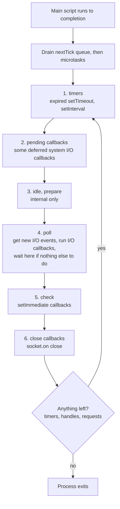
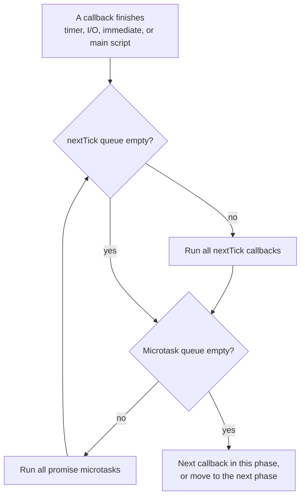
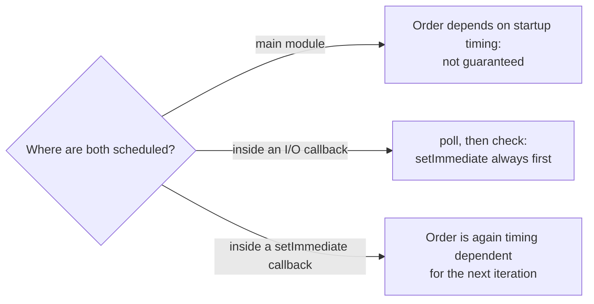

# The Node.js Event Loop

> In this document you will learn exactly how Node.js decides which callback runs next: the six libuv phases, the `process.nextTick` queue, promise microtasks, `setTimeout` vs `setImmediate`, and what happens when you block the loop. This is one of the most tested Node.js topics. Interviewers use "what does this print?" puzzles and "why is my server slow?" scenarios, so every puzzle here was run with Node.js 22 to confirm the output.

**Before this:** [The event loop (browser and language basics)](../02-javascript/16-event-loop.md) · [Node.js runtime and architecture](01-nodejs-runtime-and-architecture.md) · **Interview questions:** [jump to the interview section](#interview-questions)

## Table of contents

1. [Quick refresher](#quick-refresher)
2. [The big picture in Node.js](#the-big-picture-in-nodejs)
3. [The six phases](#the-six-phases)
4. [process.nextTick](#processnexttick)
5. [Promise microtasks and the order of the two queues](#promise-microtasks-and-the-order-of-the-two-queues)
6. [setTimeout vs setImmediate](#settimeout-vs-setimmediate)
7. [When does the process exit](#when-does-the-process-exit)
8. [Blocking the event loop](#blocking-the-event-loop)
9. [Starvation](#starvation)
10. [Measuring event loop lag](#measuring-event-loop-lag)
11. [Browser vs Node.js event loop](#browser-vs-nodejs-event-loop)
12. [Real-world usage](#real-world-usage)
13. [Common mistakes](#common-mistakes)
14. [Best practices](#best-practices)
15. [How to explain this in an interview](#how-to-explain-this-in-an-interview)
16. [Interview questions](#interview-questions)
17. [Summary](#summary)
18. [References](#references)

---

## Quick refresher

You already know these ideas from the [browser event loop document](../02-javascript/16-event-loop.md). Here is a 30-second reminder:

- JavaScript runs on **one thread**. The **call stack** is the list of functions running right now.
- A callback never interrupts running code. It waits until the call stack is **empty**. This is called **run to completion**.
- **Microtasks** (promise callbacks, `queueMicrotask`) run as soon as the current piece of code finishes, before the next "big" callback.
- The **event loop** is the loop that picks the next callback when the stack is empty.

The browser and Node.js share these rules, because they come from the JavaScript language and V8. What is different in Node.js is **which queues exist and in which order they are checked**. That part comes from **libuv** and from Node.js itself.

## The big picture in Node.js

### What the event loop is in Node.js

The **Node.js event loop** is a loop inside libuv that runs on the main thread. On each turn (called an **iteration** or **tick**), it goes through a fixed list of **phases**. Each phase has its own queue of callbacks.

On top of that, Node.js has two extra queues that are **not** part of libuv:

1. The **`process.nextTick` queue** (Node.js only).
2. The **promise microtask queue** (from V8).

These two queues are emptied **after every single callback**, no matter which phase you are in.

### Analogy

Think of a security guard who walks the same route around a building all night:

1. **Timers room** — check the alarm clocks that have rung.
2. **Pending room** — handle a few delayed system messages.
3. (an internal room you never see)
4. **Mail room (poll)** — collect new deliveries (I/O results). If nothing else needs attention, wait here for the next delivery.
5. **Check room** — handle the "do this right after the mail room" notes (`setImmediate`).
6. **Close room** — handle "this door was closed" notes.

Between **every** task, the guard first reads two urgent sticky-note pads: the red pad (`process.nextTick`) and then the yellow pad (promises). The guard does not move on until both pads are empty.

Where the analogy breaks: the guard does not walk on a timer. A loop iteration can take 0.1 ms or 5 seconds, depending on how long your callbacks take.

### Where each API goes

| You call | The callback runs in |
| --- | --- |
| `setTimeout(fn, ms)`, `setInterval(fn, ms)` | **timers** phase, after at least `ms` milliseconds |
| `fs.readFile(..., cb)`, socket `data`, HTTP request handler | **poll** phase (I/O callbacks) |
| `setImmediate(fn)` | **check** phase |
| `socket.on('close', fn)` after `socket.destroy()` | **close callbacks** phase |
| `process.nextTick(fn)` | **nextTick queue**: right after the current callback |
| `promise.then(fn)`, `await`, `queueMicrotask(fn)` | **microtask queue**: right after the nextTick queue |

## The six phases

### The diagram



And this rule applies inside every phase:

> After **each** callback, Node.js drains the whole `process.nextTick` queue, then the whole promise microtask queue (and repeats until both are empty). Only then does the next callback in the phase run.

### Phase 1: timers

This phase runs callbacks from `setTimeout` and `setInterval` whose time has passed.

Important details:

- The delay is a **minimum**, not an exact time. `setTimeout(fn, 100)` means "not earlier than 100 ms". If the loop is busy, it runs later.
- In Node.js, a delay below 1 (including `0`) becomes **1 ms**. So `setTimeout(fn, 0)` and `setTimeout(fn, 1)` are the same.
- libuv reads the clock **once at the start of each iteration** and compares timers to that cached time. This detail explains the famous `setTimeout` vs `setImmediate` puzzle later.

```js
setTimeout(() => console.log('t1'), 1);
setTimeout(() => console.log('t0'), 0);
// t1
// t0
```

Both timers have a 1 ms delay, so they run in the order they were created.

### Phase 2: pending callbacks

This phase runs a few I/O callbacks that the system deferred from the previous iteration. An example from the Node.js docs: some TCP errors, like `ECONNREFUSED` on some Unix systems, are reported here. You almost never need to think about this phase.

### Phase 3: idle, prepare

Used only inside libuv and Node.js. You cannot schedule anything here.

### Phase 4: poll

This is the most important phase. It does two jobs:

1. **Run I/O callbacks** that are ready: finished file reads, new data on sockets, new HTTP requests, and so on.
2. **Decide how long to wait** for new I/O.

How long does it wait? It depends on what else is scheduled:

| Situation | What poll does |
| --- | --- |
| `setImmediate` callbacks are waiting | Does **not** wait. Goes to the check phase right away. |
| No immediates, but a timer will expire soon | Waits for I/O, but only until the nearest timer is due. |
| No immediates, no timers, but open handles (a listening server, an open socket) | Waits for I/O as long as needed. This is why an idle server uses almost no CPU. |
| Nothing at all is left | The loop ends and the process exits. |

While Node.js waits in the poll phase, the main thread sleeps inside the OS (epoll, kqueue or IOCP). It wakes up as soon as any I/O is ready.

### Phase 5: check

This phase runs `setImmediate` callbacks. It always comes **right after poll**. That is the whole point of `setImmediate`: "run this after the current I/O callbacks, before going back to timers".

If a `setImmediate` callback schedules another `setImmediate`, the new one runs in the **next** iteration, not in the same check phase:

```js
setImmediate(() => {
  console.log('A');
  setImmediate(() => console.log('C'));
});
setImmediate(() => console.log('B'));
// A
// B
// C
```

This protects the loop: a chain of `setImmediate` calls cannot block I/O forever.

### Phase 6: close callbacks

This phase runs some `'close'` callbacks, for example `socket.on('close', ...)` when a socket is destroyed abruptly with `socket.destroy()`. Other close events are emitted with `process.nextTick` instead. You rarely need to know which is which.

### A note on Node.js 20 and newer

The official docs mention a change in **libuv 1.45 (Node.js 20)**: timers now run **after** the poll phase in each iteration, instead of before it as in older versions. To stay backward compatible, libuv still runs timers **once before entering the loop**. The phase list above is still the right mental model for interviews and for almost all real code. The change can only affect edge cases where `setImmediate` and timers interact. Never write production code that depends on exact cross-phase timing.

### How one iteration looks in practice

```js
// iteration.cjs
const fs = require('node:fs');

setTimeout(() => console.log('timer'), 0);

fs.readFile(__filename, () => {
  console.log('I/O callback (poll)');
  setImmediate(() => console.log('immediate (check)'));
});
```

Typical output:

```text
timer
I/O callback (poll)
immediate (check)
```

Walkthrough:

1. The main script schedules a timer and starts a file read in the thread pool.
2. First iteration: the timer (1 ms) has usually expired by the time the loop starts, so `timer` prints.
3. The file read takes a few loop iterations (open, stat, read, close are separate thread-pool jobs). When it completes, the poll phase runs the callback: `I/O callback (poll)`.
4. The callback scheduled an immediate. The check phase comes right after poll, so `immediate (check)` prints.

## process.nextTick

### What it is

`process.nextTick(fn)` puts `fn` into the **nextTick queue**. Node.js drains this queue **as soon as the current operation finishes**, before the event loop continues to anything else, and even before promise callbacks (in CommonJS code).

The name is confusing. `process.nextTick` does **not** wait for the next loop iteration. It runs **immediately after the current callback**. The Node.js docs admit that `process.nextTick` and `setImmediate` would have better names if they were swapped, but they cannot change them now without breaking code.

| | `process.nextTick(fn)` | `setImmediate(fn)` |
| --- | --- | --- |
| When it runs | Right after the current callback, before the loop moves on | In the check phase of the current or next iteration |
| Part of libuv phases? | No | Yes (check phase) |
| Can starve I/O if called recursively? | **Yes** | No |
| Recommended for general use? | Only for specific cases | Yes, the docs recommend it for most cases |

### Simple example

```js
console.log('start');
setImmediate(() => console.log('setImmediate'));
process.nextTick(() => console.log('nextTick'));
console.log('end');
// start
// end
// nextTick
// setImmediate
```

### Why it exists

`process.nextTick` exists for two main reasons:

**1. To let the caller finish setting up before an event fires.**

```js
const EventEmitter = require('node:events');

// ❌ Wrong: emits before anyone can listen
class Connection extends EventEmitter {
  constructor() {
    super();
    this.emit('ready');
  }
}
const c1 = new Connection();
c1.on('ready', () => console.log('ready 1')); // never prints

// ✅ Correct: emit after the current code finishes
class SafeConnection extends EventEmitter {
  constructor() {
    super();
    process.nextTick(() => this.emit('ready'));
  }
}
const c2 = new SafeConnection();
c2.on('ready', () => console.log('ready 2')); // prints "ready 2"
```

**2. To make an API always asynchronous.** A function that calls its callback *sometimes* synchronously and *sometimes* asynchronously is very hard to use. People call this "releasing Zalgo".

```js
const cache = new Map();

// ❌ Wrong: sync when cached, async when not
function getUser(id, callback) {
  if (cache.has(id)) return callback(null, cache.get(id)); // sync!
  db.findUser(id, (err, user) => {                         // async
    cache.set(id, user);
    callback(err, user);
  });
}

// ✅ Correct: always async
function getUserSafe(id, callback) {
  if (cache.has(id)) {
    process.nextTick(callback, null, cache.get(id)); // extra args are passed to the callback
    return;
  }
  db.findUser(id, (err, user) => {
    cache.set(id, user);
    callback(err, user);
  });
}
```

With the wrong version, code like `getUser(1, cb); doSetup();` runs `cb` **before** `doSetup()` when the user is cached, and **after** it when not. Bugs that depend on cache state are very hard to find. Node.js core uses `process.nextTick` in many places for exactly this reason. In modern code, returning a promise solves the same problem, because `.then` callbacks are always asynchronous.

### nextTick inside nextTick

Ticks added while the queue is being drained run in the **same** drain:

```js
process.nextTick(() => {
  console.log('tick 1');
  process.nextTick(() => console.log('tick 3 (nested)'));
});
process.nextTick(() => console.log('tick 2'));
Promise.resolve().then(() => console.log('promise'));
// tick 1
// tick 2
// tick 3 (nested)
// promise
```

The nested tick runs before the promise. This is why recursive `process.nextTick` can block the loop forever (see [Starvation](#starvation)).

## Promise microtasks and the order of the two queues

### The algorithm

After each callback, Node.js runs an internal function (`processTicksAndRejections`). In simplified form:

```text
repeat:
  1. Run every callback in the nextTick queue (including ones added during this step).
  2. Run every callback in the promise microtask queue (V8 drains it fully,
     including microtasks added during this step).
until both queues are empty
Then: continue with the next callback in the current phase.
```



Two consequences you must remember:

1. In CommonJS code, **nextTick callbacks run before promise callbacks** that were queued at the same time.
2. A nextTick scheduled **inside** a promise callback waits until the **whole** microtask queue is empty.

### Example: the classic order

```js
console.log('start');
setTimeout(() => console.log('timeout'), 0);
Promise.resolve()
  .then(() => console.log('then 1'))
  .then(() => console.log('then 2'));
process.nextTick(() => console.log('tick 1'));
process.nextTick(() => console.log('tick 2'));
queueMicrotask(() => console.log('microtask'));
console.log('end');
```

Output:

```text
start
end
tick 1
tick 2
then 1
microtask
then 2
timeout
```

Step-by-step walkthrough:

1. Sync code prints `start` and `end`. Queues now: nextTick = [tick 1, tick 2]; microtasks = [then 1, microtask]; timers = [timeout].
2. The main script is done. Node drains the nextTick queue: `tick 1`, `tick 2`.
3. Node drains the microtask queue. `then 1` runs. Its promise resolves, so `then 2` is added to the **end** of the queue. Then `microtask` runs. Then `then 2` runs.
4. Both queues are empty. The event loop starts. The timers phase runs `timeout`.

### Example: queues inside queues

```js
Promise.resolve().then(() => {
  console.log('promise 1');
  process.nextTick(() => console.log('tick inside promise'));
}).then(() => console.log('promise 2'));

process.nextTick(() => {
  console.log('tick 1');
  Promise.resolve().then(() => console.log('promise inside tick'));
});
```

Output:

```text
tick 1
promise 1
promise inside tick
promise 2
tick inside promise
```

Walkthrough:

1. Start: nextTick = [tick 1]; microtasks = [promise 1].
2. Drain nextTick: `tick 1` prints and adds `promise inside tick` to microtasks. Microtasks = [promise 1, promise inside tick].
3. Drain microtasks: `promise 1` prints. It adds `tick inside promise` to the **nextTick** queue and resolves, which adds `promise 2` to microtasks. Then `promise inside tick` prints, then `promise 2` prints.
4. The microtask queue is empty. The loop in the algorithm repeats: the nextTick queue has `tick inside promise`, so it prints last.

### Microtasks between every callback (since Node.js 11)

Since **Node.js 11**, the two queues are drained after **each** timer and each immediate callback. Before Node.js 11, they were drained only between phases, so several timers could run before any promise callback. The new behavior matches browsers.

```js
setTimeout(() => {
  console.log('timeout 1');
  Promise.resolve().then(() => console.log('promise in timeout 1'));
  process.nextTick(() => console.log('tick in timeout 1'));
}, 0);
setTimeout(() => console.log('timeout 2'), 0);
```

Output in Node.js 11 and newer:

```text
timeout 1
tick in timeout 1
promise in timeout 1
timeout 2
```

In Node.js 10 and older, the output was `timeout 1`, `timeout 2`, `tick in timeout 1`, `promise in timeout 1`. You may still see this old answer in old blog posts.

### async/await is just promises

`await` pauses the function and schedules the rest as a microtask. So the rest of an `async` function runs **after** nextTick callbacks:

```js
async function run() {
  console.log('1');
  await null;
  console.log('2');
}
process.nextTick(() => console.log('3'));
run();
console.log('4');
// 1
// 4
// 3
// 2
```

Walkthrough: `run()` prints `1` synchronously (an async function runs synchronously until its first `await`). `await null` schedules the rest as a microtask. `4` prints. The main script ends. The nextTick queue runs first (`3`), then the microtask (`2`).

### ES modules change the order at the top level

Here is a surprising detail. Run the same three lines as CommonJS and as an ES module:

```js
process.nextTick(() => console.log('nextTick'));
Promise.resolve().then(() => console.log('promise'));
console.log('sync');
```

| File | Output |
| --- | --- |
| `order.cjs` (CommonJS) | `sync`, `nextTick`, `promise` |
| `order.mjs` (ES module) | `sync`, `promise`, `nextTick` |

Why? In an ES module, the top-level code runs as part of V8's **module evaluation**, which is itself driven by promises. When the module body finishes, V8 drains the microtask queue as part of finishing that evaluation, **before** Node.js gets the chance to process its nextTick queue. Inside later callbacks (timers, I/O), the normal rule (nextTick first) applies again in both module types.

This is one more reason not to write code that depends on the exact order of `process.nextTick` vs promises.

## setTimeout vs setImmediate

### In the main module: order is not guaranteed

```js
// main.cjs
setTimeout(() => console.log('timeout'), 0);
setImmediate(() => console.log('immediate'));
```

I ran this file 30 times on the same machine: `immediate` came first 26 times and `timeout` came first 4 times. The order is **not deterministic**.

Why:

1. `setTimeout(fn, 0)` is really a 1 ms timer.
2. When the loop starts, libuv checks the timers against its cached clock.
3. If **at least 1 ms** has passed since the timer was created (process startup can be slow or fast), the timer is expired and runs first.
4. If less than 1 ms has passed, the timer is not ready. The loop goes on to poll, then check, so `immediate` runs first. The timer runs in the next iteration.

You can make it deterministic by burning time **after** scheduling:

```js
setTimeout(() => console.log('timeout'), 0);
setImmediate(() => console.log('immediate'));
const start = Date.now();
while (Date.now() - start < 5) {} // 5 ms of busy work
// timeout     (10 of 10 runs)
// immediate
```

Now the timer has surely expired when the loop starts, so the timers check runs it first.

### Inside an I/O callback: setImmediate always wins

```js
const fs = require('node:fs');

fs.readFile(__filename, () => {
  setTimeout(() => console.log('timeout'), 0);
  setImmediate(() => console.log('immediate'));
});
// immediate
// timeout
```

This order is **guaranteed**. The callback runs in the poll phase. The next phase is always check (`immediate`). The loop reaches timers only after that.



### Which one should you use?

- Use **`setImmediate`** when you want "run this soon, after pending I/O". It is the right tool for **yielding** to the event loop in long tasks.
- Use **`setTimeout`** when you really need a delay in milliseconds.
- Use **`process.nextTick`** only when you need "before anything else", like emitting an event after a constructor returns.

## When does the process exit

A Node.js process exits when the event loop has **nothing left to wait for**. libuv counts **active handles** and **requests**:

- **Handles** are long-lived things: a listening server, an open socket, a `setInterval`, an active `setTimeout`, a file watcher, a child process.
- **Requests** are short operations in progress: a file read, a DNS lookup, a write.

If there are no active ("ref'ed") handles and no pending requests, the loop ends and the process exits with the code in `process.exitCode` (0 by default).

### ref and unref

Timers, servers and sockets have `unref()`. An unref'ed handle does **not** keep the process alive by itself.

```js
const timer = setTimeout(() => console.log('never printed'), 1000);
timer.unref();
console.log('done');
// done
// (the process exits at once; the timer never fires)
```

Real uses:

- A metrics "flush every 10 seconds" interval that should not stop a CLI tool from exiting.
- A cleanup timer in a library that should not keep the user's process alive.

Call `ref()` to undo it.

### A promise alone does not keep the process alive

```js
new Promise(() => {}).then(() => console.log('never'));
console.log('script end');
// script end
// (exit code 0)
```

A pending promise is just an object in memory. It is not a libuv handle. If nothing else is pending, the process exits. With top-level `await` in an ES module, Node.js notices this case, prints a warning about an unsettled top-level await and exits with code **13**.

### beforeExit and exit

- `process.on('beforeExit')` fires when the loop becomes empty. You **can** schedule more async work here, and the loop continues.
- `process.on('exit')` fires when the process is about to exit. Only **synchronous** code runs here. A `setTimeout` inside an `exit` listener never runs.

## Blocking the event loop

### What it means

**Blocking the event loop** means one callback runs for a long time. While it runs, no other callback can start: no new requests, no timers, no I/O results. For a server, every user waits.

The Node.js docs give a clear rule: the event loop is fair only if **each callback is quick**. Node.js does not split your function for you.

### Proof: a timer runs late

```js
const start = Date.now();
setTimeout(() => {
  console.log(`timer wanted 100 ms, ran after ${Date.now() - start} ms`);
}, 100);

while (Date.now() - start < 500) {} // 500 ms of CPU work
console.log('busy loop finished');
// busy loop finished
// timer wanted 100 ms, ran after 503 ms
```

The timer expired at 100 ms, but it could not run until the busy loop gave back the thread.

### Common ways to block the loop

**1. Synchronous crypto and compression**

```js
const crypto = require('node:crypto');

// ❌ Blocks: about 60-300 ms per call depending on iterations and CPU
const hash = crypto.pbkdf2Sync(password, salt, 600_000, 64, 'sha512');

// ✅ Runs in the libuv thread pool
crypto.pbkdf2(password, salt, 600_000, 64, 'sha512', (err, key) => { /* ... */ });
// or: const key = await util.promisify(crypto.pbkdf2)(password, salt, 600_000, 64, 'sha512');
```

The same goes for `bcrypt.hashSync`, `zlib.gzipSync` and `crypto.scryptSync` inside request handlers.

**2. Huge `JSON.parse` / `JSON.stringify`**

```js
const big = JSON.stringify(
  Array.from({ length: 1_000_000 }, (_, i) => ({ id: i, name: 'user' + i, tags: ['a', 'b'] }))
);
console.log((big.length / 1e6).toFixed(1), 'MB'); // 50.8 MB

const t = performance.now();
JSON.parse(big);
console.log(performance.now() - t, 'ms'); // about 1,400 ms on my machine
```

During those 1.4 seconds, the server answers nobody. `JSON.parse` is fast per byte, but it is synchronous and its cost grows with input size. Fixes:

- **Limit request body size** (for example, Express `express.json({ limit: '1mb' })`). A user should not be able to send you 50 MB of JSON.
- **Stream** large data and process it piece by piece (NDJSON, streaming JSON parsers). See [Streams](05-streams.md).
- Move one-off heavy parsing to a **worker thread**.

**3. Catastrophic backtracking in regular expressions (ReDoS)**

Some regular expressions take **exponential time** on certain inputs. A **ReDoS** (regular expression denial of service) attack sends such input on purpose.

```js
const evil = /^(a+)+$/;            // nested quantifier: (a+)+
for (const n of [16, 20, 22, 24, 26]) {
  const input = 'a'.repeat(n) + '!';
  const t = performance.now();
  evil.test(input);
  console.log(n, (performance.now() - t).toFixed(1), 'ms');
}
// 16 9.0 ms
// 20 9.1 ms
// 22 45.5 ms
// 24 216.9 ms
// 26 764.4 ms     (each extra character roughly doubles the time)
```

The `!` at the end makes the match fail, and the engine tries every way to split the `a`s between the inner and outer `+`. With 30+ characters it can take minutes. The equivalent safe pattern `/^a+$/` checks the same input in well under a millisecond.

Fixes:

- Avoid **nested quantifiers** like `(a+)+`, `(a*)*`, `(a|aa)+`, `(.*a){10}`.
- **Limit input length** before running a regex.
- Use a linting rule or a checker for unsafe regexes in CI, or a linear-time engine such as the `re2` package for user-supplied patterns.

**4. Large synchronous loops and algorithms**

Sorting 5 million items, building a huge Excel file in memory, or an accidental O(n²) loop over a large array can all take seconds.

**5. Synchronous APIs in handlers**

`fs.readFileSync`, `child_process.execSync`, `fs.existsSync` in a hot path. Each one is small, but under load they add up.

### Fix 1: partition the work (yield with setImmediate)

Split long work into chunks and give the loop a chance to run other callbacks between chunks:

```js
// Process 1 million records without freezing the server
function processInChunks(items, handleItem, chunkSize = 1000) {
  return new Promise((resolve) => {
    let index = 0;

    function nextChunk() {
      const end = Math.min(index + chunkSize, items.length);
      for (; index < end; index++) handleItem(items[index]);

      if (index < items.length) {
        setImmediate(nextChunk); // ✅ let I/O and timers run, then continue
      } else {
        resolve();
      }
    }

    nextChunk();
  });
}
```

Why `setImmediate` and not `process.nextTick` or a promise? A `nextTick` or promise chain runs **before** the loop continues, so I/O would still be blocked. `setImmediate` runs in the check phase, after poll has handled pending I/O.

This also works with `await`:

```js
const { setImmediate: yieldToLoop } = require('node:timers/promises');

async function processAll(items) {
  for (let i = 0; i < items.length; i++) {
    handleItem(items[i]);
    if (i % 1000 === 0) await yieldToLoop(); // pause every 1000 items
  }
}
```

Partitioning keeps the server responsive, but the total work still uses the main thread. It is good for moderate work.

### Fix 2: offload the work

- **Worker threads** for CPU-heavy JavaScript (parsing, image processing in JS, complex calculations). See [Concurrency: worker threads and cluster](12-concurrency-worker-threads-and-cluster.md).
- A **job queue** for long tasks (reports, emails, video): the request returns at once, a worker process does the job. See [Background jobs and queues](13-background-jobs-and-queues.md).
- A **separate service** in a language suited for heavy computation.

### Do not block the thread pool either

The libuv thread pool has only 4 threads by default. If you start hundreds of slow `fs` or `crypto.pbkdf2` operations at once, other pool work (all file reads, `dns.lookup`) waits in line. The event loop is not blocked, but your I/O becomes slow. Limit concurrency for heavy pool work. See [One JavaScript thread and many helpers](01-nodejs-runtime-and-architecture.md#one-javascript-thread-and-many-helpers).

## Starvation

**Starvation** means some callbacks never get a chance to run because others keep jumping ahead.

### Recursive process.nextTick starves the loop

```js
let count = 0;
function tick() {
  count++;
  if (count < 1_000_000) process.nextTick(tick);
  else console.log('nextTick chain finished');
}
setTimeout(() => console.log('timeout finally runs, count =', count), 0);
process.nextTick(tick);
// nextTick chain finished
// timeout finally runs, count = 1000000
```

The timer was ready after 1 ms, but it had to wait for **one million** ticks. Ticks added during the drain run in the same drain, so the loop never reaches the timers phase. If the recursion never stopped, the timer would **never** run, and neither would any I/O callback. The server would look frozen.

### Recursive promises starve it too

```js
let count = 0;
function loop() {
  count++;
  if (count < 1_000_000) Promise.resolve().then(loop);
  else console.log('promise chain finished');
}
setTimeout(() => console.log('timeout, count =', count), 0);
loop();
// promise chain finished
// timeout, count = 1000000
```

The microtask queue is also drained completely, so an endless promise chain blocks the loop just like endless ticks.

### Recursive setImmediate does not

```js
let count = 0;
function step() {
  count++;
  if (count < 100_000) setImmediate(step);
  else console.log('immediate chain finished');
}
setTimeout(() => console.log('timeout runs, count =', count), 0);
setImmediate(step);
// timeout runs, count = 89      (a small number; it varies per run)
// immediate chain finished
```

Each new immediate waits for the **next** iteration, so timers and I/O get their turn between steps. This is why `setImmediate` is the right way to yield.

## Measuring event loop lag

### What event loop lag is

**Event loop lag** (or **event loop delay**) is how late callbacks run compared to when they should run. If a timer should fire at 100 ms but fires at 160 ms, the lag is 60 ms. High lag means something is blocking the loop. It is one of the most useful health metrics for a Node.js service.

### monitorEventLoopDelay

Node.js has a built-in, low-overhead histogram in `perf_hooks` (since Node.js 11.10):

```js
const { monitorEventLoopDelay, performance } = require('node:perf_hooks');

const histogram = monitorEventLoopDelay({ resolution: 20 }); // sample every 20 ms
histogram.enable();
const elu1 = performance.eventLoopUtilization();

// Simulate one 300 ms block, 200 ms after start
setTimeout(() => {
  const start = Date.now();
  while (Date.now() - start < 300) {}
}, 200);

setTimeout(() => {
  histogram.disable();
  const toMs = (ns) => (ns / 1e6).toFixed(1); // the histogram uses nanoseconds
  console.log('mean', toMs(histogram.mean), 'ms');
  console.log('p99 ', toMs(histogram.percentile(99)), 'ms');
  console.log('max ', toMs(histogram.max), 'ms');

  const elu = performance.eventLoopUtilization(elu1);
  console.log('utilization', elu.utilization.toFixed(2));
}, 1000);
```

Example output (numbers vary by machine and OS timer precision):

```text
mean 41.6 ms
p99  299.9 ms
max  299.9 ms
utilization 0.30
```

How to read it:

- **max / p99** about 300 ms: one callback blocked the loop for about 300 ms. That is our busy loop.
- **Event loop utilization (ELU)** 0.30: the loop was busy about 30% of the time and idle (waiting in poll) 70% of the time. ELU near 1.0 means the process is CPU-saturated.

In production, export these numbers (p50, p99, max, ELU) to your monitoring system and alert when p99 lag stays high. Many APM tools collect them automatically.

### A simple manual check

```js
// Rough lag check without perf_hooks
let last = performance.now();
setInterval(() => {
  const now = performance.now();
  const lag = now - last - 500;
  if (lag > 50) console.warn(`event loop lag: ${lag.toFixed(0)} ms`);
  last = now;
}, 500).unref();
```

### Finding the guilty code

When lag is high, find which function blocks:

- **CPU profile:** `node --cpu-prof app.js` writes a `.cpuprofile` file you can open in Chrome DevTools. Or attach with `node --inspect` and record in the Performance/Profiler tab.
- **Flame graphs:** tools like Clinic.js (`clinic flame`) or `0x`.
- **Logs:** log slow requests with timing; correlate lag spikes with endpoints.

More in [Debugging and profiling](../10-testing-security-production/07-debugging-and-profiling.md).

## Browser vs Node.js event loop

| Topic | Browser | Node.js |
| --- | --- | --- |
| Defined by | HTML Living Standard | libuv + Node.js |
| Structure | Task queues (the browser picks which queue next) + microtasks + rendering | Fixed phases: timers, pending, idle/prepare, poll, check, close |
| Microtasks run | After each task and whenever the call stack empties | After each callback (since Node.js 11), after the nextTick queue |
| `process.nextTick` | Does not exist | Yes, runs before promise microtasks (in CommonJS) |
| `setImmediate` | Not standard | Check phase |
| Rendering | `requestAnimationFrame`, style, layout, paint between tasks | No rendering |
| Minimum timer delay | 0 ms, clamped to 4 ms after 5 nested levels | 1 ms (0 becomes 1) |
| Waiting for I/O | Browser internals | Poll phase blocks in epoll/kqueue/IOCP |
| When it stops | When the page is closed | When nothing is left to wait for |

What is the same: one JavaScript thread, run to completion, microtasks before the next macrotask, timers are minimums, long tasks block everything.

## Real-world usage

- **Express/Fastify request handlers** run as I/O callbacks in the poll phase. Each `await` inside them continues as a microtask. Keep the sync part short.
- **Node.js core** uses `process.nextTick` to emit events and errors after the current function returns. For example, a stream that fails during construction emits `'error'` on the next tick, so you have time to attach a listener.
- **Libraries that cache results** use `process.nextTick` or promises to keep callbacks always asynchronous.
- **Batch jobs** (CSV import, data migration scripts) yield with `setImmediate` or process data as a stream so a health-check endpoint can still respond.
- **Graceful shutdown**: a server stops accepting connections; the process exits when the last socket and timer close and the loop becomes empty.
- **Electron main process** uses the same Node.js event loop (integrated with the platform's UI message loop). Blocking it freezes window management and IPC. See [Electron architecture](../08-electron-desktop/01-electron-architecture-and-process-model.md).
- **Health metrics**: event loop delay and utilization are standard signals for autoscaling and alerting.

## Common mistakes

1. **"`process.nextTick` runs on the next loop iteration."** No. It runs right after the current callback, before the loop continues.
2. **"`setTimeout(fn, 0)` runs before `setImmediate`."** Not guaranteed in the main module. Inside an I/O callback, `setImmediate` always runs first.
3. **"Promises run in a loop phase."** Microtasks are not a libuv phase. They run between callbacks.
4. **Quoting pre-Node 11 behavior.** Old articles say all timers in a phase run before any microtask. That changed in Node.js 11.
5. **Using recursive `process.nextTick` or promise chains to "yield".** They starve I/O. Use `setImmediate`.
6. **Expecting `async` to make CPU work non-blocking.** `await` only helps with waiting.
7. **Thinking `EventEmitter.emit()` is asynchronous.** It calls listeners synchronously, in the current callback. It has nothing to do with the loop phases. See [Core modules](04-core-modules-fs-path-events-buffer.md#eventemitter).
8. **Trusting `setTimeout` for exact timing.** Delays are minimums. Under load, timers run late.
9. **Accepting unlimited JSON bodies or running user-controlled regexes.** Both can freeze the server.
10. **Leaving intervals and connections open in tests.** The process (or the test runner) never exits.

## Best practices

- **Keep every callback short.** *Reason:* the loop can only be fair if each callback finishes quickly.
- **Never use `...Sync` APIs in request handlers.** *Reason:* each call blocks all users.
- **Use `setImmediate` to yield in long loops, not `process.nextTick`.** *Reason:* only `setImmediate` lets I/O run in between.
- **Use `process.nextTick` only for "after this function returns" cases** (emitting events after construction, keeping APIs consistently async). *Reason:* it is powerful and easy to misuse.
- **Move CPU-heavy work to worker threads or job queues.** *Reason:* partitioning helps responsiveness, but does not add CPU power.
- **Limit input sizes** (body size, regex input length, array lengths). *Reason:* most accidental and malicious blocking comes from unexpectedly big input.
- **Monitor event loop delay and ELU in production.** *Reason:* blocking is invisible in normal request logs until users complain.
- **Do not depend on the exact order of `nextTick`, promises, timers and immediates** across modules. *Reason:* the order differs between ESM and CommonJS, and between contexts.
- **`unref()` background timers in libraries and CLIs.** *Reason:* they should not keep the process alive.

## How to explain this in an interview

1. **Define it:** "The Node.js event loop is a loop in libuv, running on the main thread, that decides which callback runs next. Each iteration goes through phases: timers, pending callbacks, idle/prepare, poll, check and close callbacks."
2. **Why it exists:** "It lets one JavaScript thread handle many concurrent I/O operations. The OS and the thread pool do the waiting; the loop runs the callbacks when results are ready."
3. **How it works:** "Timers run expired `setTimeout` and `setInterval` callbacks. Poll runs I/O callbacks and waits for new I/O when there is nothing else to do. Check runs `setImmediate`. Close runs close callbacks. Outside the phases there are two high-priority queues: the `process.nextTick` queue and the promise microtask queue. After every callback, Node drains nextTicks first, then promises, before moving on."
4. **Small example:** "Inside an `fs.readFile` callback, if I schedule `setTimeout(fn, 0)` and `setImmediate(fn)`, the immediate always runs first, because check comes right after poll. In the main module the order isn't guaranteed, because it depends on whether 1 ms has passed when the loop starts."
5. **Where it is useful:** "It explains why Node handles thousands of connections, how to yield in long jobs with `setImmediate`, why core APIs emit errors on the next tick, and how to read event loop lag metrics."
6. **Trade-offs / gotchas:** "Any long synchronous work — big `JSON.parse`, sync crypto, a bad regex — blocks every request. Recursive `nextTick` or promise chains can starve I/O completely. So I keep callbacks short, offload CPU work to worker threads, and monitor event loop delay in production."

## Interview questions

### Q1. Explain the Node.js event loop and its phases.

**What the interviewer is checking:** Whether you know the real phases (not only "callback queue") and where `nextTick` and promises fit.

**Short spoken answer (30–60 seconds):**
> The event loop is libuv's loop on the main thread. Each iteration has six phases. Timers runs expired `setTimeout` and `setInterval` callbacks. Pending callbacks runs a few deferred system callbacks. Idle and prepare are internal. Poll gets new I/O events and runs their callbacks, and if nothing else is scheduled, it waits there for I/O. Check runs `setImmediate` callbacks. Close callbacks runs things like a socket's close handler. Then it loops again, or exits if nothing is left. `process.nextTick` and promise callbacks are not phases: Node drains the nextTick queue and then the microtask queue after every single callback.

**Detailed explanation:** See [The six phases](#the-six-phases) and [the two queues](#promise-microtasks-and-the-order-of-the-two-queues). Mention the poll timeout logic if you want to go deeper: poll does not block when immediates are pending, blocks until the nearest timer otherwise, and blocks indefinitely only if there are open handles and no timers.

**Code or diagram:** draw the six boxes in a circle, with "nextTick → microtasks" between each callback.

**Follow-up questions:**
- **Where do HTTP request handlers run?** — In the poll phase, as I/O callbacks. Code after an `await` inside them runs later as a microtask.
- **Which phase does Node.js spend most of its time in for an idle server?** — Poll, sleeping inside epoll/kqueue/IOCP until a connection or data arrives.
- **What changed in Node.js 20?** — With libuv 1.45, timers run after the poll phase in each iteration (and once before the loop starts for compatibility). It only affects edge-case timing between timers and immediates.

**Common mistakes:** Describing only the browser model (macrotask/microtask) with no phases. Putting `process.nextTick` inside a phase.

**Where this is used in real projects:** Debugging slow servers, understanding library behavior, reading event loop metrics.

### Q2. What does this print?

```js
console.log('start');
setTimeout(() => console.log('timeout'), 0);
Promise.resolve()
  .then(() => console.log('then 1'))
  .then(() => console.log('then 2'));
process.nextTick(() => console.log('tick 1'));
process.nextTick(() => console.log('tick 2'));
queueMicrotask(() => console.log('microtask'));
console.log('end');
```

**Answer:**

```text
start
end
tick 1
tick 2
then 1
microtask
then 2
timeout
```

**Why:** Sync code first. Then the nextTick queue (`tick 1`, `tick 2`). Then microtasks in order: `then 1` (which queues `then 2` at the end), `microtask`, `then 2`. Only then does the loop start, and the timers phase runs `timeout`. (Verified with Node.js 22, CommonJS.)

### Q3. What is the difference between process.nextTick, setImmediate and setTimeout(fn, 0)?

**What the interviewer is checking:** Precise timing knowledge and good judgment about which to use.

**Short spoken answer (30–60 seconds):**
> `process.nextTick` runs the callback right after the current operation, before the event loop continues and before promise callbacks. It isn't part of the loop phases. `setImmediate` runs in the check phase, right after the poll phase of the current or next iteration. `setTimeout(fn, 0)` is really a 1 ms timer that runs in the timers phase once it has expired. The naming is confusing — nextTick is actually the most immediate one. I use `setImmediate` to yield in long tasks, `setTimeout` when I need a real delay, and `nextTick` only when something must happen after the current function returns but before anything else, like emitting an event after a constructor.

**Follow-up questions:**
- **Why are the names confusing?** — `nextTick` fires within the same iteration, and `setImmediate` fires on a following check phase. The docs say the names should have been swapped, but changing them would break the ecosystem.
- **Which one can starve I/O?** — `process.nextTick` (and promise chains). New ticks added during the drain run in the same drain, so the loop never moves on. Recursive `setImmediate` cannot starve I/O.
- **Is there a promise version?** — Yes: `require('node:timers/promises')` gives `setTimeout` and `setImmediate` that return promises, for example `await setTimeout(100)`.

**Common mistakes:** "`nextTick` waits for the next loop iteration." "`setTimeout(fn, 0)` is the fastest way to defer."

**Where this is used in real projects:** Libraries choosing how to defer callbacks; batch jobs yielding to the loop.

### Q4. What does this print, and is the order guaranteed?

```js
setTimeout(() => console.log('timeout'), 0);
setImmediate(() => console.log('immediate'));
```

**Answer:** Either `timeout, immediate` or `immediate, timeout`. The order is **not guaranteed**. In my test, 30 runs gave `immediate` first 26 times and `timeout` first 4 times.

**Why:** `setTimeout(fn, 0)` is a 1 ms timer. When the loop starts, libuv checks timers against its cached time. If 1 ms has already passed since the timer was created, the timer runs first in the timers phase. Otherwise the loop continues to poll and check, so the immediate runs first and the timer runs in the next iteration. Process startup speed decides which happens.

**Follow-up questions:**
- **How can you make `timeout` always come first?** — Do at least ~1 ms of synchronous work after scheduling both (for example, a 5 ms busy loop). Then the timer has expired before the loop starts. In my test this gave `timeout` first 10 out of 10 times. (Not something you would do in real code.)
- **How can you make `immediate` always come first?** — Schedule both inside an I/O callback (see Q5).

**Common mistakes:** Answering confidently with one fixed order.

### Q5. What does this print?

```js
const fs = require('node:fs');

fs.readFile(__filename, () => {
  console.log('readFile');
  setTimeout(() => console.log('timeout'), 0);
  setImmediate(() => console.log('immediate'));
  process.nextTick(() => console.log('nextTick'));
});
```

**Answer:**

```text
readFile
nextTick
immediate
timeout
```

**Why:**

1. The readFile callback runs in the **poll** phase and prints `readFile`.
2. When it returns, Node drains the nextTick queue: `nextTick`.
3. The next phase after poll is **check**: `immediate`.
4. The loop wraps around to the **timers** phase: `timeout`.

This order is guaranteed. (Verified with Node.js 22.)

### Q6. What does this print?

```js
const fs = require('node:fs');
console.log('1');
fs.readFile(__filename, () => {
  console.log('2');
  setTimeout(() => console.log('3'), 0);
  setImmediate(() => {
    console.log('4');
    process.nextTick(() => console.log('5'));
  });
  Promise.resolve().then(() => console.log('6'));
});
setImmediate(() => console.log('7'));
process.nextTick(() => console.log('8'));
Promise.resolve().then(() => console.log('9'));
console.log('10');
```

**Answer:**

```text
1
10
8
9
7
2
6
4
5
3
```

**Why (step by step):**

1. Sync code: `1`, `10`. The file read starts in the thread pool.
2. After the main script: nextTick `8`, then promise `9`.
3. First iteration: no timers. Poll does not wait because an immediate is pending. The file read is not finished yet (it needs several thread-pool round trips: open, stat, read, close). Check phase: `7`.
4. A few iterations later, the read completes. Poll runs the callback: `2`. It schedules a timer, an immediate and a promise.
5. After the callback: microtask `6`.
6. Check phase: `4`. After that callback, its nextTick: `5`.
7. Next iteration, timers phase: `3`.

I ran it 20 times and got the same order every time.

### Q7. What does this print?

```js
Promise.resolve().then(() => {
  console.log('promise 1');
  process.nextTick(() => console.log('tick inside promise'));
}).then(() => console.log('promise 2'));

process.nextTick(() => {
  console.log('tick 1');
  Promise.resolve().then(() => console.log('promise inside tick'));
});
```

**Answer:**

```text
tick 1
promise 1
promise inside tick
promise 2
tick inside promise
```

**Why:** nextTick queue first (`tick 1`, which queues `promise inside tick`). Then the microtask queue is drained **completely**: `promise 1` (queues a tick and then `promise 2`), `promise inside tick`, `promise 2`. Only when microtasks are empty does Node look at the nextTick queue again: `tick inside promise`.

**Follow-up:**
- **What is the rule in one sentence?** — Node drains the whole nextTick queue, then the whole microtask queue, and repeats until both are empty; a tick created inside a promise callback waits for the microtask queue to finish.

### Q8. What does this print in Node.js 22? Would it be different in Node.js 10?

```js
setTimeout(() => {
  console.log('timeout 1');
  Promise.resolve().then(() => console.log('promise in timeout 1'));
  process.nextTick(() => console.log('tick in timeout 1'));
}, 0);
setTimeout(() => console.log('timeout 2'), 0);
```

**Answer (Node.js 11 and newer):**

```text
timeout 1
tick in timeout 1
promise in timeout 1
timeout 2
```

**Why:** Since Node.js 11, the nextTick and microtask queues are drained after **each** timer callback, so the tick and promise from timer 1 run before timer 2. In Node.js 10 and older, the queues were drained only after the whole timers phase, so the output was `timeout 1`, `timeout 2`, `tick in timeout 1`, `promise in timeout 1`.

**What the interviewer is checking:** Whether your knowledge is current and whether you know the queues run between callbacks, not between phases.

### Q9. What does this print?

```js
async function run() {
  console.log('1');
  await null;
  console.log('2');
}
process.nextTick(() => console.log('3'));
run();
console.log('4');
```

**Answer:** `1`, `4`, `3`, `2`.

**Why:** An async function runs synchronously until its first `await`, so `1` prints. `await null` schedules the rest of `run` as a microtask. `4` prints. After the main script, the nextTick queue runs (`3`) before the microtask queue (`2`). (CommonJS; verified.)

### Q10. This file prints a different order when it is named `.mjs` instead of `.cjs`. Why?

```js
process.nextTick(() => console.log('nextTick'));
Promise.resolve().then(() => console.log('promise'));
console.log('sync');
```

**What the interviewer is checking:** Deep knowledge; this one separates people who have run code from those who memorized rules.

**Short spoken answer (30–60 seconds):**
> As CommonJS it prints `sync`, `nextTick`, `promise`, because after the main script Node drains the nextTick queue before promise microtasks. As an ES module it prints `sync`, `promise`, `nextTick`. The reason is that an ES module's top-level code runs as part of V8's module evaluation, which is promise-based. When the module body finishes, the microtask queue is drained as part of that evaluation, before Node gets back control to run its nextTick queue. Inside later callbacks, like timers or I/O, the usual nextTick-first rule applies in both. The practical lesson is: don't write code that depends on nextTick versus promise ordering.

**Follow-up questions:**
- **Does `"type": "module"` in package.json have the same effect as `.mjs`?** — Yes. What matters is whether the file is loaded as an ES module.

### Q11. What does this print?

```js
setImmediate(() => {
  console.log('immediate 1');
  process.nextTick(() => console.log('tick'));
  Promise.resolve().then(() => console.log('promise'));
});
setImmediate(() => console.log('immediate 2'));
```

**Answer:** `immediate 1`, `tick`, `promise`, `immediate 2`.

**Why:** Both immediates run in the same check phase, but the nextTick and microtask queues are drained **between** them (Node.js 11+).

### Q12. What does this print?

```js
setImmediate(() => {
  console.log('A');
  setImmediate(() => console.log('C'));
});
setImmediate(() => console.log('B'));
```

**Answer:** `A`, `B`, `C`.

**Why:** An immediate scheduled during the check phase goes to the **next** iteration's check phase. `B` was already in the current queue, so it runs before `C`. This design is why recursive `setImmediate` cannot starve I/O.

### Q13. What does this print?

```js
setTimeout(() => console.log('t1'), 1);
setTimeout(() => console.log('t0'), 0);
```

**Answer:** `t1`, `t0`.

**Why:** In Node.js, a delay less than 1 is set to 1 ms. Both timers have the same 1 ms delay, so they run in creation order. Many people expect `t0` first.

### Q14. What does this print?

```js
setImmediate(() => console.log('immediate'));
(async () => {
  for (let i = 0; i < 3; i++) {
    await null;
    console.log('await', i);
  }
})();
```

**Answer:** `await 0`, `await 1`, `await 2`, `immediate`.

**Why:** Each `await` continues as a microtask, and the microtask queue is drained completely (including new microtasks) before the loop reaches the check phase. A loop of awaits on already-resolved values does **not** yield to the event loop. If you want to yield, `await` a real `setImmediate` (from `node:timers/promises`).

### Q15. What happens here, and how do you fix it?

```js
let count = 0;
function tick() {
  count++;
  process.nextTick(tick); // no stop condition
}
setTimeout(() => console.log('timeout'), 0);
process.nextTick(tick);
```

**What the interviewer is checking:** Understanding of starvation.

**Short spoken answer (30–60 seconds):**
> This starves the event loop. Every tick schedules another tick, and Node drains the nextTick queue completely, including new ticks, before moving on. So the loop never reaches the timers phase, `timeout` never prints, and no I/O callback ever runs — a server would look frozen even though it's "busy". The fix is to yield with `setImmediate` instead, because an immediate scheduled during the check phase waits for the next iteration, so timers and I/O run in between. If the work is CPU heavy, I'd move it to a worker thread.

**Code:** With a stop condition at 1,000,000 ticks, the output is `nextTick chain finished`, then `timeout finally runs, count = 1000000` — the timer waited for all ticks. With `setImmediate` instead, the timer runs after only a few dozen steps.

**Follow-up questions:**
- **Can promises cause the same problem?** — Yes. An endless `Promise.resolve().then(loop)` chain also starves the loop, because the microtask queue is drained completely.

**Common mistakes:** Thinking `nextTick` "gives other code a chance". It does the opposite.

### Q16. Your Node.js API's p99 latency jumps from 50 ms to 2 seconds, but the database is fast and CPU is around 100% of one core. How do you investigate?

**What the interviewer is checking:** Production debugging of event loop blocking.

**Short spoken answer (30–60 seconds):**
> High CPU on one core plus slow responses for every endpoint points to event loop blocking: some synchronous code is holding the main thread. First I'd confirm with event loop delay metrics, `monitorEventLoopDelay` or our APM, and event loop utilization close to 1. Then I'd find the hot code with a CPU profile — `node --cpu-prof` or attaching the inspector, or a flame graph with Clinic. Typical causes are a huge `JSON.parse` or `stringify`, sync crypto like `bcrypt.hashSync`, a regex with catastrophic backtracking on user input, or an O(n²) loop on a big array. The fix depends on the cause: limit input size, use async APIs, fix the regex, stream data, or move the work to a worker thread or a background job.

**Follow-up questions:**
- **How would you prevent it next time?** — Alert on p99 event loop delay, set body size limits, lint for unsafe regexes and `...Sync` calls in handlers, and load-test endpoints with large inputs.
- **What if CPU is low but latency is high?** — Then the loop is probably idle and waiting: slow downstream services, connection pool exhaustion, or a saturated libuv thread pool (many `fs`/`crypto` jobs queued).

**Where this is used in real projects:** Incident response for any Node.js service.

### Q17. How do you measure event loop lag in production?

**Short spoken answer (30–60 seconds):**
> Node has `perf_hooks.monitorEventLoopDelay`, which gives a histogram of delays in nanoseconds — I export mean, p99 and max. I also export event loop utilization from `performance.eventLoopUtilization()`, which says what fraction of time the loop was busy. Most APM agents collect both. I alert when p99 delay stays above, say, 100 to 200 ms for several minutes, and I use ELU along with CPU to decide on scaling. When an alert fires, I take a CPU profile to find the blocking code.

**Code:** see [monitorEventLoopDelay](#monitoreventloopdelay).

**Follow-up questions:**
- **What is the difference between event loop delay and ELU?** — Delay measures how late callbacks run (a symptom users feel). ELU measures how busy the loop is (capacity). High ELU with low delay means busy but healthy; high delay means something blocks for long stretches.

### Q18. How would you process 1 million records in a Node.js server without freezing other requests?

**What the interviewer is checking:** Practical patterns: partitioning, streaming, offloading.

**Short spoken answer (30–60 seconds):**
> It depends on the work per record. If it's light, I'd process in chunks of, say, a thousand, and yield between chunks with `setImmediate`, so I/O and other requests run in between. If the records come from a file or database, I'd stream them instead of loading everything into memory, which also gives backpressure. If each record is CPU heavy, chunking only spreads the pain, so I'd use a worker thread pool, or better, push the job to a queue and let a separate worker process handle it, and return a job ID to the client right away.

**Code:**

```js
const { setImmediate: yieldToLoop } = require('node:timers/promises');

async function importRecords(records) {
  for (let i = 0; i < records.length; i++) {
    saveToBatch(records[i]);
    if (i % 1000 === 999) await yieldToLoop(); // let other callbacks run
  }
}
```

**Follow-up questions:**
- **Why not `await Promise.resolve()` every 1000 records?** — A resolved promise continues as a microtask. Microtasks are drained before the loop continues, so I/O still cannot run. You must yield to a real loop phase.

### Q19. Why does Node.js core emit some errors with process.nextTick instead of throwing or emitting immediately?

**Short spoken answer (30–60 seconds):**
> To give the caller time to attach listeners. If `net.connect()` or a stream constructor emitted `'error'` synchronously, the error would fire before the caller even had the object back, so there could be no listener and the process would crash. By deferring the emit with `process.nextTick`, the current code finishes first — the caller attaches `.on('error')` — and then the event fires. The same idea keeps APIs consistently asynchronous, so callbacks never run sometimes sync and sometimes async.

**Code:** See the `Connection` example in [process.nextTick](#processnexttick).

### Q20. Why does an idle Node.js server not use 100% CPU even though the event loop is "always running"?

**Short answer:** Because the loop is not a busy spin. In the poll phase, when there are no immediates and no timers due, libuv blocks inside the OS (epoll_wait, kqueue, GetQueuedCompletionStatusEx) and the thread sleeps. The OS wakes it up when a socket has data or a timer is due. The loop only "runs" when there is work.

### Q21. When does a Node.js process exit? What is `unref()`?

**Short spoken answer (30–60 seconds):**
> A Node.js process exits when the event loop has no more active handles or pending requests: no listening servers, open sockets, active timers or in-flight I/O. A pending promise alone doesn't keep it alive, because a promise is just an object, not a libuv handle. `unref()` on a timer, server or socket tells libuv not to count that handle, so it won't keep the process alive by itself. I use it for background intervals like metrics flushing in CLI tools or libraries. `ref()` undoes it.

**Code:**

```js
const timer = setTimeout(() => console.log('never printed'), 1000);
timer.unref();
console.log('done');
// done   (process exits immediately)
```

**Follow-up questions:**
- **Your Jest/`node:test` run never finishes. Why?** — Something is still open: a DB pool, a server, an interval. Close them in `afterAll`. Do not hide it with a forced exit.

### Q22. Compare the browser event loop and the Node.js event loop.

**Short spoken answer (30–60 seconds):**
> They share the core model: one JavaScript thread, run to completion, and microtasks drained before the next macrotask. The differences are in the host. The browser follows the HTML spec: several task queues, microtasks, and rendering steps with `requestAnimationFrame`, style, layout and paint. Node uses libuv's fixed phases — timers, pending, poll, check, close — and adds `process.nextTick`, which runs before promise microtasks, plus `setImmediate` in the check phase. Node has no rendering. Timer details differ too: Node turns a 0 ms delay into 1 ms, browsers clamp nested timers to 4 ms. And since Node 11, Node drains microtasks between each callback, which matches the browser.

### Q23. Is `EventEmitter.emit()` synchronous or asynchronous? Where do its listeners run in the event loop?

**Short answer:** Synchronous. `emit()` calls every listener immediately, in registration order, on the current call stack. Listeners do not go into any loop phase or queue. If you emit from inside an I/O callback, the listeners run inside that same poll-phase callback. Code after `emit()` runs only after all listeners have returned.

```js
const EventEmitter = require('node:events');
const bus = new EventEmitter();
bus.on('order', () => console.log('listener'));
console.log('before');
bus.emit('order');
console.log('after');
// before
// listener
// after
```

More in [Core modules: EventEmitter](04-core-modules-fs-path-events-buffer.md#eventemitter).

## Summary

- The Node.js event loop is libuv's loop on the main thread with six phases: **timers → pending callbacks → idle/prepare → poll → check → close callbacks**.
- **Poll** runs I/O callbacks and waits for new I/O when nothing else is scheduled. **Check** runs `setImmediate`. **Timers** runs expired `setTimeout`/`setInterval` (a 0 ms delay becomes 1 ms).
- `process.nextTick` and promise microtasks are **not phases**. After every callback, Node drains the whole nextTick queue, then the whole microtask queue, and repeats until both are empty.
- Since **Node.js 11**, these queues are drained between each timer/immediate callback, like in browsers.
- In CommonJS, nextTick runs before promises. In an ES module's top-level code, promises run first.
- `setTimeout(fn, 0)` vs `setImmediate`: **not guaranteed** in the main module; **`setImmediate` first** inside an I/O callback.
- The process exits when there are no active handles or requests. `unref()` stops a handle from keeping the process alive. A pending promise alone does not keep it alive.
- Blocking the loop (sync crypto, huge JSON, ReDoS regexes, big loops, `...Sync` calls) delays every user. Partition with `setImmediate`, stream data, or offload to worker threads and job queues.
- Recursive `process.nextTick` or promise chains **starve** I/O. Recursive `setImmediate` does not.
- Measure with `perf_hooks.monitorEventLoopDelay` (nanoseconds) and `performance.eventLoopUtilization()`; find the cause with a CPU profile.

## References

- Node.js — The Node.js event loop, timers, and `process.nextTick()`: https://nodejs.org/en/learn/asynchronous-work/event-loop-timers-and-nexttick
- Node.js — Don't block the event loop (or the worker pool): https://nodejs.org/en/learn/asynchronous-work/dont-block-the-event-loop
- Node.js — Understanding `process.nextTick()`: https://nodejs.org/en/learn/asynchronous-work/understanding-processnexttick
- Node.js — Understanding `setImmediate()`: https://nodejs.org/en/learn/asynchronous-work/understanding-setimmediate
- Node.js Timers API (delay rules, `ref`/`unref`, `timers/promises`): https://nodejs.org/api/timers.html
- Node.js Process API (`nextTick`, `beforeExit`, `exit`, exit codes): https://nodejs.org/api/process.html
- Node.js Performance measurement APIs (`monitorEventLoopDelay`, `eventLoopUtilization`): https://nodejs.org/api/perf_hooks.html
- libuv design overview (the loop iteration): https://docs.libuv.org/en/v1.x/design.html
- Node.js 11 changelog (microtasks between timers and immediates): https://github.com/nodejs/node/blob/main/doc/changelogs/CHANGELOG_V11.md
- OWASP — Regular expression Denial of Service (ReDoS): https://owasp.org/www-community/attacks/Regular_expression_Denial_of_Service_-_ReDoS
