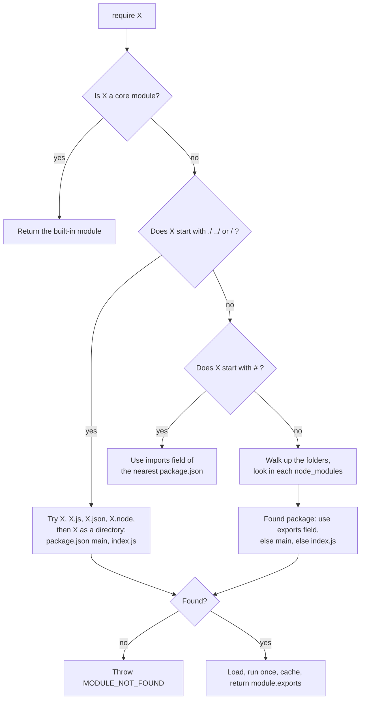
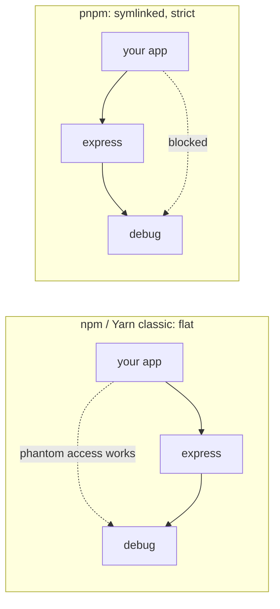

# Modules, npm and Packages

> In this document you will learn how Node.js loads code: how `require()` finds a file, why modules behave like singletons, how ES modules work in Node.js, what every important `package.json` field means, how semver ranges and lockfiles keep installs reproducible, and how npm, Yarn and pnpm differ. These topics come up in every backend and full-stack interview, and they explain many real bugs ("works on my machine", "two copies of the same library", "cannot use import outside a module").

**Before this:** [Modules: ESM and CommonJS (language level)](../02-javascript/14-modules-esm-and-commonjs.md) · [Node.js runtime and architecture](01-nodejs-runtime-and-architecture.md) · **Interview questions:** [jump to the interview section](#interview-questions)

## Table of contents

1. [Why modules matter in Node.js](#why-modules-matter-in-nodejs)
2. [CommonJS in Node.js](#commonjs-in-nodejs)
3. [How require finds a module](#how-require-finds-a-module)
4. [Module caching and singletons](#module-caching-and-singletons)
5. [ES modules in Node.js](#es-modules-in-nodejs)
6. [Mixing CommonJS and ES modules](#mixing-commonjs-and-es-modules)
7. [package.json in depth](#packagejson-in-depth)
8. [Semantic versioning and ranges](#semantic-versioning-and-ranges)
9. [Lockfiles, npm install and npm ci](#lockfiles-npm-install-and-npm-ci)
10. [npm vs Yarn vs pnpm](#npm-vs-yarn-vs-pnpm)
11. [npx and package binaries](#npx-and-package-binaries)
12. [Workspaces and monorepos](#workspaces-and-monorepos)
13. [Publishing a package](#publishing-a-package)
14. [Supply-chain risks](#supply-chain-risks)
15. [Common mistakes](#common-mistakes)
16. [Best practices](#best-practices)
17. [How to explain this in an interview](#how-to-explain-this-in-an-interview)
18. [Interview questions](#interview-questions)
19. [Summary](#summary)
20. [References](#references)

---

## Why modules matter in Node.js

A **module** is a file that keeps its own variables private and shares only what it chooses to **export**. Other files **import** what they need.

Modules solve three problems:

1. **Name collisions.** Two files can both have a variable called `config` without breaking each other.
2. **Organization.** You split a big app into small files with clear jobs: `userService.js`, `db.js`, `routes/orders.js`.
3. **Reuse.** You install other people's modules (packages) from npm instead of writing everything yourself.

Node.js supports **two module systems**:

| | CommonJS (CJS) | ES modules (ESM) |
| --- | --- | --- |
| Syntax | `require()`, `module.exports` | `import`, `export` |
| Origin | Node.js's original system (2009) | The JavaScript standard (ES2015) |
| Loading | Synchronous, at runtime | Static structure, loaded asynchronously |
| Used by | Most older npm packages, many existing backends | Browsers, modern packages, new projects |

The language-level differences (live bindings, static analysis, tree shaking) are explained in [Modules: ESM and CommonJS](../02-javascript/14-modules-esm-and-commonjs.md). This document focuses on **how Node.js loads and resolves them** and on **packages**.

## CommonJS in Node.js

### The basics

```js
// math.js
function add(a, b) {
  return a + b;
}
const PI = 3.14159;

module.exports = { add, PI };
```

```js
// app.js
const { add, PI } = require('./math');

console.log(add(2, 3)); // 5
console.log(PI);        // 3.14159
```

- `require(path)` loads a module and returns its `module.exports` value.
- `module.exports` is the object (or function, or any value) the module shares.
- `exports` is a shortcut variable that points to the same object as `module.exports` at the start.

### The module wrapper

Before running a CommonJS file, Node.js wraps its code in a function:

```js
(function (exports, require, module, __filename, __dirname) {
  // your file's code is here
});
```

This explains several things:

- Top-level variables are **private** to the file. They are local variables of this function.
- `require`, `module`, `exports`, `__filename` and `__dirname` look global, but they are **function parameters**, different for every file.
- `this` at the top level of a CommonJS file is `module.exports`.

### The `exports` vs `module.exports` trap

```js
// ❌ Wrong: reassigning `exports` breaks the link
// greet.js
exports = { greet: () => 'hi' };
```

```js
// app.js
const m = require('./greet');
console.log(m, typeof m.greet); // {} undefined
```

Why: `require` returns `module.exports`. At the start, `exports` and `module.exports` point to the same empty object. Reassigning `exports` only changes the local variable. `module.exports` is still the empty object.

```js
// ✅ Correct: add properties to exports
exports.greet = () => 'hi';

// ✅ Correct: replace module.exports entirely
module.exports = { greet: () => 'hi' };

// ✅ Correct: export a single function or class
module.exports = class UserService { /* ... */ };
```

Simple rule: if you want to export **one thing** or **replace** the whole export, use `module.exports =`. Never assign to `exports` directly.

### require is synchronous

`require()` reads the file from disk, runs it and returns the result **before** the next line runs. That is fine at startup, because modules are usually loaded once at the top of the file. Do not call `require()` for the first time inside a hot request handler: the first call blocks the event loop while the file is read and compiled.

## How require finds a module

When you call `require(X)`, Node.js follows a fixed **resolution algorithm**. Knowing it helps you fix "Cannot find module" errors.

### Step 1: core modules

If `X` is a built-in module name, Node.js returns it at once.

```js
const fs = require('fs');       // core module
const fs2 = require('node:fs'); // same module, explicit prefix (recommended)
console.log(fs === fs2);        // true
```

The `node:` prefix (available since Node.js 16 / 14.18 for `require`) always means "the built-in module". Some newer built-ins can **only** be loaded with the prefix, for example `node:test` and `node:sqlite`. This protects against npm packages with the same name.

### Step 2: relative and absolute paths

If `X` starts with `./`, `../` or `/`, Node.js treats it as a file path, relative to the **current file's folder** (not the current working directory).

For `require('./utils')`, Node.js tries, in order:

1. `./utils` exactly (if a file with that exact name exists)
2. `./utils.js`
3. `./utils.json`
4. `./utils.node` (a compiled native addon)
5. `./utils` as a **directory**:
   - `./utils/package.json` with a `"main"` field → load that file
   - otherwise `./utils/index.js`, then `index.json`, then `index.node`

If nothing matches, you get `Error: Cannot find module './utils'` with the code `MODULE_NOT_FOUND`.

### Step 3: package imports starting with `#`

`require('#db')` looks up the `"imports"` field of the nearest `package.json` (see [package.json in depth](#packagejson-in-depth)).

### Step 4: bare names and node_modules

A **bare specifier** is a name with no path, like `require('express')` or `require('lodash/merge')`. Node.js looks in `node_modules` folders, starting from the current file's folder and walking **up** to the file system root:

```text
File: /home/asha/shop/src/routes/orders.js
require('express') checks:

/home/asha/shop/src/routes/node_modules/express
/home/asha/shop/src/node_modules/express
/home/asha/shop/node_modules/express        <- usually found here
/home/asha/node_modules/express
/home/node_modules/express
/node_modules/express
(then a few global folders, such as those in NODE_PATH — a legacy feature)
```

When it finds the package folder, it reads that package's `package.json`:

- If the package has an **`"exports"`** field, Node.js uses it to find the file, and **only** the paths listed there are allowed.
- Otherwise, it uses **`"main"`**, and falls back to `index.js`.



### See the answer with require.resolve

```js
console.log(require.resolve('express'));
// /home/asha/shop/node_modules/express/index.js

console.log(require.resolve('./utils'));
// /home/asha/shop/src/utils.js
```

`require.resolve()` runs the algorithm without loading the module. It is very useful for debugging "which copy of this package am I using?".

## Module caching and singletons

### Modules run once

After a module is loaded the first time, Node.js stores it in a **cache**, keyed by its **resolved absolute filename**. Every later `require` of the same file returns the **same object** without running the file again.

```js
// counter.js
console.log('counter.js is running');
let count = 0;
module.exports = {
  increment: () => ++count,
  get value() { return count; },
};
```

```js
// main.js
const a = require('./counter');
const b = require('./counter.js'); // different string, same resolved file

a.increment();
a.increment();
console.log(a === b, b.value);
// counter.js is running     (printed only once)
// true 2
```

ES modules are cached the same way: one module instance per resolved URL.

### Modules as singletons

Because a module runs once, anything created at its top level is **shared by the whole app**. This is a simple and very common way to create a **singleton** (one shared instance).

```js
// db.js
const { Pool } = require('pg');

const pool = new Pool({ connectionString: process.env.DATABASE_URL, max: 10 });

module.exports = pool; // every file that requires db.js gets this same pool
```

```js
// userRepository.js
const pool = require('./db');
async function findUser(id) {
  const { rows } = await pool.query('SELECT * FROM users WHERE id = $1', [id]);
  return rows[0];
}
module.exports = { findUser };
```

Real uses: database connection pools, a logger instance, a configuration object, an in-memory cache.

### When the singleton breaks

The cache key is the **resolved file path**, not the package name. So you can get **two instances** of "the same" module:

1. **Two copies of a package in `node_modules`.** If your app needs `logger@2` and a dependency needs `logger@1`, npm installs both. They are different files, so they have different state. Classic symptoms: `instanceof` returns `false` for an object from the "same" class, or a plugin registers itself on a copy your app never uses. Run `npm ls logger` to see duplicates.
2. **Case-insensitive file systems** (Windows, macOS default). `require('./Config')` and `require('./config')` resolve to two different cache keys, so the file runs twice.
3. **Symlinks and monorepos.** A linked package can resolve to a different real path than the installed one.
4. **CommonJS and ESM builds of a dual package** loaded in the same app (see [the dual package hazard](#the-dual-package-hazard)).

For frameworks that depend on a single instance (Angular, React, a plugin host), list them as `peerDependencies` so the app provides the one copy.

### Clearing the cache

`require.cache` is an object of loaded modules. Deleting an entry makes the next `require` run the file again:

```js
delete require.cache[require.resolve('./config')];
const freshConfig = require('./config');
```

This is useful in some test setups and hot-reload tools. Avoid it in application code: other modules still hold references to the old instance. ES modules have no public cache you can clear.

### Circular dependencies

When `a.js` requires `b.js` and `b.js` requires `a.js`, Node.js does not loop forever. It returns the **partially filled** `exports` of the module that is still loading.

```js
// a.js
console.log('a starting');
exports.done = false;
const b = require('./b.js');
console.log('in a, b.done =', b.done);
exports.done = true;
console.log('a done');
```

```js
// b.js
console.log('b starting');
exports.done = false;
const a = require('./a.js');
console.log('in b, a.done =', a.done);
exports.done = true;
console.log('b done');
```

```js
// main.js
console.log('main starting');
const a = require('./a.js');
const b = require('./b.js');
console.log('in main, a.done =', a.done, 'b.done =', b.done);
```

Output:

```text
main starting
a starting
b starting
in b, a.done = false
b done
in a, b.done = true
a done
in main, a.done = true b.done = true
```

Walkthrough:

1. `main` requires `a`. `a` starts and sets `done = false`.
2. `a` requires `b`. `b` starts.
3. `b` requires `a`. `a` is already in the cache but **not finished**, so `b` gets `a`'s current exports: `{ done: false }`.
4. `b` finishes. Back in `a`, `b.done` is `true`. `a` finishes.
5. `main` requires `b`, which is cached.

The danger: if `b` used something from `a` at load time (for example, `const { helper } = require('./a')` and `helper` is defined later in `a`), it would get `undefined`. Fix circular dependencies by moving shared code into a third module, or by requiring lazily inside a function.

## ES modules in Node.js

### How Node.js decides: ESM or CommonJS?

| File | Treated as |
| --- | --- |
| `.mjs` | Always ESM |
| `.cjs` | Always CommonJS |
| `.js` with nearest `package.json` `"type": "module"` | ESM |
| `.js` with `"type": "commonjs"` | CommonJS |
| `.js` with no `"type"` field (or no `package.json`) | CommonJS, **unless** the file contains ESM syntax (`import`/`export` statements, `import.meta`, top-level `await`). Then Node.js runs it as ESM. |

The last row is called **syntax detection**. It is enabled by default since Node.js 22.7 (and 20.19). The Node.js docs still recommend **always setting `"type"`** explicitly: it avoids surprises and the small cost of detection.

```json
{
  "name": "orders-api",
  "type": "module"
}
```

### What is different in ESM

**1. File extensions are required for relative imports.**

```js
// ❌ Wrong in ESM: ERR_MODULE_NOT_FOUND
import { formatPrice } from './utils';

// ✅ Correct
import { formatPrice } from './utils.js';
import { routes } from './routes/index.js'; // directory index must be written out
```

Bare package names (`import express from 'express'`) do not need extensions.

**2. No `require`, `__dirname`, `__filename`, `module`, `exports`.**

```js
// ESM replacements
const dir = import.meta.dirname;   // folder of this file (Node.js 20.11+ / 21.2+)
const file = import.meta.filename; // full path of this file
const url = import.meta.url;       // file:///home/asha/shop/src/app.js

// Older versions:
import { fileURLToPath } from 'node:url';
import path from 'node:path';
const __filename = fileURLToPath(import.meta.url);
const __dirname = path.dirname(__filename);
```

`import.meta.dirname` and `import.meta.filename` were added in Node.js 20.11 and 21.2, and the docs marked them as no longer experimental in 24.0 and 22.16.

**3. Top-level `await` works.**

```js
// config.mjs
const res = await fetch('https://config.example.com/app.json');
export const config = await res.json();
```

Use it carefully: every module that imports `config.mjs` waits for it.

**4. ESM is always in strict mode.** Assigning to an undeclared variable throws.

**5. JSON needs an import attribute.**

```js
import pkg from './package.json' with { type: 'json' };
console.log(pkg.version);
```

JSON modules with import attributes are stable since Node.js 22.12 (and 23.1). In CommonJS, `require('./package.json')` just works.

**6. Loading is asynchronous.** Node.js first reads and links the whole import graph, then runs it. This is what allows top-level `await`, and it is why `import` statements are always hoisted.

### Dynamic import

`import()` is a function-like expression that loads a module **at runtime** and returns a promise. It works in **both** ESM and CommonJS.

```js
// In a CommonJS file
async function loadExporter(format) {
  const module = await import(`./exporters/${format}.mjs`);
  return module.default;
}
```

Real uses: loading a heavy library only when needed (PDF generation), plugins chosen by configuration, and loading an ESM-only package from old CommonJS code.

## Mixing CommonJS and ES modules

### ESM importing CommonJS: works

```js
// pricing.cjs
exports.formatPrice = (n) => `$${n.toFixed(2)}`;
module.exports.TAX = 0.2;
```

```js
// app.mjs
import { formatPrice, TAX } from './pricing.cjs'; // named exports detected
import pricing from './pricing.cjs';              // default = module.exports

console.log(formatPrice(9.5), TAX);  // $9.50 0.2
console.log(Object.keys(pricing));   // [ 'formatPrice', 'TAX' ]
```

- The **default import** is always `module.exports`.
- **Named imports** work when Node.js can detect the export names by analyzing the CommonJS code without running it. Simple patterns like `exports.x = ...` work. Dynamic patterns may not. If a named import fails, use the default import.

### CommonJS requiring ESM: `require(esm)`

For years, `require()` of an ES module threw `ERR_REQUIRE_ESM`. This was a big pain when popular packages became ESM-only. Modern Node.js fixes most of it:

- Added in Node.js 22.0 behind a flag.
- **Enabled by default** in Node.js 22.12 (and 20.19). Older 22.x releases printed an experimental warning.
- Marked **stable** in Node.js 25.4.

```js
// geometry.mjs
export function distance(a, b) { return Math.abs(a - b); }
export default class Point {}
```

```js
// app.cjs
const geometry = require('./geometry.mjs');
console.log(geometry);
// [Module: null prototype] {
//   __esModule: true,
//   default: [class Point],
//   distance: [Function: distance]
// }
console.log(geometry.distance(2, 5)); // 3
```

`require()` returns the **module namespace object**. The one limit: the ES module (and everything it imports) must not use **top-level `await`**. Otherwise `require()` throws `ERR_REQUIRE_ASYNC_MODULE`, and you must use `import()` instead.

```js
// settings.mjs
const settings = await Promise.resolve({ port: 3000 });
export default settings;
```

```js
// app.cjs
try {
  require('./settings.mjs');
} catch (err) {
  console.log(err.code); // ERR_REQUIRE_ASYNC_MODULE
}
```

### createRequire: using require inside ESM

```js
// app.mjs
import { createRequire } from 'node:module';
const require = createRequire(import.meta.url);

const legacyConfig = require('./legacy-config.cjs');
const data = require('./data.json');
```

Useful for loading CommonJS-only files, or using `require.resolve` from ESM.

### The dual package hazard

Some packages ship **two builds**: one CommonJS and one ESM, selected with the `"import"` and `"require"` conditions in `"exports"`. If one part of your app `import`s the package and another part `require`s it, Node.js loads **both builds**. They are different files, so you get two separate instances:

- Module-level state (caches, registries, singletons) is duplicated.
- `instanceof` checks fail between objects from the two builds.

Ways to avoid it (for package authors): ship ESM only (consumers on modern Node.js can `require` it), or keep the state in one CommonJS core and make the ESM entry a thin wrapper, or use the `"module-sync"` condition so both `import` and `require` load the same ESM file.

### Which should you choose today?

| Situation | Recommendation |
| --- | --- |
| New application on Node.js 22+ | ESM with `"type": "module"` |
| Existing large CommonJS backend | Keep CommonJS; use `import()` or `require(esm)` for ESM-only packages; migrate gradually |
| Library for others | ESM, with clear `"exports"`; add a CommonJS build only if you must support very old Node.js versions |
| TypeScript project | Write `import`/`export`; set `"module": "nodenext"` so TypeScript follows Node.js rules (see [Modules, declaration files and tsconfig](../03-typescript/09-modules-declaration-files-and-tsconfig.md)) |

## package.json in depth

`package.json` describes a project or package: its name, version, entry points, scripts and dependencies. Here is a realistic example for a library, followed by an explanation of each field.

```json
{
  "name": "@acme/price-utils",
  "version": "2.4.1",
  "description": "Price formatting and tax helpers",
  "license": "MIT",
  "type": "module",
  "exports": {
    ".": {
      "types": "./dist/index.d.ts",
      "import": "./dist/index.js",
      "require": "./dist/index.cjs"
    },
    "./tax": "./dist/tax.js",
    "./package.json": "./package.json"
  },
  "main": "./dist/index.cjs",
  "imports": {
    "#internal/*": "./dist/internal/*.js"
  },
  "files": ["dist"],
  "bin": {
    "price-cli": "./dist/cli.js"
  },
  "scripts": {
    "build": "tsc -p tsconfig.build.json",
    "test": "node --test",
    "prepublishOnly": "npm run build && npm test"
  },
  "dependencies": {
    "decimal.js": "^10.4.3"
  },
  "devDependencies": {
    "typescript": "~5.9.3"
  },
  "peerDependencies": {
    "@acme/money": "^3.0.0"
  },
  "optionalDependencies": {
    "fsevents": "^2.3.3"
  },
  "engines": {
    "node": ">=22"
  }
}
```

### Identity fields

- **`name`** — the package name. Lowercase, URL-safe. A **scoped** name like `@acme/price-utils` groups packages under an organization and avoids name clashes.
- **`version`** — a semver version (`MAJOR.MINOR.PATCH`). See [Semantic versioning](#semantic-versioning-and-ranges).
- **`private: true`** — npm refuses to publish this package. Use it for applications so you never publish your company's backend by accident.
- **`license`**, **`description`**, **`repository`**, **`author`** — metadata for npm and users.

### Entry points: `main`, `exports`, `type`

- **`type`** — `"module"` or `"commonjs"`. Decides how `.js` files in this package are loaded.
- **`main`** — the old way to define the entry file. Used when `"exports"` is missing, and by old tools.
- **`exports`** — the modern way. It has three powers:

**1. Encapsulation.** Only listed paths can be imported. Everything else is private.

```js
import { formatPrice } from '@acme/price-utils';     // OK: "."
import { vat } from '@acme/price-utils/tax';         // OK: "./tax"
import x from '@acme/price-utils/dist/internal/a.js';
// ❌ Error [ERR_PACKAGE_PATH_NOT_EXPORTED]
```

This lets authors refactor internal files without breaking users. Adding `"exports"` to an existing package can be a **breaking change**, because deep imports that used to work now fail.

**2. Conditional exports.** Different files for different situations:

| Condition | Matches when |
| --- | --- |
| `"types"` | TypeScript resolves types (a community condition; put it **first**) |
| `"import"` | Loaded with `import` or `import()` |
| `"require"` | Loaded with `require()` |
| `"module-sync"` | Loaded with `import` or `require()`, for a synchronous ESM file |
| `"node"` | Running in Node.js |
| `"browser"`, `"development"`, `"production"` | Community conditions used by bundlers |
| `"default"` | Always matches. Must be **last**. |

**Order matters:** Node.js picks the **first** matching key, so go from most specific to least specific.

**3. Subpath patterns.**

```json
{
  "exports": {
    "./features/*.js": "./src/features/*.js",
    "./features/internal/*": null
  }
}
```

`*` is a simple string replacement. `null` blocks a path.

### `imports`: private aliases inside a package

```json
{
  "imports": {
    "#db": "./src/infra/db.js",
    "#internal/*": "./src/internal/*.js"
  }
}
```

```js
import pool from '#db'; // instead of '../../../infra/db.js'
```

Keys must start with `#`. They work only for code inside the same package. This is the Node.js-native alternative to TypeScript path aliases.

### `scripts`

```json
{
  "scripts": {
    "start": "node dist/server.js",
    "dev": "node --watch src/server.js",
    "build": "tsc",
    "test": "node --test",
    "lint": "eslint .",
    "pretest": "npm run lint"
  }
}
```

- Run with `npm run build`. `npm start` and `npm test` have shortcuts.
- npm adds `node_modules/.bin` to `PATH` while a script runs, so `tsc` and `eslint` run the **project's** installed versions, not global ones.
- `pre<name>` and `post<name>` scripts run automatically before and after `<name>` (`pretest` runs before `test`).
- `node --run build` (Node.js 22+) runs a script faster than `npm run`, but without npm's pre/post hooks.

**Lifecycle scripts** run automatically during install: `preinstall`, `install`, `postinstall`, and `prepare`. They are needed by packages that compile native code. They are also the most common way malicious packages attack you (see [Supply-chain risks](#supply-chain-risks)).

### The four kinds of dependencies

| Field | Meaning | Installed when someone installs your package? | Example |
| --- | --- | --- | --- |
| `dependencies` | Needed at **runtime** | Yes | `express`, `pg`, `zod` |
| `devDependencies` | Needed only to **develop, build or test** | No | `typescript`, `jest`, `eslint` |
| `peerDependencies` | "I work **with** this package, but the **host app** must provide it" | npm 7+ installs them automatically if missing and warns or errors on conflicts | A React component library lists `react`; an Angular library lists `@angular/core` |
| `optionalDependencies` | Nice to have; install failure is not an error | Tried, failures ignored | `fsevents` (macOS-only file watcher) |

```bash
npm install express            # adds to dependencies
npm install -D typescript      # adds to devDependencies
npm install --omit=dev         # production install without devDependencies
```

Why `peerDependencies` exist: if an Angular component library listed `@angular/core` as a normal dependency, the app could end up with **two Angular copies**. Two copies of a framework means two injectors, two change detectors, and confusing errors. A peer dependency says "use the app's copy".

Your code must handle a missing optional dependency:

```js
let watcher;
try {
  watcher = require('fsevents');
} catch {
  watcher = null; // fall back to fs.watch
}
```

**`overrides`** (npm 8.3+) forces a specific version of a nested dependency, for example to apply a security fix before the parent package updates:

```json
{
  "overrides": {
    "semver": "7.6.3"
  }
}
```

Yarn calls this `resolutions`, and pnpm uses `pnpm.overrides`.

### Other important fields

- **`engines`** — supported Node.js (and npm) versions: `{ "node": ">=22" }`. npm only warns by default; set `engine-strict=true` in `.npmrc` to make it an error.
- **`bin`** — command-line programs the package provides. npm links them into `node_modules/.bin` (or a global bin folder). The file must start with `#!/usr/bin/env node`.
- **`files`** — an allowlist of files to include when publishing. Safer than `.npmignore`, because new files (like `.env` or test fixtures) are excluded by default. `package.json`, `README` and `LICENSE` are always included.
- **`types`** — the entry `.d.ts` file for TypeScript (when not using a `"types"` condition in `"exports"`).
- **`sideEffects`** — a bundler hint (webpack, Rollup): `false` means files can be removed if unused (tree shaking).
- **`packageManager`** — the package manager and version the project expects, for example `"pnpm@10.18.0"`.

## Semantic versioning and ranges

### The rule

**Semantic versioning (semver)** uses three numbers: `MAJOR.MINOR.PATCH`, for example `4.21.2`.

| Part | Increase it when you... | Example |
| --- | --- | --- |
| MAJOR | Make a **breaking** change | `4.21.2` → `5.0.0` |
| MINOR | Add a feature in a backward-compatible way | `4.21.2` → `4.22.0` |
| PATCH | Fix a bug in a backward-compatible way | `4.21.2` → `4.21.3` |

Pre-release versions have a suffix: `5.0.0-beta.1`. Versions below `1.0.0` mean "initial development": anything may change.

Semver is a **promise made by humans**. A "patch" release can still break you. That is why lockfiles exist.

### Ranges in package.json

| Range | Meaning | Matches | Does not match |
| --- | --- | --- | --- |
| `^1.2.3` (caret) | Same MAJOR: `>=1.2.3 <2.0.0` | `1.9.0` | `2.0.0`, `1.2.2` |
| `~1.2.3` (tilde) | Same MAJOR.MINOR: `>=1.2.3 <1.3.0` | `1.2.9` | `1.3.0` |
| `1.2.3` (exact) | Only this version | `1.2.3` | `1.2.4` |
| `^0.2.3` | For `0.x`, caret locks the MINOR: `>=0.2.3 <0.3.0` | `0.2.9` | `0.3.0` |
| `^0.0.3` | For `0.0.x`, caret locks everything: `>=0.0.3 <0.0.4` | `0.0.3` | `0.0.4` |
| `1.x` or `1` | Any `1.*.*` | `1.8.1` | `2.0.0` |
| `~1.2` | `>=1.2.0 <1.3.0` | `1.2.7` | `1.3.0` |
| `>=1.2.0 <2.0.0` | Explicit range | `1.5.0` | `2.0.0` |
| `*` | Any version (avoid) | everything | |

Every row was checked with the `semver` library that npm itself uses.

Two details that surprise people:

1. **Caret on `0.x` is strict.** `^0.2.3` does not accept `0.3.0`, because in `0.x` a minor bump is treated as breaking.
2. **Pre-releases are excluded** unless the range itself has a pre-release on the same `MAJOR.MINOR.PATCH`. `^1.2.3` does **not** match `1.3.0-beta.1`.

When you run `npm install express`, npm saves `"express": "^4.21.2"` (caret) by default. Use `npm install --save-exact` (or `save-exact=true` in `.npmrc`) to save exact versions.

## Lockfiles, npm install and npm ci

### The problem lockfiles solve

`package.json` has **ranges**. If you install today, `^4.21.2` might give `4.21.2`. If your teammate installs next month, it might give `4.22.0`. And that is only your direct dependency. Your 20 direct dependencies may pull in 800 indirect ones, all with ranges.

Without a lockfile, two installs of the same project can produce **different `node_modules` trees**. That causes "works on my machine" bugs and surprise breakages in CI.

### What package-lock.json records

`package-lock.json` (npm), `yarn.lock` (Yarn) and `pnpm-lock.yaml` (pnpm) record the **exact** result of an install:

- The exact version of **every** package in the tree, direct and indirect.
- Where each one was downloaded from (`resolved` URL).
- An **integrity hash** (`sha512-...`) of each package tarball. If the downloaded file does not match, the install fails. This protects against tampered downloads.
- The tree structure (which package depends on which).

```json
"node_modules/express": {
  "version": "4.21.2",
  "resolved": "https://registry.npmjs.org/express/-/express-4.21.2.tgz",
  "integrity": "sha512-...",
  "dependencies": { "body-parser": "1.20.3", "...": "..." }
}
```

### Always commit the lockfile (for applications)

- Everyone, CI and production install **exactly the same tree**.
- Dependency updates become **visible changes** in pull requests, so they can be reviewed and reverted.
- Installs are faster, because npm does not need to resolve ranges.

For a **library**, the lockfile is still useful for the library's own development and CI. But it is **not** used by people who install your library. They get versions based on your `package.json` ranges and their own lockfile.

### npm install vs npm ci

| | `npm install` | `npm ci` |
| --- | --- | --- |
| Main use | Development: add, remove, update packages | CI and production builds |
| Needs a lockfile | No (creates one) | **Yes**, fails without one |
| Can change the lockfile | Yes | **Never** |
| If `package.json` and lockfile disagree | Updates the lockfile | **Fails with an error** |
| Existing `node_modules` | Reuses it | **Deletes it** first, clean install |
| Can install one package (`npm ci express`) | Yes | No |

```bash
# In CI / Dockerfile
npm ci
npm ci --omit=dev      # production image without devDependencies
```

Simple rule: humans run `npm install`, machines run `npm ci`.

### Updating dependencies safely

```bash
npm outdated              # show current, wanted (by range) and latest versions
npm update                # update within the ranges in package.json; updates the lockfile
npm install express@5     # move to a new major on purpose
npm ls express            # show where express appears in the tree
npm explain body-parser   # explain why a package is installed
```

Tools like **Dependabot** and **Renovate** open pull requests for updates automatically, so CI tests each update.

## npm vs Yarn vs pnpm

All three install packages from the same npm registry and use `package.json`. They differ in **how they lay out `node_modules`**, speed and strictness.

### How node_modules is laid out

**npm and Yarn (classic) use a flat, "hoisted" layout.** Indirect dependencies are moved up to the top-level `node_modules` when possible, to avoid duplicates:

```text
node_modules/
  express/
  body-parser/      <- dependency of express, hoisted to the top
  debug/            <- dependency of body-parser, hoisted
```

This creates **phantom dependencies**: your code can `require('debug')` even though `debug` is not in your `package.json`, because it happens to be hoisted. It works until express stops depending on it, and then your app breaks.

**pnpm uses a content-addressable store and symlinks.** Each package version is stored **once** on your machine (in a global store) and hard-linked into projects. Your top-level `node_modules` contains **only your direct dependencies**, as symlinks:

```text
node_modules/
  express -> .pnpm/express@4.21.2/node_modules/express
  .pnpm/
    express@4.21.2/node_modules/
      express/
      body-parser -> ../../body-parser@1.20.3/node_modules/body-parser
```

So `require('debug')` from your code **fails** unless you declared it. That strictness catches real bugs. pnpm also saves a lot of disk space and is usually faster.



**Yarn (Berry, v2+)** can use **Plug'n'Play (PnP)**: no `node_modules` at all. A `.pnp.cjs` file maps package names to zip files in a cache. It is fast and strict, but some tools need extra setup. Yarn can also use a normal `node_modules` layout.

### Comparison

| | npm | Yarn (v4) | pnpm (v10) |
| --- | --- | --- | --- |
| Ships with Node.js | Yes | No | No |
| Lockfile | `package-lock.json` | `yarn.lock` | `pnpm-lock.yaml` |
| Layout | Flat, hoisted | PnP or `node_modules` | Symlinks + global store |
| Phantom dependencies | Possible | Blocked with PnP | Blocked |
| Disk usage | Copy per project | Zip cache | One copy per version per machine |
| Dependency install scripts | Run by default | Run by default (configurable) | **Not run by default** since v10; you approve them (`onlyBuiltDependencies`) |
| Workspaces | Yes | Yes | Yes (very popular for monorepos) |
| Frozen CI install | `npm ci` | `yarn install --immutable` | `pnpm install --frozen-lockfile` (default in CI) |

**Bun** also has a very fast built-in package manager compatible with `package.json`.

### Corepack

**Corepack** is a tool that downloads the exact Yarn or pnpm version named in the `packageManager` field. It was bundled with Node.js (as experimental) up to Node.js 24. The Node.js project decided to **stop bundling it from Node.js 25**. If you rely on it, install it from npm (`npm install -g corepack`) or install pnpm/Yarn directly.

### Which one to choose

- **npm** — zero setup, fine for most applications.
- **pnpm** — strict and space-efficient, great for monorepos and big teams. Many large open-source projects use it.
- **Yarn** — choose it if the team already uses it, or wants PnP.

What matters most: **one package manager per repository**, one committed lockfile, and frozen installs in CI. Mixing `npm install` and `pnpm install` in the same repo creates two lockfiles and different trees.

## npx and package binaries

When a package has a `"bin"` field, npm links the program into `node_modules/.bin`.

```bash
npx tsc --version          # run the project's local TypeScript
npx eslint .               # run the project's local ESLint
npx create-vite@latest app # download a package temporarily and run it
```

- **`npx <cmd>`** first looks in the local `node_modules/.bin`. If not found, it offers to download the package to a temporary cache and run it.
- In `npm run` scripts, you do not need `npx`: `.bin` is already on the `PATH`.
- Be careful with `npx` and package names you type by hand: a typo can download and run a malicious package. npm asks for confirmation before installing a package that is not present.
- Prefer **local** dev dependencies over **global** installs (`npm install -g`). Global tools have one version for all projects, and teammates may have a different one.

## Workspaces and monorepos

A **monorepo** is one Git repository that holds several packages or apps, for example `apps/web` (Angular), `apps/api` (Node.js) and `packages/shared-types`.

**Workspaces** let a package manager treat these folders as one project:

```json
{
  "name": "acme-platform",
  "private": true,
  "workspaces": ["apps/*", "packages/*"]
}
```

```bash
npm install                                  # installs everything, links local packages
npm run build --workspace=packages/shared-types
npm run test --workspaces                    # run in every workspace
npm install zod --workspace=apps/api         # add a dependency to one workspace
```

What workspaces give you:

- **Local linking:** `apps/api` can depend on `"@acme/shared-types": "*"` and gets a symlink to `packages/shared-types`. Changes are visible immediately, without publishing.
- **One lockfile and one install** for the whole repo.
- **Hoisting** of shared dependencies to the root `node_modules`.

pnpm uses a `pnpm-workspace.yaml` file and the `workspace:` protocol (`"@acme/shared-types": "workspace:*"`). For large monorepos, build systems like **Nx** and **Turborepo** add task caching and "only build what changed".

Real use: sharing TypeScript interfaces and validation schemas between an Angular frontend and a Node.js API, so both sides agree on the shape of `Order` and `User`.

## Publishing a package

The basic steps to publish a library to npm:

```bash
npm login                      # or use a CI token / trusted publishing
npm pack --dry-run             # see exactly which files will be published
npm version minor              # bump 2.4.1 -> 2.5.0, create a git tag
npm publish                    # publish (scoped packages: --access public the first time)
```

Checklist:

1. **Set `"files"`** to include only build output. Check with `npm pack --dry-run`. Accidentally publishing `.env` files or source maps with secrets is a real and common incident.
2. **Define `"exports"`** and, for TypeScript users, `"types"`.
3. **Use `prepublishOnly`** to build and test before publishing.
4. **Follow semver** honestly. Removing an export or dropping a Node.js version is a major change.
5. **Use a scope** (`@acme/...`) for company packages, and a private registry (GitHub Packages, Artifactory, Verdaccio, npm private packages) if the code is not public.
6. **Publish from CI with provenance.** npm supports **trusted publishing**: CI systems like GitHub Actions authenticate with short-lived OIDC credentials instead of a long-lived npm token, and npm records **provenance** (a signed statement that links the package to the source commit and build). After large token-theft attacks in 2025, npm moved away from long-lived classic tokens, so trusted publishing or short-lived granular tokens are the current recommendation.
7. **Enable two-factor authentication** on your npm account.

`npm deprecate` marks a version as deprecated with a message. `npm unpublish` is limited by npm's unpublish policy: in the first 72 hours you can remove a version if no other public package depends on it; after that, only under extra conditions (such as no dependents, very few downloads and a single owner). The policy is strict because removing packages breaks other people's builds.

## Supply-chain risks

Your app runs the code of hundreds of packages you never read. A **supply-chain attack** targets those packages instead of your code. Common attack types:

| Attack | What happens |
| --- | --- |
| **Typosquatting** | A malicious package with a name close to a popular one (`expresss`, `lodahs`). One typo installs it. |
| **Malicious install scripts** | A `postinstall` script runs on `npm install` and steals environment variables, SSH keys or npm tokens. |
| **Compromised maintainer account** | An attacker steals a maintainer's token (often by phishing) and publishes a malicious version of a popular package. Your `^` range picks it up automatically. |
| **Dependency confusion** | A public package uses the same name as your company's private package, with a higher version. A misconfigured install picks the public one. |
| **Abandoned packages** | A package no one maintains has known vulnerabilities, or its name is taken over. |

Defenses, in short:

- **Commit the lockfile** and use `npm ci`, so a new malicious version does not enter silently. Review lockfile changes in PRs.
- **Run `npm audit`** (or Dependabot, Snyk, Socket) in CI to find known vulnerabilities.
- **Limit install scripts:** `npm ci --ignore-scripts` where possible, or use pnpm, which blocks dependency scripts unless approved.
- **Use scopes and a configured registry** for private packages (`@acme:registry=...` in `.npmrc`) to prevent dependency confusion.
- **Prefer fewer, well-maintained dependencies.** Check download counts, maintainers and repository activity before adding a package.
- **Publish with 2FA and trusted publishing**, and check provenance of critical packages.

The full secure-dependency checklist is in [Secure auth, secrets and dependencies](../10-testing-security-production/06-secure-auth-secrets-and-dependencies.md).

## Common mistakes

1. **Assigning to `exports` instead of `module.exports`.** The module exports an empty object.
2. **Forgetting file extensions in ESM imports.** `import './utils'` fails with `ERR_MODULE_NOT_FOUND`.
3. **Using `__dirname` in an ES module.** It is not defined. Use `import.meta.dirname`.
4. **Using `process.cwd()` to find files next to the code.** It depends on where the app was started.
5. **Not committing the lockfile**, or running `npm install` in CI. Builds become non-reproducible.
6. **Deleting the lockfile to "fix" an install error.** This silently upgrades hundreds of packages.
7. **Putting build tools in `dependencies`** (bigger production images) or runtime libraries in `devDependencies` (crash in production after `npm ci --omit=dev`).
8. **Listing a framework as a normal dependency in a library** instead of a peer dependency, causing duplicate framework copies.
9. **Relying on phantom dependencies** (using a package you did not declare). Works with npm, breaks with pnpm or after an update.
10. **Assuming `^0.2.3` accepts `0.3.0`.** It does not.
11. **Mixing package managers** in one repo, creating multiple lockfiles.
12. **Publishing without `"files"`**, leaking tests, configs or secrets.
13. **Circular imports that use values at load time**, which then see `undefined`.

## Best practices

- **Use the `node:` prefix for built-in modules.** *Reason:* clear intent, and no npm package can shadow them.
- **Set `"type"` explicitly in every `package.json`.** *Reason:* the docs recommend it, and it removes guesswork for Node.js and tools.
- **Prefer ESM for new code** on Node.js 22+. *Reason:* it is the standard, works in browsers and Node.js, and `require(esm)` now covers most interop.
- **Use `"exports"` in libraries.** *Reason:* it defines a clear public API and lets you change internals safely.
- **Commit the lockfile and use `npm ci` in CI and Docker.** *Reason:* reproducible builds and reviewable dependency changes.
- **Pin your toolchain:** `engines`, `.nvmrc`, `packageManager`. *Reason:* fewer "works on my machine" problems.
- **Use one package manager per repo.** *Reason:* one lockfile, one tree.
- **Keep dependencies few and up to date** (Renovate/Dependabot + tests). *Reason:* small, frequent updates are easier than big, rare ones, and each dependency is an attack surface.
- **Use peer dependencies for frameworks in libraries.** *Reason:* avoids duplicate instances.
- **Use `"imports"` (`#alias`) instead of long `../../../` paths.** *Reason:* readable and supported natively by Node.js.
- **Never commit secrets in packages; check `npm pack --dry-run` before publishing.** *Reason:* published versions are public and hard to remove.

## How to explain this in an interview

**CommonJS vs ESM in Node.js:**

1. **Define it:** "Node.js has two module systems. CommonJS uses `require` and `module.exports` and is Node's original system. ES modules use `import` and `export` and are the JavaScript standard."
2. **Why it exists:** "Node needed modules in 2009, before JavaScript had them, so it created CommonJS. When ESM became the standard, Node added support so the same module syntax works in browsers and on the server."
3. **How it works:** "CommonJS loads synchronously: `require` reads, wraps and runs the file and returns `module.exports`. ESM is loaded asynchronously: Node parses the whole import graph first, links it, then runs it, which allows top-level `await` and static analysis. Node decides which system to use by the file extension — `.mjs` or `.cjs` — or the `type` field in `package.json`."
4. **Small example:** "In ESM I write `import { readFile } from 'node:fs/promises'` with full relative paths like `./utils.js`, and use `import.meta.dirname` instead of `__dirname`."
5. **Where it is useful:** "For new projects I use ESM. In older CommonJS backends I can load ESM-only packages with `import()`, and since Node 22.12, `require()` can load synchronous ES modules directly."
6. **Trade-offs / gotchas:** "ESM needs file extensions and has no `__dirname`. A module with top-level `await` can't be `require`d. And dual CommonJS/ESM packages can load twice and duplicate state."

**Lockfiles:**

1. **Define it:** "A lockfile, like `package-lock.json`, records the exact version, download URL and integrity hash of every package in the dependency tree."
2. **Why it exists:** "`package.json` only has ranges like `^4.21.2`, so installs at different times could produce different trees. The lockfile makes every install identical."
3. **How it works:** "`npm install` reads it and updates it when I change dependencies. `npm ci` installs exactly what's in it, deletes `node_modules` first, and fails if it doesn't match `package.json`."
4. **Small example:** "If a transitive dependency publishes a broken patch release, my CI keeps using the locked version until someone updates it in a reviewed PR."
5. **Where it is useful:** "CI, Docker builds, and production deployments — anywhere I need reproducible builds."
6. **Trade-offs / gotchas:** "Lockfile merge conflicts happen; I regenerate them with the package manager rather than editing by hand. And deleting the lockfile to fix an error silently upgrades everything."

## Interview questions

### Q1. What is the difference between CommonJS and ES modules in Node.js?

**What the interviewer is checking:** Practical knowledge of both systems and how Node.js picks between them.

**Short spoken answer (30–60 seconds):**
> CommonJS is Node's original module system: `require` and `module.exports`. It loads synchronously and at runtime, so you can `require` inside an `if`. ES modules are the JavaScript standard: `import` and `export`. Their imports are static, so tools can analyze them, and loading is asynchronous, which enables top-level `await`. In Node, `.mjs` files are always ESM, `.cjs` files are always CommonJS, and `.js` files follow the `type` field in the nearest `package.json`. ESM in Node requires file extensions in relative imports and doesn't have `__dirname` or `require`; you use `import.meta.dirname` and `createRequire` instead. For new projects I'd choose ESM.

**Detailed explanation:** CommonJS exports are a value (`module.exports`) copied into the importer's variable; ESM exports are **live bindings**. CommonJS can be loaded lazily anywhere; ESM static imports are hoisted and resolved before code runs, while `import()` provides lazy loading. Since Node.js 22.12, `require()` can load synchronous ESM, and ESM has always been able to import CommonJS.

**Follow-up questions:**
- **Can you use `import` in a CommonJS file?** — Not the `import` statement, but the dynamic `import()` expression works and returns a promise.
- **What happens if you `require()` an ES module that uses top-level await?** — It throws `ERR_REQUIRE_ASYNC_MODULE`. Use `import()` instead.
- **What is `this` at the top level in each?** — `module.exports` in CommonJS, `undefined` in ESM.

**Common mistakes:** Saying "Node.js does not support ESM" or "CommonJS is deprecated". Both are wrong.

**Where this is used in real projects:** Migrating an Express backend to ESM, consuming ESM-only packages (many popular packages are ESM-only now) from CommonJS code.

### Q2. How does `require()` resolve a module?

**What the interviewer is checking:** Whether you can debug "Cannot find module" and know about `node_modules` lookup.

**Short spoken answer (30–60 seconds):**
> First, if it's a core module like `fs` or `node:fs`, Node returns it directly. If the path starts with `./`, `../` or `/`, Node resolves it relative to the current file and tries the exact name, then `.js`, `.json` and `.node`, then treats it as a directory and looks for `package.json` `main` or `index.js`. If it's a bare name like `express`, Node looks in `node_modules` in the current folder, then the parent folder, all the way up to the root. When it finds the package, it uses the `exports` field if there is one — which also restricts what you can import — otherwise `main`, otherwise `index.js`. The result is cached by the resolved path, so the module runs only once.

**Code:** see the [resolution diagram](#how-require-finds-a-module).

**Follow-up questions:**
- **How do you find out which file `require('x')` loads?** — `require.resolve('x')`, or `npm ls x` to see installed copies.
- **Are relative paths relative to `process.cwd()`?** — No, to the folder of the file that calls `require`.
- **What does `NODE_PATH` do?** — It adds extra global folders to search. It is a legacy feature; avoid it.

**Common mistakes:** Forgetting the walk-up behavior, or thinking `exports` is just an alias of `main`.

**Where this is used in real projects:** Debugging monorepos, Docker images with missing `node_modules`, and errors like `ERR_PACKAGE_PATH_NOT_EXPORTED` after upgrading a library.

### Q3. Why does a module behave like a singleton? When does that break?

**What the interviewer is checking:** Understanding of the module cache and its practical consequences.

**Short spoken answer (30–60 seconds):**
> Node caches each module after the first load, keyed by its resolved absolute path. Later `require` or `import` calls return the same exports object without running the file again. So anything created at the top level — a database pool, a logger, a config object — is shared by the whole app, which is an easy singleton. It breaks when the same code is loaded from two different paths: two versions of a package in `node_modules`, different letter case on a case-insensitive file system, symlinked packages in a monorepo, or the CommonJS and ESM builds of a dual package. Then you get two instances, duplicated state, and `instanceof` checks that fail.

**Code:**

```js
const a = require('./counter');
const b = require('./counter.js');
console.log(a === b); // true, and counter.js ran only once
```

**Follow-up questions:**
- **How do you get a fresh instance in tests?** — Export a factory function instead of an instance, or use the test runner's module isolation (Jest's `jest.resetModules()`), or delete the entry from `require.cache`.
- **Is it a good idea to rely on module singletons?** — For infrastructure like a pool or logger it's common and fine. For business state, explicit dependency injection is easier to test. See [Dependency inversion and injection](../04-oop-solid-design-patterns/05-dependency-inversion-and-injection.md).

**Common mistakes:** Thinking `require` re-runs the file every time.

**Where this is used in real projects:** Database pools, Redis clients, Mongoose connections; debugging "my plugin registered but has no effect" (two copies).

### Q4. What is the difference between `exports` and `module.exports`?

**Short spoken answer (30–60 seconds):**
> `module.exports` is what `require` actually returns. `exports` is just a local variable that starts out pointing to the same object. So `exports.add = ...` works, because it adds a property to the shared object. But `exports = { add }` only reassigns the local variable, and the module still exports the original empty object. If I want to export a single function or replace the whole object, I use `module.exports = ...`.

**Code:**

```js
exports = { greet: () => 'hi' };        // ❌ require() returns {}
module.exports = { greet: () => 'hi' }; // ✅
```

### Q5. Your CommonJS project needs a package that is now ESM-only. What are your options?

**What the interviewer is checking:** Real-world interop experience and current Node.js knowledge.

**Short spoken answer (30–60 seconds):**
> On Node 22.12 or newer, I can usually just `require()` it, because `require(esm)` is enabled by default — as long as the package doesn't use top-level `await`. It returns the module namespace, so I may need `.default` for a default export. On older versions, or if it has top-level await, I use dynamic `import()`, which works in CommonJS and returns a promise — typically in an async startup function. Other options are pinning the last CommonJS version of the package, which only delays the problem, or migrating my project to ESM, which is the long-term fix.

**Code:**

```js
// CommonJS, any modern Node.js
async function main() {
  const { default: pLimit } = await import('p-limit');
  const limit = pLimit(5);
  // ...
}
main();
```

**Follow-up questions:**
- **What error did older versions throw?** — `ERR_REQUIRE_ESM`.
- **What about TypeScript compiling to CommonJS?** — With `"module": "nodenext"`, TypeScript keeps `import()` as a real dynamic import instead of turning it into `require`, and understands `require(esm)` rules in recent versions.

### Q6. What is the `exports` field in package.json and why use it?

**Short spoken answer (30–60 seconds):**
> `exports` defines a package's public entry points, and it replaces `main` in modern Node.js. It does three things. It encapsulates: only the listed paths can be imported, so deep imports of internal files throw `ERR_PACKAGE_PATH_NOT_EXPORTED`. It supports conditions: different files for `import` vs `require`, for Node vs browser, plus a `types` condition for TypeScript, and the first matching condition wins, so order matters and `default` goes last. And it supports subpaths and patterns like `./features/*`. As a library author it lets me refactor internals without breaking users, but adding it to an existing package can be a breaking change.

**Follow-up questions:**
- **If both `main` and `exports` exist, which wins?** — `exports`, in all supported Node.js versions. `main` remains for old tools.
- **Is `exports` a security boundary?** — No. Someone can still require a file by its absolute path. It defines the supported API, not access control.

### Q7. dependencies vs devDependencies vs peerDependencies — explain with examples.

**What the interviewer is checking:** Correct classification and the reason peer dependencies exist.

**Short spoken answer (30–60 seconds):**
> `dependencies` are needed when the code runs, like `express` or `pg`. `devDependencies` are needed only for development, building and testing, like TypeScript, ESLint or Jest — they aren't installed when someone installs my package, and I skip them in production with `npm ci --omit=dev`. `peerDependencies` say "I work with this package, but the host app must provide it". For example, an Angular component library lists `@angular/core` as a peer dependency, so the app uses one single copy of Angular instead of getting a second copy inside the library. npm 7 and later installs missing peers automatically and reports conflicts. There's also `optionalDependencies`, for packages where a failed install is fine, like `fsevents` on non-macOS systems.

**Follow-up questions:**
- **What is the ERESOLVE error?** — npm found conflicting peer dependency requirements (for example, a library wants `react@^18` but the app has `react@19`). Fix the versions; `--legacy-peer-deps` only hides the problem.
- **For a deployed application (not a library), does the split matter?** — Yes, for image size and attack surface: production images should not contain test tools and compilers.

**Common mistakes:** Putting `@types/*` or `typescript` in `dependencies` of an app, or putting a runtime library in `devDependencies` and crashing after a production install.

### Q8. Explain `^1.2.3` vs `~1.2.3` vs `1.2.3`. What does `^0.2.3` allow?

**Short spoken answer (30–60 seconds):**
> Caret `^1.2.3` allows any version with the same major: from 1.2.3 up to, but not including, 2.0.0 — so new features and fixes. Tilde `~1.2.3` allows only patch updates: up to but not including 1.3.0. An exact `1.2.3` allows only that version. The special case is zero-major versions: `^0.2.3` means `>=0.2.3 <0.3.0`, because before 1.0 a minor bump is treated as breaking, and `^0.0.3` allows only 0.0.3. Also, pre-release versions like `1.3.0-beta.1` are not matched by `^1.2.3`.

**Follow-up questions:**
- **Why use exact versions?** — For maximum predictability (some teams pin everything in apps). The lockfile already pins installed versions, so ranges plus a lockfile is also fine.
- **What does semver promise?** — Only that the maintainer intends patches and minors to be compatible. It is not enforced, which is why you test updates.

### Q9. What is package-lock.json and should you commit it?

**What the interviewer is checking:** Reproducible builds and supply-chain awareness.

**Short spoken answer (30–60 seconds):**
> It records the exact installed version of every package in the tree, including transitive ones, with the download URL and an integrity hash. `package.json` only has ranges, so without the lockfile two installs a month apart could give different trees. I always commit it for applications, so developers, CI and production get the same versions, and dependency changes show up in code review. The integrity hashes also make the install fail if a downloaded tarball was tampered with. For libraries, I commit it too for the library's own CI, but consumers don't use it — they resolve from my ranges.

**Follow-up questions:**
- **What do you do with a lockfile merge conflict?** — Resolve `package.json` first, then run `npm install` to regenerate the lockfile, and commit the result. Do not hand-edit it.
- **What is `npm-shrinkwrap.json`?** — A lockfile that **is** published with the package and respected by consumers. It is meant for CLI tools that want exact dependency versions, rarely for libraries.

### Q10. What is the difference between `npm install` and `npm ci`?

**Short spoken answer (30–60 seconds):**
> `npm install` is for development: it installs, adds or updates packages and can rewrite the lockfile. `npm ci` is for automated environments. It requires a lockfile, deletes `node_modules` and does a clean install of exactly what the lockfile says, never modifies `package.json` or the lockfile, and fails if the two disagree. That makes CI and Docker builds reproducible and catches cases where someone changed `package.json` without updating the lockfile. In a Dockerfile I use `npm ci --omit=dev` for production images.

**Follow-up questions:**
- **Why does `npm ci` delete `node_modules`?** — To guarantee a clean state; leftovers from previous installs cannot affect the result.
- **What is the pnpm/Yarn equivalent?** — `pnpm install --frozen-lockfile` and `yarn install --immutable`.

### Q11. What are phantom dependencies, and how does pnpm prevent them?

**Short spoken answer (30–60 seconds):**
> npm and Yarn classic hoist transitive dependencies to the top-level `node_modules`, so my code can `require` a package I never declared — for example, `debug`, because Express depends on it. That's a phantom dependency. It works by accident and breaks when the parent package stops using it or changes version. pnpm puts only my direct dependencies in the top-level `node_modules`, as symlinks into its `.pnpm` folder, and each package can only see its own declared dependencies. So an undeclared import fails immediately. pnpm also stores each package version once per machine and hard-links it, which saves disk space and speeds up installs.

### Q12. How do you handle a security vulnerability reported in a transitive dependency?

**What the interviewer is checking:** Practical dependency maintenance.

**Short spoken answer (30–60 seconds):**
> First I check if it actually affects us: is the vulnerable function reachable, is it a dev-only dependency? Then I see which direct dependency pulls it in with `npm ls` or `npm explain`. The best fix is updating that direct dependency to a version that uses the patched package. If no fixed version exists yet, I can force the patched version with `overrides` in `package.json` — after checking it's compatible — and run the tests. `npm audit fix` can do safe updates automatically, but I avoid `--force` because it can install breaking majors. Then I commit the updated lockfile so CI and production get the fix.

**Code:**

```json
{
  "overrides": {
    "vulnerable-lib": "2.3.5"
  }
}
```

### Q13. What is a supply-chain attack in the npm ecosystem? How do you reduce the risk?

**Short spoken answer (30–60 seconds):**
> It's an attack on the packages I depend on instead of on my own code. Examples are typosquatting, where a package name looks like a popular one; malicious `postinstall` scripts that steal environment variables and tokens during install; hijacked maintainer accounts publishing a malicious version that my caret range picks up; and dependency confusion between private and public names. To reduce risk: commit the lockfile and use `npm ci` so new versions don't sneak in, review lockfile changes, run `npm audit` or a tool like Socket or Snyk in CI, disable install scripts where possible — pnpm blocks them by default — use scoped private packages with a configured registry, keep dependencies few, and publish my own packages with 2FA and trusted publishing with provenance.

More detail: [Secure auth, secrets and dependencies](../10-testing-security-production/06-secure-auth-secrets-and-dependencies.md).

### Q14. What happens with circular dependencies in Node.js?

**Short spoken answer (30–60 seconds):**
> Node doesn't crash or loop forever. When module A requires B, and B requires A while A is still loading, B receives A's exports object as it is at that moment — partially filled. If B uses something A hasn't exported yet, it gets `undefined`, which causes confusing bugs like "x is not a function". With ESM, reading an imported `let`, `const` or `class` binding before its module has initialized it throws a ReferenceError instead. I fix cycles by moving the shared code into a third module, or by requiring lazily inside a function, and tools like `madge` can detect cycles.

**Code:** see [Circular dependencies](#circular-dependencies) for the full example with output.

### Q15. In ESM, how do you get the current file's directory? Why doesn't `__dirname` work?

**Short answer:** `__dirname` is a parameter of the CommonJS module wrapper function. ESM files are not wrapped, so it does not exist. Use `import.meta.dirname` (Node.js 20.11+ / 21.2+), or on older versions `path.dirname(fileURLToPath(import.meta.url))`.

```js
import path from 'node:path';
const templatePath = path.join(import.meta.dirname, 'templates', 'email.html');
```

### Q16. What does `npx` do? When would you avoid it?

**Short answer:** `npx` runs a package's binary. It first checks the local `node_modules/.bin`; if the command is not there, it can download the package into a temporary cache and run it (after asking). Use it for one-off scaffolding (`npx create-vite@latest`) or to run local tools outside npm scripts. Avoid typing unfamiliar package names into `npx` — a typo can download and run a malicious package — and avoid relying on whatever version it downloads in CI; install tools as pinned devDependencies instead.

### Q17. What are npm workspaces, and why would you use a monorepo?

**Short spoken answer (30–60 seconds):**
> Workspaces let one repository contain several packages that the package manager installs and links together. I list folders like `apps/*` and `packages/*` in the root `package.json`; then one `npm install` installs everything with one lockfile, and local packages are symlinked, so `apps/api` can import `@acme/shared-types` without publishing it. A monorepo is useful when the frontend and backend share types or validation, or when several services share libraries, because one PR can change both sides atomically. The trade-offs are bigger CI pipelines and tooling complexity, which is why large monorepos add Nx or Turborepo for caching and affected-only builds.

### Q18. You run `npm ci` in Docker and it fails with "package.json and package-lock.json are not in sync". What happened, and what do you do?

**Short answer:** Someone changed `package.json` (added or changed a dependency) without committing the updated lockfile, or used a different npm major or package manager. `npm ci` refuses to guess. Run `npm install` locally with the team's npm version, check the lockfile diff, and commit it. Do not switch CI to `npm install` to make the error go away, because then builds stop being reproducible.

## Summary

- Node.js supports **CommonJS** (`require`, `module.exports`, synchronous) and **ES modules** (`import`/`export`, static, asynchronous loading). `.mjs`/`.cjs` decide by extension; `.js` follows `"type"` in `package.json`.
- `require(X)` order: core modules → relative/absolute paths (`.js`, `.json`, `.node`, directory `main`/`index.js`) → `#imports` → `node_modules` walk-up, using `"exports"`, then `"main"`.
- Modules are **cached by resolved path** and run once, so top-level objects act as **singletons**. Duplicate package copies, case differences and dual builds break this.
- Assign `module.exports =`, never `exports =`.
- ESM in Node.js: relative imports need extensions; no `__dirname` (use `import.meta.dirname`); top-level `await`; JSON needs `with { type: 'json' }`.
- `require(esm)` is on by default since Node.js 22.12 and stable since 25.4; it fails with `ERR_REQUIRE_ASYNC_MODULE` if the module uses top-level `await`. `import()` works everywhere.
- `"exports"` gives encapsulation, conditional entry points (first match wins, `default` last) and subpath patterns.
- `dependencies` (runtime), `devDependencies` (build/test), `peerDependencies` (host provides it — frameworks), `optionalDependencies` (failure allowed), `overrides` (force nested versions).
- Semver `MAJOR.MINOR.PATCH`: `^` = same major (but same minor for `0.x`), `~` = same minor, exact = only that version.
- Commit the lockfile. Humans run `npm install`; CI runs `npm ci` (clean, frozen, fails on mismatch).
- npm/Yarn classic hoist (phantom dependencies possible); pnpm uses a global store + symlinks and blocks undeclared imports and dependency install scripts by default.
- Supply-chain defense: lockfile + `npm ci`, audits, limited install scripts, scoped registries, few dependencies, 2FA and trusted publishing.

## References

- Node.js Modules: CommonJS modules (resolution algorithm, caching, cycles, `require(esm)`): https://nodejs.org/api/modules.html
- Node.js Modules: ECMAScript modules (`import.meta`, JSON modules, interop): https://nodejs.org/api/esm.html
- Node.js Modules: Packages (`type`, `exports`, `imports`, conditions, syntax detection): https://nodejs.org/api/packages.html
- npm Docs — package.json: https://docs.npmjs.com/cli/v11/configuring-npm/package-json
- npm Docs — package-lock.json: https://docs.npmjs.com/cli/v11/configuring-npm/package-lock-json
- npm Docs — npm ci: https://docs.npmjs.com/cli/v11/commands/npm-ci
- npm Docs — Workspaces: https://docs.npmjs.com/cli/v11/using-npm/workspaces
- npm Docs — Trusted publishing and provenance: https://docs.npmjs.com/trusted-publishers and https://docs.npmjs.com/generating-provenance-statements
- Semantic Versioning 2.0.0: https://semver.org/
- npm semver calculator and range rules: https://github.com/npm/node-semver
- pnpm — Motivation and symlinked node_modules: https://pnpm.io/motivation and https://pnpm.io/symlinked-node-modules-structure
- Yarn — Plug'n'Play: https://yarnpkg.com/features/pnp
- Node.js Corepack docs (distribution note): https://nodejs.org/api/corepack.html
