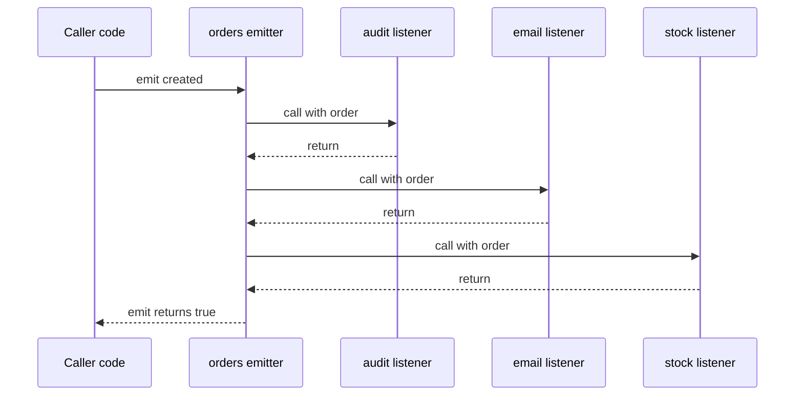

# Core Modules: fs, path, events, Buffer and More

> In this document you will learn the built-in Node.js modules you use every day: `fs` for files, `path` for file paths, `os`, `URL`, `util`, `EventEmitter`, `Buffer` for binary data, `crypto` basics, `child_process`, process signals for graceful shutdown, timers and `AbortController`. Interviewers ask about these to see if you have really built Node.js services: "Why is `readFileSync` bad in a handler?", "What happens if nobody listens to the `error` event?", "Why is `Buffer.allocUnsafe` unsafe?", "How do you shut down a server cleanly?".

**Before this:** [Node.js runtime and architecture](01-nodejs-runtime-and-architecture.md) · [The Node.js event loop](02-node-event-loop.md) · [Modules, npm and packages](03-modules-npm-and-packages.md) · **Interview questions:** [jump to the interview section](#interview-questions)

## Table of contents

1. [Overview of core modules](#overview-of-core-modules)
2. [fs: the file system](#fs-the-file-system)
3. [path: working with file paths](#path-working-with-file-paths)
4. [os: information about the machine](#os-information-about-the-machine)
5. [URL and URLSearchParams](#url-and-urlsearchparams)
6. [util: helpers you will actually use](#util-helpers-you-will-actually-use)
7. [EventEmitter](#eventemitter)
8. [Buffer: binary data](#buffer-binary-data)
9. [crypto basics](#crypto-basics)
10. [child_process overview](#child_process-overview)
11. [Process signals and graceful shutdown](#process-signals-and-graceful-shutdown)
12. [Timers in Node.js](#timers-in-nodejs)
13. [AbortController in Node.js APIs](#abortcontroller-in-nodejs-apis)
14. [Common mistakes](#common-mistakes)
15. [Best practices](#best-practices)
16. [How to explain this in an interview](#how-to-explain-this-in-an-interview)
17. [Interview questions](#interview-questions)
18. [Summary](#summary)
19. [References](#references)

---

## Overview of core modules

**Core modules** (also called built-in modules) come with Node.js. You do not install them. Load them with the `node:` prefix so it is clear they are built in:

```js
// CommonJS
const fs = require('node:fs');
const path = require('node:path');

// ES modules
import { readFile } from 'node:fs/promises';
import path from 'node:path';
```

| Module | Use it for |
| --- | --- |
| `node:fs`, `node:fs/promises` | Reading, writing, watching files and folders |
| `node:path` | Building and parsing file paths safely |
| `node:os` | CPU count, memory, temp folder, line endings |
| `node:url` | Converting between file paths and `file://` URLs (`URL` itself is global) |
| `node:util` | `promisify`, `inspect`, `types`, `parseArgs`, `format` |
| `node:events` | `EventEmitter`, `once`, `on` |
| `node:buffer` | Binary data (`Buffer` is also global) |
| `node:crypto` | Random IDs, hashes, HMAC, password hashing, encryption |
| `node:child_process` | Running other programs |
| `node:timers/promises` | Promise versions of `setTimeout`, `setImmediate`, `setInterval` |
| `node:stream` | Streams (covered in [Streams](05-streams.md)) |
| `node:http`, `node:https` | HTTP servers and clients (covered in [HTTP servers and Express](06-http-servers-and-express.md)) |
| `node:worker_threads`, `node:cluster` | Parallelism (covered in [Concurrency](12-concurrency-worker-threads-and-cluster.md)) |

## fs: the file system

### Three API styles

The `fs` module offers almost every operation in three styles. Here is the same task — read a JSON settings file — in each style:

```js
// 1. Synchronous: blocks the event loop until done
const fs = require('node:fs');
try {
  const text = fs.readFileSync('settings.json', 'utf8');
  console.log(JSON.parse(text));
} catch (err) {
  console.error('could not read settings:', err.code);
}
```

```js
// 2. Callback: error-first callback
const fs = require('node:fs');
fs.readFile('settings.json', 'utf8', (err, text) => {
  if (err) {
    console.error('could not read settings:', err.code);
    return;
  }
  console.log(JSON.parse(text));
});
```

```js
// 3. Promise: works with async/await (the usual choice for new code)
const { readFile } = require('node:fs/promises');

async function loadSettings() {
  try {
    const text = await readFile('settings.json', 'utf8');
    return JSON.parse(text);
  } catch (err) {
    console.error('could not read settings:', err.code);
    return {};
  }
}
```

| Style | Blocks the event loop? | Error handling | When to use |
| --- | --- | --- | --- |
| Sync (`readFileSync`) | **Yes** | `try/catch` | Startup code, CLI scripts, build tools |
| Callback (`readFile`) | No (thread pool) | `if (err)` in the callback | Older code; the Node.js docs say callbacks are the fastest when maximum performance matters |
| Promise (`fs/promises`) | No (thread pool) | `try/catch` with `await` | Most new application code |

The **error-first callback** convention: the first argument is an error (or `null`), and the result comes after. You must check `err` first. Forgetting this is a classic bug.

### Common file operations

```js
import { readFile, writeFile, appendFile, mkdir, readdir, stat, rm, rename } from 'node:fs/promises';

// Create nested folders. No error if they already exist.
await mkdir('data/reports/2026', { recursive: true });

// Write and read JSON
await writeFile('data/settings.json', JSON.stringify({ theme: 'dark', pageSize: 20 }, null, 2));
const settings = JSON.parse(await readFile('data/settings.json', 'utf8'));
console.log(settings.pageSize); // 20

// Append lines to a log file
await appendFile('data/app.log', 'started\n');

// List a folder with file types
const entries = await readdir('data', { withFileTypes: true });
for (const e of entries) console.log(e.name, e.isDirectory() ? 'dir' : 'file');
// app.log file
// reports dir
// settings.json file

// File information
const info = await stat('data/settings.json');
console.log(info.isFile(), info.size, info.mtime); // true 41 2026-10-18T...

// Delete a folder and everything in it. force: no error if missing.
await rm('data', { recursive: true, force: true });
```

Without an encoding (`'utf8'`), `readFile` returns a **Buffer** (raw bytes), not a string. This surprises many people.

### Write flags

The `flag` option controls how a file is opened:

| Flag | Meaning |
| --- | --- |
| `'w'` (default for `writeFile`) | Create or **overwrite** |
| `'a'` | Create or **append** |
| `'wx'` | Create, but **fail if the file exists** (`EEXIST`) |
| `'r'` (default for `readFile`) | Read; fail if missing (`ENOENT`) |

```js
try {
  await writeFile('invoice-1001.pdf', pdfBuffer, { flag: 'wx' }); // never overwrite an invoice
} catch (err) {
  if (err.code === 'EEXIST') console.log('invoice already generated');
  else throw err;
}
```

### Error codes you will meet

File errors have a `code` property. Check the code, not the message text:

| Code | Meaning | Typical fix |
| --- | --- | --- |
| `ENOENT` | No such file or directory | Create it, or treat "missing" as a normal case |
| `EEXIST` | Already exists | Use another name, or it is fine |
| `EACCES`, `EPERM` | Permission denied | Fix permissions or the user running the app |
| `EISDIR` | Expected a file, got a directory | Check the path |
| `ENOTDIR` | A part of the path is not a directory | Check the path |
| `EMFILE` | Too many open files | Close files; limit concurrency |
| `ENOSPC` | No space left on device | Free disk space, alert |

### Do not check before you open

```js
// ❌ Wrong: race condition between the check and the read
import { access, readFile } from 'node:fs/promises';
try {
  await access('config.json');                 // file exists now...
  const text = await readFile('config.json');  // ...but may be deleted before this line
} catch {}

// ✅ Correct: just try, and handle the error code
try {
  const text = await readFile('config.json', 'utf8');
} catch (err) {
  if (err.code === 'ENOENT') { /* use defaults */ }
  else throw err;
}
```

Between the check and the real operation, another process can delete or change the file. This is called a **TOCTOU** bug (time of check to time of use). The Node.js docs recommend opening directly and handling the error. It is also one fewer system call.

### Atomic writes

If your process crashes in the middle of `writeFile`, the file may be left **half-written**. For important files (config, state, caches), write to a temporary file and then **rename** it. A rename within the same file system replaces the target in one step on POSIX systems, so readers see either the old file or the new file, never half of one.

```js
import { writeFile, rename } from 'node:fs/promises';

async function writeJsonAtomic(file, data) {
  const tmp = `${file}.${process.pid}.tmp`;
  await writeFile(tmp, JSON.stringify(data, null, 2));
  await rename(tmp, file); // replace in one step
}
```

On Windows, rename can fail with `EPERM` if another program (an antivirus scanner, an editor) has the file open. Libraries like `write-file-atomic` handle these cases with retries.

### FileHandle: always close files

`open()` from `fs/promises` returns a **FileHandle**. It holds an operating system file descriptor until you close it.

```js
import { open } from 'node:fs/promises';

const file = await open('data/app.log');
try {
  for await (const line of file.readLines()) {
    console.log('line:', line);
  }
} finally {
  await file.close(); // always close, even if an error happens
}
// line: started
// line: request /orders
```

The docs warn not to rely on automatic closing of FileHandles, because it is unreliable. Leaking file descriptors leads to `EMFILE` errors under load.

### Large files: use streams

`readFile` loads the **whole** file into memory. For a 2 GB log file, that means 2 GB of RAM (and very large strings fail completely). Use streams to process big files in chunks:

```js
import { createReadStream } from 'node:fs';
import { createInterface } from 'node:readline';

const lines = createInterface({ input: createReadStream('huge.log'), crlfDelay: Infinity });
let errors = 0;
for await (const line of lines) {
  if (line.includes('ERROR')) errors++;
}
console.log('error lines:', errors); // constant memory, any file size
```

Details are in [Streams](05-streams.md).

### Finding files with glob

Node.js 22 added `fs.glob()`, marked stable in Node.js 24 (and 22.17). It replaces the `glob` package for simple cases:

```js
import { glob } from 'node:fs/promises';

for await (const file of glob('src/**/*.test.js')) {
  console.log(file); // src/orders/orders.test.js ...
}
```

### Watching files

```js
import { watch } from 'node:fs';

const watcher = watch('./config', { recursive: true }, (eventType, filename) => {
  console.log(eventType, filename); // 'change' 'app.json'  or  'rename' 'new.json'
});
// later: watcher.close();
```

- `fs.watch` uses the OS notification system (inotify on Linux, FSEvents/kqueue on macOS, `ReadDirectoryChangesW` on Windows). `recursive: true` works on Linux since Node.js 19.1, and on macOS and Windows.
- The docs warn that behavior is **not 100% consistent across platforms**: you can get duplicate events, `filename` can be `null`, and network file systems and some Docker volume setups may not report changes.
- `fs.watchFile` polls with `stat` at an interval. It is slower; the docs recommend `fs.watch` when possible.
- Real projects (dev servers, build tools) often use the `chokidar` package, which smooths over platform differences. `node --watch` restarts your app on changes.

### Permissions

On Linux and macOS, every file has an owner and permission bits (read, write, execute for owner, group, others), written in octal like `0o644`:

```js
import { writeFile, chmod } from 'node:fs/promises';

// Private key: only the owner can read and write
await writeFile('secrets/private.pem', keyPem, { mode: 0o600 });
await chmod('scripts/deploy.sh', 0o755); // owner rwx, others r-x
```

- On Windows, permissions work differently (ACLs). Node.js only supports the read-only flag there.
- Run your server as a **non-root** user (especially in Docker), so a bug cannot overwrite system files.
- The Node.js **permission model** (`--permission`, `--allow-fs-read`, `--allow-fs-write`) can restrict which paths the process may touch. See [Modern built-in features](01-nodejs-runtime-and-architecture.md#modern-built-in-features).

## path: working with file paths

### Why you need it

File paths look different on each OS: `/home/asha/app/uploads/a.png` on Linux and `C:\Users\Asha\app\uploads\a.png` on Windows. Building paths with string concatenation breaks across platforms and makes security bugs easy. The `path` module handles separators and `..` segments correctly.

The outputs below use POSIX paths (Linux/macOS). On Windows, `path` uses `\` and drive letters.

### join vs resolve

These two are asked about often.

**`path.join(...parts)`** glues segments together with the right separator and normalizes `.` and `..`. It does **not** look at the current directory.

```js
const path = require('node:path');

path.join('/app', 'uploads', '../logs', 'today.log'); // '/app/logs/today.log'
path.join('app', 'uploads');                           // 'app/uploads' (stays relative)
path.join('/app', '/etc', 'passwd');                   // '/app/etc/passwd'
```

**`path.resolve(...parts)`** builds an **absolute** path. It works from right to left until it reaches an absolute path. If none is found, it starts from `process.cwd()`.

```js
path.resolve('/app', 'uploads', 'avatar.png'); // '/app/uploads/avatar.png'
path.resolve('/app', '/etc', 'passwd');        // '/etc/passwd'  (the absolute '/etc' resets it)
path.resolve('uploads');                       // '<current working dir>/uploads'
```

| | `path.join` | `path.resolve` |
| --- | --- | --- |
| Result | Can be relative | Always absolute |
| A segment starting with `/` | Treated as a normal segment | Resets everything before it |
| Uses `process.cwd()` | Never | When no absolute segment is given |
| Typical use | Combine known parts | Get a full path for a user-given or relative path |

### Other useful functions

```js
path.basename('/app/uploads/avatar.png');         // 'avatar.png'
path.basename('/app/uploads/avatar.png', '.png'); // 'avatar'
path.dirname('/app/uploads/avatar.png');          // '/app/uploads'
path.extname('archive.tar.gz');                   // '.gz'  (only the last extension)
path.normalize('/app//uploads/./images/../avatar.png'); // '/app/uploads/avatar.png'
path.relative('/app/src/routes', '/app/src/models/user.js'); // '../models/user.js'
path.isAbsolute('./x');                           // false
path.parse('/app/uploads/avatar.png');
// { root: '/', dir: '/app/uploads', base: 'avatar.png', ext: '.png', name: 'avatar' }
path.format({ dir: '/app/out', name: 'report', ext: '.pdf' }); // '/app/out/report.pdf'
path.sep;                                         // '/' on POSIX, '\\' on Windows
```

`path.posix` and `path.win32` force one style. Use `path.posix` for URL-like paths (for example, keys in S3) so they always use `/`.

### `__dirname`, `import.meta.dirname` and `process.cwd()`

| | Meaning | Changes when you start the app from another folder? |
| --- | --- | --- |
| `__dirname` (CommonJS) | Folder of the **current file** | No |
| `import.meta.dirname` (ESM, Node.js 20.11+) | Folder of the **current file** | No |
| `process.cwd()` | Folder where the **process was started** | **Yes** |

```js
// ❌ Wrong: breaks when started as `node src/server.js` from another folder
const template = await readFile('templates/email.html', 'utf8');

// ✅ Correct: relative to this file
const template2 = await readFile(path.join(import.meta.dirname, 'templates', 'email.html'), 'utf8');
```

Use `process.cwd()` only when you really mean "where the user ran the command", like a CLI tool that processes files in the user's folder.

### Security: path traversal

**Path traversal** is an attack where user input contains `../` to escape the folder you intended. `path.join` does **not** protect you:

```js
const UPLOAD_DIR = '/srv/app/uploads';

// ❌ Wrong
path.join(UPLOAD_DIR, '../../etc/passwd'); // '/srv/etc/passwd' — outside uploads!
```

```js
// ✅ Correct: resolve, then check the result is still inside the base folder
function safePath(userFileName) {
  const fullPath = path.resolve(UPLOAD_DIR, userFileName);
  if (!fullPath.startsWith(UPLOAD_DIR + path.sep)) {
    throw new Error('Invalid file path');
  }
  return fullPath;
}

safePath('avatar.png');       // '/srv/app/uploads/avatar.png'
safePath('../../etc/passwd'); // throws Invalid file path
safePath('/etc/passwd');      // throws (absolute input resets resolve)
safePath('../uploads-old/x'); // throws (the + path.sep check stops prefix tricks)
```

Notice the `+ path.sep`: without it, `/srv/app/uploads-old/x` would pass a plain `startsWith('/srv/app/uploads')` check. Even better: do not use user input in paths at all. Generate your own file names (for example, `crypto.randomUUID() + '.png'`) and keep the original name in the database.

## os: information about the machine

```js
const os = require('node:os');

os.platform();             // 'linux' | 'darwin' | 'win32'
os.availableParallelism(); // number of CPUs the process can use (Node.js 18.14+), e.g. 8
os.cpus().length;          // number of logical CPUs
os.totalmem();             // total RAM in bytes
os.freemem();              // free RAM in bytes
os.homedir();              // '/home/asha'
os.tmpdir();               // '/tmp' — the right place for temporary files
os.hostname();             // 'api-7f9c4' (in Kubernetes, usually the pod name)
os.EOL;                    // '\n' on POSIX, '\r\n' on Windows
```

Real uses: choose the number of cluster workers or worker threads (`os.availableParallelism()`), write temp files to `os.tmpdir()`, include the hostname in logs, and use `os.EOL` when writing text files for the local OS.

## URL and URLSearchParams

`URL` and `URLSearchParams` are **global** in Node.js and follow the same WHATWG standard as browsers.

```js
const url = new URL('https://shop.example.com:8443/api/orders?status=paid&page=2#top');

url.protocol;  // 'https:'
url.hostname;  // 'shop.example.com'
url.port;      // '8443'
url.pathname;  // '/api/orders'
url.search;    // '?status=paid&page=2'
url.hash;      // '#top'
url.origin;    // 'https://shop.example.com:8443'

url.searchParams.get('status');   // 'paid'
url.searchParams.get('missing');  // null
url.searchParams.set('page', '3');
url.searchParams.append('tag', 'summer sale');
url.href; // 'https://shop.example.com:8443/api/orders?status=paid&page=3&tag=summer+sale#top'
```

Building URLs safely:

```js
const base = new URL('https://api.example.com/v1/');
new URL('users/42', base).href; // 'https://api.example.com/v1/users/42'
new URL('/health', base).href;  // 'https://api.example.com/health' (leading / replaces the path)

const params = new URLSearchParams({ q: 'node streams', limit: '10' });
params.toString(); // 'q=node+streams&limit=10' (encoded for you)
```

- Invalid input throws a `TypeError` with code `ERR_INVALID_URL`. `URL.canParse(input)` checks without throwing.
- Never build query strings with string concatenation: values like `&` or `#` in user input break the URL.
- The old `url.parse()` is a legacy API. Use `new URL()`.
- In ESM, convert between `file://` URLs and paths with `fileURLToPath()` and `pathToFileURL()` from `node:url`.

## util: helpers you will actually use

### promisify

Turns an error-first callback function into a function that returns a promise:

```js
const util = require('node:util');
const crypto = require('node:crypto');

const scrypt = util.promisify(crypto.scrypt);
const key = await scrypt('password', 'salt', 64); // instead of a callback
```

Most core modules already have promise versions (`fs/promises`, `timers/promises`, `stream/promises`, `dns/promises`), so you mainly need `promisify` for older APIs and old libraries. `util.callbackify` does the opposite.

### inspect

`console.log` shows nested objects only 2 levels deep:

```js
const order = { user: { profile: { address: { city: 'Pune', geo: { lat: 1 } } } } };

console.log(order);
// { user: { profile: { address: [Object] } } }

console.log(util.inspect(order, { depth: null, compact: true, breakLength: Infinity }));
// { user: { profile: { address: { city: 'Pune', geo: { lat: 1 } } } } }
```

You can control how your own class is printed (handy for hiding secrets in logs):

```js
class Money {
  constructor(cents) { this.cents = cents; }
  [util.inspect.custom]() { return `Money(${(this.cents / 100).toFixed(2)})`; }
}
console.log(new Money(1999)); // Money(19.99)
```

### Other helpers

```js
util.format('%s has %d items, data: %j', 'cart', 3, { a: 1 }); // 'cart has 3 items, data: {"a":1}'
util.types.isPromise(Promise.resolve()); // true
util.types.isDate(new Date());            // true
util.isDeepStrictEqual({ a: [1, 2] }, { a: [1, 2] }); // true

const oldApi = util.deprecate(() => 'old', 'oldApi() is deprecated, use newApi()', 'DEP_APP_001');
oldApi(); // prints a DeprecationWarning once
```

`util.parseArgs` parses command-line arguments (shown in [the process object](01-nodejs-runtime-and-architecture.md#the-process-object)).

## EventEmitter

### What it is

An **EventEmitter** is an object that can **emit** named events and lets other code **listen** to them. It is Node.js's version of the **observer pattern** (see [Behavioral patterns](../04-oop-solid-design-patterns/08-behavioral-patterns.md)).

Many core objects are EventEmitters: HTTP servers (`'request'`), sockets (`'data'`, `'close'`), streams (`'data'`, `'end'`, `'error'`), child processes (`'exit'`) and `process` itself (`'SIGTERM'`).

### Why it exists

It lets one part of the code announce "something happened" without knowing who cares. The order service does not need to import the email service, the stock service and the analytics service. It just emits `'created'`.

### Analogy

A radio station broadcasts on a frequency (the event name). Anyone with a radio tuned to that frequency (a listener) hears it. The station does not know who is listening.

Where it breaks: unlike a radio, `emit()` **waits for every listener to finish**, one after another, before it returns.

### The basic API

```js
const EventEmitter = require('node:events');

const orders = new EventEmitter();

orders.on('created', (order) => console.log('email for', order.id));
orders.on('created', (order) => console.log('stock update for', order.id));
orders.prependListener('created', () => console.log('audit log first'));

console.log('before emit');
const hadListeners = orders.emit('created', { id: 42 });
console.log('after emit', hadListeners, orders.emit('nobody-listens'));
```

Output:

```text
before emit
audit log first
email for 42
stock update for 42
after emit true false
```

| Method | What it does |
| --- | --- |
| `on(name, fn)` / `addListener` | Add a listener (at the end) |
| `prependListener(name, fn)` | Add a listener at the start |
| `once(name, fn)` | Listener that runs at most once, then is removed |
| `off(name, fn)` / `removeListener` | Remove one listener (needs the same function reference) |
| `removeAllListeners(name?)` | Remove all listeners (for one event or all) |
| `emit(name, ...args)` | Call all listeners **synchronously**; returns `true` if there were listeners |
| `listenerCount(name)` | Count listeners |
| `setMaxListeners(n)` | Change the leak-warning limit for this emitter |

### Listeners run synchronously, in order



Key facts:

- `emit()` calls listeners **one by one, on the same call stack**. It is **not** asynchronous and does not use the event loop.
- A slow listener delays the code that called `emit()`.
- If a listener **throws**, the error goes up to the `emit()` caller, and the remaining listeners do **not** run.
- `emit()` takes a **snapshot** of the listener list. Removing a listener during an emit does not stop it from being called in that same emit:

```js
const e = new EventEmitter();
const listenerB = () => console.log('B');
e.on('event', () => { console.log('A'); e.off('event', listenerB); });
e.on('event', listenerB);
e.emit('event'); // A, B   (B still runs this time)
e.emit('event'); // A
```

### `this` inside listeners

```js
const e = new EventEmitter();
function onPing() { console.log(this === e); }
e.on('ping', onPing);                          // true: normal functions get the emitter as `this`
e.on('ping', () => console.log(this === e));   // false: arrow functions keep the outer `this`
e.emit('ping');
```

To remove a listener, keep a reference to the **same** function: `e.off('ping', onPing)`. An inline arrow function cannot be removed later.

### The special `error` event

If an EventEmitter emits `'error'` and **no listener** is registered for `'error'`, Node.js **throws** the error. If nothing catches it, the process crashes.

```js
const e = new EventEmitter();

try {
  e.emit('error', new Error('disk full'));
} catch (err) {
  console.log('thrown:', err.message); // thrown: disk full
}

e.on('error', (err) => console.log('handled', err.message));
e.emit('error', new Error('again')); // handled again
```

This is the most important EventEmitter rule in production: **every stream, socket, server and custom emitter that can emit `'error'` needs an `'error'` listener.** An unhandled stream error is a very common reason for a Node.js process to crash.

`events.errorMonitor` lets you observe errors (for logging or metrics) without counting as a handler. The process still crashes if no real `'error'` listener exists.

```js
const { errorMonitor } = require('node:events');
e.on(errorMonitor, (err) => metrics.increment('emitter_errors'));
```

### Async listeners are not awaited

`emit()` ignores the return value of listeners. An `async` listener returns a promise, and nobody waits for it or catches its rejection:

```js
const jobs = new EventEmitter();
jobs.on('job', async () => {
  throw new Error('async fail');
});
jobs.emit('job');
console.log('emit returned');
// emit returned
// ...then the process crashes with an unhandled rejection (exit code 1)
```

Options:

- Catch errors inside the async listener (`try/catch`) and handle them there.
- Create the emitter with `{ captureRejections: true }`. Rejections are then routed to the `'error'` event:

```js
const jobs = new EventEmitter({ captureRejections: true });
jobs.on('job', async () => { throw new Error('async fail'); });
jobs.on('error', (err) => console.log('captured:', err.message));
jobs.emit('job'); // captured: async fail
```

- If the caller must wait for the work to finish, do not use events. Call a function and `await` it.

### The memory-leak warning

By default, adding more than **10** listeners for the same event on one emitter prints a warning:

```js
const bus = new EventEmitter();
for (let i = 0; i < 11; i++) bus.on('message', () => {});
// (node:31144) MaxListenersExceededWarning: Possible EventEmitter memory leak detected.
// 11 message listeners added to [EventEmitter]. MaxListeners is 10.
// Use emitter.setMaxListeners() to increase limit
```

This is a **warning**, not an error. It usually points to a real bug: code that adds a listener on every request and never removes it.

```js
// ❌ Wrong: a new listener on the shared emitter for every request, never removed
app.get('/prices/stream', (req, res) => {
  priceFeed.on('price', (p) => res.write(`data: ${JSON.stringify(p)}\n\n`));
});

// ✅ Correct: remove the listener when the client disconnects
app.get('/prices/stream', (req, res) => {
  const onPrice = (p) => res.write(`data: ${JSON.stringify(p)}\n\n`);
  priceFeed.on('price', onPrice);
  req.on('close', () => priceFeed.off('price', onPrice));
});
```

Each forgotten listener keeps its closure (including `res`) in memory forever. If you really need many listeners (a pub/sub hub with many subscribers), raise the limit on purpose with `setMaxListeners(n)`.

### Promise helpers: once and on

```js
const { once, on } = require('node:events');

// Wait for one event as a promise
const [port] = await once(server, 'listening');

// Iterate over events with for await
for await (const [message] of on(socket, 'message')) {
  handle(message);
}
```

`events.once()` rejects if `'error'` is emitted while waiting, and both helpers accept an `AbortSignal` to stop waiting.

### A realistic example: domain events

```js
const EventEmitter = require('node:events');

class OrderService extends EventEmitter {
  constructor(orderRepository) {
    super({ captureRejections: true });
    this.orderRepository = orderRepository;
  }

  async placeOrder(cart, userId) {
    const order = await this.orderRepository.create({ userId, items: cart.items });
    this.emit('order:placed', order); // listeners decide what else happens
    return order;
  }
}

const orderService = new OrderService(orderRepository);
orderService.on('order:placed', (order) => emailService.sendConfirmation(order));
orderService.on('order:placed', (order) => analytics.track('order_placed', { id: order.id }));
orderService.on('error', (err) => logger.error({ err }, 'order listener failed'));
```

This decouples the order logic from side effects inside **one process**. Remember the limits: listeners run in memory, so if the process crashes after the order is saved, the email is never sent. For reliable side effects across services, use a message queue (see [Background jobs and queues](13-background-jobs-and-queues.md)).

### How EventEmitter works inside

Inside, an EventEmitter is basically an object that maps event names to arrays of functions. `on` pushes to an array; `emit` copies the array and calls each function with the arguments. Writing a mini version is a common interview task; a full implementation with `once` and `off` is in [JavaScript polyfills and implementations](../11-coding-interviews/04-javascript-polyfills-and-implementations.md).

```js
// The core idea in a few lines
class MiniEmitter {
  #events = new Map();
  on(name, fn) {
    if (!this.#events.has(name)) this.#events.set(name, []);
    this.#events.get(name).push(fn);
    return this;
  }
  off(name, fn) {
    const list = this.#events.get(name) ?? [];
    this.#events.set(name, list.filter((f) => f !== fn));
    return this;
  }
  emit(name, ...args) {
    const list = [...(this.#events.get(name) ?? [])]; // snapshot
    for (const fn of list) fn.apply(this, args);
    return list.length > 0;
  }
}
```

### EventTarget in Node.js

Node.js also has the browser-style **`EventTarget`** (`addEventListener`, `dispatchEvent`), used by `AbortSignal`, `BroadcastChannel` and Web APIs. Differences: no special `'error'` event, a listener is registered only once per type, and there is no `prependListener`. For Node.js-style code, `EventEmitter` is still the normal choice.

## Buffer: binary data

### What it is

A **Buffer** is a fixed-size piece of memory that holds **raw bytes** (numbers from 0 to 255). `Buffer` is a subclass of `Uint8Array`.

### Why it exists

JavaScript strings are text (UTF-16 inside the engine). But servers deal with **bytes** all the time: files, network packets, images, compressed data, encrypted data. Before typed arrays existed, JavaScript had no good way to hold bytes, so Node.js added `Buffer`. When you read a file without an encoding, or receive data from a socket, you get Buffers.

### Bytes are not characters

```js
const buf = Buffer.from('Hi €');
console.log(buf);                       // <Buffer 48 69 20 e2 82 ac>
console.log(buf.length);                // 6 (bytes)
console.log('Hi €'.length);             // 4 (UTF-16 code units)
console.log(Buffer.byteLength('Hi €')); // 6
```

The `€` sign needs **3 bytes** in UTF-8 (`e2 82 ac`). So `string.length` is not the size in bytes. Use `Buffer.byteLength()` when you need the byte size, for example for a `Content-Length` header or a size limit.

### Creating Buffers

```js
Buffer.from('hello');               // from a string (UTF-8 by default)
Buffer.from('aGVsbG8=', 'base64');  // from base64 -> 'hello'
Buffer.from([0x48, 0x69]);          // from bytes -> 'Hi'
Buffer.alloc(4);                    // <Buffer 00 00 00 00> zero-filled
Buffer.alloc(4, 1);                 // <Buffer 01 01 01 01>
Buffer.allocUnsafe(4);              // 4 bytes, NOT cleared: may contain old data
Buffer.concat([Buffer.from('Hello, '), Buffer.from('world')]).toString(); // 'Hello, world'
```

### Why `allocUnsafe` is unsafe

`Buffer.alloc(size)` fills the memory with zeros. `Buffer.allocUnsafe(size)` skips that step, so it is faster, but the memory **may still contain data from earlier allocations**: passwords, tokens, other users' data. If you send such a buffer before overwriting every byte, you leak that data.

```js
// ❌ Dangerous: if fewer than 1024 bytes are written, old memory is sent
const out = Buffer.allocUnsafe(1024);
out.write(shortMessage);
socket.write(out);

// ✅ Safe
const out2 = Buffer.alloc(1024);
```

Use `allocUnsafe` only when you will immediately overwrite **all** bytes (for example, reading exactly N bytes into it). Small `allocUnsafe` buffers (smaller than half of `Buffer.poolSize`) are sliced from a shared pre-allocated pool for speed. `Buffer.poolSize` is 8 KiB in Node.js 22 and 24 (Node.js 26 raised it to 64 KiB). The old `new Buffer(size)` constructor is deprecated because older versions returned uninitialized memory by default.

### Encodings

```js
const data = Buffer.from('user:pa$$word');
data.toString('base64');            // 'dXNlcjpwYSQkd29yZA=='  (HTTP Basic auth header uses this)
data.toString('hex');               // '757365723a7061242477...'
Buffer.from([0xfb, 0xff]).toString('base64');    // '+/8='
Buffer.from([0xfb, 0xff]).toString('base64url'); // '-_8'   (URL-safe, no padding)
```

| Encoding | Use it for |
| --- | --- |
| `utf8` (default) | Normal text |
| `base64` | Binary data inside text: email attachments, data URLs, Basic auth |
| `base64url` | Binary data in URLs and JWTs (`+/` become `-_`, no `=` padding) |
| `hex` | Hashes, debugging bytes |
| `latin1` / `binary` | Old 1-byte encodings |
| `utf16le` | Windows text formats |
| `ascii` | Legacy 7-bit text |

**Base64 is encoding, not encryption.** Anyone can decode it. Do not "hide" secrets with base64.

### Buffers share memory

`subarray()` (and the legacy `slice()`) returns a **view** of the same memory, not a copy:

```js
const original = Buffer.from([1, 2, 3, 4]);
const view = original.subarray(1, 3);
view[0] = 9;
console.log(original); // <Buffer 01 09 03 04>  — changed through the view!

const copy = Buffer.from(original); // a real copy
copy[0] = 7;
console.log(original, copy); // <Buffer 01 09 03 04> <Buffer 07 09 03 04>
```

This is fast (no copying), but changing a view changes the original. Also, a small view keeps the whole big underlying memory alive, which can cause memory to be retained longer than expected.

### Split characters across chunks

When data arrives in chunks (streams, sockets), a multi-byte character can be **split** between two chunks:

```js
const euro = Buffer.from('€');          // <Buffer e2 82 ac>
const part1 = euro.subarray(0, 2);
const part2 = euro.subarray(2);

// ❌ Wrong: decoding each chunk separately breaks the character
console.log(part1.toString() + part2.toString()); // '��'

// ✅ Correct: a streaming decoder keeps incomplete bytes for the next chunk
const { StringDecoder } = require('node:string_decoder');
const decoder = new StringDecoder('utf8');
console.log(decoder.write(part1) + decoder.write(part2) + decoder.end()); // '€'
```

For streams, `readable.setEncoding('utf8')` does this for you. `TextDecoder` with `{ stream: true }` also works. Invalid UTF-8 bytes become the replacement character `U+FFFD` (`�`).

### Other Buffer operations

```js
Buffer.from('abc').equals(Buffer.from('abc')); // true
Buffer.compare(Buffer.from('a'), Buffer.from('b')); // -1 (useful for sorting)
JSON.stringify(Buffer.from('hi'));             // '{"type":"Buffer","data":[104,105]}'

// Reading and writing binary numbers (file formats, network protocols)
const header = Buffer.alloc(6);
header.writeUInt16BE(0x1234, 0); // big-endian 2-byte number at offset 0
header.writeUInt32LE(1, 2);      // little-endian 4-byte number at offset 2
console.log(header);             // <Buffer 12 34 01 00 00 00>
console.log(header.readUInt16BE(0)); // 4660
```

Real uses: file uploads, image processing, reading binary file formats, computing hashes, building protocol messages, working with `crypto` keys.

## crypto basics

### Random values

```js
const crypto = require('node:crypto');

crypto.randomUUID();                        // 'b3e1c7a2-...' (v4 UUID, 36 chars)
crypto.randomBytes(32).toString('hex');     // 64 hex chars: session IDs, reset tokens
crypto.randomBytes(32).toString('base64url'); // 43 chars, URL-safe
crypto.randomInt(1, 7);                     // a fair dice roll: 1..6
```

**Never use `Math.random()` for anything secret** (tokens, passwords, IDs that must not be guessed). It is not cryptographically secure; its output can be predicted. `crypto.randomUUID()` is also available as a global (`crypto.randomUUID()` through the Web Crypto `globalThis.crypto`).

### Hashing

A **hash** turns any input into a fixed-size fingerprint. The same input always gives the same hash, and you cannot reverse it.

```js
crypto.createHash('sha256').update('hello').digest('hex');
// '2cf24dba5fb0a30e26e83b2ac5b9e29e1b161e5c1fa7425e73043362938b9824'

// One-shot helper: added in 21.7 / 20.12, stable since 24.13.1 and 25.5
crypto.hash('sha256', 'hello'); // same result
```

Uses: file checksums, cache keys and ETags, detecting duplicate uploads, content-addressed storage.

### HMAC: verifying webhooks

An **HMAC** is a hash that uses a secret key. Only someone who knows the key can produce the right value. Payment providers and GitHub sign webhooks this way.

```js
const WEBHOOK_SECRET = process.env.WEBHOOK_SECRET;

function verifySignature(rawBody, receivedHex) {
  const expected = crypto.createHmac('sha256', WEBHOOK_SECRET).update(rawBody).digest();
  const received = Buffer.from(receivedHex, 'hex');
  // timingSafeEqual throws if lengths differ, so check length first
  return received.length === expected.length && crypto.timingSafeEqual(expected, received);
}
```

Two important details:

- Compute the HMAC over the **raw request body bytes**, not over re-serialized JSON (key order and spaces can change).
- Compare with **`crypto.timingSafeEqual`**, not `===`. A normal comparison stops at the first different character, and an attacker can measure response times to guess the signature byte by byte (a **timing attack**).

### Password hashing

Never store passwords as plain text, and never use a fast hash like SHA-256 for passwords. Fast hashes let attackers try billions of guesses per second. Use a **slow, salted** password-hashing function: **scrypt** (built into Node.js), **Argon2** or **bcrypt** (npm packages).

```js
const { promisify } = require('node:util');
const scrypt = promisify(crypto.scrypt);

async function hashPassword(password) {
  const salt = crypto.randomBytes(16);
  const key = await scrypt(password, salt, 64);
  return `${salt.toString('hex')}:${key.toString('hex')}`; // store this
}

async function verifyPassword(password, stored) {
  const [saltHex, keyHex] = stored.split(':');
  const derived = await scrypt(password, Buffer.from(saltHex, 'hex'), 64);
  return crypto.timingSafeEqual(derived, Buffer.from(keyHex, 'hex'));
}
```

The async `scrypt` runs in the libuv thread pool, so it does not block the event loop. Full authentication design is in [Authentication and authorization](09-authentication-and-authorization.md).

### Web Crypto

Node.js also has the standard **Web Crypto API** (`globalThis.crypto.subtle`), the same as in browsers. Use it when code must run in both places:

```js
const digest = await crypto.subtle.digest('SHA-256', new TextEncoder().encode('hello'));
Buffer.from(digest).toString('hex'); // '2cf24dba...'
```

## child_process overview

The `child_process` module runs **other programs** from Node.js: `git`, `ffmpeg`, `ImageMagick`, a Python script, or another Node.js script.

| Function | What it does | Output | Uses a shell? |
| --- | --- | --- | --- |
| `exec(cmd)` | Run a command string | Buffered (whole output at the end, size-limited) | **Yes** |
| `execFile(file, args)` | Run a program with an argument array | Buffered | No (by default) |
| `spawn(cmd, args)` | Start a process | **Streams** (`stdout`, `stderr`) | No (by default) |
| `fork(modulePath)` | Start a Node.js script with an IPC channel | Streams + `process.send()` messages | No |
| `execSync`, `spawnSync`, ... | Same, but **block** the event loop | | |

```js
const { execFile, spawn } = require('node:child_process');
const { promisify } = require('node:util');
const execFileAsync = promisify(execFile);

// Small output: execFile
const { stdout } = await execFileAsync('git', ['rev-parse', '--short', 'HEAD']);
console.log('commit', stdout.trim());

// Large or long-running output: spawn and stream
const ffmpeg = spawn('ffmpeg', ['-i', 'input.mov', 'output.mp4']);
ffmpeg.stderr.on('data', (chunk) => process.stdout.write(chunk));
ffmpeg.on('close', (code) => console.log('ffmpeg exited with', code));
ffmpeg.on('error', (err) => console.error('failed to start ffmpeg', err));
```

**Security: never pass user input to `exec`.** `exec` runs the string in a shell, so input like `photo.png; rm -rf /` becomes two commands. This is **command injection**.

```js
// ❌ Wrong: command injection
exec(`convert ${req.query.file} -resize 200x200 thumb.png`);

// ✅ Correct: arguments are passed separately, no shell parsing
execFile('convert', [req.query.file, '-resize', '200x200', 'thumb.png']);
// (still validate the file name and path!)
```

When to use child processes vs worker threads, `fork` with IPC, and process pools are covered in [Concurrency: worker threads and cluster](12-concurrency-worker-threads-and-cluster.md). Electron apps use the same APIs; see [File system, child processes and native features](../08-electron-desktop/05-filesystem-child-processes-and-native-features.md).

## Process signals and graceful shutdown

### Signals

A **signal** is a small message the operating system sends to a process. Node.js exposes signals as events on `process`.

| Signal | Who sends it | Default in Node.js |
| --- | --- | --- |
| `SIGINT` | Ctrl+C in the terminal | Exit (code 130 on Unix shells) |
| `SIGTERM` | `kill <pid>`, Docker `docker stop`, Kubernetes before killing a pod, systemd | Exit |
| `SIGKILL` | `kill -9`, Docker/Kubernetes after the grace period | Immediate kill. **Cannot be caught.** |
| `SIGHUP` | Terminal closed | Exit |

Platform notes:

- On **Windows**, `SIGINT` (Ctrl+C) works, but real `SIGTERM` signals are not supported (you can add a listener, but Windows does not send it). Windows services and containers on Windows use other mechanisms.
- When you add a listener for `SIGINT` or `SIGTERM`, Node.js **removes the default exit behavior**. Your handler must end the process (by closing everything, or by calling `process.exit()`).
- In Docker, if Node.js runs as PID 1 through a shell (`CMD npm start`), signals may not reach your app. Use the exec form `CMD ["node", "server.js"]` or a tiny init like `tini` (`docker run --init`).

### Graceful shutdown

**Graceful shutdown** means: when asked to stop, the server finishes current work cleanly instead of dropping it. In Kubernetes, every deploy sends `SIGTERM` to old pods, so this happens many times a day.

The steps:

1. Stop accepting **new** connections (`server.close()`).
2. Let **in-flight** requests finish.
3. Close other resources: database pools, Redis, message consumers.
4. Exit. If it takes too long, **force exit** after a deadline.

```js
// The shape of a shutdown handler (the full, tested version is in Production Node.js)
let shuttingDown = false;

process.on('SIGTERM', () => {
  if (shuttingDown) return;            // a second signal can arrive
  shuttingDown = true;

  const forceExit = setTimeout(() => process.exit(1), 10_000);
  forceExit.unref();                   // this timer alone must not keep the process alive

  server.close(async () => {           // stop accepting new connections, wait for in-flight requests
    await db.close();                  // then close pools, Redis, queue consumers
    process.exitCode = 0;              // exit naturally when the event loop is empty
  });
});
```

The full production version is explained in one place: [Production Node.js: Graceful shutdown](14-production-nodejs.md#graceful-shutdown). It covers readiness checks, the Kubernetes readiness race, `server.close()` behavior since Node.js 19, `closeAllConnections()`, closing queue workers, and a tested example.

## Timers in Node.js

Node.js timers look like browser timers, with some extras:

```js
const timeout = setTimeout(() => console.log('later'), 1000);
clearTimeout(timeout);

const interval = setInterval(() => sendHeartbeat(), 30_000);
interval.unref(); // do not keep the process alive just for this

const immediate = setImmediate(() => console.log('after I/O'));
clearImmediate(immediate);
```

- `setTimeout` returns a **`Timeout` object** (not a number) with `ref()`, `unref()`, `refresh()` and `hasRef()`.
- A delay below 1 ms becomes 1 ms. A delay above 2,147,483,647 ms (about 24.8 days) is also set to 1 ms, with a warning.
- Timing details and phases are in [The Node.js event loop](02-node-event-loop.md#the-six-phases).

### Promise-based timers

```js
const { setTimeout: sleep, setInterval: every } = require('node:timers/promises');

await sleep(500); // pause 500 ms inside an async function

// Retry with a delay
async function fetchWithRetry(url, attempts = 3) {
  for (let i = 1; i <= attempts; i++) {
    try {
      return await fetch(url);
    } catch (err) {
      if (i === attempts) throw err;
      await sleep(200 * 2 ** i); // 400 ms, 800 ms ... exponential backoff
    }
  }
}

// Interval as an async iterator
for await (const startTime of every(1000, Date.now())) {
  if (await jobIsDone()) break; // break stops the interval
}
```

## AbortController in Node.js APIs

An **`AbortController`** lets you cancel an operation. You pass its `signal` to an API; calling `controller.abort()` cancels it. It is the same standard API as in browsers, and it is global in Node.js.

Many Node.js APIs accept a `signal`: `fetch`, `fs.readFile`/`writeFile`, `timers/promises`, `events.once`/`on`, `child_process.spawn`/`exec`, `stream.pipeline`, `readline`, and more.

```js
// 1. Timeout for fetch: AbortSignal.timeout (Node.js 17.3+)
try {
  const res = await fetch('https://slow.example.com/report', { signal: AbortSignal.timeout(2000) });
} catch (err) {
  if (err.name === 'TimeoutError') console.log('request took too long');
}

// 2. Cancel a file read
const controller = new AbortController();
const promise = readFile('big.csv', { signal: controller.signal });
controller.abort();
await promise.catch((err) => console.log(err.name)); // AbortError

// 3. Cancel a sleep
await sleep(10_000, null, { signal: AbortSignal.timeout(50) }).catch((err) => console.log(err.code)); // ABORT_ERR

// 4. Combine signals: user cancel OR timeout (AbortSignal.any, Node.js 20.3+)
const userCancel = new AbortController();
const signal = AbortSignal.any([userCancel.signal, AbortSignal.timeout(5000)]);
```

What the errors look like (tested on Node.js 22):

| Situation | `err.name` |
| --- | --- |
| `controller.abort()` | `AbortError` |
| `AbortSignal.timeout()` expired, in `fetch` | `TimeoutError` |
| `AbortSignal.timeout()` expired, in `timers/promises` and `events.once` | `AbortError` (code `ABORT_ERR`) |

**Gotcha:** the timer inside `AbortSignal.timeout()` is unref'ed. It does **not** keep the process alive. In my test, a top-level `await once(emitter, 'ready', { signal: AbortSignal.timeout(20) })` with nothing else running did not reject — the process simply exited with the "unsettled top-level await" warning (exit code 13). In a real server this never matters, because the server keeps the loop alive.

Real uses: request timeouts to downstream services, cancelling work when the HTTP client disconnects (`req.on('close', () => controller.abort())`), and stopping background loops during shutdown.

## Common mistakes

1. **Using `readFileSync`/`writeFileSync` in request handlers.** Blocks every request.
2. **Forgetting the `'utf8'` encoding** and getting a Buffer instead of a string.
3. **Checking with `fs.access`/`existsSync` before opening.** Race condition; just open and handle `ENOENT`.
4. **Building paths with string concatenation** (`dir + '/' + file`). Breaks on Windows and invites path traversal.
5. **Trusting `path.join` to stop `../` attacks.** It does not; resolve and check the prefix.
6. **Using `process.cwd()` for files shipped with the code.**
7. **No `'error'` listener on streams, sockets or custom emitters.** The process crashes on the first error.
8. **Async listeners on EventEmitter without error handling.** Unhandled rejection crashes the process.
9. **Adding listeners per request and never removing them.** Memory leak and `MaxListenersExceededWarning`.
10. **Thinking `emit()` is asynchronous.** It runs listeners immediately, in order.
11. **Using `Buffer.allocUnsafe` without overwriting every byte.** Leaks old memory.
12. **Confusing `string.length` with byte length.** Wrong `Content-Length` and wrong size limits.
13. **Decoding stream chunks one by one** with `chunk.toString()`. Breaks multi-byte characters at chunk borders.
14. **Using `Math.random()` for tokens**, SHA-256 for passwords, or `===` to compare signatures.
15. **Passing user input to `exec()`.** Command injection.
16. **No `SIGTERM` handler**, or a handler that never exits. Dropped requests on every deploy, or pods killed with `SIGKILL`.

## Best practices

- **Use `node:fs/promises` with `async/await` in application code.** *Reason:* non-blocking and readable error handling.
- **Always pass an encoding when you want text.** *Reason:* otherwise you get a Buffer.
- **Handle errors by `err.code`.** *Reason:* codes are stable; messages are not.
- **Write important files atomically** (temp file + rename). *Reason:* a crash never leaves a half-written file.
- **Close FileHandles in `finally`.** *Reason:* leaked descriptors cause `EMFILE`.
- **Stream large files.** *Reason:* constant memory regardless of file size.
- **Build paths with `path.join`/`path.resolve` relative to `import.meta.dirname`/`__dirname`.** *Reason:* works on every OS and from any working directory.
- **Validate user-provided paths, or better, generate file names yourself.** *Reason:* prevents path traversal.
- **Register an `'error'` listener on every emitter that can fail.** *Reason:* unhandled `'error'` events crash the process.
- **Remove listeners you add per request or per connection.** *Reason:* prevents memory leaks.
- **Use `Buffer.alloc` unless you have measured a need for `allocUnsafe`.** *Reason:* safety first.
- **Use `crypto.randomBytes`/`randomUUID` for secrets, scrypt/Argon2/bcrypt for passwords, `timingSafeEqual` for comparisons.** *Reason:* each prevents a well-known attack.
- **Use `execFile`/`spawn` with argument arrays, never `exec` with user input.** *Reason:* prevents command injection.
- **Implement graceful shutdown with a force-exit timeout.** *Reason:* zero dropped requests during deploys, and no hanging pods.
- **Give every outgoing request a timeout with `AbortSignal.timeout()`.** *Reason:* a hung dependency should not hang your service.

## How to explain this in an interview

**EventEmitter:**

1. **Define it:** "EventEmitter is Node's built-in implementation of the observer pattern. An object emits named events, and listeners registered with `on` or `once` are called with the event data."
2. **Why it exists:** "It decouples the code that announces something from the code that reacts. Most core objects — servers, sockets, streams, `process` — are EventEmitters."
3. **How it works:** "Internally it keeps a map from event names to arrays of listener functions. `emit` takes a snapshot of the array and calls each listener synchronously, in registration order, with the emitter as `this` for normal functions."
4. **Small example:** "An `OrderService` emits `order:placed`, and separate listeners send the confirmation email and track analytics, without the service importing them."
5. **Where it is useful:** "Streams, HTTP servers, WebSocket connections, custom domain events inside one process, and progress events in long jobs."
6. **Trade-offs / gotchas:** "`emit` is synchronous, so a slow listener blocks the caller. An `'error'` event with no listener throws and can crash the process. Async listeners aren't awaited, so their rejections need handling or `captureRejections`. And listeners added per request must be removed, or you get a memory leak and the max-listeners warning."

**Buffer:**

1. **Define it:** "A Buffer is a fixed-size chunk of raw bytes. It's a subclass of `Uint8Array`."
2. **Why it exists:** "Servers handle binary data — files, sockets, images, crypto — and JavaScript strings are for text, so Node needed a byte container."
3. **How it works:** "You create one with `Buffer.from`, `Buffer.alloc` or `Buffer.allocUnsafe`, and convert to text with an encoding like `utf8`, `base64` or `hex`. `subarray` gives a view that shares the same memory."
4. **Small example:** "`Buffer.from('€')` is three bytes, so `'€'.length` is 1 but `Buffer.byteLength('€')` is 3 — that matters for `Content-Length`."
5. **Where it is useful:** "File uploads, hashing, base64 for Basic auth or data URLs, binary protocols, and every stream chunk."
6. **Trade-offs / gotchas:** "`allocUnsafe` can contain old sensitive memory. Views share memory, so changes leak between them. And decoding chunks separately breaks multi-byte characters — use `setEncoding` or `StringDecoder`."

## Interview questions

### Q1. What are the differences between the sync, callback and promise versions of the fs API?

**What the interviewer is checking:** Event loop awareness and judgment about when sync is acceptable.

**Short spoken answer (30–60 seconds):**
> All three do the same file operations. The sync versions, like `readFileSync`, block the event loop until the disk work is done and throw errors you catch with try/catch. The callback versions hand the work to libuv's thread pool and call an error-first callback later. The promise versions in `fs/promises` also use the thread pool but return promises, so I can use async/await. In application code I use the promise API. I use sync calls only at startup — like loading a certificate before `listen` — or in small CLI scripts. The docs also say the callback API is slightly faster and uses less memory, which only matters in very hot paths.

**Follow-up questions:**
- **Do the async fs APIs use the network-style OS async I/O?** — No. They run blocking system calls on the libuv thread pool (4 threads by default).
- **Is it safe to run many concurrent writes to the same file with the promise API?** — No. The docs say these operations are not synchronized; concurrent modifications of the same file can corrupt data. Serialize them, or use a write stream.

**Common mistakes:** Saying the promise API "doesn't use threads", or using `existsSync` checks in handlers.

**Where this is used in real projects:** Config loading, upload handling, report generation, log processing.

### Q2. What is the difference between `path.join` and `path.resolve`?

**Short spoken answer (30–60 seconds):**
> `path.join` just glues segments together with the right separator and normalizes `.` and `..`. It can return a relative path and never looks at the current directory. `path.resolve` always returns an absolute path: it processes segments from right to left until it builds an absolute path, and if it never finds one, it prepends `process.cwd()`. A segment that starts with `/` resets `resolve`, but `join` treats it as a normal part. So `join('/app', '/etc')` is `/app/etc`, while `resolve('/app', '/etc')` is `/etc`.

**Code:**

```js
path.join('/app', 'uploads', '../logs'); // '/app/logs'
path.resolve('uploads');                 // '/current/working/dir/uploads'
path.resolve('/app', '/etc', 'passwd');  // '/etc/passwd'
```

**Follow-up questions:**
- **Does `path.join` protect against path traversal?** — No. `path.join('/uploads', '../../etc/passwd')` escapes the folder. Resolve the path and check that it starts with the base folder plus `path.sep`.

### Q3. How do you prevent path traversal when serving user-requested files?

**What the interviewer is checking:** Security awareness with real code.

**Short spoken answer (30–60 seconds):**
> The safest option is not to use user input in file paths at all: I store files under generated names like a UUID and keep the original name in the database. If I must use a user-provided name, I resolve it against the base folder with `path.resolve`, then check that the result still starts with the base folder plus the path separator — the separator matters, otherwise `/uploads-old` would pass a check for `/uploads`. I reject anything else with a 400 or 404. I also run the process as a non-root user with minimal file permissions, so even a bug can't read system files.

**Code:** see [Security: path traversal](#security-path-traversal).

**Follow-up questions:**
- **What about URL-encoded input like `%2e%2e%2f`?** — Decode first (frameworks usually decode route params), then resolve and check. Check the final resolved path, not the raw string.
- **What about symlinks inside the upload folder?** — A symlink can point outside. Use `fs.realpath` on the result and check again, or forbid symlinks in that folder.

### Q4. What happens when an EventEmitter emits an `error` event and there is no listener?

**What the interviewer is checking:** The most important production rule of EventEmitter.

**Short spoken answer (30–60 seconds):**
> Node treats `'error'` specially. If there's no `'error'` listener, `emit('error', err)` throws the error. If nothing catches it, it becomes an uncaught exception and the process crashes. That's why every stream, socket, server and custom emitter that can fail needs an `'error'` handler. If I only want to observe errors for logging or metrics, I can use `events.errorMonitor`, but that doesn't count as handling — the process still crashes without a real listener.

**Code:**

```js
const e = new EventEmitter();
e.emit('error', new Error('disk full')); // throws -> crash if uncaught
```

**Follow-up questions:**
- **Does `stream.pipeline` help here?** — Yes. It attaches error handling to all streams in the chain and reports the first error to one callback or promise. See [Streams](05-streams.md).
- **Can you catch it with try/catch around `emit`?** — Yes, if `emit` is called in your code. But most core emitters emit errors from inside the event loop, where your try/catch is not on the stack. So you need a listener.

**Common mistakes:** Assuming errors are ignored when nobody listens, or relying on `process.on('uncaughtException')` instead of proper listeners.

**Where this is used in real projects:** File streams for uploads, database client connections, Redis clients, WebSocket servers — all crash the process on first error without a listener.

### Q5. Is `EventEmitter.emit()` synchronous? What does this print?

```js
const EventEmitter = require('node:events');
const bus = new EventEmitter();
bus.on('order', () => console.log('listener 1'));
bus.on('order', () => console.log('listener 2'));
console.log('before');
bus.emit('order');
console.log('after');
```

**Answer:**

```text
before
listener 1
listener 2
after
```

**Why:** `emit()` calls each listener synchronously, in registration order, on the current call stack. Only after all listeners return does the line after `emit()` run. Nothing goes through the event loop. If you want a listener to do work later, it must schedule it itself (`setImmediate`, a promise, a queue).

**Follow-up:**
- **What happens if listener 1 throws?** — The error goes to the caller of `emit()`, `listener 2` does not run, and `after` does not print unless the error is caught.

### Q6. What does the "MaxListenersExceededWarning: Possible EventEmitter memory leak detected" warning mean, and how do you fix it?

**Short spoken answer (30–60 seconds):**
> By default, an emitter warns when more than 10 listeners are added for the same event. It's only a warning, but it usually means a real leak: code that adds a listener on every request or connection and never removes it — for example, subscribing to a shared price feed in a route handler. Each listener keeps its closure and things like the response object alive. The fix is to remove the listener when it's no longer needed — `off` on `req.on('close')`, or use `once` — keeping a reference to the same function. Only if many listeners are truly expected, like a pub/sub hub, do I raise the limit with `setMaxListeners`.

**Follow-up questions:**
- **How do you find where the listeners were added?** — Run with `node --trace-warnings` to get a stack trace for the warning, or check `emitter.listenerCount(name)` over time.

### Q7. How do you handle errors from async listeners on an EventEmitter?

**Short answer:** `emit()` ignores listener return values, so a rejected promise from an `async` listener is unhandled and, since Node.js 15, crashes the process. Options: wrap the listener body in `try/catch`; create the emitter with `{ captureRejections: true }` so rejections are routed to the `'error'` event; or, if the caller needs to wait for the result, do not use events at all — call and `await` a function.

### Q8. What is a Buffer, and why does Node.js need it?

**What the interviewer is checking:** Binary vs text understanding.

**Short spoken answer (30–60 seconds):**
> A Buffer is a fixed-size block of raw bytes; it's a subclass of `Uint8Array`. Node needs it because a server constantly deals with binary data — file contents, network packets, images, compressed or encrypted data — and JavaScript strings are text. When you read a file without an encoding or get data from a socket, you get Buffers. You convert to and from text with encodings: `utf8` for normal text, `base64` or `base64url` for binary inside text, `hex` for hashes. One important detail is that bytes aren't characters: `'€'` has length 1 but takes 3 bytes in UTF-8.

**Follow-up questions:**
- **How do you get the byte size of a string?** — `Buffer.byteLength(str, 'utf8')`.
- **Is base64 encryption?** — No. It is reversible encoding. Anyone can decode it.
- **What does `JSON.stringify` do with a Buffer?** — It produces `{"type":"Buffer","data":[...]}`. Convert to base64 first if you need to send it in JSON.

### Q9. What is the difference between `Buffer.alloc` and `Buffer.allocUnsafe`?

**Short spoken answer (30–60 seconds):**
> `Buffer.alloc(size)` gives you zero-filled memory, so it never contains old data. `Buffer.allocUnsafe(size)` skips the zero-filling, so it's faster, but the memory may contain leftovers from earlier allocations — possibly passwords, tokens or other users' data. If I don't overwrite every byte before sending or saving it, I can leak that data. Small unsafe allocations also come from a shared pool. I use `alloc` by default and `allocUnsafe` only in measured hot paths where I immediately fill the whole buffer.

### Q10. What does this print and why?

```js
const original = Buffer.from([1, 2, 3, 4]);
const part = original.subarray(1, 3);
part[0] = 9;
console.log(original);
```

**Answer:** `<Buffer 01 09 03 04>`

**Why:** `subarray()` (and the legacy `buf.slice()`) returns a **view** over the same memory, not a copy. Changing the view changes the original. To get an independent copy, use `Buffer.from(part)`. Note that this differs from `Array.prototype.slice`, which copies.

### Q11. Text from a file stream sometimes shows `�` characters at random places. What is wrong?

**What the interviewer is checking:** Chunk boundaries and multi-byte characters.

**Short spoken answer (30–60 seconds):**
> The code is probably calling `chunk.toString()` on each chunk separately. UTF-8 characters can be 2 to 4 bytes long, and a chunk boundary can fall in the middle of a character. Decoding half a character gives the replacement character. The fix is to decode with a streaming decoder that keeps incomplete bytes for the next chunk: call `stream.setEncoding('utf8')`, or use `StringDecoder` or `TextDecoder` with `stream: true`. Or collect the Buffers and decode once at the end, if the data is small.

**Code:**

```js
// ❌ chunk.toString() per chunk
stream.on('data', (chunk) => { text += chunk.toString(); });

// ✅ let the stream decode correctly across chunk borders
stream.setEncoding('utf8');
stream.on('data', (chunk) => { text += chunk; });
```

### Q12. How do you generate a secure random token, and how do you store passwords?

**Short spoken answer (30–60 seconds):**
> For tokens like password-reset links or session IDs, I use `crypto.randomBytes(32)` encoded as hex or base64url, or `crypto.randomUUID()` for IDs. Never `Math.random()`, because it's predictable. For passwords, I never store plain text or a fast hash like SHA-256, because attackers can try billions of guesses per second. I use a slow, salted password-hashing function: scrypt, which is built into Node, or Argon2 or bcrypt. I store the salt and parameters with the hash, and I compare with `crypto.timingSafeEqual`. And I use the async versions, which run in the thread pool, so login requests don't block the event loop.

**Follow-up questions:**
- **Why a salt?** — So two users with the same password get different hashes, and precomputed tables (rainbow tables) are useless.
- **Should you store reset tokens as plain text in the database?** — Better to store a hash of the token (SHA-256 is fine here, because the token is long and random) and compare hashes, so a database leak does not expose working tokens.

### Q13. How do you verify a webhook signature? Why not use `===`?

**Short spoken answer (30–60 seconds):**
> The provider signs the raw request body with an HMAC using a shared secret, usually SHA-256, and sends the signature in a header. I compute the same HMAC over the exact raw body bytes — not re-serialized JSON — and compare it to the header with `crypto.timingSafeEqual`, after checking the lengths match. I don't use `===` because a normal comparison returns as soon as one character differs, so response times leak how many leading characters were correct; an attacker could guess the signature piece by piece. Many providers also include a timestamp in the signed data, and I reject old timestamps to stop replay attacks.

### Q14. What is the difference between `exec`, `execFile`, `spawn` and `fork`?

**Short spoken answer (30–60 seconds):**
> `exec` runs a command string through a shell and buffers all output until the process ends — convenient for small commands, but dangerous with user input because of shell injection, and limited by `maxBuffer`. `execFile` runs a program directly with an arguments array, no shell by default, and also buffers output. `spawn` starts a process and gives me streams for stdout and stderr, so it's right for long-running processes or large output like ffmpeg. `fork` is a special `spawn` for Node scripts that adds an IPC channel, so parent and child can exchange messages with `send` and `on('message')`. The sync versions block the event loop, so I avoid them in servers.

**Follow-up questions:**
- **How do you avoid command injection?** — Never build a shell string from user input. Use `execFile`/`spawn` with an argument array, and still validate inputs.
- **What do you do if the child process hangs?** — Pass a `timeout` or an `AbortSignal`, handle the `'error'` and `'exit'` events, and kill it with `child.kill()`.

### Q15. How do you implement graceful shutdown in a Node.js HTTP server?

**What the interviewer is checking:** Production readiness.

**Short spoken answer (30–60 seconds):**
> I listen for `SIGTERM`, which Docker and Kubernetes send before stopping a container, and `SIGINT` for Ctrl+C. When it arrives, I first stop accepting new connections with `server.close()` and make the readiness check fail so the load balancer stops routing to me. In-flight requests finish; since Node 19, `server.close` also closes idle keep-alive connections. When the server's close callback fires, I close the database pool, Redis and queue consumers, and let the process exit naturally. I also start an unref'ed force-exit timer, shorter than Kubernetes' grace period, so a stuck connection can't make the pod hang until `SIGKILL`.

**Code:** see [Graceful shutdown](#graceful-shutdown) for the short shape, and [Production Node.js: Graceful shutdown](14-production-nodejs.md#graceful-shutdown) for the full tested version.

**Follow-up questions:**
- **Why might your SIGTERM handler never run in Docker?** — If the container starts with `npm start` or a shell form `CMD`, the shell may be PID 1 and not forward signals. Use `CMD ["node", "server.js"]` or `--init`/`tini`.
- **Can you handle SIGKILL?** — No. It cannot be caught. That is why the shutdown must finish within the grace period.
- **What about long-lived connections like WebSockets?** — Tell clients to reconnect (send a close frame), then close them; `server.close()` alone would wait for them forever.

### Q16. How do you add a timeout to an outgoing `fetch` call in Node.js?

**Short answer:** Pass `signal: AbortSignal.timeout(ms)`. When the time passes, `fetch` rejects with an error whose `name` is `'TimeoutError'`. To combine a timeout with manual cancellation (for example, when the incoming request is closed by the client), use `AbortSignal.any([controller.signal, AbortSignal.timeout(ms)])`.

```js
const res = await fetch(url, { signal: AbortSignal.timeout(3000) });
```

### Q17. Why should you not call `fs.existsSync()` or `fs.access()` before reading a file?

**Short answer:** It creates a race condition (TOCTOU): the file can be deleted, created or replaced between the check and the read. It also costs an extra system call. Just perform the operation and handle the error code (`ENOENT`, `EACCES`). If you need "create only if missing", use the `'wx'` flag, which makes the check and the creation one atomic operation.

### Q18. Write a tiny EventEmitter with `on`, `off` and `emit`.

**What the interviewer is checking:** Understanding of the internals (a map of arrays, snapshot on emit).

**Answer:** See the `MiniEmitter` in [How EventEmitter works inside](#how-eventemitter-works-inside). Key points to say while coding: store listeners in a `Map` of arrays; `emit` copies the array before looping so listeners removed during the emit do not break the loop; call listeners with `apply(this, args)` so `this` is the emitter; return whether there were listeners. Then mention what the real one adds: `once` (a wrapper that removes itself), the special `'error'` event, max-listener warnings and `prependListener`. The full version is in [JavaScript polyfills and implementations](../11-coding-interviews/04-javascript-polyfills-and-implementations.md).

## Summary

- Load built-ins with the `node:` prefix. Prefer `node:fs/promises` with `async/await`; use sync fs APIs only at startup or in scripts.
- Pass `'utf8'` to get strings; otherwise you get Buffers. Handle errors by `err.code` (`ENOENT`, `EEXIST`, `EACCES`, `EMFILE`).
- Do not check before you open (TOCTOU). Write important files atomically (temp + rename). Close FileHandles. Stream big files.
- `path.join` combines; `path.resolve` makes absolute paths (and resets on `/`). Neither prevents path traversal by itself: resolve and check the base-folder prefix with `path.sep`.
- Use `__dirname`/`import.meta.dirname` for files next to your code; `process.cwd()` only for "where the user ran the command".
- `URL`/`URLSearchParams` are global and standard. `util.promisify`, `util.inspect`, `util.types` are everyday helpers.
- `EventEmitter.emit()` is **synchronous** and calls listeners in order. An `'error'` event with no listener **throws** and can crash the process. Async listeners are not awaited. Remove per-request listeners to avoid leaks (10-listener warning).
- `Buffer` holds raw bytes. Bytes are not characters (`Buffer.byteLength`). `allocUnsafe` may contain old data. `subarray` shares memory. Decode streams with `setEncoding`/`StringDecoder`.
- Crypto: `randomBytes`/`randomUUID` for secrets, scrypt/Argon2/bcrypt for passwords, HMAC + `timingSafeEqual` for webhooks. Never `Math.random()` for security.
- `child_process`: `execFile`/`spawn` with argument arrays; never `exec` with user input.
- Graceful shutdown: on `SIGTERM`, `server.close()`, finish in-flight work, close pools, exit; force-exit timer shorter than the grace period. `SIGKILL` cannot be caught.
- `AbortController`/`AbortSignal.timeout()`/`AbortSignal.any()` cancel `fetch`, fs, timers, events and child processes.

## References

- Node.js File system API: https://nodejs.org/api/fs.html
- Node.js Path API: https://nodejs.org/api/path.html
- Node.js OS API: https://nodejs.org/api/os.html
- Node.js URL API: https://nodejs.org/api/url.html
- Node.js Util API: https://nodejs.org/api/util.html
- Node.js Events API (EventEmitter, `error` event, `captureRejections`, `once`/`on`): https://nodejs.org/api/events.html
- Node.js Buffer API: https://nodejs.org/api/buffer.html
- Node.js String decoder API: https://nodejs.org/api/string_decoder.html
- Node.js Crypto API: https://nodejs.org/api/crypto.html
- Node.js Child process API: https://nodejs.org/api/child_process.html
- Node.js Process API (signal events): https://nodejs.org/api/process.html#signal-events
- Node.js HTTP API (`server.close`, `closeAllConnections`): https://nodejs.org/api/http.html
- Node.js Timers API: https://nodejs.org/api/timers.html
- Node.js Globals (`AbortController`, `AbortSignal`): https://nodejs.org/api/globals.html
- OWASP — Path Traversal: https://owasp.org/www-community/attacks/Path_Traversal
- OWASP — OS Command Injection Defense Cheat Sheet: https://cheatsheetseries.owasp.org/cheatsheets/OS_Command_Injection_Defense_Cheat_Sheet.html
- OWASP — Password Storage Cheat Sheet: https://cheatsheetseries.owasp.org/cheatsheets/Password_Storage_Cheat_Sheet.html
