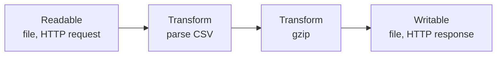
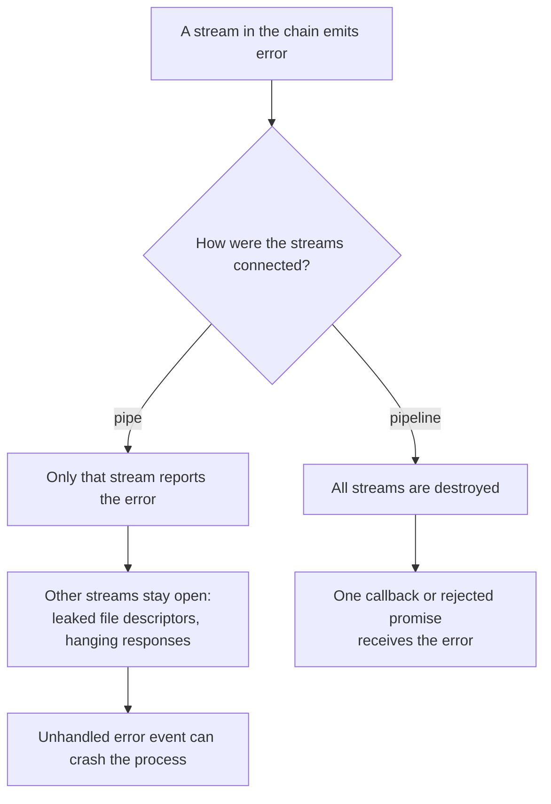
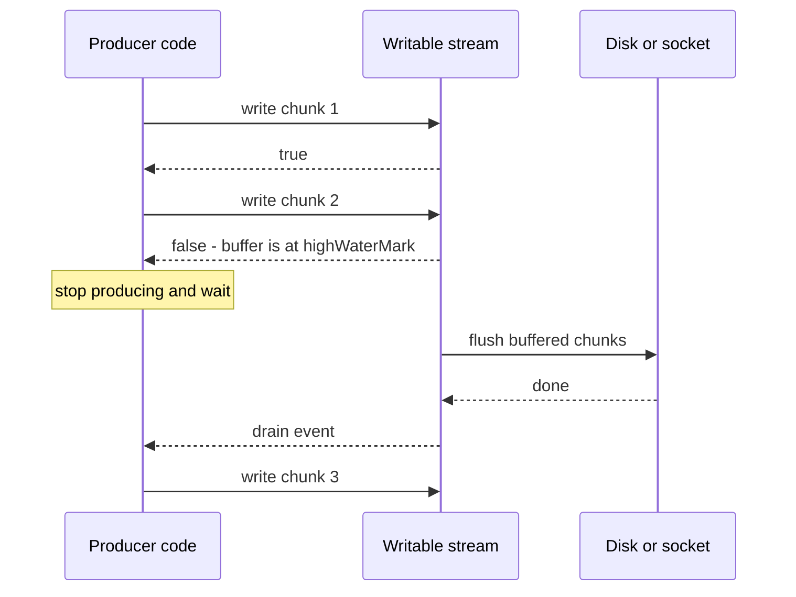

# Streams

> In this document you will learn how Node.js streams move data in small pieces instead of loading everything into memory: the four stream types, flowing and paused mode, the important events, `pipe` vs `pipeline`, backpressure, object mode, writing your own transforms, async iteration, and streaming in HTTP (downloads, uploads, compression, proxying). Streams are how Node.js handles big files and many connections with little memory, and interviewers use them to test whether you understand memory, error handling and backpressure.

**Before this:** [Core modules: fs, path, events, Buffer](04-core-modules-fs-path-events-buffer.md) · [The Node.js event loop](02-node-event-loop.md) · [Iterators and generators](../02-javascript/13-iterators-and-generators.md) · **Interview questions:** [jump to the interview section](#interview-questions)

## Table of contents

1. [Why streams exist](#why-streams-exist)
2. [The four stream types](#the-four-stream-types)
3. [Readable streams](#readable-streams)
4. [Writable streams](#writable-streams)
5. [Stream events](#stream-events)
6. [pipe vs pipeline](#pipe-vs-pipeline)
7. [Backpressure](#backpressure)
8. [Object mode](#object-mode)
9. [Writing your own streams](#writing-your-own-streams)
10. [Async iteration and generators](#async-iteration-and-generators)
11. [Streams in HTTP](#streams-in-http)
12. [Compression with zlib streams](#compression-with-zlib-streams)
13. [Web Streams in Node.js](#web-streams-in-nodejs)
14. [Real-world examples](#real-world-examples)
15. [Common mistakes](#common-mistakes)
16. [Best practices](#best-practices)
17. [How to explain this in an interview](#how-to-explain-this-in-an-interview)
18. [Interview questions](#interview-questions)
19. [Summary](#summary)
20. [References](#references)

---

## Why streams exist

### What a stream is

A **stream** is a flow of data that arrives (or leaves) **piece by piece**, over time. Each piece is called a **chunk**. Instead of waiting for all the data, you process each chunk as soon as it arrives, and then forget it.

### The problem streams solve

Imagine a user downloads a 2 GB log file from your server.

```js
// ❌ Without streams: the whole file goes into memory
app.get('/logs/today', async (req, res) => {
  const data = await fs.promises.readFile('/var/log/app.log'); // 2 GB Buffer in RAM
  res.end(data);
});
```

Problems:

1. **Memory.** Each download needs 2 GB of RAM. Ten users at once need 20 GB. The process crashes.
2. **Time to first byte.** The user receives nothing until the whole file has been read from disk.
3. **Hard limits.** Buffers and strings have maximum sizes. Very large files cannot be read in one piece at all.

```js
// ✅ With streams: about 64 KB in memory at a time, per download
const { pipeline } = require('node:stream/promises');

app.get('/logs/today', async (req, res) => {
  res.setHeader('Content-Type', 'text/plain');
  await pipeline(fs.createReadStream('/var/log/app.log'), res);
});
```

Now the server reads one chunk, sends it, reads the next chunk, and so on. Memory stays small and constant, and the first bytes reach the user almost immediately.

### Analogy

Moving water from a lake to a city:

- **Without streams:** fill a giant tank with the whole lake, drive the tank to the city, empty it. You need a lake-sized tank.
- **With streams:** connect a pipe. Water flows continuously. The pipe holds only a little water at any moment.

And **backpressure** is the valve: if the city cannot use water fast enough, the valve slows the flow from the lake, so the pipe does not burst.

Where the analogy breaks: a Node.js stream does not flow by itself at a fixed speed. It moves only as fast as the consumer asks for data.

### Streams are everywhere in Node.js

| Thing | Stream type |
| --- | --- |
| `fs.createReadStream()` / `fs.createWriteStream()` | Readable / Writable |
| HTTP request on the server (`req`) | Readable |
| HTTP response on the server (`res`) | Writable |
| TCP socket (`net.Socket`) | Duplex |
| `process.stdin` / `process.stdout` | Readable / Writable |
| `zlib.createGzip()`, `crypto.createHash()` | Transform |
| Child process `stdout` / `stdin` | Readable / Writable |

Streams are **EventEmitters**, so they use events like `'data'`, `'end'` and `'error'` (see [EventEmitter](04-core-modules-fs-path-events-buffer.md#eventemitter)).

## The four stream types

| Type | What it does | Example |
| --- | --- | --- |
| **Readable** | A source you read data **from** | File read stream, HTTP request, `process.stdin` |
| **Writable** | A destination you write data **to** | File write stream, HTTP response, `process.stdout` |
| **Duplex** | Both readable and writable, and the two sides are **independent** | TCP socket: what you send and what you receive are different data |
| **Transform** | A Duplex where the output is **computed from the input** | gzip, encryption, CSV parser, uppercase converter |



A typical program is a **pipeline**: one Readable, zero or more Transforms, and one Writable.

## Readable streams

### Two ways to read: flowing and paused

A Readable stream is in one of two **modes**:

- **Paused mode** (the default): data waits in an internal buffer until you ask for it with `read()`.
- **Flowing mode**: data is pushed to you as fast as it arrives, through `'data'` events.

Internally, `readable.readableFlowing` has three states:

| Value | Meaning |
| --- | --- |
| `null` | No consumer yet. The stream does not produce data. |
| `true` | Flowing. `'data'` events are emitted. |
| `false` | Paused explicitly. Data may pile up in the buffer. |

```js
const { Readable } = require('node:stream');

const r = new Readable({ read() {} });
console.log(r.readableFlowing); // null
r.on('data', () => {});
console.log(r.readableFlowing); // true  (adding a 'data' listener starts flowing)
r.pause();
console.log(r.readableFlowing); // false
```

The stream switches to flowing mode when you:

- add a `'data'` listener,
- call `resume()`,
- call `pipe()`.

It goes back to paused with `pause()` or `unpipe()`.

**Important:** if a stream is flowing and nobody handles the `'data'` events, **the data is lost**. That is why you should use one consumption style per stream and not mix them.

### Reading with 'data' events

```js
const fs = require('node:fs');

const stream = fs.createReadStream('orders.csv', { encoding: 'utf8' });

let bytes = 0;
stream.on('data', (chunk) => {
  bytes += chunk.length;
});
stream.on('end', () => console.log('done, characters:', bytes));
stream.on('error', (err) => console.error('read failed:', err.code));
```

Without `encoding`, chunks are **Buffers**. With `encoding: 'utf8'`, the stream decodes chunks correctly, even when a multi-byte character is split between two chunks (see [Split characters across chunks](04-core-modules-fs-path-events-buffer.md#split-characters-across-chunks)).

### Reading with for await (the modern way)

Readable streams are **async iterables**. This is usually the clearest way to read:

```js
for await (const chunk of fs.createReadStream('orders.csv')) {
  console.log('got', chunk.length, 'bytes');
}
console.log('finished');
```

`for await` also handles backpressure (it reads the next chunk only after your loop body finishes) and throws stream errors into your `try/catch`. More in [Async iteration and generators](#async-iteration-and-generators).

### Creating a Readable from data

`Readable.from()` turns any iterable or async iterable into a stream:

```js
const { Readable } = require('node:stream');

const users = Readable.from([{ id: 1 }, { id: 2 }]); // object mode by default
const lines = Readable.from(['first line\n', 'second line\n']);

async function* fetchPages() {
  for (let page = 1; page <= 3; page++) {
    const res = await fetch(`https://api.example.com/orders?page=${page}`);
    yield* await res.json();
  }
}
const orders = Readable.from(fetchPages());
```

Note: `Readable.from('abc')` emits the whole string as **one** chunk. Strings and Buffers are not split into characters.

## Writable streams

```js
const fs = require('node:fs');

const out = fs.createWriteStream('report.txt');
out.write('Daily report\n');
out.write('Orders: 120\n');
out.end('Total: 4,560\n'); // write a last chunk and close

out.on('finish', () => console.log('all data flushed to the file'));
out.on('error', (err) => console.error('write failed:', err.code));
```

- `write(chunk)` adds data. It returns `true` or `false` — this is the backpressure signal (see [Backpressure](#backpressure)).
- `end(chunk?)` says "no more data". You must call it, or the file is never finished.
- `'finish'` fires when all data has been handed to the underlying system.
- Writing after `end()` causes an error (`ERR_STREAM_WRITE_AFTER_END`).

## Stream events

| Event | Stream | When it fires |
| --- | --- | --- |
| `'data'` | Readable | A chunk is available (flowing mode) |
| `'readable'` | Readable | Data can be read with `read()` (paused mode) |
| `'end'` | Readable | No more data will come |
| `'finish'` | Writable | `end()` was called and all data was flushed |
| `'drain'` | Writable | The buffer emptied after `write()` returned `false`; safe to write again |
| `'error'` | Both | Something failed. **Must be handled.** |
| `'close'` | Both | The stream and its resource (file descriptor, socket) are closed. No more events. |
| `'pipe'` / `'unpipe'` | Writable | A readable started or stopped piping into it |

Order for a simple copy (tested on Node.js 22):

```js
const { Readable, Writable } = require('node:stream');

const src = Readable.from(['a', 'b']);
const dst = new Writable({
  write(chunk, encoding, callback) {
    console.log('write', chunk.toString());
    callback();
  },
});

src.on('data', (c) => console.log('data', c));
src.on('end', () => console.log('readable end'));
src.on('close', () => console.log('readable close'));
dst.on('finish', () => console.log('writable finish'));
dst.on('close', () => console.log('writable close'));

src.pipe(dst);
```

```text
data a
write a
data b
write b
readable end
writable finish
writable close
readable close
```

Remember the difference: **`'end'` is for Readables, `'finish'` is for Writables.** `'close'` comes last for both. By default (`autoDestroy: true`, since Node.js 14), a stream destroys itself after `'end'`/`'finish'` or `'error'`, which releases its resource and emits `'close'`.

## pipe vs pipeline

### pipe

`readable.pipe(writable)` connects two streams and handles backpressure for you. It returns the destination, so you can chain:

```js
fs.createReadStream('orders.csv')
  .pipe(zlib.createGzip())
  .pipe(fs.createWriteStream('orders.csv.gz'));
```

It looks nice, but it has a serious problem: **errors are not forwarded and streams are not cleaned up.** The docs say that if the source emits an error, the destination is **not** closed automatically. You must listen for `'error'` on **every** stream and destroy the others yourself. If you forget, you leak file descriptors and memory, or crash with an unhandled `'error'` event.

### pipeline

`stream.pipeline()` does the same connection **plus** correct error handling:

- If **any** stream fails, `pipeline` **destroys all** the streams.
- You get **one** place to handle the error: a callback, or a rejected promise.
- It waits until the last stream is fully finished.

```js
const { pipeline } = require('node:stream/promises'); // promise version (Node.js 15+)
const fs = require('node:fs');
const zlib = require('node:zlib');

async function compressFile(input, output) {
  await pipeline(
    fs.createReadStream(input),
    zlib.createGzip(),
    fs.createWriteStream(output),
  );
  console.log('compressed', input);
}

compressFile('orders.csv', 'orders.csv.gz').catch((err) => {
  console.error('compression failed:', err.message);
});
```

### Proof: what happens on an error

```js
const { Readable, Writable, pipeline } = require('node:stream');

function make() {
  const src = new Readable({ read() { this.destroy(new Error('source failed')); } });
  const dst = new Writable({ write(c, e, cb) { cb(); } });
  return { src, dst };
}

// With pipe
const a = make();
a.src.on('error', (e) => console.log('pipe: source error:', e.message));
a.src.pipe(a.dst);
setTimeout(() => console.log('pipe: destination destroyed?', a.dst.destroyed), 20);

// With pipeline
const b = make();
pipeline(b.src, b.dst, (err) => {
  console.log('pipeline callback:', err.message);
  console.log('pipeline: destination destroyed?', b.dst.destroyed);
});
```

```text
pipe: source error: source failed
pipeline callback: source failed
pipeline: destination destroyed? true
pipe: destination destroyed? false
```

With `pipe`, the destination stays open: in a real app, that is an open file or a hanging HTTP response. With `pipeline`, everything is cleaned up.



**Rule: use `pipeline` (from `node:stream/promises`) in application code.** `pipe` is fine only for quick scripts where a crash does not matter.

`pipeline` also accepts an `AbortSignal` as an option to cancel the whole chain:

```js
await pipeline(source, transform, destination, { signal: AbortSignal.timeout(30_000) });
```

`stream.finished(stream)` (also in `node:stream/promises`) waits for a single stream to end, finish or fail.

## Backpressure

### What it is

**Backpressure** is the mechanism that slows down a fast producer when the consumer is slow. Without it, data piles up in memory.

Example: you read a file from a fast SSD (1 GB/s) and send it to a user on a slow mobile connection (1 MB/s). If you keep reading at full speed, the unsent data collects in memory — up to the whole file.

### How it works: highWaterMark, write() and drain

Every stream has an internal buffer with a limit called **`highWaterMark`**:

| Stream | Default `highWaterMark` |
| --- | --- |
| Byte streams in general | 64 KiB on Linux/macOS since Node.js 22 (16 KiB before Node.js 22, and still 16 KiB on Windows) |
| `fs.createReadStream()` | 64 KiB |
| Object-mode streams | 16 objects |

`highWaterMark` is a **threshold, not a hard limit**. The stream does not reject data above it. It only **signals** "please stop".

The signal for writers is the return value of `write()`:

- `write()` returns **`true`**: the buffer is below the limit. Keep writing.
- `write()` returns **`false`**: the buffer reached the limit. **Stop writing** and wait for the **`'drain'`** event.

```js
const { Writable } = require('node:stream');

const slowDisk = new Writable({
  highWaterMark: 16, // tiny limit, to see the effect
  write(chunk, encoding, callback) {
    setTimeout(callback, 10); // pretend each write takes 10 ms
  },
});

console.log(slowDisk.write('12345678')); // true  (8 bytes buffered)
console.log(slowDisk.write('12345678')); // false (16 bytes: limit reached)
slowDisk.once('drain', () => console.log('drain: buffer emptied, safe to write again'));
```



### Respecting backpressure when you write manually

```js
const { once } = require('node:events');

// ❌ Wrong: ignores the return value; memory grows without limit
for (let i = 0; i < 10_000_000; i++) {
  out.write(`line ${i}\n`);
}

// ✅ Correct: pause when write() returns false
async function writeLines(out, count) {
  for (let i = 0; i < count; i++) {
    if (!out.write(`line ${i}\n`)) {
      await once(out, 'drain'); // wait until the buffer empties
    }
  }
  out.end();
  await once(out, 'finish');
}
```

### Backpressure on the reading side

For Readables, the producer is your `_read()` implementation (or the file system). When the consumer is slow, the readable's buffer fills up, and the stream stops calling `_read()` until there is room again. Your custom readable signals this with the return value of `push()`: `false` means "stop pushing for now".

### Who handles it for you

- `pipe()` and `pipeline()` handle backpressure automatically: they pause the source when `write()` returns `false` and resume it on `'drain'`.
- `for await` handles it on the reading side: the next chunk is read only after your loop body finishes.
- **You** handle it when you call `write()` yourself, or when you push data from an event source (for example, `data` events from a socket into a file).

The docs warn that ignoring `false` from `write()` can exhaust memory, and that a socket which never drains can even become a remotely exploitable problem (a client that reads very slowly on purpose).

## Object mode

By default, streams carry **bytes** (Buffers or strings). In **object mode**, each chunk can be **any JavaScript value** (except `null`, which means "end"). `highWaterMark` then counts **objects**, not bytes (default 16).

```js
const { Readable, Transform, Writable } = require('node:stream');
const { pipeline } = require('node:stream/promises');

const onlyPaid = new Transform({
  objectMode: true,
  transform(order, encoding, callback) {
    if (order.status === 'paid') callback(null, { id: order.id, total: order.total });
    else callback(); // drop this order: call back with no data
  },
});

const results = [];
await pipeline(
  Readable.from([
    { id: 1, status: 'paid', total: 10 },
    { id: 2, status: 'open', total: 5 },
    { id: 3, status: 'paid', total: 7 },
  ]),
  onlyPaid,
  new Writable({
    objectMode: true,
    write(order, encoding, callback) {
      results.push(order);
      callback();
    },
  }),
);
console.log(results); // [ { id: 1, total: 10 }, { id: 3, total: 7 } ]
```

Real uses: database cursors that stream rows, parsed CSV records, log entries, messages from a queue. A Transform can be bytes on one side and objects on the other with `readableObjectMode` / `writableObjectMode` (the CSV example below uses this).

## Writing your own streams

### A simple Transform: uppercase

```js
const { Transform, Readable } = require('node:stream');
const { pipeline } = require('node:stream/promises');

const upper = new Transform({
  transform(chunk, encoding, callback) {
    callback(null, chunk.toString().toUpperCase()); // (error, output)
  },
});

await pipeline(Readable.from(['hello', ' world\n']), upper, process.stdout);
// HELLO WORLD
```

The `transform` function gets each chunk and must call `callback` exactly once:

- `callback(null, data)` — push `data` and get the next chunk.
- `callback()` — push nothing for this chunk (filtering).
- `callback(err)` — fail the stream; `pipeline` will destroy everything.
- `this.push(data)` — push several outputs for one input, then call `callback()`.

This example uses plain ASCII. For arbitrary text, calling `toString()` on each chunk can break a multi-byte character at a chunk border. Use `setEncoding('utf8')` on the source, or a `StringDecoder` inside the transform.

### A realistic Transform: CSV lines to objects

The main difficulty: chunks are cut at **random byte positions**, not at line endings. A line can start in one chunk and end in the next. So you keep the **unfinished last line** and join it with the next chunk. `_flush()` handles the final line when the input ends.

```js
const { Transform } = require('node:stream');
const { StringDecoder } = require('node:string_decoder');

// Bytes in -> one string per line out
class LineSplitter extends Transform {
  constructor() {
    super({ readableObjectMode: true });
    this.decoder = new StringDecoder('utf8'); // safe for multi-byte characters
    this.leftover = '';
  }

  _transform(chunk, encoding, callback) {
    const lines = (this.leftover + this.decoder.write(chunk)).split('\n');
    this.leftover = lines.pop(); // the last piece may be an unfinished line
    for (const line of lines) {
      if (line) this.push(line);
    }
    callback();
  }

  _flush(callback) {
    const rest = this.leftover + this.decoder.end();
    if (rest) this.push(rest);
    callback();
  }
}

// Line strings in -> row objects out
class CsvToObjects extends Transform {
  constructor() {
    super({ objectMode: true });
    this.headers = null;
  }

  _transform(line, encoding, callback) {
    const values = line.split(',');
    if (!this.headers) {
      this.headers = values; // first line = column names
      return callback();
    }
    callback(null, Object.fromEntries(this.headers.map((h, i) => [h, values[i]])));
  }
}
```

Use them to sum paid orders from a large file:

```js
const fs = require('node:fs');
const { pipeline } = require('node:stream/promises');

let rows = 0, paid = 0, total = 0;

await pipeline(
  fs.createReadStream('orders.csv'),   // id,customer,amount,status
  new LineSplitter(),
  new CsvToObjects(),
  async function (source) {             // the final stage can be an async function
    for await (const row of source) {
      rows++;
      if (row.status === 'paid') {
        paid++;
        total += Number(row.amount);
      }
    }
  },
);

console.log({ rows, paid, total: total.toFixed(2) });
// For my 100,000-row test file: { rows: 100000, paid: 66667, total: '16699167.33' }
```

I checked the numbers against a simple non-streaming version (`readFile` + `split`): same row and paid counts. The streaming version keeps memory flat no matter how big the file is.

This splitter is simplified: real CSV can contain commas and newlines inside quoted fields. In production, use a tested parser such as `csv-parse`, which is itself a Transform stream.

### Custom Readable and Writable

```js
const { Readable, Writable } = require('node:stream');

// A Readable that produces numbers 1..5
class Counter extends Readable {
  constructor() {
    super({ objectMode: true });
    this.current = 1;
  }
  _read() {
    if (this.current > 5) this.push(null);   // null = end of stream
    else this.push(this.current++);          // push returns false when the buffer is full
  }
}

// A Writable that saves batches to a database
class BatchInsert extends Writable {
  constructor(repository, batchSize = 500) {
    super({ objectMode: true });
    this.repository = repository;
    this.batchSize = batchSize;
    this.batch = [];
  }
  async _write(row, encoding, callback) {
    this.batch.push(row);
    if (this.batch.length < this.batchSize) return callback();
    try {
      await this.repository.insertMany(this.batch);
      this.batch = [];
      callback();
    } catch (err) {
      callback(err);
    }
  }
  async _final(callback) {      // runs before 'finish': save the last partial batch
    try {
      if (this.batch.length) await this.repository.insertMany(this.batch);
      callback();
    } catch (err) {
      callback(err);
    }
  }
}
```

Because `_write` calls `callback` only after the insert finishes, the writable applies backpressure to the whole pipeline: the file is read only as fast as the database can store rows.

| Class | Method you implement |
| --- | --- |
| Readable | `_read()` and call `this.push(data)` / `this.push(null)` |
| Writable | `_write(chunk, encoding, callback)`, optionally `_final(callback)` |
| Transform | `_transform(chunk, encoding, callback)`, optionally `_flush(callback)` |
| Duplex | `_read()` and `_write()` |

## Async iteration and generators

### Reading with for await

```js
async function countErrors(file) {
  let count = 0;
  try {
    for await (const chunk of fs.createReadStream(file, { encoding: 'utf8' })) {
      count += chunk.split('ERROR').length - 1;
    }
  } catch (err) {
    console.error('read failed', err.code); // stream errors land here
  }
  return count;
}
```

If you leave the loop early with `break`, `return` or a thrown error, **the stream is destroyed** (its file is closed):

```js
const r = Readable.from(['1', '2', '3']);
for await (const chunk of r) {
  console.log('first', chunk); // first 1
  break;
}
console.log(r.destroyed); // true
```

For text files processed line by line, use `readline` (see [Large files: use streams](04-core-modules-fs-path-events-buffer.md#large-files-use-streams)).

### Generators inside pipeline

`pipeline` accepts **async generator functions** as transforms, and an async function as the last stage. This is often simpler than writing a Transform class:

```js
const { pipeline } = require('node:stream/promises');
const { Readable } = require('node:stream');

const out = [];
await pipeline(
  Readable.from(['a', 'b', 'c']),
  async function* (source) {
    for await (const chunk of source) {
      yield chunk.toUpperCase();
    }
  },
  async function (source) {
    for await (const chunk of source) out.push(chunk);
  },
);
console.log(out); // [ 'A', 'B', 'C' ]
```

Readable streams also have array-like helpers: `map`, `filter`, `take`, `toArray`, `reduce` and more. The docs still mark these as **experimental**, so prefer generators in production code.

```js
await Readable.from(['1', '2', '3']).map((x) => Number(x) * 2).toArray(); // [ 2, 4, 6 ]
```

## Streams in HTTP

In a Node.js HTTP server:

- **`req`** (`http.IncomingMessage`) is a **Readable**: the request body arrives in chunks.
- **`res`** (`http.ServerResponse`) is a **Writable**: you write the response body in chunks.

Express uses the same objects, so all of this works there too.

### Streaming a large file download

```js
const http = require('node:http');
const fs = require('node:fs');
const { pipeline } = require('node:stream/promises');

http.createServer(async (req, res) => {
  if (req.url !== '/exports/orders.csv') {
    res.writeHead(404).end();
    return;
  }
  const file = '/data/exports/orders.csv';
  try {
    const { size } = await fs.promises.stat(file);
    res.writeHead(200, {
      'Content-Type': 'text/csv',
      'Content-Length': size,
      'Content-Disposition': 'attachment; filename="orders.csv"',
    });
    await pipeline(fs.createReadStream(file), res);
  } catch (err) {
    if (!res.headersSent) res.writeHead(500).end('Export failed');
    else res.destroy(err); // headers already sent: we can only abort the connection
    // If the client disconnects early, pipeline rejects and closes the file stream.
  }
}).listen(3000);
```

Why this is good:

- Memory per download is about one chunk, not the file size.
- If the user cancels the download, `pipeline` sees the response close early, rejects, and **closes the file**. With `pipe`, the file stream could stay open.
- Backpressure: a slow client makes the server read the file more slowly.

In Express, `res.download()` and `res.sendFile()` stream files for you, and support range requests.

### Handling uploads

```js
const { randomUUID } = require('node:crypto');
const { Transform } = require('node:stream');

const MAX_UPLOAD = 10 * 1024 * 1024; // 10 MB

function limitSize(max) {
  let seen = 0;
  return new Transform({
    transform(chunk, encoding, callback) {
      seen += chunk.length;
      if (seen > max) {
        return callback(Object.assign(new Error('Payload too large'), { status: 413 }));
      }
      callback(null, chunk);
    },
  });
}

async function handleUpload(req, res) {
  const target = `/data/uploads/${randomUUID()}.bin`; // never use the client's file name as a path
  try {
    await pipeline(req, limitSize(MAX_UPLOAD), fs.createWriteStream(target));
    res.writeHead(201, { 'Content-Type': 'application/json' });
    res.end(JSON.stringify({ file: target }));
  } catch (err) {
    await fs.promises.unlink(target).catch(() => {}); // remove the partial file
    res.writeHead(err.status ?? 500, { Connection: 'close' });
    res.end(err.message);
  }
}
```

Key points:

- The body goes straight from the socket to the disk (or to S3 with a streaming upload), never fully into memory.
- **Always limit the size while streaming.** `Content-Length` can be missing or false, so count the real bytes.
- Delete the partial file on failure.
- When the server rejects early, the client is often still sending. In my test, a client sending 3 MB to a 1 MB limit saw a **connection reset** rather than the 413 response, because the server closed the connection while the client was still uploading. That is normal HTTP behavior; clients should check sizes before uploading too.
- For `multipart/form-data` (browser file inputs), use a streaming parser such as `busboy` (used by `multer`). Do not buffer whole files in memory.

### Proxying

A proxy or BFF can stream a response from another service straight to the client:

```js
const { Readable } = require('node:stream');

app.get('/reports/:id/pdf', async (req, res, next) => {
  try {
    const upstream = await fetch(`http://report-service/reports/${req.params.id}.pdf`, {
      signal: AbortSignal.timeout(30_000),
    });
    if (!upstream.ok) return res.status(upstream.status).end();
    res.setHeader('Content-Type', 'application/pdf');
    await pipeline(Readable.fromWeb(upstream.body), res); // Web stream -> Node stream
  } catch (err) {
    next(err);
  }
});
```

`fetch` returns a **Web** `ReadableStream`, so `Readable.fromWeb()` converts it to a Node.js stream (see [Web Streams in Node.js](#web-streams-in-nodejs)).

### Streaming responses as they are generated

You do not need a file to stream. You can write a big JSON or CSV response row by row from a database cursor:

```js
app.get('/orders/export.ndjson', async (req, res) => {
  res.setHeader('Content-Type', 'application/x-ndjson');
  await pipeline(
    orderRepository.streamAll(), // object-mode Readable from a DB cursor
    async function* (orders) {
      for await (const order of orders) yield JSON.stringify(order) + '\n';
    },
    res,
  );
});
```

**NDJSON** (newline-delimited JSON, one object per line) is easy to stream and easy to parse line by line. Server-Sent Events also write to `res` as a stream (see [API styles and real-time communication](../09-system-design/04-api-styles-and-real-time-communication.md)).

## Compression with zlib streams

The `zlib` module provides Transform streams for gzip, deflate and Brotli:

```js
const zlib = require('node:zlib');

// Compress a file
await pipeline(fs.createReadStream('orders.csv'), zlib.createGzip(), fs.createWriteStream('orders.csv.gz'));

// Decompress
await pipeline(fs.createReadStream('orders.csv.gz'), zlib.createGunzip(), fs.createWriteStream('orders.copy.csv'));
```

In my test, a 3.29 MB CSV compressed to 0.56 MB, and decompressing gave back exactly 3,289,148 bytes.

Compressing an HTTP response on the fly:

```js
res.writeHead(200, { 'Content-Type': 'text/csv', 'Content-Encoding': 'gzip' });
await pipeline(fs.createReadStream('orders.csv'), zlib.createGzip(), res);
```

Notes:

- Check the client's `Accept-Encoding` header before sending gzip. In Express, the `compression` middleware does this for you. Often a reverse proxy or CDN (Nginx, a load balancer) compresses instead.
- Compression is CPU work. The async zlib streams use the libuv thread pool, so they do not block the event loop, but they still use CPU.
- `zlib.gzipSync()` blocks the event loop. Do not use it in request handlers.
- Do not compress already-compressed data (images, video, zip files).

Other useful Transform streams: `crypto.createCipheriv()` / `createDecipheriv()` (encryption) and `crypto.createHash()` (hash a file without loading it):

```js
const crypto = require('node:crypto');

async function sha256OfFile(path) {
  const hash = crypto.createHash('sha256');
  await pipeline(fs.createReadStream(path), hash);
  return hash.digest('hex');
}
```

## Web Streams in Node.js

Browsers use a different, standard stream API: **Web Streams** (`ReadableStream`, `WritableStream`, `TransformStream`). Node.js supports them too: they are global, used by `fetch`, `Response` and `Blob`, and the docs mark them stable since Node.js 22.15 (and 23.11).

| | Node.js streams | Web Streams |
| --- | --- | --- |
| Where | Node.js core (`fs`, `http`, `net`, `zlib`) | Browsers, Deno, Bun, Node.js, Cloudflare Workers |
| Style | EventEmitter + methods | Promise-based readers and writers |
| Connect | `pipeline()` | `readable.pipeThrough(transform).pipeTo(writable)` |
| Backpressure | `write()` returns `false`, `'drain'` | Built into the reader/writer promises |

Convert between them:

```js
const { Readable, Writable } = require('node:stream');

// Web -> Node
const response = await fetch('https://example.com/data.csv');
const nodeReadable = Readable.fromWeb(response.body);

// Node -> Web
const webReadable = Readable.toWeb(fs.createReadStream('orders.csv'));
```

A Web `TransformStream`:

```js
const upper = new TransformStream({
  transform(chunk, controller) {
    controller.enqueue(chunk.toUpperCase());
  },
});

const source = new ReadableStream({
  start(controller) {
    controller.enqueue('x');
    controller.enqueue('y');
    controller.close();
  },
});

for await (const value of source.pipeThrough(upper)) console.log(value); // X, Y
```

When to use which: use Node.js streams with Node.js core modules (most backend code). Use Web Streams for code that must also run in browsers or edge runtimes, and when working with `fetch` bodies.

## Real-world examples

| Task | Stream solution |
| --- | --- |
| Import a 5 GB CSV into a database | `createReadStream` → CSV parser → batch-insert Writable. Memory stays flat, and the database speed controls the read speed. |
| Process large log files | `readline` over `createReadStream`, count or filter lines |
| Export a large report | DB cursor → transform to CSV/NDJSON → `res` (optionally gzip) |
| File uploads | `req` → size limit → file or S3 upload stream |
| Download from S3 and send to the user | S3 object body → `res` |
| Proxy or BFF | `fetch` body → `Readable.fromWeb` → `res` |
| Hash or encrypt large files | `createReadStream` → `crypto.createHash` / `createCipheriv` |
| Video/audio | Range requests with `createReadStream(file, { start, end })` |
| Child processes | `spawn('ffmpeg', ...)` stdout piped to a file or response |
| Electron | Stream large files between disk and the renderer without freezing the main process |

## Common mistakes

1. **Reading whole files into memory** (`readFile`) for big or unbounded data.
2. **Using `pipe()` without error handling.** Leaked file descriptors, hanging responses, crashes from unhandled `'error'`. Use `pipeline`.
3. **No `'error'` listener on a stream** that is used with events directly.
4. **Ignoring the return value of `write()`.** Memory grows without limit.
5. **Calling `chunk.toString()` per chunk** for text, breaking multi-byte characters.
6. **Assuming chunks are lines.** Chunks are cut at random byte positions; split lines yourself and keep the leftover.
7. **Forgetting `_flush()`** in a line-splitting transform: the last line is lost.
8. **Calling the transform `callback` twice, or never.** Twice is an error; never stalls the stream.
9. **Mixing `'data'` events, `pipe` and `for await`** on the same stream. Data gets lost or consumed twice.
10. **Collecting all chunks in a transform** (`this.all.push(chunk)`) and pushing at the end. This removes the memory benefit.
11. **Not limiting upload size while streaming**, trusting `Content-Length`.
12. **Forgetting `end()`** on a Writable. The file or response never finishes.
13. **Using the client's file name as a path** for uploads (path traversal).
14. **Treating `highWaterMark` as a hard limit.** It is a threshold for the backpressure signal.

## Best practices

- **Use `pipeline` from `node:stream/promises` for every chain.** *Reason:* one error handler and automatic cleanup of all streams.
- **Use `for await` or async generator stages for custom logic.** *Reason:* clear code with built-in backpressure and error propagation.
- **Respect `write()` returning `false`** whenever you write manually. *Reason:* keeps memory bounded.
- **Stream anything big or unbounded:** files, exports, uploads, proxied responses. *Reason:* constant memory and faster first byte.
- **Set `encoding` or use `StringDecoder`** for text. *Reason:* correct multi-byte characters across chunks.
- **Limit sizes while streaming** (count bytes in a Transform). *Reason:* protects memory and disk from huge or malicious inputs.
- **Use tested parsers** (`csv-parse`, `busboy`, streaming JSON parsers) for real formats. *Reason:* edge cases like quoted fields and multipart boundaries are hard.
- **Use object mode for records**, and batch writes to databases. *Reason:* simpler code and fewer round trips.
- **Clean up partial output on failure** (delete partial files, abort multipart uploads). *Reason:* no corrupt leftovers.
- **Pass an `AbortSignal` to long pipelines.** *Reason:* you can cancel on timeout or client disconnect.
- **Prefer Node.js streams for Node.js I/O and Web Streams for cross-runtime code**, converting with `fromWeb`/`toWeb`. *Reason:* each fits its ecosystem.

## How to explain this in an interview

1. **Define it:** "A stream is a way to process data piece by piece, in chunks, instead of loading everything into memory. Node has four types: Readable, Writable, Duplex and Transform."
2. **Why it exists:** "Servers deal with large or never-ending data — files, uploads, HTTP bodies, sockets. Loading all of it uses huge memory and delays the first byte. Streams keep memory constant and start sending immediately."
3. **How it works:** "Each stream has an internal buffer with a `highWaterMark`. A writable's `write()` returns `false` when its buffer is full, and emits `drain` when it's ready again — that's backpressure, so a slow consumer slows down the producer. I connect streams with `stream.pipeline`, which handles backpressure, forwards errors to one place, and destroys all streams if one fails."
4. **Small example:** "For a CSV export download, I pipe a file read stream through gzip into the HTTP response with `pipeline`. Each request uses only a few chunks of memory, and if the user cancels, the file is closed."
5. **Where it is useful:** "File downloads and uploads, big CSV imports into a database, log processing, compression, hashing, proxying responses from other services, and spawning tools like ffmpeg."
6. **Trade-offs / gotchas:** "Stream code is harder to write and debug than `readFile`. I must handle errors — `pipe` doesn't forward them — respect backpressure when I call `write` myself, and remember that chunks are random byte slices, so lines and multi-byte characters can be split."

## Interview questions

### Q1. What are streams in Node.js, and why use them?

**What the interviewer is checking:** The core motivation: memory and time to first byte.

**Short spoken answer (30–60 seconds):**
> Streams let you work with data in chunks as it arrives, instead of loading it all into memory first. If a user downloads a 2 GB file and I use `readFile`, I need 2 GB of RAM per download and the user waits until the whole file is read. With a read stream piped into the response, memory stays around one chunk — 64 KB by default for file streams — and the first bytes go out immediately. Node has four types: Readable, Writable, Duplex like a TCP socket, and Transform like gzip. Many core objects are streams: HTTP request and response, sockets, `process.stdin` and `stdout`. The trade-off is that stream code needs careful error handling and backpressure.

**Follow-up questions:**
- **Do streams make things faster?** — They reduce memory and time to first byte, and let stages run concurrently (read, compress and send at the same time). Total throughput for a small file is not necessarily better.
- **When is `readFile` fine?** — Small files with a known maximum size, like a config file.

**Common mistakes:** Saying "streams are asynchronous, so they are faster", without mentioning memory and backpressure.

**Where this is used in real projects:** Exports, uploads, log processing, proxies, media.

### Q2. What are the four types of streams? Give an example of each.

**Short spoken answer (30–60 seconds):**
> Readable is a source: `fs.createReadStream`, an HTTP request on the server, `process.stdin`. Writable is a destination: `fs.createWriteStream`, an HTTP response, `process.stdout`. Duplex is both readable and writable with two independent sides, like a TCP socket — what I send and what I receive are different data. Transform is a duplex where the output is computed from the input, like `zlib.createGzip`, `crypto.createHash`, or a CSV parser.

**Follow-up questions:**
- **What is the difference between Duplex and Transform?** — In a Transform, data written in comes out transformed on the readable side. In a Duplex, the two sides are unrelated streams that just share one object.

### Q3. What is backpressure, and how does Node.js handle it?

**What the interviewer is checking:** The most important stream concept.

**Short spoken answer (30–60 seconds):**
> Backpressure is how a slow consumer slows down a fast producer, so data doesn't pile up in memory. Every stream has a buffer limit called `highWaterMark`. When I call `write()` on a writable and the buffer reaches that limit, `write()` returns `false`. That means stop; when the buffer empties, the stream emits `drain`, and I can continue. On the readable side, when the consumer doesn't read, the buffer fills and the stream stops calling `_read`. `pipe` and `pipeline` do all of this automatically, and so does `for await`. I only handle it myself when I call `write()` manually — then I check the return value and `await once(stream, 'drain')`.

**Code or diagram:** see the [backpressure sequence diagram](#backpressure).

**Follow-up questions:**
- **What happens if you ignore it?** — `write()` still accepts the data, so the internal buffer grows without limit. With a fast source and a slow client, memory can grow to the size of the whole data set and crash the process.
- **Is `highWaterMark` a hard limit?** — No. It is a threshold for the signal. Writes above it are still buffered.
- **What is the default `highWaterMark`?** — 16 objects in object mode. For byte streams, 64 KiB on Linux/macOS since Node.js 22 (16 KiB before, and still 16 KiB on Windows). File read streams use 64 KiB.

**Common mistakes:** Not knowing that `write()` returns a boolean.

**Where this is used in real projects:** Writing big exports, copying from a fast database to a slow network client, batch inserts.

### Q4. What is the difference between `pipe()` and `stream.pipeline()`?

**What the interviewer is checking:** Production-safe error handling.

**Short spoken answer (30–60 seconds):**
> Both connect streams and handle backpressure. The difference is errors and cleanup. With `pipe`, errors are not forwarded: if the source fails, the destination isn't closed, so I'd need an error listener on every stream and manual cleanup, otherwise I leak file descriptors or crash on an unhandled `'error'` event. `pipeline` destroys all streams in the chain if any of them fails, and reports the error once — to a callback, or as a rejected promise from `node:stream/promises`. It also accepts async generators as stages and an `AbortSignal`. In application code I always use `pipeline`.

**Code:** see [Proof: what happens on an error](#proof-what-happens-on-an-error). In my test, after a source error, the destination was still open with `pipe` (`destroyed: false`) and destroyed with `pipeline` (`destroyed: true`).

**Follow-up questions:**
- **What happens with `pipeline` when an HTTP client disconnects during a download?** — The response stream closes early, `pipeline` rejects with a premature-close error, and the file read stream is destroyed, so the file descriptor is released.

### Q5. What is the difference between flowing and paused mode?

**Short spoken answer (30–60 seconds):**
> A readable starts in paused mode — technically `readableFlowing` is `null` until there's a consumer. In paused mode, data waits in the buffer until someone calls `read()`. In flowing mode, data is pushed out through `'data'` events as fast as it arrives. Adding a `'data'` listener, calling `resume()`, or `pipe()` switches to flowing; `pause()` or `unpipe()` stops it. The danger is that in flowing mode, if nobody handles `'data'`, the data is lost. In modern code I rarely manage modes myself: I use `pipeline` or `for await`, which handle it.

### Q6. What does this print?

```js
const { Readable } = require('node:stream');

(async () => {
  const r = Readable.from(['1', '2', '3']);
  for await (const chunk of r) {
    console.log('first', chunk);
    break;
  }
  console.log('destroyed', r.destroyed);
})();
```

**Answer:**

```text
first 1
destroyed true
```

**Why:** Leaving a `for await` loop early (`break`, `return`, or an exception) calls the iterator's `return()`, which **destroys** the stream. For a file stream, that closes the file. If you need to keep the stream open, use `r.iterator({ destroyOnReturn: false })`.

### Q7. What does this print, and in what order do the events fire?

```js
const { Readable, Writable } = require('node:stream');
const src = Readable.from(['a', 'b']);
const dst = new Writable({ write(chunk, enc, cb) { console.log('write', chunk.toString()); cb(); } });
src.on('end', () => console.log('readable end'));
dst.on('finish', () => console.log('writable finish'));
src.pipe(dst);
```

**Answer:**

```text
write a
write b
readable end
writable finish
```

**Why:** Each chunk is written as it flows. When the source has no more data, it emits `'end'`; `pipe` then calls `dst.end()`, and when everything is flushed the writable emits `'finish'`. `'end'` belongs to Readables and `'finish'` to Writables; `'close'` (not shown) fires last on both.

### Q8. Write a Transform stream that converts text to uppercase.

**Answer:**

```js
const { Transform } = require('node:stream');
const { StringDecoder } = require('node:string_decoder');

function upperCase() {
  const decoder = new StringDecoder('utf8');
  return new Transform({
    transform(chunk, encoding, callback) {
      callback(null, decoder.write(chunk).toUpperCase());
    },
    flush(callback) {
      callback(null, decoder.end().toUpperCase());
    },
  });
}

// Usage:
// await pipeline(fs.createReadStream('in.txt'), upperCase(), fs.createWriteStream('out.txt'));
```

Points to say while writing it: call `callback` exactly once per chunk; pass errors as `callback(err)`; use a `StringDecoder` so characters split between chunks are not broken; implement `flush` for any remaining data at the end.

### Q9. How would you import a 5 GB CSV file into a database in Node.js?

**What the interviewer is checking:** Putting streams, backpressure and batching together.

**Short spoken answer (30–60 seconds):**
> I'd never load it into memory. I'd build a pipeline: `fs.createReadStream` for the file, a real CSV parser like `csv-parse` as a Transform that outputs row objects, a validation and mapping step as an async generator, and a custom Writable in object mode that collects rows into batches of, say, 500 and inserts each batch with one query. The writable calls its callback only after the insert finishes, so backpressure makes the file reading wait for the database. I'd run it as a background job, not in a request handler, log progress, write invalid rows to an error file, and make the import restartable — for example, with upserts keyed by a business ID so a retry doesn't create duplicates.

**Follow-up questions:**
- **Why batch inserts?** — One insert per row means millions of round trips. Batches cut the overhead dramatically.
- **Why not `Promise.all` over all rows?** — It starts everything at once: unbounded memory and connection-pool exhaustion. Streams keep concurrency bounded.
- **How do you handle the last partial batch?** — In `_final()` of the Writable, which runs before `'finish'`.

### Q10. How do you stream a large file download in Express, and what happens if the client disconnects?

**Short spoken answer (30–60 seconds):**
> I set the headers — content type, content length from `stat`, and `Content-Disposition` for a download — then run `pipeline(fs.createReadStream(file), res)`. Memory stays at about one chunk per download, and a slow client slows the file reading through backpressure. If the client disconnects, the response closes early, `pipeline` rejects with a premature-close error and destroys the file stream, so the file descriptor is released. I catch that error and don't treat it as a server failure. If headers were already sent when another error happens, I can't send a 500 anymore, so I destroy the response. In Express, `res.download` and `res.sendFile` already stream and support range requests.

### Q11. How do you safely handle large file uploads?

**Short spoken answer (30–60 seconds):**
> I stream the request body directly to its destination — a file or object storage — instead of buffering it. I count bytes in a Transform and fail the pipeline once it exceeds the limit, because `Content-Length` can be missing or wrong. I save the file under a generated name like a UUID, never the client's file name, to avoid path traversal, and I delete the partial file if anything fails. For `multipart/form-data`, I use a streaming parser like busboy, through multer, with size and file-count limits. I also validate the content type by checking the file's actual bytes, and scan or process it in a background job if needed.

**Follow-up questions:**
- **Why does the client sometimes see a connection reset instead of 413?** — The server rejects and closes the connection while the client is still sending the body, so the client's write fails. Clients should check file size before uploading.

### Q12. What is object mode?

**Short answer:** In object mode, each chunk is a JavaScript value (an object, number, string) instead of bytes, and `highWaterMark` counts objects (default 16) instead of bytes. It is used for record streams: database rows, parsed CSV records, log entries. A Transform can be bytes on the writable side and objects on the readable side using `readableObjectMode: true`, like a line splitter. `Readable.from(iterable)` uses object mode by default.

### Q13. Why does text processed with `chunk.toString()` sometimes contain broken characters, and why do some lines get cut in half?

**What the interviewer is checking:** Understanding that chunks are arbitrary byte slices.

**Short spoken answer (30–60 seconds):**
> Chunks are cut at random byte positions. A UTF-8 character can be up to four bytes, so a chunk can end in the middle of one, and decoding each chunk separately produces replacement characters. Lines have the same problem: a chunk can end in the middle of a line. For characters, I set the stream encoding to utf8 or use a `StringDecoder`, which keeps incomplete bytes for the next chunk. For lines, I keep the last unfinished piece and prepend it to the next chunk, and flush it at the end — or simply use `readline` or a proper parser.

### Q14. A Node.js service that generates CSV exports gets killed with "JavaScript heap out of memory". How do you fix it?

**Short spoken answer (30–60 seconds):**
> The export probably builds the whole CSV in memory: loading all rows from the database into an array, then joining a giant string. I'd switch to streaming end to end: a database cursor or a paginated query as an object-mode readable, an async generator that turns each row into a CSV line, and `pipeline` into the response, maybe through gzip. Memory then depends on the chunk size, not the number of rows. If the export is very large or slow, I'd move it to a background job that streams into object storage and give the user a download link. Increasing `--max-old-space-size` only hides the problem.

### Q15. How do you hash a large file without loading it into memory?

**Answer:**

```js
const crypto = require('node:crypto');
const fs = require('node:fs');
const { pipeline } = require('node:stream/promises');

async function sha256OfFile(path) {
  const hash = crypto.createHash('sha256'); // a Transform stream
  await pipeline(fs.createReadStream(path), hash);
  return hash.digest('hex');
}
```

The hash object is updated chunk by chunk, so memory stays constant. Uses: checksums for uploads, deduplication, verifying downloads.

### Q16. What are Web Streams, and how do they relate to Node.js streams?

**Short spoken answer (30–60 seconds):**
> Web Streams are the standard streaming API from browsers: `ReadableStream`, `WritableStream` and `TransformStream`, with promise-based readers and `pipeThrough`/`pipeTo`. Node supports them as globals, and they're stable since 22.15. `fetch` in Node returns a Web `ReadableStream` as the body. Node's own I/O — files, HTTP, sockets, zlib — still uses Node streams. To connect them, I use `Readable.fromWeb` and `Readable.toWeb`, for example to pipe a `fetch` response body into an Express response. I use Web Streams for code that must run in browsers or edge runtimes too.

### Q17. What happens if you never call `end()` on a writable stream, or never call the callback in `_write`/`_transform`?

**Short answer:** If you never call `end()`, the writable never emits `'finish'`: the file is never completed (and may not be fully flushed), an HTTP response never completes and the client waits until a timeout, and `pipeline`/`finished` never resolve. If you never call the callback in `_write` or `_transform`, the stream stops: no more chunks are delivered, backpressure stops the source, and the whole pipeline hangs silently. Calling the callback twice is also a bug and throws an error. These "hangs" are hard to debug, so keep every code path calling the callback exactly once, including error paths.

### Q18. When would you not use streams?

**Short answer:** When the data is small and bounded (a config file, a typical JSON API body under a size limit), `readFile` or a buffered body parser is simpler and less error-prone. Also when you need the whole data at once anyway (for example, sorting all records, or a library that needs a complete Buffer) — then streaming only helps if you can change the algorithm (external sort, chunked processing). Streams add complexity; use them when size is large or unbounded, or when time to first byte matters.

## Summary

- A **stream** processes data in **chunks**. It keeps memory constant and sends the first bytes quickly.
- Four types: **Readable** (source), **Writable** (destination), **Duplex** (two independent sides, like a socket), **Transform** (output computed from input, like gzip).
- Readables are paused until consumed; `'data'`, `resume()` or `pipe()` start flowing mode. Prefer `for await` or `pipeline`.
- Key events: `'data'`, `'end'` (Readable), `'finish'` (Writable), `'drain'`, `'error'` (must be handled), `'close'` (last).
- **Use `pipeline` from `node:stream/promises`**: it handles backpressure, forwards errors to one place and destroys all streams on failure. `pipe` does not clean up on errors.
- **Backpressure:** `write()` returns `false` at `highWaterMark`; wait for `'drain'`. `highWaterMark` is a threshold, not a hard limit. Defaults: 16 objects; 64 KiB for byte streams on Linux/macOS since Node.js 22 (16 KiB on Windows); 64 KiB for file read streams.
- **Object mode** carries JavaScript values; good for rows and records.
- Custom streams: implement `_read`/`push`, `_write`/`_final`, `_transform`/`_flush`. Call each callback exactly once.
- Chunks are random byte slices: decode with `setEncoding`/`StringDecoder` and keep leftover partial lines.
- In HTTP, `req` is Readable and `res` is Writable. Stream downloads, uploads (with size limits and generated file names), exports and proxied responses.
- zlib and crypto provide Transform streams for compression, hashing and encryption.
- Web Streams are supported and stable; convert with `Readable.fromWeb()` / `Readable.toWeb()`.

## References

- Node.js Stream API (types, modes, events, `pipeline`, `finished`, `highWaterMark`, async iteration, `Readable.from`): https://nodejs.org/api/stream.html
- Node.js — Backpressuring in streams: https://nodejs.org/en/learn/modules/backpressuring-in-streams
- Node.js — How to use streams: https://nodejs.org/en/learn/modules/how-to-use-streams
- Node.js Web Streams API: https://nodejs.org/api/webstreams.html
- Node.js Zlib API: https://nodejs.org/api/zlib.html
- Node.js Readline API: https://nodejs.org/api/readline.html
- Node.js String decoder API: https://nodejs.org/api/string_decoder.html
- Node.js HTTP API (`IncomingMessage`, `ServerResponse`): https://nodejs.org/api/http.html
- WHATWG Streams Standard: https://streams.spec.whatwg.org/
