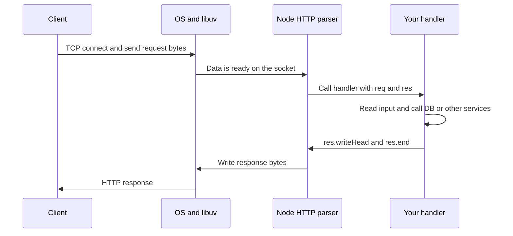
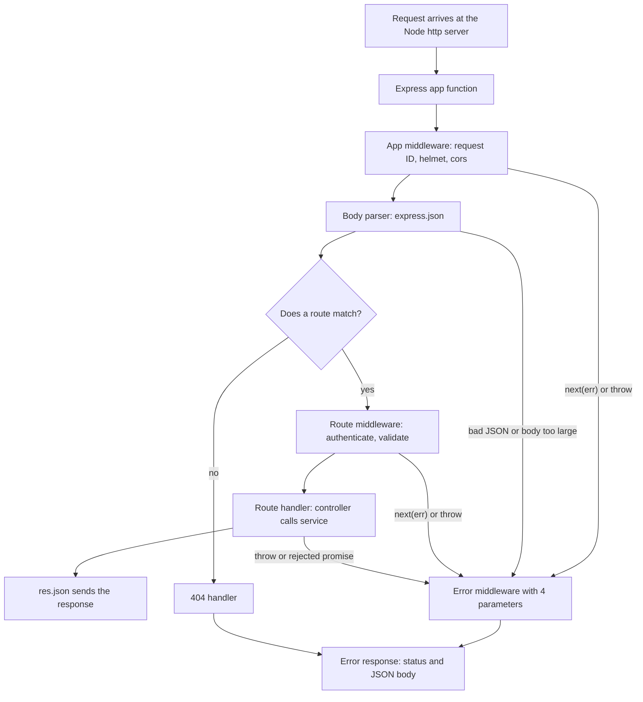
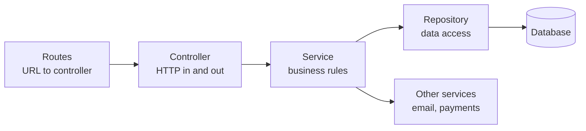
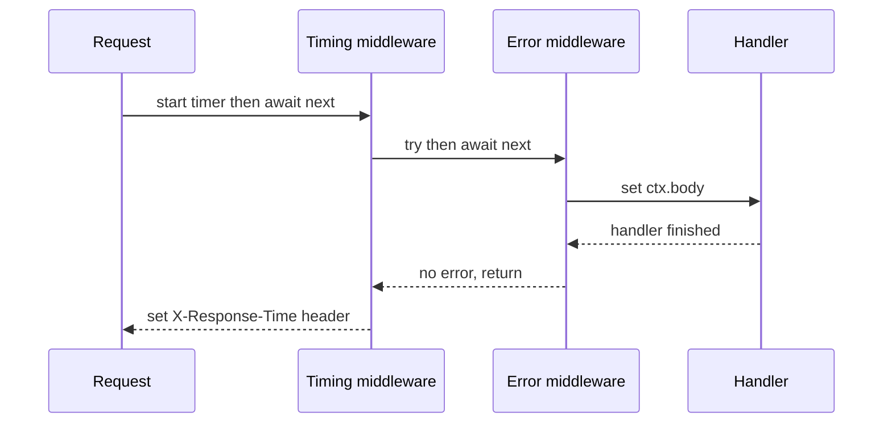

# HTTP Servers and Express

> In this document you will learn how a Node.js HTTP server really works, first with the built-in `http` module and then with Express. You will learn routing, middleware, error handling (including the big async change in Express 5), project structure and typed handlers in TypeScript. Interviews for backend and full-stack roles almost always ask "what is middleware?" and "how do you handle errors in Express?" — after this document you can answer both with confidence.

**Before this:** [Node.js runtime and architecture](01-nodejs-runtime-and-architecture.md) · [Streams](05-streams.md) · [HTTP, HTTPS and TLS](../01-cs-and-web-fundamentals/05-http-https-and-tls.md) · **Interview questions:** [jump to the interview section](#interview-questions)

## Table of contents

1. [How a Node.js HTTP server works](#how-a-nodejs-http-server-works)
2. [The http module](#the-http-module)
3. [Building a small API with only the http module](#building-a-small-api-with-only-the-http-module)
4. [Why frameworks exist](#why-frameworks-exist)
5. [Express basics](#express-basics)
6. [Routing in Express](#routing-in-express)
7. [Middleware](#middleware)
8. [The request lifecycle](#the-request-lifecycle)
9. [Error handling and async errors](#error-handling-and-async-errors)
10. [Request and response API](#request-and-response-api)
11. [Project structure for real APIs](#project-structure-for-real-apis)
12. [Typed Express handlers in TypeScript](#typed-express-handlers-in-typescript)
13. [Production setup for an Express app](#production-setup-for-an-express-app)
14. [Fastify, NestJS and Koa](#fastify-nestjs-and-koa)
15. [Common mistakes](#common-mistakes)
16. [Best practices](#best-practices)
17. [Interview questions](#interview-questions)
18. [Summary](#summary)
19. [References](#references)

---

## How a Node.js HTTP server works

An **HTTP server** is a program that waits for HTTP requests on a network port and sends back HTTP responses. A browser, a mobile app or another server is the **client**.

Here is what happens when a client calls `GET http://localhost:3000/products`:

1. The client opens a TCP connection to port 3000 (or reuses an open one).
2. The client sends text like `GET /products HTTP/1.1` plus headers.
3. Node.js (through libuv and the operating system) notices data on the socket. It does **not** block a thread while waiting.
4. Node's built-in HTTP parser (called `llhttp`) reads the request line and headers.
5. Node creates two objects: a **request** object (`req`) and a **response** object (`res`). It calls your handler function with them.
6. Your code decides what to send. It sets a status code, headers and a body on `res`.
7. Node writes the response bytes back to the socket. With HTTP keep-alive, the connection can stay open for the next request.

The important idea: **one Node.js process handles many connections at the same time** on one JavaScript thread. While request A waits for the database, Node runs code for request B. This works well as long as your handler does not block the thread with heavy synchronous work. (The details are in [the Node.js event loop](02-node-event-loop.md).)



**Analogy:** Think of a restaurant with one very fast waiter (the JavaScript thread). The waiter takes an order, gives it to the kitchen (the database, the file system, other services), and goes to the next table. When a dish is ready, the waiter delivers it. The waiter never stands still in the kitchen. The analogy breaks when the waiter has to cook something himself (CPU-heavy work): then every table waits.

---

## The http module

Node.js has a built-in module called `node:http`. Every Node web framework (Express, Fastify, Koa, NestJS) is built on top of it. Knowing it helps you understand what frameworks do for you.

### The smallest server

```js
// server.mjs
import http from "node:http";

const server = http.createServer((req, res) => {
  res.statusCode = 200;
  res.setHeader("Content-Type", "text/plain; charset=utf-8");
  res.end("Hello from Node.js\n");
});

server.listen(3000, () => {
  console.log("Listening on http://localhost:3000");
});
```

Run it with `node server.mjs` and open `http://localhost:3000`. You see `Hello from Node.js`.

What each part does:

- `http.createServer(handler)` creates a server. Node calls `handler(req, res)` **once for every request**.
- `server.listen(3000)` starts listening on port 3000. The callback runs when the port is ready.
- `res.end(body)` sends the body and finishes the response. **Every request must end with `res.end()`** (or something that calls it). If you forget, the client waits until a timeout.

### The request object (`req`)

`req` is an `http.IncomingMessage`. It is a **Readable stream** — the body arrives in chunks.

| Property | What it contains | Example |
| --- | --- | --- |
| `req.method` | HTTP method | `"GET"`, `"POST"` |
| `req.url` | Path plus query string (not the full URL) | `"/products?limit=10"` |
| `req.headers` | Object with all headers, **names in lowercase** | `req.headers["content-type"]` |
| `req.httpVersion` | HTTP version | `"1.1"` |
| `req.socket.remoteAddress` | Client IP address (of the direct peer, maybe a proxy) | `"::1"` |

```js
const server = http.createServer((req, res) => {
  console.log(req.method);                 // GET
  console.log(req.url);                    // /products?limit=10
  console.log(req.headers["user-agent"]);  // Mozilla/5.0 ...

  // Parse the URL with the WHATWG URL class (global in Node).
  const url = new URL(req.url, "http://localhost");
  console.log(url.pathname);                    // /products
  console.log(url.searchParams.get("limit"));   // 10
  res.end("ok");
});
```

Note: `req.url` has no host part. The `URL` class needs a base, so we pass a dummy base like `"http://localhost"`. Do not build the base from the `Host` header without checking it — the client controls that header.

### The response object (`res`)

`res` is an `http.ServerResponse`. It is a **Writable stream**.

| Method or property | What it does |
| --- | --- |
| `res.statusCode = 404` | Sets the status code (default is 200) |
| `res.setHeader(name, value)` | Sets one header before the response starts |
| `res.writeHead(status, headers)` | Sets status and headers in one call, and sends them |
| `res.write(chunk)` | Sends part of the body (headers are sent first if not yet sent) |
| `res.end([chunk])` | Sends the last part and finishes the response |
| `res.headersSent` | `true` after headers were sent — you cannot change them anymore |

```js
const server = http.createServer((req, res) => {
  res.writeHead(200, { "Content-Type": "application/json; charset=utf-8" });
  res.end(JSON.stringify({ status: "ok", time: new Date().toISOString() }));
});
```

A common bug: setting a header after the body started.

```js
// ❌ Wrong: headers are already sent by res.write()
res.write("part 1");
res.setHeader("X-Total", "10"); // throws ERR_HTTP_HEADERS_SENT

// ✅ Correct: set all headers first
res.setHeader("X-Total", "10");
res.write("part 1");
res.end("part 2");
```

### Manual routing

The `http` module has **no router**. You check the method and the path yourself:

```js
import http from "node:http";

const server = http.createServer((req, res) => {
  const { pathname } = new URL(req.url, "http://localhost");

  if (req.method === "GET" && pathname === "/health") {
    res.writeHead(200, { "Content-Type": "application/json" });
    res.end(JSON.stringify({ status: "up" }));
    return;
  }

  if (req.method === "GET" && pathname.startsWith("/users/")) {
    const id = pathname.slice("/users/".length); // "/users/42" -> "42"
    res.writeHead(200, { "Content-Type": "application/json" });
    res.end(JSON.stringify({ id }));
    return;
  }

  res.writeHead(404, { "Content-Type": "application/json" });
  res.end(JSON.stringify({ error: "Not found" }));
});

server.listen(3000);
```

This works for three routes. With fifty routes, path parameters, shared checks (authentication, logging) and error handling, the `if` chain becomes hard to maintain. That is the main reason frameworks exist.

### Reading a request body

The body does **not** arrive as one string. It comes as a stream of `Buffer` chunks. You must collect the chunks yourself:

```js
function readBody(req) {
  return new Promise((resolve, reject) => {
    const chunks = [];
    req.on("data", (chunk) => chunks.push(chunk)); // chunk is a Buffer
    req.on("end", () => resolve(Buffer.concat(chunks).toString("utf8")));
    req.on("error", reject);
  });
}
```

This simple version has a **serious security problem**: there is no size limit. A client can send 2 GB and your process keeps all of it in memory until it crashes. Real code must:

1. Check the `Content-Type` (reply `415 Unsupported Media Type` if it is wrong).
2. Limit the size (reply `413 Content Too Large` if it is too big).
3. Handle broken JSON (reply `400 Bad Request`).

You will see a full version in the next section.

### Server timeouts and limits

The `http.Server` has settings that protect you against slow or never-ending clients (for example the "Slowloris" attack, where a client sends headers one byte at a time to keep connections busy).

| Setting | Default (Node 22/24) | Meaning |
| --- | --- | --- |
| `server.headersTimeout` | 60 seconds (or `requestTimeout` if smaller) | Max time to receive all request headers |
| `server.requestTimeout` | 300 seconds (since Node 18) | Max time to receive the whole request |
| `server.keepAliveTimeout` | 5 seconds | How long an idle keep-alive connection stays open |
| `maxHeaderSize` option | 16 KiB | Max total size of request headers |
| `server.maxRequestsPerSocket` | 0 (no limit) | Max requests on one keep-alive connection |

```js
const server = http.createServer(handler);
server.headersTimeout = 10_000; // 10 s to send headers
server.requestTimeout = 30_000; // 30 s for the full request
```

If a load balancer sits in front of Node, set Node's `keepAliveTimeout` **higher** than the load balancer's idle timeout. Otherwise Node may close a connection at the same moment the load balancer sends a new request on it, and the client gets a random `502`.

---

## Building a small API with only the http module

Here is a complete, realistic products API using only `node:http`. It shows everything a framework normally does for you: routing, JSON parsing with limits, validation, consistent errors, request IDs and timeouts. It runs directly with `node products-server.ts` on Node 22.18+ (Node can strip TypeScript types; put `"type": "module"` in `package.json`), or after compiling with `tsc`.

```ts
// products-server.ts
import { createServer, type IncomingMessage, type ServerResponse } from "node:http";
import { randomUUID } from "node:crypto";

// A small error type that carries an HTTP status and a stable error code.
class HttpError extends Error {
  readonly status: number;
  readonly code: string;

  constructor(status: number, code: string, message: string) {
    super(message);
    this.name = "HttpError";
    this.status = status;
    this.code = code;
  }
}

interface Product {
  id: string;
  name: string;
  priceCents: number;
}

const products = new Map<string, Product>();

// Reads a JSON body, but never more than maxBytes.
function readJsonBody(req: IncomingMessage, maxBytes = 100_000): Promise<unknown> {
  return new Promise((resolve, reject) => {
    const mediaType = req.headers["content-type"]?.split(";")[0]?.trim().toLowerCase();
    if (mediaType !== "application/json") {
      reject(new HttpError(415, "UNSUPPORTED_MEDIA_TYPE", "Send the body as application/json"));
      return;
    }

    // Fast check: the client told us the size up front.
    if (Number(req.headers["content-length"] ?? 0) > maxBytes) {
      reject(new HttpError(413, "BODY_TOO_LARGE", `Body must be at most ${maxBytes} bytes`));
      return;
    }

    const chunks: Buffer[] = [];
    let received = 0;
    let failed = false;

    req.on("data", (chunk: Buffer) => {
      if (failed) return; // keep reading, but throw the extra bytes away
      received += chunk.length;
      if (received > maxBytes) {
        failed = true;
        reject(new HttpError(413, "BODY_TOO_LARGE", `Body must be at most ${maxBytes} bytes`));
        return;
      }
      chunks.push(chunk);
    });

    req.on("end", () => {
      if (failed) return;
      const text = Buffer.concat(chunks).toString("utf8");
      try {
        resolve(JSON.parse(text));
      } catch {
        reject(new HttpError(400, "INVALID_JSON", "The body is not valid JSON"));
      }
    });

    req.on("error", reject);
  });
}

function sendJson(res: ServerResponse, status: number, body: unknown): void {
  const payload = JSON.stringify(body);
  res.writeHead(status, {
    "Content-Type": "application/json; charset=utf-8",
    "Content-Length": Buffer.byteLength(payload),
  });
  res.end(payload);
}

function parseNewProduct(input: unknown): Omit<Product, "id"> {
  if (typeof input !== "object" || input === null) {
    throw new HttpError(400, "VALIDATION_FAILED", "Body must be a JSON object");
  }
  const { name, priceCents } = input as Record<string, unknown>;
  if (typeof name !== "string" || name.trim().length === 0 || name.length > 100) {
    throw new HttpError(400, "VALIDATION_FAILED", "name must be a non-empty string (max 100 chars)");
  }
  if (!Number.isInteger(priceCents) || (priceCents as number) < 0) {
    throw new HttpError(400, "VALIDATION_FAILED", "priceCents must be a non-negative integer");
  }
  return { name: name.trim(), priceCents: priceCents as number };
}

async function handle(req: IncomingMessage, res: ServerResponse): Promise<void> {
  const url = new URL(req.url ?? "/", "http://localhost");
  const segments = url.pathname.split("/").filter(Boolean); // "/products/42" -> ["products", "42"]

  if (segments[0] !== "products" || segments.length > 2) {
    throw new HttpError(404, "NOT_FOUND", `No route for ${req.method} ${url.pathname}`);
  }

  const id = segments[1];

  if (!id && req.method === "GET") {
    const limit = Math.min(Number(url.searchParams.get("limit") ?? 20) || 20, 100);
    sendJson(res, 200, { data: [...products.values()].slice(0, limit) });
    return;
  }

  if (!id && req.method === "POST") {
    const input = parseNewProduct(await readJsonBody(req, 10_000));
    const product: Product = { id: randomUUID(), ...input };
    products.set(product.id, product);
    res.setHeader("Location", `/products/${product.id}`);
    sendJson(res, 201, product);
    return;
  }

  if (id && req.method === "GET") {
    const product = products.get(id);
    if (!product) throw new HttpError(404, "PRODUCT_NOT_FOUND", `Product ${id} does not exist`);
    sendJson(res, 200, product);
    return;
  }

  res.setHeader("Allow", id ? "GET" : "GET, POST");
  throw new HttpError(405, "METHOD_NOT_ALLOWED", `${req.method} is not allowed here`);
}

const server = createServer((req, res) => {
  const requestId = randomUUID();
  res.setHeader("X-Request-Id", requestId);

  handle(req, res).catch((error: unknown) => {
    if (res.headersSent) {
      res.destroy(); // too late to send a clean error
      return;
    }
    if (error instanceof HttpError) {
      sendJson(res, error.status, { error: { code: error.code, message: error.message, requestId } });
      return;
    }
    console.error({ requestId, error }); // log the details on the server only
    sendJson(res, 500, { error: { code: "INTERNAL", message: "Something went wrong", requestId } });
  });
});

// Protect the server from slow or never-ending requests.
server.headersTimeout = 10_000; // max time to receive all request headers
server.requestTimeout = 30_000; // max time to receive the whole request

const port = Number(process.env.PORT ?? 3000);
server.listen(port, () => console.log(`Listening on http://localhost:${port}`));
```

Real responses from this server (tested with `fetch`):

```text
GET  /products                         -> 200 {"data":[]}
POST /products {"name":" Keyboard ","priceCents":4999}
                                       -> 201 Location: /products/<uuid>
                                          {"id":"<uuid>","name":"Keyboard","priceCents":4999}
POST /products  body "{oops"           -> 400 {"error":{"code":"INVALID_JSON",...}}
POST /products  Content-Type text/plain -> 415 {"error":{"code":"UNSUPPORTED_MEDIA_TYPE",...}}
POST /products  20 KB body             -> 413 {"error":{"code":"BODY_TOO_LARGE",...}}
GET  /products/nope                    -> 404 {"error":{"code":"PRODUCT_NOT_FOUND",...}}
DELETE /products                       -> 405 Allow: GET, POST
```

### Step-by-step: what happens on `POST /products`

1. Node parses the headers and calls the `createServer` callback with `req` and `res`.
2. We create a `requestId` and put it in the `X-Request-Id` header. If a user reports a problem, they can give you this ID, and you can find the request in your logs.
3. `handle()` splits the path into `["products"]`. There is no `id`, and the method is `POST`.
4. `readJsonBody()` checks the `Content-Type`, checks `Content-Length`, then collects chunks. If the total goes over 10,000 bytes, it rejects with a `413` and ignores the remaining bytes.
5. `JSON.parse` turns the text into a value of type `unknown`. We do not trust it yet.
6. `parseNewProduct()` checks the shape and trims the name. Now we have real, checked data.
7. We save the product, set the `Location` header and send `201 Created`.
8. If anything throws, `handle()` returns a rejected promise. The `.catch()` turns a known `HttpError` into a clean JSON error. Unknown errors become a generic `500` — **we never send stack traces to clients**.

### A note on reading with `for await`

You may see this shorter style:

```js
for await (const chunk of req) {
  total += chunk.length;
  if (total > max) throw new Error("too large"); // ❌ problem
}
```

It looks fine, but leaving a `for await` loop early (with `throw`, `break` or `return`) **destroys the stream**. For an HTTP request this destroys the socket, so the client never receives your nice `413` response — the connection just breaks. The `data` event version above keeps the connection alive and can answer properly. (Stream iteration rules are covered in [Streams](05-streams.md).)

---

## Why frameworks exist

Look at the http-only server again. Most of the code is not business logic. It is plumbing:

| Problem | With plain `http` | With a framework like Express |
| --- | --- | --- |
| Routing | `if` chains and manual path splitting | `app.get("/products/:id", handler)` |
| Path parameters | Split the string yourself | `req.params.id` |
| Query strings | `new URL(...).searchParams` | `req.query` |
| JSON body | Collect chunks, limit size, parse | `app.use(express.json({ limit: "100kb" }))` |
| Shared logic (logging, auth, CORS) | Call helpers in every branch | Middleware, written once |
| Errors | Your own try/catch structure | Central error-handling middleware |
| Static files | Read files, set MIME types, protect against `../` path tricks | `express.static("public")` |
| Ecosystem | Write everything | Thousands of ready middleware packages |

A framework gives you a **standard structure**. A new developer on your team already knows where routes, middleware and error handlers go.

When is plain `http` still a good choice?

- Very small services such as a health-check sidecar or a webhook receiver.
- Libraries that must not depend on a framework.
- Learning, so you understand what frameworks hide.
- Extreme performance needs where every microsecond counts (but Fastify is usually a better answer here).

---

## Express basics

**Express** is a small, unopinionated web framework for Node.js. "Unopinionated" means it gives you routing and middleware, but it does not force a folder structure, a database or a validation library on you.

### Express 4 vs Express 5 (version facts)

| | Express 4 | Express 5 |
| --- | --- | --- |
| Released | 2014 | 5.0.0 in September 2024; became the default `npm install express` version with 5.1.0 in March 2025 |
| Node.js required | Very old versions supported | Node.js 18 or newer |
| Async errors | Rejected promises are **not** caught | Rejected promises and thrown errors in handlers go to the error middleware automatically |
| Route path syntax | `*`, `?` and regex-like strings | Named wildcards (`/*splat`), optional parts in braces (`{.:ext}`), no regex characters in strings |
| `req.body` without a parser | `{}` | `undefined` |
| `req.query` | Writable property | Read-only getter; default query parser is `"simple"` |
| Status | Still supported, but new features go to Express 5; plan to upgrade | Active (5.3 is the latest release in October 2026) |

This document uses **Express 5** and points out where Express 4 behaves differently, because many existing projects still run Express 4.

### Hello Express

```bash
npm install express
npm install --save-dev @types/express typescript
```

```js
// app.mjs
import express from "express";

const app = express();

app.get("/", (req, res) => {
  res.send("Hello from Express");
});

app.listen(3000, (error) => {
  if (error) throw error; // Express 5 passes listen errors (like EADDRINUSE) here
  console.log("Listening on http://localhost:3000");
});
```

Compare with the `http` version:

- `app.get("/", handler)` replaces the `if (req.method === "GET" && pathname === "/")` check.
- `res.send()` sets `Content-Type` and `Content-Length` for you and ends the response.
- `app.listen()` calls `http.createServer(app).listen(...)` inside. An Express `app` is just a request handler function `(req, res)` that you could pass to `http.createServer` yourself.

```js
import http from "node:http";
import express from "express";

const app = express();
const server = http.createServer(app); // same as app.listen(), but you keep the server object
server.listen(3000);
```

Keeping the `server` object is useful for timeouts, WebSocket upgrades and graceful shutdown.

---

## Routing in Express

**Routing** means deciding which code runs for a given HTTP method and path.

### Route methods

```js
app.get("/products", listProducts);        // read a list
app.post("/products", createProduct);      // create
app.get("/products/:id", getProduct);      // read one
app.put("/products/:id", replaceProduct);  // replace
app.patch("/products/:id", updateProduct); // partial update
app.delete("/products/:id", deleteProduct);
app.all("/admin", adminOnly);              // any method
```

### Route parameters

A segment that starts with `:` is a **route parameter**. Express puts its value in `req.params`. Values are always **strings**.

```js
app.get("/users/:userId/orders/:orderId", (req, res) => {
  console.log(req.params); // { userId: '7', orderId: '1001' }  for GET /users/7/orders/1001
  const userId = Number(req.params.userId); // convert yourself, then validate
  res.json({ userId, orderId: req.params.orderId });
});
```

Express 5 path syntax (it uses `path-to-regexp` version 8):

```js
// Optional part: matches /files/report AND /files/report.pdf
app.get("/files/:name{.:ext}", (req, res) => {
  res.json(req.params); // { name: 'report', ext: 'pdf' }  or  { name: 'report' }
});

// Named wildcard: matches /static/css/site.css
app.get("/static/*filepath", (req, res) => {
  res.json(req.params.filepath); // [ 'css', 'site.css' ]  (an array of segments)
});

// Several paths instead of a regex-like string
app.get(["/discussion/:slug", "/page/:slug"], showPage);
```

> **Express 4 difference:** Express 4 accepted `"/files/:name.:ext?"` and `"/static/*"`. In Express 5 these strings throw an error at startup. When you upgrade, search your routes for `*`, `?`, `(` and `[`.

### Query strings

```js
// GET /products?category=books&sort=-price&limit=10
app.get("/products", (req, res) => {
  console.log(req.query); // { category: 'books', sort: '-price', limit: '10' }
  // Values are strings, or arrays of strings if the key repeats: ?tag=a&tag=b
  const limit = Math.min(Number(req.query.limit) || 20, 100);
  res.json({ limit });
});
```

Never trust `req.query` types. A client can send `?limit=abc` or `?limit=1&limit=2` (which gives an array). Validate it (see [Validation and error handling](08-validation-and-error-handling.md)).

### Route order matters

Express checks routes **in the order you register them** and runs the first one that matches.

```js
// ❌ Wrong: "/users/me" is never reached, because "/users/:id" matches first with id = "me"
app.get("/users/:id", getUserById);
app.get("/users/me", getCurrentUser);

// ✅ Correct: specific routes before generic ones
app.get("/users/me", getCurrentUser);
app.get("/users/:id", getUserById);
```

### `app.route()` — one path, many methods

```js
app
  .route("/products/:id")
  .get(getProduct)
  .put(replaceProduct)
  .delete(deleteProduct);
```

### `express.Router` — split routes into modules

A **Router** is a mini application with its own routes and middleware. You "mount" it at a path prefix.

```js
// routes/products.routes.js
import { Router } from "express";

export const productsRouter = Router();

productsRouter.get("/", listProducts);     // GET  /api/products
productsRouter.get("/:id", getProduct);    // GET  /api/products/:id
productsRouter.post("/", createProduct);   // POST /api/products
```

```js
// app.js
import express from "express";
import { productsRouter } from "./routes/products.routes.js";
import { ordersRouter } from "./routes/orders.routes.js";

const app = express();
app.use(express.json());
app.use("/api/products", productsRouter);
app.use("/api/orders", ordersRouter);
```

Inside a mounted router, `req.baseUrl` is `"/api/products"` and `req.path` is the rest (for example `"/42"`). `req.originalUrl` always keeps the full original URL.

If a nested router needs the parent's parameters, use `mergeParams`:

```js
const reviewsRouter = Router({ mergeParams: true });
reviewsRouter.get("/", (req, res) => {
  res.json({ productId: req.params.productId }); // works because of mergeParams
});
app.use("/api/products/:productId/reviews", reviewsRouter);
```

### `router.param()` — load a parameter once

```js
productsRouter.param("id", async (req, res, next, id) => {
  const product = await productService.findById(id);
  if (!product) {
    res.status(404).json({ error: "Product not found" });
    return;
  }
  req.product = product; // in TypeScript, declare this property (see the TypeScript section)
  next();
});

productsRouter.get("/:id", (req, res) => res.json(req.product));
productsRouter.delete("/:id", deleteProduct); // also gets req.product
```

---

## Middleware

### What it is

**Middleware** is a function that runs **between** receiving the request and sending the response. It has this signature:

```js
function middleware(req, res, next) {
  // 1. do something with req or res
  // 2. then EITHER call next() to pass control to the next function
  //    OR send a response to finish the request
}
```

Every request travels through a **chain** of middleware functions, in the order you registered them. Each one can:

- read or change `req` and `res` (for example add `req.user`),
- end the request by sending a response (for example `401 Unauthorized`),
- call `next()` to pass the request to the next function,
- call `next(error)` to jump to the error-handling middleware.

### Why it exists

Many routes need the same steps: parse JSON, log the request, check the token, add security headers. Without middleware you would copy these steps into every handler. Middleware lets you write them **once** and apply them to all routes, to one router, or to one route.

### Analogy

Middleware is like **security checkpoints at an airport**. Every passenger (request) walks through them in a fixed order: ticket check, passport control, security scan, gate. Any checkpoint can stop a passenger ("you cannot board" = send `403`). If everything is fine, each checkpoint waves the passenger on (`next()`). The gate (the route handler) is the last stop.

Where the analogy breaks: in Express, code written after `next()` also runs, after the later functions have returned (see [Q5](#q5-what-does-this-print-for-get-)). An airport checkpoint does nothing once you have walked past it.

### A simple example

```js
import express from "express";

const app = express();

// Runs for every request
app.use((req, res, next) => {
  console.log(`${req.method} ${req.url}`);
  next(); // pass control on — without this, the request hangs
});

app.get("/hello", (req, res) => {
  res.send("Hello");
});

app.listen(3000);
// Request:  GET /hello
// Console:  GET /hello
// Response: Hello
```

### A realistic example: request ID and timing

```js
import { randomUUID } from "node:crypto";

function requestContext(req, res, next) {
  // Reuse the ID from the load balancer if it sent a safe one, otherwise make one.
  const incoming = req.get("x-request-id");
  req.id = incoming && /^[\w-]{1,100}$/.test(incoming) ? incoming : randomUUID();
  res.set("X-Request-Id", req.id);

  const start = process.hrtime.bigint();
  // "finish" fires after the last byte of the response was handed to the OS.
  res.on("finish", () => {
    const ms = Number(process.hrtime.bigint() - start) / 1e6;
    console.log(JSON.stringify({
      requestId: req.id,
      method: req.method,
      path: req.originalUrl,
      status: res.statusCode,
      durationMs: Math.round(ms),
    }));
  });

  next();
}

app.use(requestContext);
```

Notice the trick: to log the **status code and duration**, we cannot log immediately, because the response does not exist yet. We listen for the `finish` event of `res` instead.

### Types of middleware

| Type | How you register it | Runs for |
| --- | --- | --- |
| Application-level | `app.use(fn)` or `app.use("/api", fn)` | All requests (or all under a path prefix) |
| Router-level | `router.use(fn)` | All requests that reach that router |
| Route-level | `app.get("/admin", requireAdmin, handler)` | Only that route |
| Error-handling | `app.use((err, req, res, next) => {...})` — **4 parameters** | Only when an error was passed with `next(err)` or thrown |
| Built-in | `express.json()`, `express.urlencoded()`, `express.static()`, `express.raw()`, `express.text()` | Wherever you mount them |
| Third-party | `cors()`, `helmet()`, `morgan()`, `compression()`, `cookieParser()` | Wherever you mount them |

Route-level middleware can be a list:

```js
app.delete(
  "/products/:id",
  authenticate,          // is there a valid user?
  requireRole("admin"),  // is the user an admin?
  deleteProduct,         // the real handler
);
```

### Built-in middleware

```js
// Parse JSON bodies (Content-Type: application/json). Default limit is "100kb".
app.use(express.json({ limit: "100kb" }));

// Parse HTML form bodies (Content-Type: application/x-www-form-urlencoded).
// Express 5 default is extended: false (simple key=value parsing).
app.use(express.urlencoded({ extended: false, limit: "100kb" }));

// Serve files from ./public:  GET /logo.png -> public/logo.png
app.use(express.static("public", { maxAge: "1d" }));

// Raw bytes for one route only — needed for webhook signature checks
app.post("/webhooks/payments", express.raw({ type: "application/json" }), handlePaymentWebhook);
```

What `express.json()` does for you:

- It only acts when the `Content-Type` matches. Otherwise it calls `next()` and `req.body` stays `undefined` (Express 5).
- It enforces the size limit. Too big → error with status `413`.
- Broken JSON → error with status `400`. Both errors go to your error middleware.
- It decompresses `gzip` and `deflate` bodies (Express 5 adds `br`).

### Third-party middleware you will meet everywhere

```js
import helmet from "helmet";
import cors from "cors";
import morgan from "morgan";
import compression from "compression";

app.use(helmet());       // security headers: Content-Security-Policy, X-Content-Type-Options, HSTS...
app.use(cors({           // which other origins may call this API from a browser
  origin: ["https://shop.example.com"],
  credentials: true,     // allow cookies; never combine with origin "*"
}));
app.use(morgan("combined")); // one access-log line per request
app.use(compression());       // gzip responses (often done by the reverse proxy instead)
```

| Package | Problem it solves |
| --- | --- |
| `helmet` | Sets safe HTTP security headers with good defaults |
| `cors` | Answers browser CORS preflight requests and sets `Access-Control-Allow-*` headers |
| `morgan` | Simple access logging (in production many teams use `pino-http` for JSON logs) |
| `compression` | Compresses response bodies |
| `cookie-parser` | Parses the `Cookie` header into `req.cookies` |
| `express-rate-limit` | Limits requests per client (covered in [Production Node.js](14-production-nodejs.md)) |

CORS and security headers are explained in depth in [Web security: XSS, CSRF, CORS, CSP](../10-testing-security-production/05-web-security-xss-csrf-cors-csp.md).

### Middleware order matters

Middleware runs in registration order. A typical order:

```js
const app = express();

app.use(requestContext);                   // 1. request ID first, so every log line has it
app.use(helmet());                         // 2. security headers on every response
app.use(cors(corsOptions));                // 3. before routes, so preflight requests are answered
app.use(express.json({ limit: "100kb" })); // 4. before routes that read req.body
app.use("/api/products", productsRouter);  // 5. routes
app.use("/api/orders", authenticate, ordersRouter);
app.use(notFoundHandler);                  // 6. after all routes: nothing matched -> 404
app.use(errorHandler);                     // 7. last: error handler with 4 parameters
```

```js
// ❌ Wrong: the router runs before the JSON parser, so req.body is undefined in handlers
app.use("/api/products", productsRouter);
app.use(express.json());

// ✅ Correct
app.use(express.json());
app.use("/api/products", productsRouter);
```

### `next()` rules

| Call | Effect |
| --- | --- |
| `next()` | Go to the next matching middleware or route |
| `next(err)` | Skip all normal middleware; go to the next **error** middleware |
| `next("route")` | Skip the remaining handlers of **this route** and go to the next matching route |
| `next("router")` | Leave the current router and continue after it |
| Send a response and do not call `next()` | The request is finished |

`next("route")` example — a feature flag:

```js
app.get(
  "/checkout",
  (req, res, next) => (req.user?.betaTester ? next() : next("route")),
  newCheckoutPage, // only beta testers get here
);
app.get("/checkout", oldCheckoutPage); // everyone else lands here
```

### How to explain this in an interview

1. **Define it:** "Middleware is a function with `(req, res, next)` that runs in a chain between the incoming request and the final response."
2. **Why it exists:** "Cross-cutting concerns like logging, authentication, body parsing and security headers are needed by many routes. Middleware lets me write them once."
3. **How it works:** "Express keeps an ordered list of middleware and routes. For each request it walks the list. Each function either sends a response, calls `next()` to continue, or calls `next(err)` to jump to the error handlers — the functions with four parameters."
4. **Small example:** "An `authenticate` middleware reads the Bearer token, verifies it, sets `req.user` and calls `next()`. If the token is invalid, it sends 401 and the chain stops."
5. **Where it is useful:** "Request IDs, logging, CORS, helmet, body parsing, auth, rate limiting and the central error handler."
6. **Trade-offs / gotchas:** "Order matters — the JSON parser must come before the routes, and the error handler must be last. Forgetting `next()` hangs the request. Calling `next()` after sending a response causes 'headers already sent' errors. In Express 4, async errors need `next(err)` or a wrapper."

---

## The request lifecycle

This diagram shows the full path of one request through a typical Express app.



Step by step for `POST /api/orders` with a valid token:

1. Node's `http` server parses the headers and calls `app(req, res)`.
2. Express adds helper methods to `req` and `res` (like `res.json` and `req.get`).
3. `requestContext` sets `req.id`, starts a timer and calls `next()`.
4. `helmet()` sets security headers on `res` and calls `next()`.
5. `express.json()` reads and parses the body into `req.body`, then calls `next()`.
6. Express looks for a match. `/api/orders` matches the mount path of `ordersRouter`. Inside it, `POST /` matches.
7. `authenticate` verifies the token, sets `req.user` and calls `next()`.
8. `validate(createOrderSchema)` checks `req.body` and calls `next()`.
9. The controller calls `orderService.placeOrder(...)`, awaits it, and calls `res.status(201).json(order)`.
10. The `finish` event fires and `requestContext` logs `201` with the duration.

If step 9 throws (for example, the product is out of stock), Express 5 catches the rejected promise and calls the error middleware, which sends a `409` with a JSON error body.

---

## Error handling and async errors

### Error-handling middleware

An **error-handling middleware** is a middleware with **exactly four parameters**: `(err, req, res, next)`. Express looks at the number of parameters (`fn.length`) to decide. If a function has four, Express only calls it when there is an error.

```js
// Must be registered AFTER all routes.
app.use((err, req, res, next) => {
  console.error({ requestId: req.id, err });           // full details in the server log
  const status = Number.isInteger(err.status) ? err.status : 500;
  res.status(status).json({
    error: {
      code: err.code ?? "INTERNAL",
      message: status < 500 ? err.message : "Something went wrong", // hide internals for 5xx
      requestId: req.id,
    },
  });
});
```

Three rules to remember:

1. **Four parameters, always.** Even if you do not use `next`, keep it in the signature. A function with three parameters is a normal middleware and is skipped when there is an error.
2. **Register it last**, after all routes and the 404 handler.
3. **If the response already started**, you cannot send a new one. Pass the error to Express's default handler, which closes the connection:

```js
app.use((err, req, res, next) => {
  if (res.headersSent) {
    next(err); // let Express close the connection
    return;
  }
  // ... normal error response
});
```

### The 404 handler

A missing route is **not** an error in Express. If no route matches, Express falls through to its built-in handler, which sends a plain HTML "Cannot GET /x" page. For an API, add your own JSON 404 handler after all routes:

```js
app.use((req, res) => {
  res.status(404).json({ error: { code: "NOT_FOUND", message: `No route for ${req.method} ${req.path}` } });
});
```

### Express's default error handler

If you do not write an error handler, Express uses a built-in one. It sends an HTML page. **When `NODE_ENV` is not `"production"`, that page includes the stack trace.** This leaks file paths and library versions to attackers. Always set `NODE_ENV=production` in production and always add your own error handler.

### How errors reach the error handler

| Where the error happens | Express 4 | Express 5 |
| --- | --- | --- |
| `throw` in a synchronous handler | Caught → error handler | Caught → error handler |
| `next(err)` | Error handler | Error handler |
| `throw` inside an `async` handler (rejected promise) | **Not caught.** Unhandled rejection. Request hangs; on Node 15+ the process crashes by default | Caught → error handler |
| `throw` inside a `setTimeout` or event callback | Not caught → `uncaughtException` → crash | Not caught → crash |

Express 5 does not change the last row. It can only catch errors that happen during the call to your function or in the promise that your function returns. A callback that runs later is outside of Express's reach.

### Express 4: async errors need help

```js
// ❌ Express 4: the rejected promise is ignored by Express
app.get("/users/:id", async (req, res) => {
  const user = await userService.findById(req.params.id); // throws "DB down"
  res.json(user);
});
// Result in Express 4: the client waits until a timeout. Node prints an
// unhandled rejection error and, since Node 15, exits the process.
```

Fix 1 — try/catch and `next(err)`:

```js
app.get("/users/:id", async (req, res, next) => {
  try {
    const user = await userService.findById(req.params.id);
    res.json(user);
  } catch (err) {
    next(err);
  }
});
```

Fix 2 — a small wrapper, so you do not repeat try/catch everywhere:

```js
// Express 4 helper
const asyncHandler = (fn) => (req, res, next) => {
  Promise.resolve(fn(req, res, next)).catch(next);
};

app.get("/users/:id", asyncHandler(async (req, res) => {
  const user = await userService.findById(req.params.id);
  res.json(user);
}));
```

There is also a package called `express-async-errors` that patches Express 4 to do this for every route.

### Express 5: async errors just work

```js
// ✅ Express 5: a rejected promise is passed to next(err) for you
app.get("/users/:id", async (req, res) => {
  const user = await userService.findById(req.params.id);
  if (!user) throw new NotFoundError(`User ${req.params.id} not found`);
  res.json(user);
});
```

Inside Express 5's router, every handler call is wrapped. If the function throws, the router calls `next(err)`. If the function returns a promise, the router adds `.catch()` and calls `next(err)` on rejection. If the promise is rejected with a falsy value (like `undefined`), the router passes `new Error("Rejected promise")` instead, so the error handler always receives an error.

The same applies to async **error handlers** and to `router.param()` callbacks.

### Error classes make the handler simple

Throw errors that already know their HTTP status. Then the error handler does not need a long `if` chain:

```js
class AppError extends Error {
  constructor(status, code, message) {
    super(message);
    this.name = this.constructor.name;
    this.status = status;
    this.code = code;
  }
}
class NotFoundError extends AppError {
  constructor(message = "Not found") { super(404, "NOT_FOUND", message); }
}
class ConflictError extends AppError {
  constructor(message) { super(409, "CONFLICT", message); }
}

// In a service:
throw new ConflictError("Product SKU-1 is out of stock");
```

A complete error system (error codes, validation errors, RFC 9457 problem details, logging and process-level crashes) is in [Validation and error handling](08-validation-and-error-handling.md).

---

## Request and response API

### The most used `req` properties

| Property | Example value for `GET /api/products/42?fields=name` | Notes |
| --- | --- | --- |
| `req.params` | `{ id: '42' }` | From the route path; strings |
| `req.query` | `{ fields: 'name' }` | Parsed query string; strings or arrays |
| `req.body` | `{ name: 'Lamp' }` | Only after a body parser; `undefined` otherwise (Express 5) |
| `req.get("authorization")` | `"Bearer eyJ..."` | Header lookup, case-insensitive |
| `req.method` | `"GET"` | |
| `req.path` | `"/42"` inside a router mounted at `/api/products` | Path without query string |
| `req.originalUrl` | `"/api/products/42?fields=name"` | Never changed by routers |
| `req.ip` | `"203.0.113.7"` | Correct behind proxies only with `trust proxy` |
| `req.protocol`, `req.secure` | `"https"`, `true` | Behind a proxy, needs `trust proxy` |
| `req.cookies` | `{ sid: 'abc' }` | Needs `cookie-parser` |
| `req.is("application/json")` | `"application/json"` or `false` | Checks the request `Content-Type` |
| `req.accepts("json")` | `"json"` or `false` | Content negotiation |

**`trust proxy`:** In production, Node usually sits behind a load balancer or reverse proxy (Nginx, AWS ALB). Then the direct peer is the proxy, and the real client IP is in the `X-Forwarded-For` header. Clients can fake this header. So Express ignores it unless you tell it how many proxies to trust:

```js
app.set("trust proxy", 1); // exactly one proxy in front of us: trust its X-Forwarded-For entry
// Now req.ip is the real client IP, and req.secure is true for HTTPS at the proxy.
```

Do not use `app.set("trust proxy", true)` unless you really control every hop. With `true`, a client can set `X-Forwarded-For: 1.2.3.4` and fake its IP — which breaks IP-based rate limiting.

### The most used `res` methods

| Method | What it does |
| --- | --- |
| `res.status(201)` | Sets the status code; returns `res` so you can chain. Express 5 throws for values outside 100–999 |
| `res.json(obj)` | Sends JSON with `Content-Type: application/json` |
| `res.send(body)` | Sends a string, Buffer or object; sets content type based on the value |
| `res.sendStatus(204)` | Sends only the status (with the status text as body, except for 204/304) |
| `res.set(name, value)` / `res.get(name)` | Sets / reads a response header |
| `res.location(url)` | Sets the `Location` header |
| `res.redirect(302, url)` | Redirects (status first in Express 5) |
| `res.cookie(name, value, options)` / `res.clearCookie(name)` | Sets / removes a cookie |
| `res.sendFile(absPath)` | Streams a file with the right content type |
| `res.download(absPath, filename)` | Like `sendFile`, plus `Content-Disposition: attachment` |
| `res.type("csv")` | Sets the `Content-Type` |
| `res.format({...})` | Sends different formats based on the `Accept` header |
| `res.end()` | Ends without a body (inherited from Node's `ServerResponse`) |
| `res.locals` | An object for passing data to later middleware (and to view templates) during one request |

Common combinations:

```js
// Created
res.status(201).location(`/api/products/${product.id}`).json(product);

// No content (for example after DELETE)
res.status(204).end();

// Secure session cookie
res.cookie("sid", sessionId, {
  httpOnly: true,     // JavaScript in the page cannot read it
  secure: true,       // only sent over HTTPS
  sameSite: "lax",    // not sent on most cross-site requests (CSRF protection)
  maxAge: 1000 * 60 * 60 * 8, // 8 hours in milliseconds
});
```

### Exactly one response per request

You must send **exactly one** response for each request. Not zero (the client hangs) and not two (error).

```js
// ❌ Wrong: missing return, so both responses run
app.get("/orders/:id", async (req, res) => {
  const order = await orderService.findById(req.params.id);
  if (!order) {
    res.status(404).json({ error: "Not found" });
  }
  res.json(order); // runs too -> Error: Cannot set headers after they are sent to the client
});

// ✅ Correct
app.get("/orders/:id", async (req, res) => {
  const order = await orderService.findById(req.params.id);
  if (!order) {
    res.status(404).json({ error: "Not found" });
    return;
  }
  res.json(order);
});
```

### Streaming responses

`res` is a Node Writable stream, so you can stream large data instead of loading it into memory:

```js
import { createReadStream } from "node:fs";
import { pipeline } from "node:stream/promises";

app.get("/reports/:id/download", async (req, res) => {
  const filePath = await reportService.getFilePath(req.params.id); // throws NotFoundError if missing
  res.attachment(`report-${req.params.id}.csv`); // Content-Disposition: attachment; filename=...
  res.type("text/csv");
  await pipeline(createReadStream(filePath), res); // backpressure and cleanup handled for you
});
```

Memory stays small, even for a 2 GB file, because only one chunk at a time is in memory. If the stream fails in the middle, headers are already sent, so your error handler must check `res.headersSent` (as shown above). Backpressure and `pipeline` are explained in [Streams](05-streams.md).

---

## Project structure for real APIs

A single `app.js` with all routes works for a demo. For a real API, split the code into **layers**. Each layer has one job.

| Layer | Job | Knows about HTTP? | Example |
| --- | --- | --- | --- |
| **Routes** | Map URL + method to a controller, attach middleware | Yes | `router.post("/", authenticate, validate(schema), controller.create)` |
| **Controller** | Read input from `req`, call the service, write `res` | Yes | `const product = await service.create(req.body); res.status(201).json(product)` |
| **Service** | Business rules and workflows | **No** | "A product name must be unique", "reserve stock, then charge" |
| **Repository** | Talk to the database | No | SQL queries, ORM calls |



Why this split helps:

- **Testing:** You can unit-test the service without HTTP or a real database (pass a fake repository).
- **Reuse:** The same service can be called from an HTTP route, a background job or a CLI script.
- **Change:** Switching from Express to Fastify only touches routes and controllers. Switching databases only touches repositories.

The trade-off: more files. For a tiny service with five endpoints, routes + services is often enough. Add layers when they give a real benefit, not by habit.

### A folder layout that scales (feature-based)

```text
src/
  app.ts                 builds and returns the Express app (no listen)
  server.ts              creates the HTTP server, listens, handles shutdown
  config/
    env.ts               reads and validates environment variables
  db/
    pool.ts              database connection pool
  middleware/
    request-context.ts
    authenticate.ts
    validate.ts
    error-handler.ts
  shared/
    errors.ts            AppError, NotFoundError, ...
  modules/
    products/
      products.routes.ts
      products.controller.ts
      products.service.ts
      products.repository.ts
      products.schemas.ts
    orders/
      ...
tests/
  products.api.test.ts
```

Grouping by **feature** (`modules/products`) instead of by **type** (`controllers/`, `services/`) keeps related code together. When you work on products, all the files are in one folder.

### A complete products module in TypeScript

```ts
// src/modules/products/products.repository.ts
import type { Pool } from "pg";

export interface Product {
  id: string;
  name: string;
  priceCents: number;
}

export function createProductRepository(pool: Pool) {
  return {
    async findById(id: string): Promise<Product | undefined> {
      const result = await pool.query<Product>(
        `SELECT id, name, price_cents AS "priceCents" FROM products WHERE id = $1`,
        [id], // parameterized: safe from SQL injection
      );
      return result.rows[0];
    },

    async insert(input: Omit<Product, "id">): Promise<Product> {
      const result = await pool.query<Product>(
        `INSERT INTO products (name, price_cents) VALUES ($1, $2)
         RETURNING id, name, price_cents AS "priceCents"`,
        [input.name, input.priceCents],
      );
      return result.rows[0]!;
    },

    async existsByName(name: string): Promise<boolean> {
      const result = await pool.query(`SELECT 1 FROM products WHERE lower(name) = lower($1)`, [name]);
      return (result.rowCount ?? 0) > 0;
    },
  };
}

export type ProductRepository = ReturnType<typeof createProductRepository>;
```

```ts
// src/modules/products/products.service.ts
import { ConflictError, NotFoundError } from "../../shared/errors.js";
import type { Product, ProductRepository } from "./products.repository.js";

export function createProductService(repo: ProductRepository) {
  return {
    async getById(id: string): Promise<Product> {
      const product = await repo.findById(id);
      if (!product) throw new NotFoundError(`Product ${id} not found`);
      return product;
    },

    async create(input: { name: string; priceCents: number }): Promise<Product> {
      // Business rule. (A UNIQUE index in the database is the real guarantee
      // against two requests racing; this check gives a friendly early error.)
      if (await repo.existsByName(input.name)) {
        throw new ConflictError(`A product named "${input.name}" already exists`);
      }
      return repo.insert(input);
    },
  };
}

export type ProductService = ReturnType<typeof createProductService>;
```

```ts
// src/modules/products/products.controller.ts
import type { Request, Response } from "express";
import type { ProductService } from "./products.service.js";
import type { CreateProductInput } from "./products.schemas.js";

export function createProductController(service: ProductService) {
  return {
    async getById(req: Request<{ id: string }>, res: Response): Promise<void> {
      const product = await service.getById(req.params.id);
      res.json(product);
    },

    async create(req: Request, res: Response): Promise<void> {
      // validate() middleware already parsed and checked the body
      const input = res.locals.body as CreateProductInput;
      const product = await service.create(input);
      res.status(201).location(`/api/products/${product.id}`).json(product);
    },
  };
}
```

```ts
// src/modules/products/products.routes.ts
import { Router } from "express";
import { authenticate, requireRole } from "../../middleware/authenticate.js";
import { validateBody } from "../../middleware/validate.js";
import { createProductSchema } from "./products.schemas.js";
import type { createProductController } from "./products.controller.js";

export function createProductsRouter(controller: ReturnType<typeof createProductController>): Router {
  const router = Router();
  router.get("/:id", controller.getById);
  router.post("/", authenticate, requireRole("admin"), validateBody(createProductSchema), controller.create);
  return router;
}
```

```ts
// src/app.ts — the "composition root": the one place that wires everything together
import express from "express";
import helmet from "helmet";
import type { Pool } from "pg";
import { requestContext } from "./middleware/request-context.js";
import { errorHandler, notFoundHandler } from "./middleware/error-handler.js";
import { createProductRepository } from "./modules/products/products.repository.js";
import { createProductService } from "./modules/products/products.service.js";
import { createProductController } from "./modules/products/products.controller.js";
import { createProductsRouter } from "./modules/products/products.routes.js";

export function createApp(deps: { pool: Pool }) {
  const app = express();
  app.set("trust proxy", 1);
  app.use(requestContext);
  app.use(helmet());
  app.use(express.json({ limit: "100kb" }));

  const productService = createProductService(createProductRepository(deps.pool));
  app.use("/api/products", createProductsRouter(createProductController(productService)));

  app.get("/health/live", (req, res) => { res.json({ status: "ok" }); });
  app.use(notFoundHandler);
  app.use(errorHandler);
  return app;
}
```

```ts
// src/server.ts — starts the process
import http from "node:http";
import { createApp } from "./app.js";
import { pool } from "./db/pool.js";
import { env } from "./config/env.js";

const server = http.createServer(createApp({ pool }));
server.headersTimeout = 10_000;
server.requestTimeout = 30_000;
server.listen(env.PORT, () => console.log(`API listening on port ${env.PORT}`));

process.on("SIGTERM", () => {
  server.close(async () => {   // stop accepting new connections, finish in-flight requests
    await pool.end();          // then close the database pool
    process.exit(0);
  });
});
```

Notice two design choices:

1. **Factories instead of global singletons.** `createProductService(repo)` receives its dependency. This is simple manual **dependency injection** (explained in [Dependency inversion and injection](../04-oop-solid-design-patterns/05-dependency-inversion-and-injection.md)). In tests you pass a fake repository.
2. **`app.ts` does not call `listen()`.** Tests import `createApp()` and send requests with a library like `supertest` without opening a real port (see [Testing Node.js APIs](../10-testing-security-production/03-testing-nodejs-apis.md)). `server.ts` is the only file that deals with ports, timeouts and shutdown. A complete graceful shutdown is in [Production Node.js](14-production-nodejs.md#graceful-shutdown).

---

## Typed Express handlers in TypeScript

The `@types/express` package gives types for Express. The `Request` type has generic parameters:

```ts
Request<Params, ResBody, ReqBody, ReqQuery, Locals>
```

```ts
import type { Request, Response, NextFunction, RequestHandler } from "express";

interface OrderParams { orderId: string }
interface OrderDto { id: string; status: "pending" | "paid" | "shipped"; totalCents: number }
interface ErrorBody { error: { code: string; message: string } }
interface ListQuery { status?: string; limit?: string }

// Typed params and response body
export const getOrder: RequestHandler<OrderParams, OrderDto | ErrorBody> = async (req, res) => {
  const order = await orderService.findById(req.params.orderId); // req.params.orderId: string
  if (!order) {
    res.status(404).json({ error: { code: "NOT_FOUND", message: "Order not found" } });
    return;
  }
  res.json(order); // TypeScript checks that order matches OrderDto
};

// Typed query
export async function listOrders(
  req: Request<Record<string, never>, OrderDto[], unknown, ListQuery>,
  res: Response<OrderDto[]>,
): Promise<void> {
  const limit = Math.min(Number(req.query.limit) || 20, 100);
  res.json(await orderService.list({ status: req.query.status, limit }));
}
```

### Adding your own properties to `req`

Middleware often adds data like `req.user` or `req.id`. Tell TypeScript about them with **declaration merging** — you add fields to Express's global `Request` interface:

```ts
// src/types/express.d.ts
import type { AuthUser } from "../modules/auth/auth.types.js";

declare global {
  namespace Express {
    interface Request {
      id: string;          // set by requestContext middleware
      user?: AuthUser;     // set by authenticate middleware (missing on public routes)
    }
  }
}

export {}; // makes this file a module
```

Now `req.user?.role` type-checks everywhere. Make sure the file is included by your `tsconfig.json`.

An alternative is `res.locals` with a typed `Locals` generic. Some teams prefer it because it does not change a global type. Both are common.

### Types are not validation

This is the most important point of this section:

```ts
// ❌ This only LOOKS safe. The generic is a compile-time promise, nothing checks it at runtime.
app.post("/orders", (req: Request<{}, unknown, { quantity: number }>, res) => {
  const total = req.body.quantity * 10; // a client can send { "quantity": "ten" } -> NaN
});
```

TypeScript types disappear when the code is compiled. The request body comes from the network and can be anything. Treat it as `unknown`, check it at runtime with a schema (Zod, Joi, etc.), and only then give it a type. That is covered in [Validation and error handling](08-validation-and-error-handling.md) and [Runtime validation and type-safe APIs](../03-typescript/11-runtime-validation-and-type-safe-apis.md).

---

## Production setup for an Express app

A short checklist. Each item has its own deeper explanation in [Production Node.js](14-production-nodejs.md).

```ts
import express from "express";
import helmet from "helmet";
import cors from "cors";
import { rateLimit } from "express-rate-limit";
import pinoHttp from "pino-http";

const app = express();

app.set("trust proxy", 1);                                // correct req.ip behind one load balancer
app.use(pinoHttp());                                      // structured JSON logs with request IDs
app.use(helmet());                                        // security headers; also removes X-Powered-By
app.use(cors({ origin: ["https://shop.example.com"], credentials: true })); // explicit allowlist
app.use(rateLimit({ windowMs: 60_000, limit: 300, standardHeaders: "draft-8", legacyHeaders: false }));
app.use(express.json({ limit: "100kb" }));                // small body limit by default

// ... routes ...

app.use(notFoundHandler);
app.use(errorHandler);                                    // JSON errors, no stack traces
```

| Item | Why |
| --- | --- |
| `NODE_ENV=production` | Express's default error page hides stack traces; some libraries enable caching |
| `helmet()` | Safe default security headers |
| Explicit CORS allowlist | Only your frontends can call the API from a browser with credentials |
| Body size limits | Stops memory exhaustion from huge payloads |
| Rate limiting | Slows brute force and abuse (use a shared store like Redis when you run many instances) |
| Server timeouts | Stops slow clients from holding connections forever |
| Request IDs and JSON logs | You can trace one request across services |
| Central error handler | Consistent error format, no leaked internals |
| Health endpoints | The load balancer or Kubernetes knows when an instance is ready or dead |
| Graceful shutdown on `SIGTERM` | Deployments do not cut off in-flight requests |
| Compression and TLS at the proxy | Nginx or the load balancer is usually better at it than Node |

---

## Fastify, NestJS and Koa

Express is the most widely known Node framework, but it is not the only choice. You should be able to compare it with the main alternatives.

### Fastify

**Fastify** is a framework designed for low overhead and high throughput. It has built-in JSON Schema validation (with Ajv), fast JSON serialization from response schemas, built-in logging with `pino`, a plugin system with encapsulation, and first-class `async/await` and TypeScript support. Fastify v5 (released in 2024) requires Node.js 20 or newer.

```ts
import Fastify from "fastify";

const app = Fastify({ logger: true }); // pino logger built in

app.post(
  "/products",
  {
    schema: {
      body: {
        type: "object",
        required: ["name", "priceCents"],
        additionalProperties: false,
        properties: {
          name: { type: "string", minLength: 1, maxLength: 100 },
          priceCents: { type: "integer", minimum: 0 },
        },
      },
      response: {
        201: {
          type: "object",
          properties: { id: { type: "string" }, name: { type: "string" }, priceCents: { type: "integer" } },
        },
      },
    },
  },
  async (request, reply) => {
    // The body was already validated against the schema. Invalid bodies got a 400 automatically.
    const product = await productService.create(request.body as { name: string; priceCents: number });
    reply.code(201);
    return product; // returning a value sends it; only schema fields are serialized
  },
);

await app.listen({ port: 3000, host: "0.0.0.0" });
```

A nice side effect of the response schema: if `product` has an extra field like `internalCost`, Fastify does **not** send it, because it is not in the schema. That prevents accidental data leaks.

### NestJS

**NestJS** is a full, opinionated framework inspired by Angular. It uses modules, classes, decorators and a dependency injection container. It runs on top of Express by default (Express 5 since NestJS 11) and can switch to Fastify with an adapter.

```ts
import { Body, Controller, Get, Param, ParseUUIDPipe, Post, UseGuards } from "@nestjs/common";
import { IsInt, IsString, Length, Min } from "class-validator";

export class CreateProductDto {
  @IsString() @Length(1, 100) name!: string;
  @IsInt() @Min(0) priceCents!: number;
}

@Controller("products")
export class ProductsController {
  constructor(private readonly productsService: ProductsService) {} // injected by Nest

  @Get(":id")
  findOne(@Param("id", ParseUUIDPipe) id: string) {
    return this.productsService.findOne(id); // returned value becomes the JSON response
  }

  @Post()
  @UseGuards(AdminGuard)
  create(@Body() dto: CreateProductDto) { // validated by a global ValidationPipe
    return this.productsService.create(dto);
  }
}
```

If you know Angular, NestJS feels familiar: `@Injectable()` services, modules with `providers`, guards, pipes and interceptors.

### Koa

**Koa** was created by the original Express team. Its core is tiny (no router or body parser built in). Its middleware is `async (ctx, next) => {}` and uses `await next()`. Because `next()` returns a promise that resolves when **all later middleware has finished**, code after `await next()` runs on the way back. This is called the **onion model**.

```js
import Koa from "koa";

const app = new Koa();

// Timing middleware: works correctly because await next() waits for everything downstream
app.use(async (ctx, next) => {
  const start = Date.now();
  await next();
  ctx.set("X-Response-Time", `${Date.now() - start}ms`);
});

// Error handling is just try/catch around next()
app.use(async (ctx, next) => {
  try {
    await next();
  } catch (err) {
    ctx.status = err.status ?? 500;
    ctx.body = { error: ctx.status < 500 ? err.message : "Something went wrong" };
  }
});

app.use(async (ctx) => {
  ctx.body = { message: "Hello from Koa" }; // ctx.body replaces res.send
});

app.listen(3000);
```



In Express, `next()` returns `undefined`, so `await next()` does **not** wait for async handlers further down (see [Q6](#q6-what-does-this-print-for-get-)). That is the key difference.

### Comparison

| | Express | Fastify | NestJS | Koa |
| --- | --- | --- | --- | --- |
| Style | Minimal, unopinionated | Minimal core + plugins, schema-first | Full framework, opinionated, DI, decorators | Minimal, async onion middleware |
| Validation | Bring your own | Built in (JSON Schema) | Pipes + class-validator (or Zod) | Bring your own |
| Logging | Bring your own | Built in (pino) | Built-in logger, swappable | Bring your own |
| TypeScript | Via `@types/express` | First class | First class | Via `@types/koa` |
| Performance | Good enough for most APIs | Designed for low overhead | Depends on adapter (Express or Fastify) | Good, small core |
| Learning curve | Lowest | Low to medium | Highest | Low |
| Ecosystem | Largest | Large and growing | Large | Smaller |

### When to choose what

- **Express:** You want the biggest ecosystem and the most familiar API. Your team is small or mixed. You maintain an existing Express codebase. Most CRUD APIs are limited by the database, not the framework.
- **Fastify:** You build new services where throughput and latency matter, and you like schema-based validation and serialization. Good for microservices and high-traffic APIs.
- **NestJS:** You build a large application with many developers and want a strong, enforced structure (modules, DI, guards). Angular teams pick it up quickly. Accept more boilerplate and decorator magic.
- **Koa:** You want a tiny core with clean async middleware and are happy to choose every piece yourself.
- **Plain `http`:** Tiny services, libraries, or learning.

---

## Common mistakes

| Mistake | What goes wrong | Fix |
| --- | --- | --- |
| Forgetting `next()` in middleware | The request hangs until a timeout | Call `next()` or send a response on every code path |
| Missing `return` after sending a response | "Cannot set headers after they are sent to the client" | `res.status(404).json(...); return;` |
| Async handler in Express 4 without a wrapper | Unhandled rejection, hanging request, crashed process | `try/catch` + `next(err)`, a wrapper, or upgrade to Express 5 |
| Error handler with 3 parameters | It is never called for errors | Always use `(err, req, res, next)` |
| Error handler registered before the routes | Errors from routes never reach it | Register it last |
| `express.json()` after the routers | `req.body` is `undefined` | Register parsers first |
| `"/users/:id"` before `"/users/me"` | `me` is treated as an id | Specific routes first |
| Trusting `req.body` because it has a TypeScript type | Crashes, `NaN`, injection | Validate at runtime |
| Sending `err.stack` or `err.message` of unknown errors to the client | Information leak | Generic message for 5xx; details only in logs |
| `cors({ origin: "*", credentials: true })` or reflecting any origin | Any site can make credentialed calls | Explicit allowlist |
| `app.set("trust proxy", true)` without control of the proxy chain | Clients fake their IP | Trust the exact number of proxies |
| Reading big files with `fs.readFile` and `res.send` | High memory, slow first byte | Stream with `pipeline` or `res.sendFile` |
| Doing CPU-heavy work in a handler (big JSON, image resize, bcrypt with sync API) | Every other request waits | Async APIs, worker threads or a job queue |
| No body size limits or server timeouts | Easy denial of service | `express.json({ limit })`, `headersTimeout`, `requestTimeout` |
| Calling `app.listen()` inside `app.ts` | Hard to test; ports clash in tests | Export the app; listen in `server.ts` |

---

## Best practices

- **Keep handlers thin.** Controllers translate HTTP to function calls. Business rules live in services. This keeps logic testable and reusable.
- **One error format for the whole API.** Throw typed errors, convert them in one error middleware. Clients can then handle errors in one place.
- **Validate every input at the edge.** Body, params, query and headers. Reject unknown fields to prevent mass assignment.
- **Set limits everywhere.** Body size, header size, timeouts, page sizes, rate limits. Unlimited input is a vulnerability.
- **Use Express 5 for new projects.** Async errors are handled, and the stricter path syntax removes a class of ReDoS-prone route patterns.
- **Add a request ID to every log line and every error response.** This turns "it failed sometime yesterday" into a two-minute search.
- **Separate `app` from `server`.** Tests use the app; only `server.ts` deals with ports, timeouts and shutdown.
- **Use secure defaults:** `helmet()`, explicit CORS, `NODE_ENV=production`, HttpOnly + Secure cookies, and `trust proxy` set to the real number of proxies.
- **Stream large payloads.** Use `pipeline()` so backpressure and cleanup are correct.
- **Choose the framework for the team, not for benchmarks.** Database and network time usually dominate. Pick Fastify when overhead really matters, NestJS when structure matters.

---

## Interview questions

### Q1. What is the difference between Node's `http` module and Express?

**What the interviewer is checking:** Do you know that Express is a layer on top of `http`, and what that layer adds?

**Short spoken answer (30–60 seconds):**
> "The `http` module is Node's built-in, low-level server. It parses the HTTP request and gives me `req` and `res`, but nothing more — no routing, no body parsing, no middleware. I have to collect body chunks myself, check sizes, and write `if` statements for every route. Express is a framework built on top of it. An Express app is actually just a request handler that I can pass to `http.createServer`. It adds routing with path parameters, a middleware chain, helpers like `res.json` and `req.query`, built-in body parsers and a central error-handling mechanism. I use plain `http` for tiny services or libraries, and a framework for real APIs."

**Detailed explanation:** `req` is an `IncomingMessage` (Readable stream) and `res` is a `ServerResponse` (Writable stream) in both cases. Express extends their prototypes with helpers. `app.listen()` is shorthand for `http.createServer(app).listen()`.

**Follow-up questions:**
- **Can you use Express with an existing `http` server?** — Yes. `http.createServer(app)` works, and you keep the server object for timeouts, WebSocket upgrades and shutdown.
- **Is the request body available in `req` by default?** — No. In both cases the body is a stream. Express needs `express.json()` (or another parser) to fill `req.body`.
- **Does Express add overhead?** — A little: the middleware chain and routing. For most APIs the database and network cost much more.

**Common mistakes:** Saying Express "replaces" the `http` module or that it has its own HTTP parser.

**Where this is used in real projects:** Understanding this helps when you attach WebSockets (`server.on("upgrade")`), tune timeouts, or write a tiny webhook receiver without dependencies.

### Q2. What is middleware in Express, and how does `next` work?

**What the interviewer is checking:** The core mental model of Express.

**Short spoken answer (30–60 seconds):**
> "Middleware is a function with `req`, `res` and `next` that runs in a chain for every matching request, in the order I registered it. Each middleware can change the request or response, end the request by sending a response, call `next()` to pass control to the next function, or call `next(err)` to skip to the error handlers. I use it for cross-cutting things like request IDs, logging, body parsing, CORS, authentication and rate limiting. The main gotchas are order — the JSON parser must come before routes and the error handler last — and making sure every path either calls `next` or sends a response, otherwise the request hangs."

**Detailed explanation:** Express keeps a stack of layers (middleware and routes). For each request it walks the stack and calls the layers whose path matches. `next()` calls the next matching layer synchronously. `next("route")` skips the rest of the current route's handlers; `next("router")` leaves the current router.

**Follow-up questions:**
- **What is the difference between `app.use()` and `app.get()`?** — `app.use(path, fn)` matches any method and any path that **starts with** the prefix (`/api` matches `/api/users`). `app.get(path, fn)` matches only GET (and HEAD) and the **whole** path.
- **Where do you put authentication middleware?** — On the routers or routes that need it (`app.use("/api/orders", authenticate, ordersRouter)`), not before public routes like `/health` or `/login`.
- **How do you pass data from one middleware to the next?** — Attach it to `req` (`req.user`) or `res.locals`. In TypeScript, declare the property with declaration merging.

**Common mistakes:** Not knowing that order matters; thinking `next()` returns a promise.

**Where this is used in real projects:** Every Express app: auth, logging, validation, tenant resolution, feature flags.

### Q3. How does Express know a function is an error handler?

**Short answer:** By the number of declared parameters. Express checks `fn.length`. A function with exactly four parameters `(err, req, res, next)` is an error handler. It is skipped during normal flow and called only after `next(err)` or a thrown error. If you remove the unused `next` parameter, the function has three parameters and becomes a normal middleware — it will never receive errors.

```js
app.use((err, req, res, next) => { /* error handler */ });   // length 4
app.use((err, req, res) => { /* NOT an error handler */ });  // length 3
```

A subtle trap: default parameter values and rest parameters are not counted by `fn.length`. `(err, req, res, next = () => {})` has length 3. Keep the four plain parameters.

### Q4. How do you handle errors in async route handlers in Express 4 and Express 5?

**What the interviewer is checking:** Version awareness and understanding of promises in a callback-based framework.

**Short spoken answer (30–60 seconds):**
> "Express 4 was designed before async/await. If an async handler throws, it returns a rejected promise, and Express 4 ignores it. The error never reaches my error middleware, the client hangs, and on modern Node the unhandled rejection crashes the process. So in Express 4 I wrap every async handler — either a try/catch with `next(err)` or a small `asyncHandler` wrapper that does `.catch(next)`. Express 5, which became the default on npm in 2025, does this for me: if a handler throws or returns a rejected promise, the router forwards it to `next(err)`. What Express 5 still cannot catch is an error thrown later in a callback, like inside `setTimeout`, because that runs outside the handler's call."

**Code:**

```js
// Express 4 wrapper
const asyncHandler = (fn) => (req, res, next) => Promise.resolve(fn(req, res, next)).catch(next);

// Express 5: no wrapper needed
app.get("/orders/:id", async (req, res) => {
  res.json(await orderService.getById(req.params.id)); // rejection -> error middleware
});
```

**Follow-up questions:**
- **What happens if a promise is rejected with `undefined` in Express 5?** — The router replaces it with `new Error("Rejected promise")`, so the error handler always gets an error object.
- **Why does an unhandled rejection crash Node?** — Since Node 15, the default `--unhandled-rejections` mode is `throw`: an unhandled rejection is raised as an uncaught exception, which ends the process unless an `uncaughtException` handler exists.
- **How would you migrate a large Express 4 codebase?** — Upgrade to Express 5, then remove wrappers gradually. They are harmless in Express 5, so there is no rush.

**Common mistakes:** Claiming Express 4 catches async errors; forgetting errors in timers/event callbacks; wrapping only some routes.

**Where this is used in real projects:** Every API that awaits a database call. A missing wrapper in Express 4 is a classic cause of mysterious production crashes.

### Q5. What does this print for `GET /`?

```js
app.use((req, res, next) => {
  console.log("A");
  next();
  console.log("B");
});
app.use((req, res, next) => {
  console.log("C");
  next();
  console.log("D");
});
app.get("/", (req, res) => {
  console.log("E");
  res.send("ok");
});
```

**Answer:**

```text
A
C
E
D
B
```

**Why, step by step:**
1. The first middleware logs `A` and calls `next()`.
2. `next()` calls the second middleware **synchronously**. It logs `C` and calls `next()`.
3. That `next()` calls the route handler, which logs `E` and sends the response.
4. The handler returns. Control goes back into the second middleware, right after its `next()` call. It logs `D`.
5. The second middleware returns. Control goes back into the first one, which logs `B`.

It works like nested function calls. (Verified with a small model of Express's router dispatch, which calls the next layer synchronously.) Code after `next()` is legal, but it runs **after** the response was sent, so it must not try to send again.

### Q6. What does this print for `GET /`?

```js
app.use(async (req, res, next) => {
  console.log("1");
  await next();
  console.log("2");
});
app.get("/", async (req, res) => {
  console.log("3");
  await new Promise((resolve) => setTimeout(resolve, 10));
  console.log("4");
  res.send("ok");
});
```

**Answer:**

```text
1
3
2
4
```

**Why, step by step:**
1. The middleware logs `1` and calls `next()`.
2. `next()` synchronously calls the handler. It logs `3` and reaches `await` on a timer. The handler returns a pending promise to Express's router.
3. Express's `next()` returns `undefined` — it does **not** return the handler's promise.
4. `await undefined` only waits one microtask. So the middleware logs `2` right away.
5. After 10 ms the timer fires and the handler logs `4` and sends the response.

**Follow-up — what would Koa print?** `1, 3, 4, 2`. In Koa, `next()` returns a promise that resolves only when the downstream middleware is finished. So in Express, a "measure the duration" middleware must listen to `res.on("finish")` instead of code after `await next()`.

### Q7. This request sometimes hangs forever. Find the bug.

```js
app.use(async (req, res, next) => {
  const apiKey = req.get("x-api-key");
  if (apiKey) {
    req.client = await clientService.findByApiKey(apiKey);
    next();
  }
});
```

**Answer:** When there is no `x-api-key` header, the middleware neither calls `next()` nor sends a response. The request hangs until the server or client times out. Also, if `findByApiKey` returns `null`, the request continues with no client.

```js
// ✅ Correct: every path ends with a response or next()
app.use(async (req, res, next) => {
  const apiKey = req.get("x-api-key");
  if (!apiKey) {
    res.status(401).json({ error: { code: "API_KEY_REQUIRED", message: "Send the x-api-key header" } });
    return;
  }
  const client = await clientService.findByApiKey(apiKey);
  if (!client) {
    res.status(401).json({ error: { code: "API_KEY_INVALID", message: "Unknown API key" } });
    return;
  }
  req.client = client;
  next();
});
```

On Express 4, a database error in `findByApiKey` would also hang the request, because the async error is not caught.

### Q8. Why do we get "Cannot set headers after they are sent to the client"?

**Short answer:** Some code tried to send a second response (or set a header) after the first response already started. Usual causes:

1. Missing `return` after `res.status(...).json(...)` inside an `if`.
2. Calling `next()` after sending a response, so a later handler sends again.
3. A callback or promise that sends a response after a timeout middleware already sent `503`.
4. An error handler that does not check `res.headersSent` when a stream failed halfway.

The error code is `ERR_HTTP_HEADERS_SENT`. The client usually got the first response, so the bug is visible mainly in server logs. Fix the control flow so there is exactly one response per request.

### Q9. What does `express.json()` do, and what happens if a client sends a 10 MB JSON body?

**What the interviewer is checking:** Knowledge of body parsing and its security role.

**Short spoken answer:**
> "`express.json()` is a built-in middleware that reads the request stream when the `Content-Type` is JSON, enforces a size limit, decompresses gzip if needed, parses the JSON and puts the result in `req.body`. The default limit is 100 KB. A 10 MB body exceeds it, so the parser stops and passes an error with status 413 and type `entity.too.large` to my error middleware. Broken JSON gives a 400 with type `entity.parse.failed`. If the content type is not JSON, it just calls `next()` and `req.body` stays undefined in Express 5."

**Follow-up questions:**
- **How do you allow a big upload on one route only?** — Keep the global limit small and mount a parser with a bigger limit on that route, or better, stream uploads (multipart with a streaming parser like `busboy`, or direct-to-storage pre-signed URLs).
- **Why do webhook routes often use `express.raw()`?** — Signature verification (Stripe, GitHub) needs the exact raw bytes. Parsing and re-serializing JSON changes them.

**Common mistakes:** Setting `limit: "50mb"` globally "to be safe".

**Where this is used in real projects:** Every JSON API; the limit is a basic DoS protection.

### Q10. How do you structure a large Express application?

**What the interviewer is checking:** Architecture thinking, separation of concerns, testability.

**Short spoken answer (30–60 seconds):**
> "I group code by feature — a folder per module like products or orders — and inside each module I separate layers. Routes map URLs and attach middleware. Controllers translate HTTP into function calls and back. Services hold business rules and do not know about Express. Repositories do the database queries. I wire everything in one composition root, usually with factory functions that receive their dependencies, so tests can pass fakes. I keep `app.ts`, which builds the app, separate from `server.ts`, which listens and handles shutdown. Cross-cutting middleware — request context, auth, validation, error handler — lives in a shared folder. For a very small service I skip some layers; the structure should earn its cost."

**Code or diagram:** See [Project structure for real APIs](#project-structure-for-real-apis).

**Follow-up questions:**
- **Why should services not receive `req` and `res`?** — Then they can be reused from jobs, CLIs and tests, and they do not depend on Express.
- **Where do you validate: controller or service?** — Shape validation at the edge (middleware/controller). Business rules (stock available, unique name) in the service. Hard guarantees (unique, foreign key) in the database.
- **When would you use NestJS instead?** — Large teams that want enforced modules and DI; it gives this structure out of the box.

**Common mistakes:** Putting SQL in route handlers; one giant `routes.js`; services that call `res.json`.

**Where this is used in real projects:** Any API that grows beyond a few endpoints or a few developers.

### Q11. Why separate `app.ts` from `server.ts`?

**Short answer:** `app.ts` builds the Express app and exports it without calling `listen()`. Tests can import it and send requests in-process with `supertest`, with no port conflicts, and can inject fake dependencies. `server.ts` handles process concerns: reading the port, server timeouts, `listen()`, and graceful shutdown on `SIGTERM`. It also makes it easy to run the same app in other hosts (for example a serverless adapter).

### Q12. How do you add a `user` property to `req` in TypeScript?

**Short answer:** Use declaration merging on the global `Express.Request` interface:

```ts
declare global {
  namespace Express {
    interface Request {
      user?: { id: string; role: "admin" | "customer" };
    }
  }
}
export {};
```

Make it optional (`user?`) because public routes have no user, and narrow it in protected handlers. Alternatives: `res.locals` with a typed `Locals` generic, or a small helper `getUser(req)` that throws `401` if missing. Remember that these are compile-time types only.

### Q13. How do you get the real client IP behind a load balancer?

**What the interviewer is checking:** Proxies, `X-Forwarded-For` and spoofing.

**Short spoken answer:**
> "Behind a load balancer, the TCP peer is the load balancer, so `req.socket.remoteAddress` is its IP. The proxy adds the client IP to `X-Forwarded-For`. But a client can send a fake `X-Forwarded-For` too, so Express ignores it by default. I set `app.set('trust proxy', 1)` when there is exactly one proxy — then Express takes the address that the trusted proxy added, and `req.ip`, `req.protocol` and `req.secure` become correct. I never set it to `true` blindly, because then anyone can spoof their IP and bypass IP-based rate limits."

**Follow-up questions:**
- **Why does `req.secure` matter?** — Secure cookies and HTTPS redirects depend on it. With TLS ending at the proxy, Express sees plain HTTP unless it trusts `X-Forwarded-Proto`.
- **What if there are two proxies (CDN + load balancer)?** — Use `trust proxy` = 2, or a list of trusted subnets.

**Common mistakes:** Reading `req.headers["x-forwarded-for"]` directly and trusting it.

**Where this is used in real projects:** Rate limiting, audit logs, geo features, fraud detection.

### Q14. How do you send a 2 GB file to a client without running out of memory?

**Short answer:** Stream it. `fs.readFile` would load all 2 GB into memory. Use `res.sendFile(absolutePath)` / `res.download()` or `pipeline(createReadStream(path), res)`. Streams send chunk by chunk and respect **backpressure**: if the client is slow, Node pauses reading the file. `pipeline` also destroys both streams if one fails or the client disconnects, so file handles do not leak. For very large or very many files, a better design is often to let object storage or a CDN serve them (for example with a pre-signed URL), so Node is not in the data path at all.

### Q15. Why should you configure server timeouts?

**What the interviewer is checking:** Awareness of slow-client attacks and proxy interaction.

**Short spoken answer:**
> "Every open connection costs memory and a file descriptor. A slow-client attack like Slowloris opens many connections and sends headers very slowly to keep them busy. Node has `headersTimeout` and `requestTimeout` on the server — by default 60 seconds for headers and 5 minutes for the whole request since Node 18. I usually lower them for a JSON API. Behind a load balancer I also make Node's `keepAliveTimeout` longer than the load balancer's idle timeout, otherwise Node may close a connection just as the balancer reuses it, which shows up as random 502 errors."

**Follow-up questions:**
- **Does `requestTimeout` stop a slow database query?** — No. It limits receiving the request. For slow work inside the handler you need your own timeouts (for example `AbortSignal.timeout()` for `fetch`, `statement_timeout` for Postgres).
- **What is the difference from a response timeout middleware?** — A middleware can send `503` after N ms, but the work continues in the background unless you cancel it with an `AbortSignal`.

**Common mistakes:** Assuming defaults are safe for every environment; confusing request-receive timeouts with processing timeouts.

**Where this is used in real projects:** Services exposed directly to the internet, and every service behind AWS ALB, Nginx or a Kubernetes ingress.

### Q16. Write a middleware that answers 503 if a request takes longer than N milliseconds.

**Answer:**

```ts
import type { RequestHandler } from "express";

export function timeout(ms: number): RequestHandler {
  return (req, res, next) => {
    const controller = new AbortController();
    res.locals.signal = controller.signal; // handlers can pass it to fetch() or DB calls

    const timer = setTimeout(() => {
      controller.abort(new Error(`Request timed out after ${ms} ms`));
      if (!res.headersSent) {
        res.status(503).json({ error: { code: "TIMEOUT", message: "The request took too long" } });
      }
    }, ms);

    // Clear the timer when the response finishes or the client disconnects.
    res.on("finish", () => clearTimeout(timer));
    res.on("close", () => clearTimeout(timer));
    next();
  };
}

app.use(timeout(5_000));
```

Key points to say: (1) check `res.headersSent` before sending; (2) clear the timer on `finish` and `close` to avoid leaks; (3) a timeout response does **not** stop the work — that is why we expose an `AbortSignal` for handlers to cancel downstream calls; (4) the handler must not send a response after the timeout already did, or you get "headers already sent".

### Q17. Review this handler. What would you change?

```js
app.post("/api/users", async (req, res) => {
  const { email, password, role } = req.body;
  const existing = await db.query(`SELECT * FROM users WHERE email = '${email}'`);
  if (existing.rows.length) return res.status(400).send("exists");
  const user = await db.query(
    "INSERT INTO users (email, password, role) VALUES ($1, $2, $3) RETURNING *",
    [email, password, role],
  );
  res.json(user.rows[0]);
});
```

**What the interviewer is checking:** Security and API design review skills.

**Answer — problems and fixes:**

1. **SQL injection** in the first query (string interpolation). Use parameters: `WHERE email = $1`.
2. **Plain-text password storage.** Hash with Argon2id, scrypt or bcrypt (see [Authentication and authorization](09-authentication-and-authorization.md)).
3. **Mass assignment / privilege escalation:** the client chooses `role`. A user can register as `admin`. Never take `role` from the body here.
4. **No validation:** email format, password length, unknown fields.
5. **Leaks data:** `RETURNING *` sends the password hash back. Return only safe fields.
6. **Race condition:** two requests with the same email can both pass the check. Add a `UNIQUE` index on `email` and map the unique-violation error to `409 Conflict`.
7. **Wrong status codes / format:** a duplicate should be `409` with a JSON error body; a successful create should be `201` with a `Location` header.
8. **Email enumeration:** for public signup, a "this email exists" response tells attackers which emails have accounts. Many apps send a neutral response and email the user instead.
9. On Express 4, a database error would be an unhandled rejection.

```js
app.post("/api/users", validateBody(registerSchema), async (req, res) => {
  const { email, password } = res.locals.body;          // validated, no role field allowed
  const passwordHash = await hashPassword(password);
  try {
    const { rows } = await db.query(
      `INSERT INTO users (email, password_hash, role) VALUES ($1, $2, 'customer')
       RETURNING id, email, role, created_at AS "createdAt"`,
      [email.toLowerCase(), passwordHash],
    );
    res.status(201).location(`/api/users/${rows[0].id}`).json(rows[0]);
  } catch (err) {
    if (err.code === "23505") throw new ConflictError("Email already registered"); // Postgres unique_violation
    throw err;
  }
});
```

### Q18. Express, Fastify or NestJS — which would you choose for a new service?

**What the interviewer is checking:** Senior-level trade-off reasoning, not fandom.

**Short spoken answer (30–60 seconds):**
> "It depends on the team and the service. For a small or medium API with a team that already knows Express, I'd choose Express 5 — the async error handling is fixed, the ecosystem is huge, and the bottleneck is usually the database anyway. For a high-traffic service where per-request overhead matters, I'd pick Fastify: schema-based validation and serialization, built-in pino logging, and good TypeScript support. For a large codebase with many developers, especially an Angular team, I'd consider NestJS because it enforces modules, dependency injection, guards and pipes — the price is more boilerplate and a steeper learning curve. Whatever I pick, I keep business logic in plain services so the framework stays a thin layer."

**Follow-up questions:**
- **Can NestJS be fast?** — Yes, it can run on the Fastify adapter. Its overhead is mostly in the DI and decorator layers.
- **What does Fastify's response schema give you besides speed?** — It only serializes declared fields, so internal fields are not leaked by accident.
- **What about Koa?** — Clean async onion middleware with a tiny core, but you assemble router, body parser and validation yourself; smaller ecosystem.

**Common mistakes:** Choosing only by benchmark numbers; claiming Express "cannot do async".

**Where this is used in real projects:** Every greenfield backend decision and architecture review.

### Q19. How does Koa middleware differ from Express middleware?

**Short answer:** Koa middleware is `async (ctx, next)` and `next()` returns a promise that resolves when **all downstream middleware has finished**. So code after `await next()` runs on the way back out — the **onion model**. This makes timing, error handling (`try { await next() } catch {}`) and response transformation simple. Koa uses one `ctx` object (with `ctx.request`, `ctx.response`, `ctx.body`) instead of `req`/`res`. Express's `next()` returns `undefined`; Express uses `res.on("finish")` for after-response work and a separate four-parameter error middleware for errors.

### Q20. How do you upgrade an application from Express 4 to Express 5?

**What the interviewer is checking:** Practical experience with breaking changes.

**Short spoken answer:**
> "First I make sure we run Node 18 or newer, ideally a current LTS. Then I upgrade the package and fix the breaking changes: route strings — wildcards must be named like `/*splat`, optional parts use braces, and regex characters are not allowed; removed APIs like `res.send(status)`, `res.json(obj, status)`, `app.del` and `req.param()`; `req.query` is read-only, so code that assigned validated values to it must use `res.locals` or another property; `req.body` is undefined without a parser; and `express.urlencoded` defaults to `extended: false`. I check that `res.status()` only gets valid integers. Then I run the test suite, and later remove the async wrappers because Express 5 forwards rejected promises itself."

**Follow-up questions:**
- **Is there a tool for this?** — The Express migration guide lists official codemods (for example `npx codemod@latest @expressjs/v5-migration-recipe`) for many API renames; route syntax and `req.query` writes still need manual review.
- **Why were regex characters removed from path strings?** — The new `path-to-regexp` avoids patterns that could lead to catastrophic backtracking (ReDoS) and makes matching predictable.

**Common mistakes:** Forgetting middleware packages that rely on writing `req.query`.

**Where this is used in real projects:** Many companies are doing this migration now because Express 5 is the default release and new features only go there.

---

## Summary

- A Node HTTP server calls your handler with `req` (Readable stream) and `res` (Writable stream) for every request. One thread handles many connections because I/O is non-blocking.
- The `http` module has no routing or body parsing. You must collect the body yourself with size limits, content-type checks and JSON error handling.
- Set `headersTimeout`, `requestTimeout` and body limits to protect against slow or huge requests.
- Express adds routing (`req.params`, `req.query`, `Router`), middleware, helpers (`res.json`) and central error handling on top of `http`.
- Middleware is `(req, res, next)`, runs in registration order, and must either send a response or call `next()`.
- Error middleware has exactly four parameters and is registered last; check `res.headersSent` before responding.
- Express 4 does not catch rejected promises — use `next(err)` or a wrapper. Express 5 (default since 2025, Node 18+) forwards thrown errors and rejected promises automatically.
- Express 5 has a stricter route syntax (`/*splat`, `{.:ext}`), `req.body` is `undefined` without a parser, and `req.query` is read-only.
- Structure real APIs as routes → controllers → services → repositories, grouped by feature, wired in one composition root; keep `app.ts` separate from `server.ts`.
- TypeScript generics on `Request` are compile-time only — always validate input at runtime.
- Choose Express for familiarity and ecosystem, Fastify for low overhead and schemas, NestJS for enforced structure in large teams, Koa for a tiny async core.

---

## References

- Node.js `http` module documentation — https://nodejs.org/api/http.html
- Node.js Stream documentation — https://nodejs.org/api/stream.html
- Express 5 migration guide — https://expressjs.com/en/guide/migrating-5.html
- Express routing guide — https://expressjs.com/en/guide/routing.html
- Express: using middleware — https://expressjs.com/en/guide/using-middleware.html
- Express error handling — https://expressjs.com/en/guide/error-handling.html
- Express behind proxies (`trust proxy`) — https://expressjs.com/en/guide/behind-proxies.html
- Express production best practices: security — https://expressjs.com/en/advanced/best-practice-security.html
- Express version support — https://expressjs.com/en/support/
- Express 5.1 becomes the default release (blog, March 2025) — https://expressjs.com/en/blog/2025-03-31-v5-1-latest-release
- `pillarjs/router` source (how handlers and promises are dispatched) — https://github.com/pillarjs/router
- Fastify documentation — https://fastify.dev/docs/latest/
- NestJS documentation — https://docs.nestjs.com/
- Koa documentation — https://koajs.com/
- Helmet — https://helmetjs.github.io/
