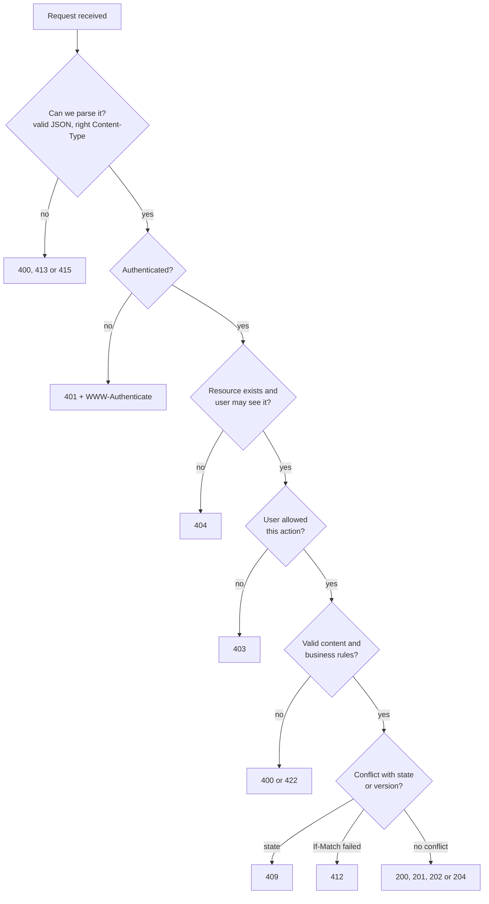
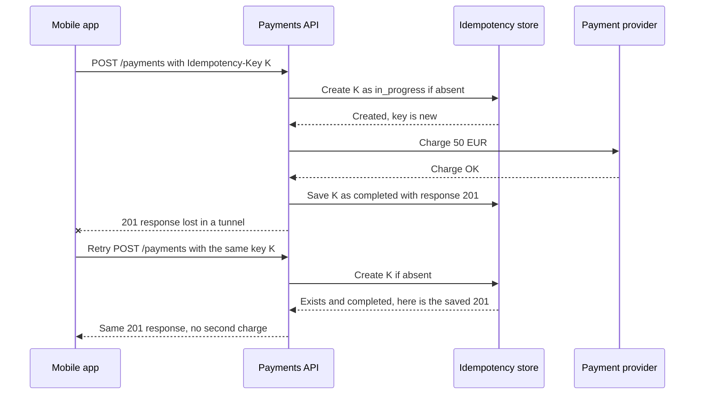
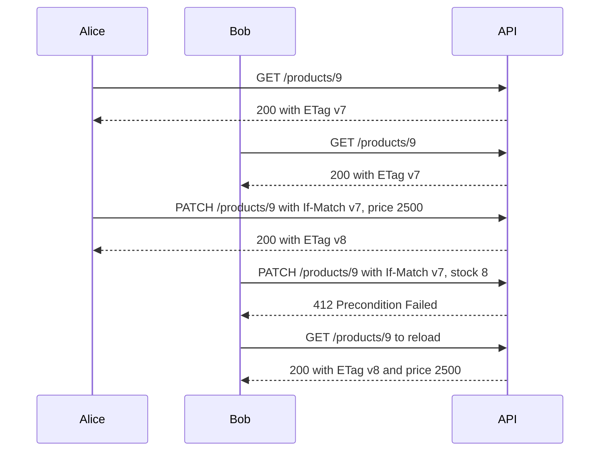
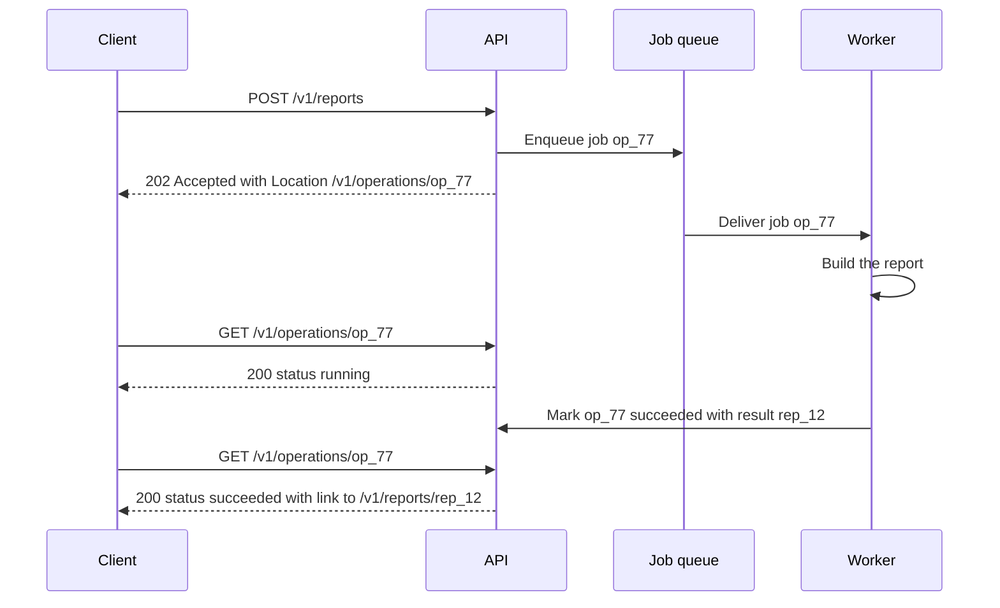
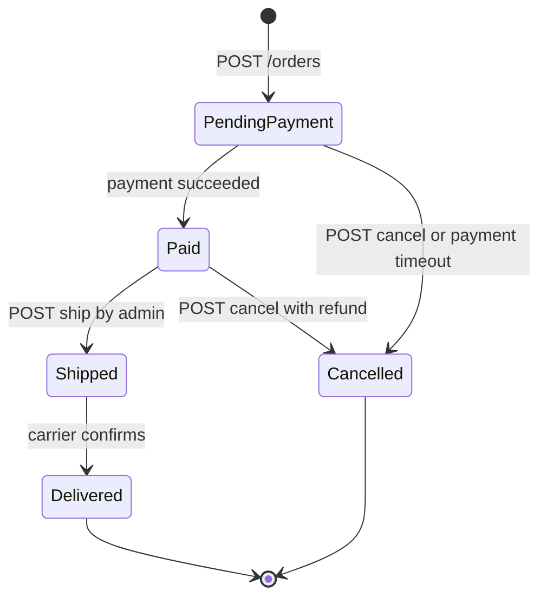

# REST API Design

> In this document you will learn how to design REST APIs that are easy to use, safe to retry and ready for production: resource naming, HTTP methods and idempotency, status codes, error format (RFC 9457), pagination, filtering, versioning, idempotency keys, optimistic concurrency with ETags, bulk and long-running operations, and OpenAPI documentation. It ends with a complete design for an orders API. API design questions appear in almost every backend and full-stack interview, and they are a favorite way to test senior judgment.

**Before this:** [HTTP servers and Express](06-http-servers-and-express.md) · [HTTP, HTTPS and TLS](../01-cs-and-web-fundamentals/05-http-https-and-tls.md) · **Interview questions:** [jump to the interview section](#interview-questions)

## Table of contents

1. [What REST is](#what-rest-is)
2. [Resources and URI naming](#resources-and-uri-naming)
3. [HTTP methods, safety and idempotency](#http-methods-safety-and-idempotency)
4. [Choosing status codes](#choosing-status-codes)
5. [Request and response formats](#request-and-response-formats)
6. [Error format with RFC 9457 Problem Details](#error-format-with-rfc-9457-problem-details)
7. [Pagination](#pagination)
8. [Filtering, sorting and field selection](#filtering-sorting-and-field-selection)
9. [Versioning and evolving an API](#versioning-and-evolving-an-api)
10. [Idempotency keys for safe retries](#idempotency-keys-for-safe-retries)
11. [Concurrency control with ETags](#concurrency-control-with-etags)
12. [Bulk operations](#bulk-operations)
13. [Long-running operations](#long-running-operations)
14. [HATEOAS](#hateoas)
15. [Documenting with OpenAPI](#documenting-with-openapi)
16. [Rate limiting headers](#rate-limiting-headers)
17. [Security basics for REST APIs](#security-basics-for-rest-apis)
18. [Caching API responses](#caching-api-responses)
19. [REST vs GraphQL vs gRPC](#rest-vs-graphql-vs-grpc)
20. [Worked example: an orders API](#worked-example-an-orders-api)
21. [How to explain this in an interview](#how-to-explain-this-in-an-interview)
22. [Common mistakes](#common-mistakes)
23. [Best practices](#best-practices)
24. [Interview questions](#interview-questions)
25. [Summary](#summary)
26. [References](#references)

---

## What REST is

**REST** (Representational State Transfer) is an architectural style for networked applications. Roy Fielding described it in his PhD dissertation in 2000. It is **not** a protocol or a standard. It is a set of rules (called **constraints**). An API that follows them is called **RESTful**.

In practice, a REST API means: **you work with resources (things) identified by URLs, and you use standard HTTP methods and status codes to act on them.**

```text
GET    /orders/1001      -> read order 1001
PATCH  /orders/1001      -> change part of order 1001
DELETE /orders/1001      -> delete order 1001
```

### The constraints in plain words

| Constraint | Plain meaning | What it gives you |
| --- | --- | --- |
| **Client–server** | The frontend and backend are separate and talk only over the API | Each side can change and scale on its own |
| **Stateless** | Every request carries everything the server needs (for example the token). The server does not remember earlier requests in memory | Any server instance can handle any request — easy horizontal scaling |
| **Cacheable** | Responses say whether they can be cached and for how long | Less load, faster clients (browsers, CDNs) |
| **Uniform interface** | Same rules everywhere: resources have URLs, standard methods, self-describing messages (media types, status codes), links | Clients and tools (proxies, caches) understand any REST API |
| **Layered system** | The client cannot tell if it talks to the real server or a proxy, load balancer or CDN | You can add caches and gateways without changing clients |
| **Code on demand** (optional) | The server can send code to run on the client (like JavaScript) | Rarely discussed for APIs |

"Stateless" is often misunderstood. It does **not** mean the server has no database. It means the server keeps no **session state between requests in its own memory**. Application data lives in databases. Session data (if any) lives in a shared store like Redis, so any instance can read it.

**Analogy:** A REST API is like a well-organized library. Every book (resource) has a unique shelf code (URL). There is a small, fixed set of actions that work the same for every book: look at it (GET), add a new book (POST), replace it (PUT), fix a page (PATCH), remove it (DELETE). The librarian does not need to remember you between visits — you show your library card every time (stateless).

### Richardson Maturity Model

A simple way to describe "how RESTful" an API is:

| Level | Description | Example |
| --- | --- | --- |
| 0 | One URL, one method, actions in the body (RPC over HTTP) | `POST /api` with `{"action":"getOrder","id":1}` |
| 1 | Separate URLs for resources | `POST /orders/1` |
| 2 | Resources **plus** correct HTTP methods and status codes | `GET /orders/1` → `200`, `DELETE /orders/1` → `204` |
| 3 | Level 2 **plus** hypermedia links in responses (HATEOAS) | Response contains `"links": {"cancel": "/orders/1/cancel"}` |

Most good production APIs are **level 2**. That is what this document teaches. Level 3 is covered briefly in [HATEOAS](#hateoas).

---

## Resources and URI naming

A **resource** is any "thing" your API exposes: a user, an order, an invoice, a list of order items, even a "password reset request". A **URI** (the path in the URL) identifies the resource.

### Rules for good URIs

1. **Use nouns, not verbs.** The HTTP method is the verb.

   ```text
   ❌ GET  /getOrders          ✅ GET  /orders
   ❌ POST /createOrder        ✅ POST /orders
   ❌ POST /deleteOrder/42     ✅ DELETE /orders/42
   ```

2. **Use plural nouns for collections.** `/orders` is the collection, `/orders/42` is one item in it. Plural everywhere keeps it consistent.

3. **Use lowercase and hyphens (kebab-case) for multi-word paths.** `/order-items`, not `/orderItems` or `/order_items`. URLs are case-sensitive after the host, so mixing cases causes bugs.

4. **Use stable, opaque IDs.** `/orders/ord_8f3k2` or a UUID. Avoid exposing sequential database IDs if they leak business information (like how many orders you have) or make guessing easy. IDs must never be your only protection, though — always check authorization.

5. **No file extensions or trailing slashes.** `/orders/42`, not `/orders/42.json` or `/orders/42/`. Use the `Accept` header for formats.

6. **Query strings are for filtering, sorting and pagination — not for identity.** `/orders?status=paid` filters the collection. `/orders/42` identifies an order.

### Nesting: show relationships, but keep it shallow

Nesting shows that a resource belongs to another one:

```text
GET /customers/7/orders         -> orders of customer 7
GET /orders/42/items            -> items of order 42
```

Rules:

- Nest only when the child **cannot exist without the parent** (order items belong to an order) or when you scope a collection to an owner.
- Keep nesting to **one level** (two at most). Deep paths like `/customers/7/orders/42/items/3/discounts` are hard to use and hard to change.
- Once a child has its own global ID, give it a top-level route too: `GET /orders/42` works without knowing the customer.

```text
❌ /customers/7/orders/42/items/3/discounts
✅ /orders/42/items          (items of an order)
✅ /order-items/3/discounts  (if you really need it, start from the item's own ID)
```

### Actions that do not fit CRUD

Some operations are not "create, read, update, delete". Examples: cancel an order, resend an email, approve an invoice. You have three common options:

| Option | Example | When to use |
| --- | --- | --- |
| Update a state field | `PATCH /orders/42` with `{"status":"cancelled"}` | Simple state change with no extra data or side effects |
| Model the action as a resource (a noun) | `POST /orders/42/cancellations` with `{"reason":"..."}` | The action has its own data and history (who cancelled, why, refund) |
| Controller-style sub-resource (a verb) | `POST /orders/42/cancel` | Pragmatic and very common (Stripe, GitHub use this style); clear for complex workflows |

The `PATCH status` option looks clean, but it hides business rules. Cancelling may trigger a refund and a stock release, and it may be forbidden after shipping. A dedicated `POST /orders/42/cancel` endpoint makes these rules explicit and easier to authorize separately. Pick one style and use it consistently.

### Example resource map for a shop

```text
/customers
/customers/{customerId}
/customers/{customerId}/addresses
/products
/products/{productId}
/orders
/orders/{orderId}
/orders/{orderId}/items
/orders/{orderId}/cancel          (action)
/payments
/payments/{paymentId}
/me                               (alias for the logged-in user)
```

---

## HTTP methods, safety and idempotency

Two properties matter a lot for API design and for interviews:

- **Safe**: the method does not change server state. The client can call it without side effects. (Logging or metrics do not count as changes.)
- **Idempotent**: calling it **once or many times has the same effect on the server** as calling it once. The *response* can differ (for example `DELETE` returns `204` the first time and `404` the second time), but the *state* is the same.

Idempotency is important because **networks fail**. If a request times out, the client does not know if the server processed it. If the method is idempotent, the client can safely send it again.

| Method | Purpose | Safe | Idempotent | Request body | Typical success status |
| --- | --- | --- | --- | --- | --- |
| `GET` | Read a resource or collection | Yes | Yes | No | `200` |
| `HEAD` | Like GET but headers only | Yes | Yes | No | `200` |
| `OPTIONS` | Ask what is allowed (used by CORS preflight) | Yes | Yes | No | `204` / `200` |
| `POST` | Create a resource in a collection, or run an action | No | **No** | Yes | `201` (created), `200`, `202` |
| `PUT` | Replace a resource completely (or create it at a known URL) | No | **Yes** | Yes | `200`, `204`, `201` |
| `PATCH` | Change part of a resource | No | **Not guaranteed** | Yes | `200`, `204` |
| `DELETE` | Delete a resource | No | **Yes** | Usually no | `204`, `200`, `202` |

### Why is PUT idempotent but POST is not?

```text
PUT /users/7/settings   {"theme":"dark","language":"en"}
PUT /users/7/settings   {"theme":"dark","language":"en"}   <- sent twice
Result: settings are {"theme":"dark","language":"en"}. Same as sending once.

POST /orders   {"productId":"p1","quantity":1}
POST /orders   {"productId":"p1","quantity":1}             <- sent twice
Result: TWO orders. Different from sending once.
```

`PUT` says "make the resource look exactly like this". Doing it again changes nothing. `POST` says "add a new one to this collection", so every call adds another. To make `POST` safe to retry, use an [idempotency key](#idempotency-keys-for-safe-retries).

### Why is PATCH not guaranteed to be idempotent?

It depends on the patch:

```text
PATCH /products/9  {"price": 1500}           -> idempotent: sets price to 1500 every time
PATCH /accounts/3  {"op":"increment","by":10} -> NOT idempotent: adds 10 each time
```

Prefer patches that **set values** rather than patches that **apply changes relative to the current value**.

### PUT vs PATCH

| | `PUT` | `PATCH` |
| --- | --- | --- |
| Meaning | Replace the whole resource | Change only the fields sent |
| Missing fields | Are cleared or set to defaults | Are left unchanged |
| Idempotent | Yes | Not guaranteed |
| Typical use | Settings documents, files, resources where the client owns the full state | Most "edit" forms in apps |

```js
// Current product: { name: "Lamp", priceCents: 2000, color: "white" }

// PUT /products/9  { "name": "Desk Lamp", "priceCents": 2500 }
// Result:          { name: "Desk Lamp", priceCents: 2500 }        <- color is gone

// PATCH /products/9  { "priceCents": 2500 }
// Result:            { name: "Lamp", priceCents: 2500, color: "white" }
```

Two standard PATCH formats exist:

- **JSON Merge Patch** (RFC 7396, media type `application/merge-patch+json`): send a partial object. `null` means "remove this field". Simple and common.
- **JSON Patch** (RFC 6902, `application/json-patch+json`): send a list of operations such as `[{"op":"replace","path":"/priceCents","value":2500}]`. More powerful (array edits, `test` operations), more complex.

Most APIs accept a plain partial JSON object with merge-patch semantics, even if they label it `application/json`.

### POST vs PUT for creating

- `POST /orders` — the **server** chooses the ID. Returns `201 Created` with a `Location: /orders/ord_123` header.
- `PUT /documents/my-notes` — the **client** chooses the ID (URL). Returns `201` if new, `200`/`204` if replaced. Naturally idempotent. Useful for uploads or "upsert" semantics.

---

## Choosing status codes

Status codes tell the client **what kind of result** it got, so it can react without parsing the body. Use the right class first, then the specific code.

| Class | Meaning | Who should act |
| --- | --- | --- |
| `2xx` | Success | — |
| `3xx` | Redirect or "use your cached copy" | Client follows or uses cache |
| `4xx` | **Client** error — the request is wrong or not allowed | Client must change something before retrying |
| `5xx` | **Server** error — the request may be fine, the server failed | Client may retry later |

### The codes you should know

| Code | Name | Use it when |
| --- | --- | --- |
| `200` | OK | Successful GET, or PUT/PATCH/POST that returns a body |
| `201` | Created | A new resource was created. Add a `Location` header with its URL |
| `202` | Accepted | Request accepted for **later** processing (async job) |
| `204` | No Content | Success with no body (DELETE, or PUT/PATCH when you return nothing) |
| `301` / `308` | Moved Permanently / Permanent Redirect | A resource has a new permanent URL (`308` keeps the method and body) |
| `304` | Not Modified | Conditional GET: the client's cached copy is still valid |
| `400` | Bad Request | Malformed request: broken JSON, wrong types, missing required fields |
| `401` | Unauthorized | **Not authenticated**: missing, invalid or expired credentials. Send `WWW-Authenticate` |
| `403` | Forbidden | **Authenticated but not allowed** to do this |
| `404` | Not Found | Resource does not exist — **or** you hide that it exists from this user |
| `405` | Method Not Allowed | Method not supported on this URL. Send an `Allow` header |
| `406` | Not Acceptable | Cannot produce the format requested in `Accept` |
| `409` | Conflict | Request conflicts with the current state (duplicate email, order already shipped) |
| `410` | Gone | Resource existed but was permanently removed (for example a retired API version) |
| `412` | Precondition Failed | An `If-Match` / `If-Unmodified-Since` condition failed (someone else changed it) |
| `413` | Content Too Large | Body too big |
| `415` | Unsupported Media Type | Wrong `Content-Type` (you expect JSON) |
| `422` | Unprocessable Content | Body is well-formed but fails validation or business rules |
| `428` | Precondition Required | You require `If-Match` for updates but the client did not send it |
| `429` | Too Many Requests | Rate limit exceeded. Send `Retry-After` |
| `500` | Internal Server Error | Unexpected bug or failure on the server |
| `502` | Bad Gateway | A gateway/proxy got an invalid response from an upstream server |
| `503` | Service Unavailable | Temporarily overloaded or in maintenance. Send `Retry-After` if you know |
| `504` | Gateway Timeout | A gateway/proxy timed out waiting for an upstream server |

### The tricky pairs

**401 vs 403**
- `401`: "I don't know who you are." The token is missing, expired or invalid. The client should log in or refresh the token.
- `403`: "I know who you are, and you can't do this." Logging in again does not help.

**400 vs 422**
- `400`: the server cannot even understand the request (invalid JSON, wrong content type, `"quantity": "abc"`).
- `422`: the request is understood, but the content is invalid (`"quantity": -5`, "end date before start date").
- Many APIs use `400` for all validation errors, and that is fine. **Pick one policy and document it.**

**404 vs 403 for resources the user may not see**
- If a user asks for `/orders/42` and it belongs to someone else, returning `403` confirms that order 42 exists. Returning `404` hides it. For private resources, `404` is usually safer.

**409 vs 412**
- `409`: a conflict with the resource's **state** (cannot cancel a shipped order; email already used).
- `412`: a failed **precondition header** (`If-Match` ETag does not match the current version).

**500 vs 502/503/504**
- `500`: your code failed. `502`/`504`: something between you and an upstream failed or was too slow (often produced by the proxy, not your code). `503`: you are temporarily unable to serve (overload, maintenance, dependency down).

### A decision flow



The order of checks matters too. Check authentication before validation, so anonymous users cannot learn about your validation rules or resource existence.

### Never return 200 for errors

```js
// ❌ Wrong: HTTP 200 with an error inside
{ "success": false, "error": "Order not found" }
```

Monitoring, caches, retries and client libraries all rely on the status code. A `200` with an error body breaks all of them. Return `404` with an error body instead.

---

## Request and response formats

Consistency is the most important rule. A client developer should be able to guess how a new endpoint works after using two others.

### JSON conventions

| Topic | Recommendation | Example |
| --- | --- | --- |
| Media type | `application/json` for requests and responses | `Content-Type: application/json` |
| Field names | One style everywhere — `camelCase` is natural for JavaScript clients | `createdAt`, `totalCents` |
| Dates and times | ISO 8601 strings in UTC | `"2026-03-02T10:15:00Z"` |
| Money | Integer minor units (cents) **plus** a currency code. Never floats | `{"amountCents": 1999, "currency": "EUR"}` |
| IDs | Strings, even if numeric in the DB (JavaScript loses precision above 2^53 − 1) | `"id": "9007199254740993"` |
| Enums | Lowercase strings, documented | `"status": "paid"` |
| Booleans | Real booleans, named positively | `"isActive": true` |
| Empty collections | `[]`, not `null` | `"items": []` |
| Missing vs null | Be consistent: omit unknown fields, or always send `null` | `"shippedAt": null` |

Why integers for money:

```js
console.log(0.1 + 0.2);            // 0.30000000000000004
console.log(1999 + 2999);           // 4998 -> exact, display as 49.98
```

Why string IDs:

```js
console.log(JSON.parse('{"id": 9007199254740993}').id); // 9007199254740992 (wrong!)
console.log(JSON.parse('{"id": "9007199254740993"}').id); // '9007199254740993'
```

### Single resource and collection shapes

A single resource is returned as an object:

```json
{
  "id": "ord_8f3k2",
  "status": "paid",
  "customerId": "cus_19",
  "totalCents": 4998,
  "currency": "EUR",
  "createdAt": "2026-03-02T10:15:00Z"
}
```

A collection is best wrapped in an object (an **envelope**), so you can add pagination data later without breaking clients:

```json
{
  "data": [
    { "id": "ord_8f3k2", "status": "paid", "totalCents": 4998 },
    { "id": "ord_7a1m9", "status": "pending", "totalCents": 1200 }
  ],
  "page": {
    "nextCursor": "eyJjcmVhdGVkQXQiOiIyMDI2LTAzLTAyVDEwOjAwOjAwWiIsImlkIjoibzIifQ",
    "hasMore": true
  }
}
```

```js
// ❌ A bare array cannot grow: where would you put "nextCursor" later?
[ { "id": "ord_8f3k2" }, { "id": "ord_7a1m9" } ]
```

### Content negotiation

The client says what it sends with `Content-Type` and what it wants back with `Accept`.

```text
POST /orders
Content-Type: application/json      <- what I send
Accept: application/json            <- what I want back
```

If the client sends XML to a JSON-only endpoint, answer `415`. If it asks for a format you cannot produce, answer `406` (or just send JSON, which many APIs do).

### Return the created or updated resource

After `POST`, `PUT` or `PATCH`, return the full resource as the server now sees it (with server-generated fields like `id`, `createdAt`, `status`). The client then does not need a second `GET`.

```text
HTTP/1.1 201 Created
Location: /orders/ord_8f3k2
Content-Type: application/json

{ "id": "ord_8f3k2", "status": "pending", ... }
```

---

## Error format with RFC 9457 Problem Details

Every error from your API should have **the same shape**. Clients can then handle errors in one place. Instead of inventing your own format, use the standard: **RFC 9457 "Problem Details for HTTP APIs"** (published July 2023; it replaces RFC 7807).

### The standard fields

The media type is `application/problem+json`.

| Field | Meaning | Example |
| --- | --- | --- |
| `type` | A URI that identifies the **kind** of problem. Clients use it as the main error identifier. Defaults to `"about:blank"` | `"https://api.shop.example/problems/out-of-stock"` |
| `title` | Short, human-readable summary of the problem **type** (same for every occurrence) | `"Product out of stock"` |
| `status` | The HTTP status code (must match the real response status) | `409` |
| `detail` | Human-readable explanation of **this** occurrence, to help the client fix it | `"Only 2 units of SKU-1 are left, you asked for 5."` |
| `instance` | A URI that identifies **this** occurrence | `"/orders/requests/req_7f2c"` |

You can add **extension members** for extra data. Clients must ignore extensions they do not understand.

```text
HTTP/1.1 409 Conflict
Content-Type: application/problem+json

{
  "type": "https://api.shop.example/problems/out-of-stock",
  "title": "Product out of stock",
  "status": 409,
  "detail": "Only 2 units of SKU-1 are left, you asked for 5.",
  "instance": "/requests/req_7f2c",
  "productId": "SKU-1",
  "available": 2,
  "requestId": "req_7f2c"
}
```

### Validation errors

Validation usually produces several errors at once. Return them all, so the user can fix the whole form in one go. RFC 9457 shows an `errors` extension in its examples:

```text
HTTP/1.1 422 Unprocessable Content
Content-Type: application/problem+json

{
  "type": "https://api.shop.example/problems/validation",
  "title": "Your request is not valid",
  "status": 422,
  "detail": "2 fields have problems.",
  "errors": [
    { "pointer": "#/items/0/quantity", "detail": "must be greater than 0" },
    { "pointer": "#/shippingAddress/postalCode", "detail": "is required" }
  ]
}
```

The `pointer` is a JSON Pointer (RFC 6901) into the request body. A frontend can map it to the form field and show the message next to it.

### Producing problem details in Express

```ts
import type { ErrorRequestHandler } from "express";

export class ProblemError extends Error {
  readonly status: number;
  readonly type: string;
  readonly title: string;
  readonly extensions: Record<string, unknown>;

  constructor(opts: { status: number; type: string; title: string; detail?: string; extensions?: Record<string, unknown> }) {
    super(opts.detail ?? opts.title);
    this.status = opts.status;
    this.type = opts.type;
    this.title = opts.title;
    this.extensions = opts.extensions ?? {};
  }
}

export const problemHandler: ErrorRequestHandler = (err, req, res, next) => {
  if (res.headersSent) {
    next(err);
    return;
  }
  const requestId = req.get("x-request-id") ?? undefined;

  if (err instanceof ProblemError) {
    res.status(err.status).type("application/problem+json").json({
      type: err.type,
      title: err.title,
      status: err.status,
      detail: err.message,
      requestId,
      ...err.extensions,
    });
    return;
  }

  console.error({ requestId, err }); // full details only in logs
  res.status(500).type("application/problem+json").json({
    type: "about:blank",
    title: "Internal Server Error",
    status: 500,
    requestId,
  });
};

// Usage in a service
throw new ProblemError({
  status: 409,
  type: "https://api.shop.example/problems/out-of-stock",
  title: "Product out of stock",
  detail: `Only ${available} units of ${sku} are left, you asked for ${quantity}.`,
  extensions: { productId: sku, available },
});
```

Tips:

- The `type` URI does not have to resolve, but it is nice if it points to a documentation page.
- Keep `title` stable; put specifics in `detail`.
- **Never** put stack traces, SQL or internal hostnames in any field.
- Always include a request ID so support can find the log entry.

The full error-handling system (error classes, validation libraries, logging) is in [Validation and error handling](08-validation-and-error-handling.md).

---

## Pagination

Never return an unbounded list. A table that has 50 rows today can have 5 million next year. Every collection endpoint needs **pagination**: returning the data in pages.

### Offset pagination (`limit` + `offset`)

```text
GET /orders?limit=20&offset=40      -> rows 41 to 60
```

```sql
SELECT id, created_at, total_cents
FROM orders
WHERE customer_id = $1
ORDER BY created_at DESC, id DESC
LIMIT 20 OFFSET 40;
```

A variant is **page-based**: `?page=3&pageSize=20` (offset = (page − 1) × pageSize).

**Advantages:**
- Very simple to build and understand.
- Clients can jump to any page ("go to page 7") and show page numbers.

**Disadvantages:**
- **Slow for big offsets.** `OFFSET 1000000` makes the database read and throw away one million rows before returning 20.
- **Unstable when data changes.** If a new row is inserted at the top while the user pages, every row shifts by one. The user sees a duplicate (or misses a row if one is deleted).

Real run (SQLite, ordered newest first, page size 2): page 1 returned `o5, o4`. Then a new order `o6` was inserted. Page 2 (`OFFSET 2`) returned `o4, o3` — **`o4` appeared twice**.

### Cursor pagination (keyset pagination)

Instead of "skip N rows", the client says "give me rows **after this one**". The **cursor** encodes the sort position of the last row the client saw.

```text
GET /orders?limit=20
-> { "data": [...20 orders...], "page": { "nextCursor": "eyJjcmVhdGVkQXQi...", "hasMore": true } }

GET /orders?limit=20&cursor=eyJjcmVhdGVkQXQi...
-> next 20 orders
```

The SQL uses a `WHERE` condition on the sort columns instead of `OFFSET`:

```sql
-- Sort by created_at DESC, and use id as a tie-breaker so the order is unique.
SELECT id, created_at, total_cents
FROM orders
WHERE customer_id = $1
  AND (created_at, id) < ($2, $3)    -- position of the last row from the previous page
ORDER BY created_at DESC, id DESC
LIMIT 21;                            -- one extra row tells us if there is a next page
```

With an index on `(customer_id, created_at DESC, id DESC)`, the database jumps straight to the right place in the index. Page 1 and page 50,000 are equally fast. (SQLite's query plan for this query: `SEARCH orders USING COVERING INDEX orders_customer_created_id (customer_id=? AND (created_at,id)<(?,?))`.)

```ts
// Cursor helpers: the cursor is opaque to clients (base64url of JSON).
interface OrderCursor {
  createdAt: string; // ISO timestamp of the last row
  id: string;        // tie-breaker
}

export function encodeCursor(cursor: OrderCursor): string {
  return Buffer.from(JSON.stringify(cursor)).toString("base64url");
}

export function decodeCursor(raw: string): OrderCursor {
  try {
    const value: unknown = JSON.parse(Buffer.from(raw, "base64url").toString("utf8"));
    if (
      typeof value === "object" && value !== null &&
      typeof (value as OrderCursor).createdAt === "string" &&
      typeof (value as OrderCursor).id === "string"
    ) {
      return value as OrderCursor;
    }
  } catch {
    // fall through
  }
  throw new ProblemError({ status: 400, type: "https://api.shop.example/problems/invalid-cursor", title: "Invalid cursor" });
}

export async function listOrders(customerId: string, limit: number, rawCursor?: string) {
  const params: unknown[] = [customerId];
  let where = "customer_id = $1";
  if (rawCursor) {
    const c = decodeCursor(rawCursor);
    params.push(c.createdAt, c.id);
    where += " AND (created_at, id) < ($2, $3)";
  }
  params.push(limit + 1);

  const { rows } = await pool.query(
    `SELECT id, created_at AS "createdAt", total_cents AS "totalCents"
     FROM orders WHERE ${where}
     ORDER BY created_at DESC, id DESC
     LIMIT $${params.length}`,
    params,
  );

  const hasMore = rows.length > limit;
  const data = rows.slice(0, limit);
  const last = data.at(-1);
  return {
    data,
    page: {
      hasMore,
      nextCursor: hasMore && last ? encodeCursor({ createdAt: last.createdAt, id: last.id }) : null,
    },
  };
}
```

Walkthrough with five orders (`o1` oldest … `o5` newest, where `o2` and `o3` have the **same** timestamp) and `limit = 2` (tested with SQLite):

1. Page 1: no cursor → returns `o5, o4`. There was a third row, so `hasMore = true`. The cursor encodes `o4`'s `(createdAt, id)`.
2. Page 2: rows "less than" `o4`'s position → `o3, o2`. The tie-breaker `id` keeps `o2` and `o3` in a fixed order even though their timestamps are equal.
3. Page 3: rows less than `o2` → `o1`. No extra row, so `hasMore = false` and `nextCursor = null`.

Without the `id` tie-breaker, rows with equal timestamps could be skipped or repeated between pages.

**Advantages of cursors:**
- Fast at any depth (uses the index).
- Stable: inserts and deletes do not cause duplicates or gaps.
- Works well for infinite scroll and feeds.

**Disadvantages:**
- No "jump to page 7". Only next (and previous, if you also build a `prevCursor`).
- The sort order must be fixed and unique (add a tie-breaker column).
- Changing the sort means a different cursor format.
- More complex to build.

### Comparison

| | Offset / page | Cursor (keyset) |
| --- | --- | --- |
| Jump to page N | Yes | No |
| Performance at deep pages | Gets slower | Constant |
| Consistent under inserts/deletes | No (duplicates or gaps) | Yes |
| Implementation | Easy | Medium |
| Good for | Admin tables with page numbers, small datasets | Feeds, infinite scroll, large tables, public APIs, data exports |

### Total counts

Clients often want "showing 1–20 of 12,345". A `COUNT(*)` over a big filtered table can be as slow as the query itself. Options:

- Return a total only when asked (`?includeTotal=true`).
- Return an estimate for large tables.
- Return `hasMore` only (enough for "Load more" buttons).

### Link headers

Some APIs (for example GitHub's) also send page links in the standard `Link` header (RFC 8288):

```text
Link: <https://api.shop.example/orders?limit=20&cursor=eyJ...>; rel="next"
```

### Always cap `limit`

```ts
const limit = Math.min(Math.max(Number(req.query.limit) || 20, 1), 100); // default 20, between 1 and 100
```

Without a maximum, `?limit=1000000` turns your pagination into a denial-of-service tool.

---

## Filtering, sorting and field selection

### Filtering

Use query parameters named after fields:

```text
GET /orders?status=paid
GET /orders?status=paid,shipped              (several values)
GET /orders?createdAfter=2026-01-01T00:00:00Z&createdBefore=2026-02-01T00:00:00Z
GET /products?minPriceCents=1000&maxPriceCents=5000
GET /products?q=desk lamp                     (free-text search)
```

Some APIs use bracket styles like `?price[gte]=1000` or `?filter[status]=paid`. Any style works if it is consistent and documented.

### Sorting

```text
GET /orders?sort=-createdAt            (minus = descending)
GET /products?sort=priceCents,-rating  (several fields)
```

**Security warning:** column names cannot be passed as SQL parameters. If you build `ORDER BY ${sort}` from user input, you have SQL injection. Always map allowed values to known columns:

```ts
const SORTABLE = {
  createdAt: "created_at",
  totalCents: "total_cents",
} as const;

function toOrderBy(sortParam = "-createdAt"): string {
  const parts = sortParam.split(",").map((raw) => {
    const desc = raw.startsWith("-");
    const field = desc ? raw.slice(1) : raw;
    const column = SORTABLE[field as keyof typeof SORTABLE];
    if (!column) {
      throw new ProblemError({ status: 400, type: "https://api.shop.example/problems/invalid-sort", title: "Invalid sort field", detail: `Cannot sort by "${field}"` });
    }
    return `${column} ${desc ? "DESC" : "ASC"}`;
  });
  return [...parts, "id DESC"].join(", "); // tie-breaker for stable order
}

console.log(toOrderBy("-createdAt"));           // created_at DESC, id DESC
console.log(toOrderBy("totalCents,-createdAt")); // total_cents ASC, created_at DESC, id DESC
```

Also remember: every filter and sort combination that is used often needs a matching **database index**. A beautiful filter API on an unindexed table is a slow API. (See [Databases](10-databases.md).)

### Field selection (sparse fieldsets)

Let clients ask for only the fields they need, to save bandwidth on mobile:

```text
GET /orders/ord_8f3k2?fields=id,status,totalCents
-> { "id": "ord_8f3k2", "status": "paid", "totalCents": 4998 }
```

Use an allowlist of selectable fields, the same way as for sorting.

### Expanding related resources

The opposite problem: the client needs related data and has to make many calls. Some APIs offer `expand` (Stripe's term) or `include`:

```text
GET /orders/ord_8f3k2?expand=customer,items
```

Keep it limited (one level, allowlisted relations), or clients can create very expensive queries. If clients need very flexible shapes, that is a sign GraphQL may fit better (see [REST vs GraphQL vs gRPC](#rest-vs-graphql-vs-grpc)).

---

## Versioning and evolving an API

Once clients use your API, you cannot change it freely. Mobile apps in particular stay installed for years. **Versioning** lets you make breaking changes without breaking existing clients.

### Breaking vs non-breaking changes

| Non-breaking (safe) | Breaking (needs a new version or a migration plan) |
| --- | --- |
| Adding a new endpoint | Removing or renaming an endpoint or field |
| Adding an optional request field | Making an optional field required |
| Adding a field to a response | Changing a field's type (`"42"` → `42`) or meaning |
| Adding a new optional query parameter | Changing default behavior (sort order, page size) |
| Adding a new enum value **if clients were told to expect unknown values** | Changing status codes or the error format |
| Relaxing validation | Tightening validation |

Clients should be **tolerant readers**: ignore unknown fields and handle unknown enum values. Say this in your docs.

### Versioning strategies

| Strategy | Example | Pros | Cons |
| --- | --- | --- | --- |
| **URI path** | `GET /v1/orders` | Very visible; easy to route, cache and test in a browser; most common | Version is part of the resource URL (purists dislike it); whole API versions at once |
| **Header** | `Api-Version: 2` or `Accept: application/vnd.shop.v2+json` | Clean URLs; can version per resource | Hidden; harder to test and cache (needs `Vary`) |
| **Query parameter** | `GET /orders?version=2` | Easy to add | Easy to forget; mixes with filters |
| **Date-based** (Stripe style) | `Stripe-Version: 2025-03-31` pinned per account | Small, frequent changes; each client stays on its version | Requires a compatibility layer that transforms responses |

For most teams, **URI versioning with a major version only** (`/v1`, `/v2`) is the pragmatic choice. Use it rarely: try hard to make changes additive so you stay on `v1` for years.

### Deprecating old versions

1. Announce the deprecation and the shutdown date in docs and changelogs.
2. Send machine-readable headers on deprecated endpoints:

   ```text
   Deprecation: @1767225599                          (RFC 9745: deprecated since this Unix time)
   Sunset: Thu, 01 Jul 2027 00:00:00 GMT             (RFC 8594: will stop working after this date)
   Link: <https://api.shop.example/docs/migrate-v2>; rel="deprecation"
   ```

3. Monitor who still calls the old version (by API key or client ID) and contact them.
4. After the sunset date, return `410 Gone` with a problem-details body that links to the migration guide.

### Express: mounting versions

```ts
app.use("/v1/orders", ordersRouterV1);
app.use("/v2/orders", ordersRouterV2); // only the parts that changed are new; share services
```

Versions should share the same services and database. Only the HTTP layer (request/response mapping) differs.

---

## Idempotency keys for safe retries

### The problem

A mobile app sends `POST /payments` to charge €50. The server charges the card, but the response is lost because the train enters a tunnel. The app sees a timeout. What now?

- If the app **does not retry**, the user may think the payment failed and pay again some other way.
- If the app **retries**, the user may be charged twice.

A timeout does **not** tell you whether the server did the work. `POST` is not idempotent, so a blind retry is dangerous.

### The solution

The client generates a unique **idempotency key** (usually a UUID v4) for each *intended operation* and sends it in a header. If the server sees the same key again, it does not repeat the work. It returns the **saved result** of the first request.

```text
POST /v1/payments
Idempotency-Key: 9b2f6a1e-5c4d-4c4c-8e8e-3f1a2b3c4d5e
Content-Type: application/json

{ "orderId": "ord_42", "amountCents": 5000, "currency": "EUR" }
```

The header name `Idempotency-Key` is used by Stripe, PayPal and many others, and it is being standardized in an IETF draft ("The Idempotency-Key HTTP Header Field" — still a draft, not an RFC, at the time of writing).

### Server rules

| Situation | Server response |
| --- | --- |
| Key is new | Process the request, **store** the key + a hash of the request + the response |
| Key exists, same request, finished | Return the stored response again (do not process again) |
| Key exists, same request, **still running** | `409 Conflict` — "a request with this key is in progress" |
| Key exists, **different** request body | `422 Unprocessable Content` — the key was reused for something else |
| Key missing on an endpoint that requires one | `400 Bad Request` |

These match the error cases described in the IETF draft.



### Implementation

The key detail: **"check if the key exists" and "mark it as in progress" must be one atomic step.** Otherwise two parallel retries can both see "key is new" and both charge the card. With Redis this is `SET key value NX EX ttl` ("set only if Not eXists, with expiry"). With SQL it is an `INSERT` into a table with a unique constraint on the key.

```ts
import { createHash } from "node:crypto";

interface StoredResponse { status: number; body: unknown }

type IdempotencyRecord =
  | { state: "in_progress"; requestHash: string }
  | { state: "completed"; requestHash: string; response: StoredResponse };

interface IdempotencyStore {
  /** Atomically saves the record only if the key is new. Returns the existing record otherwise. */
  createIfAbsent(key: string, record: IdempotencyRecord, ttlSeconds: number): Promise<IdempotencyRecord | null>;
  save(key: string, record: IdempotencyRecord, ttlSeconds: number): Promise<void>;
  delete(key: string): Promise<void>;
}

const TTL_SECONDS = 24 * 60 * 60; // keep keys for 24 hours

export function hashRequest(method: string, path: string, body: unknown): string {
  return createHash("sha256").update(`${method} ${path}\n${JSON.stringify(body)}`).digest("hex");
}

export async function runIdempotent(
  store: IdempotencyStore,
  key: string,
  requestHash: string,
  operation: () => Promise<StoredResponse>,
): Promise<StoredResponse & { replayed: boolean }> {
  const existing = await store.createIfAbsent(key, { state: "in_progress", requestHash }, TTL_SECONDS);

  if (existing) {
    if (existing.requestHash !== requestHash) {
      throw new AppError(422, "IDEMPOTENCY_KEY_REUSED", "This Idempotency-Key was used with a different request");
    }
    if (existing.state === "in_progress") {
      throw new AppError(409, "REQUEST_IN_PROGRESS", "A request with this Idempotency-Key is still running");
    }
    return { ...existing.response, replayed: true };
  }

  try {
    const response = await operation();
    await store.save(key, { state: "completed", requestHash, response }, TTL_SECONDS);
    return { ...response, replayed: false };
  } catch (error) {
    await store.delete(key); // let the client retry (safe only if nothing was committed)
    throw error;
  }
}
```

A Redis store with the official `redis` client:

```ts
import type { RedisClientType } from "redis";

export function createRedisIdempotencyStore(redis: RedisClientType): IdempotencyStore {
  return {
    async createIfAbsent(key, record, ttlSeconds) {
      const ok = await redis.set(`idem:${key}`, JSON.stringify(record), { NX: true, EX: ttlSeconds });
      if (ok === "OK") return null; // we created it: the key is new
      const raw = await redis.get(`idem:${key}`);
      return raw ? (JSON.parse(raw) as IdempotencyRecord) : null;
    },
    async save(key, record, ttlSeconds) {
      await redis.set(`idem:${key}`, JSON.stringify(record), { EX: ttlSeconds });
    },
    async delete(key) {
      await redis.del(`idem:${key}`);
    },
  };
}
```

Using it in an Express route:

```ts
paymentsRouter.post("/", authenticate, validateBody(createPaymentSchema), async (req, res) => {
  const rawKey = req.get("idempotency-key");
  if (!rawKey || !/^[A-Za-z0-9_-]{8,100}$/.test(rawKey)) {
    throw new AppError(400, "IDEMPOTENCY_KEY_REQUIRED", "Send a valid Idempotency-Key header");
  }
  // Scope the key to the caller, so two users can never collide or read each other's results.
  const key = `${req.user!.id}:${rawKey}`;
  const result = await runIdempotent(store, key, hashRequest("POST", "/v1/payments", res.locals.body), async () => {
    const payment = await paymentService.charge(req.user!.id, res.locals.body);
    return { status: 201, body: payment };
  });
  if (result.replayed) res.set("Idempotent-Replayed", "true");
  res.status(result.status).json(result.body);
});
```

Tested behavior (two parallel calls with one key, then a retry, then a different body): the parallel call got `409 REQUEST_IN_PROGRESS`, the first call got `201`, the retry got the **same** `201` with `replayed: true`, the different body got `422 IDEMPOTENCY_KEY_REUSED`, and the card was charged **exactly once**.

### Important details

- **Scope the key** to the authenticated user (or API client). Otherwise one user could replay another user's response by guessing a key.
- **Store a hash of the request.** Reusing a key with a different body is a client bug; reject it with `422`.
- **Expire keys** (24 hours is common). Keys only need to live as long as clients retry.
- **The strongest design keeps the key in the same database transaction as the business write.** For example, a `payments` table with a unique constraint on `(user_id, idempotency_key)`. Then "payment created" and "key recorded" can never get out of sync — even if the process crashes between the two steps. The Redis approach above has a small gap: if the process crashes after charging but before `save()`, the key stays `in_progress` until it expires.
- Idempotency keys protect against **duplicate requests**. They do not replace other protections (like a unique constraint that prevents two payments for the same order).
- Clients must reuse the **same key for retries of the same operation** and create a **new key for a new operation**. Generate the key when the user clicks "Pay", not inside the retry loop.

---

## Concurrency control with ETags

### The lost update problem

Two admins edit the same product at the same time:

1. Alice loads product 9: `{ name: "Lamp", priceCents: 2000, stock: 10 }`.
2. Bob loads product 9 too.
3. Alice changes the price to 2500 and saves (`PUT` with the full object).
4. Bob changes the stock to 8 and saves (`PUT` with **his** old copy: price 2000).
5. Result: price is back to 2000. **Alice's change is silently lost.**

This is the **lost update** problem. The fix is **optimistic concurrency control**: every version of the resource has an identifier. An update only succeeds if the client proves it edited the latest version.

### ETag and If-Match

- The server sends an **ETag** (entity tag) header with each resource. It identifies the version, for example `ETag: "v7"` or a hash of the content.
- When updating, the client sends `If-Match: "v7"`. The server applies the change **only if the current ETag is still `"v7"`**. Otherwise it answers **`412 Precondition Failed`**.



Bob's client reloads, shows him the new data and lets him apply his change again. No change is lost.

### Implementation with a version column

The database check must be **atomic**. Do not "read, compare, then write" in separate steps — another request can sneak in between. Put the version check **in the `UPDATE` statement itself**:

```sql
UPDATE products
SET price_cents = $1, version = version + 1, updated_at = now()
WHERE id = $2 AND version = $3      -- only if nobody changed it since the client read it
RETURNING id, name, price_cents, stock, version;
```

If zero rows were updated, either the product does not exist or the version changed.

```ts
productsRouter.get("/:id", async (req, res) => {
  const product = await productService.getById(req.params.id);
  res.set("ETag", `"v${product.version}"`);
  res.json(product);
});

productsRouter.patch("/:id", validateBody(updateProductSchema), async (req, res) => {
  const ifMatch = req.get("if-match");
  if (!ifMatch) {
    throw new AppError(428, "PRECONDITION_REQUIRED", "Send If-Match with the ETag you received");
  }
  const match = /^"v(\d+)"$/.exec(ifMatch);
  if (!match) throw new AppError(412, "PRECONDITION_FAILED", "Unknown ETag");

  const { rows } = await pool.query(
    `UPDATE products
     SET price_cents = COALESCE($1, price_cents), stock = COALESCE($2, stock), version = version + 1
     WHERE id = $3 AND version = $4
     RETURNING id, name, price_cents AS "priceCents", stock, version`,
    [res.locals.body.priceCents ?? null, res.locals.body.stock ?? null, req.params.id, Number(match[1])],
  );

  if (rows.length === 0) {
    const exists = await productService.exists(req.params.id);
    if (!exists) throw new AppError(404, "NOT_FOUND", "Product not found");
    throw new AppError(412, "PRECONDITION_FAILED", "The product was changed by someone else. Reload and try again.");
  }

  res.set("ETag", `"v${rows[0].version}"`);
  res.json(rows[0]);
});
```

### Strong vs weak ETags

- **Strong ETag** `"v7"`: the representation is byte-for-byte identical. Required for `If-Match`.
- **Weak ETag** `W/"v7"`: "semantically the same" (for example, differently compressed). Good for caching (`If-None-Match`), but **never matches** in an `If-Match` comparison.

### ETags also power caching

The same ETag supports **conditional GET**: the client sends `If-None-Match: "v7"`. If nothing changed, the server answers `304 Not Modified` with no body. That saves bandwidth. Express sets weak ETags on `res.send` responses automatically. Details in [Caching](11-caching.md).

### Alternatives

| Approach | How | When |
| --- | --- | --- |
| ETag + `If-Match` | HTTP-standard optimistic locking | Public APIs, generic clients, caches |
| `version` field in the body | Client sends `"version": 7` in the PATCH body | Simpler for some frontends; same database logic |
| `If-Unmodified-Since` with timestamps | Uses `Last-Modified` | Weaker: one-second resolution, clock issues |
| Pessimistic locking (`SELECT ... FOR UPDATE`) | Lock the row during the transaction | Short server-side transactions; never across user think time |
| Last write wins | No check | Only when overwriting is truly acceptable |

---

## Bulk operations

Sometimes clients need to create or update many items at once: importing 500 products, marking 50 notifications as read. One request per item is slow (500 round trips). A **bulk endpoint** handles a batch in one request.

```text
POST /v1/products/batch
Content-Type: application/json

{ "items": [ { "sku": "A1", "name": "Lamp", "priceCents": 2000 },
             { "sku": "A2", "name": "",     "priceCents": 1500 } ] }
```

### Design decisions

**1. All-or-nothing (atomic) or partial success?**

| Atomic | Partial success |
| --- | --- |
| One transaction; if any item fails, nothing is saved | Each item succeeds or fails on its own |
| Simple to reason about | Better for large imports where a few bad rows are normal |
| Response: `201` for all, or `422` with the failing items | Response: `200` with a result per item |

A partial-success response:

```json
{
  "results": [
    { "index": 0, "status": 201, "id": "prod_91" },
    { "index": 1, "status": 422, "error": { "type": "https://api.shop.example/problems/validation", "detail": "name is required" } }
  ],
  "summary": { "succeeded": 1, "failed": 1 }
}
```

Some APIs use `207 Multi-Status` (from WebDAV) for this. A `200` with a clear per-item result array is simpler and very common.

**2. Limits.** Cap the batch size (for example 100 or 1,000 items) and the body size. Return `413` or `422` when exceeded.

**3. Idempotency.** Batches are retried too. Support an `Idempotency-Key`, or make each item idempotent with a client-supplied key (like `sku`) and upsert semantics.

**4. Very large batches** (100,000 rows) should not run inside one HTTP request. Upload the file, return `202 Accepted`, and process it in the background (next section).

Bulk **reads** are simpler: `GET /v1/products?ids=p1,p2,p3` (with a cap on the number of IDs).

---

## Long-running operations

Some work takes longer than a normal HTTP request should: generating a big report, video processing, importing a file, provisioning infrastructure. Holding the request open for minutes is a bad idea. Proxies time out (often after 30–60 seconds), clients give up, and server connections stay busy.

### The pattern: 202 Accepted + a status resource

1. The client starts the work: `POST /v1/reports`.
2. The server validates the input, creates a **job** (or "operation") record, puts the work on a queue, and immediately answers **`202 Accepted`** with a `Location` header pointing to the job.
3. The client **polls** the job URL. The response contains the status and, when finished, a link to the result.
4. Optionally, the server also sends a **webhook** or a push notification when the job finishes, so clients do not have to poll.

```text
POST /v1/reports
{ "type": "sales", "from": "2026-01-01", "to": "2026-03-31" }

HTTP/1.1 202 Accepted
Location: /v1/operations/op_77
Retry-After: 5

{ "id": "op_77", "status": "queued", "createdAt": "2026-04-01T09:00:00Z" }
```

```text
GET /v1/operations/op_77
-> 200 { "id": "op_77", "status": "running", "progress": 0.4 }

GET /v1/operations/op_77
-> 200 { "id": "op_77", "status": "succeeded",
         "result": { "href": "/v1/reports/rep_12" } }
```



### Design tips

- Use clear states: `queued`, `running`, `succeeded`, `failed`, `cancelled`. Include an error object (problem details) when `failed`.
- Send `Retry-After` so clients poll at a sensible rate (and apply rate limits to polling).
- Allow cancellation if it makes sense: `POST /v1/operations/op_77/cancel` or `DELETE /v1/operations/op_77`.
- Make the start request idempotent (idempotency key), so a retry does not start two reports.
- Keep operation records for a while (for example 7 days), then clean up.
- For real-time updates, server-sent events or WebSockets can replace polling (see [API styles and real-time communication](../09-system-design/04-api-styles-and-real-time-communication.md)).

The queue and worker side is covered in [Background jobs and queues](13-background-jobs-and-queues.md).

---

## HATEOAS

**HATEOAS** (Hypermedia As The Engine Of Application State) is the last REST constraint (Richardson level 3). The idea: responses contain **links to the actions that are possible now**, so the client discovers what it can do instead of hard-coding URLs and rules.

```json
{
  "id": "ord_42",
  "status": "pending",
  "totalCents": 4998,
  "links": {
    "self":   { "href": "/v1/orders/ord_42" },
    "pay":    { "href": "/v1/orders/ord_42/payments", "method": "POST" },
    "cancel": { "href": "/v1/orders/ord_42/cancel",   "method": "POST" }
  }
}
```

When the order is shipped, the server simply stops including the `cancel` link. The client shows a "Cancel" button only if the link exists.

**Advantages:** the server controls workflow rules in one place; URLs can change without breaking clients; the API is self-documenting.

**Disadvantages:** bigger responses; most client developers still read docs and hard-code URLs; tooling support is limited; formats (HAL, JSON:API, Siren) differ.

In practice, most APIs use only a light version: `self` links, pagination links and maybe a few action links. Know the concept and the trade-off for interviews.

---

## Documenting with OpenAPI

An API without documentation is hard to use. The standard way to describe a REST API is the **OpenAPI Specification** (formerly "Swagger"). It is a YAML or JSON file that describes every endpoint, parameter, request body, response and security scheme. Current versions are OpenAPI 3.1 (fully aligned with JSON Schema) and 3.2 (released September 2025).

```yaml
openapi: 3.1.0
info:
  title: Shop API
  version: 1.0.0
paths:
  /v1/orders:
    post:
      summary: Create an order
      operationId: createOrder
      security:
        - bearerAuth: []
      parameters:
        - name: Idempotency-Key
          in: header
          required: true
          schema: { type: string, maxLength: 100 }
      requestBody:
        required: true
        content:
          application/json:
            schema: { $ref: "#/components/schemas/CreateOrder" }
      responses:
        "201":
          description: Order created
          headers:
            Location: { schema: { type: string } }
          content:
            application/json:
              schema: { $ref: "#/components/schemas/Order" }
        "422":
          description: Validation failed
          content:
            application/problem+json:
              schema: { $ref: "#/components/schemas/Problem" }
components:
  securitySchemes:
    bearerAuth: { type: http, scheme: bearer, bearerFormat: JWT }
  schemas:
    CreateOrder:
      type: object
      required: [items]
      additionalProperties: false
      properties:
        items:
          type: array
          minItems: 1
          maxItems: 50
          items:
            type: object
            required: [productId, quantity]
            properties:
              productId: { type: string }
              quantity: { type: integer, minimum: 1, maximum: 100 }
    Order:
      type: object
      properties:
        id: { type: string }
        status: { type: string, enum: [pending_payment, paid, shipped, delivered, cancelled] }
        totalCents: { type: integer }
        currency: { type: string, example: EUR }
        createdAt: { type: string, format: date-time }
    Problem:
      type: object
      properties:
        type: { type: string }
        title: { type: string }
        status: { type: integer }
        detail: { type: string }
```

### What OpenAPI gives you

- **Interactive docs** with Swagger UI, Redoc or Scalar ("try it out" in the browser).
- **Generated clients and types** (for example `openapi-typescript` for TypeScript types, or OpenAPI Generator for many languages). The Angular frontend can use generated types instead of hand-written interfaces.
- **Request validation** from the same schema (for example `express-openapi-validator`).
- **Contract tests** that check the implementation matches the spec, and mock servers for frontend development.
- **Design reviews** — reviewers can read a spec before any code exists.

### Design-first vs code-first

| Design-first | Code-first |
| --- | --- |
| Write the OpenAPI file, review it, then implement | Generate the spec from code (decorators in NestJS, schemas in Fastify, Zod-to-OpenAPI) |
| Frontend and backend can work in parallel from day one | Spec always matches the code |
| Risk: spec and code drift apart (add contract tests) | Risk: the API design is an accident of the code |

Either way: **the spec lives in the repository, is reviewed like code, and is checked in CI.**

---

## Rate limiting headers

Rate limiting protects your API from abuse and overload. When a client is over the limit, answer **`429 Too Many Requests`** with a `Retry-After` header (seconds, or an HTTP date):

```text
HTTP/1.1 429 Too Many Requests
Retry-After: 30
Content-Type: application/problem+json

{ "type": "https://api.shop.example/problems/rate-limited", "title": "Too many requests", "status": 429,
  "detail": "Limit is 100 requests per minute. Try again in 30 seconds." }
```

To let clients slow down **before** they hit the limit, send the current quota on normal responses too. Three styles exist:

| Style | Example | Status |
| --- | --- | --- |
| Legacy `X-RateLimit-*` | `X-RateLimit-Limit: 100`, `X-RateLimit-Remaining: 42`, `X-RateLimit-Reset: 1767225600` | Very common (GitHub and others), never standardized; `Reset` is sometimes a timestamp, sometimes seconds |
| IETF `RateLimit` + `RateLimit-Policy` | `RateLimit-Policy: "default";q=100;w=60` and `RateLimit: "default";r=42;t=30` | IETF draft (draft-ietf-httpapi-ratelimit-headers), not yet an RFC |
| Older draft versions | `RateLimit-Limit`, `RateLimit-Remaining`, `RateLimit-Reset` | Earlier draft revisions, still seen in libraries |

In the newer draft format, `q` is the quota, `w` the window in seconds, `r` the remaining quota and `t` the seconds until the quota resets. The `express-rate-limit` package can emit these headers (`standardHeaders: "draft-8"`). Rate-limiting algorithms (token bucket, sliding window) and Redis-backed limiters are in [Production Node.js](14-production-nodejs.md).

---

## Security basics for REST APIs

Security has its own documents. Here is the API-design view. The **OWASP API Security Top 10 (2023)** lists the most common API risks; the first three are about authorization and data exposure:

| Risk | What it means | Design defense |
| --- | --- | --- |
| **Broken Object Level Authorization (BOLA / IDOR)** | `GET /orders/43` returns someone else's order because the API only checks "is logged in" | Check ownership or permission **for every object** on every request, in the service or query (`WHERE id = $1 AND customer_id = $2`) |
| **Broken Authentication** | Weak tokens, no rate limit on login, tokens that never expire | Standard auth (see [Authentication and authorization](09-authentication-and-authorization.md)) |
| **Broken Object Property Level Authorization** | Mass assignment (`{"role":"admin"}` in a profile update) or returning hidden fields (`passwordHash`) | Allowlist writable fields in schemas; map DB rows to response DTOs explicitly |
| **Unrestricted Resource Consumption** | No limits on page size, body size, batch size, request rate | Caps everywhere, rate limits, timeouts |
| **Broken Function Level Authorization** | Normal user can call `DELETE /admin/users/7` | Role/permission checks on every admin route |

More rules:

- **HTTPS only.** Redirect or reject plain HTTP. Use HSTS.
- **No secrets in URLs.** Tokens and API keys in query strings end up in logs, browser history and `Referer` headers. Use the `Authorization` header.
- **Validate all input** (types, ranges, lengths, enums) and reject unknown fields. See [Validation and error handling](08-validation-and-error-handling.md).
- **Do not leak internals** in errors (stack traces, SQL, hostnames).
- **CORS**: allow only your own frontends. CORS is a browser rule, not an access control for your API. See [Web security: XSS, CSRF, CORS, CSP](../10-testing-security-production/05-web-security-xss-csrf-cors-csp.md).
- **Log security events** (failed logins, permission denials) without logging passwords or tokens.

---

## Caching API responses

`GET` responses can be cached by browsers, CDNs and proxies if you allow it:

```text
Cache-Control: public, max-age=60          (anyone may cache for 60 seconds — product catalog)
Cache-Control: private, max-age=0, no-cache (only the browser, and it must revalidate — user data)
Cache-Control: no-store                     (never store — sensitive data)
ETag: "v7"                                  (allows 304 Not Modified revalidation)
```

Rules of thumb: public catalog data can be cached briefly; personal data should be `private` or `no-store`; mutation endpoints (`POST`, `PATCH`) are not cached. If a response changes based on a request header (like `Accept-Language` or `Authorization`), send `Vary` with that header name. Server-side caching (Redis, cache-aside, invalidation) is in [Caching](11-caching.md), and caching strategy across layers in [Caching strategies and invalidation](../09-system-design/03-caching-strategies-and-invalidation.md).

---

## REST vs GraphQL vs gRPC

REST is not the only API style. A short comparison (the system-level trade-offs are in [API styles and real-time communication](../09-system-design/04-api-styles-and-real-time-communication.md)):

| | REST | GraphQL | gRPC |
| --- | --- | --- | --- |
| Model | Resources + HTTP methods | One endpoint; the client sends a query describing exactly the data it wants | Remote procedure calls defined in `.proto` files |
| Format | Usually JSON | JSON | Protocol Buffers (binary) over HTTP/2 |
| Over/under-fetching | Common (fixed response shapes) | Solved — client picks fields and nested data | Fixed messages, but compact |
| HTTP caching | Excellent (GET, ETag, CDN) | Harder (mostly POST to one URL) | Not HTTP-cacheable |
| Browser support | Native | Native (it is just HTTP) | Needs gRPC-Web and a proxy |
| Typing / contracts | OpenAPI (optional) | Strong schema built in | Strong schema built in, code generation |
| Streaming | Limited (SSE, chunked) | Subscriptions | Built in, bidirectional |
| Best for | Public APIs, CRUD, simple integrations, cacheable data | Complex UIs that combine many entities; many client types (web, mobile) | Internal service-to-service calls with high performance needs |

A typical company uses REST for public and frontend APIs, maybe GraphQL as a backend-for-frontend aggregation layer, and gRPC between internal services.

---

## Worked example: an orders API

Let us put everything together. This is the kind of design you may be asked to sketch on a whiteboard.

### Requirements

- Customers browse products, place orders with several items, pay, and see their order history.
- Customers can change the shipping address and cancel an order **before it ships**.
- Admins can list and search all orders and mark them as shipped.
- Finance needs a CSV export of orders for a date range (can be large).
- Mobile clients on bad networks must be able to retry safely.

### Resources

| Resource | URI | Notes |
| --- | --- | --- |
| Orders | `/v1/orders`, `/v1/orders/{orderId}` | Customers see only their own; admins see all |
| Order items | `/v1/orders/{orderId}/items` | Belong to an order; created together with the order |
| Payments | `/v1/orders/{orderId}/payments` | A payment attempt for an order |
| Order actions | `/v1/orders/{orderId}/cancel`, `/v1/orders/{orderId}/ship` | Explicit state transitions with business rules |
| Exports | `/v1/order-exports`, `/v1/operations/{operationId}` | Long-running |

### Order lifecycle



The API enforces this state machine. For example, `POST /v1/orders/{id}/cancel` on a `shipped` order returns `409 Conflict`.

### Endpoints

| Method and path | Purpose | Success | Main errors |
| --- | --- | --- | --- |
| `POST /v1/orders` (requires `Idempotency-Key`) | Create an order | `201` + `Location` | `400`, `401`, `409` (out of stock), `422` |
| `GET /v1/orders?status=&createdAfter=&sort=&limit=&cursor=` | List orders (own orders for customers) | `200` | `400` (bad cursor or sort) |
| `GET /v1/orders/{orderId}` | Get one order (with items) + `ETag` | `200` | `404` |
| `PATCH /v1/orders/{orderId}` (requires `If-Match`) | Change shipping address or notes | `200` + new `ETag` | `404`, `409` (already shipped), `412`, `422`, `428` |
| `POST /v1/orders/{orderId}/cancel` | Cancel (refund if paid) | `200` | `404`, `409` |
| `POST /v1/orders/{orderId}/payments` (requires `Idempotency-Key`) | Pay | `201` | `422` for a declined card (some APIs, like Stripe, use `402`), `409` (already paid) |
| `POST /v1/orders/{orderId}/ship` (admin) | Mark as shipped | `200` | `403`, `409` |
| `POST /v1/order-exports` (admin) | Start a CSV export | `202` + `Location` | `403`, `422` |
| `GET /v1/operations/{operationId}` | Export status | `200` | `404` |

### Create an order

```text
POST /v1/orders
Authorization: Bearer eyJhbGciOi...
Idempotency-Key: 5f0c7a52-3b6e-4a51-9c33-2d1e8f4b6a90
Content-Type: application/json

{
  "items": [
    { "productId": "prod_lamp", "quantity": 2 },
    { "productId": "prod_desk", "quantity": 1 }
  ],
  "shippingAddress": {
    "name": "Asha Rao", "line1": "12 Park Street", "city": "Pune",
    "postalCode": "411001", "country": "IN"
  }
}
```

Notice what the client does **not** send: prices, totals, status, customer ID. The server takes the customer ID from the token and the prices from the database. A client that sends `"priceCents": 1` must not get a cheap lamp.

```text
HTTP/1.1 201 Created
Location: /v1/orders/ord_8f3k2
ETag: "v1"
Content-Type: application/json

{
  "id": "ord_8f3k2",
  "status": "pending_payment",
  "customerId": "cus_19",
  "items": [
    { "productId": "prod_lamp", "name": "Desk Lamp", "quantity": 2, "unitPriceCents": 2499, "lineTotalCents": 4998 },
    { "productId": "prod_desk", "name": "Oak Desk",  "quantity": 1, "unitPriceCents": 18900, "lineTotalCents": 18900 }
  ],
  "totalCents": 23898,
  "currency": "INR",
  "shippingAddress": { "name": "Asha Rao", "line1": "12 Park Street", "city": "Pune", "postalCode": "411001", "country": "IN" },
  "createdAt": "2026-04-01T09:00:00Z",
  "version": 1
}
```

Out of stock:

```text
HTTP/1.1 409 Conflict
Content-Type: application/problem+json

{ "type": "https://api.shop.example/problems/out-of-stock", "title": "Product out of stock", "status": 409,
  "detail": "Only 1 unit of Desk Lamp is left, you asked for 2.", "productId": "prod_lamp", "available": 1 }
```

### List orders

```text
GET /v1/orders?status=paid,shipped&sort=-createdAt&limit=20

HTTP/1.1 200 OK
{
  "data": [ { "id": "ord_8f3k2", "status": "paid", "totalCents": 23898, "createdAt": "2026-04-01T09:00:00Z" } ],
  "page": { "nextCursor": "eyJjcmVhdGVkQXQiOiIyMDI2LTA0LTAxVDA5OjAwOjAwWiIsImlkIjoib3JkXzhmM2syIn0", "hasMore": true }
}
```

The list returns a **summary** of each order (no items) to keep it small. The detail endpoint returns everything.

### Change the address safely

```text
PATCH /v1/orders/ord_8f3k2
If-Match: "v2"
Content-Type: application/merge-patch+json

{ "shippingAddress": { "line1": "14 Park Street" } }
```

- Current version is `v2` and status is `paid` → `200` with `ETag: "v3"`.
- Someone else changed it first → `412`.
- The order is already `shipped` → `409` ("address cannot change after shipping").

### Express skeleton

```ts
// src/modules/orders/orders.routes.ts
import { Router } from "express";
import { authenticate, requireRole } from "../../middleware/authenticate.js";
import { validateBody, validateQuery } from "../../middleware/validate.js";
import { createOrderSchema, listOrdersQuerySchema, updateOrderSchema } from "./orders.schemas.js";
import type { OrdersController } from "./orders.controller.js";

export function createOrdersRouter(c: OrdersController): Router {
  const router = Router();
  router.use(authenticate); // every orders endpoint needs a logged-in user

  router.post("/", requireIdempotencyKey, validateBody(createOrderSchema), c.create);
  router.get("/", validateQuery(listOrdersQuerySchema), c.list);
  router.get("/:orderId", c.getById);
  router.patch("/:orderId", requireIfMatch, validateBody(updateOrderSchema), c.update);
  router.post("/:orderId/cancel", c.cancel);
  router.post("/:orderId/payments", requireIdempotencyKey, c.pay);
  router.post("/:orderId/ship", requireRole("admin"), c.ship);
  return router;
}
```

```ts
// src/modules/orders/orders.service.ts (the important rules)
export function createOrderService(deps: { repo: OrderRepository; products: ProductRepository }) {
  return {
    async getForUser(user: AuthUser, orderId: string): Promise<Order> {
      const order = await deps.repo.findById(orderId);
      // Object-level authorization: hide other customers' orders with a 404.
      if (!order || (user.role !== "admin" && order.customerId !== user.id)) {
        throw new AppError(404, "ORDER_NOT_FOUND", "Order not found");
      }
      return order;
    },

    async cancel(user: AuthUser, orderId: string): Promise<Order> {
      const order = await this.getForUser(user, orderId);
      if (order.status === "cancelled") return order; // already done: idempotent
      if (order.status !== "pending_payment" && order.status !== "paid") {
        throw new AppError(409, "ORDER_NOT_CANCELLABLE", `An order that is ${order.status} cannot be cancelled`);
      }
      return deps.repo.cancelAndRefund(order); // one transaction: status change + stock release + refund record
    },
  };
}
```

Notice that `cancel` is written to be **idempotent**: cancelling an already-cancelled order returns it unchanged with `200`, so a client retry after a timeout does no harm.

### Design decisions to mention

1. **Prices come from the server**, never from the client.
2. **Idempotency keys** on order creation and payment, scoped per user.
3. **Optimistic concurrency** (`ETag` + `If-Match`) on updates.
4. **Explicit action endpoints** for state transitions, each with its own authorization and rules.
5. **Cursor pagination** for order history (fast and stable for customers with long histories).
6. **404 for other customers' orders** (object-level authorization without leaking existence).
7. **Problem details** for all errors, with a request ID.
8. **Async export** with `202` + operation resource, because exports can take minutes.
9. **Versioned under `/v1`**, with additive changes preferred.
10. **Database guarantees:** a transaction for "create order + reserve stock", a check constraint on stock, and a unique constraint for idempotency. (The schema is in [Databases](10-databases.md#schema-design-for-an-orders-system).)

---

## How to explain this in an interview

Use this when asked "How do you design a good REST API?" or "Design the API for X".

1. **Define it:** "REST is an architectural style where the API exposes resources at URLs, and clients use standard HTTP methods, status codes and headers to work with them. Requests are stateless, so any server instance can handle them."
2. **Why it exists:** "It reuses everything HTTP already offers — caching, standard semantics, tooling, proxies — so APIs are predictable and easy to consume from any client."
3. **How it works:** "I model nouns as resources with plural names and shallow nesting. I use GET to read, POST to create, PUT to replace, PATCH to update partially and DELETE to remove, and I keep in mind which are idempotent. I return precise status codes — 201 with Location, 204, 400/422 for validation, 401 vs 403, 404, 409 for state conflicts — and one error format, RFC 9457 problem details."
4. **Small example:** "For orders: `POST /v1/orders` with an Idempotency-Key returns 201 and the order; `GET /v1/orders?status=paid&limit=20&cursor=...` uses cursor pagination; `PATCH /v1/orders/{id}` requires If-Match to prevent lost updates; and `POST /v1/orders/{id}/cancel` returns 409 if the order already shipped."
5. **Where it is useful:** "Public APIs, frontends and mobile apps, partner integrations — anywhere you want broad compatibility and HTTP caching."
6. **Trade-offs / gotchas:** "Fixed response shapes cause over- and under-fetching, which is where GraphQL can help. POST is not idempotent, so retries need idempotency keys. Offset pagination breaks on big or changing data. And versioning is expensive, so I design for additive change and tolerant readers."

---

## Common mistakes

| Mistake | Why it hurts | Better |
| --- | --- | --- |
| Verbs in URLs (`/getOrders`, `/createUser`) | Duplicates what HTTP methods already say | `GET /orders`, `POST /users` |
| `200 OK` with `{ "success": false }` | Breaks monitoring, retries, caching | Real status codes + problem details |
| Different error formats per endpoint | Clients need special cases everywhere | One format (RFC 9457) everywhere |
| Unbounded lists | Slow queries, huge responses, easy DoS | Pagination with a capped `limit` |
| Offset pagination for feeds or huge tables | Slow deep pages, duplicates on inserts | Cursor pagination |
| Trusting client-sent prices, totals, roles or owner IDs | Fraud, privilege escalation | Compute on the server; take identity from the token |
| Only checking "is logged in" for `/orders/:id` | BOLA: users read others' data | Check ownership/permissions per object |
| Blind retries of POST | Duplicate orders and payments | Idempotency keys |
| Read-compare-write for updates | Lost updates under concurrency | Version check inside the `UPDATE` (`WHERE version = $n`) + ETags |
| Breaking changes without a version | Old mobile apps crash | Additive changes; new major version + deprecation headers when unavoidable |
| `ORDER BY ${req.query.sort}` | SQL injection | Allowlist of sortable fields |
| Floats for money, numbers for large IDs | Rounding errors, precision loss in JavaScript | Integer minor units; string IDs |
| Tokens in query strings | Leak into logs and referrers | `Authorization` header |
| Long requests that do heavy work synchronously | Proxy timeouts, stuck connections | `202 Accepted` + operation resource |

---

## Best practices

- **Be consistent above all.** Naming, casing, pagination, errors and dates should look the same on every endpoint. Write a short API style guide for your team.
- **Design from the client's point of view.** Start from the screens and use cases, then shape resources. Avoid exposing database tables one-to-one.
- **Make writes safe to retry.** Use idempotent methods where possible, idempotency keys for `POST`, and idempotent business operations (cancel twice = cancel once).
- **Protect against concurrent edits** with ETags or version fields.
- **Put limits on everything:** page size, body size, batch size, rate. Document them.
- **Return useful errors:** correct status, stable `type`, a helpful `detail`, field-level validation errors and a request ID.
- **Authorize every object**, not just every route.
- **Prefer additive evolution** and tolerant readers; version only for real breaking changes, and deprecate with dates and headers.
- **Document with OpenAPI**, keep the spec in the repo, check it in CI, and generate client types from it.
- **Use HTTP features** (caching headers, conditional requests, `Location`, `Retry-After`) instead of inventing your own.

---
