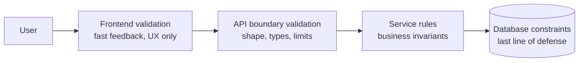
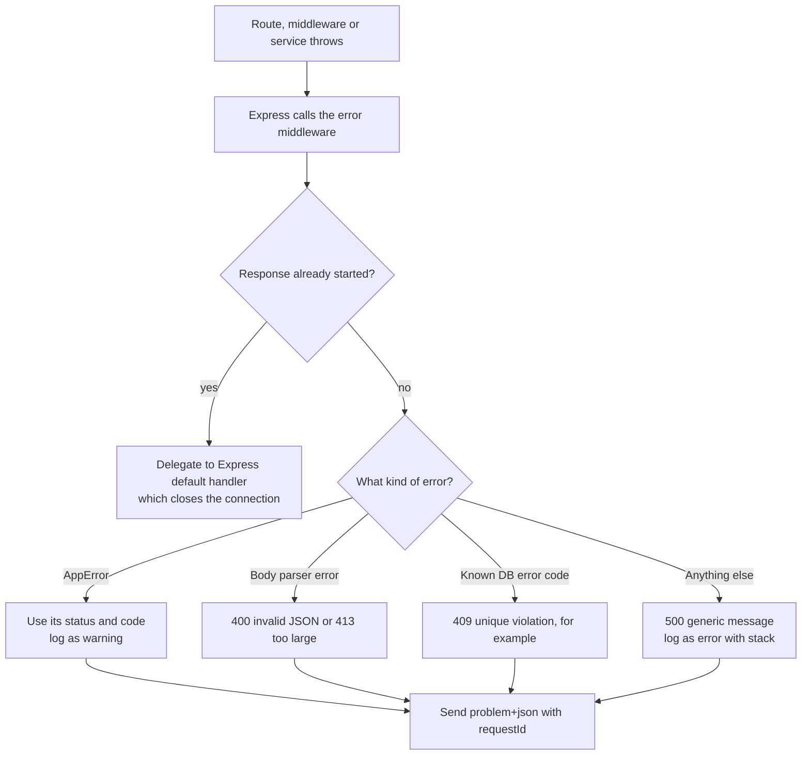

# Validation and Error Handling

> In this document you will learn how to protect a Node.js API from bad input and how to handle failures in a clean, predictable way: validation layers, validation libraries (Zod, Joi, express-validator, class-validator), custom error classes, a central Express error handler, async error patterns, process-level crashes, graceful shutdown, timeouts and safe retries. Interviewers use these topics to see whether you can build a service that stays correct and stable when things go wrong — which is most of real backend work.

**Before this:** [HTTP servers and Express](06-http-servers-and-express.md) · [REST API design](07-rest-api-design.md) · [Error handling in JavaScript](../02-javascript/15-error-handling.md) · **Interview questions:** [jump to the interview section](#interview-questions)

## Table of contents

1. [Never trust input](#never-trust-input)
2. [Validation layers](#validation-layers)
3. [Validation, sanitization, normalization and encoding](#validation-sanitization-normalization-and-encoding)
4. [Parse, do not just check](#parse-do-not-just-check)
5. [Validation libraries](#validation-libraries)
6. [A reusable validation middleware for Express](#a-reusable-validation-middleware-for-express)
7. [Operational errors vs programmer errors](#operational-errors-vs-programmer-errors)
8. [Custom error classes](#custom-error-classes)
9. [A central error-handling middleware](#a-central-error-handling-middleware)
10. [Async error patterns](#async-error-patterns)
11. [unhandledRejection and uncaughtException](#unhandledrejection-and-uncaughtexception)
12. [Graceful shutdown](#graceful-shutdown)
13. [Timeouts for downstream calls](#timeouts-for-downstream-calls)
14. [Careful retries](#careful-retries)
15. [Common mistakes](#common-mistakes)
16. [Best practices](#best-practices)
17. [Interview questions](#interview-questions)
18. [Summary](#summary)
19. [References](#references)

---

## Never trust input

**Input** is any data that comes from outside your code. You do not control it, so you must check it before you use it.

Input is more than the request body:

| Source | Examples |
| --- | --- |
| Request body | JSON, form data, uploaded files |
| URL | Path params (`/orders/:id`), query strings (`?limit=10`) |
| Headers and cookies | `Authorization`, `Content-Type`, `X-Forwarded-For`, session cookies |
| Webhooks | Calls from Stripe, GitHub, partners |
| Messages | Jobs from a queue, events from Kafka |
| Other services | Responses from third-party APIs |
| Files and config | CSV imports, environment variables |

What can go wrong if you trust input:

```js
// 1. Wrong type -> wrong math
const quantity = req.body.quantity;           // client sent "2" (a string)
const total = quantity * 1999 + 500;          // works by accident: 4498
const label = quantity + " items";            // ok
const next = quantity + 1;                    // "21" — string concatenation bug

// 2. Mass assignment -> privilege escalation
await db.users.update(req.user.id, req.body); // body: { "displayName": "Bob", "role": "admin" }

// 3. NoSQL injection (MongoDB)
await users.findOne({ email: req.body.email, password: req.body.password });
// body: { "email": "admin@shop.com", "password": { "$ne": null } }  -> matches any password!

// 4. Huge input -> denial of service
const ids = req.query.ids.split(",");         // ?ids=1,2,3,... (one million IDs)
```

Every one of these bugs is fixed by the same idea: **check the shape, types, ranges and allowed fields of input before your business logic sees it.**

---

## Validation layers

You validate in several places. Each layer has a different job.



| Layer | What it checks | Example | Can it be bypassed? |
| --- | --- | --- | --- |
| **Frontend** (Angular forms, HTML `required`) | Format, required fields | "Email is invalid" under the field | **Yes** — anyone can call your API with `curl` |
| **API boundary** (validation middleware) | Shape, types, lengths, ranges, enums, unknown fields | `quantity` is an integer from 1 to 100 | No — every request passes through it |
| **Service / domain** | Business rules that need data | "Product is in stock", "Coupon not expired", "Only draft orders can be edited" | No |
| **Database** | Hard guarantees | `UNIQUE(email)`, `CHECK (stock >= 0)`, `NOT NULL`, foreign keys | No — even buggy code and scripts cannot break them |

Key points:

- **Frontend validation is for user experience, not security.** Always validate again on the server.
- **The API layer rejects garbage early**, before it reaches your services. It is cheap and gives good error messages.
- **The database is the only place that can guarantee some rules under concurrency.** Two requests can both check "is this email free?" at the same moment and both see "yes". Only a `UNIQUE` constraint stops the second insert. Your code then turns the database error into a `409 Conflict`.

```ts
try {
  await pool.query("INSERT INTO users (email, password_hash) VALUES ($1, $2)", [email, hash]);
} catch (err) {
  if ((err as { code?: string }).code === "23505") { // PostgreSQL unique_violation
    throw new ConflictError("EMAIL_TAKEN", "This email is already registered");
  }
  throw err;
}
```

---

## Validation, sanitization, normalization and encoding

These four words are often mixed up. They are different tools.

| Term | What it does | Example |
| --- | --- | --- |
| **Validation** | Checks input and **rejects** it if it is wrong. Does not change it | "age must be an integer between 0 and 150" → `400` |
| **Normalization** | Changes valid input into a **standard form** | Trim spaces, lowercase emails, Unicode normalization (`"é"` has two encodings) |
| **Sanitization** | **Removes or changes** dangerous parts and keeps the rest | Strip `<script>` from user HTML with an HTML sanitizer |
| **Output encoding (escaping)** | Makes data safe **for the place where you output it** | `<` becomes `&lt;` in HTML; parameters in SQL; quoting in shell |

```js
// Validation: reject
if (!Number.isInteger(age) || age < 0 || age > 150) throw new ValidationError(...);

// Normalization: standard form
const email = input.email.trim().toLowerCase();
const name = input.name.normalize("NFC").trim();

// Sanitization: rich text from an editor (server side, with a library such as sanitize-html)
const safeHtml = sanitizeHtml(input.bio, { allowedTags: ["b", "i", "a", "p"], allowedAttributes: { a: ["href"] } });
```

Rules of thumb:

1. **Prefer validation over sanitization.** If a field should be a number, reject `"12abc"`. Do not try to "fix" it. Guessing what the user meant leads to bugs.
2. **Sanitize only when you must accept rich content** (HTML from a WYSIWYG editor, Markdown).
3. **Encode at output, not at input.** Store the user's text as it is, and escape it when you render it in HTML, put it in SQL (parameters) or pass it to a shell. The right escaping depends on the destination, and you do not know all destinations when you save the data. Angular escapes interpolated values automatically; SQL drivers escape parameters. XSS is covered in [Web security: XSS, CSRF, CORS, CSP](../10-testing-security-production/05-web-security-xss-csrf-cors-csp.md).

---

## Parse, do not just check

TypeScript types exist only at **compile time**. After compilation they are gone. So this code gives you a false feeling of safety:

```ts
interface CreateOrderBody { productId: string; quantity: number }

app.post("/orders", (req, res) => {
  const body = req.body as CreateOrderBody; // ❌ a promise to the compiler, not a check
  body.quantity.toFixed(0);                  // crashes if the client sent "quantity": "two"
});
```

The better idea is called **"parse, don't validate"**: treat raw input as `unknown`, run it through a **parser** that either throws or returns a **new, typed value**. After parsing, the type is true.

```ts
import { z } from "zod";

const createOrderSchema = z.object({
  productId: z.string().min(1).max(50),
  quantity: z.number().int().min(1).max(100),
});

type CreateOrderInput = z.infer<typeof createOrderSchema>; // { productId: string; quantity: number }

function parseCreateOrder(raw: unknown): CreateOrderInput {
  return createOrderSchema.parse(raw); // throws a ZodError if invalid
}
```

One schema gives you **both** the runtime check **and** the TypeScript type. They can never drift apart. This idea is explained in more depth in [Runtime validation and type-safe APIs](../03-typescript/11-runtime-validation-and-type-safe-apis.md).

---

## Validation libraries

Writing `if` checks by hand works for two fields, but it is long, easy to get wrong and gives inconsistent error messages. Use a library.

### Zod

**Zod** is a TypeScript-first schema library. You define a schema, and Zod gives you a parser and an inferred type. Zod 4 is the current major version (stable since 2025). The examples use Zod 4 syntax.

```ts
import { z } from "zod";

export const registerSchema = z.strictObject({        // strictObject: unknown keys -> error
  email: z.email().max(254).transform((s) => s.toLowerCase()),
  password: z.string().min(15).max(128),
  displayName: z.string().trim().min(1).max(50),
  marketingOptIn: z.boolean().default(false),
});

export type RegisterInput = z.infer<typeof registerSchema>;
// { email: string; password: string; displayName: string; marketingOptIn: boolean }

const result = registerSchema.safeParse({ email: "Asha@Example.com", password: "short", displayName: "  Asha " , role: "admin" });
if (!result.success) {
  console.log(result.error.issues.map((i) => `${i.path.join(".")}: ${i.message}`));
  // [ 'password: Too small: expected string to have >=15 characters', ': Unrecognized key: "role"' ]
  // (exact message wording depends on the Zod version)
}
```

Useful features:

- `safeParse` returns `{ success: true, data }` or `{ success: false, error }` instead of throwing.
- `z.coerce.number()` converts query-string values like `"20"` into numbers.
- `.transform()` normalizes data during parsing (lowercase, trim).
- `.refine()` / `.superRefine()` add cross-field rules ("end date after start date").
- `z.discriminatedUnion()` validates "one of several shapes" by a type field.

```ts
export const listOrdersQuerySchema = z.object({
  status: z.enum(["pending_payment", "paid", "shipped", "delivered", "cancelled"]).optional(),
  limit: z.coerce.number().int().min(1).max(100).default(20),
  cursor: z.string().max(500).optional(),
});

export const dateRangeSchema = z
  .object({ from: z.iso.date(), to: z.iso.date() })
  .refine((v) => v.from <= v.to, { message: "from must be before to", path: ["to"] });
```

> **Zod 3 note:** In Zod 3 you write `z.string().email()` and `z.string().date()`, and `.strict()` instead of `z.strictObject()`. Zod 4 still accepts the method forms but marks them as deprecated.

### Joi

**Joi** is an older, very mature JavaScript schema library (from the hapi ecosystem). It does not infer TypeScript types by itself.

```js
import Joi from "joi";

const registerSchema = Joi.object({
  email: Joi.string().email().max(254).lowercase().required(),
  password: Joi.string().min(15).max(128).required(),
  displayName: Joi.string().trim().min(1).max(50).required(),
  marketingOptIn: Joi.boolean().default(false),
});

const { error, value } = registerSchema.validate(req.body, {
  abortEarly: false,   // collect all errors, not only the first
  stripUnknown: false, // unknown keys are errors by default in Joi objects
});
if (error) {
  console.log(error.details.map((d) => ({ path: d.path.join("."), message: d.message })));
}
```

### express-validator

**express-validator** is a set of Express middlewares built on the `validator.js` library. You validate fields with chained rules directly in the route.

```js
import { body, matchedData, validationResult } from "express-validator";

app.post(
  "/users",
  body("email").isEmail().normalizeEmail(),
  body("password").isLength({ min: 15, max: 128 }),
  body("displayName").trim().isLength({ min: 1, max: 50 }),
  (req, res) => {
    const result = validationResult(req);
    if (!result.isEmpty()) {
      res.status(400).json({ errors: result.array() });
      return;
    }
    const data = matchedData(req); // only the validated fields — unknown fields are dropped
    // ... create the user with data
  },
);
```

### class-validator (with class-transformer)

**class-validator** uses decorators on classes. It is the default in **NestJS** (with the `ValidationPipe`), and it feels natural for Angular developers.

```ts
import { IsBoolean, IsEmail, IsOptional, IsString, Length, MaxLength } from "class-validator";
import { plainToInstance } from "class-transformer";
import { validate } from "class-validator";

export class RegisterDto {
  @IsEmail() @MaxLength(254) email!: string;
  @IsString() @Length(15, 128) password!: string;
  @IsString() @Length(1, 50) displayName!: string;
  @IsOptional() @IsBoolean() marketingOptIn?: boolean;
}

const dto = plainToInstance(RegisterDto, req.body);
const errors = await validate(dto, { whitelist: true, forbidNonWhitelisted: true });
// whitelist: strip properties without decorators; forbidNonWhitelisted: report them as errors
```

In NestJS the same checks run automatically with `app.useGlobalPipes(new ValidationPipe({ whitelist: true, forbidNonWhitelisted: true, transform: true }))`.

### Comparison

| | Zod | Joi | express-validator | class-validator |
| --- | --- | --- | --- | --- |
| Style | Schema objects | Schema objects | Middleware chains per field | Decorators on classes |
| TypeScript types | Inferred from schema | Written separately | Written separately | The class is the type |
| Works outside Express | Yes (anywhere) | Yes | Express only | Yes (needs decorators) |
| Reuse on frontend | Yes (same schema in Angular/React) | Possible, heavy | No | Possible |
| Typical home | Modern TS backends, tRPC, Fastify via type providers | Older Express/hapi apps | Express apps | NestJS |

My default for a new TypeScript Express API is **Zod**: one schema, one type, usable in services, jobs and even the frontend. In NestJS, use class-validator (or a Zod pipe). Fastify already validates with JSON Schema.

---

## A reusable validation middleware for Express

Instead of calling the schema in every handler, write one middleware factory.

```ts
// src/middleware/validate.ts
import type { RequestHandler } from "express";
import type { ZodType } from "zod";
import { ValidationError } from "../shared/errors.js";

type Part = "body" | "query" | "params";

export function validate(part: Part, schema: ZodType): RequestHandler {
  return (req, res, next) => {
    const result = schema.safeParse(req[part]);
    if (!result.success) {
      next(
        new ValidationError(
          result.error.issues.map((issue) => ({
            path: [part, ...issue.path.map(String)].join("."),
            message: issue.message,
          })),
        ),
      );
      return;
    }
    // Express 5: req.query is a read-only getter, so store parsed values in res.locals.
    res.locals[part] = result.data;
    next();
  };
}

export const validateBody = (schema: ZodType) => validate("body", schema);
export const validateQuery = (schema: ZodType) => validate("query", schema);
export const validateParams = (schema: ZodType) => validate("params", schema);
```

Usage:

```ts
const orderIdParams = z.object({ orderId: z.string().regex(/^ord_[a-z0-9]{5,30}$/) });

ordersRouter.get(
  "/",
  validateQuery(listOrdersQuerySchema),
  async (req, res) => {
    const query = res.locals.query as z.infer<typeof listOrdersQuerySchema>; // { limit: number, ... }
    res.json(await orderService.list(req.user!, query));
  },
);

ordersRouter.get("/:orderId", validateParams(orderIdParams), async (req, res) => {
  res.json(await orderService.getForUser(req.user!, res.locals.params.orderId));
});
```

Why `res.locals` and not `req.query = result.data`? In **Express 5, `req.query` is a getter without a setter**. Assigning to it throws a `TypeError` in strict-mode code (all ES modules and TypeScript output are strict). In Express 4 the assignment worked, so older code that does it breaks when you upgrade. `req.body` can still be replaced, but using `res.locals` for all three parts keeps the rule simple.

### What a good validation error looks like

```text
POST /v1/users  { "email": "not-an-email", "password": "short" }

HTTP/1.1 400 Bad Request
Content-Type: application/problem+json

{
  "type": "https://api.shop.example/problems/validation",
  "title": "The request is not valid",
  "status": 400,
  "errors": [
    { "path": "body.email", "message": "Invalid email address" },
    { "path": "body.password", "message": "Too small: expected string to have >=15 characters" },
    { "path": "body.displayName", "message": "Invalid input: expected string, received undefined" }
  ],
  "requestId": "req_7f2c"
}
```

All errors are returned at once, each with a path, so the frontend can show every message next to its field.

---

## Operational errors vs programmer errors

Not all errors are the same. The most useful split for Node.js:

| | **Operational errors** | **Programmer errors** |
| --- | --- | --- |
| What | Expected problems in a correct program, caused by the outside world | Bugs in the code |
| Examples | Invalid user input, not found, duplicate email, database timeout, network failure, disk full, 3rd-party API returns 503 | `TypeError: Cannot read properties of undefined`, calling a function with wrong arguments, forgetting to `await`, wrong SQL syntax |
| Can you predict them? | Yes | No (or you would have fixed them) |
| How to handle | Handle them: return `4xx`, retry, use a fallback, show a message | Fix the code. At runtime: log, return `500`, and if the process state may be broken, **crash and restart** |

**Analogy:** A restaurant runs out of fish (operational — tell the customer, offer something else). The chef sets the kitchen on fire because of a mistake (programmer — stop service, fix it, start again). You do not keep cooking in a burning kitchen.

Why crash on a programmer error? Because after an unexpected exception, you do not know what state the process is in. A lock may be held forever, a transaction may be half-done, a cache may be corrupted. Restarting a clean process (with a process manager or Kubernetes restarting it) is safer than continuing in an unknown state. **Inside a request handler**, an unexpected error usually only affects that request, so the error middleware returns `500` and the process keeps running. **Outside any request** (an `uncaughtException`), the safe choice is to log and exit.

---

## Custom error classes

Give errors structure, so the error handler does not need to guess.

```ts
// src/shared/errors.ts
export class AppError extends Error {
  readonly statusCode: number;
  readonly code: string;
  readonly isOperational: boolean;
  readonly details?: unknown;

  constructor(
    statusCode: number,
    code: string,
    message: string,
    options: { details?: unknown; cause?: unknown; isOperational?: boolean } = {},
  ) {
    super(message, { cause: options.cause }); // Error "cause" (ES2022) keeps the original error
    this.name = new.target.name;              // "NotFoundError", "ConflictError", ...
    this.statusCode = statusCode;
    this.code = code;
    this.details = options.details;
    this.isOperational = options.isOperational ?? true;
  }
}

export class ValidationError extends AppError {
  constructor(details: Array<{ path: string; message: string }>) {
    super(400, "VALIDATION_FAILED", "The request is not valid", { details });
  }
}

export class UnauthorizedError extends AppError {
  constructor(message = "Authentication required") {
    super(401, "UNAUTHENTICATED", message);
  }
}

export class ForbiddenError extends AppError {
  constructor(message = "You are not allowed to do this") {
    super(403, "FORBIDDEN", message);
  }
}

export class NotFoundError extends AppError {
  constructor(resource: string, id: string) {
    super(404, "NOT_FOUND", `${resource} ${id} was not found`);
  }
}

export class ConflictError extends AppError {
  constructor(code: string, message: string) {
    super(409, code, message);
  }
}
```

```ts
const e = new NotFoundError("Order", "ord_42");
console.log(e instanceof NotFoundError, e instanceof AppError, e instanceof Error); // true true true
console.log(e.name, e.statusCode, e.code, e.message); // NotFoundError 404 NOT_FOUND Order ord_42 was not found

// Wrapping a low-level error without losing it:
const wrapped = new AppError(502, "PAYMENT_PROVIDER_FAILED", "Payment provider failed", { cause: new Error("ECONNRESET") });
console.log((wrapped.cause as Error).message); // ECONNRESET
```

Design notes:

- **`code`** is a stable, machine-readable string (`"ORDER_NOT_CANCELLABLE"`). Clients and translations depend on it. Messages can change; codes should not.
- **`cause`** (standard since ES2022) keeps the original low-level error for the logs, while the client sees only your clean message.
- **`new.target.name`** sets the name automatically for every subclass.
- With TypeScript targeting ES2015 or newer, `instanceof` works with subclasses of `Error`. (With an ES5 target it did not, without extra code — another reason to target ES2022.)
- Throw these from **services**. Services then express business failures without knowing about Express — the status code is just data on the error.

---

## A central error-handling middleware

All errors should flow to **one** place that decides the status code, the response body and the log entry.



```ts
// src/middleware/error-handler.ts
import type { ErrorRequestHandler, RequestHandler } from "express";
import { AppError } from "../shared/errors.js";
import { logger } from "../shared/logger.js";

const PROBLEM_BASE = "https://api.shop.example/problems/";

export const notFoundHandler: RequestHandler = (req, res) => {
  res.status(404).type("application/problem+json").json({
    type: `${PROBLEM_BASE}not-found`,
    title: "Not Found",
    status: 404,
    detail: `No route for ${req.method} ${req.path}`,
  });
};

function toAppError(err: unknown): AppError | undefined {
  if (err instanceof AppError) return err;

  // Errors from express.json() (body-parser) carry a "type" and a "status".
  const e = err as { type?: string; status?: number; code?: string };
  if (e.type === "entity.parse.failed") return new AppError(400, "INVALID_JSON", "The body is not valid JSON");
  if (e.type === "entity.too.large") return new AppError(413, "BODY_TOO_LARGE", "The body is too large");
  if (e.type === "encoding.unsupported" || e.type === "charset.unsupported") {
    return new AppError(415, "UNSUPPORTED_ENCODING", "Unsupported content encoding");
  }

  // Known PostgreSQL error codes (a last line of defense — services should map these themselves).
  if (e.code === "23505") return new AppError(409, "CONFLICT", "The resource already exists");
  if (e.code === "23503") return new AppError(409, "REFERENCE_CONFLICT", "A referenced resource does not exist or is still in use");

  return undefined;
}

export const errorHandler: ErrorRequestHandler = (err, req, res, next) => {
  if (res.headersSent) {
    next(err); // too late for a clean response; Express closes the connection
    return;
  }

  const appError = toAppError(err);
  const requestId = req.id;

  if (appError && appError.isOperational) {
    // Expected problem: 4xx are client mistakes, so a warning or info is enough.
    logger.warn({ requestId, code: appError.code, status: appError.statusCode, msg: appError.message });
    res.status(appError.statusCode).type("application/problem+json").json({
      type: `${PROBLEM_BASE}${appError.code.toLowerCase().replaceAll("_", "-")}`,
      title: appError.message,
      status: appError.statusCode,
      code: appError.code,
      errors: appError.details,
      requestId,
    });
    return;
  }

  // Unexpected error (a bug or an unknown failure): log everything, reveal nothing.
  logger.error({ requestId, err }, "Unhandled error in request");
  res.status(500).type("application/problem+json").json({
    type: "about:blank",
    title: "Internal Server Error",
    status: 500,
    requestId,
  });
};
```

```ts
// app.ts — order matters
app.use("/v1/orders", ordersRouter);
app.use(notFoundHandler); // after all routes
app.use(errorHandler);    // very last
```

### Not leaking stack traces

Attackers learn a lot from stack traces: file paths, library names and versions, SQL queries, internal hostnames.

```ts
// ❌ Wrong: sends internals to everyone
res.status(500).json({ message: err.message, stack: err.stack });

// ✅ Correct: generic message to the client, full details in the logs, linked by requestId
logger.error({ requestId, err });
res.status(500).json({ type: "about:blank", title: "Internal Server Error", status: 500, requestId });
```

Also remember: **Express's built-in error handler includes the stack trace in its HTML response when `NODE_ENV` is not `"production"`.** Always register your own handler and set `NODE_ENV=production`.

Do not log secrets either. Configure your logger to redact fields like `authorization`, `password`, `cookie` and `token` (pino has a `redact` option). Logging is covered in [Production Node.js](14-production-nodejs.md).

### Consistent error responses

Clients should never need to special-case an endpoint. Every error — validation, auth, not found, conflict, rate limit, crash — uses the same shape (RFC 9457 problem details, see [REST API design](07-rest-api-design.md#error-format-with-rfc-9457-problem-details)) and includes:

- the correct HTTP status,
- a stable machine-readable `code` (or `type`),
- a human-readable message,
- field-level `errors` for validation,
- a `requestId` for support.

Keep a **catalog of error codes** in your docs (`ORDER_NOT_CANCELLABLE`, `EMAIL_TAKEN`, `OUT_OF_STOCK`). The Angular frontend can map codes to translated messages, instead of showing raw server text.

---

## Async error patterns

Most Node.js bugs around errors come from async code. Here are the patterns you must know.

### 1. `async/await` + `try/catch`

```ts
async function getOrderTotal(orderId: string): Promise<number> {
  try {
    const order = await orderRepo.findById(orderId);
    return order.totalCents;
  } catch (err) {
    // Add context, keep the original as "cause".
    throw new AppError(503, "ORDERS_UNAVAILABLE", "Could not load the order", { cause: err });
  }
}
```

Only catch an error when you can **do something useful**: add context, translate it, retry, or use a fallback. Catching and ignoring hides bugs.

```ts
// ❌ Swallowing errors
try { await sendWelcomeEmail(user); } catch {}

// ✅ Decide consciously: the signup succeeded even if the email failed — log it and move on
try {
  await sendWelcomeEmail(user);
} catch (err) {
  logger.warn({ err, userId: user.id }, "Welcome email failed; will be retried by the email job");
}
```

### 2. A missing `await` escapes your `try/catch`

```js
async function save() { throw new Error("save failed"); }

function handler() {
  try {
    save();                 // ❌ no await: the promise rejects later
    console.log("saved");
  } catch (err) {
    console.log("caught:", err.message);
  }
}
process.on("unhandledRejection", (err) => console.log("unhandled:", err.message));
handler();
console.log("end");
// Output (verified with Node 22):
// saved
// end
// unhandled: save failed
```

The `try/catch` only catches errors thrown **synchronously** while the `try` block runs. `save()` returns a rejected promise; nobody waits for it, so the rejection becomes "unhandled" later. Fix: `await save()` inside an `async` function. The TypeScript-ESLint rule `@typescript-eslint/no-floating-promises` catches this mistake.

### 3. Errors in callbacks run later and escape everything

```js
function loadConfig() {
  setTimeout(() => {
    throw new Error("boom"); // runs on a later tick, outside any try/catch
  }, 0);
}

try {
  loadConfig();
  console.log("after call");
} catch (e) {
  console.log("caught", e.message); // never runs
}
// Output: "after call", then the process crashes with "boom" (uncaughtException)
```

Fix: convert callback APIs to promises (`util.promisify`, or the `fs/promises` style APIs) and `await` them. Never `throw` inside a timer or event callback; pass the error to a callback or reject a promise.

### 4. Error-first callbacks

Older Node APIs use callbacks with the error as the first argument:

```js
import { readFile } from "node:fs";

readFile("config.json", "utf8", (err, text) => {
  if (err) {               // always check err first
    logger.error({ err }, "Could not read config");
    return;                // and return!
  }
  const config = JSON.parse(text); // may throw — this callback is not inside any try/catch
});
```

Prefer `node:fs/promises` and `await` in new code.

### 5. EventEmitters and streams: the `error` event

An `EventEmitter` that emits `"error"` with **no listener** throws, which usually crashes the process.

```js
import { createReadStream } from "node:fs";

const stream = createReadStream("missing-file.csv");
// ❌ No 'error' listener: ENOENT crashes the process
stream.on("error", (err) => logger.error({ err }, "Read failed")); // ✅
```

For streams, use `pipeline()` from `node:stream/promises`. It forwards errors from every stream in the chain to one promise and cleans everything up:

```js
import { pipeline } from "node:stream/promises";
await pipeline(createReadStream("orders.csv"), csvParser(), saveToDatabase()); // one try/catch covers all
```

(See [Core modules](04-core-modules-fs-path-events-buffer.md) and [Streams](05-streams.md).)

### 6. Many promises at once: `Promise.all` vs `Promise.allSettled`

```js
const results = await Promise.allSettled([
  Promise.resolve("users"),
  Promise.reject(new Error("orders failed")),
  Promise.resolve("products"),
]);
console.log(results.map((r) => (r.status === "fulfilled" ? r.value : `ERR ${r.reason.message}`)));
// [ 'users', 'ERR orders failed', 'products' ]

try {
  await Promise.all([Promise.resolve(1), Promise.reject(new Error("first failure")), Promise.reject(new Error("second failure"))]);
} catch (e) {
  console.log("Promise.all:", e.message); // Promise.all: first failure
}
```

- `Promise.all` rejects with the **first** rejection. The other promises keep running; their results (and errors) are ignored. Use it when **all** results are required.
- `Promise.allSettled` waits for all and reports each outcome. Use it for dashboards and "best effort" work, where one failure should not hide the rest.

### 7. Express 4 vs Express 5

In Express 4, a rejected promise from an `async` handler is **not** sent to the error middleware — wrap handlers or use `next(err)`. Express 5 forwards rejections automatically. Full explanation in [HTTP servers and Express](06-http-servers-and-express.md#error-handling-and-async-errors).

---

## unhandledRejection and uncaughtException

These are **process-level** events. They fire when an error escapes all your handlers.

| Event | When it fires | Default Node.js behavior (Node 15+) |
| --- | --- | --- |
| `uncaughtException` | A synchronous `throw` was not caught anywhere (for example inside a timer callback) | Print the stack trace and **exit with code 1** |
| `unhandledRejection` | A promise was rejected and no `.catch()` / `await` handled it | Raise it as an uncaught exception → **exit with code 1** (default `--unhandled-rejections=throw`) |

Verified with Node 22:

```js
async function loadUser() { throw new Error("DB down"); }
loadUser(); // nobody awaits or catches this
setTimeout(() => console.log("still running?"), 100);
// Output: the "Error: DB down" stack trace, then the process exits with code 1.
// "still running?" is never printed.
```

### A trap: adding a listener changes the default

If you register `process.on("unhandledRejection", ...)`, **Node no longer crashes**. Your listener replaces the default behavior:

```js
process.on("unhandledRejection", (reason) => { console.log("handler:", reason.message); });
async function loadUser() { throw new Error("DB down"); }
loadUser();
setTimeout(() => console.log("still running"), 100);
// Output: "handler: DB down", "still running", exit code 0
```

The same is true for `uncaughtException`: with a listener, the process continues. That is dangerous, because after an unexpected exception the process may be in a broken state.

### The recommended pattern: log, then exit

```ts
// src/process-handlers.ts
import { logger } from "./shared/logger.js";

export function installProcessHandlers(shutdown: (code: number) => Promise<void>): void {
  process.on("unhandledRejection", (reason) => {
    // Turn it into an uncaught exception so there is only one code path.
    throw reason;
  });

  process.on("uncaughtException", (err, origin) => {
    logger.fatal({ err, origin }, "Uncaught exception — shutting down");
    // Try a fast graceful shutdown (stop accepting requests, flush logs), then exit with 1.
    void shutdown(1);
  });
}
```

Then let something **outside** the process restart it: Kubernetes, Docker's restart policy, systemd or PM2. Run several instances behind a load balancer, so one restart does not cause downtime.

Rules:

- **Never use these handlers to "keep the server alive" after a programmer error.** Log, clean up quickly, exit.
- Find and fix the root cause: an unhandled rejection is always a bug (a missing `await` or `.catch`).
- If you only want to **observe** crashes (for example to report to an error-tracking service) without changing behavior, Node offers `process.on("uncaughtExceptionMonitor", ...)`, which runs before the default crash.

---

## Graceful shutdown

When you deploy a new version, the platform stops the old process. Usually it sends **`SIGTERM`**, waits for a grace period (30 seconds by default in Kubernetes), and then sends **`SIGKILL`**, which cannot be caught. Pressing Ctrl+C in a terminal sends **`SIGINT`**.

If the process just dies, in-flight requests fail, database transactions roll back halfway through user actions, and messages from a queue may be processed twice. A **graceful shutdown** finishes the current work cleanly first.

### Overview

The full step list, the sequence diagram, the Kubernetes readiness race and the Docker signal details are explained once, in [Production Node.js: Graceful shutdown](14-production-nodejs.md#graceful-shutdown). In short: fail readiness, `server.close()`, let in-flight requests finish, stop background work, close resources, exit — and force-exit after a deadline.

This section shows the part that connects to **error handling**: one `shutdown(exitCode)` function that both `SIGTERM` and the crash handler above can call. A normal stop exits with `0`; a crash exits with `1`.

### Code

```ts
// src/server.ts
import http from "node:http";
import { createApp } from "./app.js";
import { pool } from "./db/pool.js";
import { redis } from "./db/redis.js";
import { logger } from "./shared/logger.js";

let isShuttingDown = false;

const app = createApp({ pool, isShuttingDown: () => isShuttingDown });
// In app.ts: GET /health/ready answers 503 when isShuttingDown() is true.
const server = http.createServer(app);
server.listen(Number(process.env.PORT ?? 3000));

async function closeDependencies(): Promise<void> {
  await Promise.allSettled([pool.end(), redis.quit()]);
}

export async function shutdown(exitCode: number, timeoutMs = 10_000): Promise<void> {
  if (isShuttingDown) return;   // signals can arrive twice
  isShuttingDown = true;
  logger.info({ exitCode }, "Graceful shutdown started");

  // Safety net: never hang forever.
  const forceExit = setTimeout(() => {
    logger.error("Shutdown took too long, forcing exit");
    process.exit(1);
  }, timeoutMs);
  forceExit.unref(); // this timer alone must not keep the process alive

  server.close(async (err) => {   // callback runs when all connections are closed
    try {
      await closeDependencies();
      logger.info("Shutdown complete");
      process.exit(err ? 1 : exitCode);
    } catch (closeError) {
      logger.error({ err: closeError }, "Error during shutdown");
      process.exit(1);
    }
  });
  server.closeIdleConnections(); // keep-alive sockets with no active request
}

process.on("SIGTERM", () => void shutdown(0));
process.on("SIGINT", () => void shutdown(0));
```

Tested with a simulated `SIGTERM` while a 300 ms request was running: the in-flight request still completed (`"slow work done"`), a new connection after `close()` was refused (`ECONNREFUSED`), dependencies were closed, and the process exited with code 0.

### Details that matter

- **`server.close()` waits for active requests**, but long keep-alive connections can keep it waiting. `server.closeIdleConnections()` (Node 18.2+) closes idle ones; since Node 19, `server.close()` also closes idle connections itself. `server.closeAllConnections()` closes everything — use it as a last resort when the deadline is near.
- **`process.exit()` does not wait** for pending async work like log flushing. Flush your logger first (pino has helpers for this).
- **Exit code:** use `0` for a normal stop (`SIGTERM`) and `1` when the shutdown was caused by a crash, so the process manager and your alerts can tell them apart.
- Readiness timing, the grace period, Windows signals and Docker PID 1 are explained in [Production Node.js: Graceful shutdown](14-production-nodejs.md#graceful-shutdown).

---

## Timeouts for downstream calls

Every call to another system (database, Redis, HTTP API, queue) can hang. **Without a timeout, one slow dependency can block all your requests**: each waiting request holds memory, a connection from the pool and a socket. Soon the pool is empty and your whole service stops responding — even for endpoints that do not use the slow dependency.

### HTTP calls with `fetch` (Node 18+)

```ts
async function getShippingQuote(orderId: string): Promise<Quote> {
  try {
    const res = await fetch(`https://shipping.example.com/quotes/${orderId}`, {
      signal: AbortSignal.timeout(2_000), // give up after 2 seconds
    });
    if (!res.ok) throw new AppError(502, "SHIPPING_FAILED", `Shipping service answered ${res.status}`);
    return (await res.json()) as Quote;
  } catch (err) {
    if (err instanceof Error && err.name === "TimeoutError") {
      throw new AppError(504, "SHIPPING_TIMEOUT", "Shipping service did not answer in time", { cause: err });
    }
    throw err;
  }
}
```

Verified: a `fetch` to a local server that answers after 2 seconds, with `AbortSignal.timeout(200)`, rejects after about 200 ms with an error named `TimeoutError`.

To combine a timeout with a "client disconnected" or "request timed out" signal, use `AbortSignal.any([signalA, signalB])` (Node 20.3+).

### Databases

```ts
import { Pool } from "pg";

export const pool = new Pool({
  max: 10,
  connectionTimeoutMillis: 2_000,  // waiting for a free connection (default 0 = wait forever!)
  idleTimeoutMillis: 10_000,
  statement_timeout: 5_000,        // PostgreSQL cancels queries that run longer than 5 s
});
```

### A timeout budget

A request has a total time budget (for example 3 seconds, because the frontend gives up then). Downstream timeouts must fit inside it:

```text
Incoming request budget: 3000 ms
  ├─ DB query:            timeout 1000 ms
  ├─ Shipping API:        timeout 1000 ms (including retries!)
  └─ Remaining work + network: ~1000 ms
```

If the shipping API has a 5-second timeout but your caller gives up after 3 seconds, you waste resources on answers nobody will read.

---

## Careful retries

Many failures are **transient**: a network blip, a restarting pod, a `503` during deploy. A retry often succeeds. But careless retries can make an outage **worse**: if 1,000 clients each retry 5 times immediately, a struggling service gets 5,000 extra requests (a **retry storm**).

### When to retry

| Retry | Do not retry |
| --- | --- |
| Network errors (`ECONNRESET`, `ETIMEDOUT`) | `400`, `401`, `403`, `404`, `409`, `422` — the same request will fail again |
| `502`, `503`, `504` | `500` from a bug (usually; it may be retried once if idempotent) |
| `429` (after `Retry-After`) | Non-idempotent operations without an idempotency key (`POST /payments`) |
| `408 Request Timeout` | When the overall deadline has already passed |

### How to retry: exponential backoff with jitter

- **Exponential backoff:** wait longer after each failure: 100 ms, 200 ms, 400 ms, 800 ms...
- **Jitter:** add randomness, so thousands of clients do not retry at the same moment.
- **A maximum** number of attempts and a maximum delay.
- **Respect `Retry-After`** when the server sends it.

```ts
export interface RetryOptions {
  retries: number;      // extra attempts after the first one
  baseDelayMs: number;
  maxDelayMs: number;
  shouldRetry: (error: unknown) => boolean;
  signal?: AbortSignal;
}

const sleep = (ms: number, signal?: AbortSignal) =>
  new Promise<void>((resolve, reject) => {
    const timer = setTimeout(resolve, ms);
    signal?.addEventListener("abort", () => { clearTimeout(timer); reject(signal.reason); }, { once: true });
  });

export async function retry<T>(operation: (attempt: number) => Promise<T>, options: RetryOptions): Promise<T> {
  for (let attempt = 1; ; attempt++) {
    try {
      return await operation(attempt);
    } catch (error) {
      if (attempt > options.retries || !options.shouldRetry(error)) throw error;
      const exp = Math.min(options.maxDelayMs, options.baseDelayMs * 2 ** (attempt - 1));
      const delay = Math.random() * exp; // "full jitter": random between 0 and the exponential delay
      await sleep(delay, options.signal);
    }
  }
}
```

```ts
const isTransient = (e: unknown) => {
  const status = (e as { status?: number }).status;
  return status === 502 || status === 503 || status === 504 || (e as Error).name === "TimeoutError";
};

const quote = await retry(() => getShippingQuote(orderId), {
  retries: 2, baseDelayMs: 100, maxDelayMs: 1_000, shouldRetry: isTransient,
});
```

Tested: an operation that failed with `503` twice succeeded on the third attempt (3 calls). An operation that failed with `400` was not retried at all.

### Beyond simple retries

- **Retry at one layer only.** If the client, the API gateway, your service and your HTTP library all retry 3 times, one failure becomes 3 × 3 × 3 × 3 = 81 calls.
- **Circuit breaker:** after many failures, stop calling the dependency for a while and fail fast (or use a fallback). This gives the dependency time to recover.
- **Retry budgets:** allow retries only up to a percentage of normal traffic.
- **Idempotency:** retries of writes need idempotency keys ([REST API design](07-rest-api-design.md#idempotency-keys-for-safe-retries)).

Resilience patterns (circuit breakers, bulkheads, fallbacks) are covered in [Reliability and resilience](../10-testing-security-production/09-reliability-and-resilience.md).

---

## Common mistakes

| Mistake | Consequence | Fix |
| --- | --- | --- |
| Validating only in the frontend | Anyone with `curl` bypasses it | Validate on the server, always |
| `req.body as MyType` | False safety; crashes and injections | Parse with a schema |
| Allowing unknown fields | Mass assignment (`"role": "admin"`) | Strict schemas or field allowlists |
| "Check then insert" for uniqueness without a DB constraint | Duplicates under concurrency | `UNIQUE` constraint + map error to `409` |
| Sanitizing instead of rejecting simple fields | Silent data changes, surprises | Validate and reject; sanitize only rich text |
| Sending `err.message` / `err.stack` of unknown errors | Information leaks | Generic 500 body, details in logs |
| Different error shapes per route | Messy client code | One central error handler, one format |
| Empty `catch {}` | Hidden failures | Handle, add context, or rethrow |
| Missing `await` | Unhandled rejections, wrong order of operations | `no-floating-promises` lint rule |
| `process.on("uncaughtException")` to keep running | Zombie process in a broken state | Log and exit; let the orchestrator restart |
| No `SIGTERM` handling | Failed requests on every deploy | Graceful shutdown |
| No timeouts on HTTP/DB calls | One slow dependency takes the whole service down | `AbortSignal.timeout`, pool and statement timeouts |
| Retrying everything immediately, forever | Retry storms, duplicate writes | Backoff + jitter, limits, only transient errors, idempotency |

---

## Best practices

- **Validate at the edge with schemas** (body, query, params, headers) and keep the schema as the single source of truth for types.
- **Reject unknown fields** and set limits on lengths, sizes, ranges and array counts.
- **Let the database guarantee invariants** (unique, foreign keys, checks) and translate its errors into clear API errors.
- **Model errors as classes with a status and a stable code**, thrown from services; keep HTTP details out of business logic.
- **Have exactly one error handler** that formats problem details, logs with a request ID, and never leaks internals.
- **Treat unhandled rejections as bugs.** Lint for floating promises; crash and restart on unknown process-level errors.
- **Shut down gracefully** on `SIGTERM` with a deadline shorter than the platform's grace period.
- **Put a timeout on every outbound call**, and fit them into the request's time budget.
- **Retry only transient failures**, with exponential backoff, jitter and a cap, at one layer, and only for idempotent operations.
- **Test failure paths:** invalid input, duplicate requests, slow and failing dependencies, shutdown during a request.

---

### How to explain this in an interview

Use this for "How do you handle errors in a Node.js API?"

1. **Define it:** "Error handling is how the service reacts to bad input and failures: it rejects invalid requests early, turns expected failures into clear 4xx responses, hides unexpected ones behind a generic 500, and keeps the process healthy."
2. **Why it exists:** "Input is untrusted and dependencies fail all the time. Without a strategy you get crashes, leaked stack traces and inconsistent responses."
3. **How it works:** "I validate body, query and params with Zod schemas in middleware. Services throw typed errors — an AppError with a status and a stable code. One error middleware at the end maps them to RFC 9457 problem details with a request ID, and logs unknown errors in full. At the process level, unhandled rejections and uncaught exceptions are logged and the process exits so the orchestrator restarts it. On SIGTERM I shut down gracefully."
4. **Small example:** "Cancelling a shipped order: the service throws `ConflictError('ORDER_NOT_CANCELLABLE')`, the error handler returns 409 with that code, and the Angular app shows a translated message."
5. **Where it is useful:** "Every API, but especially with many clients — consistent errors make frontends and SDKs simple."
6. **Trade-offs / gotchas:** "Operational vs programmer errors: I handle the first and crash on the second outside requests. Express 4 needs async wrappers. Adding an `unhandledRejection` listener disables Node's default crash. And timeouts plus careful retries are part of error handling, not an afterthought."

---

## Interview questions

### Q1. Why do you need server-side validation if the Angular form already validates?

**What the interviewer is checking:** The trust boundary.

**Short spoken answer:**
> "Frontend validation is only for user experience — quick feedback next to the field. It runs on the user's machine, so anyone can skip it by calling the API with curl, Postman or a modified app. The server is the trust boundary, so it must validate everything again: types, lengths, ranges, enums and unknown fields. And some rules can only be checked on the server or in the database, like 'this email is not taken' or 'this product is in stock'. A nice trick is to share schemas, for example the same Zod schema in the frontend and backend, so the rules stay in sync."

**Follow-up questions:**
- **Which layer guarantees uniqueness?** — Only the database (`UNIQUE` constraint); app-level checks have race conditions.
- **Should the server trust a `price` sent by the client?** — Never. Compute it from the database.

**Common mistakes:** "The frontend already checks it, so the backend doesn't need to."

**Where this is used in real projects:** Every form-backed API.

### Q2. What is the difference between validation and sanitization?

**What the interviewer is checking:** Precise vocabulary and secure defaults.

**Short spoken answer:**
> "Validation checks the input and rejects it if it's wrong, without changing it — for example 'quantity must be an integer from 1 to 100'. Sanitization changes the input to remove dangerous parts and keeps the rest — for example cleaning user HTML so only safe tags remain. There is also normalization, like trimming and lowercasing an email, and output encoding, which escapes data for the place where you output it — HTML escaping, SQL parameters. My default is to validate and reject. I sanitize only rich content I must accept, and I encode at output time, because the right escaping depends on the destination."

**Follow-up questions:**
- **Should you HTML-escape everything before saving to the database?** — No. Store raw text, escape when rendering. Otherwise you get double-escaped data and still miss other contexts (JSON, CSV, SQL).
- **Does validation prevent XSS?** — Partly (it limits what can come in), but output encoding and CSP are the real defenses.

**Common mistakes:** Trying to "clean" SQL injection with string replacement instead of parameterized queries.

**Where this is used in real projects:** Comment systems, CMS editors, profile bios.

### Q3. How do you validate requests in an Express + TypeScript API?

**What the interviewer is checking:** Practical implementation and the compile-time vs runtime distinction.

**Short spoken answer (30–60 seconds):**
> "TypeScript types disappear at runtime, so a type on `req.body` proves nothing. I define a schema per endpoint with Zod — body, query and params — and use a small `validate` middleware factory. It calls `safeParse`; on failure it passes a ValidationError with all issues and their paths to the error handler, which returns 400 problem details. On success it stores the parsed data, with coerced types and defaults applied, in `res.locals`. I use strict objects so unknown fields are rejected, which prevents mass assignment. The type comes from `z.infer`, so the schema is the single source of truth."

**Code:** see [A reusable validation middleware for Express](#a-reusable-validation-middleware-for-express).

**Follow-up questions:**
- **Why not write the parsed query back to `req.query`?** — In Express 5 `req.query` is a getter without a setter; assigning throws in strict mode.
- **How do you validate query numbers?** — Query values are strings, so use `z.coerce.number().int().min(1).max(100).default(20)`.
- **Zod vs class-validator?** — Zod infers types from schemas and works anywhere; class-validator uses decorators and fits NestJS.

**Common mistakes:** Casting `req.body as T`; validating only the body and not params/query; returning only the first error.

**Where this is used in real projects:** Every endpoint of a typed Node API.

### Q4. What is mass assignment and how do you prevent it?

**Short answer:** Mass assignment happens when you pass the whole request body into a create/update call: `User.update(id, req.body)`. An attacker adds fields you did not expect, like `"role": "admin"`, `"isVerified": true` or `"ownerId": "someone-else"`. Prevent it by: strict schemas that reject unknown keys (`z.strictObject`, `forbidNonWhitelisted` in class-validator), building the update object explicitly from allowed fields, separate DTOs for "create", "update by user" and "update by admin", and never taking identity or ownership fields from the body (take them from the authenticated user). OWASP calls the general category "Broken Object Property Level Authorization".

### Q5. What is the difference between operational errors and programmer errors?

**What the interviewer is checking:** Mature error-handling philosophy in Node.js.

**Short spoken answer:**
> "Operational errors are expected problems in a correct program caused by the outside world: invalid input, not found, a duplicate email, a timed-out database, a 503 from a partner API. I handle them — return the right 4xx, retry, or use a fallback. Programmer errors are bugs: reading a property of undefined, passing the wrong arguments, a missing await. You can't handle a bug meaningfully at runtime. Inside a request I return a generic 500 and log it; but if it escapes to the process level, I log and exit, because the process may be in an unknown state — a lock held or a half-written cache — and let the orchestrator start a clean one."

**Follow-up questions:**
- **How do you mark them in code?** — An `isOperational` flag on `AppError`; anything that is not a known `AppError` is treated as a programmer error.
- **Isn't crashing bad for availability?** — With several instances and fast restarts, a clean restart is better than a corrupted process serving wrong results.

**Common mistakes:** Treating all errors the same; catching everything and continuing.

**Where this is used in real projects:** Error handlers, alerting (page on programmer errors, not on 404s), process managers.

### Q6. Design an error class hierarchy for an API.

**Short answer:** A base `AppError extends Error` with `statusCode`, a stable `code`, optional `details` and `cause`, and `isOperational`. Subclasses for common cases: `ValidationError` (400 with field details), `UnauthorizedError` (401), `ForbiddenError` (403), `NotFoundError` (404), `ConflictError` (409 with a specific code such as `ORDER_NOT_CANCELLABLE`), `RateLimitError` (429 with `retryAfter`), and `DependencyError` (502/503/504 wrapping the original as `cause`). Services throw them; one error middleware maps them to problem details. Set `this.name = new.target.name` and use the ES2022 `cause` option. See [Custom error classes](#custom-error-classes).

### Q7. What happens here, and how do you fix it?

```js
async function save() { throw new Error("save failed"); }

function handler() {
  try {
    save();
    console.log("saved");
  } catch (err) {
    console.log("caught:", err.message);
  }
}
process.on("unhandledRejection", (err) => console.log("unhandled:", err.message));
handler();
console.log("end");
```

**Answer (verified with Node 22):**

```text
saved
end
unhandled: save failed
```

**Why:**
1. `save()` is an `async` function. Calling it does not throw — it returns a promise that is already rejected.
2. Nothing awaits that promise, so the `try/catch` sees no error. `"saved"` is printed (a lie!).
3. `handler()` returns and `"end"` is printed.
4. After the current task and its microtasks, Node notices the rejected promise has no handler and emits `unhandledRejection`.

**Fix:** make `handler` `async` and `await save()`. Then the `catch` runs and prints `caught: save failed`. Without the listener, Node 15+ would crash the process. Enable `@typescript-eslint/no-floating-promises` to catch this at build time.

### Q8. What is the default behavior of Node on an unhandled promise rejection, and what should your app do?

**What the interviewer is checking:** Version knowledge and production judgment.

**Short spoken answer:**
> "Since Node 15 the default mode is `throw`: an unhandled rejection is raised as an uncaught exception, and the process prints the error and exits with code 1. Before Node 15 it only printed a warning, which hid many bugs. An important detail is that if I register an `unhandledRejection` listener, Node no longer crashes — the listener replaces the default. So in production I either leave the default, or I add a listener that logs and rethrows, and an `uncaughtException` handler that logs as fatal, does a quick graceful shutdown and exits with code 1. Then Kubernetes or PM2 restarts the process. I never use these handlers to keep running."

**Follow-up questions:**
- **What is `uncaughtExceptionMonitor`?** — An event for observing uncaught exceptions (for example reporting them) without changing the default crash behavior.
- **Can you change the mode?** — Yes, with `--unhandled-rejections=strict|throw|warn|none|warn-with-error-code`. Do not use `none` or `warn` in production.

**Common mistakes:** "Node just prints a warning" (outdated); swallowing errors in a global handler.

**Where this is used in real projects:** Every production Node service's bootstrap file.

### Q9. Why does this crash the process even though there is a try/catch?

```js
function loadConfig() {
  setTimeout(() => { throw new Error("boom"); }, 0);
}
try {
  loadConfig();
  console.log("after call");
} catch (e) {
  console.log("caught", e.message);
}
```

**Answer:** It prints `after call`, then crashes with `Error: boom` as an `uncaughtException` (verified). The `try/catch` only covers the synchronous call to `loadConfig()`, which just schedules a timer and returns. The callback runs later, on a new call stack, where no `try/catch` exists. Express 5 cannot catch this either. Fix: do not throw inside callbacks; wrap the work in a promise and `await` it (for example `await setTimeout(0)` from `node:timers/promises`, then throw normally inside the async function).

### Q10. How do you build a central error handler in Express? What must it do?

**What the interviewer is checking:** Concrete implementation knowledge.

**Short spoken answer:**
> "It's a middleware with four parameters registered after all routes and after a 404 handler. First, if `res.headersSent` is true, it calls `next(err)` so Express closes the connection. Then it classifies the error: my own AppErrors give the status and code; body-parser errors map to 400 or 413; some database codes like the Postgres unique violation map to 409; everything else is a 500. It sends one consistent format — problem details with a stable code, field errors for validation and the request ID. It logs operational errors at warning level and unknown errors at error level with the full stack and cause, but it never sends stack traces or internal messages to the client."

**Follow-up questions:**
- **Why check `headersSent`?** — If a stream failed after headers were sent, you cannot send a new status; trying causes another error.
- **Where do you put the 404 handler?** — After all routes, before the error handler. A missing route is not an error in Express.

**Common mistakes:** Three-parameter error handler; registering it before routes; leaking `err.message` for 500s.

**Where this is used in real projects:** Every Express API.

### Q11. How do you implement graceful shutdown in a Node.js HTTP service?

**What the interviewer is checking:** Production readiness and deployment knowledge.

**Short spoken answer (30–60 seconds):**
> "Orchestrators send SIGTERM, wait for a grace period — 30 seconds by default in Kubernetes — and then SIGKILL. On SIGTERM I set a shutting-down flag so the readiness endpoint returns 503 and the load balancer stops sending traffic. Then I call `server.close()`, which stops accepting new connections and waits for in-flight requests, and I close idle keep-alive connections. I stop queue consumers, then close the database pool and Redis and flush logs. Finally I exit with code 0. I also start a timer with `unref()` that force-exits if shutdown takes longer than the grace period, and I make the handler idempotent because signals can arrive twice."

**Code:** see [Graceful shutdown](#graceful-shutdown) (the shared `shutdown(exitCode)` function) and [Production Node.js: Graceful shutdown](14-production-nodejs.md#graceful-shutdown) (the full step list and the readiness race).

**Follow-up questions:**
- **Why does Docker sometimes not deliver SIGTERM to Node?** — With a shell-form `CMD` or `npm start`, a shell or npm is PID 1 and may not forward signals. Use the exec form `CMD ["node", "server.js"]` or an init like `tini`.
- **What about WebSockets and long requests?** — Tell clients to reconnect (close frames), and use `closeAllConnections()` near the deadline.
- **What about queue workers?** — Stop pulling new jobs, finish or release current ones so they are redelivered.

**Common mistakes:** Calling `process.exit()` immediately; no forced-exit timeout; forgetting to fail readiness first.

**Where this is used in real projects:** Every deploy in Kubernetes, ECS, or any rolling-update platform.

### Q12. Your API becomes unresponsive when a third-party shipping API is slow. Why, and how do you fix it?

**What the interviewer is checking:** Cascading failure reasoning.

**Short spoken answer:**
> "Without timeouts, every request that calls the shipping API waits — for a long time or forever. Those requests hold sockets, memory and often a database connection from the pool. As traffic continues, the waiting requests pile up until the pool or memory is exhausted, so even endpoints that don't need shipping start failing. That's a cascading failure. The fix: a timeout on every outbound call — `AbortSignal.timeout` with fetch — sized to fit the request's overall budget; limited retries with backoff only for transient errors; a circuit breaker that fails fast while the dependency is unhealthy; and a fallback, like a cached or default shipping estimate. I'd also isolate it with a concurrency limit so it can't consume all resources."

**Follow-up questions:**
- **What timeout value?** — Based on the dependency's normal latency (for example its p99 plus margin) and your own budget, not a random large number.
- **What is a bulkhead?** — Limiting how many concurrent calls can go to one dependency so it can't use up shared resources.

**Common mistakes:** Only adding retries (makes it worse); timeouts longer than the caller's.

**Where this is used in real projects:** Payment, shipping, email and any third-party integration.

### Q13. When should you retry a failed request, and how?

**What the interviewer is checking:** Avoiding retry storms and duplicate writes.

**Short spoken answer:**
> "Only for transient failures — network errors, timeouts, 502, 503, 504, and 429 after its Retry-After — and only if the operation is idempotent or protected with an idempotency key. I never retry validation or auth errors like 400, 401, 403, 404 or 409. I use exponential backoff with jitter, a small maximum number of attempts and a total deadline, and I retry at one layer only, because retries multiply across layers. For a dependency that keeps failing, a circuit breaker stops the retries altogether for a while."

**Code:** see [Careful retries](#careful-retries).

**Follow-up questions:**
- **Why jitter?** — Without randomness, all clients that failed at the same time retry at the same time, creating waves of load.
- **What is full jitter?** — The delay is a random value between 0 and the exponential backoff value.

**Common mistakes:** Infinite immediate retries; retrying POST without idempotency.

**Where this is used in real projects:** HTTP clients, queue consumers, database reconnection logic.

### Q14. What is wrong with this code?

```js
app.post("/import", async (req, res) => {
  try {
    const rows = parseCsv(req.body.csv);
    for (const row of rows) {
      db.insert("products", row);
    }
    res.json({ imported: rows.length });
  } catch (err) {
    res.status(500).json({ error: err.message, stack: err.stack });
  }
});
```

**Answer:**
1. `db.insert` is not awaited — inserts run in the background, failures become unhandled rejections, and the response claims success before anything is saved.
2. No validation of `req.body.csv` or of each row (types, required fields, unknown fields → mass assignment into the products table).
3. No size limits; a huge CSV in a JSON body blocks memory and the event loop while parsing.
4. The error response leaks `err.message` and `err.stack`.
5. All errors become `500`, even invalid input, which should be `400`/`422` with row numbers.
6. No transaction: half the rows may be inserted when one fails. Decide atomic vs partial and report per-row results.
7. For big imports: upload the file, return `202`, process in a background job with streaming.

### Q15. Should you validate data coming from your own database or from internal services?

**Short answer:** Data from your own database, written through your validated code, can usually be trusted for shape — but parse data from **other** services, queues, webhooks, caches and third-party APIs at the boundary, because they change independently, can be misconfigured, or (for webhooks) can be forged. For webhooks, verify the signature first (HMAC over the **raw** body). For queue messages, validate the payload and its version, and send invalid messages to a dead-letter queue instead of crashing the worker.

### Q16. How do you handle errors when calling several services in parallel?

**Short answer:** If every result is required, use `Promise.all` — it rejects on the first failure (the other promises keep running, so give them timeouts or an `AbortSignal` to cancel). If partial results are useful (a dashboard with independent widgets), use `Promise.allSettled` and render what succeeded, logging failures. Example (verified): `allSettled` on `[users, failing orders, products]` gives `['users', 'ERR orders failed', 'products']`, while `Promise.all` throws `first failure`. Use `Promise.any` when any one success is enough (fastest replica).

### Q17. How do you make sure validation errors are useful for the frontend?

**Short answer:** Return **all** errors at once (not only the first), each with a precise path (`items.0.quantity` or a JSON pointer `#/items/0/quantity`), a stable code or rule name, and a readable message. Use one format (problem details with an `errors` array) and status `400` or `422` consistently. The Angular app can then map paths to form controls and call `setErrors()` to show server messages next to the right fields.

---

## Summary

- All input is untrusted: body, params, query, headers, cookies, webhooks, queue messages and third-party responses.
- Validate in layers: frontend for UX, API boundary for shape and limits, services for business rules, database constraints for hard guarantees under concurrency.
- Validation rejects; normalization standardizes; sanitization strips dangerous parts; output encoding escapes for the destination. Prefer reject, and encode at output.
- TypeScript types do not exist at runtime: parse input with a schema (Zod, Joi, express-validator, class-validator), reject unknown fields, and derive types from the schema.
- In Express 5, store parsed query/params in `res.locals` — `req.query` is read-only.
- Operational errors are expected and handled; programmer errors are bugs — return 500 in a request, crash and restart at the process level.
- Use an `AppError` hierarchy with status, stable code, details and `cause`, and one error middleware that returns consistent problem details and never leaks stack traces.
- Await every promise; errors in callbacks and floating promises escape `try/catch`. Use `pipeline` for streams and listen for `error` events.
- Since Node 15, unhandled rejections crash the process; adding a listener disables that — log and exit instead.
- On `SIGTERM`: fail readiness, `server.close()`, finish in-flight work, close pools, exit, with a forced-exit timeout.
- Put timeouts on every outbound call and retry only transient, idempotent operations with exponential backoff, jitter and a cap.

---

## References

- Node.js `process` events (`uncaughtException`, `unhandledRejection`, signals) — https://nodejs.org/api/process.html
- Node.js CLI `--unhandled-rejections` — https://nodejs.org/api/cli.html#--unhandled-rejectionsmode
- Node.js `http` server `close`, `closeIdleConnections`, `closeAllConnections` — https://nodejs.org/api/http.html
- Node.js `AbortSignal.timeout` and `AbortSignal.any` (globals) — https://nodejs.org/api/globals.html#class-abortsignal
- MDN: `Error` `cause` — https://developer.mozilla.org/en-US/docs/Web/JavaScript/Reference/Global_Objects/Error/cause
- MDN: `Promise.allSettled` — https://developer.mozilla.org/en-US/docs/Web/JavaScript/Reference/Global_Objects/Promise/allSettled
- Express error handling guide — https://expressjs.com/en/guide/error-handling.html
- Express 5 migration guide (`req.query` getter, async errors) — https://expressjs.com/en/guide/migrating-5.html
- Zod 4 documentation — https://zod.dev/
- Joi documentation — https://joi.dev/api/
- express-validator documentation — https://express-validator.github.io/docs/
- class-validator — https://github.com/typestack/class-validator
- NestJS validation — https://docs.nestjs.com/techniques/validation
- RFC 9457: Problem Details for HTTP APIs — https://www.rfc-editor.org/rfc/rfc9457.html
- OWASP Input Validation Cheat Sheet — https://cheatsheetseries.owasp.org/cheatsheets/Input_Validation_Cheat_Sheet.html
- OWASP Mass Assignment Cheat Sheet — https://cheatsheetseries.owasp.org/cheatsheets/Mass_Assignment_Cheat_Sheet.html
- Kubernetes: Pod termination and grace period — https://kubernetes.io/docs/concepts/workloads/pods/pod-lifecycle/#pod-termination
- node-postgres Pool and client configuration — https://node-postgres.com/apis/pool
- AWS Architecture Blog: Exponential Backoff and Jitter — https://aws.amazon.com/blogs/architecture/exponential-backoff-and-jitter/
