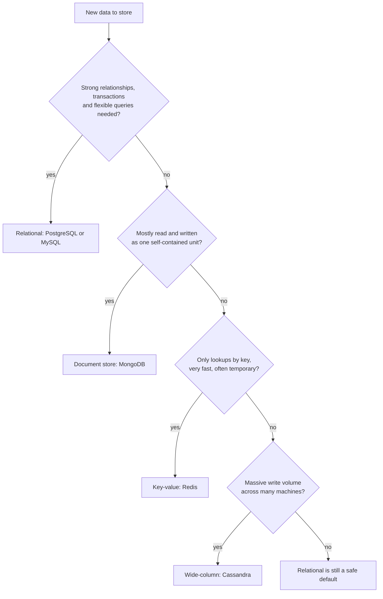
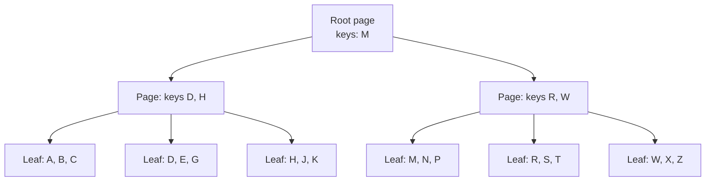
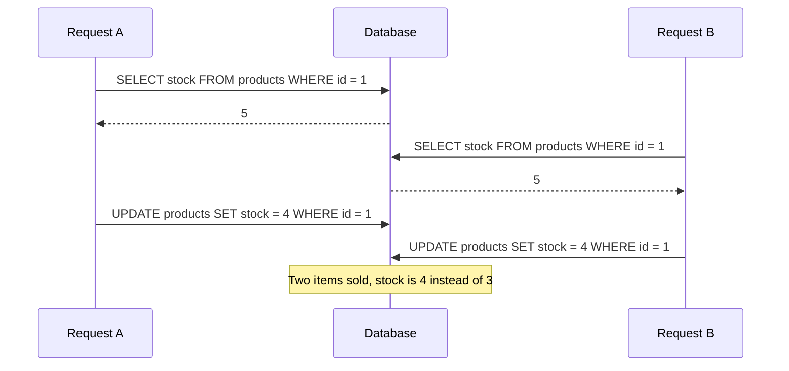
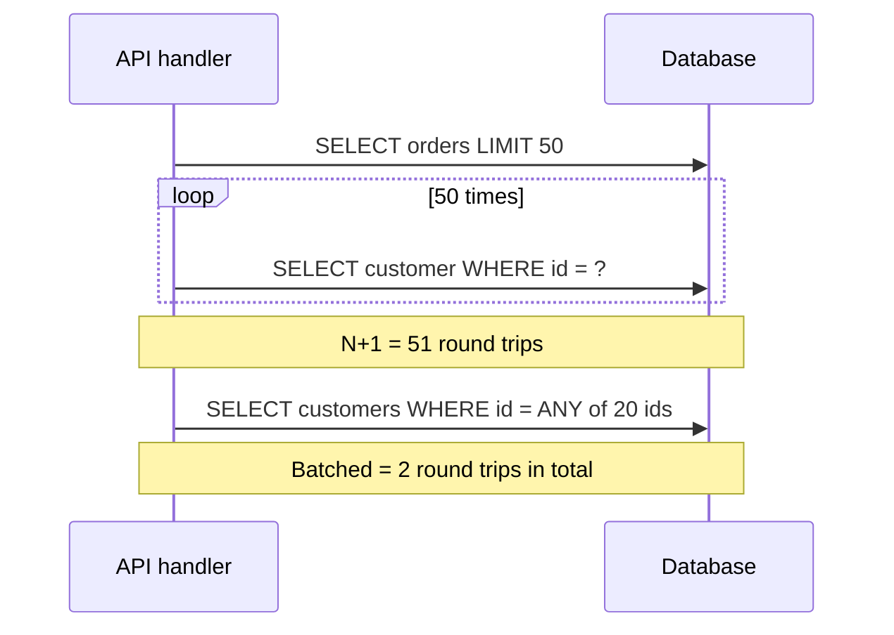
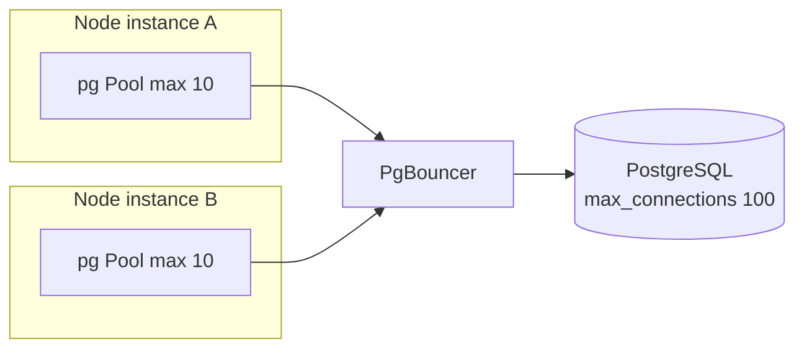
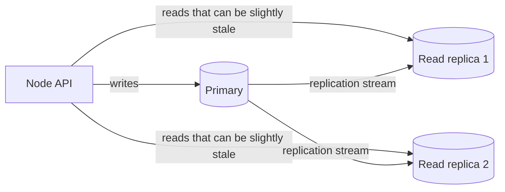
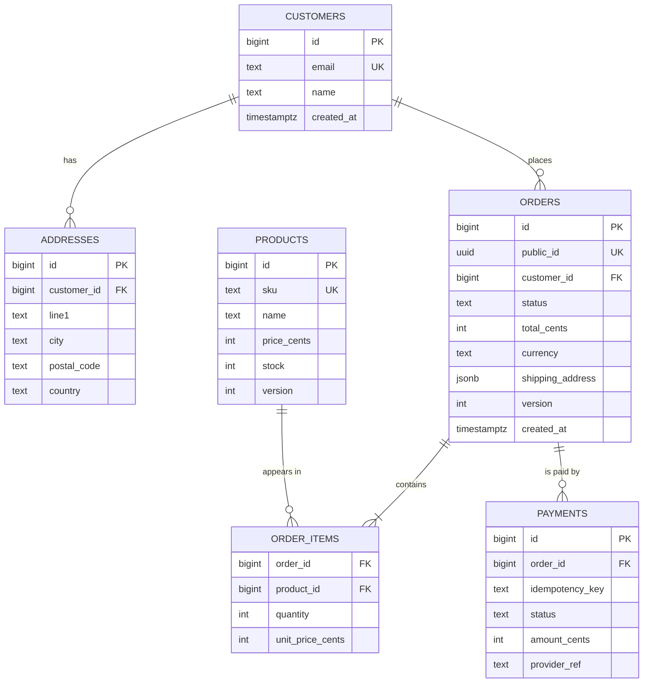

# Databases for Backend Developers

> In this document you will learn what a Node.js backend developer must know about databases: SQL vs NoSQL, relational modeling and normalization, joins, indexes and query plans, transactions, isolation levels and locking, the N+1 problem, connection pooling, ORMs and query builders, SQL injection, migrations, MongoDB basics, and replication and sharding. It ends with a complete schema for an orders system. Database questions show up in almost every backend interview, because most performance and correctness problems in real APIs are database problems.

**Before this:** [HTTP servers and Express](06-http-servers-and-express.md) · [REST API design](07-rest-api-design.md) · [Data structures and Big O](../01-cs-and-web-fundamentals/02-data-structures-and-big-o.md) · **Interview questions:** [jump to the interview section](#interview-questions)

## Table of contents

1. [SQL vs NoSQL](#sql-vs-nosql)
2. [Relational basics: tables, keys and constraints](#relational-basics-tables-keys-and-constraints)
3. [Joins](#joins)
4. [Normalization and denormalization](#normalization-and-denormalization)
5. [Indexes](#indexes)
6. [Reading query plans with EXPLAIN](#reading-query-plans-with-explain)
7. [Transactions and ACID](#transactions-and-acid)
8. [Isolation levels and anomalies](#isolation-levels-and-anomalies)
9. [Optimistic and pessimistic locking](#optimistic-and-pessimistic-locking)
10. [The N+1 query problem](#the-n1-query-problem)
11. [Connection pooling](#connection-pooling)
12. [ORMs, query builders and raw SQL](#orms-query-builders-and-raw-sql)
13. [SQL injection and parameterized queries](#sql-injection-and-parameterized-queries)
14. [Migrations](#migrations)
15. [MongoDB basics](#mongodb-basics)
16. [Replication and sharding](#replication-and-sharding)
17. [Schema design for an orders system](#schema-design-for-an-orders-system)
18. [Common mistakes](#common-mistakes)
19. [Best practices](#best-practices)
20. [Interview questions](#interview-questions)
21. [Summary](#summary)
22. [References](#references)

SQL examples use **PostgreSQL** syntax unless noted. Many of them were also run on SQLite (built into Node 22 as `node:sqlite`) to confirm the results shown.

---

## SQL vs NoSQL

A **database** stores data durably (it survives restarts), lets many users read and write at the same time safely, and lets you query the data efficiently. Databases differ mainly in their **data model** — how data is shaped — and in their **guarantees**.

### The main families

| Type | Data model | Examples | Great for |
| --- | --- | --- | --- |
| **Relational (SQL)** | Tables with rows and columns, relationships through keys, a fixed schema | PostgreSQL, MySQL, SQL Server, SQLite | Business data with relationships: users, orders, payments, inventory |
| **Document** | JSON-like documents, flexible schema, nested data | MongoDB, Couchbase, Firestore | Data read as a whole unit (a product with its variants), varied shapes, fast iteration |
| **Key-value** | A key maps to a value | Redis, DynamoDB (also document-like), etcd | Caching, sessions, rate limits, very fast lookups by key |
| **Wide-column** | Rows with many dynamic columns grouped in partitions | Cassandra, ScyllaDB, HBase | Huge write volumes, time-series, data spread across many machines |
| **Graph** | Nodes and edges (relationships are first-class) | Neo4j, Amazon Neptune | Social graphs, recommendations, fraud detection ("friends of friends") |
| **Search engine** | Inverted index over text | Elasticsearch, OpenSearch | Full-text search, filtering, relevance ranking |
| **Time-series** | Measurements over time | TimescaleDB, InfluxDB | Metrics, IoT, monitoring |

"NoSQL" just means "not only relational". The NoSQL families are very different from each other.

### How to choose



A practical rule many teams follow: **start with PostgreSQL** unless you have a clear reason not to. It gives transactions, constraints, joins, JSON columns (`jsonb`), full-text search and good performance up to very large sizes. Add specialized stores (Redis for caching, Elasticsearch for search) when a real need appears. Using several databases for different jobs is called **polyglot persistence**.

| | Relational | Document (MongoDB) |
| --- | --- | --- |
| Schema | Defined up front; changed with migrations | Flexible per document (validation optional) |
| Relationships | Foreign keys and joins | Embedding, or references with `$lookup` |
| Transactions | Core feature, multi-row and multi-table | Single-document atomic; multi-document transactions supported (with more cost) |
| Scaling writes | Usually vertical first; sharding is harder | Built-in sharding |
| Query flexibility | Very high (any join, aggregation) | High within a document; cross-collection queries are harder |
| Best when | Data is relational and correctness matters | Data is naturally hierarchical and accessed as a unit |

---

## Relational basics: tables, keys and constraints

A relational database stores data in **tables**. Each **row** is one record. Each **column** has a type.

```sql
CREATE TABLE customers (
  id          bigint GENERATED ALWAYS AS IDENTITY PRIMARY KEY,
  email       text        NOT NULL UNIQUE,
  name        text        NOT NULL,
  created_at  timestamptz NOT NULL DEFAULT now()
);

CREATE TABLE orders (
  id           bigint GENERATED ALWAYS AS IDENTITY PRIMARY KEY,
  customer_id  bigint      NOT NULL REFERENCES customers(id),
  status       text        NOT NULL CHECK (status IN ('pending_payment','paid','shipped','delivered','cancelled')),
  total_cents  integer     NOT NULL CHECK (total_cents >= 0),
  created_at   timestamptz NOT NULL DEFAULT now()
);
```

### Keys

- **Primary key (PK):** uniquely identifies a row. Never null, never duplicated. Usually an automatically generated number or a UUID.
- **Foreign key (FK):** a column that points to a primary key in another table (`orders.customer_id` → `customers.id`). The database refuses orders for customers that do not exist, and (by default) refuses to delete a customer that still has orders.
- **Natural key:** a real-world unique value (email, ISBN). **Surrogate key:** a meaningless generated ID. Prefer surrogate primary keys (natural values can change — people change emails) and put a `UNIQUE` constraint on the natural key.

**Integer IDs vs UUIDs:**

| | `bigint` identity | UUID |
| --- | --- | --- |
| Size | 8 bytes | 16 bytes |
| Generated | By the database, in order | Anywhere (app, client, offline) |
| Guessable / leaks counts | Yes (`/orders/1001` → you have ~1000 orders) | No |
| Index locality | Excellent (always appended at the end) | Random UUIDv4 inserts spread across the index; **UUIDv7** (time-ordered) fixes most of this |
| Merging data from many sources | Conflicts | Easy |

A common choice: `bigint` internally plus a public random ID, or UUIDv7 everywhere.

### Constraints are your last line of defense

| Constraint | Protects against |
| --- | --- |
| `NOT NULL` | Missing required data |
| `UNIQUE` | Duplicates (even under concurrent requests) |
| `CHECK` | Invalid values (negative stock, unknown status) |
| `FOREIGN KEY` | References to rows that do not exist ("orphans") |
| `EXCLUDE` (PostgreSQL) | Overlaps, for example two bookings for the same room and time |

Application code has bugs, scripts skip validation, and two requests can race. Constraints are checked **by the database for every write**, so they always hold. Tested on SQLite: with `CHECK (stock >= 0)`, an update that would make stock negative failed with `CHECK constraint failed: stock >= 0`.

### Data types that matter

- **Money:** `integer`/`bigint` in minor units (cents) or `numeric(12,2)`. Never `float`/`real` — binary floating point cannot represent `0.1` exactly.
- **Time:** PostgreSQL `timestamptz` (stores an absolute moment in UTC). Plain `timestamp` has no time zone and causes bugs.
- **Text:** `text` in PostgreSQL (no performance benefit from `varchar(n)`; use `CHECK (length(x) <= n)` if you need a limit).
- **JSON:** `jsonb` for flexible attributes. Do not put everything in JSON — you lose types, constraints and simple indexing.

---

## Joins

A **join** combines rows from two tables based on a related column. Example data:

```text
customers                orders
id | name                id  | customer_id | total_cents
1  | Asha                101 | 1           | 2500
2  | Ben                 102 | 1           | 4000
3  | Chen                103 | 2           | 1500
                         104 | NULL        | 999      (a guest order with no customer)
```

All outputs below were produced by running the queries on SQLite 3.50.

### INNER JOIN — only matching rows

```sql
SELECT c.name, o.id AS order_id, o.total_cents
FROM customers c
INNER JOIN orders o ON o.customer_id = c.id
ORDER BY o.id;
```

```text
name | order_id | total_cents
Asha | 101      | 2500
Asha | 102      | 4000
Ben  | 103      | 1500
```

Chen (no orders) and order 104 (no customer) are missing.

### LEFT JOIN — all rows from the left table

```sql
SELECT c.name, o.id AS order_id
FROM customers c
LEFT JOIN orders o ON o.customer_id = c.id
ORDER BY c.id, o.id;
```

```text
name | order_id
Asha | 101
Asha | 102
Ben  | 103
Chen | NULL        <- kept, with NULLs for the missing order
```

Find customers **without** orders (an "anti-join"):

```sql
SELECT c.name FROM customers c
LEFT JOIN orders o ON o.customer_id = c.id
WHERE o.id IS NULL;            -- Chen
```

### RIGHT JOIN and FULL OUTER JOIN

- **RIGHT JOIN:** all rows from the right table. Here it returns the three matched rows plus `NULL | 104`. (You can always rewrite it as a LEFT JOIN by swapping the tables, which most people find easier to read.)
- **FULL OUTER JOIN:** all rows from both sides: the three matches, `Chen | NULL` and `NULL | 104`.

### CROSS JOIN and SELF JOIN

- **CROSS JOIN:** every row with every row (3 customers × 4 orders = 12 rows). Rarely what you want; useful for generating combinations (sizes × colors).
- **SELF JOIN:** a table joined with itself, for example employees and their managers in the same table:

```sql
SELECT e.name AS employee, m.name AS manager
FROM employees e
LEFT JOIN employees m ON m.id = e.manager_id;
```

| Join | Rows returned |
| --- | --- |
| `INNER` | Only rows that match on both sides |
| `LEFT` | All left rows + matches (NULLs where no match) |
| `RIGHT` | All right rows + matches |
| `FULL OUTER` | All rows from both sides |
| `CROSS` | Every combination |

### Two classic join bugs

**Bug 1 — `COUNT(*)` with a LEFT JOIN counts the NULL row:**

```sql
-- ❌ Chen shows 1 order
SELECT c.name, COUNT(*) AS orders FROM customers c
LEFT JOIN orders o ON o.customer_id = c.id GROUP BY c.id;
-- Asha 2, Ben 1, Chen 1

-- ✅ Count a column from the right table (NULLs are not counted)
SELECT c.name, COUNT(o.id) AS orders, COALESCE(SUM(o.total_cents), 0) AS spent
FROM customers c LEFT JOIN orders o ON o.customer_id = c.id GROUP BY c.id;
-- Asha 2 6500, Ben 1 1500, Chen 0 0
```

**Bug 2 — a `WHERE` on the right table turns a LEFT JOIN into an INNER JOIN:**

```sql
-- ❌ "All customers with their big orders" — but Ben and Chen disappear
SELECT c.name, o.id FROM customers c
LEFT JOIN orders o ON o.customer_id = c.id
WHERE o.total_cents > 2000;
-- Asha 101, Asha 102

-- ✅ Put the condition in the ON clause
SELECT c.name, o.id FROM customers c
LEFT JOIN orders o ON o.customer_id = c.id AND o.total_cents > 2000;
-- Asha 101, Asha 102, Ben NULL, Chen NULL
```

The `WHERE` runs after the join. For Ben and Chen, `o.total_cents` is NULL, and `NULL > 2000` is not true, so their rows are removed.

---

## Normalization and denormalization

**Normalization** means organizing tables so that each fact is stored **in one place**. This avoids **anomalies**: inconsistent data after inserts, updates or deletes.

### A badly designed table

```text
order_lines
order_id | order_date | customer_email   | customer_city | product_sku | product_name | unit_price | qty
101      | 2026-03-01 | asha@example.com | Pune          | LAMP-1      | Desk Lamp    | 2499       | 2
101      | 2026-03-01 | asha@example.com | Pune          | DESK-9      | Oak Desk     | 18900      | 1
102      | 2026-03-04 | asha@example.com | Mumbai        | LAMP-1      | Desk Lamp    | 2499       | 1
```

Problems:

- **Update anomaly:** Asha moves. Her city is stored in many rows; if you update only some, the data contradicts itself (already happened: Pune vs Mumbai).
- **Insert anomaly:** you cannot add a product that has never been ordered.
- **Delete anomaly:** delete order 102, and you may lose the only record of some product or customer.

### The normal forms in plain words

| Normal form | Rule | Fix in the example |
| --- | --- | --- |
| **1NF** | Every column holds one atomic value; no repeating groups or lists in a cell | No `"LAMP-1, DESK-9"` in one cell — one row per order line |
| **2NF** | 1NF + every non-key column depends on the **whole** key (matters for composite keys) | In `(order_id, product_sku)` rows, `order_date` depends only on `order_id` → move to `orders`; `product_name` depends only on `sku` → move to `products` |
| **3NF** | 2NF + non-key columns depend **only on the key**, not on other non-key columns | `customer_city` depends on the customer, not the order → move to `customers` |

A memory sentence: every non-key column must depend on **the key, the whole key, and nothing but the key**.

### The normalized design

```text
customers(id, email, city)
products(id, sku, name, price_cents)
orders(id, customer_id → customers, created_at)
order_items(order_id → orders, product_id → products, quantity, unit_price_cents)
```

Notice `order_items.unit_price_cents`. Is that duplication? **No** — it is a different fact: "the price **at the time of purchase**". The product's current price can change; the price on an old invoice must not. Recognizing this is a sign of good modeling.

### Denormalization: duplicating on purpose

Normalized data needs joins to read. Sometimes reads are so frequent (or joins so expensive) that you store a copy on purpose:

- `orders.total_cents` (sum of the items) so order lists do not aggregate items every time.
- `products.review_count` and `average_rating` instead of counting reviews on every page view.
- A reporting table or materialized view rebuilt every hour.

**Costs:** more storage, more complex writes, and the risk that copies get out of sync. Keep them in sync in the **same transaction**, with triggers, or accept eventual consistency with background jobs. Normalize first; denormalize when measurements show you need it.

---

## Indexes

### What an index is

An **index** is a separate data structure that lets the database find rows **without reading the whole table**. Without an index, `WHERE email = 'asha@example.com'` on 10 million rows is a **full table scan** — read all 10 million rows. With an index, it is a few page reads.

**Analogy:** the index at the back of a book. To find "closures", you do not read all 600 pages; you look up the word in the alphabetical index and jump to page 214. The analogy also shows the cost: when you add pages, the index must be updated too.

### How a B-tree index works

Most database indexes are **B-trees** (balanced trees). Keys are kept **sorted** in a tree of pages. Each internal page points to child pages for key ranges; leaf pages hold keys plus pointers to the rows.



- A lookup walks from the root to one leaf: **O(log n)** page reads. Even with a billion rows, the tree is only a few levels deep because each page holds hundreds of keys.
- Because keys are sorted, a B-tree also supports **range queries** (`BETWEEN`, `>`, `<`), **prefix matches** (`LIKE 'abc%'`) and **ORDER BY** without sorting.

### Composite indexes and column order

A **composite index** covers several columns, for example `(customer_id, status, created_at)`. It is sorted by the first column, then by the second within equal first values, and so on — like a phone book sorted by last name, then first name.

The **leftmost prefix rule:** the index helps queries that filter on a **leftmost prefix** of its columns.

Tested with SQLite's `EXPLAIN QUERY PLAN` and an index on `orders (customer_id, status, created_at)`:

| Query filter | Plan |
| --- | --- |
| `customer_id = 7 AND status = 'paid' ORDER BY created_at` | `SEARCH ... USING INDEX (customer_id=? AND status=?)` — no extra sort |
| `customer_id = 7` | `SEARCH ... USING INDEX (customer_id=?)` |
| `status = 'paid'` only | `SCAN orders` — the index cannot help, `status` is not the first column |
| Before creating the index | `SCAN orders` + `USE TEMP B-TREE FOR ORDER BY` (full scan and a sort) |

Rules for choosing the column order:

1. Columns compared with **equality** (`=`) first.
2. Then the column used for **sorting** or for a **range** (`>`, `BETWEEN`). After a range column, later columns cannot be used for seeking.
3. Among equality columns, think about which combinations your queries use.

### Covering indexes

If the index contains **all columns the query needs**, the database can answer from the index alone, without visiting the table. SQLite reported `USING COVERING INDEX` for `SELECT status, created_at FROM orders WHERE customer_id = 7 AND status = 'paid'`. PostgreSQL calls this an **index-only scan**, and you can add extra non-key columns with `INCLUDE`:

```sql
CREATE INDEX idx_orders_customer_created ON orders (customer_id, created_at DESC) INCLUDE (status, total_cents);
```

### Other useful index types (PostgreSQL)

| Index | Use |
| --- | --- |
| **Unique index** | Enforces uniqueness (what `UNIQUE` constraints create) |
| **Partial index** | Index only some rows: `CREATE INDEX ... ON orders (created_at) WHERE status = 'pending_payment'` — small and fast |
| **Expression index** | Index a computed value: `CREATE INDEX ON users (lower(email))` for case-insensitive lookups |
| **GIN** | `jsonb` containment, arrays, full-text search |
| **BRIN** | Huge, naturally ordered tables (time-series), very small |
| **Hash** | Equality only (B-tree is usually fine) |

### When an index is not used

- **A function on the column:** `WHERE lower(email) = 'a@b.c'` cannot use an index on `email` (SQLite plan: `SCAN users`). Fix: an expression index on `lower(email)`, or store emails normalized.
- **Leading wildcard:** `LIKE '%@example.com'` cannot use a B-tree (`SCAN users`). Use full-text search or a trigram index (`pg_trgm`).
- **Not a leftmost prefix** of a composite index.
- **Type mismatch** (comparing a text column with a number) forces conversion.
- **Low selectivity:** if a filter matches a large part of the table (for example `status = 'delivered'` for 90% of rows), a sequential scan is cheaper, and the planner chooses it.
- **Outdated statistics:** run `ANALYZE` (autovacuum usually does it).

### The cost of indexes

Indexes are not free:

- **Every `INSERT`, `UPDATE` (of indexed columns) and `DELETE` must update every index.** A table with 12 indexes has slow writes.
- They use disk and memory (cache).
- Unused indexes are pure cost. PostgreSQL's `pg_stat_user_indexes` shows how often each index is used.

Index for your **actual query patterns**, verify with `EXPLAIN`, and remove indexes nobody uses.

---

## Reading query plans with EXPLAIN

The database does not run your SQL literally. The **query planner** chooses a **plan**: which indexes to use, in which order to join tables, which join algorithm to use. `EXPLAIN` shows the plan; `EXPLAIN ANALYZE` **runs** the query and shows real times and row counts.

```sql
EXPLAIN ANALYZE
SELECT id, total_cents FROM orders WHERE customer_id = 7 ORDER BY created_at DESC LIMIT 20;
```

An illustrative PostgreSQL plan on a 1-million-row table **without** a suitable index (your numbers will differ):

```text
Limit  (cost=18920.11..18920.16 rows=20 width=16) (actual time=96.4..96.4 rows=20 loops=1)
  ->  Sort  (cost=18920.11..18920.24 rows=52 width=16) (actual time=96.4..96.4 rows=20 loops=1)
        Sort Key: created_at DESC
        ->  Seq Scan on orders  (cost=0.00..18918.00 rows=52 width=16) (actual time=0.03..96.2 rows=48 loops=1)
              Filter: (customer_id = 7)
              Rows Removed by Filter: 999952
Execution Time: 96.5 ms
```

And **with** an index on `(customer_id, created_at DESC)`:

```text
Limit  (cost=0.42..9.10 rows=20 width=16) (actual time=0.02..0.05 rows=20 loops=1)
  ->  Index Scan using idx_orders_customer_created on orders  (cost=0.42..22.98 rows=52 width=16) (actual time=0.02..0.05 rows=20 loops=1)
        Index Cond: (customer_id = 7)
Execution Time: 0.07 ms
```

How to read a plan:

- Read it **from the innermost (most indented) node outwards**. Data flows up.
- **`cost=start..total`** — the planner's estimate in arbitrary units. **`actual time`** — real milliseconds (only with `ANALYZE`).
- **`rows`** estimate vs **actual rows** — a big difference means outdated statistics or a hard-to-estimate condition, which can lead to bad plans.
- **"Rows Removed by Filter: 999952"** — the database read almost a million rows to return 48. A strong hint you need an index.

Common node types:

| Node | Meaning |
| --- | --- |
| `Seq Scan` | Reads the whole table — fine for small tables or when most rows match |
| `Index Scan` | Walks the index, then fetches matching rows from the table |
| `Index Only Scan` | Answers from the index alone (covering index) |
| `Bitmap Index Scan` + `Bitmap Heap Scan` | Collects matching row locations from one or more indexes, then reads the table pages in order — good for medium selectivity |
| `Nested Loop` | For each outer row, look up inner rows — great when the outer side is small and the inner side is indexed |
| `Hash Join` | Builds a hash table of one side — good for larger joins on equality |
| `Merge Join` | Joins two inputs sorted on the join key |
| `Sort` | Sorts in memory or on disk ("external merge" means it spilled to disk) |

### A workflow for a slow endpoint

1. Find the slow query: application tracing/logs, or PostgreSQL's `pg_stat_statements` extension (total and mean time per query).
2. Run `EXPLAIN (ANALYZE, BUFFERS)` with **realistic** parameters on realistic data.
3. Look for sequential scans on big tables, large "rows removed", bad estimates, sorts spilling to disk, nested loops over many rows.
4. Fix: add or change an index, rewrite the query (avoid functions on columns, select fewer columns, paginate with keysets), update statistics.
5. Measure again. Check the write cost of any new index.

> Careful: `EXPLAIN ANALYZE` really executes the statement. For `UPDATE`/`DELETE`, wrap it in `BEGIN; ... ROLLBACK;`.

---

## Transactions and ACID

A **transaction** groups several operations into **one unit of work**: either all of them happen, or none of them do.

The classic example: transfer money from account 1 to account 2. Two updates must happen together. If the server crashes between them, money must not disappear or appear from nowhere.

### ACID

| Letter | Property | Plain meaning |
| --- | --- | --- |
| **A** | Atomicity | All or nothing. On error, everything is rolled back |
| **C** | Consistency | A transaction moves the database from one valid state to another; constraints always hold |
| **I** | Isolation | Concurrent transactions do not see each other's half-finished work (to a degree set by the isolation level) |
| **D** | Durability | Once committed, the data survives crashes (written to the write-ahead log on disk) |

### Example with rollback

Tested on SQLite with `CHECK (balance >= 0)`: account 1 has 100, account 2 has 50. A transfer of 150 credits account 2 first, then fails when debiting account 1. The whole transaction rolls back: balances stay **100 and 50**. A transfer of 30 commits: **70 and 80**.

In Node with `pg`, a transaction **must use one client** from the pool (each client is one database connection):

```ts
import type { Pool, PoolClient } from "pg";

export async function withTransaction<T>(pool: Pool, work: (client: PoolClient) => Promise<T>): Promise<T> {
  const client = await pool.connect();
  try {
    await client.query("BEGIN");
    const result = await work(client);
    await client.query("COMMIT");
    return result;
  } catch (err) {
    await client.query("ROLLBACK");
    throw err;
  } finally {
    client.release(); // ALWAYS give the connection back
  }
}

// Usage
await withTransaction(pool, async (tx) => {
  await tx.query("UPDATE accounts SET balance = balance - $1 WHERE id = $2", [amount, fromId]);
  await tx.query("UPDATE accounts SET balance = balance + $1 WHERE id = $2", [amount, toId]);
});
```

```ts
// ❌ Wrong: pool.query() may run each statement on a DIFFERENT connection.
await pool.query("BEGIN");
await pool.query("UPDATE accounts ...");   // maybe another connection, outside the transaction!
await pool.query("COMMIT");
```

Transaction tips:

- **Keep transactions short.** They hold locks; long transactions block others and bloat PostgreSQL's MVCC storage. Never wait for a user, an HTTP call or an email inside a transaction.
- **Do not call external services inside a transaction** — you cannot roll back an email or a card charge. Use the **outbox pattern** (write an "event to send" row in the same transaction; a worker sends it later). See [Background jobs and queues](13-background-jobs-and-queues.md).
- **Savepoints** (`SAVEPOINT s1; ... ROLLBACK TO s1;`) let you undo part of a transaction.

---

## Isolation levels and anomalies

When many transactions run at the same time, they can interfere. **Isolation levels** control how much they are allowed to see of each other. Stronger isolation = fewer anomalies, but more blocking or more retries.

### The anomalies

| Anomaly | What happens | Example |
| --- | --- | --- |
| **Dirty read** | T1 reads data that T2 wrote but **has not committed** (and may roll back) | You see a balance that never really existed |
| **Non-repeatable read** | T1 reads a row twice and gets **different values** because T2 committed an update in between | Price is 20 at the start of your report, 25 at the end |
| **Phantom read** | T1 runs the same query twice and gets **different sets of rows** because T2 inserted/deleted matching rows | "Count of today's orders" changes inside one transaction |
| **Lost update** | T1 and T2 both read a value, both write based on what they read; one write overwrites the other | Two purchases both read stock = 5 and both write 4 (should be 3) |
| **Write skew** | Two transactions read overlapping data, make decisions, and write **different** rows, breaking a rule together | Two doctors both check "at least one other doctor is on call", both go off call |

### The levels (SQL standard)

| Level | Dirty read | Non-repeatable read | Phantom read |
| --- | --- | --- | --- |
| Read Uncommitted | Possible | Possible | Possible |
| Read Committed | Prevented | Possible | Possible |
| Repeatable Read | Prevented | Prevented | Possible (by the standard) |
| Serializable | Prevented | Prevented | Prevented — results are as if transactions ran one at a time |

Real databases differ from the textbook table:

- **PostgreSQL default: Read Committed.** Its Read Uncommitted behaves like Read Committed (no dirty reads ever). Its Repeatable Read uses a snapshot and also prevents phantoms; Serializable uses **Serializable Snapshot Isolation (SSI)** and aborts transactions that would break serializability with error code **`40001` (serialization_failure)** — your code must **retry** them.
- **MySQL InnoDB default: Repeatable Read.**
- **SQL Server and Oracle default: Read Committed.**

```sql
BEGIN ISOLATION LEVEL SERIALIZABLE;
-- ... reads and writes ...
COMMIT; -- may fail with 40001: retry the whole transaction
```

### A lost update, step by step



Read Committed does **not** prevent this, because each statement is fine on its own. The bug is the **read-then-write in application code**. Fixes are in the next section.

---

## Optimistic and pessimistic locking

### Fix 1: atomic updates (best when possible)

Let the database do the math in one statement, with the rule in the `WHERE`:

```sql
UPDATE products
SET stock = stock - $1
WHERE id = $2 AND stock >= $1          -- only if enough stock
RETURNING stock;
```

If zero rows are updated, there was not enough stock. Tested on SQLite with one item in stock: the first purchase updated 1 row, the second updated **0 rows** — no overselling, no lock management.

### Fix 2: optimistic locking (version column)

**Optimistic** = assume conflicts are rare. Do not lock; detect conflicts at write time.

```sql
UPDATE products
SET price_cents = $1, version = version + 1
WHERE id = $2 AND version = $3;        -- the version the client read
```

Tested: Alice and Bob both read version 1. Alice's update changed 1 row (now version 2). Bob's update changed **0 rows** → conflict → reload and retry, or return `412`/`409` to the user. This is how ETags work in REST APIs (see [REST API design](07-rest-api-design.md#concurrency-control-with-etags)).

### Fix 3: pessimistic locking (`SELECT ... FOR UPDATE`)

**Pessimistic** = assume conflicts are likely. Lock the row while you work on it; other transactions that want to lock it **wait**.

```ts
await withTransaction(pool, async (tx) => {
  const { rows } = await tx.query(
    "SELECT balance FROM accounts WHERE id = $1 FOR UPDATE", // row stays locked until COMMIT/ROLLBACK
    [accountId],
  );
  if (rows[0].balance < amount) throw new ConflictError("INSUFFICIENT_FUNDS", "Not enough money");
  await tx.query("UPDATE accounts SET balance = balance - $1 WHERE id = $2", [amount, accountId]);
});
```

Variants:

- `FOR UPDATE NOWAIT` — fail immediately instead of waiting.
- `FOR UPDATE SKIP LOCKED` — skip rows locked by others. Perfect for **job queues in PostgreSQL**: many workers each grab different pending jobs.

```sql
SELECT id, payload FROM jobs
WHERE status = 'pending'
ORDER BY created_at
LIMIT 10
FOR UPDATE SKIP LOCKED;
```

### Deadlocks

If T1 locks row A then wants B, while T2 locks B then wants A, both wait forever — a **deadlock**. The database detects it and aborts one transaction (PostgreSQL error `40P01`). Prevent it by **locking rows in a consistent order** (for example by ascending ID), keeping transactions short, and retrying aborted transactions.

### Which one to choose

| Approach | Best when | Watch out |
| --- | --- | --- |
| Atomic `UPDATE ... WHERE` | Counters, stock, balances — the rule fits in one statement | Not every rule fits |
| Optimistic (version) | Conflicts are rare; user edits with "think time"; REST APIs | Clients must handle conflicts and retry |
| Pessimistic (`FOR UPDATE`) | High contention on short server-side transactions; complex multi-step checks | Blocking, deadlocks; never hold across user interaction |
| `SERIALIZABLE` | Complex invariants across many rows (write skew) | Retries on `40001`; more aborts under load |
| Unique constraints | "Only one X" rules (one active cart per user, one payment per order) | Map the violation to `409` |

Race conditions in Node application code (and Redis locks across services) are covered in [Concurrency: worker threads and cluster](12-concurrency-worker-threads-and-cluster.md).

---

## The N+1 query problem

The **N+1 problem** happens when code runs **1 query** to load a list of N items, and then **1 more query per item** to load related data — N+1 queries in total.

```ts
// ❌ N+1: 1 query for orders + 1 query per order for its customer
const orders = await db.query("SELECT * FROM orders ORDER BY id LIMIT 50");
for (const order of orders.rows) {
  order.customer = (await db.query("SELECT * FROM customers WHERE id = $1", [order.customer_id])).rows[0];
}
```

Measured with a query counter on SQLite (50 orders belonging to 20 customers):

| Approach | Queries |
| --- | --- |
| Loop (N+1) | **51** |
| Batch load with `IN` / `ANY` | **2** |
| Single `JOIN` | **1** |

Each query costs a network round trip (often 0.5–2 ms or more). 51 queries can easily turn a 5 ms endpoint into a 100 ms one — and it grows with page size.

### How it hides in ORMs

ORMs make N+1 easy to write by accident, especially with **lazy loading**:

```ts
// TypeORM with a lazy relation — looks innocent
const orders = await orderRepo.find({ take: 50 });
for (const order of orders) {
  const customer = await order.customer; // a query per order!
}
```

### Fixes

```ts
// ✅ Fix 1: JOIN
const { rows } = await db.query(`
  SELECT o.id, o.total_cents, c.id AS customer_id, c.name AS customer_name
  FROM orders o JOIN customers c ON c.id = o.customer_id
  ORDER BY o.id LIMIT 50`);

// ✅ Fix 2: batch load related rows with one query
const orders = (await db.query("SELECT * FROM orders ORDER BY id LIMIT 50")).rows;
const customerIds = [...new Set(orders.map((o) => o.customer_id))];
const customers = (await db.query("SELECT * FROM customers WHERE id = ANY($1)", [customerIds])).rows;
const byId = new Map(customers.map((c) => [c.id, c]));
for (const o of orders) o.customer = byId.get(o.customer_id);

// ✅ Fix 3: tell the ORM to load the relation eagerly
// Prisma:
const orders3 = await prisma.order.findMany({ take: 50, include: { customer: true } });
// TypeORM:
const orders4 = await orderRepo.find({ take: 50, relations: { customer: true } });
```

- **GraphQL** is especially prone to N+1 (each resolver loads its own data). The standard fix is **DataLoader**, which collects all IDs requested in one tick and loads them with one batched query.
- **Detect it:** log the number of queries per request in development, watch for repeated identical queries in traces, or use ORM query logging.



---

## Connection pooling

### Why pools exist

Opening a database connection is expensive: TCP handshake, TLS, authentication, and in PostgreSQL a whole new **server process** per connection (several MB of memory). Doing that for every HTTP request would add many milliseconds and could overload the database.

A **connection pool** keeps a set of open connections and **lends** them to queries. When a query finishes, the connection goes back to the pool for the next one.

**Analogy:** a car rental desk with 10 cars. Customers borrow a car and return it. If all cars are out, the next customer waits in line — or gives up after a timeout. Buying a new car for every customer would be absurd.

### `pg` Pool

```ts
// src/db/pool.ts
import { Pool } from "pg";

export const pool = new Pool({
  connectionString: process.env.DATABASE_URL,
  max: 10,                        // max connections in THIS process (default 10)
  idleTimeoutMillis: 10_000,      // close idle connections after 10 s (default 10 s)
  connectionTimeoutMillis: 2_000, // fail if no connection is free within 2 s (default 0 = wait forever)
  statement_timeout: 5_000,       // PostgreSQL cancels statements running longer than 5 s
});

pool.on("error", (err) => {
  // An idle client lost its connection (for example the DB restarted). Log it; the pool replaces the client.
  console.error("Unexpected idle client error", err);
});

// Simple queries: pool.query() checks out a client, runs the query and releases it.
const { rows } = await pool.query("SELECT id, name FROM products WHERE id = $1", [productId]);
```

Rules:

- **One pool per process**, created once at startup (a module-level singleton), not per request.
- **`pool.query()`** for single statements; **`pool.connect()` + `release()` in `finally`** for transactions. A forgotten `release()` leaks connections until the pool is empty and every request hangs.
- **Set `connectionTimeoutMillis`.** The default waits forever, turning a pool shortage into hanging requests instead of fast errors.
- **Close the pool on shutdown** (`await pool.end()`).

### Sizing the pool

Bigger is **not** better. A database can only run a limited number of queries in parallel efficiently (roughly related to its CPU cores and disks). Too many connections cause context switching and lock contention.

- A commonly cited starting point (PostgreSQL wiki): `connections ≈ (CPU cores × 2) + effective disks` **for the whole database**.
- **Multiply by instances!** 20 Node processes × `max: 20` = 400 connections. PostgreSQL's default `max_connections` is 100.
- With many instances or serverless functions (each invocation may create its own pool), put a **connection pooler** like **PgBouncer** (or a managed proxy such as Amazon RDS Proxy) between the apps and the database.
- Measure: pool wait time, active vs idle connections, database CPU.



---

## ORMs, query builders and raw SQL

There are three main ways to talk to a SQL database from Node.js.

| Approach | What it is | Node.js examples |
| --- | --- | --- |
| **Raw SQL** with a driver | You write SQL strings with parameters | `pg`, `mysql2`, `better-sqlite3` |
| **Query builder** | A JavaScript API that builds SQL for you; you still think in SQL | Knex, Kysely, Drizzle (also has ORM features) |
| **ORM** (Object-Relational Mapper) | Maps tables to classes/objects; handles relations, often migrations too | Prisma, TypeORM, Sequelize, MikroORM |

The same query — "paid orders of customer 7, newest first, with the customer's name" — in each style:

```ts
// Raw SQL with pg
const { rows } = await pool.query(
  `SELECT o.id, o.total_cents, c.name
   FROM orders o JOIN customers c ON c.id = o.customer_id
   WHERE o.customer_id = $1 AND o.status = 'paid'
   ORDER BY o.created_at DESC LIMIT 20`,
  [customerId],
);

// Knex (query builder)
const rows2 = await knex("orders as o")
  .join("customers as c", "c.id", "o.customer_id")
  .where({ "o.customer_id": customerId, "o.status": "paid" })
  .orderBy("o.created_at", "desc")
  .limit(20)
  .select("o.id", "o.total_cents", "c.name");

// Drizzle (typed, SQL-like)
const rows3 = await db
  .select({ id: orders.id, totalCents: orders.totalCents, name: customers.name })
  .from(orders)
  .innerJoin(customers, eq(customers.id, orders.customerId))
  .where(and(eq(orders.customerId, customerId), eq(orders.status, "paid")))
  .orderBy(desc(orders.createdAt))
  .limit(20);

// Prisma (ORM, schema-first, generated typed client)
const rows4 = await prisma.order.findMany({
  where: { customerId, status: "paid" },
  orderBy: { createdAt: "desc" },
  take: 20,
  select: { id: true, totalCents: true, customer: { select: { name: true } } },
});

// TypeORM (decorator-based entities)
const rows5 = await orderRepo.find({
  where: { customer: { id: customerId }, status: "paid" },
  order: { createdAt: "DESC" },
  take: 20,
  relations: { customer: true },
});
```

### Comparison

| | Raw SQL | Query builder (Knex, Kysely, Drizzle) | ORM (Prisma, TypeORM) |
| --- | --- | --- | --- |
| Control and performance | Full | High | Medium (generated SQL; escape hatches exist) |
| Type safety | Manual (or tools like PgTyped) | Good (Kysely, Drizzle) / weak (Knex) | Strong (Prisma) / medium (TypeORM) |
| Productivity for CRUD | Low | Medium | High |
| Relations and nested writes | Manual | Manual joins | Built in |
| Migrations | Separate tool | Knex/Drizzle Kit included | Prisma Migrate / TypeORM migrations |
| Risks | Repetition, string-building mistakes | Some learning curve | Hidden N+1, inefficient queries, "magic", harder complex SQL |

Practical advice:

- An ORM is productive for typical CRUD. **Learn SQL anyway** — you need it to debug what the ORM generates and to write reports.
- Turn on **query logging** in development to see the generated SQL.
- Use the ORM's **raw query** feature for complex reports, but safely (next section).
- Keep data access in **repositories**, so the rest of the app does not depend on the ORM everywhere.

---

## SQL injection and parameterized queries

**SQL injection** happens when user input is **concatenated into SQL text**, so the input can change the query's structure.

```ts
// ❌ Vulnerable
const email = req.body.email; // attacker sends:  x' OR '1'='1
const sql = `SELECT id, email FROM users WHERE email = '${email}'`;
// Becomes: SELECT id, email FROM users WHERE email = 'x' OR '1'='1'   -> returns EVERY user
```

Tested on SQLite with two users: the concatenated query returned **2 rows**; the parameterized version below returned **0 rows**. With inputs like `'; DROP TABLE users; --` or `UNION SELECT password_hash ...`, attackers can read or destroy data.

### The fix: parameterized queries (prepared statements)

```ts
// ✅ Safe: the SQL text and the values travel separately
const { rows } = await pool.query("SELECT id, email FROM users WHERE email = $1", [email]);
```

The database parses the SQL **first**, with a placeholder. The value is sent separately and is always treated as **data**, never as SQL code. No escaping functions, no blacklists — parameters solve it.

### Things parameters cannot do

Placeholders replace **values**, not **identifiers** (table or column names) or keywords (`ASC`/`DESC`). For dynamic sorting, use an **allowlist**:

```ts
const SORT_COLUMNS = { createdAt: "created_at", total: "total_cents" } as const;
const column = SORT_COLUMNS[req.query.sort as keyof typeof SORT_COLUMNS] ?? "created_at";
const direction = req.query.dir === "asc" ? "ASC" : "DESC";
await pool.query(`SELECT * FROM orders WHERE customer_id = $1 ORDER BY ${column} ${direction} LIMIT 20`, [customerId]);
```

For `IN` lists, use `= ANY($1)` with an array in PostgreSQL, instead of building `IN (1,2,3)` by hand.

### ORMs are not automatically safe

ORMs parameterize their normal methods, but their **raw** APIs can be misused:

```ts
// Prisma
await prisma.$queryRaw`SELECT * FROM users WHERE email = ${email}`;            // ✅ tagged template: parameterized
await prisma.$queryRawUnsafe(`SELECT * FROM users WHERE email = '${email}'`);  // ❌ string building: injectable

// Knex
await knex.raw("SELECT * FROM users WHERE email = ?", [email]);               // ✅
await knex.raw(`SELECT * FROM users WHERE email = '${email}'`);               // ❌
```

### NoSQL injection

MongoDB queries are objects, so the attack looks different: the attacker sends an **operator** instead of a string.

```js
// Body: { "email": "admin@shop.com", "password": { "$ne": null } }
await users.findOne({ email: req.body.email, password: req.body.password }); // ❌ matches any password
```

Fix: validate types (password **must be a string**) with a schema before querying, and never compare passwords in a query anyway (load the user by email, then verify the hash). Mongoose's `sanitizeFilter` option and libraries that strip `$` keys help as defense in depth.

Least privilege adds another layer: the app's database user should not be allowed to `DROP` tables or read tables it does not need.

---

## Migrations

A **migration** is a versioned script that changes the database schema (or data) from one version to the next: create a table, add a column, add an index. Migrations are stored in the repository and run in order, so every environment (your laptop, CI, staging, production) gets the same schema.

```sql
-- migrations/20260401_0930_add_order_notes.sql
ALTER TABLE orders ADD COLUMN notes text;
```

```ts
// Knex migration (TypeScript)
import type { Knex } from "knex";

export async function up(knex: Knex): Promise<void> {
  await knex.schema.alterTable("orders", (t) => {
    t.text("notes");
  });
}

export async function down(knex: Knex): Promise<void> {
  await knex.schema.alterTable("orders", (t) => {
    t.dropColumn("notes");
  });
}
```

Tools: Prisma Migrate, TypeORM migrations, Drizzle Kit, Knex, node-pg-migrate, Flyway, Liquibase. The database records which migrations ran (a table like `knex_migrations` or `_prisma_migrations`).

### Rules for production

- **Never edit a migration that already ran** in a shared environment. Write a new one.
- **Run migrations automatically in the deployment pipeline**, before (or as part of) the new code rollout — not by hand.
- **Make changes backward compatible.** During a rolling deploy, old and new code run at the same time against the same schema.
- **Watch locks.** Some changes lock a big table for minutes. In PostgreSQL, use `CREATE INDEX CONCURRENTLY`, add `NOT NULL` constraints in steps, and set a `lock_timeout` for migrations.
- **Down migrations** are useful in development; in production, "roll forward" with a new fix is usually safer than reversing.

### Expand and contract (zero-downtime changes)

Renaming a column `name` to `full_name` without downtime:

1. **Expand:** add `full_name` (nullable). Deploy code that **writes both** columns and reads `name`.
2. **Backfill:** copy `name` into `full_name` for existing rows in batches.
3. **Switch reads:** deploy code that reads `full_name` (still writes both).
4. **Contract:** deploy code that stops writing `name`, then drop the `name` column in a later migration.

Each step is safe with old and new code running side by side.

---

## MongoDB basics

**MongoDB** is the most popular document database. Data is stored as **documents** (BSON — binary JSON with extra types like dates and ObjectIds) in **collections**. Each document has a unique `_id` (by default an `ObjectId`, which contains a timestamp).

```js
// An order as ONE document: items and address are embedded
{
  _id: ObjectId("6710f3a2c1d4e5f6a7b8c9d0"),
  customerId: ObjectId("6710f1..."),
  status: "paid",
  items: [
    { productId: ObjectId("66ff..."), name: "Desk Lamp", unitPriceCents: 2499, quantity: 2 },
    { productId: ObjectId("66fe..."), name: "Oak Desk", unitPriceCents: 18900, quantity: 1 }
  ],
  shippingAddress: { line1: "12 Park Street", city: "Pune", postalCode: "411001", country: "IN" },
  totalCents: 23898,
  createdAt: ISODate("2026-04-01T09:00:00Z")
}
```

Reading the order with its items is **one** lookup, with no joins.

### CRUD with the official driver

```ts
import { MongoClient, ObjectId } from "mongodb";

const client = new MongoClient(process.env.MONGODB_URI!);   // the client manages a connection pool
await client.connect();
const orders = client.db("shop").collection("orders");

await orders.insertOne({ customerId, status: "pending_payment", items, totalCents, createdAt: new Date() });

const recentPaid = await orders
  .find({ customerId, status: "paid" })
  .sort({ createdAt: -1 })
  .limit(20)
  .toArray();

// Atomic update on one document
await orders.updateOne(
  { _id: new ObjectId(orderId), status: "pending_payment" },   // condition = optimistic check
  { $set: { status: "paid", paidAt: new Date() } },
);
```

### Embedding vs referencing

The main modeling decision in MongoDB: put related data **inside** the document, or store an **ID** that points to another document.

| Embed when | Reference when |
| --- | --- |
| The data belongs to the parent and is read together ("order items") | The related data is shared by many parents ("product catalog") |
| One-to-few relationships | One-to-many with **unbounded** growth ("all comments of a popular post") |
| You want atomic updates of the whole unit | The related data changes often on its own |
| The total stays far below the **16 MB document limit** | Documents would grow forever |

Rule of thumb: **model for your access patterns.** Data that is read together should be stored together.

### Indexes and the ESR rule

MongoDB uses B-tree indexes too, including compound indexes. For compound index order, MongoDB's documentation recommends the **ESR rule**: **E**quality fields first, then **S**ort fields, then **R**ange fields.

```js
// Query: customerId = X, status = "paid", sorted by createdAt desc, totalCents > 10000
await orders.createIndex({ customerId: 1, status: 1, createdAt: -1, totalCents: 1 });
```

Use `explain("executionStats")` to check whether a query uses an index (`IXSCAN`) or scans the collection (`COLLSCAN`).

### Aggregation pipeline

The aggregation pipeline processes documents through stages, like Unix pipes:

```js
// Revenue per product for paid orders in March 2026
const revenue = await orders.aggregate([
  { $match: { status: "paid", createdAt: { $gte: new Date("2026-03-01"), $lt: new Date("2026-04-01") } } },
  { $unwind: "$items" },                                   // one document per item
  { $group: {
      _id: "$items.productId",
      units: { $sum: "$items.quantity" },
      revenueCents: { $sum: { $multiply: ["$items.quantity", "$items.unitPriceCents"] } },
  } },
  { $sort: { revenueCents: -1 } },
  { $limit: 10 },
  { $lookup: { from: "products", localField: "_id", foreignField: "_id", as: "product" } }, // a left join
]).toArray();
```

### Transactions, validation and Mongoose

- Single-document writes are **atomic**. Multi-document **transactions** are supported (since 4.0 on replica sets, 4.2 on sharded clusters) but cost more; a good document model needs them rarely.
- MongoDB supports **schema validation** with JSON Schema on a collection.
- **Mongoose** is a popular ODM (object-document mapper) that adds schemas, validation, middleware hooks and `populate()` for references.

---

## Replication and sharding

Two different tools for two different problems. The system-level view is in [Scalability and core building blocks](../09-system-design/02-scalability-and-core-building-blocks.md).

### Replication — copies of the same data

A **primary** accepts writes and streams changes to one or more **replicas** (followers).



- **High availability:** if the primary fails, a replica is promoted (failover).
- **Read scaling:** send read-heavy queries (reports, listings) to replicas.
- **Replication lag:** replicas are usually slightly behind with asynchronous replication. A user who just updated their profile and is then served from a replica may see the **old** data. Fix: read-your-own-writes from the primary for a short time after a write, or route that user's reads to the primary.
- Synchronous replication avoids losing committed data on failover but adds write latency.

### Sharding — splitting the data

**Sharding** (horizontal partitioning) splits rows across several database servers by a **shard key** (for example `customer_id` or `tenant_id`). Each shard holds a subset of the data.

- **Scales writes and storage** beyond one machine.
- **The shard key is critical:** it should spread load evenly and match your queries. Queries that include the shard key go to one shard; queries without it must ask **all** shards ("scatter-gather").
- **Costs:** cross-shard joins and transactions are hard or impossible; rebalancing is complex; hot keys (one huge tenant) can overload a shard.

Do not shard early. Before sharding: optimize queries and indexes, add caching, add read replicas, scale the machine vertically, archive old data, and use table **partitioning** inside one database (PostgreSQL declarative partitioning by date, for example). MongoDB, Cassandra and DynamoDB shard natively; for PostgreSQL there are extensions such as Citus.

---

## Schema design for an orders system

This is the database behind the orders API in [REST API design](07-rest-api-design.md#worked-example-an-orders-api).



```sql
CREATE TABLE customers (
  id          bigint GENERATED ALWAYS AS IDENTITY PRIMARY KEY,
  email       text NOT NULL,
  name        text NOT NULL,
  created_at  timestamptz NOT NULL DEFAULT now()
);
CREATE UNIQUE INDEX customers_email_lower_uq ON customers (lower(email));

CREATE TABLE products (
  id           bigint GENERATED ALWAYS AS IDENTITY PRIMARY KEY,
  sku          text NOT NULL UNIQUE,
  name         text NOT NULL,
  price_cents  integer NOT NULL CHECK (price_cents >= 0),
  stock        integer NOT NULL CHECK (stock >= 0),
  version      integer NOT NULL DEFAULT 1
);

CREATE TABLE orders (
  id                bigint GENERATED ALWAYS AS IDENTITY PRIMARY KEY,
  public_id         uuid NOT NULL UNIQUE DEFAULT gen_random_uuid(),   -- what the API exposes
  customer_id       bigint NOT NULL REFERENCES customers(id),
  status            text NOT NULL DEFAULT 'pending_payment'
                    CHECK (status IN ('pending_payment','paid','shipped','delivered','cancelled')),
  total_cents       integer NOT NULL CHECK (total_cents >= 0),
  currency          char(3) NOT NULL,
  shipping_address  jsonb NOT NULL,          -- a snapshot: later address edits must not change old orders
  idempotency_key   text,
  version           integer NOT NULL DEFAULT 1,
  created_at        timestamptz NOT NULL DEFAULT now(),
  UNIQUE (customer_id, idempotency_key)      -- a retried "create order" cannot create a duplicate
);
-- "My orders, newest first" with keyset pagination:
CREATE INDEX orders_customer_created_idx ON orders (customer_id, created_at DESC, id DESC);
-- Admin dashboard: open orders only (partial index stays small)
CREATE INDEX orders_open_created_idx ON orders (created_at) WHERE status IN ('pending_payment','paid');

CREATE TABLE order_items (
  order_id          bigint NOT NULL REFERENCES orders(id) ON DELETE CASCADE,
  product_id        bigint NOT NULL REFERENCES products(id),
  quantity          integer NOT NULL CHECK (quantity BETWEEN 1 AND 100),
  unit_price_cents  integer NOT NULL CHECK (unit_price_cents >= 0),   -- price at purchase time
  PRIMARY KEY (order_id, product_id)
);
CREATE INDEX order_items_product_idx ON order_items (product_id);    -- "which orders contain product X"

CREATE TABLE payments (
  id               bigint GENERATED ALWAYS AS IDENTITY PRIMARY KEY,
  order_id         bigint NOT NULL REFERENCES orders(id),
  idempotency_key  text NOT NULL,
  status           text NOT NULL CHECK (status IN ('pending','succeeded','failed','refunded')),
  amount_cents     integer NOT NULL CHECK (amount_cents > 0),
  provider_ref     text,
  created_at       timestamptz NOT NULL DEFAULT now(),
  UNIQUE (order_id, idempotency_key)
);
-- At most one successful payment per order:
CREATE UNIQUE INDEX payments_one_success_per_order ON payments (order_id) WHERE status = 'succeeded';
```

Design decisions to explain in an interview:

- **Prices are copied into `order_items`** (`unit_price_cents`) and the shipping address into `orders` — orders are historical records.
- **Money is stored as integers** with a currency code.
- **Constraints guard the invariants:** valid statuses, non-negative stock, quantity limits, one successful payment per order, no duplicate orders from retries.
- **Indexes follow the access patterns:** customer history (keyset pagination), open orders for admins, product lookups.
- **`public_id`** is exposed in URLs instead of the sequential ID.
- **`version`** columns support optimistic locking (ETags).
- `order_items` uses a **composite primary key**, so the same product cannot appear twice in one order.

### Placing an order in one transaction

```ts
export async function placeOrder(customerId: number, input: CreateOrderInput, idempotencyKey: string) {
  return withTransaction(pool, async (tx) => {
    // 1. Load current prices from the DB (never trust client prices). Lock rows in a fixed order (by id) to avoid deadlocks.
    const productIds = input.items.map((i) => i.productId).sort((a, b) => a - b);
    const { rows: products } = await tx.query(
      "SELECT id, name, price_cents FROM products WHERE id = ANY($1) ORDER BY id FOR UPDATE",
      [productIds],
    );
    if (products.length !== productIds.length) throw new NotFoundError("Product", "one or more");

    // 2. Reserve stock atomically per item
    for (const item of input.items) {
      const res = await tx.query(
        "UPDATE products SET stock = stock - $1, version = version + 1 WHERE id = $2 AND stock >= $1",
        [item.quantity, item.productId],
      );
      if (res.rowCount === 0) throw new ConflictError("OUT_OF_STOCK", `Product ${item.productId} is out of stock`);
    }

    // 3. Create the order with the computed total
    // Note: pg returns bigint columns as strings by default, so convert the id to a number.
    const priceById = new Map(products.map((p) => [Number(p.id), p.price_cents as number]));
    const total = input.items.reduce((sum, i) => sum + priceById.get(i.productId)! * i.quantity, 0);
    const { rows: [order] } = await tx.query(
      `INSERT INTO orders (customer_id, total_cents, currency, shipping_address, idempotency_key)
       VALUES ($1, $2, 'INR', $3, $4) RETURNING id, public_id, status, total_cents, created_at`,
      [customerId, total, input.shippingAddress, idempotencyKey],
    );

    // 4. Insert the items with the price snapshot (one statement for all items)
    await tx.query(
      `INSERT INTO order_items (order_id, product_id, quantity, unit_price_cents)
       SELECT $1, x.product_id, x.quantity, x.unit_price
       FROM unnest($2::bigint[], $3::int[], $4::int[]) AS x(product_id, quantity, unit_price)`,
      [order.id, input.items.map((i) => i.productId), input.items.map((i) => i.quantity), input.items.map((i) => priceById.get(i.productId))],
    );
    return order;
  });
  // If the INSERT hits UNIQUE (customer_id, idempotency_key), catch error 23505 outside,
  // load the existing order and return it: the retry becomes a no-op.
}
```

Everything inside succeeds or fails together: no order without items, no reserved stock without an order.

---

## Common mistakes

| Mistake | Consequence | Fix |
| --- | --- | --- |
| Building SQL with string concatenation | SQL injection | Parameterized queries; allowlist identifiers |
| No indexes for common filters / sorts | Full scans, slow endpoints as data grows | Index access patterns; verify with `EXPLAIN` |
| Indexing every column | Slow writes, wasted memory | Index what queries use; drop unused indexes |
| Functions on indexed columns in `WHERE` | Index ignored | Expression indexes or normalized data |
| Read-then-write updates in app code | Lost updates, overselling | Atomic `UPDATE ... WHERE`, version checks, locks |
| Uniqueness checked only in code | Duplicates under concurrency | `UNIQUE` constraints |
| Transactions via `pool.query("BEGIN")` | Statements on different connections | `pool.connect()` + one client + `release()` |
| External calls inside transactions | Long locks, inconsistent side effects | Outbox pattern; call after commit |
| N+1 queries (often hidden by ORMs) | Many round trips, slow lists | Joins, batch loading, eager loading, DataLoader |
| New pool per request / huge pools | Connection storms, DB overload | One pool per process; size for all instances; PgBouncer |
| No `connectionTimeoutMillis` | Requests hang when the pool is exhausted | Set acquisition and statement timeouts |
| `float` for money, `timestamp` without time zone | Rounding and time zone bugs | Integer cents / `numeric`; `timestamptz` |
| `OFFSET` pagination on huge tables | Slow deep pages | Keyset pagination |
| Editing old migrations; breaking changes in one deploy | Drift between environments; downtime | New migrations; expand-and-contract |
| Unbounded arrays embedded in MongoDB documents | Huge documents, 16 MB limit | Reference instead |

---

## Best practices

- **Default to a relational database** (PostgreSQL) for business data; add specialized stores for clear needs.
- **Model the domain first**, normalize to 3NF, then denormalize deliberately where measurements show a need.
- **Let the database enforce invariants** with `NOT NULL`, `UNIQUE`, `CHECK` and foreign keys.
- **Design indexes from queries**, check plans with `EXPLAIN ANALYZE`, and monitor slow queries with `pg_stat_statements`.
- **Use transactions for multi-step writes**, keep them short, and never call external services inside them.
- **Prevent races in the database:** atomic updates, optimistic versions, `FOR UPDATE` when needed, retries for serialization failures and deadlocks.
- **Always parameterize**; allowlist dynamic identifiers; give the app's DB user least privilege.
- **One pool per process** with timeouts; account for all instances; release connections in `finally`.
- **Watch for N+1** with query counts and eager or batched loading.
- **Version every schema change** with migrations in CI/CD, using backward-compatible steps.
- **Scale in order:** better queries and indexes → caching ([Caching](11-caching.md)) → read replicas → partitioning → sharding.

---

### How to explain this in an interview

Use this for "How do you make a slow query fast?" — the database question you are most likely to get.

1. **Define it:** "An index is a separate sorted structure, usually a B-tree, that lets the database find rows without scanning the whole table."
2. **Why it exists:** "Without it, a filter on a big table reads every row — O(n). With a B-tree it's O(log n) page reads, and sorted order also helps ORDER BY and ranges."
3. **How it works:** "I start from the slow query, run EXPLAIN ANALYZE with real parameters, and look for sequential scans, many removed rows, bad row estimates or sorts. Then I add an index that matches the query: equality columns first, then the sort or range column — the leftmost-prefix rule — and maybe INCLUDE columns for an index-only scan."
4. **Small example:** "`WHERE customer_id = ? ORDER BY created_at DESC LIMIT 20` on a million orders: a composite index on `(customer_id, created_at DESC)` turns a full scan plus sort into a short index scan that stops after 20 rows."
5. **Where it is useful:** "Every list endpoint, foreign keys used in joins, unique lookups like email, and keyset pagination."
6. **Trade-offs / gotchas:** "Indexes slow down writes and use memory, so I don't index everything. Functions on the column, leading wildcards and low selectivity prevent index use. And sometimes the real fix is not an index but removing an N+1 or paginating."

---

## Interview questions

### Q1. SQL or NoSQL — how do you choose?

**What the interviewer is checking:** Reasoning from data shape and requirements, not fashion.

**Short spoken answer (30–60 seconds):**
> "I start from the data and the access patterns. If the data is relational — customers, orders, payments — and I need transactions, constraints and flexible queries, I choose a relational database, usually PostgreSQL. It also handles JSON, full-text search and large volumes, so it's a safe default. I choose a document database like MongoDB when data is naturally hierarchical and read as a unit, the shape varies, and cross-entity queries are rare. Key-value stores like Redis are for caching, sessions and counters. Wide-column stores like Cassandra fit massive write volumes spread across many machines. Many systems combine them: Postgres as the source of truth, Redis for caching, Elasticsearch for search."

**Follow-up questions:**
- **Does NoSQL scale better?** — Many NoSQL systems shard natively, so horizontal write scaling is easier. But a single well-tuned PostgreSQL server with replicas handles a lot; scale needs should be measured, not assumed.
- **Can MongoDB do transactions?** — Yes, single-document operations are atomic, and multi-document transactions exist since 4.0, with extra cost.

**Common mistakes:** "NoSQL has no schema, so it's faster to develop" (the schema moves into the code); "SQL doesn't scale".

**Where this is used in real projects:** Every new service's architecture decision.

### Q2. Explain INNER, LEFT, RIGHT and FULL OUTER joins.

**Short answer:** `INNER JOIN` returns only rows that match on both sides. `LEFT JOIN` returns all rows from the left table plus matches, with NULLs where there is no match (useful for "customers and their orders, including customers with none"). `RIGHT JOIN` is the mirror image. `FULL OUTER JOIN` returns all rows from both sides. With customers Asha (2 orders), Ben (1) and Chen (0), and a guest order with no customer: INNER gives 3 rows, LEFT gives 4 (Chen with NULL), RIGHT gives 4 (the guest order with NULL name), FULL gives 5. To find customers with no orders: `LEFT JOIN ... WHERE o.id IS NULL`.

### Q3. What does this query return, and why?

```sql
SELECT c.name, COUNT(*) AS orders
FROM customers c
LEFT JOIN orders o ON o.customer_id = c.id
GROUP BY c.id;
```

(Asha has 2 orders, Ben 1, Chen 0.)

**Answer (verified on SQLite):** `Asha 2`, `Ben 1`, **`Chen 1`**.

**Why:** the LEFT JOIN produces one row for Chen with NULL order columns. `COUNT(*)` counts **rows**, so it counts that row. `COUNT(o.id)` counts only non-NULL values and returns `Chen 0`. Similarly, `SUM(o.total_cents)` would be NULL for Chen; wrap it in `COALESCE(..., 0)`.

### Q4. Why did this LEFT JOIN lose customers?

```sql
SELECT c.name, o.id FROM customers c
LEFT JOIN orders o ON o.customer_id = c.id
WHERE o.total_cents > 2000;
```

**Answer:** It returns only Asha's two orders (verified). The `WHERE` runs after the join; for customers without a matching order, `o.total_cents` is NULL, and `NULL > 2000` is not true, so those rows are filtered out — the LEFT JOIN behaves like an INNER JOIN. Move the condition into the `ON` clause (`ON o.customer_id = c.id AND o.total_cents > 2000`) to keep all customers with NULLs (Asha 101, Asha 102, Ben NULL, Chen NULL).

### Q5. What is normalization? When would you denormalize?

**What the interviewer is checking:** Modeling fundamentals and pragmatism.

**Short spoken answer:**
> "Normalization organizes tables so each fact is stored once, which prevents update, insert and delete anomalies. In practice I aim for third normal form: atomic values in each column, every non-key column depending on the whole key, and nothing depending on other non-key columns — 'the key, the whole key and nothing but the key'. For example, a customer's city belongs in the customers table, not repeated on every order. I denormalize on purpose when reads dominate and joins or aggregations are too expensive — like storing `total_cents` on the order or a review count on the product — and I keep the copy in sync in the same transaction or accept eventual consistency. Note that copying the product price into order items isn't denormalization: it's a different fact — the price at purchase time."

**Follow-up questions:**
- **What is 2NF in simple words?** — With a composite key, no column may depend on only part of the key (order date depends only on the order ID, not on (order ID, product ID)).
- **What are the risks of denormalization?** — Inconsistent copies, more complex writes, more storage.

**Common mistakes:** Over-normalizing lookup data into dozens of tables; storing comma-separated lists in a column.

**Where this is used in real projects:** Every schema design and review.

### Q6. How does a B-tree index work, and why does column order matter in a composite index?

**What the interviewer is checking:** Internals plus practical index design.

**Short spoken answer:**
> "A B-tree keeps keys sorted in a balanced tree of pages. A lookup goes from the root down to one leaf, so it's O(log n), and because every page holds many keys, the tree is only a few levels deep even for huge tables. Being sorted, it also supports range queries, prefix LIKEs and ORDER BY. A composite index on (a, b, c) is sorted by a, then b, then c — like a phone book sorted by last name, then first name. So it helps queries that filter on a leftmost prefix: a, or a and b, or a, b and c. It can't help a query that only filters on b. I put equality columns first, then the sort or range column."

**Follow-up questions:**
- **What is a covering index?** — An index that contains every column the query needs, so the database answers from the index alone (index-only scan); in PostgreSQL you can add columns with `INCLUDE`.
- **Why might the database ignore your index?** — Low selectivity, a function on the column, a leading wildcard, type mismatch, or outdated statistics.

**Common mistakes:** Thinking an index on (a, b) helps `WHERE b = ?`; creating separate single-column indexes and expecting them to act like a composite index.

**Where this is used in real projects:** Every slow-query investigation.

### Q7. An endpoint listing a customer's orders became slow as data grew. How do you investigate?

**What the interviewer is checking:** A structured performance workflow.

**Short spoken answer (30–60 seconds):**
> "First I confirm where the time goes with tracing or logs — is it the database, or many queries, or serialization? If it's one query, I take it from `pg_stat_statements` or the logs and run `EXPLAIN ANALYZE` with realistic parameters. Typical findings: a sequential scan with millions of rows removed by the filter, a separate sort step, or an offset deep in the result. Fixes: a composite index on `(customer_id, created_at DESC)` that matches the filter and sort, keyset pagination instead of large offsets, and selecting only the needed columns. If it's many queries, it's probably an N+1, so I switch to a join or batch loading. Then I measure again and check the write cost of the new index."

**Follow-up questions:**
- **The plan's row estimates are way off — what then?** — Run `ANALYZE`, consider extended statistics for correlated columns, and check for parameter-dependent plans.
- **The query is fast alone but slow in production?** — Lock contention, pool exhaustion, cold cache, or noisy neighbors; check wait events and pool metrics.

**Common mistakes:** Adding random indexes without looking at the plan.

**Where this is used in real projects:** Daily backend work.

### Q8. What are ACID transactions? Give an example where you need one.

**Short spoken answer:**
> "A transaction groups several operations so they succeed or fail together. ACID means: Atomicity — all or nothing, on error everything is rolled back; Consistency — constraints hold before and after; Isolation — concurrent transactions don't see each other's half-done work, depending on the isolation level; Durability — once committed, it survives a crash because it's in the write-ahead log. Example: placing an order — reserve stock, insert the order and its items. If inserting the items fails, the stock reservation must be undone. In Node with `pg`, I check out one client from the pool, run BEGIN, the statements and COMMIT on that same client, ROLLBACK on error, and release the client in `finally`."

**Follow-up questions:**
- **Why not `pool.query('BEGIN')`?** — Each `pool.query` may use a different connection, so the statements wouldn't be in the same transaction.
- **Can you call a payment API inside the transaction?** — Avoid it: it holds locks during a slow network call and can't be rolled back. Use the outbox pattern or call it before/after with idempotency.

**Common mistakes:** Long transactions; forgetting `release()`.

**Where this is used in real projects:** Orders, payments, transfers, any multi-row write.

### Q9. Explain isolation levels and the anomalies they prevent.

**What the interviewer is checking:** Concurrency theory with real database knowledge.

**Short spoken answer (30–60 seconds):**
> "Isolation levels define how much concurrent transactions can see of each other. The anomalies are: dirty reads — seeing uncommitted data; non-repeatable reads — the same row gives different values within a transaction; phantom reads — the same query returns a different set of rows; plus lost updates and write skew. Read Committed prevents dirty reads; Repeatable Read also prevents non-repeatable reads; Serializable makes the result equivalent to running transactions one by one. PostgreSQL defaults to Read Committed, its Repeatable Read uses snapshots and also avoids phantoms, and its Serializable uses SSI and aborts conflicting transactions with error 40001, which the application must retry. MySQL InnoDB defaults to Repeatable Read. Higher levels mean more retries or blocking, so I usually stay at Read Committed and use atomic updates, constraints or row locks for the specific races."

**Follow-up questions:**
- **Does Read Committed prevent lost updates?** — Not for read-then-write in application code. Use atomic updates, version checks or `SELECT ... FOR UPDATE`.
- **What is write skew?** — Two transactions read overlapping data and write different rows, breaking a rule together (two doctors both going off call). Serializable or explicit locking prevents it.

**Common mistakes:** Assuming all databases implement levels identically; forgetting retries at Serializable.

**Where this is used in real projects:** Booking systems, inventory, financial ledgers.

### Q10. Two customers buy the last item at the same time. How do you prevent overselling?

**What the interviewer is checking:** Practical race-condition handling.

**Short spoken answer:**
> "The bug is reading stock in the application and then writing a new value — both requests read 1 and both succeed. I make the check and the change one atomic statement: `UPDATE products SET stock = stock - 1 WHERE id = $1 AND stock >= 1`. If it updates zero rows, the item is sold out and I return 409. I also add a `CHECK (stock >= 0)` constraint as a safety net. If the logic is more complex, I lock the row with `SELECT ... FOR UPDATE` inside a short transaction. I tested the atomic version: with one item in stock, the first update changed one row and the second changed zero."

**Follow-up questions:**
- **What about a flash sale with huge contention on one row?** — Row locks serialize everything; consider reserving stock in Redis with atomic decrements, queueing purchases, or splitting stock into buckets.
- **How do you make sure the order and the stock change are consistent?** — Same transaction for the stock update and the order insert.

**Common mistakes:** Checking stock with a SELECT, then updating in a separate step; relying on a mutex in one Node process (does not work across instances).

**Where this is used in real projects:** E-commerce checkout, ticketing, booking.

### Q11. Optimistic vs pessimistic locking — when do you use each?

**Short answer:** **Optimistic locking** assumes conflicts are rare: no lock is held; the update includes the version that was read (`WHERE id = $1 AND version = $2`) and fails with zero rows if someone else changed it — then the client reloads or retries. Great for user edits with think time and for REST APIs (ETag/If-Match). **Pessimistic locking** assumes conflicts are likely: `SELECT ... FOR UPDATE` locks the row inside a short transaction, so others wait. Good for high-contention, short server-side operations (account balances), and `FOR UPDATE SKIP LOCKED` is a great way to build job queues in PostgreSQL. Never hold pessimistic locks across user interaction, lock rows in a consistent order to avoid deadlocks, and retry on deadlock errors.

### Q12. What is the N+1 problem and how do you fix it?

**What the interviewer is checking:** A very common real-world performance bug.

**Short spoken answer:**
> "It's when code loads a list with one query and then runs one more query per item to load related data — N plus one queries. Each query is a network round trip, so a page of 50 orders with their customers becomes 51 queries; I measured exactly that in a small test, versus 2 with batching and 1 with a join. It often hides behind ORM lazy loading or GraphQL resolvers. Fixes: a JOIN, batch loading with `WHERE id = ANY($1)` and mapping in memory, the ORM's eager loading like Prisma's `include` or TypeORM's `relations`, or DataLoader in GraphQL. I detect it by logging the number of queries per request in development."

**Follow-up questions:**
- **Is a JOIN always better than two queries?** — Not always: joining one-to-many data duplicates parent columns per child row; two queries (parent + batched children) can be lighter. Both avoid N+1.
- **How does DataLoader work?** — It collects all `load(id)` calls made in the same tick, then calls a batch function once with all IDs and caches results per request.

**Common mistakes:** "The ORM handles it"; using `Promise.all` over N queries (still N queries, just parallel — and it can exhaust the pool).

**Where this is used in real projects:** List endpoints, GraphQL APIs, admin tables.

### Q13. Why do we need connection pooling, and how big should the pool be?

**What the interviewer is checking:** Resource management in Node + DB.

**Short spoken answer:**
> "Opening a database connection is expensive — TCP, TLS, authentication, and in PostgreSQL a new server process per connection. A pool keeps connections open and lends them to queries, so requests don't pay that cost and the database isn't flooded. In Node I create one `pg` Pool per process at startup, use `pool.query` for single statements and `pool.connect` with `release` in `finally` for transactions. Bigger isn't better: the database can only do a limited amount of work in parallel. A common starting point is around cores times two for the whole database, and I remember to multiply by the number of instances — 20 instances with 20 connections each is 400, above Postgres's default limit of 100. With many instances or serverless, I add PgBouncer. And I set a connection acquire timeout so pool exhaustion fails fast instead of hanging."

**Follow-up questions:**
- **Symptoms of a leaked connection?** — Requests hang after a while, the pool shows all clients checked out, and they never return; usually a missing `release()` in an error path.
- **Why can `Promise.all` over 1,000 queries be bad?** — It queues them all on the pool and holds connections, starving other requests; limit concurrency.

**Common mistakes:** Creating a pool per request; huge pools; no timeouts.

**Where this is used in real projects:** Every Node service that uses a SQL database.

### Q14. ORM or raw SQL?

**Short answer:** ORMs (Prisma, TypeORM) give fast CRUD development, typed models, relations and migrations, but they can hide inefficient SQL and N+1 queries and make complex queries awkward. Raw SQL (`pg`) gives full control and performance but more repetitive code and manual typing. Query builders (Kysely, Drizzle, Knex) sit in between: SQL-shaped, composable, often type-safe. My usual choice: an ORM or typed query builder for most CRUD, raw parameterized SQL for complex reports, query logging on in development, and data access behind repositories. Whatever the tool, the team must understand the SQL it produces.

### Q15. What is SQL injection, and how do you prevent it?

**What the interviewer is checking:** A security basic you must get exactly right.

**Short spoken answer:**
> "SQL injection is when user input is concatenated into a SQL string, so the input can change the query's structure — for example an email of `x' OR '1'='1` turns a lookup into 'return all users', or worse, `UNION SELECT` reads other tables. In a quick SQLite test, the concatenated query returned every user, and the parameterized one returned none. The fix is parameterized queries: the SQL text with placeholders like `$1` is parsed first, and the values are sent separately and treated only as data. Placeholders can't be used for column names or sort directions, so for dynamic sorting I map input through an allowlist. I'm careful with ORM raw APIs like `$queryRawUnsafe`, and I give the app's DB user least privilege."

**Follow-up questions:**
- **Is escaping quotes enough?** — No: escaping rules depend on context and encoding and are easy to get wrong. Parameters are the correct fix.
- **Does MongoDB have injection?** — Yes, operator injection like `{ "$ne": null }`; validate types before querying.

**Common mistakes:** "We use an ORM so we're safe" — raw queries and dynamic identifiers still need care.

**Where this is used in real projects:** Any code that builds queries, especially search, filters and reports.

### Q16. How do you run schema migrations safely with zero downtime?

**Short answer:** Keep migrations versioned in the repo and run them automatically in the pipeline. Make each change backward compatible with the code currently running, because old and new versions run together during a rolling deploy. Use **expand and contract**: add new columns/tables first (nullable or with defaults), deploy code that writes both old and new, backfill in batches, switch reads, stop writing the old column, and drop it in a later release. Avoid long locks: `CREATE INDEX CONCURRENTLY`, add constraints as `NOT VALID` then `VALIDATE`, set `lock_timeout`. Never edit a migration that already ran; roll forward with a new one.

### Q17. MongoDB: embed or reference?

**What the interviewer is checking:** Document modeling skill.

**Short spoken answer:**
> "I model for access patterns. I embed data that belongs to the parent and is read together, in one-to-few relationships — like order items and the shipping address inside an order. Then one read gets everything, and updates to the whole order are atomic. I reference data that is shared across many documents, changes independently, or grows without limit — like products, or comments on a popular post — because documents have a 16 MB limit and huge arrays are slow to update. Sometimes I combine them: reference the product but embed a snapshot of its name and price in the order item."

**Follow-up questions:**
- **How do you join in MongoDB?** — `$lookup` in an aggregation pipeline, or a second query in the application; frequent joins suggest a relational model might fit better.
- **What is the ESR rule?** — For compound indexes: Equality fields first, then Sort, then Range.

**Common mistakes:** Designing MongoDB collections like normalized SQL tables; unbounded embedded arrays.

**Where this is used in real projects:** Catalogs, CMS content, user profiles, event data.

### Q18. What is replication lag, and how does it affect users?

**Short answer:** With asynchronous replication, replicas apply the primary's changes slightly later — usually milliseconds, sometimes seconds under load. If reads go to a replica right after a write, the user may not see their own change ("I saved my profile but it shows the old name"). Fixes: read-your-own-writes (route a user's reads to the primary for a short time after they write, or for specific screens), track the replication position (LSN) and wait for the replica to catch up, or use synchronous replication for critical data (at the cost of write latency). Never use replicas for reads that are part of a write decision (like checking stock before buying).

### Q19. When would you shard a database, and what are the costs?

**Short answer:** When one primary can no longer handle the write volume or the data size, **after** cheaper steps: query and index tuning, caching, read replicas, vertical scaling, archiving and partitioning. Sharding splits data by a shard key (for example `tenant_id`) across servers. Choose a key that spreads load evenly and appears in most queries. Costs: cross-shard queries become scatter-gather, cross-shard transactions and joins are hard, rebalancing is operationally complex, and hot keys can overload one shard. See [Scalability and core building blocks](../09-system-design/02-scalability-and-core-building-blocks.md).

### Q20. Design the database schema for orders, items and payments.

**What the interviewer is checking:** Applying everything together.

**Short spoken answer (30–60 seconds):**
> "I'd have customers, products, orders, order_items and payments. Orders reference customers and have a status with a CHECK constraint, an integer total in cents with a currency, a snapshot of the shipping address and a version column for optimistic locking. Order items have a composite primary key of order and product, a quantity check and a copy of the unit price at purchase time, because prices change later. Products have a non-negative stock check. Payments reference orders with a unique (order_id, idempotency_key) and a partial unique index that allows only one succeeded payment per order. For access patterns I add an index on orders (customer_id, created_at DESC, id) for keyset pagination of order history, and a partial index for open orders. Placing an order runs in one transaction: lock and read current prices, atomically decrement stock, insert the order and items."

**Code or diagram:** see [Schema design for an orders system](#schema-design-for-an-orders-system).

**Follow-up questions:**
- **Why not store the total only as a computed sum?** — Storing it avoids aggregating on every list read and records the charged amount; recompute and verify in the same transaction.
- **How do you prevent a duplicate order on retry?** — `UNIQUE (customer_id, idempotency_key)` and return the existing order on conflict.

**Common mistakes:** Floats for money; no price snapshot; no constraints; indexes not matching queries.

**Where this is used in real projects:** E-commerce, marketplaces, subscription billing.

### Q21. What happens here, and how do you fix it?

```ts
app.get("/orders", async (req, res) => {
  const client = await pool.connect();
  const { rows } = await client.query("SELECT * FROM orders WHERE customer_id = $1", [req.user.id]);
  if (rows.length === 0) return res.json([]);
  client.release();
  res.json(rows);
});
```

**Answer:** The early `return` (and any thrown error from `query`) skips `client.release()`, so the connection **leaks**. After a few customers with no orders, the pool (default 10) is empty, and every later request waits forever (the default `connectionTimeoutMillis` is 0). Fix: use `pool.query()` for a single statement, or `try { ... } finally { client.release(); }`. Also: `SELECT *` returns columns the client does not need, and there is no pagination.

### Q22. How would you store money and timestamps?

**Short answer:** Money as an integer number of minor units (`bigint` cents) plus an ISO currency code, or `numeric(precision, scale)` — never binary floats, because `0.1 + 0.2` is `0.30000000000000004`. Timestamps as `timestamptz` in PostgreSQL (an absolute instant, stored in UTC), converted to the user's time zone only for display. In JSON APIs, send ISO 8601 strings with `Z`, and send large IDs and `bigint` amounts as strings if they can exceed `Number.MAX_SAFE_INTEGER`.

---

## Summary

- Choose the store from data shape and access patterns; **PostgreSQL** is a strong default, with Redis, MongoDB, Elasticsearch or Cassandra for specific needs.
- Use primary keys, foreign keys, `NOT NULL`, `UNIQUE` and `CHECK` constraints — the database enforces rules even when code races or has bugs.
- Know your joins and their traps: `COUNT(*)` with LEFT JOIN, and `WHERE` on the right table turning LEFT into INNER.
- Normalize to 3NF to avoid anomalies; denormalize deliberately for read performance; snapshots like "price at purchase" are separate facts.
- **B-tree indexes** give O(log n) lookups, ranges and ordering; composite indexes follow the leftmost-prefix rule (equality first, then sort/range); indexes cost write performance.
- Use **EXPLAIN ANALYZE** to see scans, joins, estimates and sorts before and after a change.
- **Transactions** (ACID) make multi-step writes all-or-nothing; in `pg` use one client per transaction and always release it.
- Isolation levels trade anomalies for performance; PostgreSQL defaults to Read Committed; Serializable needs retries on `40001`.
- Prevent races with **atomic updates**, **optimistic versions**, `FOR UPDATE` (and `SKIP LOCKED` for queues), and unique constraints.
- Kill **N+1** queries with joins, batching, eager loading or DataLoader.
- **One pool per process**, sized for all instances, with timeouts; add PgBouncer at scale.
- **Always parameterize** queries; allowlist identifiers; watch ORM raw APIs and NoSQL operator injection.
- Version schema changes as **migrations** and use expand-and-contract for zero downtime.
- MongoDB: model for access patterns (embed vs reference), ESR index order, aggregation pipelines.
- Replication gives availability and read scaling (beware lag); sharding scales writes at a high complexity cost — do it last.

---

## References

- PostgreSQL documentation: Indexes — https://www.postgresql.org/docs/current/indexes.html
- PostgreSQL: Using EXPLAIN — https://www.postgresql.org/docs/current/using-explain.html
- PostgreSQL: Transaction isolation — https://www.postgresql.org/docs/current/transaction-iso.html
- PostgreSQL: Explicit locking (`FOR UPDATE`, `SKIP LOCKED`) — https://www.postgresql.org/docs/current/explicit-locking.html
- PostgreSQL: Constraints — https://www.postgresql.org/docs/current/ddl-constraints.html
- PostgreSQL: `pg_stat_statements` — https://www.postgresql.org/docs/current/pgstatstatements.html
- PostgreSQL wiki: Number of database connections — https://wiki.postgresql.org/wiki/Number_Of_Database_Connections
- MySQL InnoDB transaction isolation levels — https://dev.mysql.com/doc/refman/8.4/en/innodb-transaction-isolation-levels.html
- SQLite: Query planning and `EXPLAIN QUERY PLAN` — https://www.sqlite.org/eqp.html
- Node.js `node:sqlite` module — https://nodejs.org/api/sqlite.html
- node-postgres (`pg`): Pool and transactions — https://node-postgres.com/apis/pool and https://node-postgres.com/features/transactions
- OWASP SQL Injection Prevention Cheat Sheet — https://cheatsheetseries.owasp.org/cheatsheets/SQL_Injection_Prevention_Cheat_Sheet.html
- Prisma documentation (relations, raw queries) — https://www.prisma.io/docs
- TypeORM documentation — https://typeorm.io/
- Drizzle ORM documentation — https://orm.drizzle.team/docs/overview
- Knex.js documentation — https://knexjs.org/
- MongoDB data modeling — https://www.mongodb.com/docs/manual/data-modeling/
- MongoDB ESR (Equality, Sort, Range) guideline — https://www.mongodb.com/docs/manual/tutorial/equality-sort-range-guideline/
- MongoDB aggregation pipeline — https://www.mongodb.com/docs/manual/core/aggregation-pipeline/
- MongoDB transactions — https://www.mongodb.com/docs/manual/core/transactions/
- DataLoader — https://github.com/graphql/dataloader
