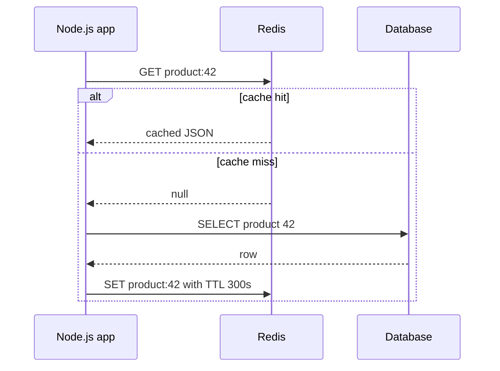
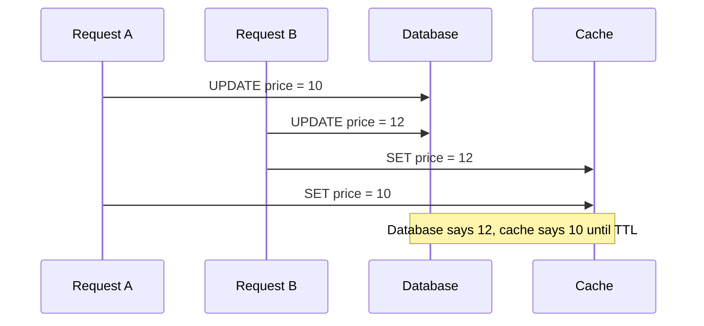
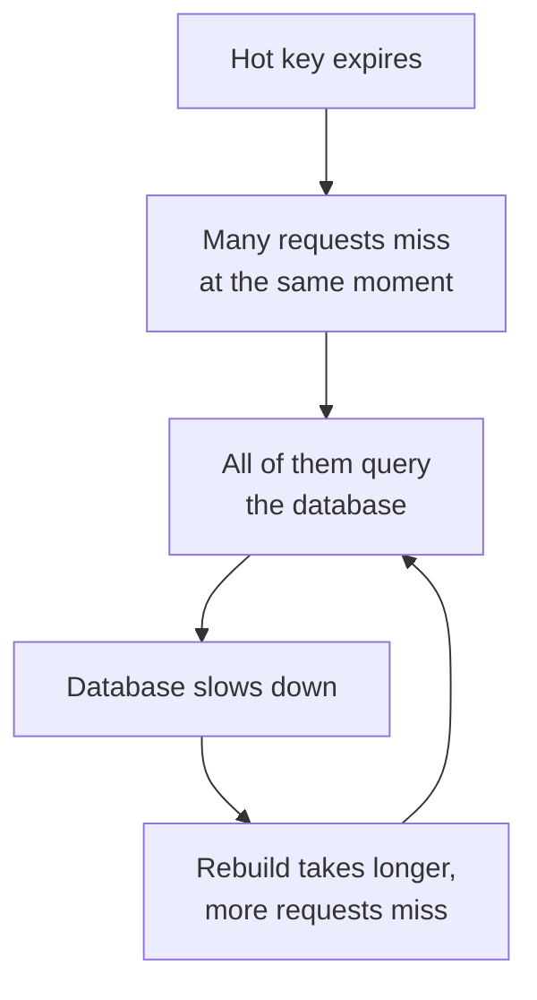
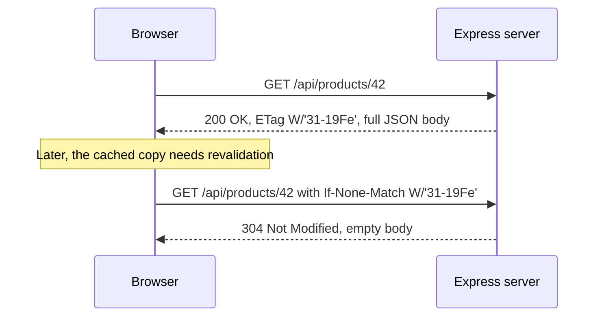

# Caching in Node.js

> In this document you will learn how to make a Node.js backend faster and cheaper with caching: what to cache, where to cache it, the main caching patterns, how to keep the cache correct, how to use Redis, and how to use HTTP caching from Express. Caching questions are common in backend and system design interviews because they test both performance thinking and correctness thinking.

**Before this:** [HTTP servers and Express](06-http-servers-and-express.md) · [Databases](10-databases.md) · [HTTP, HTTPS and TLS](../01-cs-and-web-fundamentals/05-http-https-and-tls.md) · **Interview questions:** [jump to the interview section](#interview-questions)

## Table of contents

1. [What caching is and why it matters](#what-caching-is-and-why-it-matters)
2. [What to cache and what not to cache](#what-to-cache-and-what-not-to-cache)
3. [Cache levels in a backend](#cache-levels-in-a-backend)
4. [Designing cache keys](#designing-cache-keys)
5. [Caching patterns](#caching-patterns)
6. [TTL and expiration](#ttl-and-expiration)
7. [Eviction policies and an LRU cache](#eviction-policies-and-an-lru-cache)
8. [Cache invalidation strategies](#cache-invalidation-strategies)
9. [When caches fail: stampede, penetration and avalanche](#when-caches-fail-stampede-penetration-and-avalanche)
10. [Redis basics for Node.js developers](#redis-basics-for-nodejs-developers)
11. [HTTP caching from Express](#http-caching-from-express)
12. [Consistency trade-offs](#consistency-trade-offs)
13. [Measuring a cache](#measuring-a-cache)
14. [Common mistakes and best practices](#common-mistakes-and-best-practices)
15. [How to explain caching in an interview](#how-to-explain-caching-in-an-interview)
16. [Interview questions](#interview-questions)
17. [Summary](#summary)
18. [References](#references)

This document is about **caching inside and in front of a Node.js service**. The bigger, cross-layer view (browser, CDN, API gateway, database caches and how they work together) is in [Caching strategies and invalidation](../09-system-design/03-caching-strategies-and-invalidation.md).

---

## What caching is and why it matters

### What it is

A **cache** is a fast storage place that keeps a copy of data so that you do not have to compute it or fetch it again.

The original data lives in a slower place. We call that place the **source of truth** (for example, your PostgreSQL database or another service's API). The cache only holds a *copy*.

- A **cache hit** means the data was found in the cache.
- A **cache miss** means the data was not in the cache, so you had to go to the source of truth.

### Why it exists

Some work is slow or expensive:

- A database query that joins five tables takes 80 ms.
- A call to a payment provider's API takes 300 ms and costs money per request.
- Rendering a big report takes 2 seconds of CPU.

If 1,000 users ask for the same product page every minute, you do the same slow work 1,000 times. With a cache, you do it once and serve the other 999 requests from memory in less than a millisecond.

Caching gives you:

- **Lower latency** — responses come back faster.
- **Less load** on the database and other services.
- **Lower cost** — fewer database CPU cycles, fewer paid API calls.
- **Better resilience** — sometimes you can still serve cached data when the source is down.

### Analogy

Think of a chef in a restaurant. The big storage room in the basement is the source of truth. It has everything, but walking there takes time. So the chef keeps the most used ingredients (salt, oil, onions) on a small shelf next to the stove. That shelf is the cache.

- The shelf is small, so the chef must decide what to keep there (eviction).
- If an ingredient on the shelf goes bad, the chef must throw it away (expiration and invalidation).

Where the analogy breaks: in software, the "basement" can change *without the chef knowing*. Another server can update the database, and your cache still holds the old value. This is why caching is hard. The hard part is not storing data. The hard part is knowing when the copy is wrong.

### The price you pay

A cache is not free. You trade **freshness** and **memory** for speed.

- The cached copy can be **stale** (older than the real data).
- You need memory to hold it.
- Your system gets more complex: more moving parts, more failure modes, more bugs.

So a good engineer first asks: "How stale can this data be?" The answer decides almost every other choice.

---

## What to cache and what not to cache

### Good candidates

| Data | Why it is a good fit |
| --- | --- |
| Product catalog, categories, CMS pages | Read very often, changed rarely |
| Configuration and feature flags | Read on every request, changes rarely |
| Results of expensive queries (reports, dashboards, counts) | Costly to compute; a few seconds or minutes old is fine |
| Responses from slow or paid third-party APIs (exchange rates, geo lookups) | Slow, rate-limited or billed per call |
| User sessions | Read on every request; must be fast |
| Computed values (rendered HTML fragments, permission lists) | CPU-heavy to build |

A simple rule: cache data that is **read much more often than it is written**, and where **a little staleness is acceptable**.

### Bad candidates (or be very careful)

| Data | Why |
| --- | --- |
| Account balance used to approve a payment | Stale data can cause real money loss |
| Stock count when the user clicks "Buy" | Must be checked against the source of truth at the moment of the write |
| Data that changes on almost every read | The cache is invalidated so often that it rarely helps |
| Data with very high cardinality and no reuse (each key read once) | The hit ratio will be near zero; you only waste memory |
| Secrets, tokens, personal data in shared caches | Risk of leaking data to the wrong user |

You can still *show* a cached stock count on a product page ("Only 3 left!"). But when the order is placed, you must check the real value in the database inside a transaction. **Cache for reading, not for deciding.**

---

## Cache levels in a backend

A request can hit several caches before it reaches the database. Each level is faster but smaller and more local than the next.


### 1. In-process cache (in-memory)

The data lives in the memory of your Node.js process, for example in a `Map` or an LRU cache.

```js
const cache = new Map();

function getConfig(key) {
  if (cache.has(key)) return cache.get(key);
  const value = loadConfigFromDisk(key);
  cache.set(key, value);
  return value;
}
```

- **Speed:** fastest possible (nanoseconds to microseconds). No network.
- **Problem 1: not shared.** If you run 4 Node.js processes (cluster or 4 containers), each one has its own copy. When data changes, you must invalidate 4 caches.
- **Problem 2: lost on restart.** Every deploy starts with an empty ("cold") cache.
- **Problem 3: memory.** It uses the V8 heap of your process. A big unbounded cache can crash the process with "JavaScript heap out of memory".

Good for: small, hot, rarely changing data (config, feature flags, country lists), and as a short-lived first layer in front of Redis.

### 2. Distributed cache (Redis, Memcached, Valkey)

The data lives in a separate server that all your Node.js instances share.

- **Speed:** fast (usually below 1 ms inside the same data center), but there is a network hop.
- **Shared:** all instances see the same data. One invalidation is enough.
- **Survives deploys** of your app.
- **Cost:** another system to run, monitor and secure.

Good for: most application caching when you run more than one instance, sessions, rate limit counters, locks.

### 3. HTTP caching (browser, CDN, reverse proxy)

Your server sends headers such as `Cache-Control` and `ETag`. Browsers, CDNs (Cloudflare, CloudFront, Fastly) and reverse proxies (Nginx, Varnish) then store the response. The request may never reach your Node.js server at all.

- **Speed:** best possible for the user (served from the browser or a nearby CDN edge).
- **Control:** harder. Once a browser has cached a response for an hour, you cannot easily take it back.

Good for: static files, public API responses, images, pages that are the same for all users.

### Comparison

| Level | Latency | Shared between instances | Survives app restart | Main risk |
| --- | --- | --- | --- | --- |
| In-process | ~microseconds | No | No | Inconsistent copies, memory pressure |
| Redis | ~0.2–1 ms on a local network | Yes | Yes (unless Redis restarts without persistence) | Extra infrastructure, network failures |
| HTTP / CDN | 0 ms (browser) to tens of ms (edge) | Yes (CDN) | Yes | Hard to invalidate, risk of caching private data |

In real systems you often combine levels: a small in-process LRU with a 10-second TTL in front of Redis with a 5-minute TTL, plus HTTP caching for public responses. This is called a **multi-level cache** (L1 = in-process, L2 = Redis).

---

## Designing cache keys

The **cache key** is the name under which you store a value. A bad key causes wrong data, which is worse than slow data.

### Rule: the key must include every input that changes the result

```js
// ❌ Wrong: the result depends on language and currency, but the key does not
const key = `product:${productId}`;

// ✅ Correct: every input that changes the response is in the key
const key = `product:v2:${productId}:lang=${lang}:cur=${currency}`;
```

If two users get different answers for the "same" key, one of them will see the other's data.

### Include the tenant or user when data is private

```js
// ❌ Wrong: two tenants with an order #1001 share one cache entry
const key = `order:${orderId}`;

// ✅ Correct: the tenant is part of the key
const key = `tenant:${tenantId}:order:${orderId}`;
```

This is a security issue, not only a correctness issue. A missing tenant ID in a cache key is a real-world cause of data leaks between customers.

### Include a version for the data shape

When you deploy code that changes the shape of the cached object (for example, you rename `price` to `priceCents`), old entries in Redis still have the old shape. Put a schema version in the key (`product:v2:...`). The new code reads `v2` keys and simply ignores the old `v1` keys until they expire.

### Naming conventions for Redis keys

- Use `:` as a separator: `app:entity:id:detail`, for example `shop:product:42:reviews`.
- Keep keys short but readable.
- Add a prefix per application if several apps share one Redis.
- Never build keys from raw, unbounded user input without validation (for example a free-text search string of 10 KB). Hash long inputs:

```js
import { createHash } from "node:crypto";

function searchKey(query, filters) {
  const raw = JSON.stringify({ query: query.trim().toLowerCase(), filters });
  const hash = createHash("sha256").update(raw).digest("hex").slice(0, 32);
  return `search:v1:${hash}`;
}
```

Be careful with `JSON.stringify` of objects: `{a:1,b:2}` and `{b:2,a:1}` give different strings. Sort the keys or build the string in a fixed order.

---

## Caching patterns

A **caching pattern** describes *who* reads and writes the cache and *when*. Interviewers often ask you to name and compare them.

### Cache-aside (lazy loading)

**What it is:** The application code talks to both the cache and the database. On a read, the app checks the cache first. On a miss, the app reads the database and then puts the result into the cache.

This is the most common pattern in Node.js services.



**Code (TypeScript, `redis` package v5+):**

```ts
import { createClient } from "redis";

interface Product {
  id: string;
  name: string;
  priceCents: number;
}

interface ProductRepository {
  findById(id: string): Promise<Product | null>;
  update(id: string, changes: Partial<Omit<Product, "id">>): Promise<Product>;
}

const redis = createClient({ url: process.env.REDIS_URL ?? "redis://localhost:6379" });
redis.on("error", (err) => console.error("Redis client error", err));
await redis.connect();

const PRODUCT_TTL_SECONDS = 300;
const productKey = (id: string) => `product:v1:${id}`;

export function createProductService(productRepository: ProductRepository) {
  async function getProduct(id: string): Promise<Product | null> {
    const key = productKey(id);

    // 1. Try the cache first. If Redis is down, do not fail the request.
    try {
      const cached = await redis.get(key);
      if (cached !== null) return JSON.parse(cached) as Product;
    } catch (err) {
      console.warn("cache read failed, falling back to database", err);
    }

    // 2. Cache miss: read from the source of truth.
    const product = await productRepository.findById(id);

    // 3. Fill the cache for next time. A failed cache write must not fail the request.
    if (product) {
      redis
        .set(key, JSON.stringify(product), {
          expiration: { type: "EX", value: PRODUCT_TTL_SECONDS },
        })
        .catch((err) => console.warn("cache write failed", err));
    }
    return product;
  }

  async function updateProductPrice(id: string, priceCents: number): Promise<Product> {
    const updated = await productRepository.update(id, { priceCents });
    await redis.del(productKey(id)); // invalidate after the database write succeeds
    return updated;
  }

  return { getProduct, updateProductPrice };
}
```

> **Version note:** `redis` (node-redis) v5 and newer use `{ expiration: { type: "EX", value: 300 } }` and `{ condition: "NX" }`. The older `{ EX: 300, NX: true }` options still work but are marked deprecated. If you use `ioredis`, the same command is `redis.set(key, value, "EX", 300)`.

**Step-by-step for the first and second request:**

1. Request 1 calls `getProduct("42")`. `redis.get` returns `null` (miss).
2. The app queries the database (say 40 ms) and gets the product.
3. The app writes `product:v1:42` into Redis with a 300-second TTL. It does not wait for this write.
4. Request 2 (one second later) calls `getProduct("42")`. `redis.get` returns the JSON string (hit, under 1 ms). No database call.
5. After 300 seconds, Redis deletes the key automatically. The next request is a miss again and reloads fresh data.

**Advantages:**

- Simple and explicit. You control everything in code.
- Only data that is actually requested gets cached (no wasted memory on unused data).
- If the cache is down, the app still works (slower) because it falls back to the database.

**Disadvantages:**

- The first request for each key is always slow (a miss).
- Data can be stale until the TTL ends or you invalidate it.
- Cache logic is mixed into business code (you can hide it in a helper or decorator).

### Read-through

**What it is:** The application only talks to the cache. On a miss, *the cache itself* loads the data from the source (using a loader function you gave it) and stores it.

The difference from cache-aside is *who* loads the data: in cache-aside the app does it; in read-through the cache layer does it.

In Node.js you usually get read-through from a library. The `lru-cache` package has a `fetchMethod` option for this:

```ts
import { LRUCache } from "lru-cache";

const exchangeRates = new LRUCache<string, number>({
  max: 200,          // at most 200 currencies in memory
  ttl: 60_000,       // fresh for 60 seconds
  allowStale: true,  // return the old value while a new one is being fetched
  fetchMethod: async (currency, _staleValue, { signal }) => {
    const res = await fetch(`https://rates.example.com/${currency}`, { signal });
    if (!res.ok) throw new Error(`rate service returned ${res.status}`);
    const body = (await res.json()) as { rate: number };
    return body.rate;
  },
});

// The caller does not know if the value came from memory or from the API.
const rate = await exchangeRates.fetch("EUR");
```

`cache.fetch()` also merges concurrent calls for the same key into one call to `fetchMethod`. That protects you from the stampede problem you will see later.

### Write-through

**What it is:** Every write goes to the cache *and* to the database at the same time, as part of the same operation. The cache is always updated when data changes.

```ts
async function updateProduct(id: string, changes: Partial<Omit<Product, "id">>): Promise<Product> {
  const updated = await productRepository.update(id, changes); // 1. database first
  await redis.set(productKey(id), JSON.stringify(updated), {   // 2. then the cache
    expiration: { type: "EX", value: PRODUCT_TTL_SECONDS },
  });
  return updated;
}
```

- **Pro:** reads after a write are fast and fresh. Fewer misses.
- **Con:** writes are slower (two writes).
- **Con:** you cache data that might never be read.
- **Con:** if the database write succeeds and the cache write fails, the cache holds old data. You still need a TTL as a safety net.
- **Race risk:** two concurrent updates can write the cache in the wrong order (see [cache invalidation strategies](#cache-invalidation-strategies)). Many teams prefer "delete on write" for this reason.

### Write-behind (write-back)

**What it is:** The application writes only to the cache. The cache (or a background worker) writes the changes to the database later, often in batches.

```text
Request -> write to Redis (fast) -> respond to user
                 |
                 +--> background job every 5 s -> batch write to database
```

Example use: counting page views or "likes". You do `INCR post:42:views` in Redis on every view and flush the totals to the database every few seconds.

- **Pro:** very fast writes; the database gets fewer, bigger writes.
- **Con:** **data loss risk.** If Redis crashes before the flush, recent writes are gone.
- **Con:** the database is behind the cache, so other systems that read the database see old data.

Use write-behind only when losing a few seconds of data is acceptable (analytics counters, not orders or payments).

### Write-around

**What it is:** Writes go only to the database. The cache is not updated on write. The next read is a miss and loads fresh data (cache-aside on the read side).

In practice, "cache-aside + delete on write" is a form of write-around. It is the safest default for most CRUD APIs.

### Comparison table

| Pattern | Who loads on miss | What happens on write | Freshness | Main risk |
| --- | --- | --- | --- | --- |
| Cache-aside | Application | App deletes or updates the key | Stale until TTL or delete | Misses on first read, stampede |
| Read-through | Cache library | Usually combined with delete on write | Same as cache-aside | Library-specific behavior |
| Write-through | Usually app or cache | Write DB and cache together | Fresh after writes | Slower writes, race between concurrent writes |
| Write-behind | Cache | Write cache now, DB later | Cache is fresh, DB is behind | Data loss if cache dies |
| Write-around | Application | Write DB only | Next read loads fresh data | First read after write is slow |

---

## TTL and expiration

**TTL** (time to live) is how long a cache entry is allowed to live. After the TTL, the entry is treated as expired and is removed or reloaded.

```ts
await redis.set("homepage:banners", JSON.stringify(banners), {
  expiration: { type: "EX", value: 600 }, // 600 seconds = 10 minutes
});
```

TTL is your **safety net**. Even if every invalidation in your code fails, the data will be correct again after the TTL. So almost every cache entry should have a TTL.

### How to choose a TTL

Ask: "If this value is wrong, for how long is that acceptable?"

| Data | Example TTL | Reason |
| --- | --- | --- |
| Exchange rates on a display page | 60 s | Small changes, users accept a minute |
| Product details | 5–15 min plus delete on write | Rarely changes; invalidation handles updates |
| Feature flags | 10–30 s | Teams want flags to take effect quickly |
| Dashboard aggregates | 1–5 min | Expensive to compute, slight delay is fine |
| User session | 30 min sliding | Security: idle users are logged out |
| "Not found" results (negative cache) | 30–60 s | Short, so new records appear quickly |

### A TTL bounds time, not memory

A cache with a TTL can still grow without limit if you add many new keys faster than old ones expire. TTL limits *freshness*. Only a maximum size (`max` entries or `maxmemory` in Redis) limits *memory*.

### Testing TTL logic with an injected clock

Do not wait for real time in tests. Pass a clock function so you can move time forward.

```js
class TtlCache {
  #entries = new Map();
  #now;

  constructor(now = () => Date.now()) {
    this.#now = now;
  }

  set(key, value, ttlMs) {
    this.#entries.set(key, { value, expiresAt: this.#now() + ttlMs });
  }

  get(key) {
    const entry = this.#entries.get(key);
    if (!entry) return undefined;
    if (entry.expiresAt <= this.#now()) {
      this.#entries.delete(key); // lazy expiration: remove when read
      return undefined;
    }
    return entry.value;
  }
}

let fakeTime = 1000;
const cache = new TtlCache(() => fakeTime);
cache.set("price:42", 199, 5000);

console.log(cache.get("price:42")); // 199
fakeTime += 4999;
console.log(cache.get("price:42")); // 199
fakeTime += 1;
console.log(cache.get("price:42")); // undefined
```

This cache removes expired entries only when they are read. This is called **lazy expiration**. Redis does the same, plus a background job that samples keys with a TTL and deletes expired ones. So in Redis, expired keys do not stay in memory forever.

---

## Eviction policies and an LRU cache

**Eviction** means removing entries because the cache is full, even if they have not expired. Expiration is about *time*; eviction is about *space*.

### Common eviction policies

| Policy | Removes | Good when |
| --- | --- | --- |
| **LRU** (least recently used) | The entry that was not read for the longest time | Recently used data is likely to be used again (most web apps) |
| **LFU** (least frequently used) | The entry with the fewest reads | Some keys are popular for a long time (top products) |
| **FIFO** (first in, first out) | The oldest inserted entry | Simple; rarely the best |
| **Random** | A random entry | All keys are used about equally |
| **TTL-based** | The entry closest to expiry | You can predict which keys are less valuable |

LRU has a weakness: one big scan (for example, a batch job that reads every product once) can push all the truly popular items out. LFU handles this better because it counts how often a key is used, not only when.

### Build an LRU cache with a `Map`

This is a classic interview task. The trick: a JavaScript `Map` remembers insertion order. The first key in `map.keys()` is the oldest. When you read a key, delete it and insert it again to move it to the "newest" end.

```js
class LRUCache {
  #max;
  #map = new Map();

  constructor(max) {
    if (!Number.isInteger(max) || max < 1) throw new TypeError("max must be a positive integer");
    this.#max = max;
  }

  get(key) {
    if (!this.#map.has(key)) return undefined;
    const value = this.#map.get(key);
    this.#map.delete(key); // move to the newest position
    this.#map.set(key, value);
    return value;
  }

  set(key, value) {
    if (this.#map.has(key)) this.#map.delete(key);
    this.#map.set(key, value);
    if (this.#map.size > this.#max) {
      const oldestKey = this.#map.keys().next().value; // first key = least recently used
      this.#map.delete(oldestKey);
    }
  }

  has(key) {
    return this.#map.has(key);
  }

  keys() {
    return [...this.#map.keys()];
  }
}

const cache = new LRUCache(2);
cache.set("a", 1);
cache.set("b", 2);
console.log(cache.get("a")); // 1  -> "a" is now the most recently used
cache.set("c", 3);           // cache is full, evict the least recently used: "b"
console.log(cache.keys());   // [ 'a', 'c' ]
console.log(cache.get("b")); // undefined
```

**Step-by-step:**

1. `set("a")` → order `[a]`.
2. `set("b")` → order `[a, b]`.
3. `get("a")` → delete and re-insert `a` → order `[b, a]`.
4. `set("c")` → order `[b, a, c]`. Size 3 > max 2, so delete the first key `b` → `[a, c]`.

All operations are O(1) on average, because `Map` lookups, deletes and inserts are O(1) on average. In other languages the classic solution is a hash map plus a doubly linked list; the `Map` does both jobs for you.

Notice the `has()` check in `get()`. If you wrote `if (!this.#map.get(key))`, you would treat a cached `0`, `""` or `false` as a miss.

### Use `lru-cache` in production

Writing your own LRU is good for interviews. In production, use the well-tested [`lru-cache`](https://www.npmjs.com/package/lru-cache) package (v11 at the time of writing; requires Node.js 20 or newer).

```ts
import { LRUCache } from "lru-cache";

interface Permissions {
  roles: string[];
  scopes: string[];
}

const permissionCache = new LRUCache<string, Permissions>({
  max: 5_000,          // at most 5,000 users
  ttl: 30_000,         // each entry is fresh for 30 seconds
  updateAgeOnGet: false,
});

permissionCache.set("user:42", { roles: ["admin"], scopes: ["orders:write"] });
const perms = permissionCache.get("user:42");
```

Useful options:

- `max` — maximum number of entries (the library pre-allocates for it).
- `maxSize` + `sizeCalculation` — limit by total size (for example, bytes of JSON) instead of count.
- `ttl` — time to live in milliseconds.
- `allowStale` — return an expired value while a refresh runs.
- `fetchMethod` — turn the cache into a read-through cache with built-in request coalescing.
- `dispose` — a callback when an entry is removed (to close resources).

The library requires at least one of `max`, `maxSize` or `ttl`, to protect you from unbounded memory use.

### Eviction in Redis

Redis uses the `maxmemory` setting to limit memory and `maxmemory-policy` to choose what to evict:

| Policy | Meaning |
| --- | --- |
| `noeviction` | Do not evict. New writes fail with an error when memory is full. This is the default. |
| `allkeys-lru` | Evict the least recently used keys among all keys. A good default for a pure cache. |
| `allkeys-lfu` | Evict the least frequently used keys (Redis 4.0+). |
| `allkeys-random` | Evict random keys. |
| `volatile-lru` / `volatile-lfu` / `volatile-random` | Same, but only among keys that have a TTL. |
| `volatile-ttl` | Evict keys with the shortest remaining TTL first. |
| `allkeys-lrm` / `volatile-lrm` | Evict the least recently *modified* keys (new in Redis 8.6). |

For a Redis that is only a cache, use `allkeys-lru` or `allkeys-lfu`. If the same Redis also holds data that must not be lost (for example, BullMQ job queues), do **not** use an `allkeys-*` policy, because Redis may evict your jobs. Use `noeviction` for queue data and ideally run a separate Redis for caching.

Redis LRU and LFU are **approximated**: Redis samples a few keys (`maxmemory-samples`, default 5) and evicts the best candidate among them. This saves memory and is close to true LRU in practice.

---

## Cache invalidation strategies

**Cache invalidation** means removing or updating cached data when the source data changes. There is a famous joke: "There are only two hard things in computer science: cache invalidation and naming things." It is hard because the cache and the database are two separate systems, and you cannot update both at exactly the same moment.

### Strategy 1: TTL only

Let entries expire. Do nothing on writes.

- **Pro:** simplest. No invalidation code.
- **Con:** data is stale for up to one TTL after every change.
- **Use when:** some staleness is fine (dashboards, exchange rate displays).

### Strategy 2: Delete on write (recommended default)

After you update the database, delete the cache key. The next read loads fresh data.

```ts
async function renameProduct(id: string, name: string): Promise<void> {
  await productRepository.update(id, { name }); // 1. update the source of truth
  await redis.del(productKey(id));              // 2. delete the cached copy
}
```

Why **delete** and not **update** the cache? Look at two concurrent updates with "update the cache":



Request A wrote the database first but the cache last. Now the cache holds an old value. If both requests *delete* instead, the order does not matter: the key is gone, and the next read loads 12 from the database.

**Order matters: database first, then delete.** If you delete the cache first and then update the database, a read that happens in between can load the *old* value from the database and put it back in the cache.

Even "database first, then delete" has a small race window:

1. Reader R misses the cache and reads the old row (price 10) from the database.
2. Writer W updates the row to 12 and deletes the cache key.
3. Reader R, which was slow, now writes the old value 10 into the cache.

This needs unlucky timing, and the TTL limits the damage. If you need to shrink the window further:

- **Delayed double delete:** delete the key, and delete it again a short time later (for example, 1 second, via a delayed job).
- **Versioned writes:** store a version number with the value and only write to the cache if the version is newer.
- **Change data capture:** let a process that reads the database's change log (for example, Debezium) perform the deletes, in commit order.

### Strategy 3: Versioned keys (namespace versioning)

Instead of deleting many keys, change the key name. Store a version number and put it in every key.

```js
const kv = new Map(); // stands in for Redis in this small example
kv.set("catalog:version", 1);

const pageKey = (page) => `catalog:v${kv.get("catalog:version")}:page:${page}`;

kv.set(pageKey(1), ["old list"]);
console.log(pageKey(1)); // catalog:v1:page:1

// The catalog changed: bump the version. All old keys are now unreachable.
kv.set("catalog:version", kv.get("catalog:version") + 1);
console.log(pageKey(1), kv.get(pageKey(1))); // catalog:v2:page:1 undefined
```

In Redis you would use `INCR catalog:version`. Old keys are never read again and disappear when their TTL ends.

- **Pro:** invalidates thousands of keys (every page, every filter combination) with one command.
- **Con:** every read needs the current version (one extra lookup, which you can cache in memory for a second or two).
- **Con:** old keys use memory until they expire, so they must have a TTL.

### Strategy 4: Event-based invalidation

When data changes, publish an event. Every service or instance that caches the data listens and deletes its copy.

This is how you keep **in-process caches** in sync across many Node.js instances, using Redis pub/sub:

```ts
import { LRUCache } from "lru-cache";

const localProducts = new LRUCache<string, Product>({ max: 1000, ttl: 30_000 });

// A subscriber needs its own connection: a subscribed connection cannot run other commands.
const subscriber = redis.duplicate();
await subscriber.connect();
await subscriber.subscribe("invalidate:product", (productId) => {
  localProducts.delete(productId);
});

export async function invalidateEverywhere(productId: string): Promise<void> {
  await redis.del(productKey(productId));                // shared cache
  await redis.publish("invalidate:product", productId);  // every instance's local cache
}
```

Redis pub/sub is **fire-and-forget**: if an instance is disconnected at the moment of the message, it never receives it. That is why the local cache still has a short TTL (30 seconds here) as a safety net. For guaranteed delivery, use Redis Streams or a message broker (see [Background jobs and queues](13-background-jobs-and-queues.md)).

### Strategy 5: Tag-based invalidation

Sometimes one change affects many keys. For example, changing a category affects the category page, the search results and every product in it. You can keep a Redis set of keys per "tag":

```ts
async function cacheWithTags(key: string, value: string, tags: string[], ttlSeconds: number) {
  const multi = redis.multi().set(key, value, { expiration: { type: "EX", value: ttlSeconds } });
  for (const tag of tags) {
    multi.sAdd(`tag:${tag}`, key).expire(`tag:${tag}`, ttlSeconds);
  }
  await multi.exec();
}

async function invalidateTag(tag: string) {
  const keys = await redis.sMembers(`tag:${tag}`);
  if (keys.length > 0) await redis.del(keys);
  await redis.del(`tag:${tag}`);
}
```

CDNs offer the same idea with "cache tags" or "surrogate keys", so you can purge many URLs at once.

### Choosing a strategy

| Situation | Strategy |
| --- | --- |
| Staleness of a few minutes is fine | TTL only |
| Single entity updated through your API | Delete on write + TTL |
| Many keys depend on one dataset (lists, filters, pages) | Versioned keys or tags |
| Many instances with in-process caches | Event-based (pub/sub) + short TTL |
| Data changed by other systems directly in the database | Change data capture events, or TTL only |

---

## When caches fail: stampede, penetration and avalanche

A cache can make your system *more* fragile if you do not plan for its failure modes. These three problems have standard names. Learn them; they come up in interviews.

| Problem | What happens | Main fixes |
| --- | --- | --- |
| **Cache stampede** (thundering herd, dog-piling) | One hot key expires; many requests miss at once and all hit the database | Request coalescing, locks, stale-while-revalidate, early refresh |
| **Cache penetration** | Requests for keys that do not exist anywhere always miss and always hit the database | Negative caching, Bloom filters, input validation |
| **Cache avalanche** | Many keys expire at the same time, or the whole cache goes down | TTL jitter, high availability, fallbacks, rate limiting the database |

### Cache stampede

**The problem:** Your home page data is cached with a 60-second TTL. 2,000 requests per second read it. At the moment it expires, the next requests all see a miss *at the same time*. If rebuilding takes 500 ms, about 1,000 requests run the same expensive query in parallel. The database slows down, rebuilding takes even longer, more requests pile up, and the database can fall over.



#### Fix 1: Request coalescing (single flight)

Inside one Node.js process, let only the first caller do the work. Other callers for the same key wait for the same promise.

```js
const sleep = (ms) => new Promise((resolve) => setTimeout(resolve, ms));

let productDbCalls = 0;
async function loadProductFromDb(id) {
  productDbCalls++;
  await sleep(50); // pretend the query takes 50 ms
  return { id, name: `Product ${id}` };
}

const inFlight = new Map(); // key -> promise of the running load

function getProductCoalesced(id) {
  const existing = inFlight.get(id);
  if (existing) return existing; // join the running request

  const promise = loadProductFromDb(id).finally(() => inFlight.delete(id));
  inFlight.set(id, promise);
  return promise;
}

const results = await Promise.all([1, 2, 3, 4, 5].map(() => getProductCoalesced("42")));
console.log(results.length, productDbCalls, results[0] === results[4]); // 5 1 true
```

Five callers, one database call. All five get the *same* object.

Important details:

- Store the **promise**, not the value. The value does not exist yet.
- Remove the promise in `finally`, so a failed load does not stay stuck forever and a later call can retry.
- This works per process. With 10 instances you can still get 10 parallel loads (much better than 1,000). To limit to one load across all instances, use a distributed lock.

#### Fix 2: A distributed lock (mutex) in Redis

Only the instance that gets the lock rebuilds the value. Others wait a little and read the cache again.

```ts
import { randomUUID } from "node:crypto";

const sleep = (ms: number) => new Promise((resolve) => setTimeout(resolve, ms));

// Delete the lock only if we still own it (compare and delete in one atomic step).
const RELEASE_LOCK_SCRIPT = `
if redis.call("GET", KEYS[1]) == ARGV[1] then
  return redis.call("DEL", KEYS[1])
else
  return 0
end`;

export async function getWithLock<T>(
  key: string,
  ttlSeconds: number,
  load: () => Promise<T>,
): Promise<T> {
  for (let attempt = 0; attempt < 50; attempt++) {
    const cached = await redis.get(key);
    if (cached !== null) return JSON.parse(cached) as T;

    const lockKey = `lock:${key}`;
    const token = randomUUID();
    // SET lock:key token NX PX 10000 -> only one caller gets "OK"
    const acquired = await redis.set(lockKey, token, {
      condition: "NX",
      expiration: { type: "PX", value: 10_000 },
    });

    if (acquired === "OK") {
      try {
        const value = await load();
        await redis.set(key, JSON.stringify(value), {
          expiration: { type: "EX", value: ttlSeconds },
        });
        return value;
      } finally {
        await redis.eval(RELEASE_LOCK_SCRIPT, { keys: [lockKey], arguments: [token] });
      }
    }
    await sleep(50 + Math.random() * 50); // someone else is rebuilding; wait and retry
  }
  return load(); // give up waiting; load directly rather than fail the request
}
```

Why each part matters:

- `NX` means "set only if the key does not exist", so only one caller wins.
- `PX 10000` gives the lock an expiry. If the winner crashes, the lock frees itself after 10 seconds.
- The random `token` plus the Lua script make sure you only delete *your own* lock. Without it, a slow process could delete a lock that another process acquired after the first lock expired.
- The random sleep (jitter) stops all waiters from retrying at exactly the same moment.

Locks are covered in more depth (including their limits) in [Concurrency, worker threads and cluster](12-concurrency-worker-threads-and-cluster.md).

#### Fix 3: Stale-while-revalidate

Keep serving the old value for a while after it becomes "stale", and refresh it in the background. Users never wait for the rebuild, and only one refresh runs.

```js
function createSwrCache({ freshMs, staleMs, now = () => Date.now() }) {
  const entries = new Map();    // key -> { value, storedAt }
  const refreshing = new Map(); // key -> promise of a running refresh

  function refresh(key, loader) {
    if (refreshing.has(key)) return refreshing.get(key);
    const promise = Promise.resolve()
      .then(() => loader(key))
      .then((value) => {
        entries.set(key, { value, storedAt: now() });
        return value;
      })
      .finally(() => refreshing.delete(key));
    refreshing.set(key, promise);
    return promise;
  }

  return {
    async get(key, loader) {
      const entry = entries.get(key);
      const age = entry ? now() - entry.storedAt : Infinity;
      if (age < freshMs) return { value: entry.value, state: "fresh" };
      if (age < freshMs + staleMs) {
        refresh(key, loader).catch(() => {}); // background refresh; keep the old value on error
        return { value: entry.value, state: "stale" };
      }
      return { value: await refresh(key, loader), state: "miss" };
    },
  };
}

let clock = 0;
let version = 0;
const sleep = (ms) => new Promise((resolve) => setTimeout(resolve, ms));
const swr = createSwrCache({ freshMs: 1000, staleMs: 5000, now: () => clock });
const loader = async () => `config-v${++version}`;

console.log(await swr.get("config", loader)); // { value: 'config-v1', state: 'miss' }
clock = 500;
console.log(await swr.get("config", loader)); // { value: 'config-v1', state: 'fresh' }
clock = 2000;
console.log(await swr.get("config", loader)); // { value: 'config-v1', state: 'stale' }
await sleep(0); // let the background refresh finish
console.log(await swr.get("config", loader)); // { value: 'config-v2', state: 'fresh' }
clock = 10000;
console.log(await swr.get("config", loader)); // { value: 'config-v3', state: 'miss' }
```

**Step-by-step:**

1. Time 0: no entry. The caller waits for the loader. Result `config-v1`, state `miss`.
2. Time 500: age 500 < 1000. State `fresh`. No loader call.
3. Time 2000: age 2000 is between 1000 and 6000. The caller gets `config-v1` immediately (state `stale`) and a refresh starts in the background.
4. After the refresh, the entry is `config-v2` with `storedAt` 2000, so the next read is `fresh`.
5. Time 10000: age 8000 > 6000. The stale window is over, so the caller must wait. Result `config-v3`.

The same idea exists in HTTP as `Cache-Control: max-age=60, stale-while-revalidate=300`, and in `lru-cache` as `allowStale: true` with `fetchMethod`.

#### Fix 4: Early (probabilistic) refresh

Refresh a hot key a little *before* it expires. For example, when the remaining TTL is below 10% of the original, one request (chosen at random with a small probability) refreshes it. The key never actually expires under load. This is sometimes called "probabilistic early expiration".

#### Fix 5: Never expire hot keys; refresh on a schedule

For a few very hot, known keys (home page, top 100 products), a background job rebuilds them every minute. Requests always hit the cache. See [Background jobs and queues](13-background-jobs-and-queues.md) for scheduling.

### Cache penetration

**The problem:** Someone requests `GET /products/does-not-exist-123`. The cache misses. The database returns nothing. You do not cache "nothing", so the *next* request for the same ID also hits the database. An attacker can send millions of requests for random non-existent IDs and every single one goes to the database. The cache gives zero protection.

#### Fix 1: Negative caching

Cache the "not found" result too, with a short TTL.

```ts
const NOT_FOUND = "__not_found__";

export async function getProductWithNegativeCache(id: string): Promise<Product | null> {
  const key = productKey(id);
  const cached = await redis.get(key);
  if (cached === NOT_FOUND) return null;                 // cached "does not exist"
  if (cached !== null) return JSON.parse(cached) as Product;

  const product = await productRepository.findById(id);
  if (product) {
    await redis.set(key, JSON.stringify(product), { expiration: { type: "EX", value: 300 } });
  } else {
    await redis.set(key, NOT_FOUND, { expiration: { type: "EX", value: 30 } }); // short TTL
  }
  return product;
}
```

Keep the negative TTL short. When the product is created later, either delete the negative entry on create, or accept up to 30 seconds of "not found".

Negative caching alone does not stop *random* IDs (each ID is new). For that, add:

#### Fix 2: Validate input early

If product IDs are UUIDs, reject `GET /products/abc` with `400 Bad Request` before touching the cache or database. Validation is cheap and stops a lot of junk. See [Validation and error handling](08-validation-and-error-handling.md).

#### Fix 3: Bloom filter

A **Bloom filter** is a small, memory-efficient structure that answers the question "Is this item in the set?" with one of two answers:

- **"Definitely not"** — always correct.
- **"Probably yes"** — usually correct, but can be wrong (a *false positive*).

It never gives a false negative. So you load all existing product IDs into a Bloom filter. If the filter says "definitely not", return 404 without touching the database.

How it works inside: it is an array of bits, all 0 at the start. To add an item, you compute *k* hash functions of the item and set those *k* bit positions to 1. To check an item, you compute the same positions. If any of them is 0, the item was never added. If all are 1, the item was probably added (or other items happened to set the same bits).

```js
import { createHash } from "node:crypto";

class BloomFilter {
  #bits;
  #size;
  #hashCount;

  constructor(size, hashCount) {
    this.#size = size;
    this.#hashCount = hashCount;
    this.#bits = new Uint8Array(size); // one byte per bit, to keep the example simple
  }

  #positions(item) {
    // Use slices of one SHA-256 digest as k different hash values.
    const digest = createHash("sha256").update(item).digest();
    const positions = [];
    for (let i = 0; i < this.#hashCount; i++) {
      positions.push(digest.readUInt32BE(i * 4) % this.#size);
    }
    return positions;
  }

  add(item) {
    for (const p of this.#positions(item)) this.#bits[p] = 1;
  }

  mightContain(item) {
    return this.#positions(item).every((p) => this.#bits[p] === 1);
  }
}

const productIds = new BloomFilter(10_000, 4);
for (const id of ["p-1", "p-2", "p-3"]) productIds.add(id);

console.log(productIds.mightContain("p-2"));   // true
console.log(productIds.mightContain("p-999")); // false (a true answer here would be a false positive)
```

In production you do not write your own. Redis Open Source 8 includes Bloom filters (they were the RedisBloom module before): `BF.RESERVE`, `BF.ADD`, `BF.EXISTS`. With node-redis: `await redis.bf.add("products:ids", id)` and `await redis.bf.exists("products:ids", id)`.

Limits: you cannot remove items from a basic Bloom filter (a Cuckoo filter allows deletes), and you must add new IDs when products are created.

### Cache avalanche

**The problem:** A large part of the cache becomes empty at once. Two common causes:

1. **Synchronized expiry.** A nightly job loaded 100,000 products into Redis at 02:00 with a TTL of exactly 1 hour. At 03:00 all of them expire in the same second.
2. **Cache outage.** Redis restarts or the network to Redis fails. Every request goes to the database.

#### Fix 1: TTL jitter

Add a random amount to each TTL so keys expire at different times.

```js
function ttlWithJitter(baseSeconds, jitterRatio = 0.1, random = Math.random) {
  const spread = baseSeconds * jitterRatio;
  return Math.round(baseSeconds - spread + random() * spread * 2);
}

console.log(ttlWithJitter(3600, 0.1, () => 0));        // 3240
console.log(ttlWithJitter(3600, 0.1, () => 0.5));      // 3600
console.log(ttlWithJitter(3600, 0.1, () => 0.999999)); // 3960
```

With 10% jitter, a one-hour TTL becomes a random value between 54 and 66 minutes. The expirations spread out over 12 minutes instead of one second.

#### Fix 2: Make the cache highly available

Use Redis replication with automatic failover (Redis Sentinel, Redis Cluster, or a managed service such as Amazon ElastiCache or Azure Cache for Redis). Enable persistence if a cold start would hurt.

#### Fix 3: Protect the database when the cache is down

- Put a **concurrency limit** in front of expensive queries so the database gets at most N parallel queries.
- Use a **circuit breaker** around Redis: when Redis fails, skip it quickly instead of waiting for timeouts on every request.
- Serve **degraded responses** (for example, a static "popular products" list) if both the cache and the database are overloaded.
- **Warm the cache** after a deploy or Redis restart by pre-loading the hottest keys.

These resilience patterns are explained in [Production Node.js](../07-nodejs-backend/14-production-nodejs.md).

### Hot keys

A related problem: one key is so popular (a viral post, a flash-sale product) that the single Redis node that holds it becomes the bottleneck. Fixes: an in-process L1 cache with a TTL of 1–5 seconds in front of Redis (removes most Redis reads), or storing several copies of the key (`post:42:copy:1` to `post:42:copy:8`) and reading a random copy.

---

## Redis basics for Node.js developers

### What Redis is

**Redis** is an in-memory data store. It keeps data in RAM, so reads and writes are very fast (well under a millisecond on the server). It is not only a key-value store: it has real data structures (strings, hashes, lists, sets, sorted sets, streams and more), and it can save data to disk.

Key facts:

- Redis runs commands **one at a time** on its main thread. Each single command is **atomic**: no other command runs in the middle of it. This makes counters and locks easy. (Redis 6+ can use extra threads for network I/O, but command execution is still sequential.)
- Because commands run one at a time, a **slow command blocks everyone**. Never run `KEYS *` on a production server with millions of keys. Use `SCAN` instead.
- Data size is limited by RAM.

> **Licensing note:** In 2024 Redis moved away from its BSD license, and the Linux Foundation started **Valkey**, a fork of Redis 7.2 that stays BSD-licensed. In 2025, Redis 8 added the AGPLv3 open-source license as an option. Valkey is compatible with Redis clients and commands for normal caching use, so the Node.js code in this document works with both. Many cloud providers offer Valkey as their managed "Redis-compatible" service.

### Connecting from Node.js

Redis recommends the official **node-redis** client (`npm install redis`). **ioredis** is the older popular client, still supported and used by libraries such as BullMQ.

```ts
import { createClient } from "redis";

const redis = createClient({ url: process.env.REDIS_URL ?? "redis://localhost:6379" });

// Always listen for errors. Without a listener, a connection error can crash the process.
redis.on("error", (err) => console.error("Redis client error", err));

await redis.connect();

await redis.set("greeting", "hello");
console.log(await redis.get("greeting")); // hello

// On shutdown:
await redis.close(); // node-redis v5+; older code uses redis.quit()
```

Create **one client per process** and reuse it. Do not create a new connection per request. (A pub/sub subscriber needs its own extra connection, as shown before.)

### The core data types

#### Strings

The simplest type. A string can hold text, JSON, numbers or binary data (up to 512 MB, but keep values small).

```ts
await redis.set("product:v1:42", JSON.stringify({ id: "42", name: "Mug" }), {
  expiration: { type: "EX", value: 300 },
});
const raw = await redis.get("product:v1:42"); // string or null

await redis.incr("page:home:views");    // atomic counter: 1, 2, 3...
await redis.incrBy("cart:7:items", 3);  // add 3
```

`INCR` is atomic. Ten Node.js instances can increment the same counter at the same time without losing updates. With "read, add one, write back" in your own code, you would lose updates.

#### Hashes

A hash is a small map of fields inside one key. Good for objects when you want to read or update single fields.

```ts
await redis.hSet("user:42", { name: "Asha", plan: "pro", loginCount: "0" });
await redis.hIncrBy("user:42", "loginCount", 1);
const user = await redis.hGetAll("user:42"); // { name: 'Asha', plan: 'pro', loginCount: '1' }
const plan = await redis.hGet("user:42", "plan"); // 'pro'
```

Note: all hash values come back as strings.

#### Lists

An ordered list of strings. You can push and pop at both ends. Good for "recent items" and simple queues.

```ts
// Keep the 10 most recently viewed products for a user.
await redis.lPush("recent:user:42", "product:7");
await redis.lTrim("recent:user:42", 0, 9); // keep indexes 0..9 only
const recent = await redis.lRange("recent:user:42", 0, -1);
```

For real job queues, use a library such as BullMQ instead of raw lists. It handles retries, crashes and acknowledgments for you.

#### Sets

An unordered collection of unique strings. Good for tags, "who liked this", and membership checks.

```ts
await redis.sAdd("product:7:tags", ["sale", "kitchen"]);
await redis.sIsMember("product:7:tags", "sale"); // true
await redis.sAdd("post:9:likes", "user:42");      // adding twice has no effect
const likeCount = await redis.sCard("post:9:likes");
```

#### Sorted sets

Like a set, but every member has a numeric **score**, and members are kept sorted by score. This is the perfect structure for **leaderboards**, rankings and time-ordered data.

```ts
// Add points to players.
await redis.zIncrBy("leaderboard:2026-10", 50, "player:asha");
await redis.zIncrBy("leaderboard:2026-10", 80, "player:ravi");

// Top 10, highest score first.
const top = await redis.zRangeWithScores("leaderboard:2026-10", 0, 9, { REV: true });
// [ { value: 'player:ravi', score: 80 }, { value: 'player:asha', score: 50 } ]

// Rank of one player (0 = first place).
const rank = await redis.zRevRank("leaderboard:2026-10", "player:asha"); // 1
```

Adding a member and finding a rank are O(log N). Doing the same with `ORDER BY score DESC` on a large SQL table under heavy write load is much more expensive.

Sorted sets are also used for **sliding-window rate limiting** (score = timestamp) and delayed jobs (score = time to run). BullMQ uses sorted sets internally for delayed jobs.

#### Other types (short overview)

- **Streams** — an append-only log with consumer groups and acknowledgments. Like a small Kafka inside Redis. Good for event processing with guaranteed delivery.
- **Bitmaps and HyperLogLog** — count unique visitors with very little memory (HyperLogLog gives an approximate count using about 12 KB per key).
- **Geospatial indexes** — "find stores within 5 km".
- **JSON, Bloom filters, time series, search** — included in Redis Open Source 8 (before version 8 they were separate modules).

### Expiry commands

| Command | Meaning |
| --- | --- |
| `SET key value EX 60` | Set with a TTL of 60 seconds (`PX` for milliseconds) |
| `SET key value NX` | Set only if the key does not exist (used for locks and idempotency) |
| `EXPIRE key 60` | Add or change the TTL of an existing key |
| `TTL key` | Seconds left; `-1` = no TTL, `-2` = key does not exist |
| `PERSIST key` | Remove the TTL |

A common bug: `SET` without `EX` on a key that had a TTL **removes** the TTL (unless you use `KEEPTTL`). The key then lives forever.

Since Redis 7.4 you can also set a TTL on **individual hash fields** (`HEXPIRE`).

### Atomic multi-step operations

- **`MULTI` / `EXEC` (transactions):** queue several commands and run them together, without other clients' commands in between.

  ```ts
  const [count] = await redis.multi().incr("visits").expire("visits", 60).exec();
  ```

- **Lua scripts (`EVAL`):** run a small script on the Redis server. The whole script is atomic. Use it for "check then act" logic, like the lock release script above.
- **Pipelining:** send many commands without waiting for each reply. This saves network round trips but is *not* atomic. node-redis automatically pipelines commands sent in the same tick.

### Pub/Sub

Publishers send messages to a **channel**; every connected subscriber of that channel gets the message.

```ts
const subscriber = redis.duplicate();
await subscriber.connect();
await subscriber.subscribe("orders:created", (message) => {
  console.log("new order", JSON.parse(message));
});

await redis.publish("orders:created", JSON.stringify({ id: "o-1001" }));
```

Pub/sub is **at-most-once**: no storage, no replay. If no subscriber is connected, the message is lost. Use it for cache invalidation and live notifications (for example, fan-out to WebSocket servers), not for important work. For work that must not be lost, use Redis Streams, BullMQ or a broker.

### Persistence

Redis keeps data in memory but can save it to disk:

| Option | How it works | Data loss on crash |
| --- | --- | --- |
| **No persistence** | Memory only | Everything |
| **RDB snapshots** | Saves a full snapshot every N seconds (a forked child process writes the file) | Changes since the last snapshot (often minutes) |
| **AOF (append-only file)** | Logs every write command; replays the log on restart | With the default `appendfsync everysec`: up to about 1 second |
| **RDB + AOF** | Both; AOF is used for recovery | About 1 second; snapshots are good for backups |

For a pure cache, no persistence (or RDB only) is fine: you can rebuild the data. For sessions, queues and rate limit data, use AOF (and replication).

### Common Redis use cases in Node.js backends

**1. Caching** — everything in this document.

**2. Sessions** — store session data by session ID, with a TTL. Every app instance can read it.

```ts
interface Session {
  userId: string;
  roles: string[];
}

async function saveSession(sessionId: string, session: Session): Promise<void> {
  await redis.set(`session:${sessionId}`, JSON.stringify(session), {
    expiration: { type: "EX", value: 1800 }, // 30 minutes
  });
}
```

With Express you normally use `express-session` with a Redis store (`connect-redis`). See [Authentication and authorization](09-authentication-and-authorization.md).

**3. Rate limiting** — count requests per user per time window.

```ts
// Fixed window: at most `limit` requests per user per window.
export async function isAllowed(userId: string, limit = 100, windowSeconds = 60): Promise<boolean> {
  const window = Math.floor(Date.now() / 1000 / windowSeconds);
  const key = `ratelimit:${userId}:${window}`;
  const results = await redis.multi().incr(key).expire(key, windowSeconds).exec();
  const count = Number(results[0]);
  return count <= limit;
}
```

Rate limiting algorithms (fixed window, sliding window, token bucket) are compared in [Production Node.js](14-production-nodejs.md).

**4. Leaderboards and rankings** — sorted sets, shown above.

**5. Distributed locks** — `SET key token NX PX ttl`, shown in the stampede section.

**6. Idempotency keys** — `SET idem:<key> <response> NX EX 86400` to make sure a payment request is processed once. See [REST API design](07-rest-api-design.md).

**7. Queues** — BullMQ uses Redis as its storage. See [Background jobs and queues](13-background-jobs-and-queues.md).

### Redis operational tips

- Set `maxmemory` and a `maxmemory-policy` on cache instances.
- Use `SCAN` instead of `KEYS`. Use `UNLINK` (non-blocking delete) for big keys.

  ```ts
  for await (const keys of redis.scanIterator({ MATCH: "search:v1:*", COUNT: 100 })) {
    if (keys.length > 0) await redis.unlink(keys);
  }
  ```

- Avoid **big keys** (a hash with millions of fields, a 50 MB string). They block Redis while being read, written or deleted.
- Protect Redis: require a password (or ACL users), use TLS across networks, never expose port 6379 to the internet.
- Set client timeouts and a reconnect strategy, and handle the `error` event.

---

## HTTP caching from Express

HTTP caching lets browsers, CDNs and proxies keep your responses. When it works, the request never reaches Node.js, or it reaches Node.js but you send back an empty `304 Not Modified` instead of the full body.

This section shows the server side in Express. The HTTP protocol rules (caching headers in detail, the browser cache) are in [HTTP, HTTPS and TLS](../01-cs-and-web-fundamentals/05-http-https-and-tls.md).

### `Cache-Control`: the main header

| Directive | Meaning |
| --- | --- |
| `max-age=60` | Fresh for 60 seconds in any cache (browser, CDN) |
| `s-maxage=300` | Fresh for 300 seconds in **shared** caches (CDN, proxy); overrides `max-age` there |
| `public` | Shared caches may store it, even for some responses they would not store by default |
| `private` | Only the user's browser may store it; CDNs must not |
| `no-cache` | Caches may store it, but must **revalidate** with the server before every use |
| `no-store` | Do not store it anywhere (for sensitive data) |
| `must-revalidate` | Once stale, do not use it without revalidating |
| `stale-while-revalidate=300` | After it becomes stale, a cache may serve it for 300 more seconds while it refreshes in the background |
| `immutable` | The content will never change at this URL; do not revalidate |

Common confusion: **`no-cache` does not mean "do not cache".** It means "cache, but check with me before using it". `no-store` is the one that means "do not cache".

### Recipes

```ts
import express from "express";

const app = express();

// 1. Static files with a content hash in the name (main.3f9a1c.js): cache forever.
app.use("/assets", express.static("dist/assets", { immutable: true, maxAge: "1y" }));

// 2. Public API data that can be a bit stale: let the CDN and browser cache it.
app.get("/api/products/:id", async (req, res, next) => {
  try {
    const product = await productService.getProduct(req.params.id);
    if (!product) return res.status(404).json({ error: "Not found" });
    res.set("Cache-Control", "public, max-age=60, stale-while-revalidate=300");
    res.json(product);
  } catch (err) {
    next(err);
  }
});

// 3. Private, personal data: never store in shared caches.
app.get("/api/me", (req, res) => {
  res.set("Cache-Control", "private, no-store");
  res.json({ id: "u1" });
});
```

Why the hash in file names? When you deploy a new version, the file name changes (`main.8b2d4e.js`), so browsers download the new file. The old URL can be cached "forever" safely because its content never changes. The HTML page that references these files should use `no-cache`, so the browser always checks for a new version of the HTML.

### ETag and `304 Not Modified`

An **ETag** is a short fingerprint of the response body (like a version ID). The flow:



(Real ETag values are wrapped in double quotes, like `W/"31-19Fe..."`.)

Express does this for you. `res.send()` and `res.json()` compute a **weak ETag** (prefix `W/`) from the body by default. If the request has a matching `If-None-Match` header, Express changes the status to `304` and sends no body.

```js
import express from "express";

const app = express();
app.get("/api/products/42", (req, res) => {
  res.set("Cache-Control", "no-cache"); // store, but revalidate every time
  res.json({ id: "42", name: "Coffee mug", priceCents: 1299 });
});
app.listen(3000);
```

```bash
curl -i http://localhost:3000/api/products/42
# HTTP/1.1 200 OK
# Cache-Control: no-cache
# ETag: W/"31-19Fe7V74DveEFUhK9ygMU7DBheI"
# ... body of 49 bytes

curl -i -H 'If-None-Match: W/"31-19Fe7V74DveEFUhK9ygMU7DBheI"' http://localhost:3000/api/products/42
# HTTP/1.1 304 Not Modified
# (no body)
```

Important: this automatic ETag **saves bandwidth, not server work**. Express still runs your handler and builds the full body to compute the hash. To also save the database work, compute the ETag from something cheap, such as the row's version number or `updated_at`:

```ts
app.get("/api/orders/:id", async (req, res, next) => {
  try {
    const meta = await orderRepository.getVersion(req.params.id); // cheap: SELECT version
    if (!meta) return res.sendStatus(404);

    const etag = `"order-${req.params.id}-v${meta.version}"`;
    res.set("ETag", etag);
    res.set("Cache-Control", "private, no-cache");

    if (req.headers["if-none-match"] === etag) {
      return res.sendStatus(304); // skip loading the full order
    }
    const order = await orderRepository.findById(req.params.id); // expensive query
    res.json(order);
  } catch (err) {
    next(err);
  }
});
```

(A full implementation should also handle a list of ETags and `*` in `If-None-Match`. Express's built-in `req.fresh` property does this for you after you set the `ETag` header.)

The ETag is also used for **optimistic concurrency** with `If-Match` on updates. That is covered in [REST API design](07-rest-api-design.md).

### `Last-Modified` and `If-Modified-Since`

The older, time-based alternative to ETags. The server sends `Last-Modified: <date>`; the client sends `If-Modified-Since: <date>`; the server answers 304 if nothing changed. It only has one-second precision, so ETags are preferred for APIs. `express.static` sends both.

### The `Vary` header

If your response depends on a request header (for example `Accept-Language` or `Accept-Encoding`), send `Vary: Accept-Language`. Otherwise a CDN may give a French page to a German user. Never cache responses that depend on `Authorization` or cookies in a shared cache unless the cache key includes them.

### Safety rules for HTTP caching

- Responses with user-specific data must use `private` or `no-store`. A `public` header on `/api/me` can make a CDN serve one user's profile to other users.
- Send `Cache-Control: no-store` for responses with tokens, personal data or one-time content.
- Error responses (500) should normally not be cached for long.
- Be careful with `max-age` on API responses that you might need to change urgently. You cannot recall a response from a browser cache. CDNs at least offer purge APIs.

---

## Consistency trade-offs

Whenever you add a cache, you have two copies of the data. You must decide how consistent they need to be.

### Kinds of consistency you can offer

- **Strong consistency:** every read sees the latest write. With a cache, this is very hard and usually means not caching, or updating the cache inside the same transaction (which is not possible across a database and Redis).
- **Eventual consistency:** reads may be stale for a while, but will become correct (after a TTL or an invalidation). This is what almost all caches give you.
- **Read-your-writes:** a user always sees their *own* changes immediately, even if others see them a bit later. Users get very confused if they edit their profile and the page still shows the old name.

### How to give read-your-writes with a cache

1. Delete the cache key right after the write (delete on write).
2. Return the updated object in the response of the `PUT`/`PATCH`, so the frontend can show it without another read.
3. For a short time after a write, bypass the cache for that user's own data (for example, set a flag `recentWrite:user:42` with a 5-second TTL and skip the cache while it exists).

### Questions to ask before caching

- How stale can this data be? Seconds? Minutes? Never?
- Who changes this data? Only my service (easy to invalidate) or other systems too (harder)?
- What happens if a user sees stale data? Confusion, or money lost?
- What happens if the cache is down? Can the database take the full load?
- How much memory does it need? How many distinct keys?

---

## Measuring a cache

A cache you do not measure may be useless or even harmful. Track:

| Metric | What it tells you |
| --- | --- |
| **Hit ratio** = hits / (hits + misses) | How often the cache helps. Low ratio = wrong keys, TTL too short or data not reused |
| **Latency** of hits and misses | Whether the cache really makes things faster |
| **Memory usage** and **evictions** | Whether the cache is too small (many evictions) |
| **Expired keys** | Whether TTLs are too short |
| **Backend load** (database QPS) | The real goal: did load go down? |
| **Errors and timeouts** talking to Redis | Whether the cache itself is a source of failures |

### Counting hits and misses in your code

```js
class CacheStats {
  hits = 0;
  misses = 0;

  recordHit() {
    this.hits++;
  }

  recordMiss() {
    this.misses++;
  }

  get hitRatio() {
    const total = this.hits + this.misses;
    return total === 0 ? 0 : this.hits / total;
  }
}

const stats = new CacheStats();
for (let i = 0; i < 90; i++) stats.recordHit();
for (let i = 0; i < 10; i++) stats.recordMiss();
console.log(stats.hitRatio); // 0.9
```

In production, export these as metrics (for example, Prometheus counters `cache_hits_total` and `cache_misses_total` with a `cache` label) and look at them on a dashboard. See [Production Node.js](14-production-nodejs.md) for metrics in Node.js.

### Redis server statistics

`INFO stats` returns `keyspace_hits` and `keyspace_misses` for the whole server:

```ts
export async function redisHitRatio(): Promise<number> {
  const info = await redis.info("stats");
  const hits = Number(/keyspace_hits:(\d+)/.exec(info)?.[1] ?? 0);
  const misses = Number(/keyspace_misses:(\d+)/.exec(info)?.[1] ?? 0);
  return hits + misses === 0 ? 0 : hits / (hits + misses);
}
```

`INFO stats` also shows `evicted_keys` and `expired_keys`. Many evictions mean `maxmemory` is too small or your policy is wrong.

What is a "good" hit ratio? It depends on the data. A product catalog cache may reach 95% or more. A per-user cache with short TTLs may be 60% and still very useful if each miss is expensive. Compare the numbers to your goal (lower database load, lower latency), not to a magic number.

---

## Common mistakes and best practices

### Common mistakes

**1. Treating falsy values as a miss.**

```js
const counts = new Map([["unread:7", 0]]);
let dbCalls = 0;
function loadUnreadFromDb() {
  dbCalls++;
  return 0;
}

// ❌ Wrong: a cached 0 is falsy, so it looks like a miss
function getUnreadWrong(key) {
  const cached = counts.get(key);
  if (cached) return cached;
  return loadUnreadFromDb();
}

// ✅ Correct: check whether the key exists
function getUnreadRight(key) {
  if (counts.has(key)) return counts.get(key);
  return loadUnreadFromDb();
}

getUnreadWrong("unread:7");
getUnreadWrong("unread:7");
console.log(dbCalls); // 2 -> the cache never helped

dbCalls = 0;
getUnreadRight("unread:7");
getUnreadRight("unread:7");
console.log(dbCalls); // 0
```

With Redis, compare with `null` (`cached !== null`), because `GET` returns `null` for a missing key and `"0"` (a truthy string) for a stored zero.

**2. Unbounded in-memory caches.** A plain object or `Map` used as a cache, keyed by user input, with no maximum size. Memory grows until the process crashes. Always use `max` or `maxSize`.

**3. No TTL.** A single missed invalidation then keeps wrong data forever.

**4. Missing parts of the key** (tenant, user, language, filters), leading to wrong or leaked data.

**5. Caching errors or partial data.** A failed upstream call returns an empty list, and you cache the empty list for an hour.

**6. Letting the cache take the app down.** Redis is slow or down, every request waits 5 seconds for a timeout, and the whole API fails. The cache should be an optimization: on cache errors, fall back to the source (with limits) and set short client timeouts.

**7. Updating the cache before the database**, or updating instead of deleting with concurrent writers.

**8. Using the cache as the source of truth** without persistence or a backup plan (for example, storing orders only in Redis).

**9. Caching per-user data with `Cache-Control: public`.**

**10. Not measuring.** You add a cache, the hit ratio is 3%, and nobody notices that it only adds latency.

### Best practices

- **Start without a cache.** Add one when you have measured a real problem (slow endpoint, high database load). Fix slow queries and missing indexes first.
- **Use cache-aside with delete on write as the default.** It is simple and safe.
- **Always set a TTL**, and add jitter for keys created in bulk.
- **Always bound memory** (`max` in `lru-cache`, `maxmemory` in Redis).
- **Put every input into the key**, including tenant and a schema version.
- **Coalesce concurrent misses** for hot keys.
- **Cache "not found"** with a short TTL.
- **Treat the cache as optional:** catch cache errors, use short timeouts, and fall back.
- **Keep a separate Redis** (or at least separate policies) for cache data versus queue/session data.
- **Measure hit ratio, latency, memory and evictions.**
- **Never cache data that drives a critical decision** (payments, stock reservation) without re-checking the source of truth.

---

## How to explain caching in an interview

1. **Define it:** "A cache is a fast copy of data that is slow or expensive to get from the source of truth, like the database."
2. **Why it exists:** "It reduces latency and load. If a thousand users read the same product, we do the expensive query once instead of a thousand times."
3. **How it works:** "The most common pattern is cache-aside: the app checks Redis first; on a miss it reads the database and stores the result with a TTL. On writes, it updates the database and then deletes the cache key."
4. **Small example:** "For a product page, I cache `product:v1:42` in Redis for five minutes. When an admin changes the price, the service deletes that key, so the next read loads the new price."
5. **Where it is useful:** "Read-heavy data that changes rarely: catalogs, config, sessions, expensive aggregates, slow third-party APIs. Also HTTP caching for static files and public responses."
6. **Trade-offs and gotchas:** "The cost is staleness and complexity. You must handle invalidation, bound memory, and plan for failures: stampede when a hot key expires, penetration with non-existent keys, and avalanche when many keys expire together. And I would never use cached data to make a payment or stock decision."

---

## Interview questions

### Q1. What is a cache, and when should you add one to a backend?

**What the interviewer is checking:** That you know caching is a trade-off, not a free speed-up, and that you measure before you add it.

**Short spoken answer (30–60 seconds):**
> A cache is a fast copy of data that is slow or expensive to get from the source of truth, for example a database query or a third-party API call. It lowers latency and reduces load, because repeated reads are served from memory. But it costs freshness, memory and complexity, because now I have two copies that can disagree. So I add a cache when I have measured a real problem, like a hot endpoint with a slow query, and when the data is read much more often than it changes and a little staleness is acceptable. Before caching, I check if an index or a better query fixes it. And I decide up front how stale the data may be, because that drives the TTL and the invalidation strategy.

**Detailed explanation:**
Good cache candidates are read-heavy, rarely changing, expensive to produce and reused by many requests (catalogs, config, aggregates, sessions, slow external APIs). Bad candidates are data that drives critical decisions (balances, stock at checkout), data that changes on almost every read, and data that is rarely reused (low hit ratio). A cache adds failure modes: stale reads, stampedes, memory pressure and a new dependency that can be down.

**Follow-up questions:**
- **How do you know the cache helps?** — Measure hit ratio, latency of hits versus misses, and the load on the database before and after. If the hit ratio is very low, the cache only adds latency and memory.
- **What would you try before caching?** — Check the query plan with `EXPLAIN`, add missing indexes, remove N+1 queries, and return less data. Caching a slow query hides the problem but does not fix it.
- **Can a cache make availability worse?** — Yes. If every request waits for a Redis timeout when Redis is down, the whole API slows down. The cache must be optional, with short timeouts and a fallback.

**Common mistakes:** Saying "cache everything for speed"; not mentioning staleness; forgetting that the cache can fail.

**Where this is used in real projects:** Product and CMS pages, permission lookups on every request, dashboards, currency rates, geo lookups, session storage.

### Q2. Explain cache-aside, read-through, write-through and write-behind.

**What the interviewer is checking:** Whether you can name the patterns, explain who does what, and compare their trade-offs.

**Short spoken answer (30–60 seconds):**
> In cache-aside, the application owns the logic. It reads the cache first; on a miss it reads the database and puts the result in the cache with a TTL. On writes it updates the database and deletes the key. Read-through is similar, but the cache layer loads the data itself through a loader function, so the app only talks to the cache. Write-through means every write updates the database and the cache together, so reads after writes are fresh, but writes are slower. Write-behind writes only to the cache and flushes to the database later in batches. It is very fast, but you can lose data if the cache dies. My default is cache-aside with delete on write, because it is simple and the app still works if the cache is down.

**Detailed explanation:**

| Pattern | Read path | Write path | Best for |
| --- | --- | --- | --- |
| Cache-aside | App: cache → DB on miss → fill cache | App: DB, then delete key | General CRUD APIs |
| Read-through | Cache library loads on miss | Usually delete on write | Code that should not know about loading (`lru-cache` `fetchMethod`) |
| Write-through | Cache (always filled on write) | DB + cache together | Data read right after writes |
| Write-behind | Cache | Cache now, DB later (batched) | Counters, analytics, where small loss is OK |

**Follow-up questions:**
- **Which pattern loses data on a crash?** — Write-behind, because writes exist only in the cache until the flush.
- **Why can write-through still give stale data?** — If the database write succeeds and the cache write fails, or if two concurrent writes reach the cache in the opposite order from the database. You still need a TTL.
- **What is write-around?** — Writes go only to the database; the next read misses and loads fresh data. Cache-aside with delete on write behaves this way.

**Common mistakes:** Mixing up read-through and cache-aside without explaining *who* loads; recommending write-behind for orders or payments.

**Where this is used in real projects:** Cache-aside in most Node.js services with Redis; write-behind for view counters (`INCR` then periodic flush); read-through in in-process caches with loaders.

### Q3. When data changes, should you update the cache or delete the key? In which order?

**What the interviewer is checking:** Understanding of race conditions between the cache and the database.

**Short spoken answer (30–60 seconds):**
> I prefer to delete the key after the database write succeeds. If I update the cache instead, two concurrent writers can update the database in one order and the cache in the other order, and the cache keeps the older value until the TTL. Deleting is order-independent: the key is gone and the next read loads the latest data. The order matters too: database first, then delete. If I delete first, a reader can load the old row between my delete and my update and put the stale value back. There is still a tiny race with a slow reader, so I keep a TTL as a safety net, and for sensitive data I can add a delayed second delete or version checks.

**Detailed explanation:**
The remaining race with "update DB, then delete": a reader misses, reads the old row, gets delayed; the writer updates and deletes; the reader then writes the old row into the cache. It needs the reader's database read to finish before the write but its cache write to happen after the delete, so it is rare. Mitigations: a short TTL, a delayed double delete (for example, through a delayed job), storing a version with the value and refusing older versions, or doing invalidation from the database change log (change data capture) in commit order.

**Code:**

```ts
async function renameProduct(id: string, name: string): Promise<void> {
  await productRepository.update(id, { name }); // 1. source of truth
  await redis.del(productKey(id));              // 2. invalidate
}
```

**Follow-up questions:**
- **What if the delete fails after the database commit?** — The cache stays stale until the TTL. You can retry the delete, or publish an invalidation event through an outbox so it is retried reliably (see the outbox pattern in [Background jobs and queues](13-background-jobs-and-queues.md)).
- **Should the delete be inside the database transaction?** — It cannot be atomic with the database anyway. Do it after commit. If you delete inside the transaction before commit, a reader can reload the old committed value.
- **When is updating the cache on write fine?** — With a single writer per key (for example, writes serialized through a queue), or when values carry versions and the cache only accepts newer versions.

**Common mistakes:** "Delete the cache, then update the database"; not knowing any race exists; assuming Redis and the database can be updated atomically together.

**Where this is used in real projects:** Admin panels updating products, profile updates, any CRUD endpoint behind a cache.

### Q4. What is a cache stampede, and how do you prevent it?

**What the interviewer is checking:** Knowledge of a classic production failure and several concrete fixes.

**Short spoken answer (30–60 seconds):**
> A cache stampede happens when a hot key expires and many requests miss at the same moment. They all run the same expensive query, the database slows down, rebuilding takes longer and even more requests pile up. To prevent it, first I coalesce requests inside each process: the first miss starts the load and the other callers await the same promise. Across instances I can use a short Redis lock with SET NX and an expiry, so only one instance rebuilds and the others wait and re-read. Even better for hot data is stale-while-revalidate: serve the old value and refresh it in the background, so nobody waits. I also add jitter to TTLs, and for a few known hot keys I refresh them on a schedule so they never expire.

**Detailed explanation:**
Coalescing (single flight) stores the promise of the running load in a `Map` and removes it in `finally`. A Redis lock uses `SET lock:key <token> NX PX 10000`, releases it with a compare-and-delete Lua script, and has waiters sleep with jitter. Stale-while-revalidate keeps a "fresh" and a "stale" window. Probabilistic early refresh refreshes before expiry with a small probability as the TTL gets close to zero.

**Code:**

```js
const inFlight = new Map();

function getCoalesced(key, load) {
  if (inFlight.has(key)) return inFlight.get(key);
  const promise = load(key).finally(() => inFlight.delete(key));
  inFlight.set(key, promise);
  return promise;
}
```

**Follow-up questions:**
- **Why delete the in-flight promise in `finally` and not only on success?** — If the load fails and the rejected promise stays in the map, every later call gets the same old error forever.
- **Is coalescing enough with 20 instances?** — It reduces 10,000 parallel loads to at most 20. If even 20 is too many, add a distributed lock or stale-while-revalidate.
- **What if the lock holder crashes?** — The lock has a TTL, so it expires and another instance takes over. The TTL must be longer than the normal rebuild time.

**Common mistakes:** Only saying "use a longer TTL" (it delays the problem); forgetting lock expiry; deleting someone else's lock without a token check.

**Where this is used in real projects:** Home pages, flash sales, configuration endpoints, any hot key under high traffic.

### Q5. What are cache penetration and cache avalanche? How are they different from a stampede?

**What the interviewer is checking:** Whether you can separate three related failure modes and match each with the right fix.

**Short spoken answer (30–60 seconds):**
> A stampede is one hot key expiring and many requests rebuilding it at once. Penetration is about keys that do not exist at all: because "not found" is never cached, every request for a missing ID goes to the database, and an attacker can exploit this with random IDs. The fixes are negative caching with a short TTL, validating input, and a Bloom filter that can say "this ID definitely does not exist". Avalanche is when a large part of the cache becomes empty at once: many keys created together with the same TTL expire in the same second, or Redis itself goes down. The fixes are TTL jitter, a highly available Redis, cache warming, and protecting the database with concurrency limits and circuit breakers.

**Detailed explanation:**
A Bloom filter gives no false negatives and a tunable false positive rate. Redis 8 includes Bloom filters (`BF.ADD`, `BF.EXISTS`). Negative caching alone does not stop random IDs because each one is new; input validation and Bloom filters do.

**Follow-up questions:**
- **Why can a Bloom filter not have false negatives?** — Adding an item sets its bits to 1, and bits are never set back to 0. So if an item was added, all its bits are 1 and the check passes.
- **How long should a negative cache TTL be?** — Short (tens of seconds), because the item might be created soon. Or delete the negative entry when the item is created.
- **How does jitter help?** — It spreads expiry times. With ±10% on one hour, keys created together expire over 12 minutes instead of in one second.

**Common mistakes:** Using the three names interchangeably; proposing a Bloom filter for stampedes.

**Where this is used in real projects:** Public product and user-profile endpoints (penetration by scrapers), nightly cache warm-up jobs (avalanche from equal TTLs).

### Q6. Implement an LRU cache with O(1) `get` and `set`.

**What the interviewer is checking:** Data structure knowledge and clean implementation.

**Short spoken answer (30–60 seconds):**
> An LRU cache evicts the least recently used entry when it is full. In JavaScript I use a Map, because a Map keeps insertion order. The first key is the oldest. On get, I delete the key and insert it again, so it moves to the newest end. On set, I do the same, and if the size is above the limit I delete the first key from map.keys(). All operations are O(1) on average. In other languages you would combine a hash map with a doubly linked list to get the same complexity.

**Code:**

```js
class LRUCache {
  #max;
  #map = new Map();

  constructor(max) {
    this.#max = max;
  }

  get(key) {
    if (!this.#map.has(key)) return undefined;
    const value = this.#map.get(key);
    this.#map.delete(key);
    this.#map.set(key, value);
    return value;
  }

  set(key, value) {
    this.#map.delete(key);
    this.#map.set(key, value);
    if (this.#map.size > this.#max) {
      this.#map.delete(this.#map.keys().next().value);
    }
  }
}
```

**Follow-up questions:**
- **How would you add a TTL?** — Store `{ value, expiresAt }` and treat expired entries as misses in `get` (delete them). Optionally sweep periodically.
- **How would you limit by bytes instead of count?** — Track a size per entry (for example, `Buffer.byteLength(JSON.stringify(value))`), keep a running total, and evict from the oldest end until the total fits. `lru-cache` supports this with `maxSize` and `sizeCalculation`.
- **Why not use a plain object?** — Objects do not guarantee the insertion order you need for integer-like keys (they are sorted numerically first), and they have prototype keys. `Map` is designed for this.
- **When is LFU better than LRU?** — When a one-time scan would flush popular items from an LRU. LFU keeps items that are used often over a long time.

**Common mistakes:** O(n) eviction by scanning for the oldest timestamp; using `if (!map.get(key))`, which breaks for falsy values; forgetting to move an existing key on `set`.

**Where this is used in real projects:** In-process caches for permissions, templates, parsed configs, DNS results; the `lru-cache` package is used by many npm tools.

### Q7. What does this code print?

```js
class LRUCache {
  #max;
  #map = new Map();
  constructor(max) { this.#max = max; }
  get(key) {
    if (!this.#map.has(key)) return undefined;
    const value = this.#map.get(key);
    this.#map.delete(key);
    this.#map.set(key, value);
    return value;
  }
  set(key, value) {
    if (this.#map.has(key)) this.#map.delete(key);
    this.#map.set(key, value);
    if (this.#map.size > this.#max) this.#map.delete(this.#map.keys().next().value);
  }
  keys() { return [...this.#map.keys()]; }
}

const lru = new LRUCache(3);
lru.set("x", 1);
lru.set("y", 2);
lru.set("z", 3);
lru.get("x");
lru.set("y", 20);
lru.set("w", 4);
console.log(lru.keys());
console.log(lru.get("z"));
```

**Answer:**

```text
[ 'x', 'y', 'w' ]
undefined
```

**Step-by-step:**

1. After three `set` calls the order is `[x, y, z]`.
2. `get("x")` moves `x` to the end: `[y, z, x]`.
3. `set("y", 20)` deletes and re-inserts `y`: `[z, x, y]`. Size is 3, no eviction.
4. `set("w", 4)` gives `[z, x, y, w]`. Size 4 > 3, so the first key `z` is evicted: `[x, y, w]`.
5. `get("z")` returns `undefined`.

The point: both reads *and* updates count as "use".

### Q8. What does this code print, and what is the problem?

```js
const sleep = (ms) => new Promise((resolve) => setTimeout(resolve, ms));
const store = new Map();
let loads = 0;

async function getUser(id) {
  if (store.has(id)) {
    console.log("hit", id);
    return store.get(id);
  }
  console.log("miss", id);
  loads++;
  await sleep(10); // pretend this is a database query
  const user = { id };
  store.set(id, user);
  return user;
}

await Promise.all([getUser(1), getUser(1)]);
await getUser(1);
console.log("loads", loads);
```

**Answer:**

```text
miss 1
miss 1
hit 1
loads 2
```

**Step-by-step:**

1. `Promise.all` starts both calls in the same tick. The first call checks the store (empty), prints `miss 1`, increments `loads`, and pauses at `await sleep(10)`.
2. The second call runs before the first one resumes. The store is still empty, so it also prints `miss 1` and starts a second "query".
3. Both finish and set the same key.
4. The third call happens after both are done, so it prints `hit 1`.
5. `loads` is 2.

**The problem:** concurrent misses for the same key all go to the database. Under load, this is the stampede. The fix is to cache the *promise* of the running load (request coalescing), so the second caller awaits the first caller's work.

### Q9. Code review: what is wrong with this caching middleware?

```js
const responseCache = {};

app.use((req, res, next) => {
  const cached = responseCache[req.url];
  if (cached) return res.json(cached);

  const originalJson = res.json.bind(res);
  res.json = (body) => {
    responseCache[req.url] = body;
    return originalJson(body);
  };
  next();
});
```

**What the interviewer is checking:** Your ability to spot correctness, security and memory problems in real code.

**Answer:** There are many problems:

1. **Unbounded memory.** Every distinct URL (including random query strings like `?x=123`) adds an entry forever. An attacker can fill memory and crash the process.
2. **No TTL.** Data is never refreshed.
3. **Caches every method.** It also runs for `POST`, `PUT` and `DELETE`, and a later `GET` can return a body cached from a different method.
4. **Caches errors.** A `500` or `404` body is cached and served as if it were valid, with status 200.
5. **Ignores the user.** The key is only the URL. `/api/me` would return the first user's profile to everybody. This is a data leak.
6. **Plain object as a map.** A URL such as `/__proto__` or `/constructor` interacts with `Object.prototype` (`responseCache["constructor"]` is truthy before anything is cached). Use a `Map`.
7. **Per-process.** With several instances, each has a different copy, and nothing invalidates entries when data changes.

**Better approach:** Cache only `GET` responses with status 200, for routes you explicitly mark as cacheable, with a key that includes everything that changes the response (user or tenant if private), using a bounded LRU with a TTL, or use HTTP caching headers and let a CDN do it.

### Q10. In-process cache or Redis? When would you use both?

**What the interviewer is checking:** Understanding of the trade-offs between local and distributed caches.

**Short spoken answer (30–60 seconds):**
> An in-process cache lives in the Node.js heap. It is the fastest, with no network hop, but each instance has its own copy, it is lost on every restart, and it uses the process memory. Redis is a shared cache: all instances see the same data, one delete invalidates it everywhere, and it survives deploys, but each read costs a network round trip and Redis is another system to operate. I use Redis as the default once I run more than one instance. I add a small in-process layer on top, with a very short TTL like five or ten seconds, for very hot keys such as config or a viral product. Then most reads never leave the process. The cost is that local copies can be stale for up to that short TTL, or I invalidate them with pub/sub.

**Follow-up questions:**
- **How do you invalidate in-process caches on 10 instances?** — Publish an invalidation message (Redis pub/sub) that every instance subscribes to, and keep a short TTL in case a message is missed.
- **What is the risk of a big in-process cache?** — Higher heap usage, longer garbage collection pauses, and "heap out of memory" crashes. Always bound it with `max` or `maxSize`.
- **What happens to the in-process cache in `cluster` mode?** — Each worker process has its own copy. See [Concurrency, worker threads and cluster](12-concurrency-worker-threads-and-cluster.md).

**Common mistakes:** Using an in-process cache for sessions with several instances (users get logged out when the load balancer switches instances); assuming a `Map` is shared between cluster workers.

**Where this is used in real projects:** L1 (in-process) + L2 (Redis) caches for feature flags, permissions and product data.

### Q11. Design a real-time game leaderboard with Redis.

**What the interviewer is checking:** Knowing which Redis data structure fits a problem.

**Short spoken answer (30–60 seconds):**
> I would use a sorted set. Each player is a member and the score is their points. ZINCRBY adds points atomically, ZRANGE with REV gives the top N, and ZREVRANK gives one player's rank. These operations are O(log N), so they stay fast with millions of players, much better than ORDER BY on a busy SQL table. I would keep one sorted set per period, like leaderboard:2026-10, with a TTL after the period ends. The database remains the source of truth for scores, and I can rebuild the sorted set from it if Redis loses data.

**Code:**

```ts
await redis.zIncrBy("leaderboard:2026-10", 50, "player:asha");
const top10 = await redis.zRangeWithScores("leaderboard:2026-10", 0, 9, { REV: true });
const myRank = await redis.zRevRank("leaderboard:2026-10", "player:asha"); // 0-based
```

**Follow-up questions:**
- **How do you show players around me (rank ± 5)?** — Get my rank with `ZREVRANK`, then `ZRANGE ... REV` from `rank - 5` to `rank + 5`.
- **Ties?** — Equal scores are ordered by member name (lexicographically). To make earlier achievers win, encode time in the score (for example, `score * 1e10 + (maxTime - timestamp)`), while staying inside the exact integer range of a double.
- **What if Redis restarts?** — Use AOF persistence and replication, and keep a way to rebuild from the database.

**Common mistakes:** Using a list and sorting in Node.js; reading the whole set to find one rank.

**Where this is used in real projects:** Games, "top sellers this week", trending posts, rate limiting with timestamps as scores.

### Q12. How do you implement a distributed lock with Redis, and what are its limits?

**What the interviewer is checking:** Correct lock mechanics (`NX`, expiry, owner token, atomic release) and awareness that Redis locks are not perfectly safe.

**Short spoken answer (30–60 seconds):**
> I acquire the lock with SET lock-key random-token NX PX and a timeout. NX makes sure only one client gets it, and the expiry frees it if the holder crashes. To release, I run a small Lua script that deletes the key only if it still holds my token, so I never delete someone else's lock. The limits: if my process pauses longer than the lock TTL, for example during a long garbage collection, the lock expires, another process takes it, and now two processes think they own it. With Redis failover, a lock can also be lost if it was not yet replicated. So for correctness-critical work I don't rely only on the lock: I use a fencing token or a database constraint, like a unique index or a conditional update, as the final protection.

**Detailed explanation:** For cache rebuilding, a lost lock only means two rebuilds, which is harmless. For "charge the card once" or "book this seat once", the database must enforce uniqueness (unique constraint, `UPDATE ... WHERE version = ?`, or a transaction with row locks). A **fencing token** is an increasing number given with each lock; the storage rejects writes that carry an older token.

**Follow-up questions:**
- **Why not `SETNX` then `EXPIRE`?** — They are two commands. If the process crashes between them, the lock never expires. `SET ... NX PX` is one atomic command.
- **What is Redlock?** — An algorithm that takes the lock on a majority of independent Redis nodes. It reduces the failover problem but still depends on timing assumptions, and it has been criticized for that. Use it only with a clear reason.
- **How long should the TTL be?** — Longer than the normal critical section, with renewal for long tasks, but short enough that a crashed holder does not block others for long.

**Common mistakes:** Releasing with a plain `DEL`; no TTL; using a Redis lock as the only protection for money.

**Where this is used in real projects:** Stampede protection, "only one instance runs this cron job", serializing work per customer.

### Q13. You use one Redis for caching and for BullMQ job queues. Which `maxmemory-policy` do you choose?

**What the interviewer is checking:** That you know eviction can delete important data, and that cache and durable data have different needs.

**Short spoken answer (30–60 seconds):**
> For a pure cache I would choose allkeys-lru or allkeys-lfu, so Redis evicts old entries when memory is full. But BullMQ stores jobs in Redis, and an allkeys policy could evict job data, which breaks the queue. BullMQ needs noeviction. So the clean solution is two Redis instances: one cache instance with allkeys-lru and maybe no persistence, and one queue instance with noeviction, AOF persistence and replication. If I really must share one instance, I would use noeviction, put TTLs on all cache keys, and monitor memory closely, because with noeviction, writes fail when memory is full.

**Follow-up questions:**
- **What does `volatile-lru` do?** — It evicts only keys with a TTL, using LRU. If cache keys have TTLs and queue keys do not, it can work, but if no volatile keys are left it behaves like `noeviction`. Separate instances are still safer.
- **What happens with `noeviction` when memory is full?** — Write commands return an out-of-memory error. Reads still work.

**Common mistakes:** Not knowing the default is `noeviction`; using `allkeys-lru` for queue data.

**Where this is used in real projects:** Every team that runs BullMQ, sessions or rate limiting next to caching.

### Q14. What is the difference between `Cache-Control: no-cache` and `no-store`? How do ETags and 304 work in Express?

**What the interviewer is checking:** Correct HTTP caching semantics and how Express implements conditional requests.

**Short spoken answer (30–60 seconds):**
> no-store means do not store the response anywhere. I use it for sensitive data. no-cache means the cache may store it but must revalidate with the server before using it. Revalidation works with ETags: the server sends an ETag, a fingerprint of the response. Next time the browser sends If-None-Match with that ETag. If nothing changed, the server replies 304 Not Modified with no body, so we save bandwidth. Express does this automatically: res.json computes a weak ETag from the body and sends 304 when it matches. But that still runs my handler and builds the body. If I want to save database work too, I compute the ETag from something cheap, like a version column, and return 304 before loading the full data.

**Follow-up questions:**
- **What is the difference between a weak and a strong ETag?** — A weak ETag (`W/"..."`) means "semantically the same", not byte-for-byte identical. Strong ETags are needed for byte-range requests. Express uses weak ETags by default; you can change it with `app.set("etag", "strong")` or turn it off.
- **What does `s-maxage` do?** — It sets freshness only for shared caches (CDNs, proxies) and overrides `max-age` there.
- **How do you cache static assets forever safely?** — Put a content hash in the file name and send `max-age=31536000, immutable`. A new build produces a new URL.
- **What does `stale-while-revalidate` do?** — It allows a cache to serve a stale response for a given time while it fetches a fresh one in the background.

**Common mistakes:** Thinking `no-cache` disables caching; caching personal API responses with `public`; thinking ETags remove server work.

**Where this is used in real projects:** Static asset serving, public catalog APIs behind a CDN, mobile apps that poll for changes with `If-None-Match`.

### Q15. After you added caching, a user reports seeing another user's data. How do you investigate?

**What the interviewer is checking:** Security awareness and structured debugging.

**Short spoken answer (30–60 seconds):**
> I treat it as a security incident first: if needed, I disable the cache with a feature flag and purge it. Then I look at the two most likely causes. One: a cache key that is missing the user or tenant ID, so two users share an entry. Two: HTTP caching, where a personal response was sent with Cache-Control public or without private, so a CDN or proxy served it to others. I check the key-building code for every input that changes the response, check the response headers on the affected endpoints, and check CDN cache rules, for example rules that ignore cookies or the Authorization header. The fix is to include tenant and user in keys, mark personal responses private or no-store, and add a test that two users never get each other's cached data.

**Follow-up questions:**
- **How do you prevent it in the future?** — A shared helper that builds keys and requires a scope (tenant/user), code review checklists, automated tests with two users, and default `Cache-Control: private, no-store` on authenticated API routes.
- **Can a cache leak data without a key bug?** — Yes, through a CDN that caches responses with `Set-Cookie`, or a shared object that is mutated after being cached (for example, adding `user.isAdmin` to a cached object that other requests reuse).

**Common mistakes:** Debugging only the code and ignoring CDN headers; not purging the bad entries.

**Where this is used in real projects:** Multi-tenant SaaS products, any app with a CDN in front of the API.

### Q16. The hit ratio of your cache is 20%. What do you check?

**What the interviewer is checking:** Practical cache tuning.

**Short spoken answer (30–60 seconds):**
> First I check whether the data is actually reused: if most keys are requested only once, no cache will help. Then I look at the keys: maybe they include something that changes every request, like a timestamp, a full URL with tracking parameters, or an unsorted JSON object, so equal requests get different keys. Then the TTL: if expired_keys is high, the TTL may be too short. Then evictions: if evicted_keys is high, the cache is too small or the policy is wrong. I also check that invalidation is not too aggressive, for example deleting a whole namespace on every small write. And finally I ask whether 20% is actually bad: if each miss is a 2-second report, 20% may still be worth it.

**Follow-up questions:**
- **How do you measure the hit ratio?** — Count hits and misses in your code and export them as metrics, and read `keyspace_hits` and `keyspace_misses` from Redis `INFO stats`.
- **How do you normalize keys?** — Lowercase and trim strings, sort object keys or build keys in a fixed order, drop irrelevant query parameters, hash long values.

**Common mistakes:** Only increasing the TTL without understanding the cause; not looking at key cardinality.

**Where this is used in real projects:** Search result caches, API gateway caches, CDN configuration (query string handling).

### Q17. How do you choose a TTL? What is the difference between expiration and eviction?

**Short answer:** Choose the TTL by asking how long stale data is acceptable for the business, then balance it against load: a longer TTL means more hits but more staleness. Use short TTLs for flags and negative results, longer ones for rarely changing data that you also invalidate on write. Add jitter for keys created together. **Expiration** removes an entry because its *time* is up (TTL). **Eviction** removes an entry because the cache is *full* (LRU, LFU), even if it has not expired. A TTL does not limit memory; only a size limit does.

### Q18. Can you get strong consistency with a cache? How do you give users read-your-writes?

**What the interviewer is checking:** Senior-level understanding of consistency trade-offs.

**Short spoken answer (30–60 seconds):**
> Not really, in a simple way. Redis and the database are two systems, and I cannot update both in one atomic transaction, so a cache gives eventual consistency, bounded by the TTL and by how reliable the invalidation is. If a piece of data truly needs strong consistency, like a balance used to approve a payment, I read it from the database, often with a lock or a transaction. What users usually need is read-your-writes: they must see their own change right away. I get that by deleting the key after the write, returning the updated object in the write response so the frontend can show it, and, if needed, bypassing the cache for that user's own data for a few seconds after a write.

**Follow-up questions:**
- **What about read replicas?** — They have the same problem: replication lag. Route a user's reads to the primary for a short time after they write.
- **Where is eventual consistency acceptable?** — Product listings, counters, recommendations, dashboards. Not for authorization changes that must take effect now (for example, a removed admin role) — invalidate those immediately and keep permission caches very short.

**Common mistakes:** Claiming write-through gives strong consistency; ignoring permission caches when access is revoked.

**Where this is used in real projects:** Profile edits, settings pages, admin role changes, shopping carts.

### Q19. Redis is down. What should your API do?

**What the interviewer is checking:** Failure handling and resilience design.

**Short spoken answer (30–60 seconds):**
> It depends on what Redis is used for. For pure caching, the API should keep working, just slower: cache calls are wrapped in try-catch with short timeouts, and on errors I go to the database. But I must protect the database from the sudden full load, so I limit concurrency for expensive queries, maybe serve stale or default data, and use a circuit breaker so I stop waiting for Redis timeouts on every request. If Redis holds sessions, rate limits or queues, it is a hard dependency: I would fail closed for login-related features, decide explicitly whether rate limiting fails open or closed, and run Redis with replication and failover so an outage is rare and short.

**Follow-up questions:**
- **Should rate limiting fail open or closed?** — For general API protection, failing open (allow requests) keeps the product working. For login and password reset, failing closed or falling back to a local in-memory limiter is safer against brute force.
- **How do you avoid every request waiting for the Redis timeout?** — Short command timeouts, `enableOfflineQueue`-style settings turned off for fail-fast paths, and a circuit breaker that skips Redis for some seconds after repeated failures.

**Common mistakes:** Letting Redis errors become 500 errors on every endpoint; forgetting that the database may not survive without the cache.

**Where this is used in real projects:** Any production service; this question checks if you have thought beyond the happy path.

### Q20. Design cache keys for a product search endpoint with filters and pagination.

**Short answer:** Normalize the inputs, then hash them into a fixed-length key with a version:

```js
import { createHash } from "node:crypto";

function searchCacheKey({ query, category, minPrice, maxPrice, sort, page, pageSize, lang }) {
  const normalized = JSON.stringify([
    query.trim().toLowerCase(),
    category ?? null,
    minPrice ?? null,
    maxPrice ?? null,
    sort ?? "relevance",
    page,
    pageSize,
    lang,
  ]); // an array keeps a fixed order
  const hash = createHash("sha256").update(normalized).digest("hex").slice(0, 32);
  return `search:v3:${hash}`;
}
```

Use a short TTL (search results change when products change), limit `pageSize` and `page` so the number of keys stays bounded, and invalidate with a version bump (`INCR search:version`) when the catalog changes significantly. Do not include user-specific data unless results are personalized; if they are, include the user or segment ID in the key.

---

## Summary

- A **cache** is a fast copy of slow or expensive data. It trades freshness, memory and complexity for lower latency and load. Decide first how stale the data may be.
- Cache levels: **in-process** (fastest, per instance), **Redis** (shared, network hop), **HTTP/CDN** (closest to the user, hard to recall).
- The default pattern is **cache-aside with delete on write**: read cache → on miss read DB and set with TTL; on write update DB, then delete the key.
- Other patterns: **read-through** (cache loads), **write-through** (write both), **write-behind** (write cache, flush later; risk of loss).
- Always set a **TTL** and a **size limit**. TTL bounds staleness; only a size limit bounds memory. Add **jitter** to TTLs.
- Cache keys must include **every input** that changes the result, including **tenant/user** and a **schema version**.
- Know the failure modes: **stampede** (coalescing, locks, stale-while-revalidate), **penetration** (negative caching, validation, Bloom filters), **avalanche** (jitter, HA Redis, protect the DB).
- **Redis** gives atomic commands and data structures: strings (counters), hashes, lists, sets, **sorted sets** (leaderboards, sliding windows), pub/sub (fire-and-forget), and persistence (RDB, AOF).
- Use `allkeys-lru`/`allkeys-lfu` for cache-only Redis and `noeviction` for queue/session data — ideally separate instances.
- **HTTP caching:** `no-cache` = revalidate, `no-store` = never store, `private` for personal data, hashed static files with `immutable`. Express sends weak ETags and `304` automatically.
- Treat the cache as **optional**: catch errors, use short timeouts and fall back. Never use cached data for payment or stock decisions.
- **Measure** hit ratio, latency, evictions and backend load.

## References

- Redis documentation — Key eviction: https://redis.io/docs/latest/develop/reference/eviction/
- Redis documentation — Persistence: https://redis.io/docs/latest/operate/oss_and_stack/management/persistence/
- Redis documentation — Bloom filter: https://redis.io/docs/latest/develop/data-types/probabilistic/bloom-filter/
- Redis documentation — Data types: https://redis.io/docs/latest/develop/data-types/
- Redis documentation — node-redis guide: https://redis.io/docs/latest/develop/clients/nodejs/
- Redis command reference — SET: https://redis.io/docs/latest/commands/set/
- node-redis repository: https://github.com/redis/node-redis
- lru-cache package: https://github.com/isaacs/node-lru-cache
- Express 5 API reference (`res.send`, `req.fresh`, `etag` setting): https://expressjs.com/en/5x/api.html
- MDN — HTTP caching: https://developer.mozilla.org/en-US/docs/Web/HTTP/Guides/Caching
- MDN — Cache-Control: https://developer.mozilla.org/en-US/docs/Web/HTTP/Reference/Headers/Cache-Control
- RFC 9111 — HTTP Caching: https://www.rfc-editor.org/rfc/rfc9111
- RFC 5861 — HTTP Cache-Control extensions for stale content: https://www.rfc-editor.org/rfc/rfc5861
- Valkey project: https://valkey.io/
