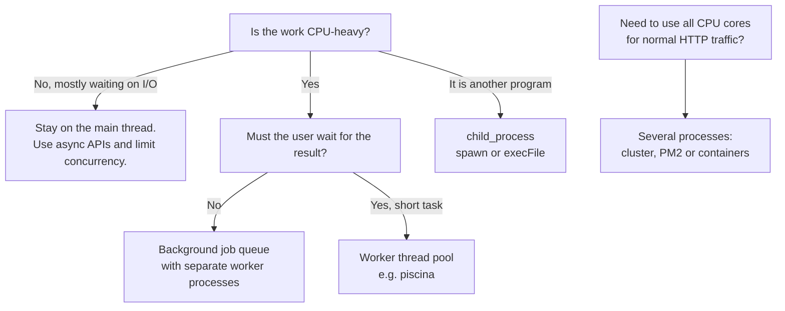
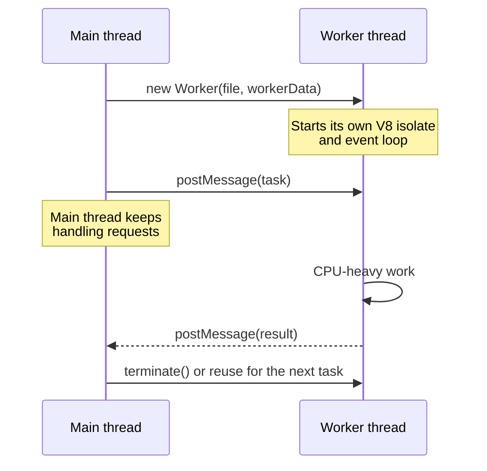
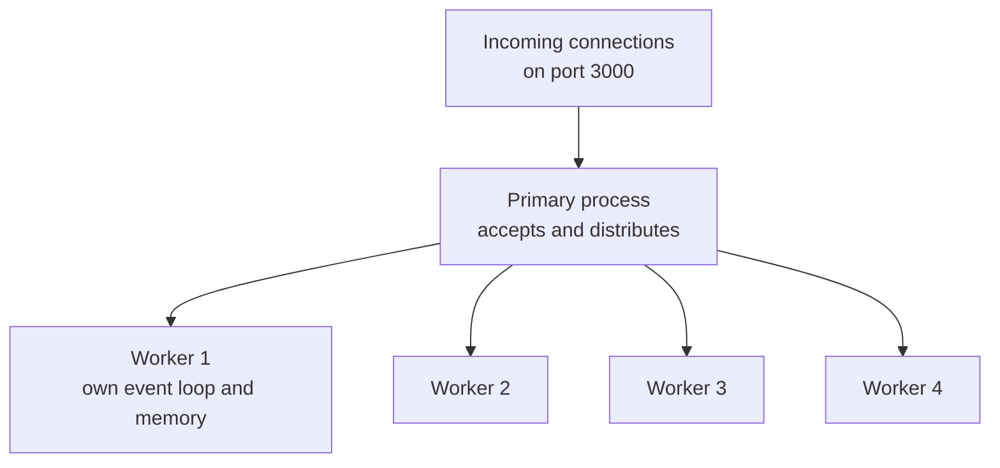

# Concurrency in Node.js: Worker Threads, Child Processes and Cluster

> In this document you will learn how Node.js handles many things at once, why CPU-heavy code freezes a Node.js server, and how to fix it with worker threads, child processes, the cluster module, PM2 or containers. You will also learn how race conditions happen in "single-threaded" async code and how to prevent them. These are standard backend interview topics because they test whether you really understand the Node.js runtime.

**Before this:** [Node.js runtime and architecture](01-nodejs-runtime-and-architecture.md) · [The Node.js event loop](02-node-event-loop.md) · [Processes, threads and memory](../01-cs-and-web-fundamentals/03-operating-systems-processes-threads-memory.md) · **Interview questions:** [jump to the interview section](#interview-questions)

## Table of contents

1. [Concurrency vs parallelism in Node.js](#concurrency-vs-parallelism-in-nodejs)
2. [The problem: CPU-bound work blocks everything](#the-problem-cpu-bound-work-blocks-everything)
3. [Your options at a glance](#your-options-at-a-glance)
4. [Worker threads](#worker-threads)
5. [Child processes](#child-processes)
6. [The cluster module](#the-cluster-module)
7. [PM2 cluster mode](#pm2-cluster-mode)
8. [Scaling with containers instead](#scaling-with-containers-instead)
9. [Comparison table](#comparison-table)
10. [Race conditions in async Node.js code](#race-conditions-in-async-nodejs-code)
11. [Limiting concurrency](#limiting-concurrency)
12. [Measuring event loop health](#measuring-event-loop-health)
13. [Common mistakes and best practices](#common-mistakes-and-best-practices)
14. [How to explain this in an interview](#how-to-explain-this-in-an-interview)
15. [Interview questions](#interview-questions)
16. [Summary](#summary)
17. [References](#references)

---

## Concurrency vs parallelism in Node.js

These two words are often mixed up. They mean different things.

- **Concurrency** means *dealing with* many tasks during the same period of time. The tasks make progress by taking turns. One cook can prepare five dishes concurrently: while the soup boils, they chop vegetables.
- **Parallelism** means *doing* many tasks at the exact same moment. It needs more than one worker (more than one CPU core). Five cooks prepare five dishes in parallel.

### What Node.js gives you by default

Your JavaScript code runs on **one main thread** with an **event loop**. Node.js is very good at *concurrency* for I/O work:

```js
// Three slow I/O operations run concurrently on ONE JavaScript thread.
const [user, orders, recommendations] = await Promise.all([
  fetchUser(userId),            // waits for the database
  fetchOrders(userId),          // waits for another query
  fetchRecommendations(userId), // waits for an HTTP call
]);
```

While Node.js waits for the database, the main thread is free to handle other requests. The waiting is done by the operating system (for network I/O) or by the libuv thread pool (for file system, DNS lookup, some crypto and zlib work). A quick reminder of this architecture is in [Node.js runtime and architecture](01-nodejs-runtime-and-architecture.md).

But your *JavaScript* code never runs in parallel on the main thread. Only one function runs at a time. So:

| Work type | Example | Is one Node.js thread enough? |
| --- | --- | --- |
| **I/O-bound** (mostly waiting) | Database queries, HTTP calls, reading files | Yes. Node handles thousands of these concurrently |
| **CPU-bound** (mostly computing) | Image resizing, PDF generation, big JSON parsing, encryption loops, data compression | No. While it computes, nothing else runs |

### Where parallelism comes from in Node.js

To use more than one CPU core for JavaScript, you need more threads or more processes:

- **Worker threads** — more JavaScript threads inside the same process.
- **Child processes** — separate processes (another Node.js script or any program like `ffmpeg`).
- **Cluster / PM2 / containers** — several copies of your whole server, each with its own event loop.

---

## The problem: CPU-bound work blocks everything

Let us see the problem with real numbers. This server has a fast `/health` route and a slow `/fib` route that computes a Fibonacci number in a CPU-heavy way.

```js
// blocking-server.mjs
import http from "node:http";

function fibonacci(n) {
  return n < 2 ? n : fibonacci(n - 1) + fibonacci(n - 2);
}

const server = http.createServer((req, res) => {
  const url = new URL(req.url, "http://localhost");

  if (url.pathname === "/health") {
    res.end("ok");
    return;
  }

  if (url.pathname === "/fib") {
    const n = Number(url.searchParams.get("n") ?? 40);
    const started = performance.now();
    const result = fibonacci(n); // CPU-bound: blocks the event loop
    res.setHeader("Content-Type", "application/json");
    res.end(JSON.stringify({ n, result, ms: Math.round(performance.now() - started) }));
    return;
  }

  res.statusCode = 404;
  res.end();
});

server.listen(3000, () => console.log("listening on 3000"));
```

I measured this from a separate process (on one test machine; your numbers will differ):

```text
GET /health               -> "ok" in 36 ms
GET /fib?n=42             -> started
GET /health (during fib)  -> "ok" in 8901 ms   <- waited for the whole computation
GET /fib?n=42             -> {"n":42,"result":267914296,"ms":8995}
```

**What happened, step by step:**

1. The `/fib` request arrives. Its handler calls `fibonacci(42)`.
2. `fibonacci` runs for about 9 seconds on the main thread. It never returns control to the event loop.
3. The `/health` request arrives. The operating system accepts the TCP connection, but Node.js cannot run the handler: the only JavaScript thread is busy.
4. Timers, other requests, database results — everything waits.
5. When `fibonacci` finishes, the event loop continues and finally answers `/health`.

In production this looks like: health checks fail, the load balancer marks the instance as dead, every user on that instance sees a timeout, and the problem seems random. One CPU-heavy endpoint can hurt the whole service.

Common real causes are sync crypto (`pbkdf2Sync`, `bcrypt.hashSync`), huge `JSON.parse`/`JSON.stringify`, image or PDF work in the handler, ReDoS regular expressions, big loops and `*Sync` APIs in handlers. Each one is explained with examples and measurements in [The Node.js event loop: Blocking the event loop](02-node-event-loop.md#blocking-the-event-loop). This document focuses on the fix for CPU-bound work: moving it off the main thread.

How to detect it: measure event loop delay and utilization (see [Measuring event loop health](#measuring-event-loop-health)), and profile with `--cpu-prof` (see [Production Node.js](14-production-nodejs.md)).

---

## Your options at a glance



- **I/O-bound work:** you usually do not need threads. Use async APIs and control how many operations run at once.
- **Short CPU work that the request must wait for** (hash a password, resize a thumbnail, parse a big file): a **worker thread pool**.
- **Long CPU work the user does not need to wait for** (video encoding, monthly reports): a **background job queue** with separate worker processes. See [Background jobs and queues](13-background-jobs-and-queues.md).
- **Running another program** (ImageMagick, ffmpeg, git, a Python script): **child process**.
- **Using all CPU cores for ordinary request handling**: run **several copies** of the server with cluster, PM2, or (most common today) containers behind a load balancer.

---

## Worker threads

### What it is

The **`node:worker_threads`** module lets you run JavaScript in parallel on extra threads inside the same Node.js process. It has been stable since Node.js 12.

Each worker thread has:

- its **own V8 instance** (an isolate) with its own heap and garbage collector,
- its **own event loop**,
- its own copy of all modules it imports.

So a worker is almost like a small separate Node.js program, but it lives inside the same process and can talk to the main thread quickly.

### Why it exists

Before worker threads, the only way to run JavaScript in parallel was to start more processes. Processes are heavier (more memory, slower start) and communicate only by copying data over IPC. Worker threads are lighter, start faster and can even **share memory** with `SharedArrayBuffer`.

### Analogy

The main thread is a receptionist in a busy office. If someone asks for a 100-page report, a good receptionist does not stop answering phones for an hour. They hand the job to a colleague in the back office (a worker thread) and keep answering the phone. When the report is ready, the colleague sends a message back.

Where it breaks: the back office colleague does not share the receptionist's desk. They get a *photocopy* of the documents (messages are copied), unless you explicitly give them a shared whiteboard (`SharedArrayBuffer`).

### How it works inside



Messages are copied with the **structured clone algorithm** (the same one browsers use for `postMessage`). It supports plain objects, arrays, `Map`, `Set`, `Date`, `RegExp`, `BigInt`, typed arrays and circular references. It does **not** keep functions, class prototypes, getters or private fields.

### Example 1: Move the Fibonacci work to a worker

```js
// fib-worker.mjs — runs inside the worker thread
import { parentPort, workerData } from "node:worker_threads";

function fibonacci(n) {
  return n < 2 ? n : fibonacci(n - 1) + fibonacci(n - 2);
}

parentPort.postMessage(fibonacci(workerData.n));
```

```js
// run-fib-worker.mjs — runs on the main thread
import { Worker } from "node:worker_threads";

function runFibInWorker(n) {
  return new Promise((resolve, reject) => {
    const worker = new Worker(new URL("./fib-worker.mjs", import.meta.url), {
      workerData: { n },
    });
    worker.once("message", resolve);
    worker.once("error", reject);
    worker.once("exit", (code) => {
      if (code !== 0) reject(new Error(`Worker stopped with exit code ${code}`));
    });
  });
}

const timer = setInterval(() => console.log("main thread is still free"), 500);
const result = await runFibInWorker(40);
clearInterval(timer);
console.log("fib(40) =", result);
```

Output:

```text
main thread is still free
main thread is still free
main thread is still free
...
fib(40) = 102334155
```

The interval keeps firing while the worker computes. The main thread is not blocked.

The important APIs:

| API | Where | Meaning |
| --- | --- | --- |
| `new Worker(fileOrUrl, options)` | Main | Start a worker running that file |
| `workerData` | Worker | A clone of the data passed in `options.workerData` |
| `parentPort` | Worker | The channel to talk to the parent (`null` on the main thread) |
| `postMessage(value)` | Both | Send a message (structured clone) |
| `'message'` / `'error'` / `'exit'` events | Main | Result, uncaught exception in the worker, worker stopped |
| `worker.terminate()` | Main | Stop the worker; returns a promise with the exit code |
| `isMainThread` / `threadId` | Both | Where am I? Thread ID (main thread is `0`) |

### Example 2: Main and worker code in one file

```js
// single-file.mjs
import { Worker, isMainThread, parentPort, workerData, threadId } from "node:worker_threads";

if (isMainThread) {
  const worker = new Worker(new URL(import.meta.url), { workerData: { numbers: [1, 2, 3, 4] } });
  worker.on("message", (msg) => console.log("main got:", msg));
  worker.on("exit", (code) => console.log("worker exited with code", code));
  console.log("main threadId:", threadId);
} else {
  const sum = workerData.numbers.reduce((a, b) => a + b, 0);
  parentPort.postMessage({ sum, from: threadId });
}
```

```text
main threadId: 0
main got: { sum: 10, from: 1 }
worker exited with code 0
```

The worker exits by itself when its event loop has nothing left to do.

### What can and cannot be sent

```js
// clone.mjs
import { Worker, isMainThread, parentPort } from "node:worker_threads";

class Money {
  constructor(cents) {
    this.cents = cents;
  }
  format() {
    return `$${(this.cents / 100).toFixed(2)}`;
  }
}

if (isMainThread) {
  const worker = new Worker(new URL(import.meta.url));
  worker.on("message", (msg) => {
    console.log(msg instanceof Money, typeof msg.format, msg); // false undefined { cents: 1999 }
    worker.terminate();
  });
  worker.postMessage("go");
  try {
    worker.postMessage({ fn: () => 1 });
  } catch (err) {
    console.log(err.name, err.message); // DataCloneError () => 1 could not be cloned.
  }
} else {
  parentPort.once("message", () => parentPort.postMessage(new Money(1999)));
}
```

- A class instance arrives as a **plain object**. Its methods are gone.
- A function cannot be sent at all: `DataCloneError`.
- So send plain data (IDs, numbers, strings, buffers), and rebuild objects on the other side if you need them.

### Transferring instead of copying

Copying a 50 MB buffer takes time and doubles memory. You can **transfer** an `ArrayBuffer` instead. Ownership moves to the other thread, and the sender can no longer use it.

```js
// transfer.mjs
import { Worker, isMainThread, parentPort } from "node:worker_threads";

if (isMainThread) {
  const worker = new Worker(new URL(import.meta.url));
  const buffer = new ArrayBuffer(8 * 1024 * 1024); // 8 MB
  console.log("before:", buffer.byteLength); // before: 8388608
  worker.postMessage(buffer, [buffer]);       // second argument = transfer list
  console.log("after:", buffer.byteLength);   // after: 0  (no longer ours)
  worker.on("message", (size) => {
    console.log("worker received", size);     // worker received 8388608
    worker.terminate();
  });
} else {
  parentPort.once("message", (buf) => parentPort.postMessage(buf.byteLength));
}
```

Transfer is almost free: no bytes are copied. It is ideal for image or file data.

### Sharing memory with `SharedArrayBuffer` and `Atomics`

A **`SharedArrayBuffer`** is memory that several threads can read and write at the same time. It is not copied and not transferred: all threads see the same bytes.

Shared memory brings back the classic problem of multithreaded programming: **data races**. Look at this counter:

```js
// atomics.mjs
import { Worker, isMainThread, workerData } from "node:worker_threads";

const WORKERS = 4;
const INCREMENTS = 1_000_000;

if (isMainThread) {
  for (const mode of ["plain", "atomic"]) {
    const shared = new SharedArrayBuffer(4); // room for one 32-bit integer
    const counter = new Int32Array(shared);
    const workers = Array.from({ length: WORKERS }, () =>
      new Worker(new URL(import.meta.url), { workerData: { shared, mode } }),
    );
    await Promise.all(workers.map((w) => new Promise((resolve) => w.once("exit", resolve))));
    console.log(mode, "expected", WORKERS * INCREMENTS, "got", counter[0]);
  }
} else {
  const counter = new Int32Array(workerData.shared);
  for (let i = 0; i < INCREMENTS; i++) {
    if (workerData.mode === "plain") counter[0]++; // read, add, write: three steps
    else Atomics.add(counter, 0, 1);               // one indivisible step
  }
}
```

Two runs on a test machine:

```text
plain expected 4000000 got 2036972
atomic expected 4000000 got 4000000
plain expected 4000000 got 1746656
atomic expected 4000000 got 4000000
```

`counter[0]++` is really three steps: read the value, add one, write it back. Two threads can read the same old value, both add one, and both write the same result. One increment is lost. The "plain" result is different on every run. `Atomics.add` does the whole update as one **atomic** (indivisible) operation, so nothing is lost.

`Atomics` also has `Atomics.wait()` and `Atomics.notify()` to let a thread sleep until another thread changes a value. Node.js allows `Atomics.wait` on the main thread, but using it there blocks the event loop, so use it only inside workers.

In practice you rarely need shared memory in web backends. Message passing is simpler and safer. Shared memory is useful for high-performance numeric work (for example, a shared progress counter or a lock-free ring buffer).

### Errors, exits and resource limits

- If a worker throws an uncaught exception, the worker stops and the main thread gets an `'error'` event. The main process does **not** crash (unless you do not handle that event).
- `'exit'` is always the last event. A non-zero exit code means something went wrong (exit code `1` if it was terminated).
- `process.exit()` inside a worker only stops that worker.
- You can limit memory per worker with `resourceLimits`:

```js
const worker = new Worker(new URL("./report-worker.mjs", import.meta.url), {
  resourceLimits: { maxOldGenerationSizeMb: 256 }, // the worker is terminated if it needs more
});
```

### Worker pools

Starting a worker costs time and memory (a new V8 isolate; roughly tens of milliseconds and several MB). The Node.js docs recommend using a **pool** of workers instead of creating one per task: the workers start once and handle many tasks.

Here is a small pool, to understand the idea:

```js
// worker-pool.mjs
import { Worker } from "node:worker_threads";
import { availableParallelism } from "node:os";

export class WorkerPool {
  #workers = [];
  #idle = [];
  #queue = [];
  #pending = new Map(); // taskId -> { resolve, reject }
  #nextTaskId = 1;

  constructor(fileUrl, size = Math.max(1, availableParallelism() - 1)) {
    for (let i = 0; i < size; i++) this.#addWorker(fileUrl);
  }

  #addWorker(fileUrl) {
    const worker = new Worker(fileUrl);
    worker.on("message", ({ taskId, ...result }) => {
      this.#pending.get(taskId)?.resolve(result);
      this.#pending.delete(taskId);
      worker.currentTaskId = undefined;
      this.#idle.push(worker);
      this.#runNext();
    });
    worker.on("error", (err) => {
      if (worker.currentTaskId) {
        this.#pending.get(worker.currentTaskId)?.reject(err);
        this.#pending.delete(worker.currentTaskId);
      }
      this.#workers = this.#workers.filter((w) => w !== worker);
      this.#idle = this.#idle.filter((w) => w !== worker);
      this.#addWorker(fileUrl); // replace the crashed worker
    });
    this.#workers.push(worker);
    this.#idle.push(worker);
    this.#runNext();
  }

  run(data) {
    return new Promise((resolve, reject) => {
      const taskId = this.#nextTaskId++;
      this.#pending.set(taskId, { resolve, reject });
      this.#queue.push({ taskId, ...data });
      this.#runNext();
    });
  }

  #runNext() {
    while (this.#idle.length > 0 && this.#queue.length > 0) {
      const worker = this.#idle.pop();
      const task = this.#queue.shift();
      worker.currentTaskId = task.taskId;
      worker.postMessage(task);
    }
  }

  async close() {
    await Promise.all(this.#workers.map((w) => w.terminate()));
  }
}
```

```js
// pool-task.mjs — a long-lived worker that handles many tasks
import { parentPort } from "node:worker_threads";
import { createHash } from "node:crypto";

parentPort.on("message", ({ taskId, password, iterations }) => {
  let digest = password;
  for (let i = 0; i < iterations; i++) {
    digest = createHash("sha256").update(digest).digest("hex");
  }
  parentPort.postMessage({ taskId, digest });
});
```

```js
const pool = new WorkerPool(new URL("./pool-task.mjs", import.meta.url), 2);
const results = await Promise.all(
  ["alice", "bob", "carol", "dave"].map((password) => pool.run({ password, iterations: 200_000 })),
);
console.log(results.map((r) => r.digest.slice(0, 8)));
// [ 'c14ac099', '2c834376', '466b2a92', '7320054b' ]
await pool.close();
```

How it works: tasks wait in `#queue`. When a worker is idle, it gets the next task. Each task has an ID, so the result is matched to the right promise. A crashed worker is replaced.

(This hashing loop is only a CPU-work example. For real password hashing, use `crypto.scrypt` (async, runs on the libuv pool) or a library such as `argon2` or `bcrypt`. See [Authentication and authorization](09-authentication-and-authorization.md).)

### Use piscina in production

[Piscina](https://github.com/piscinajs/piscina) is a popular, well-maintained worker thread pool. It handles queueing, task cancellation with `AbortSignal`, idle timeouts, worker restarts and statistics. Piscina v5 requires Node.js 20 or newer.

```ts
// thumbnail-task.ts — the worker file exports a function (default export)
export interface ThumbnailTask {
  width: number;
  height: number;
  pixels: Uint8Array;
}

export default function makeThumbnail({ width, height, pixels }: ThumbnailTask) {
  // ... CPU-heavy image work here ...
  return { width: Math.round(width / 4), height: Math.round(height / 4), bytes: pixels.length / 16 };
}
```

```ts
// thumbnail-pool.ts — on the main thread
import { Piscina } from "piscina";
import { availableParallelism } from "node:os";

export const thumbnailPool = new Piscina({
  filename: new URL("./thumbnail-task.js", import.meta.url).href, // the compiled JS file
  maxThreads: Math.max(1, availableParallelism() - 1),
  maxQueue: 1_000, // reject new tasks when the queue is this long (backpressure)
  idleTimeout: 30_000,
});

// In an Express handler:
// const result = await thumbnailPool.run({ width, height, pixels }, { signal: req.signal });
```

Notes:

- Keep `maxQueue` bounded. An unbounded queue hides overload: requests wait longer and longer and memory grows. When the queue is full, return `503 Service Unavailable` quickly.
- Size the pool around `os.availableParallelism() - 1` (leave one core for the main thread). `os.availableParallelism()` (Node.js 18.14+) is the recommended way to ask how much parallelism is available; the docs say not to use `os.cpus().length` for this.
- In containers, the CPU limit of the container matters more than the number of cores of the host. Check what `availableParallelism()` returns in your environment and allow an override with an environment variable.

### When worker threads do not help

The Node.js docs say it clearly: workers do not help much with I/O-heavy work, because Node's built-in async I/O is already more efficient. Do not put database queries or HTTP calls in workers to "make them faster".

Also remember:

- Each worker uses extra memory (its own heap).
- Sending big data back and forth costs time (copying). Measure; for small tasks, the messaging overhead can be larger than the gain.
- Workers cannot touch the main thread's variables, the DOM (in Electron renderers, workers are similar), or the `req`/`res` objects. Send them only data.

### Real-world usage

- Image and video thumbnails, PDF and Excel generation in an API.
- Parsing and validating very large CSV/JSON uploads.
- Server-side syntax highlighting, Markdown rendering, template rendering for big documents.
- Compression or encryption of large buffers (although `zlib` and most `crypto` async APIs already use the libuv thread pool).
- Build tools (bundlers and test runners such as Vitest use worker pools to run work in parallel).
- Electron apps: heavy work off the main process (see [Electron performance and architecture](../08-electron-desktop/09-performance-architecture-and-alternatives.md)).

---

## Child processes

### What it is

The **`node:child_process`** module starts other programs as separate operating system processes. The child can be any executable (`git`, `ffmpeg`, `python`, a shell script) or another Node.js script.

A child process has its own memory, its own PID and, if it is Node.js, its own event loop and V8. If it crashes, your server keeps running.

### The four main functions

| Function | Uses a shell? | Output | Best for |
| --- | --- | --- | --- |
| `spawn(cmd, args)` | No (unless `shell: true`) | **Streams** (`child.stdout`) | Long-running programs, large output |
| `execFile(file, args)` | No | **Buffered** into a string (default limit 1 MiB) | Running a program and getting its short output |
| `exec(commandString)` | **Yes** (`/bin/sh` or `cmd.exe`) | Buffered | Quick shell commands with pipes, only with trusted input |
| `fork(modulePath)` | No | Optional, plus an **IPC channel** | Another Node.js script you send messages to |

Each has a `*Sync` version (`execFileSync`, `spawnSync`). These block the event loop. Use them only in scripts and CLIs, never in request handlers.

### `execFile`: run a program and get its output

```js
import { execFile } from "node:child_process";
import { promisify } from "node:util";

const execFileAsync = promisify(execFile);

const { stdout } = await execFileAsync("git", ["rev-parse", "--short", "HEAD"], {
  timeout: 5_000, // kill the child if it runs longer than 5 seconds
});
console.log("current commit:", stdout.trim());
```

`util.promisify(execFile)` returns a promise of `{ stdout, stderr }`. On failure it rejects with an error that also has `stdout`, `stderr` and `code`. With `timeout`, Node sends `SIGTERM` to the child after the time is up (`err.killed` becomes `true`).

### `spawn`: stream the output

`execFile` collects all output in memory. For a program that prints a lot or runs for a long time, use `spawn` and read the streams.

```js
import { spawn } from "node:child_process";

function convertVideo(input, output) {
  return new Promise((resolve, reject) => {
    const child = spawn("ffmpeg", ["-i", input, "-vf", "scale=640:-2", output]);

    child.stderr.setEncoding("utf8");
    child.stderr.on("data", (chunk) => {
      // ffmpeg writes progress to stderr; parse it or log it
    });

    child.on("error", reject); // for example: ffmpeg is not installed (ENOENT)
    child.on("close", (code) => {
      if (code === 0) resolve();
      else reject(new Error(`ffmpeg exited with code ${code}`));
    });
  });
}
```

Always listen to `'error'`. If the program does not exist, there is no exit code; you get an `'error'` event with `ENOENT`, and without a listener the process can crash.

### `fork`: another Node.js process with messages

`fork` runs a Node.js file in a new process and creates an **IPC channel** (inter-process communication) so parent and child can send messages.

```js
// parent.mjs
import { fork } from "node:child_process";

const child = fork(new URL("./fork-child.mjs", import.meta.url));
child.on("message", (msg) => {
  console.log("parent got:", msg); // parent got: { type: 'result', total: 30 }
  child.disconnect();              // close the IPC channel so the child can exit
});
child.send({ type: "sum", numbers: [5, 10, 15] });
```

```js
// fork-child.mjs
process.on("message", (msg) => {
  if (msg.type === "sum") {
    process.send({ type: "result", total: msg.numbers.reduce((a, b) => a + b, 0) });
  }
});
```

Messages are serialized (JSON by default), so the same rule applies as with workers: send plain data.

Compared with a worker thread, a forked process is heavier (a whole new Node.js process: more memory and a slower start) but more isolated: a crash or a memory leak in native code cannot affect the parent's memory. This isolation is why job queue libraries can run each job processor in a separate process (BullMQ calls them "sandboxed processors").

### Security: shell injection with `exec`

`exec` passes your string to a shell. If any part of that string comes from a user, the user can run their own commands.

```js
import { exec, execFile } from "node:child_process";

// ❌ Wrong: the filename comes from the request
app.post("/convert", (req, res) => {
  exec(`convert uploads/${req.body.filename} -resize 200x200 thumbs/out.png`, (err) => {
    res.sendStatus(err ? 500 : 204);
  });
});
// filename = "a.png; rm -rf / #"  -> the shell runs:  convert uploads/a.png; rm -rf / # ...

// ✅ Correct: no shell, arguments are passed as an array, input is validated
app.post("/convert", (req, res) => {
  const filename = String(req.body.filename);
  if (!/^[a-zA-Z0-9_-]+\.(png|jpg)$/.test(filename)) return res.sendStatus(400);

  execFile("convert", [`uploads/${filename}`, "-resize", "200x200", "thumbs/out.png"], (err) => {
    res.sendStatus(err ? 500 : 204);
  });
});
```

With `execFile` (or `spawn` without `shell`), each array item reaches the program as a single argument. Characters like `;`, `|`, `$()` and backticks are not interpreted by a shell, because there is no shell.

Rules:

- Prefer `execFile` or `spawn` with an argument array.
- Never pass unsanitized user input to `exec`, or to `spawn`/`execFile` with `shell: true`.
- Validate inputs with an allow-list (like the regular expression above), even without a shell. A user could still pass an argument that the program interprets as an option (for example, a filename starting with `-`). Many programs accept `--` to mark the end of options.
- Since Node.js 24, passing an `args` array to `spawn` or `execFile` together with `shell: true` prints a runtime deprecation warning (DEP0190), because those arguments are only joined with spaces, not escaped.

More on command injection: [Production Node.js](14-production-nodejs.md) and [Web security](../10-testing-security-production/05-web-security-xss-csrf-cors-csp.md).

### Other good practices with child processes

- Set a `timeout` or pass an `AbortSignal` (`signal` option) so a stuck child does not live forever.
- Limit how many children run at once (each one costs memory and CPU). See [Limiting concurrency](#limiting-concurrency).
- For `exec`/`execFile`, remember `maxBuffer` (1 MiB by default). Larger output kills the child. Use `spawn` for big output.
- Pass only the environment variables the child needs (`env` option), especially if it is a third-party program. By default the child inherits all of `process.env`, including your secrets.
- Clean up children when your server shuts down.

---

## The cluster module

### What it is

The **`node:cluster`** module starts several copies of your Node.js server (**worker processes**) that all **share the same server port**. A **primary** process starts and manages them.

Each worker is a full Node.js process with its own event loop and memory. With 8 CPU cores and 8 workers, your server can handle about 8 times more CPU work in parallel.

### Why it exists

One Node.js process uses one main thread, so one CPU core for your JavaScript. On an 8-core server, a single process leaves 7 cores mostly idle. Before containers were common, cluster was the standard way to use all cores on one machine.

### How it works



There are two ways connections reach the workers:

- **Round-robin (default on all platforms except Windows):** the primary accepts connections and hands them to workers in turn.
- **Operating system scheduling (default on Windows):** the primary creates the listening socket and the workers accept connections directly. The Node.js docs warn that this distribution is often very unbalanced.

You can choose with the `NODE_CLUSTER_SCHED_POLICY` environment variable (`rr` or `none`) or `cluster.schedulingPolicy`.

I saw this difference when testing the example below on Windows: with the default policy, all 20 test requests were answered by one worker. With `NODE_CLUSTER_SCHED_POLICY=rr`, all 4 workers answered.

### Code

```js
// cluster.mjs
import cluster from "node:cluster";
import http from "node:http";
import { availableParallelism } from "node:os";
import process from "node:process";

if (cluster.isPrimary) {
  const count = availableParallelism();
  console.log(`primary ${process.pid} starting ${count} workers`);

  for (let i = 0; i < count; i++) cluster.fork();

  cluster.on("exit", (worker, code, signal) => {
    console.log(`worker ${worker.process.pid} died (${signal ?? code})`);
    if (!worker.exitedAfterDisconnect) cluster.fork(); // replace crashed workers
  });
} else {
  http
    .createServer((req, res) => res.end(`handled by ${process.pid}\n`))
    .listen(3000);
}
```

**Step by step:**

1. You run `node cluster.mjs`. This process is the primary (`cluster.isPrimary` is `true`).
2. `cluster.fork()` starts the same file again as a worker process. In the worker, `cluster.isPrimary` is `false`.
3. Each worker calls `listen(3000)`. Instead of failing with "port in use", the cluster module routes the listen through the primary, so all workers share port 3000.
4. When a worker crashes, the primary gets an `'exit'` event and starts a new one.

`cluster.isPrimary` exists since Node.js 16. Older code uses `cluster.isMaster`, which is a deprecated alias.

### What cluster does not do for you

- **No shared memory.** Each worker has its own variables. An in-memory cache, an in-memory session store, an in-memory rate limiter or a WebSocket connection list exists separately in every worker. Use Redis or a database for shared state.
- **No sticky sessions.** Requests from one user can go to different workers. This breaks in-memory sessions and some WebSocket/long-polling setups (Socket.IO with polling needs sticky sessions or a Redis adapter).
- **No zero-downtime reload by default.** You must write the logic (restart workers one by one) or use PM2.
- **It scales on one machine only.** For more machines, you still need a load balancer.

### Graceful restart of workers

```js
// In the primary: restart workers one by one, for example after a deploy
async function rollingRestart() {
  for (const worker of Object.values(cluster.workers)) {
    const replacement = cluster.fork();
    await new Promise((resolve) => replacement.once("listening", resolve));
    worker.disconnect(); // stop accepting new connections, finish current ones, then exit
  }
}
```

`worker.disconnect()` lets the worker finish its in-flight requests before it exits (`exitedAfterDisconnect` is then `true`, so the `'exit'` handler above does not replace it again). Graceful shutdown inside each worker is covered in [Production Node.js](14-production-nodejs.md).

---

## PM2 cluster mode

**PM2** is a popular process manager for Node.js. It uses the cluster module for you and adds process monitoring, automatic restarts, log management and zero-downtime reloads.

```bash
npm install --global pm2

# Start one worker per available CPU core
pm2 start dist/server.js -i max --name orders-api

pm2 list                 # status of all processes
pm2 logs orders-api      # stream logs
pm2 reload orders-api    # zero-downtime reload: restarts workers one by one
pm2 startup && pm2 save  # start the saved process list on boot
```

Or with a config file:

```js
// ecosystem.config.cjs
module.exports = {
  apps: [
    {
      name: "orders-api",
      script: "dist/server.js",
      instances: "max",          // or a number
      exec_mode: "cluster",
      max_memory_restart: "512M", // restart a worker if its memory grows above 512 MB
      env: { NODE_ENV: "production" },
    },
  ],
};
```

PM2 is a good fit when you deploy directly to virtual machines without containers. Your app code does not change: you write a normal single-process server and PM2 runs several copies.

---

## Scaling with containers instead

Today, most teams run Node.js in containers (Docker) on an orchestrator such as Kubernetes, Amazon ECS or a platform like Cloud Run. The common pattern is:

- **One Node.js process per container.**
- **Several container replicas** behind a load balancer.
- The orchestrator restarts crashed containers, does rolling deploys and adds replicas when load grows (autoscaling).

```text
                Load balancer
          /        |         \
   container 1  container 2  container 3      <- each runs: node dist/server.js
   (1 CPU)      (1 CPU)      (1 CPU)
```

Why not cluster inside the container?

- The orchestrator already does process management, restarts and scaling. Cluster duplicates this work.
- One process per container makes health checks, memory limits and metrics clearer: one container = one event loop.
- Scaling is more flexible: you add containers across many machines.

So in a containerized setup, give each container about one CPU and scale the number of replicas. Use cluster or PM2 mainly on plain VMs or when you must use a big machine with one deployment unit. See [Production Node.js](14-production-nodejs.md) for Docker details.

---

## Comparison table

| | Worker threads | Child process (`fork`/`spawn`) | Cluster / PM2 | Containers (replicas) |
| --- | --- | --- | --- | --- |
| Unit | Thread in the same process | Separate process | Several processes, one machine | Several processes, many machines |
| Memory isolation | Separate JS heaps, same process | Fully separate | Fully separate | Fully separate |
| Shared memory | Yes (`SharedArrayBuffer`) | No | No | No |
| Communication | `postMessage` (fast, structured clone, transfer) | IPC messages (serialized), stdio | None built in (use Redis/DB) | Network only |
| Startup cost | Low–medium | Medium–high | High (whole server) | High |
| Crash impact | Worker dies; main process survives if `'error'` is handled | Child dies; parent survives | One worker dies; others keep serving | One container dies; others keep serving |
| Main use | CPU-heavy tasks inside a request | Running other programs, isolating risky work | Using all cores for HTTP on one VM | Production scaling and high availability |

A short way to remember:

- **Worker threads** → parallel *tasks* inside one server.
- **Child processes** → *other programs* or strongly isolated work.
- **Cluster / PM2 / containers** → *more copies of the whole server*.

They combine well: each container can have a small piscina pool for CPU-heavy endpoints.

---

## Race conditions in async Node.js code

A common belief: "Node.js is single-threaded, so it has no race conditions." This is **wrong**.

A **race condition** is a bug where the result depends on the timing of two or more operations. In Node.js, your JavaScript runs one piece at a time, but every `await` is a pause point. While one request waits for the database, another request runs. If both work on the same data, they can interfere. And with several instances (cluster, containers), requests really do run in parallel against the same database.

### Race 1: Check-then-act (double booking)

```js
const sleep = (ms) => new Promise((resolve) => setTimeout(resolve, ms));

// A fake database with async calls, like a real one.
const db = {
  bookings: [],
  async findBooking(seatId) {
    await sleep(5);
    return this.bookings.find((b) => b.seatId === seatId) ?? null;
  },
  async insertBooking(booking) {
    await sleep(5);
    this.bookings.push(booking);
    return booking;
  },
};

// ❌ Wrong: check, then act, with an await in between
async function bookSeatUnsafe(seatId, userId) {
  const existing = await db.findBooking(seatId); // 1. check
  if (existing) throw new Error("Seat already booked");
  return db.insertBooking({ seatId, userId });    // 2. act
}

const results = await Promise.allSettled([
  bookSeatUnsafe("A1", "asha"),
  bookSeatUnsafe("A1", "ravi"),
]);
console.log(results.map((r) => r.status)); // [ 'fulfilled', 'fulfilled' ]
console.log("bookings for A1:", db.bookings.filter((b) => b.seatId === "A1").length); // 2
```

**Step by step:**

1. Asha's request calls `findBooking("A1")` and pauses at `await`.
2. Ravi's request runs and also calls `findBooking("A1")`, and pauses.
3. Both checks see "no booking" (nothing was inserted yet).
4. Both requests insert. Seat A1 is sold twice.

The check and the act are two separate steps, and other code runs between them.

### Race 2: Lost update (read-modify-write)

```js
let balance = 100;

async function withdraw(amount) {
  const current = balance;    // read
  await sleep(5);             // for example, call a fraud-check service
  balance = current - amount; // write, based on an old read
}

await Promise.all([withdraw(30), withdraw(50)]);
console.log("balance:", balance); // balance: 50   (expected 20)
```

Both calls read `100`. The first writes `70`, the second writes `50`. The withdrawal of 30 is lost. The same thing happens with SQL if you `SELECT` a value, compute in Node.js, and `UPDATE` with the computed value.

### Fix 1: Let the database enforce the rule (unique constraint)

The strongest fix is to make the check and the act **one atomic step inside the database**.

```sql
CREATE UNIQUE INDEX bookings_seat_unique ON bookings (event_id, seat_id);
```

```ts
import type { Pool } from "pg";

export async function bookSeat(pool: Pool, eventId: string, seatId: string, userId: string) {
  try {
    const { rows } = await pool.query(
      "INSERT INTO bookings (event_id, seat_id, user_id) VALUES ($1, $2, $3) RETURNING id",
      [eventId, seatId, userId],
    );
    return rows[0];
  } catch (err) {
    if ((err as { code?: string }).code === "23505") {
      // PostgreSQL error code for unique_violation
      throw new Error("Seat already booked");
    }
    throw err;
  }
}
```

Now two concurrent inserts cannot both succeed, no matter how many Node.js instances you run. One gets a unique-violation error, which you turn into a `409 Conflict`.

### Fix 2: Atomic updates instead of read-modify-write

Let the database do the math, with the condition in the same statement:

```ts
// ✅ One statement: check and update together
const { rowCount } = await pool.query(
  "UPDATE accounts SET balance = balance - $1 WHERE id = $2 AND balance >= $1",
  [amount, accountId],
);
if (rowCount === 0) throw new Error("Insufficient funds");

// ✅ Stock reservation
await pool.query(
  "UPDATE products SET stock = stock - $1 WHERE id = $2 AND stock >= $1",
  [quantity, productId],
);
```

The same idea in Redis: `INCR`, `DECRBY`, `HINCRBY` are atomic.

### Fix 3: Transactions with row locks (pessimistic locking)

When the logic is too complex for one statement, lock the row inside a transaction:

```ts
const client = await pool.connect();
try {
  await client.query("BEGIN");
  const { rows } = await client.query(
    "SELECT balance FROM accounts WHERE id = $1 FOR UPDATE", // other transactions wait here
    [accountId],
  );
  if (rows[0].balance < amount) throw new Error("Insufficient funds");
  await client.query("UPDATE accounts SET balance = balance - $1 WHERE id = $2", [amount, accountId]);
  await client.query("COMMIT");
} catch (err) {
  await client.query("ROLLBACK");
  throw err;
} finally {
  client.release();
}
```

### Fix 4: Optimistic locking (version column)

Do not lock. Instead, update only if nobody changed the row since you read it:

```ts
const { rowCount } = await pool.query(
  "UPDATE orders SET status = $1, version = version + 1 WHERE id = $2 AND version = $3",
  [newStatus, orderId, versionYouRead],
);
if (rowCount === 0) throw new Error("Order was changed by someone else, please retry");
```

This is good when conflicts are rare. Transactions, isolation levels and locking are explained in depth in [Databases](10-databases.md).

### Fix 5: A lock (in-process or distributed)

If the shared resource is not in one database (for example, "only one instance may call this external API for this customer at a time"), use a lock.

**In one process**, you can serialize work per key by chaining promises:

```js
function createKeyedMutex() {
  const tails = new Map(); // key -> promise that resolves when the last holder finishes

  return async function withLock(key, fn) {
    const previous = tails.get(key) ?? Promise.resolve();
    let release;
    const current = new Promise((resolve) => (release = resolve));
    const tail = previous.then(() => current);
    tails.set(key, tail);

    await previous; // wait for the earlier holder
    try {
      return await fn();
    } finally {
      release();
      if (tails.get(key) === tail) tails.delete(key); // clean up when nobody waits
    }
  };
}

const withLock = createKeyedMutex();
const locked = await Promise.allSettled([
  withLock("C3", () => bookSeatUnsafe("C3", "asha")),
  withLock("C3", () => bookSeatUnsafe("C3", "ravi")),
]);
console.log(locked.map((r) => (r.status === "fulfilled" ? `booked by ${r.value.userId}` : r.reason.message)));
// [ 'booked by asha', 'Seat already booked' ]
```

This only works inside **one process**. With several instances, use a **distributed lock** in Redis (`SET lock:key token NX PX 10000`, release with a compare-and-delete script). The code is in [Caching](11-caching.md#fix-2-a-distributed-lock-mutex-in-redis).

Redis locks are not perfect. If the lock holder pauses longer than the lock TTL (a long GC pause, a slow network), the lock expires and a second process gets it. So for correctness-critical rules (money, bookings), the **database constraint stays the final protection**. Use locks to reduce duplicate work, not as the only guard.

### Fix 6: Idempotency

Many "races" come from the same request arriving twice (a user double-clicks, a client retries after a timeout). An **idempotency key** makes the second request return the first result instead of doing the work again. See [REST API design: Idempotency keys](07-rest-api-design.md#idempotency-keys-for-safe-retries) and, for queue consumers, [Background jobs and queues: Idempotent consumers](13-background-jobs-and-queues.md#idempotent-consumers).

### Which fix to choose

| Situation | Best fix |
| --- | --- |
| "Only one X per Y" (one booking per seat, one account per email) | Unique constraint |
| Counters, balances, stock | Atomic `UPDATE ... SET x = x - ? WHERE x >= ?` or Redis `INCR` |
| Multi-step business logic on one row | Transaction with `SELECT ... FOR UPDATE`, or optimistic locking |
| Duplicate requests and retries | Idempotency keys |
| Coordinating work across instances, not in one DB | Redis lock + a safety check in the data store |
| Serializing work inside one process | In-process keyed mutex or a queue with concurrency 1 per key |

---

## Limiting concurrency

Node.js makes it very easy to start thousands of async operations at once:

```js
// ❌ Wrong: 50,000 queries start at the same moment
await Promise.all(userIds.map((id) => sendWelcomeEmail(id)));
```

This can:

- exhaust the database connection pool (requests wait, then time out),
- hit rate limits of an external API (429 errors),
- open too many sockets or files (`EMFILE: too many open files`),
- use a lot of memory for 50,000 pending promises and their buffers.

You need to **limit concurrency**: run at most N operations at a time.

### A small concurrency limiter

```js
function createLimiter(maxConcurrent) {
  let active = 0;
  const waiting = [];

  function next() {
    if (active >= maxConcurrent || waiting.length === 0) return;
    active++;
    const { task, resolve, reject } = waiting.shift();
    Promise.resolve()
      .then(task)
      .then(resolve, reject)
      .finally(() => {
        active--;
        next(); // start the next waiting task
      });
  }

  return function limit(task) {
    return new Promise((resolve, reject) => {
      waiting.push({ task, resolve, reject });
      next();
    });
  };
}

const sleep = (ms) => new Promise((resolve) => setTimeout(resolve, ms));
const limit = createLimiter(3);
let running = 0;
let peak = 0;

async function fetchInvoice(id) {
  running++;
  peak = Math.max(peak, running);
  await sleep(20);
  running--;
  return `invoice-${id}`;
}

const ids = Array.from({ length: 10 }, (_, i) => i + 1);
const invoices = await Promise.all(ids.map((id) => limit(() => fetchInvoice(id))));
console.log(invoices.length, "peak concurrency:", peak); // 10 peak concurrency: 3
```

All 10 invoices are fetched, but never more than 3 at once. The results keep the original order because `Promise.all` keeps order.

In real projects, use the small, popular package **`p-limit`** (same idea: `const limit = pLimit(3); await Promise.all(ids.map((id) => limit(() => fetchInvoice(id))))`). For arrays you can also process in fixed-size batches, but a limiter is better: a batch waits for its slowest item, while a limiter starts a new task as soon as any slot is free.

### Where limits live in a real backend

- **Database pool size** (`pg` `Pool({ max: 10 })`) limits concurrent queries per instance.
- **HTTP agent** `maxSockets` limits concurrent outgoing connections per host.
- **Worker pool** size and `maxQueue` limit CPU work.
- **Job queue worker concurrency** (BullMQ `concurrency` option) limits background jobs.
- **Rate limiting** limits how many requests clients can send to *you* (see [Production Node.js](14-production-nodejs.md)).

Remember that limits multiply: 10 instances × pool size 20 = 200 database connections. Check that the database allows that many.

---

## Measuring event loop health

To know if your event loop is overloaded, measure it. Two useful measures:

### Event loop utilization (ELU)

**Event loop utilization** is the share of time the event loop was busy running code (not idle waiting for I/O). `0` = always idle, `1` = always busy. It is available as `performance.eventLoopUtilization()` in `node:perf_hooks`.

```js
import { performance } from "node:perf_hooks";

const start = performance.eventLoopUtilization();

function busyFor(ms) {
  const end = Date.now() + ms;
  while (Date.now() < end) {} // simulate CPU work
}

setTimeout(() => {
  busyFor(300);              // 300 ms of blocking work
  setTimeout(() => {         // then 300 ms idle
    const elu = performance.eventLoopUtilization(start);
    console.log("utilization:", elu.utilization.toFixed(2)); // utilization: 0.50 (about)
  }, 300);
}, 0);
```

ELU is a better "how busy is my Node.js process" signal than CPU percentage, because CPU percentage also counts the libuv threads and garbage collection. If ELU stays close to 1, the process cannot take more work: scale out or move CPU work off the main thread. Each worker thread has its own ELU (`worker.performance.eventLoopUtilization()`).

### Event loop delay

**Event loop delay** (lag) measures how late timers fire compared to when they should fire. If a 10 ms timer fires after 200 ms, something blocked the loop for about 190 ms. Use `monitorEventLoopDelay()` from `node:perf_hooks`; it is explained in [The Node.js event loop](02-node-event-loop.md). Export the p99 delay and ELU as metrics, and alert when they stay high.

### What to do when the loop is busy

1. Profile to find the hot function (`node --cpu-prof`, Chrome DevTools via `--inspect`).
2. Make the code cheaper (better algorithm, stream instead of loading everything, cache results).
3. Move CPU work to a worker pool or a background job.
4. Scale out (more processes or containers).
5. Shed load when overloaded (return `503` fast instead of queueing forever).

---

## Common mistakes and best practices

### Common mistakes

1. **"Node.js is single-threaded, so there are no race conditions."** Every `await` is a point where other requests run. And many instances run in parallel.
2. **CPU-heavy code in request handlers** (`*Sync` crypto, image processing, giant JSON) without a worker pool.
3. **Creating a new `Worker` per request.** The startup cost and memory use add up. Use a pool.
4. **Using worker threads for I/O.** It adds overhead and no speed.
5. **Unbounded queues** in worker pools or in-memory job lists. Overload turns into memory growth and very long waits.
6. **`exec` with user input** — shell injection.
7. **In-memory state with cluster or many containers** (sessions, rate limits, caches, WebSocket rooms) and expecting it to be shared.
8. **Unlimited `Promise.all` over big arrays** — pool exhaustion and rate limits.
9. **Relying only on a Redis lock** for money or bookings, without a database constraint.
10. **Not handling `'error'` and `'exit'`** on workers and child processes; a crash then hangs a request forever.
11. **Running cluster inside containers that are already replicated** — double process management and confusing resource limits.

### Best practices

- Keep the main thread for I/O and short tasks. Measure ELU and event loop delay.
- Use a **worker pool** (piscina) with a bounded queue for CPU work the request must wait for; use a **job queue** for long work.
- Size pools with `os.availableParallelism()` (and container CPU limits), with an override.
- Send small, plain messages to workers; **transfer** large `ArrayBuffer`s instead of copying.
- Use `execFile`/`spawn` with an argument array, timeouts and validated input.
- In production, scale with **one process per container and several replicas**; use PM2 or cluster on plain VMs.
- Keep shared state in **Redis or the database**, never in process memory, when you run more than one process.
- Prevent races in the **data layer**: unique constraints, atomic updates, transactions, optimistic locking. Add idempotency keys for retries.
- Limit concurrency for every fan-out (`p-limit`, pool sizes, queue concurrency).

---

## How to explain this in an interview

1. **Define it:** "Node.js runs my JavaScript on one main thread with an event loop. That gives great concurrency for I/O, because waiting happens in the OS or the libuv thread pool, but no parallelism for my own CPU-heavy code."
2. **Why it matters:** "If one request runs a 2-second computation, the event loop is blocked for 2 seconds. Every other request, timer and health check waits."
3. **How to fix it:** "For CPU work the request waits for, I use worker threads through a pool like piscina. For long work, a background job queue. For other programs, child processes with execFile or spawn. To use all cores for normal traffic, I run several processes — cluster or PM2 on a VM, or more container replicas in Kubernetes."
4. **Small example:** "A thumbnail endpoint: the handler sends the image buffer to a piscina pool, transferring the buffer instead of copying it, and awaits the result. The main thread keeps serving other requests."
5. **Where it is useful:** "Image and PDF processing, big file parsing, compression, report generation."
6. **Trade-offs and gotchas:** "Workers cost memory and messaging overhead, so they do not help I/O. Processes don't share memory, so state goes to Redis. And single-threaded does not mean race-free: every await is a gap, so I protect invariants with database constraints, atomic updates or locks."

---

## Interview questions

### Q1. Node.js is single-threaded. How can it handle thousands of concurrent requests?

**What the interviewer is checking:** That you understand non-blocking I/O, the event loop and what "single-threaded" really means.

**Short spoken answer (30–60 seconds):**
> My JavaScript runs on a single main thread, but Node.js is not single-threaded overall. When a request needs I/O, like a database query, Node starts the operation and does not wait. Network I/O is handled by the operating system's async mechanisms like epoll or IOCP, and file system, DNS lookup and some crypto work run on the libuv thread pool. When the result is ready, a callback is queued, and the event loop runs it. So while one request waits for the database, the thread handles hundreds of others. This works great as long as each piece of JavaScript is short. If one handler does heavy CPU work, everything else waits.

**Detailed explanation:** Concurrency comes from interleaving many short callbacks; the time spent waiting does not occupy the thread. Parallelism for JS code requires workers or more processes. See [Node.js runtime and architecture](01-nodejs-runtime-and-architecture.md) and [The Node.js event loop](02-node-event-loop.md).

**Follow-up questions:**
- **What is the default libuv thread pool size?** — 4 threads, configurable with `UV_THREADPOOL_SIZE`. It is used by `fs`, `dns.lookup`, async `crypto` such as `pbkdf2`/`scrypt`, and `zlib`, not by network sockets.
- **So is Node.js good for CPU-heavy services?** — Only if you move the heavy parts to worker threads or other processes. For mostly CPU-bound services, a language with easy multithreading may fit better.
- **What is the difference between concurrency and parallelism?** — Concurrency is making progress on many tasks by interleaving; parallelism is running tasks at the same instant on several cores.

**Common mistakes:** Saying Node creates a thread per request; saying all async work runs on the thread pool.

**Where this is used in real projects:** API gateways, BFFs, chat servers — I/O-heavy services that are Node's sweet spot.

### Q2. An endpoint that generates a PDF makes the whole API slow. What is happening and how do you fix it?

**What the interviewer is checking:** Diagnosis of event loop blocking and choosing the right fix.

**Short spoken answer (30–60 seconds):**
> PDF generation is CPU-bound, and it runs on the main thread, so while one PDF is generated the event loop is blocked and every other request waits — that is why the whole API is slow, not just that endpoint. I would confirm it with event loop delay and utilization metrics and a CPU profile. Then I'd fix it depending on the user experience: if the user can wait a second or two, I'd run the generation in a worker thread pool like piscina with a bounded queue. If it takes longer, I'd make it a background job: return 202 Accepted with a job ID, generate the PDF in a separate worker process, store it, and notify the user or let them poll.

**Follow-up questions:**
- **How do you prove the loop is blocked?** — High event loop delay (p99 of `monitorEventLoopDelay`) and ELU near 1 during PDF requests, and a CPU profile (`--cpu-prof`) showing the PDF library on top.
- **Why not just add more instances?** — It helps throughput, but each instance still freezes while generating a PDF, so latency spikes remain for everyone on that instance.
- **What if the queue of PDF tasks grows too long?** — Bound it (`maxQueue`) and return `503` with `Retry-After`, or move to background jobs so requests do not wait.

**Common mistakes:** Suggesting `async`/`await` alone fixes it (async does not make CPU work non-blocking); wrapping the code in `setTimeout` or a `Promise`.

**Where this is used in real projects:** Invoices, reports, exports to Excel, image processing.

### Q3. Does wrapping CPU-heavy code in a Promise or `async` function make it non-blocking?

**Short answer:** No. A Promise executor runs **synchronously**, and an `async` function runs synchronously until its first `await`. A long loop inside either one still blocks the main thread. `async`/`await` only helps when the waiting happens *outside* JavaScript (I/O, timers, workers).

```js
async function hashManyTimes(input) {
  let x = input;
  for (let i = 0; i < 5_000_000; i++) x = (x * 31 + i) % 1_000_003; // still blocks
  return x;
}
```

To really avoid blocking, move the work to a worker thread, split it into small chunks with `setImmediate` between them (still uses the main thread, but lets other callbacks run), or use an async native API that runs off the main thread.

### Q4. What are worker threads, and how do they differ from child processes and cluster?

**What the interviewer is checking:** Correct mental model of the three tools.

**Short spoken answer (30–60 seconds):**
> Worker threads run JavaScript in parallel inside the same process. Each worker has its own V8 isolate, heap and event loop. They talk to the main thread with postMessage, which copies data with structured clone, but they can also transfer ArrayBuffers or share memory with SharedArrayBuffer. They are for CPU-heavy tasks. A child process is a separate OS process — another program or another Node script with fork. It is more isolated and heavier, and it is the way to run things like ffmpeg. Cluster forks several copies of the whole server that share one port, so you can use all CPU cores for normal request handling. Workers parallelize tasks; cluster parallelizes the server.

**Follow-up questions:**
- **Do worker threads share variables with the main thread?** — No. Each has its own heap and module instances. Only `SharedArrayBuffer` memory is shared, plus data you explicitly send.
- **Can a crash in a worker take down the process?** — An uncaught exception stops only the worker and emits `'error'` on the `Worker` object. A native crash (segfault in an addon) or running out of process memory can affect the whole process; child processes are better isolated.
- **Why does cluster not share memory?** — Each worker is a separate process with separate memory. Shared state must live in Redis or a database.

**Common mistakes:** Thinking worker threads speed up database queries; thinking cluster workers share a cache.

**Where this is used in real projects:** piscina pools for image work; `spawn("ffmpeg")` for video; PM2 cluster on VMs.

### Q5. What can you send to a worker with `postMessage`? What does this print?

```js
import { Worker, isMainThread, parentPort } from "node:worker_threads";

class Money {
  constructor(cents) { this.cents = cents; }
  format() { return `$${(this.cents / 100).toFixed(2)}`; }
}

if (isMainThread) {
  const worker = new Worker(new URL(import.meta.url));
  worker.on("message", (msg) => {
    console.log(msg instanceof Money, typeof msg.format, msg);
    worker.terminate();
  });
  worker.postMessage("go");
} else {
  parentPort.once("message", () => parentPort.postMessage(new Money(1999)));
}
```

**Answer:**

```text
false undefined { cents: 1999 }
```

**Explanation:**

1. The worker creates a `Money` instance and posts it.
2. `postMessage` uses the structured clone algorithm. It copies own enumerable data properties (`cents`), but not the prototype.
3. The main thread receives a plain object. It is not an instance of the main thread's `Money` class, and it has no `format` method.

Functions cannot be cloned at all (`DataCloneError`). Supported: primitives, plain objects, arrays, `Date`, `RegExp`, `Map`, `Set`, `BigInt`, typed arrays, `ArrayBuffer`, `Error` objects and circular references. Large `ArrayBuffer`s can be **transferred** in the transfer list instead of copied; after transfer the sender's buffer has `byteLength` 0.

### Q6. What do `SharedArrayBuffer` and `Atomics` do? What does this print?

```js
// 4 workers each do counter[0]++ one million times on a shared Int32Array.
// Then 4 workers each do Atomics.add(counter, 0, 1) one million times.
```

**What the interviewer is checking:** Understanding of data races in shared memory.

**Answer:** The plain version prints a number **below 4,000,000 that changes on every run** (on a test machine: 2,036,972 and then 1,746,656). The `Atomics.add` version always prints exactly **4,000,000**.

**Short spoken answer (30–60 seconds):**
> A SharedArrayBuffer is memory that several threads can see at the same time, without copying. But then you get real data races: counter++ is three steps — read, add, write — so two threads can read the same value and one update is lost. Atomics gives operations that happen as one indivisible step, like Atomics.add or compareExchange, and Atomics.wait and notify for signaling between threads. In web backends I rarely need this; message passing is simpler. It is useful for things like shared counters, progress tracking or high-performance numeric buffers.

**Follow-up questions:**
- **Can you call `Atomics.wait` on the main thread in Node.js?** — Node allows it (browsers do not on the main thread), but it blocks the event loop, so use it only in workers.
- **Is a `SharedArrayBuffer` transferred or copied when posted?** — Neither. Both sides get a reference to the same memory; it cannot be put in the transfer list.

**Common mistakes:** Believing JavaScript cannot have data races at all.

**Where this is used in real projects:** Rare in APIs; used in some high-performance libraries, WebAssembly threads and build tools.

### Q7. Why should you use a worker pool instead of creating a worker per task? How would you size it?

**Short spoken answer (30–60 seconds):**
> Creating a worker means starting a new V8 isolate and loading modules, which costs time and memory. If I create one per request, under load I pay that cost thousands of times and can run out of memory. A pool creates a fixed number of workers once and feeds them tasks from a queue. I size it around the available CPU cores minus one, using os.availableParallelism(), because more threads than cores for CPU-bound work only adds switching overhead. In containers I check the container's CPU limit and allow an override from configuration. And I bound the queue, so overload returns 503 quickly instead of growing memory.

**Follow-up questions:**
- **Which library do you use?** — piscina; it supports task cancellation with `AbortSignal`, `maxQueue`, idle timeouts and stats.
- **What happens if a task throws?** — The `run()` promise rejects; the pool keeps or replaces the worker.
- **Why is `os.cpus().length` not ideal?** — The docs recommend `os.availableParallelism()` for this purpose; `os.cpus()` is an inventory of logical cores and can be empty when CPU info is unavailable.

### Q8. Explain `spawn`, `exec`, `execFile` and `fork`.

**What the interviewer is checking:** API knowledge and the security difference.

**Short spoken answer (30–60 seconds):**
> All four start a child process. spawn starts a program without a shell and gives me streams, so it's the right choice for long-running programs or big output. execFile also runs a program without a shell, but buffers the output and gives it to me at the end — good for short commands like git rev-parse. exec runs a command string through a shell, so pipes and redirects work, but it is dangerous with user input because of shell injection. fork is a special spawn for Node.js scripts that also opens an IPC channel, so the parent and child can send messages. My default is execFile or spawn with an arguments array and a timeout.

**Follow-up questions:**
- **What is `maxBuffer`?** — The maximum stdout/stderr size for `exec`/`execFile` (default 1 MiB). If exceeded, the child is killed and the output is truncated.
- **How do you stop a child that hangs?** — The `timeout` option or an `AbortSignal` via `signal`, and kill it on server shutdown.
- **What is DEP0190?** — A deprecation (runtime since Node.js 24) for passing an `args` array together with `shell: true` to `spawn`/`execFile`, because the args are only joined with spaces, not escaped.

**Common mistakes:** Using `exec` for everything; not handling the `'error'` event (for example `ENOENT`).

**Where this is used in real projects:** Image/video conversion, calling Python ML scripts, git operations in CI tools, running database dumps.

### Q9. Code review: find the security bug.

```js
app.get("/api/ping", (req, res) => {
  exec(`ping -c 1 ${req.query.host}`, (err, stdout) => {
    res.type("text").send(err ? "unreachable" : stdout);
  });
});
```

**Answer:** **Command injection.** `exec` uses a shell and `host` comes from the user. `?host=example.com;cat /etc/passwd` runs a second command; `$(...)` and backticks work too. Fix: validate `host` against a strict allow-list pattern (a hostname or IP), use `execFile("ping", ["-c", "1", host], { timeout: 3000 })` without a shell, and consider not exposing such an endpoint at all. Also add a timeout and rate limiting, because even a safe `ping` endpoint can be abused to scan networks (SSRF-like behavior).

### Q10. How does the cluster module work? What are its limits?

**What the interviewer is checking:** Mechanism and practical limits of multi-process Node.

**Short spoken answer (30–60 seconds):**
> The cluster module starts a primary process that forks several worker processes running the same server code. When workers call listen on the same port, the cluster module coordinates it through the primary, so they share the port. On Linux and macOS, the primary accepts connections and gives them to workers round-robin; on Windows the default lets the OS distribute connections, which is often unbalanced. The primary can restart crashed workers. The limits: workers don't share memory, so sessions, caches and rate limits must go to Redis; it only scales one machine; and you have to build rolling restarts yourself, or use PM2. In containers I usually skip cluster and run more replicas.

**Follow-up questions:**
- **How do you do a zero-downtime restart with cluster?** — Fork a new worker, wait for `'listening'`, then `disconnect()` an old one so it finishes in-flight requests; repeat. PM2 does this with `pm2 reload`.
- **How do WebSockets work with cluster?** — A WebSocket connection stays on one worker. To broadcast to all clients, use a pub/sub adapter (for example, the Socket.IO Redis adapter). Long-polling transports need sticky sessions.
- **What is `cluster.isPrimary` vs `isMaster`?** — `isPrimary` (Node 16+); `isMaster` is a deprecated alias.

**Common mistakes:** Assuming in-memory state is shared; running cluster with N workers inside each of M Kubernetes pods without adjusting CPU limits.

**Where this is used in real projects:** Node servers on VMs, often via PM2.

### Q11. Cluster, PM2 or Kubernetes replicas — how do you choose?

**Short spoken answer (30–60 seconds):**
> They solve the same problem — run several Node processes to use more CPU and survive crashes — at different layers. On a plain VM, I use PM2 in cluster mode: it gives me restarts, log handling, memory-based restarts and zero-downtime reloads without changing app code. I'd use the raw cluster module only if I need custom control. In containers, I run one Node process per container and let Kubernetes or ECS handle replicas, restarts, rolling deploys and autoscaling across machines. That keeps one container equal to one event loop, which makes health checks, memory limits and metrics simple.

**Follow-up questions:**
- **Any reason to run cluster inside a container?** — Sometimes on a large container where the platform charges per container, but it complicates memory limits and health checks; usually avoid.
- **How many replicas?** — Start from measured throughput per replica (ELU, p95 latency) and autoscale on CPU or request rate.

### Q12. What does this code print? Why is it a bug?

```js
const sleep = (ms) => new Promise((resolve) => setTimeout(resolve, ms));
let balance = 100;

async function withdraw(amount) {
  const current = balance;
  await sleep(5);
  balance = current - amount;
}

await Promise.all([withdraw(30), withdraw(50)]);
console.log("balance:", balance);
```

**Answer:**

```text
balance: 50
```

**Step by step:**

1. `withdraw(30)` reads `current = 100` and pauses at `await`.
2. `withdraw(50)` reads `current = 100` and pauses.
3. After 5 ms the first resumes and writes `100 - 30 = 70`.
4. The second resumes and writes `100 - 50 = 50`, overwriting 70.
5. The withdrawal of 30 is lost. The correct result is 20.

This is a **lost update**. The fix is to make the read and write atomic: in a database, `UPDATE accounts SET balance = balance - $1 WHERE id = $2 AND balance >= $1`; in memory, do not `await` between reading and writing, or serialize calls with a mutex.

### Q13. Two users book the same seat at the same moment and both succeed. How do you fix it?

**What the interviewer is checking:** Real-world race condition handling across instances.

**Short spoken answer (30–60 seconds):**
> This is a check-then-act race: both requests check that the seat is free, then both insert. It happens even in single-threaded Node because of the await between the check and the insert, and across instances it happens in true parallel. The robust fix is in the database: a unique constraint on event and seat, and I just insert and translate the unique-violation error into a 409 Conflict. Alternatively, a conditional update like UPDATE seats SET held_by = user WHERE id = seat AND held_by IS NULL, and check the affected rows. An in-process mutex wouldn't work with multiple instances, and a Redis lock alone isn't enough for correctness because locks can expire. I'd also add an idempotency key so client retries don't create duplicates.

**Follow-up questions:**
- **What about a seat held for 10 minutes during payment?** — Store `held_by` and `held_until`; the conditional update allows taking a seat if `held_until < now()`. A background job or the query itself releases expired holds.
- **Why not `SELECT ... FOR UPDATE`?** — It works too (pessimistic locking) but holds locks during the transaction; for a simple "insert if absent", a unique constraint is simpler and faster.

### Q14. Implement a function that runs async tasks with a concurrency limit.

**Short answer:** Keep a counter of active tasks and a queue of waiting ones; start a new task whenever a slot is free.

```js
function createLimiter(maxConcurrent) {
  let active = 0;
  const waiting = [];
  function next() {
    if (active >= maxConcurrent || waiting.length === 0) return;
    active++;
    const { task, resolve, reject } = waiting.shift();
    Promise.resolve().then(task).then(resolve, reject).finally(() => {
      active--;
      next();
    });
  }
  return (task) => new Promise((resolve, reject) => {
    waiting.push({ task, resolve, reject });
    next();
  });
}
```

With 10 tasks of 20 ms and a limit of 3, the measured peak concurrency is 3 and all 10 results come back in order (verified above). Key points: `Promise.resolve().then(task)` also catches synchronous throws in `task`; `finally` frees the slot on success *and* failure. A full polyfill-style version is in [JavaScript polyfills and implementations](../11-coding-interviews/04-javascript-polyfills-and-implementations.md).

**Follow-up:** *What does this print with a limit of 1?*

```js
const limit1 = createLimiter(1);
const log = [];
await Promise.all([
  limit1(async () => { log.push("A start"); await sleep(10); log.push("A end"); }),
  limit1(async () => { log.push("B start"); log.push("B end"); }),
  limit1(() => { log.push("C sync"); }),
]);
console.log(log.join(" | "));
// A start | A end | B start | B end | C sync
```

With one slot, B cannot start until A has finished, even though A awaits.

### Q15. Why is unbounded `Promise.all` over a large array dangerous?

**Short answer:** It starts all operations at once. With 50,000 items you can exhaust the database pool (requests queue and time out), trigger rate limits (429) of external APIs, hit `EMFILE` (too many open files/sockets) and use a lot of memory. Use a concurrency limit (`p-limit`), streams, or a job queue. Note that `Promise.all` also rejects on the first error while the other operations keep running; use `Promise.allSettled` if you need all outcomes.

### Q16. What is event loop utilization and how is it different from CPU usage?

**Short spoken answer (30–60 seconds):**
> Event loop utilization is the fraction of time the event loop was busy running JavaScript and callbacks instead of being idle waiting for I/O. Zero means idle, one means it never rests. Node exposes it as performance.eventLoopUtilization(). It is a better saturation signal for a Node process than CPU percentage, because process CPU also includes the libuv thread pool, garbage collection threads and other native work. If ELU is close to one, new requests have to wait in line, so I would profile, move CPU work off the main thread, or scale out. I usually export ELU and event loop delay p99 as metrics and alert on them.

**Follow-up:** *How do you measure it per worker thread?* — `worker.performance.eventLoopUtilization()` on the main thread, or `performance.eventLoopUtilization()` inside the worker.

### Q17. Your service runs 6 instances, each with an in-memory rate limiter allowing 100 requests per minute per user. What is the problem?

**Short answer:** Each instance counts separately, so a user can make up to 600 requests per minute (100 per instance), and the limit changes when you scale. Also counters reset on every restart. Use a shared store (Redis) for the counters, for example `express-rate-limit` with a Redis store, or enforce limits at the API gateway. The same problem applies to in-memory sessions, caches and WebSocket rooms. See [Production Node.js](14-production-nodejs.md).

### Q18. Senior trade-off: when would you not use Node.js for a service?

**Short spoken answer (30–60 seconds):**
> Node is excellent for I/O-heavy services: APIs, BFFs, real-time gateways, where most time is spent waiting on other systems. If the core of a service is heavy computation — video encoding, large numeric simulations, ML inference — Node can do it with worker threads or by calling native programs, but I pay for messaging overhead and complexity, and the team has to be careful not to block the loop. In that case a language with mature multithreading or a specialized runtime may be simpler, and Node can stay as the API layer that calls it. So the decision depends on where the time is spent, the team's skills, and how the CPU work can be isolated — often a job queue with specialized workers is the clean split.

---

## Summary

- Node.js runs your JavaScript on **one main thread**: great **concurrency** for I/O, no **parallelism** for your own CPU work.
- **CPU-bound code blocks everything**: every request, timer and health check waits. Measured example: a health check waited ~9 seconds behind one Fibonacci request.
- **Worker threads** run JS in parallel in the same process (own isolate, heap and event loop). Messages are structured-cloned; `ArrayBuffer`s can be transferred; `SharedArrayBuffer` + `Atomics` share memory.
- Use a **worker pool** (piscina) with a **bounded queue**, sized by `os.availableParallelism()`. Workers do not speed up I/O.
- **Child processes** run other programs: `spawn` (streams), `execFile` (buffered, no shell), `exec` (shell — injection risk), `fork` (Node script + IPC).
- **Cluster** forks server copies sharing a port; round-robin except on Windows; **no shared memory**. **PM2** adds restarts and zero-downtime reloads. In containers, prefer **one process per container + replicas**.
- **Single-threaded is not race-free**: every `await` is a gap. Check-then-act and lost updates are common.
- Fix races in the **data layer** (unique constraints, atomic updates, transactions, optimistic locking), add **idempotency keys**, and use Redis locks only to reduce duplicate work.
- **Limit concurrency** for fan-outs (`p-limit`, pool sizes, queue concurrency).
- Watch **event loop utilization** and **event loop delay** to detect blocking.

## References

- Node.js docs — Worker threads: https://nodejs.org/api/worker_threads.html
- Node.js docs — Child process: https://nodejs.org/api/child_process.html
- Node.js docs — Cluster: https://nodejs.org/api/cluster.html
- Node.js docs — `os.availableParallelism()`: https://nodejs.org/api/os.html#osavailableparallelism
- Node.js docs — Performance measurement APIs (`eventLoopUtilization`, `monitorEventLoopDelay`): https://nodejs.org/api/perf_hooks.html
- Node.js docs — Deprecated APIs (DEP0190): https://nodejs.org/api/deprecations.html#dep0190-passing-args-to-nodechild_process-execfilespawn-with-shell-option
- Node.js guide — Don't block the event loop: https://nodejs.org/en/learn/asynchronous-work/dont-block-the-event-loop
- MDN — `SharedArrayBuffer`: https://developer.mozilla.org/en-US/docs/Web/JavaScript/Reference/Global_Objects/SharedArrayBuffer
- MDN — `Atomics`: https://developer.mozilla.org/en-US/docs/Web/JavaScript/Reference/Global_Objects/Atomics
- MDN — Structured clone algorithm: https://developer.mozilla.org/en-US/docs/Web/API/Web_Workers_API/Structured_clone_algorithm
- Piscina: https://github.com/piscinajs/piscina
- PM2 documentation — Cluster mode: https://pm2.keymetrics.io/docs/usage/cluster-mode/
- PostgreSQL docs — Explicit locking: https://www.postgresql.org/docs/current/explicit-locking.html
- OWASP — Command injection: https://owasp.org/www-community/attacks/Command_Injection
