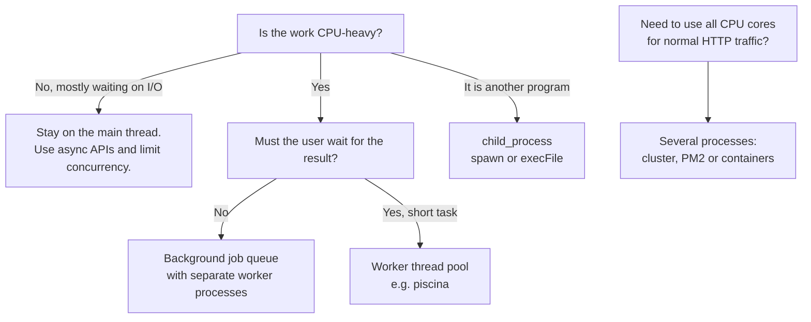
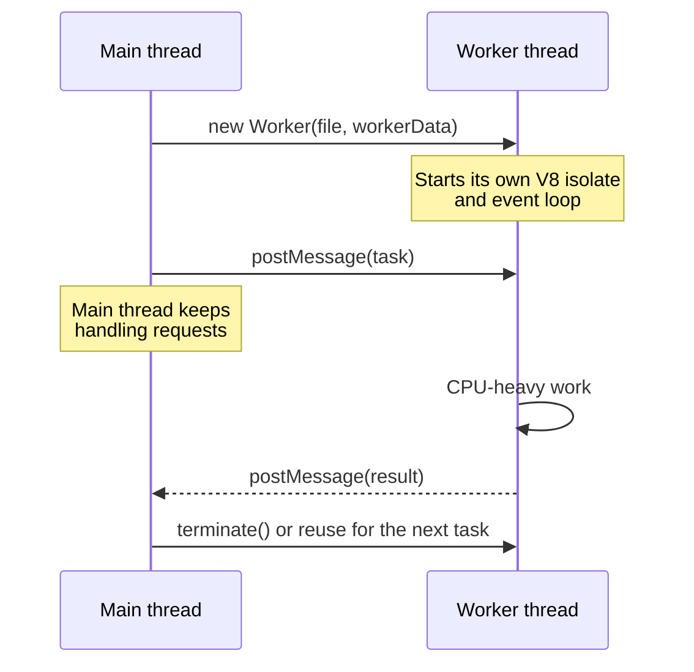
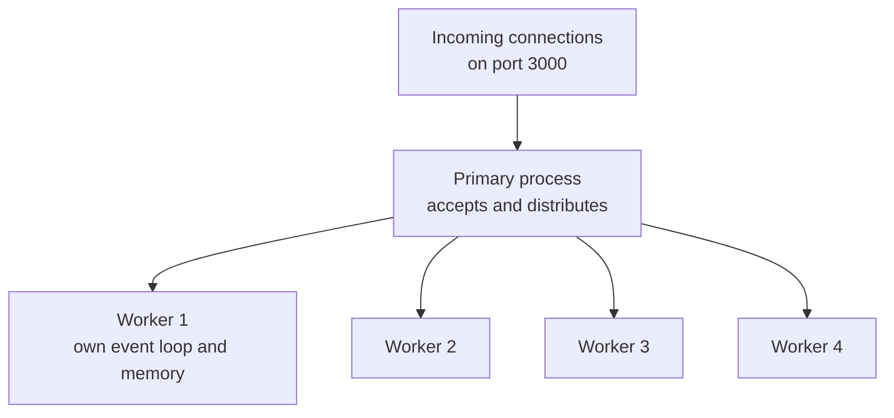

# Concurrency in Node.js: Worker Threads, Child Processes and Cluster

> In this document you will learn how Node.js handles many things at once, why CPU-heavy code freezes a Node.js server, and how to fix it with worker threads, child processes, the cluster module, PM2 or containers. You will also learn how race conditions happen in "single-threaded" async code and how to prevent them. These are standard backend interview topics because they test whether you really understand the Node.js runtime.

**Before this:** [Node.js runtime and architecture](01-nodejs-runtime-and-architecture.md) · [The Node.js event loop](02-node-event-loop.md) · [Processes, threads and memory](../01-cs-and-web-fundamentals/03-operating-systems-processes-threads-memory.md) · **Interview questions:** [jump to the interview section](#interview-questions)

## Table of contents

1. [Concurrency vs parallelism in Node.js](#concurrency-vs-parallelism-in-nodejs)
2. [The problem: CPU-bound work blocks everything](#the-problem-cpu-bound-work-blocks-everything)
3. [Your options at a glance](#your-options-at-a-glance)
4. [Worker threads](#worker-threads)
5. [Child processes](#child-processes)
6. [The cluster module](#the-cluster-module)
7. [PM2 cluster mode](#pm2-cluster-mode)
8. [Scaling with containers instead](#scaling-with-containers-instead)
9. [Comparison table](#comparison-table)
10. [Race conditions in async Node.js code](#race-conditions-in-async-nodejs-code)
11. [Limiting concurrency](#limiting-concurrency)
12. [Measuring event loop health](#measuring-event-loop-health)
13. [Common mistakes and best practices](#common-mistakes-and-best-practices)
14. [How to explain this in an interview](#how-to-explain-this-in-an-interview)
15. [Interview questions](#interview-questions)
16. [Summary](#summary)
17. [References](#references)

---

## Concurrency vs parallelism in Node.js

These two words are often mixed up. They mean different things.

- **Concurrency** means *dealing with* many tasks during the same period of time. The tasks make progress by taking turns. One cook can prepare five dishes concurrently: while the soup boils, they chop vegetables.
- **Parallelism** means *doing* many tasks at the exact same moment. It needs more than one worker (more than one CPU core). Five cooks prepare five dishes in parallel.

### What Node.js gives you by default

Your JavaScript code runs on **one main thread** with an **event loop**. Node.js is very good at *concurrency* for I/O work:

```js
// Three slow I/O operations run concurrently on ONE JavaScript thread.
const [user, orders, recommendations] = await Promise.all([
  fetchUser(userId),            // waits for the database
  fetchOrders(userId),          // waits for another query
  fetchRecommendations(userId), // waits for an HTTP call
]);
```

While Node.js waits for the database, the main thread is free to handle other requests. The waiting is done by the operating system (for network I/O) or by the libuv thread pool (for file system, DNS lookup, some crypto and zlib work). A quick reminder of this architecture is in [Node.js runtime and architecture](01-nodejs-runtime-and-architecture.md).

But your *JavaScript* code never runs in parallel on the main thread. Only one function runs at a time. So:

| Work type | Example | Is one Node.js thread enough? |
| --- | --- | --- |
| **I/O-bound** (mostly waiting) | Database queries, HTTP calls, reading files | Yes. Node handles thousands of these concurrently |
| **CPU-bound** (mostly computing) | Image resizing, PDF generation, big JSON parsing, encryption loops, data compression | No. While it computes, nothing else runs |

### Where parallelism comes from in Node.js

To use more than one CPU core for JavaScript, you need more threads or more processes:

- **Worker threads** — more JavaScript threads inside the same process.
- **Child processes** — separate processes (another Node.js script or any program like `ffmpeg`).
- **Cluster / PM2 / containers** — several copies of your whole server, each with its own event loop.

---

## The problem: CPU-bound work blocks everything

Let us see the problem with real numbers. This server has a fast `/health` route and a slow `/fib` route that computes a Fibonacci number in a CPU-heavy way.

```js
// blocking-server.mjs
import http from "node:http";

function fibonacci(n) {
  return n < 2 ? n : fibonacci(n - 1) + fibonacci(n - 2);
}

const server = http.createServer((req, res) => {
  const url = new URL(req.url, "http://localhost");

  if (url.pathname === "/health") {
    res.end("ok");
    return;
  }

  if (url.pathname === "/fib") {
    const n = Number(url.searchParams.get("n") ?? 40);
    const started = performance.now();
    const result = fibonacci(n); // CPU-bound: blocks the event loop
    res.setHeader("Content-Type", "application/json");
    res.end(JSON.stringify({ n, result, ms: Math.round(performance.now() - started) }));
    return;
  }

  res.statusCode = 404;
  res.end();
});

server.listen(3000, () => console.log("listening on 3000"));
```

I measured this from a separate process (on one test machine; your numbers will differ):

```text
GET /health               -> "ok" in 36 ms
GET /fib?n=42             -> started
GET /health (during fib)  -> "ok" in 8901 ms   <- waited for the whole computation
GET /fib?n=42             -> {"n":42,"result":267914296,"ms":8995}
```

**What happened, step by step:**

1. The `/fib` request arrives. Its handler calls `fibonacci(42)`.
2. `fibonacci` runs for about 9 seconds on the main thread. It never returns control to the event loop.
3. The `/health` request arrives. The operating system accepts the TCP connection, but Node.js cannot run the handler: the only JavaScript thread is busy.
4. Timers, other requests, database results — everything waits.
5. When `fibonacci` finishes, the event loop continues and finally answers `/health`.

In production this looks like: health checks fail, the load balancer marks the instance as dead, every user on that instance sees a timeout, and the problem seems random. One CPU-heavy endpoint can hurt the whole service.

Common real causes of blocking:

- Synchronous crypto (`crypto.pbkdf2Sync`, `bcrypt.hashSync`) on every login.
- `JSON.parse` / `JSON.stringify` of very large payloads (tens of MB).
- Image, PDF or Excel processing in the request handler.
- A regular expression with catastrophic backtracking (ReDoS).
- Big loops over arrays with millions of items, sorting huge arrays.
- `fs.readFileSync` and other `*Sync` APIs inside request handlers.

How to detect it: measure event loop delay and utilization (see [Measuring event loop health](#measuring-event-loop-health)), and profile with `--cpu-prof` (see [Production Node.js](14-production-nodejs.md)).

---

## Your options at a glance



- **I/O-bound work:** you usually do not need threads. Use async APIs and control how many operations run at once.
- **Short CPU work that the request must wait for** (hash a password, resize a thumbnail, parse a big file): a **worker thread pool**.
- **Long CPU work the user does not need to wait for** (video encoding, monthly reports): a **background job queue** with separate worker processes. See [Background jobs and queues](13-background-jobs-and-queues.md).
- **Running another program** (ImageMagick, ffmpeg, git, a Python script): **child process**.
- **Using all CPU cores for ordinary request handling**: run **several copies** of the server with cluster, PM2, or (most common today) containers behind a load balancer.

---

## Worker threads

### What it is

The **`node:worker_threads`** module lets you run JavaScript in parallel on extra threads inside the same Node.js process. It has been stable since Node.js 12.

Each worker thread has:

- its **own V8 instance** (an isolate) with its own heap and garbage collector,
- its **own event loop**,
- its own copy of all modules it imports.

So a worker is almost like a small separate Node.js program, but it lives inside the same process and can talk to the main thread quickly.

### Why it exists

Before worker threads, the only way to run JavaScript in parallel was to start more processes. Processes are heavier (more memory, slower start) and communicate only by copying data over IPC. Worker threads are lighter, start faster and can even **share memory** with `SharedArrayBuffer`.

### Analogy

The main thread is a receptionist in a busy office. If someone asks for a 100-page report, a good receptionist does not stop answering phones for an hour. They hand the job to a colleague in the back office (a worker thread) and keep answering the phone. When the report is ready, the colleague sends a message back.

Where it breaks: the back office colleague does not share the receptionist's desk. They get a *photocopy* of the documents (messages are copied), unless you explicitly give them a shared whiteboard (`SharedArrayBuffer`).

### How it works inside



Messages are copied with the **structured clone algorithm** (the same one browsers use for `postMessage`). It supports plain objects, arrays, `Map`, `Set`, `Date`, `RegExp`, `BigInt`, typed arrays and circular references. It does **not** keep functions, class prototypes, getters or private fields.

### Example 1: Move the Fibonacci work to a worker

```js
// fib-worker.mjs — runs inside the worker thread
import { parentPort, workerData } from "node:worker_threads";

function fibonacci(n) {
  return n < 2 ? n : fibonacci(n - 1) + fibonacci(n - 2);
}

parentPort.postMessage(fibonacci(workerData.n));
```

```js
// run-fib-worker.mjs — runs on the main thread
import { Worker } from "node:worker_threads";

function runFibInWorker(n) {
  return new Promise((resolve, reject) => {
    const worker = new Worker(new URL("./fib-worker.mjs", import.meta.url), {
      workerData: { n },
    });
    worker.once("message", resolve);
    worker.once("error", reject);
    worker.once("exit", (code) => {
      if (code !== 0) reject(new Error(`Worker stopped with exit code ${code}`));
    });
  });
}

const timer = setInterval(() => console.log("main thread is still free"), 500);
const result = await runFibInWorker(40);
clearInterval(timer);
console.log("fib(40) =", result);
```

Output:

```text
main thread is still free
main thread is still free
main thread is still free
...
fib(40) = 102334155
```

The interval keeps firing while the worker computes. The main thread is not blocked.

The important APIs:

| API | Where | Meaning |
| --- | --- | --- |
| `new Worker(fileOrUrl, options)` | Main | Start a worker running that file |
| `workerData` | Worker | A clone of the data passed in `options.workerData` |
| `parentPort` | Worker | The channel to talk to the parent (`null` on the main thread) |
| `postMessage(value)` | Both | Send a message (structured clone) |
| `'message'` / `'error'` / `'exit'` events | Main | Result, uncaught exception in the worker, worker stopped |
| `worker.terminate()` | Main | Stop the worker; returns a promise with the exit code |
| `isMainThread` / `threadId` | Both | Where am I? Thread ID (main thread is `0`) |

### Example 2: Main and worker code in one file

```js
// single-file.mjs
import { Worker, isMainThread, parentPort, workerData, threadId } from "node:worker_threads";

if (isMainThread) {
  const worker = new Worker(new URL(import.meta.url), { workerData: { numbers: [1, 2, 3, 4] } });
  worker.on("message", (msg) => console.log("main got:", msg));
  worker.on("exit", (code) => console.log("worker exited with code", code));
  console.log("main threadId:", threadId);
} else {
  const sum = workerData.numbers.reduce((a, b) => a + b, 0);
  parentPort.postMessage({ sum, from: threadId });
}
```

```text
main threadId: 0
main got: { sum: 10, from: 1 }
worker exited with code 0
```

The worker exits by itself when its event loop has nothing left to do.

### What can and cannot be sent

```js
// clone.mjs
import { Worker, isMainThread, parentPort } from "node:worker_threads";

class Money {
  constructor(cents) {
    this.cents = cents;
  }
  format() {
    return `$${(this.cents / 100).toFixed(2)}`;
  }
}

if (isMainThread) {
  const worker = new Worker(new URL(import.meta.url));
  worker.on("message", (msg) => {
    console.log(msg instanceof Money, typeof msg.format, msg); // false undefined { cents: 1999 }
    worker.terminate();
  });
  worker.postMessage("go");
  try {
    worker.postMessage({ fn: () => 1 });
  } catch (err) {
    console.log(err.name, err.message); // DataCloneError () => 1 could not be cloned.
  }
} else {
  parentPort.once("message", () => parentPort.postMessage(new Money(1999)));
}
```

- A class instance arrives as a **plain object**. Its methods are gone.
- A function cannot be sent at all: `DataCloneError`.
- So send plain data (IDs, numbers, strings, buffers), and rebuild objects on the other side if you need them.

### Transferring instead of copying

Copying a 50 MB buffer takes time and doubles memory. You can **transfer** an `ArrayBuffer` instead. Ownership moves to the other thread, and the sender can no longer use it.

```js
// transfer.mjs
import { Worker, isMainThread, parentPort } from "node:worker_threads";

if (isMainThread) {
  const worker = new Worker(new URL(import.meta.url));
  const buffer = new ArrayBuffer(8 * 1024 * 1024); // 8 MB
  console.log("before:", buffer.byteLength); // before: 8388608
  worker.postMessage(buffer, [buffer]);       // second argument = transfer list
  console.log("after:", buffer.byteLength);   // after: 0  (no longer ours)
  worker.on("message", (size) => {
    console.log("worker received", size);     // worker received 8388608
    worker.terminate();
  });
} else {
  parentPort.once("message", (buf) => parentPort.postMessage(buf.byteLength));
}
```

Transfer is almost free: no bytes are copied. It is ideal for image or file data.

### Sharing memory with `SharedArrayBuffer` and `Atomics`

A **`SharedArrayBuffer`** is memory that several threads can read and write at the same time. It is not copied and not transferred: all threads see the same bytes.

Shared memory brings back the classic problem of multithreaded programming: **data races**. Look at this counter:

```js
// atomics.mjs
import { Worker, isMainThread, workerData } from "node:worker_threads";

const WORKERS = 4;
const INCREMENTS = 1_000_000;

if (isMainThread) {
  for (const mode of ["plain", "atomic"]) {
    const shared = new SharedArrayBuffer(4); // room for one 32-bit integer
    const counter = new Int32Array(shared);
    const workers = Array.from({ length: WORKERS }, () =>
      new Worker(new URL(import.meta.url), { workerData: { shared, mode } }),
    );
    await Promise.all(workers.map((w) => new Promise((resolve) => w.once("exit", resolve))));
    console.log(mode, "expected", WORKERS * INCREMENTS, "got", counter[0]);
  }
} else {
  const counter = new Int32Array(workerData.shared);
  for (let i = 0; i < INCREMENTS; i++) {
    if (workerData.mode === "plain") counter[0]++; // read, add, write: three steps
    else Atomics.add(counter, 0, 1);               // one indivisible step
  }
}
```

Two runs on a test machine:

```text
plain expected 4000000 got 2036972
atomic expected 4000000 got 4000000
plain expected 4000000 got 1746656
atomic expected 4000000 got 4000000
```

`counter[0]++` is really three steps: read the value, add one, write it back. Two threads can read the same old value, both add one, and both write the same result. One increment is lost. The "plain" result is different on every run. `Atomics.add` does the whole update as one **atomic** (indivisible) operation, so nothing is lost.

`Atomics` also has `Atomics.wait()` and `Atomics.notify()` to let a thread sleep until another thread changes a value. Node.js allows `Atomics.wait` on the main thread, but using it there blocks the event loop, so use it only inside workers.

In practice you rarely need shared memory in web backends. Message passing is simpler and safer. Shared memory is useful for high-performance numeric work (for example, a shared progress counter or a lock-free ring buffer).

### Errors, exits and resource limits

- If a worker throws an uncaught exception, the worker stops and the main thread gets an `'error'` event. The main process does **not** crash (unless you do not handle that event).
- `'exit'` is always the last event. A non-zero exit code means something went wrong (exit code `1` if it was terminated).
- `process.exit()` inside a worker only stops that worker.
- You can limit memory per worker with `resourceLimits`:

```js
const worker = new Worker(new URL("./report-worker.mjs", import.meta.url), {
  resourceLimits: { maxOldGenerationSizeMb: 256 }, // the worker is terminated if it needs more
});
```

### Worker pools

Starting a worker costs time and memory (a new V8 isolate; roughly tens of milliseconds and several MB). The Node.js docs recommend using a **pool** of workers instead of creating one per task: the workers start once and handle many tasks.

Here is a small pool, to understand the idea:

```js
// worker-pool.mjs
import { Worker } from "node:worker_threads";
import { availableParallelism } from "node:os";

export class WorkerPool {
  #workers = [];
  #idle = [];
  #queue = [];
  #pending = new Map(); // taskId -> { resolve, reject }
  #nextTaskId = 1;

  constructor(fileUrl, size = Math.max(1, availableParallelism() - 1)) {
    for (let i = 0; i < size; i++) this.#addWorker(fileUrl);
  }

  #addWorker(fileUrl) {
    const worker = new Worker(fileUrl);
    worker.on("message", ({ taskId, ...result }) => {
      this.#pending.get(taskId)?.resolve(result);
      this.#pending.delete(taskId);
      worker.currentTaskId = undefined;
      this.#idle.push(worker);
      this.#runNext();
    });
    worker.on("error", (err) => {
      if (worker.currentTaskId) {
        this.#pending.get(worker.currentTaskId)?.reject(err);
        this.#pending.delete(worker.currentTaskId);
      }
      this.#workers = this.#workers.filter((w) => w !== worker);
      this.#idle = this.#idle.filter((w) => w !== worker);
      this.#addWorker(fileUrl); // replace the crashed worker
    });
    this.#workers.push(worker);
    this.#idle.push(worker);
    this.#runNext();
  }

  run(data) {
    return new Promise((resolve, reject) => {
      const taskId = this.#nextTaskId++;
      this.#pending.set(taskId, { resolve, reject });
      this.#queue.push({ taskId, ...data });
      this.#runNext();
    });
  }

  #runNext() {
    while (this.#idle.length > 0 && this.#queue.length > 0) {
      const worker = this.#idle.pop();
      const task = this.#queue.shift();
      worker.currentTaskId = task.taskId;
      worker.postMessage(task);
    }
  }

  async close() {
    await Promise.all(this.#workers.map((w) => w.terminate()));
  }
}
```

```js
// pool-task.mjs — a long-lived worker that handles many tasks
import { parentPort } from "node:worker_threads";
import { createHash } from "node:crypto";

parentPort.on("message", ({ taskId, password, iterations }) => {
  let digest = password;
  for (let i = 0; i < iterations; i++) {
    digest = createHash("sha256").update(digest).digest("hex");
  }
  parentPort.postMessage({ taskId, digest });
});
```

```js
const pool = new WorkerPool(new URL("./pool-task.mjs", import.meta.url), 2);
const results = await Promise.all(
  ["alice", "bob", "carol", "dave"].map((password) => pool.run({ password, iterations: 200_000 })),
);
console.log(results.map((r) => r.digest.slice(0, 8)));
// [ 'c14ac099', '2c834376', '466b2a92', '7320054b' ]
await pool.close();
```

How it works: tasks wait in `#queue`. When a worker is idle, it gets the next task. Each task has an ID, so the result is matched to the right promise. A crashed worker is replaced.

(This hashing loop is only a CPU-work example. For real password hashing, use `crypto.scrypt` (async, runs on the libuv pool) or a library such as `argon2` or `bcrypt`. See [Authentication and authorization](09-authentication-and-authorization.md).)

### Use piscina in production

[Piscina](https://github.com/piscinajs/piscina) is a popular, well-maintained worker thread pool. It handles queueing, task cancellation with `AbortSignal`, idle timeouts, worker restarts and statistics. Piscina v5 requires Node.js 20 or newer.

```ts
// thumbnail-task.ts — the worker file exports a function (default export)
export interface ThumbnailTask {
  width: number;
  height: number;
  pixels: Uint8Array;
}

export default function makeThumbnail({ width, height, pixels }: ThumbnailTask) {
  // ... CPU-heavy image work here ...
  return { width: Math.round(width / 4), height: Math.round(height / 4), bytes: pixels.length / 16 };
}
```

```ts
// thumbnail-pool.ts — on the main thread
import { Piscina } from "piscina";
import { availableParallelism } from "node:os";

export const thumbnailPool = new Piscina({
  filename: new URL("./thumbnail-task.js", import.meta.url).href, // the compiled JS file
  maxThreads: Math.max(1, availableParallelism() - 1),
  maxQueue: 1_000, // reject new tasks when the queue is this long (backpressure)
  idleTimeout: 30_000,
});

// In an Express handler:
// const result = await thumbnailPool.run({ width, height, pixels }, { signal: req.signal });
```

Notes:

- Keep `maxQueue` bounded. An unbounded queue hides overload: requests wait longer and longer and memory grows. When the queue is full, return `503 Service Unavailable` quickly.
- Size the pool around `os.availableParallelism() - 1` (leave one core for the main thread). `os.availableParallelism()` (Node.js 18.14+) is the recommended way to ask how much parallelism is available; the docs say not to use `os.cpus().length` for this.
- In containers, the CPU limit of the container matters more than the number of cores of the host. Check what `availableParallelism()` returns in your environment and allow an override with an environment variable.

### When worker threads do not help

The Node.js docs say it clearly: workers do not help much with I/O-heavy work, because Node's built-in async I/O is already more efficient. Do not put database queries or HTTP calls in workers to "make them faster".

Also remember:

- Each worker uses extra memory (its own heap).
- Sending big data back and forth costs time (copying). Measure; for small tasks, the messaging overhead can be larger than the gain.
- Workers cannot touch the main thread's variables, the DOM (in Electron renderers, workers are similar), or the `req`/`res` objects. Send them only data.

### Real-world usage

- Image and video thumbnails, PDF and Excel generation in an API.
- Parsing and validating very large CSV/JSON uploads.
- Server-side syntax highlighting, Markdown rendering, template rendering for big documents.
- Compression or encryption of large buffers (although `zlib` and most `crypto` async APIs already use the libuv thread pool).
- Build tools (bundlers and test runners such as Vitest use worker pools to run work in parallel).
- Electron apps: heavy work off the main process (see [Electron performance and architecture](../08-electron-desktop/09-performance-architecture-and-alternatives.md)).

---

## Child processes

### What it is

The **`node:child_process`** module starts other programs as separate operating system processes. The child can be any executable (`git`, `ffmpeg`, `python`, a shell script) or another Node.js script.

A child process has its own memory, its own PID and, if it is Node.js, its own event loop and V8. If it crashes, your server keeps running.

### The four main functions

| Function | Uses a shell? | Output | Best for |
| --- | --- | --- | --- |
| `spawn(cmd, args)` | No (unless `shell: true`) | **Streams** (`child.stdout`) | Long-running programs, large output |
| `execFile(file, args)` | No | **Buffered** into a string (default limit 1 MiB) | Running a program and getting its short output |
| `exec(commandString)` | **Yes** (`/bin/sh` or `cmd.exe`) | Buffered | Quick shell commands with pipes, only with trusted input |
| `fork(modulePath)` | No | Optional, plus an **IPC channel** | Another Node.js script you send messages to |

Each has a `*Sync` version (`execFileSync`, `spawnSync`). These block the event loop. Use them only in scripts and CLIs, never in request handlers.

### `execFile`: run a program and get its output

```js
import { execFile } from "node:child_process";
import { promisify } from "node:util";

const execFileAsync = promisify(execFile);

const { stdout } = await execFileAsync("git", ["rev-parse", "--short", "HEAD"], {
  timeout: 5_000, // kill the child if it runs longer than 5 seconds
});
console.log("current commit:", stdout.trim());
```

`util.promisify(execFile)` returns a promise of `{ stdout, stderr }`. On failure it rejects with an error that also has `stdout`, `stderr` and `code`. With `timeout`, Node sends `SIGTERM` to the child after the time is up (`err.killed` becomes `true`).

### `spawn`: stream the output

`execFile` collects all output in memory. For a program that prints a lot or runs for a long time, use `spawn` and read the streams.

```js
import { spawn } from "node:child_process";

function convertVideo(input, output) {
  return new Promise((resolve, reject) => {
    const child = spawn("ffmpeg", ["-i", input, "-vf", "scale=640:-2", output]);

    child.stderr.setEncoding("utf8");
    child.stderr.on("data", (chunk) => {
      // ffmpeg writes progress to stderr; parse it or log it
    });

    child.on("error", reject); // for example: ffmpeg is not installed (ENOENT)
    child.on("close", (code) => {
      if (code === 0) resolve();
      else reject(new Error(`ffmpeg exited with code ${code}`));
    });
  });
}
```

Always listen to `'error'`. If the program does not exist, there is no exit code; you get an `'error'` event with `ENOENT`, and without a listener the process can crash.

### `fork`: another Node.js process with messages

`fork` runs a Node.js file in a new process and creates an **IPC channel** (inter-process communication) so parent and child can send messages.

```js
// parent.mjs
import { fork } from "node:child_process";

const child = fork(new URL("./fork-child.mjs", import.meta.url));
child.on("message", (msg) => {
  console.log("parent got:", msg); // parent got: { type: 'result', total: 30 }
  child.disconnect();              // close the IPC channel so the child can exit
});
child.send({ type: "sum", numbers: [5, 10, 15] });
```

```js
// fork-child.mjs
process.on("message", (msg) => {
  if (msg.type === "sum") {
    process.send({ type: "result", total: msg.numbers.reduce((a, b) => a + b, 0) });
  }
});
```

Messages are serialized (JSON by default), so the same rule applies as with workers: send plain data.

Compared with a worker thread, a forked process is heavier (a whole new Node.js process: more memory and a slower start) but more isolated: a crash or a memory leak in native code cannot affect the parent's memory. This isolation is why job queue libraries can run each job processor in a separate process (BullMQ calls them "sandboxed processors").

### Security: shell injection with `exec`

`exec` passes your string to a shell. If any part of that string comes from a user, the user can run their own commands.

```js
import { exec, execFile } from "node:child_process";

// ❌ Wrong: the filename comes from the request
app.post("/convert", (req, res) => {
  exec(`convert uploads/${req.body.filename} -resize 200x200 thumbs/out.png`, (err) => {
    res.sendStatus(err ? 500 : 204);
  });
});
// filename = "a.png; rm -rf / #"  -> the shell runs:  convert uploads/a.png; rm -rf / # ...

// ✅ Correct: no shell, arguments are passed as an array, input is validated
app.post("/convert", (req, res) => {
  const filename = String(req.body.filename);
  if (!/^[a-zA-Z0-9_-]+\.(png|jpg)$/.test(filename)) return res.sendStatus(400);

  execFile("convert", [`uploads/${filename}`, "-resize", "200x200", "thumbs/out.png"], (err) => {
    res.sendStatus(err ? 500 : 204);
  });
});
```

With `execFile` (or `spawn` without `shell`), each array item reaches the program as a single argument. Characters like `;`, `|`, `$()` and backticks are not interpreted by a shell, because there is no shell.

Rules:

- Prefer `execFile` or `spawn` with an argument array.
- Never pass unsanitized user input to `exec`, or to `spawn`/`execFile` with `shell: true`.
- Validate inputs with an allow-list (like the regular expression above), even without a shell. A user could still pass an argument that the program interprets as an option (for example, a filename starting with `-`). Many programs accept `--` to mark the end of options.
- Since Node.js 24, passing an `args` array to `spawn` or `execFile` together with `shell: true` prints a runtime deprecation warning (DEP0190), because those arguments are only joined with spaces, not escaped.

More on command injection: [Production Node.js](14-production-nodejs.md) and [Web security](../10-testing-security-production/05-web-security-xss-csrf-cors-csp.md).

### Other good practices with child processes

- Set a `timeout` or pass an `AbortSignal` (`signal` option) so a stuck child does not live forever.
- Limit how many children run at once (each one costs memory and CPU). See [Limiting concurrency](#limiting-concurrency).
- For `exec`/`execFile`, remember `maxBuffer` (1 MiB by default). Larger output kills the child. Use `spawn` for big output.
- Pass only the environment variables the child needs (`env` option), especially if it is a third-party program. By default the child inherits all of `process.env`, including your secrets.
- Clean up children when your server shuts down.

---

## The cluster module

### What it is

The **`node:cluster`** module starts several copies of your Node.js server (**worker processes**) that all **share the same server port**. A **primary** process starts and manages them.

Each worker is a full Node.js process with its own event loop and memory. With 8 CPU cores and 8 workers, your server can handle about 8 times more CPU work in parallel.

### Why it exists

One Node.js process uses one main thread, so one CPU core for your JavaScript. On an 8-core server, a single process leaves 7 cores mostly idle. Before containers were common, cluster was the standard way to use all cores on one machine.

### How it works



There are two ways connections reach the workers:

- **Round-robin (default on all platforms except Windows):** the primary accepts connections and hands them to workers in turn.
- **Operating system scheduling (default on Windows):** the primary creates the listening socket and the workers accept connections directly. The Node.js docs warn that this distribution is often very unbalanced.

You can choose with the `NODE_CLUSTER_SCHED_POLICY` environment variable (`rr` or `none`) or `cluster.schedulingPolicy`.

I saw this difference when testing the example below on Windows: with the default policy, all 20 test requests were answered by one worker. With `NODE_CLUSTER_SCHED_POLICY=rr`, all 4 workers answered.

### Code

```js
// cluster.mjs
import cluster from "node:cluster";
import http from "node:http";
import { availableParallelism } from "node:os";
import process from "node:process";

if (cluster.isPrimary) {
  const count = availableParallelism();
  console.log(`primary ${process.pid} starting ${count} workers`);

  for (let i = 0; i < count; i++) cluster.fork();

  cluster.on("exit", (worker, code, signal) => {
    console.log(`worker ${worker.process.pid} died (${signal ?? code})`);
    if (!worker.exitedAfterDisconnect) cluster.fork(); // replace crashed workers
  });
} else {
  http
    .createServer((req, res) => res.end(`handled by ${process.pid}\n`))
    .listen(3000);
}
```

**Step by step:**

1. You run `node cluster.mjs`. This process is the primary (`cluster.isPrimary` is `true`).
2. `cluster.fork()` starts the same file again as a worker process. In the worker, `cluster.isPrimary` is `false`.
3. Each worker calls `listen(3000)`. Instead of failing with "port in use", the cluster module routes the listen through the primary, so all workers share port 3000.
4. When a worker crashes, the primary gets an `'exit'` event and starts a new one.

`cluster.isPrimary` exists since Node.js 16. Older code uses `cluster.isMaster`, which is a deprecated alias.

### What cluster does not do for you

- **No shared memory.** Each worker has its own variables. An in-memory cache, an in-memory session store, an in-memory rate limiter or a WebSocket connection list exists separately in every worker. Use Redis or a database for shared state.
- **No sticky sessions.** Requests from one user can go to different workers. This breaks in-memory sessions and some WebSocket/long-polling setups (Socket.IO with polling needs sticky sessions or a Redis adapter).
- **No zero-downtime reload by default.** You must write the logic (restart workers one by one) or use PM2.
- **It scales on one machine only.** For more machines, you still need a load balancer.

### Graceful restart of workers

```js
// In the primary: restart workers one by one, for example after a deploy
async function rollingRestart() {
  for (const worker of Object.values(cluster.workers)) {
    const replacement = cluster.fork();
    await new Promise((resolve) => replacement.once("listening", resolve));
    worker.disconnect(); // stop accepting new connections, finish current ones, then exit
  }
}
```

`worker.disconnect()` lets the worker finish its in-flight requests before it exits (`exitedAfterDisconnect` is then `true`, so the `'exit'` handler above does not replace it again). Graceful shutdown inside each worker is covered in [Production Node.js](14-production-nodejs.md).

---

## PM2 cluster mode

**PM2** is a popular process manager for Node.js. It uses the cluster module for you and adds process monitoring, automatic restarts, log management and zero-downtime reloads.

```bash
npm install --global pm2

# Start one worker per available CPU core
pm2 start dist/server.js -i max --name orders-api

pm2 list                 # status of all processes
pm2 logs orders-api      # stream logs
pm2 reload orders-api    # zero-downtime reload: restarts workers one by one
pm2 startup && pm2 save  # start the saved process list on boot
```

Or with a config file:

```js
// ecosystem.config.cjs
module.exports = {
  apps: [
    {
      name: "orders-api",
      script: "dist/server.js",
      instances: "max",          // or a number
      exec_mode: "cluster",
      max_memory_restart: "512M", // restart a worker if its memory grows above 512 MB
      env: { NODE_ENV: "production" },
    },
  ],
};
```

PM2 is a good fit when you deploy directly to virtual machines without containers. Your app code does not change: you write a normal single-process server and PM2 runs several copies.

---

## Scaling with containers instead

Today, most teams run Node.js in containers (Docker) on an orchestrator such as Kubernetes, Amazon ECS or a platform like Cloud Run. The common pattern is:

- **One Node.js process per container.**
- **Several container replicas** behind a load balancer.
- The orchestrator restarts crashed containers, does rolling deploys and adds replicas when load grows (autoscaling).

```text
                Load balancer
          /        |         \
   container 1  container 2  container 3      <- each runs: node dist/server.js
   (1 CPU)      (1 CPU)      (1 CPU)
```

Why not cluster inside the container?

- The orchestrator already does process management, restarts and scaling. Cluster duplicates this work.
- One process per container makes health checks, memory limits and metrics clearer: one container = one event loop.
- Scaling is more flexible: you add containers across many machines.

So in a containerized setup, give each container about one CPU and scale the number of replicas. Use cluster or PM2 mainly on plain VMs or when you must use a big machine with one deployment unit. See [Production Node.js](14-production-nodejs.md) for Docker details.

---

## Comparison table

| | Worker threads | Child process (`fork`/`spawn`) | Cluster / PM2 | Containers (replicas) |
| --- | --- | --- | --- | --- |
| Unit | Thread in the same process | Separate process | Several processes, one machine | Several processes, many machines |
| Memory isolation | Separate JS heaps, same process | Fully separate | Fully separate | Fully separate |
| Shared memory | Yes (`SharedArrayBuffer`) | No | No | No |
| Communication | `postMessage` (fast, structured clone, transfer) | IPC messages (serialized), stdio | None built in (use Redis/DB) | Network only |
| Startup cost | Low–medium | Medium–high | High (whole server) | High |
| Crash impact | Worker dies; main process survives if `'error'` is handled | Child dies; parent survives | One worker dies; others keep serving | One container dies; others keep serving |
| Main use | CPU-heavy tasks inside a request | Running other programs, isolating risky work | Using all cores for HTTP on one VM | Production scaling and high availability |

A short way to remember:

- **Worker threads** → parallel *tasks* inside one server.
- **Child processes** → *other programs* or strongly isolated work.
- **Cluster / PM2 / containers** → *more copies of the whole server*.

They combine well: each container can have a small piscina pool for CPU-heavy endpoints.

---
