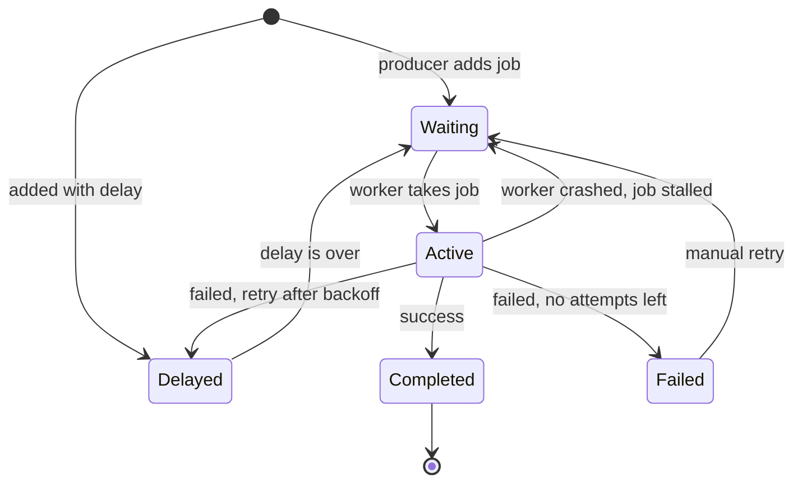
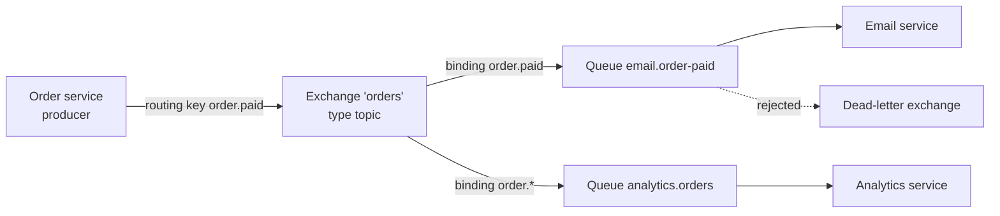
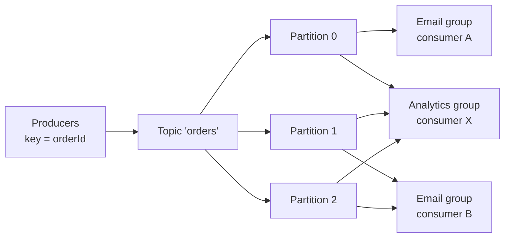
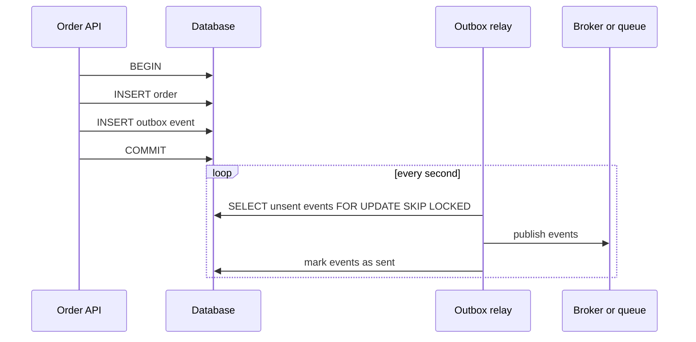

# Background Jobs and Queues

> In this document you will learn how to move slow or unreliable work out of the HTTP request: job queues with BullMQ and Redis, message brokers like RabbitMQ and Kafka, retries with backoff, idempotent consumers, the outbox pattern, scheduled jobs and webhooks. Interviewers use these topics to check whether you can build backends that stay fast and correct when things fail.

**Before this:** [The Node.js event loop](02-node-event-loop.md) · [Caching](11-caching.md) (Redis basics) · [Concurrency, worker threads and cluster](12-concurrency-worker-threads-and-cluster.md) · **Interview questions:** [jump to the interview section](#interview-questions)

## Table of contents

1. [Why background jobs](#why-background-jobs)
2. [Core concepts](#core-concepts)
3. [Job queues with BullMQ and Redis](#job-queues-with-bullmq-and-redis)
4. [Message brokers: RabbitMQ and Kafka](#message-brokers-rabbitmq-and-kafka)
5. [Choosing a queue or broker](#choosing-a-queue-or-broker)
6. [Delivery guarantees and idempotent consumers](#delivery-guarantees-and-idempotent-consumers)
7. [Retries, backoff and dead-letter queues](#retries-backoff-and-dead-letter-queues)
8. [The outbox pattern](#the-outbox-pattern)
9. [Scheduled jobs](#scheduled-jobs)
10. [Webhooks](#webhooks)
11. [Common mistakes and best practices](#common-mistakes-and-best-practices)
12. [How to explain this in an interview](#how-to-explain-this-in-an-interview)
13. [Interview questions](#interview-questions)
14. [Summary](#summary)
15. [References](#references)

---

## Why background jobs

### The problem

Imagine a sign-up endpoint:

```ts
// ❌ Everything happens inside the request
app.post("/api/users", async (req, res) => {
  const user = await userRepository.create(req.body); // 20 ms
  await emailService.sendWelcomeEmail(user.email);    // 800 ms, sometimes times out
  await crm.createContact(user);                       // 1,200 ms, rate limited
  await imageService.generateAvatar(user.id);         // 2,000 ms of CPU
  res.status(201).json(user);
});
```

Problems:

- **Slow response.** The user waits 4 seconds for work they do not need to wait for.
- **Fragile.** If the email provider is down, sign-up fails, even though the user was already created.
- **No retries.** If the CRM call fails, nobody tries again.
- **Blocks the server.** The avatar generation is CPU work on the event loop.
- **No control over load.** A spike of 10,000 sign-ups means 10,000 parallel calls to the email provider, which then rate-limits you.

### The solution

Do only the essential work in the request. Put the rest into a **queue** as **jobs**. Separate **worker** processes pick up the jobs and do the work in the background, with retries.

```ts
// ✅ The request does the essential part and enqueues the rest
app.post("/api/users", async (req, res) => {
  const user = await userRepository.create(req.body);
  await jobs.add("welcome-email", { userId: user.id });
  await jobs.add("crm-sync", { userId: user.id });
  await jobs.add("generate-avatar", { userId: user.id });
  res.status(201).json(user); // responds in ~30 ms
});
```

### Analogy

A restaurant waiter takes your order and gives it to the kitchen. The waiter does not stand at the stove cooking your food while other guests wait. The order tickets on the kitchen rail are the **queue**. The cooks are the **workers**. If one cook is sick, the tickets wait on the rail and another cook takes them.

Where the analogy breaks: in software, a "cook" can crash in the middle of a dish. The system must notice it and give the ticket to someone else, and the dish must not be served twice. Much of this document is about exactly that.

### Typical background jobs

| Job | Why in the background |
| --- | --- |
| Sending emails, SMS, push notifications | Slow, external, needs retries |
| Image and video processing, thumbnails | CPU-heavy |
| PDF invoices, CSV/Excel exports, reports | CPU-heavy and slow; user can be notified later |
| Syncing data to CRM, search index, analytics | External systems, rate limits, retries |
| Sending webhooks to customers | Their servers can be slow or down |
| Cleanup (expired sessions, old files) | Periodic, nobody waits for it |
| Billing runs, daily summaries | Scheduled |

---

## Core concepts

| Term | Meaning |
| --- | --- |
| **Job / message / task** | A small piece of data that describes work: `{ type: "welcome-email", userId: "u-42" }` |
| **Producer** (publisher) | Code that adds jobs to the queue (usually your API) |
| **Queue** | Stores jobs until a worker takes them |
| **Worker** (consumer) | A process that takes jobs and does the work |
| **Broker** | The server that holds the queues (Redis for BullMQ, RabbitMQ, Kafka, Amazon SQS) |
| **Acknowledgment (ack)** | The worker tells the broker "done, you can delete this job" |
| **Retry / backoff** | Try a failed job again, waiting longer each time |
| **Dead-letter queue (DLQ)** | Where jobs go after they failed too many times, for a human or tool to inspect |

### The job lifecycle



These are the BullMQ state names, but every queue system has the same ideas.

### Why separate worker processes?

You can run the worker inside the API process, but it is usually better to run workers as **separate processes or containers**:

- CPU-heavy jobs do not block API requests.
- You can scale workers and API servers independently (10 API instances, 3 worker instances).
- A crash in a worker does not take down the API.
- You can deploy them separately.

The code can live in the same repository and share models: one entry point `api.ts`, another `worker.ts`.

---

## Job queues with BullMQ and Redis

### What BullMQ is

**BullMQ** is the most popular job queue library for Node.js. It stores jobs in **Redis** and uses Lua scripts so that every state change (waiting → active → completed) is atomic. It gives you retries, backoff, delays, priorities, rate limits, scheduled jobs, parent-child job flows and events.

> **Version note:** This section uses the BullMQ API that works in v5 (since 5.16) and v6. BullMQ **6.0** (July 2026) **removed** the old "repeatable jobs" API (`repeat` option, `getRepeatableJobs`, `removeRepeatable`) in favor of **Job Schedulers** (`upsertJobScheduler`), which were added and recommended from 5.16. v6 also removed `debounce` (use deduplication instead) and added a PostgreSQL backend option next to Redis. In v6, `ioredis` is no longer installed automatically for you: install it yourself (`npm install bullmq ioredis`). The older library **Bull** (without "MQ") is in maintenance mode; use BullMQ for new code.

Redis setup rule: a Redis that stores BullMQ queues must use `maxmemory-policy noeviction`. Otherwise Redis may evict job data when memory is full. Use a separate Redis (or at least separate settings) from your cache. See [Caching](11-caching.md#eviction-policies-and-an-lru-cache).

### The producer: adding jobs

```ts
// queues.ts — shared by the API and the worker
import { Queue } from "bullmq";
import { Redis } from "ioredis";

export interface WelcomeEmailJob {
  userId: string;
  email: string;
}

// For producers (the API), fail fast if Redis is unreachable.
const producerConnection = new Redis(process.env.REDIS_URL ?? "redis://localhost:6379");

export const emailQueue = new Queue<WelcomeEmailJob>("emails", {
  connection: producerConnection,
  defaultJobOptions: {
    attempts: 5,                                                 // 1 try + 4 retries
    backoff: { type: "exponential", delay: 1000, jitter: 0.5 },  // ~1s, 2s, 4s, 8s (randomized)
    removeOnComplete: { age: 24 * 3600, count: 1000 },           // keep a little history
    removeOnFail: { age: 7 * 24 * 3600 },                        // keep failures for a week
  },
});
```

```ts
// In the API
export async function onUserRegistered(userId: string, email: string) {
  await emailQueue.add(
    "welcome",                      // job name (type)
    { userId, email },              // job data: small and JSON-serializable
    { jobId: `welcome:${userId}` }, // custom ID: adding the same ID twice does not create a duplicate
  );
}
```

Important points:

- **Keep job data small.** Store IDs, not whole objects or files. The worker loads fresh data from the database. Large payloads waste Redis memory, and the data may be outdated when the job runs.
- **Job data must be JSON-serializable.** No class instances, functions or `Date` objects that you expect to come back as `Date` (they become strings).
- **`removeOnComplete` / `removeOnFail`**: without them, completed jobs stay in Redis forever and memory grows.
- **Custom `jobId`** gives simple deduplication: BullMQ ignores a new job if a job with that ID already exists. (Once the old job is removed, the ID can be used again.)

### The worker: processing jobs

```ts
// worker.ts — a separate process
import { Worker, UnrecoverableError, type Job } from "bullmq";
import { Redis } from "ioredis";
import type { WelcomeEmailJob } from "./queues.js";

// Workers need maxRetriesPerRequest: null (BullMQ throws if you pass an ioredis client without it).
const workerConnection = new Redis(process.env.REDIS_URL ?? "redis://localhost:6379", {
  maxRetriesPerRequest: null,
});

export const emailWorker = new Worker<WelcomeEmailJob>(
  "emails",
  async (job: Job<WelcomeEmailJob>) => {
    const user = await userRepository.findById(job.data.userId);
    if (!user) {
      // Retrying will not help: fail now, skip the remaining attempts.
      throw new UnrecoverableError(`user ${job.data.userId} not found`);
    }
    await job.updateProgress(50);
    await emailService.send(job.data.email, "welcome"); // a thrown error here -> retry with backoff
    return { sentAt: new Date().toISOString() };         // stored as the job's return value
  },
  {
    connection: workerConnection,
    concurrency: 10,                       // up to 10 jobs at the same time in this process
    limiter: { max: 50, duration: 1000 },  // at most 50 jobs per second across all workers of this queue
  },
);

emailWorker.on("completed", (job, result) => {
  console.log(`job ${job.id} done`, result);
});
emailWorker.on("failed", (job, err) => {
  if (job && job.attemptsMade >= (job.opts.attempts ?? 1)) {
    console.error(`job ${job.id} failed permanently: ${err.message}`); // alert here
  }
});
emailWorker.on("error", (err) => {
  console.error("worker error", err); // connection problems etc.; always listen to this
});
```

How it works inside:

1. The worker waits for jobs with a blocking Redis command (this is why it needs its own connection and `maxRetriesPerRequest: null`).
2. A Lua script moves the job from "waiting" to "active" and gives the worker a **lock** on it.
3. While the processor runs, the worker keeps renewing the lock.
4. If the processor returns, the job moves to "completed". If it throws, BullMQ checks the attempts: it moves the job to "delayed" (retry after backoff) or to "failed".
5. If the worker dies and stops renewing the lock, another worker's stalled-job check notices it and moves the job back to "waiting".

### Concurrency: what `concurrency: 10` means

`concurrency` is the number of jobs **one worker process** runs at the same time. They run on the same event loop, so:

- For **I/O-bound** jobs (HTTP calls, emails, database writes), a concurrency of 10–100 per process is normal.
- For **CPU-bound** jobs (image processing), concurrency > 1 does not help in one process: the jobs block each other and can block the lock renewal. Use concurrency 1 and run more worker processes, or use **sandboxed processors** (pass a file path instead of a function; BullMQ runs it in a separate child process or worker thread).

Total parallelism = number of worker processes × `concurrency`.

### Retries and backoff

With `attempts: 5` and `backoff: { type: "exponential", delay: 1000 }`, BullMQ waits `2^(attemptsMade - 1) × delay` between tries: about 1 s, 2 s, 4 s, 8 s. The `jitter` option (0 to 1) randomizes the delay, so many failed jobs do not retry at the same moment. You can also use `type: "fixed"` or a custom backoff strategy.

Throw `UnrecoverableError` for errors that will never succeed (invalid data, missing record, a `400` from the provider). Retrying them only wastes time.

### Delayed jobs

```ts
// Send a reminder 24 hours from now
await emailQueue.add("reminder", { userId, email }, { delay: 24 * 3600 * 1000 });
```

BullMQ stores delayed jobs in a Redis sorted set with the run time as the score, and moves them to "waiting" when the time comes.

### Priorities

```ts
await emailQueue.add("welcome", { userId: "vip", email: "vip@example.com" }, { priority: 1 });
```

In BullMQ, `priority: 1` is the **highest** priority; bigger numbers are lower priority. Watch out: jobs **without** a priority are processed **before** prioritized jobs. Adding prioritized jobs is also slower (O(log n)) than normal jobs. Often a separate queue for urgent work (with its own workers) is simpler than priorities.

### Scheduled (repeatable) jobs: Job Schedulers

```ts
// Every day at 06:00 Berlin time (cron pattern)
await emailQueue.upsertJobScheduler(
  "daily-report",
  { pattern: "0 6 * * *", tz: "Europe/Berlin" },
  { name: "daily-report", data: { userId: "system", email: "reports@example.com" } },
);

// Every 15 minutes
await emailQueue.upsertJobScheduler("cleanup", { every: 15 * 60 * 1000 });

// Remove it
await emailQueue.removeJobScheduler("cleanup");
```

"Upsert" means: create it if it does not exist, update it if it does. You can call it on every app start without creating duplicates. The schedule lives in Redis, so even with 10 instances, **each run creates only one job**. This solves the "multiple instances" problem described in [Scheduled jobs](#scheduled-jobs).

### Failed jobs and dead letters

BullMQ has no separate dead-letter queue. Jobs that used up all attempts stay in the **failed** set (until `removeOnFail` cleans them). That set acts as your DLQ:

```ts
// Inspect and retry failed jobs, for example from an admin endpoint or a script
const failed = await emailQueue.getFailed(0, 50);
for (const job of failed) {
  console.log(job.id, job.name, job.failedReason, job.attemptsMade);
  await job.retry(); // move it back to waiting
}
```

Good practice:

- Alert when the number of failed jobs grows.
- Store enough information in the job and logs to understand the failure (`failedReason`, stack trace, the job ID in every log line).
- Fix the bug, then retry the failed jobs. This only works if your processor is **idempotent** (see below).

Dashboards such as **Bull Board** or **Taskforce.sh** show queues, failed jobs and let you retry them from a UI.

### Stalled jobs

A job is **stalled** when its worker stopped renewing the lock — the process crashed, was killed, or the event loop was blocked too long by CPU work. BullMQ moves the job back to "waiting" so another worker can process it (and emits a `stalled` event). By default a job may stall only once (`maxStalledCount: 1`); after that it fails.

Two consequences:

1. A job can run **more than once** (the crashed worker may have done part of the work). Make processors idempotent.
2. Do not block the event loop in processors for a long time. Use sandboxed processors for CPU-heavy jobs.

### Listening to events from anywhere

`QueueEvents` lets any process (for example, the API) listen to job events for a queue:

```ts
import { QueueEvents } from "bullmq";

const events = new QueueEvents("emails", { connection: { host: "localhost", port: 6379 } });
events.on("completed", ({ jobId }) => console.log("completed", jobId));
events.on("failed", ({ jobId, failedReason }) => console.log("failed", jobId, failedReason));
```

You can use this to push progress to the browser over WebSockets ("Your export is 60% done").

### Graceful shutdown

When a worker container is stopped (deploy, scale-down), it receives `SIGTERM`. Let current jobs finish:

```ts
process.on("SIGTERM", async () => {
  await emailWorker.close();      // stop taking new jobs, wait for active jobs to finish
  await workerConnection.quit();
  process.exit(0);
});
```

`worker.close()` has no built-in timeout, so keep jobs reasonably short, and make sure your platform's shutdown grace period (for example, Kubernetes `terminationGracePeriodSeconds`) is longer than a typical job. If the process is killed anyway, the stalled-job mechanism gives the job to another worker. Graceful shutdown for API servers is covered in [Production Node.js](14-production-nodejs.md).

### Flows (parent and child jobs)

BullMQ's `FlowProducer` creates a parent job that runs only after all its child jobs are done. Example: "resize 5 images (children), then build the product page (parent)". It is useful for fan-out/fan-in pipelines.

---

## Message brokers: RabbitMQ and Kafka

BullMQ is a **job queue for Node.js applications**. Message brokers are general-purpose systems that many services in different languages use to talk to each other. The two most common are RabbitMQ and Kafka. They work in very different ways.

### RabbitMQ

**RabbitMQ** is a traditional **message broker**. Messages are delivered to queues, consumers take them, acknowledge them, and the broker **deletes** them. It speaks the AMQP 0-9-1 protocol (plus others like MQTT and STOMP).

Key concepts:

- **Exchange** — where producers publish. Producers do *not* publish directly to queues. The exchange routes each message to zero or more queues.
- **Queue** — stores messages until a consumer takes them.
- **Binding** — a rule that connects an exchange to a queue, often with a **routing key** pattern.
- **Exchange types:**
  - `direct` — route by exact routing key (`order.paid` → queue bound with `order.paid`).
  - `topic` — route by pattern (`order.*` matches `order.paid` and `order.cancelled`; `#` matches many words).
  - `fanout` — send to every bound queue (broadcast).
  - `headers` — route by message headers.
- **Ack / nack** — the consumer confirms (`ack`) after processing. If it disconnects without ack, RabbitMQ redelivers the message to another consumer. `nack` without requeue sends it to the dead-letter exchange.
- **Prefetch** — how many unacknowledged messages one consumer may hold at once (back-pressure).
- **Dead-letter exchange (DLX)** — where rejected or expired messages go.
- **Durable queues + persistent messages** survive a broker restart. **Quorum queues** replicate data across nodes (the recommended queue type for durability).



One published event reaches two independent services, each with its own queue. The order service does not know who listens.

Code with `amqplib` (the most used Node.js client; recent versions ship their own TypeScript types):

```ts
import amqp from "amqplib";

const connection = await amqp.connect(process.env.AMQP_URL ?? "amqp://localhost");

// --- setup (idempotent: safe to run on every start) ---
const channel = await connection.createConfirmChannel(); // publisher confirms
await channel.assertExchange("orders", "topic", { durable: true });
await channel.assertExchange("orders.dlx", "fanout", { durable: true });
await channel.assertQueue("orders.dead", { durable: true });
await channel.bindQueue("orders.dead", "orders.dlx", "");
await channel.assertQueue("email.order-paid", {
  durable: true,
  arguments: { "x-dead-letter-exchange": "orders.dlx", "x-queue-type": "quorum" },
});
await channel.bindQueue("email.order-paid", "orders", "order.paid");

// --- producer ---
channel.publish(
  "orders",
  "order.paid",
  Buffer.from(JSON.stringify({ id: "evt_1", orderId: "o-1001" })),
  { persistent: true, contentType: "application/json", messageId: "evt_1" },
);
await channel.waitForConfirms(); // the broker has safely stored the message

// --- consumer ---
const consumer = await connection.createChannel();
await consumer.prefetch(10); // at most 10 unacknowledged messages at a time
await consumer.consume(
  "email.order-paid",
  async (msg) => {
    if (!msg) return; // the consumer was cancelled by the broker
    try {
      await handleOrderPaid(JSON.parse(msg.content.toString()));
      consumer.ack(msg);                // done: the broker deletes the message
    } catch {
      consumer.nack(msg, false, false); // no requeue: goes to the dead-letter exchange
    }
  },
  { noAck: false },                     // manual acknowledgments
);
```

Notes:

- **Ack after the work, not before.** If you ack first and then crash, the message is lost.
- With `nack(msg, false, true)` (requeue) on a permanent error, the message comes back immediately, fails again, forever. This is a **poison message** loop. Dead-letter it instead, or count attempts and use delayed retry queues.
- RabbitMQ does not have built-in delayed retries with exponential backoff in the basic model. Common solutions: retry queues with a message TTL that dead-letter back to the main queue, or a delayed-message plugin.

### Kafka

**Apache Kafka** is a **distributed log** (often called an event streaming platform). It is built differently from RabbitMQ:

- Messages (called **records** or events) are **appended** to a **topic** and **kept** for a retention period (for example, 7 days) — even after they are read.
- A topic is split into **partitions**. Each partition is an ordered, append-only log. Each record has an **offset** (its position number in the partition).
- Records with the same **key** (for example, `orderId`) always go to the same partition, so they keep their **order**.
- A **consumer group** is a set of consumers that share the work. Each partition is read by **exactly one** consumer in the group. Different groups read the same topic independently.
- Consumers track their position by **committing offsets**. To re-process history, you reset the offset.



The email group has two consumers sharing three partitions. The analytics group reads the same records independently, at its own speed.

Important consequences:

- **Parallelism is limited by partitions.** With 3 partitions, at most 3 consumers in one group do useful work. A 4th consumer sits idle.
- **Ordering is per partition**, not per topic. Use a key to keep related events in order.
- **Replay** is possible: a new service can read the last 7 days of events from the start. RabbitMQ cannot do this (messages are deleted after ack).
- A slow or failing message **blocks its partition** (the consumer cannot move the offset past it). You need a retry topic or a dead-letter topic.
- **Rebalancing:** when consumers join or leave a group, partitions are reassigned. During rebalance, consumption pauses briefly, and uncommitted messages may be processed again.

Node.js clients: **KafkaJS** has been the most popular pure-JavaScript client, but it has had no release since early 2023. Confluent's **`@confluentinc/kafka-javascript`** (based on the C library librdkafka, with a KafkaJS-compatible API) is actively maintained and is a good choice for new projects.

```ts
import { KafkaJS } from "@confluentinc/kafka-javascript";

const kafka = new KafkaJS.Kafka({});

// Producer: the key decides the partition, so events for one order stay in order.
const producer = kafka.producer({ "bootstrap.servers": "localhost:9092" });
await producer.connect();
await producer.send({
  topic: "orders",
  messages: [{ key: "o-1001", value: JSON.stringify({ id: "evt_1", type: "order.paid" }) }],
});

// Consumer in the group "email-service"
const consumer = kafka.consumer({ "bootstrap.servers": "localhost:9092", "group.id": "email-service" });
await consumer.connect();
await consumer.subscribe({ topics: ["orders"] });
await consumer.run({
  eachMessage: async ({ partition, message }) => {
    const event = JSON.parse(message.value?.toString() ?? "{}");
    await handleOrderEvent(event); // must be idempotent: a record can be delivered again
    // offsets are committed automatically after successful processing (by default)
  },
});
```

### RabbitMQ vs Kafka in one table

| | RabbitMQ | Kafka |
| --- | --- | --- |
| Model | Message queue: deliver, ack, delete | Distributed log: append, keep, read by offset |
| After consumption | Message is gone | Record stays until retention ends |
| Routing | Flexible (exchanges, bindings, patterns) | By topic and partition key only |
| Ordering | Per queue (weakened with multiple consumers and requeues) | Per partition |
| Scaling consumers | Add consumers to a queue | Up to the number of partitions per group |
| Replay | No | Yes (reset offsets) |
| Throughput | High | Very high (designed for millions of events per second) |
| Typical use | Task distribution, RPC-like work, complex routing | Event streaming, event sourcing, analytics pipelines, change data capture |
| Operations | Simpler | More complex (many brokers, partitions, tuning); managed services help |

---

## Choosing a queue or broker

| Need | Good choice |
| --- | --- |
| Background jobs for one Node.js app (emails, exports, retries, cron) | **BullMQ** + Redis |
| Several services in different languages exchanging tasks with routing rules | **RabbitMQ** |
| High-volume event streams, many independent consumers, replay of history | **Kafka** (or a managed service such as Confluent Cloud, Amazon MSK) |
| Serverless or fully managed, minimal operations | **Amazon SQS / SNS**, **Google Cloud Pub/Sub**, **Azure Service Bus** |
| Durable events in a Redis you already run | **Redis Streams** |
| Very simple, low volume, already have PostgreSQL | A **database-backed queue** (a `jobs` table with `SELECT ... FOR UPDATE SKIP LOCKED`, or a library like pg-boss) |

Do not choose Kafka just because it is famous. For "send an email after sign-up", it is far more than you need. Choose the simplest tool that gives the guarantees you need.

---

## Delivery guarantees and idempotent consumers

### The three guarantees

| Guarantee | Meaning | How it happens |
| --- | --- | --- |
| **At-most-once** | A message is delivered 0 or 1 times. It can be lost, never duplicated. | Ack before processing; Redis pub/sub |
| **At-least-once** | A message is delivered 1 or more times. Never lost, can be duplicated. | Ack after processing; retry on failure |
| **Exactly-once** | Delivered and processed exactly 1 time. | Not possible end-to-end in general. You get **"effectively once"** = at-least-once delivery + idempotent processing |

Almost all job queues and brokers (BullMQ, RabbitMQ with manual acks, Kafka, SQS) give you **at-least-once**. So duplicates **will** happen:

- The worker finished the work but crashed before the ack. The job is delivered again.
- A stalled job is retried while the first worker was still running.
- The producer retried after a timeout, but the first publish actually succeeded.
- A Kafka rebalance happened before the offset was committed.

Kafka has an "exactly-once semantics" feature (idempotent producers and transactions), but it only covers reading from and writing to Kafka itself. As soon as your consumer sends an email or calls a payment API, you are back to at-least-once.

### Idempotent consumers

An operation is **idempotent** if doing it twice has the same effect as doing it once. Your consumers must be idempotent.

```js
const processed = new Set(); // in production: a database table or Redis, not memory
let emailsSent = 0;

async function handleOrderPaid(event) {
  if (processed.has(event.id)) {
    console.log("skip duplicate", event.id);
    return;
  }
  emailsSent++; // the side effect
  processed.add(event.id);
}

const evt = { id: "evt_1", type: "order.paid" };
await handleOrderPaid(evt);
await handleOrderPaid(evt); // skip duplicate evt_1
console.log("emails sent:", emailsSent); // emails sent: 1
```

Techniques, from best to weakest:

1. **Natural idempotency.** Design the operation so repeating it is harmless: "set status to PAID" instead of "add 10 to balance"; `UPSERT` instead of `INSERT`; "set the search document to this version" instead of "append".
2. **A processed-messages table with a unique constraint, in the same transaction as the work.**

   ```ts
   await db.transaction(async (tx) => {
     // fails with a unique violation if this event was already processed
     await tx.query("INSERT INTO processed_events (event_id) VALUES ($1)", [event.id]);
     await tx.query("UPDATE orders SET status = 'PAID' WHERE id = $1", [event.orderId]);
   });
   // On unique violation: treat as "already done" and ack the message.
   ```

   Because both writes are in one transaction, either both happen or neither does.
3. **Idempotency keys for external calls.** Many payment and email APIs accept an idempotency key (for example, Stripe's `Idempotency-Key` header). Pass the event ID, so a retried call does not charge twice. (How to support idempotency keys in your own HTTP API is explained in [REST API design](07-rest-api-design.md#idempotency-keys-for-safe-retries).)
4. **Check-then-act with a store** (like the `Set` above, but in Redis with `SET key NX`). Simple, but there is a gap: if you crash after the side effect and before recording it, the retry repeats the side effect. Acceptable for some cases (a rare duplicate email), not for payments.

Every message needs a **stable unique ID** (`event.id`, `jobId`, `messageId`) that is created once by the producer and kept across retries.

### Ordering

Most systems do **not** guarantee global order once you have retries and several consumers. A retried "order.updated" can arrive after a newer one. Defenses:

- Put a **version** or timestamp in events, and ignore events older than what you already stored.
- In Kafka, use the entity ID as the key so all events of one entity go to one partition.
- Design consumers so order does not matter (for example, re-read the current state from the source of truth instead of applying the event's data blindly).

---

## Retries, backoff and dead-letter queues

### Which errors to retry

| Retry (transient) | Do not retry (permanent) |
| --- | --- |
| Timeouts, connection reset | `400 Bad Request`, validation errors |
| `429 Too Many Requests` (respect `Retry-After`) | `401` / `403` (fix credentials first) |
| `502`, `503`, `504` | `404` for a resource that will not appear |
| Database deadlock or serialization failure | A bug in your code (`TypeError`) — it will fail every time |

### Exponential backoff with jitter

**Backoff** means waiting longer after each failure, so a struggling service gets time to recover. **Jitter** means adding randomness, so thousands of failed jobs do not all retry at the same second (a "retry storm").

```js
function backoffDelay(attempt, { baseMs = 1000, maxMs = 60_000, random = Math.random } = {}) {
  const exponential = Math.min(maxMs, baseMs * 2 ** (attempt - 1));
  return Math.round(random() * exponential); // "full jitter": anywhere between 0 and the exponential value
}

for (let attempt = 1; attempt <= 8; attempt++) {
  console.log(attempt, Math.min(60_000, 1000 * 2 ** (attempt - 1)), backoffDelay(attempt, { random: () => 0.5 }));
}
// 1 1000 500
// 2 2000 1000
// 3 4000 2000
// 4 8000 4000
// 5 16000 8000
// 6 32000 16000
// 7 60000 30000   <- capped at maxMs
// 8 60000 30000
```

A small retry helper for code that is not inside a job queue (for example, a webhook sender or a call to another service):

```js
const sleep = (ms) => new Promise((resolve) => setTimeout(resolve, ms));
class PermanentError extends Error {}

async function retry(operation, { attempts = 5, baseMs = 100, maxMs = 5_000, shouldRetry = () => true, onRetry } = {}) {
  for (let attempt = 1; ; attempt++) {
    try {
      return await operation(attempt);
    } catch (err) {
      if (attempt >= attempts || !shouldRetry(err)) throw err;
      const delay = Math.round(Math.random() * Math.min(maxMs, baseMs * 2 ** (attempt - 1)));
      onRetry?.(err, attempt, delay);
      await sleep(delay);
    }
  }
}

let calls = 0;
const result = await retry(
  async (attempt) => {
    calls++;
    if (attempt < 3) throw new Error(`timeout on attempt ${attempt}`);
    return "delivered";
  },
  { baseMs: 10, onRetry: (err) => console.log("retrying after:", err.message) },
);
console.log(result, "after", calls, "calls");
// retrying after: timeout on attempt 1
// retrying after: timeout on attempt 2
// delivered after 3 calls

try {
  await retry(async () => { throw new PermanentError("400 Bad Request"); }, {
    shouldRetry: (e) => !(e instanceof PermanentError),
  });
} catch (e) {
  console.log("gave up immediately:", e.message); // gave up immediately: 400 Bad Request
}
```

Rules for retries:

- **Limit attempts and total time.** Infinite retries hide bugs and pile up work.
- **Only retry idempotent operations**, or use idempotency keys.
- **Retry at one layer.** If the HTTP client retries 3 times, the job retries 5 times and the queue redelivers 3 times, one failure can cause 45 calls.
- **Respect `Retry-After`** from the server when present.
- Combine with a **circuit breaker** when a dependency is fully down (see [Reliability and resilience](../10-testing-security-production/09-reliability-and-resilience.md)).

### Dead-letter queues

A **dead-letter queue** holds messages that failed too many times (or were rejected as permanently bad). Without a DLQ, a **poison message** (one that always fails) either retries forever or is silently dropped.

What to do with a DLQ:

1. **Alert** when it is not empty or grows.
2. **Inspect** messages: payload, error, attempt count, timestamps.
3. **Fix** the cause (a bug, bad data, an expired API key).
4. **Replay** the messages to the main queue (consumers must be idempotent).

In BullMQ, the failed set is the DLQ. In RabbitMQ, use a dead-letter exchange. In Kafka, publish to a `orders.DLT` (dead-letter topic). In SQS, configure a redrive policy.

---

## The outbox pattern

### The dual-write problem

A very common bug: you write to the database **and** publish a message, as two separate steps.

```ts
// ❌ Two separate systems, no shared transaction
await db.query("INSERT INTO orders ...");                      // 1. database
await broker.publish("order.created", { orderId });            // 2. broker
```

What can go wrong:

- Step 1 succeeds, then the process crashes or the broker is down → the order exists, but **no event** is ever sent. The email is never sent, inventory is never reserved.
- If you publish first and then the database transaction fails → an event for an order that **does not exist**.

You cannot put the database and the broker in one transaction. This is the **dual-write problem**.

### The solution: transactional outbox

1. In the **same database transaction** as the business change, insert the event into an **outbox table**.
2. A separate **relay** process reads unsent rows from the outbox, publishes them to the broker, and marks them as sent.



Because the order and the event are in one transaction, **either both exist or neither does**. The relay delivers the event **at least once** (if it crashes after publishing but before marking as sent, it publishes again), so consumers must be idempotent.

```sql
CREATE TABLE outbox (
  id           uuid PRIMARY KEY,
  aggregate_id text        NOT NULL,          -- e.g. the order ID (useful as a partition key)
  type         text        NOT NULL,          -- e.g. 'order.created'
  payload      jsonb       NOT NULL,
  created_at   timestamptz NOT NULL DEFAULT now(),
  sent_at      timestamptz
);
CREATE INDEX outbox_unsent ON outbox (created_at) WHERE sent_at IS NULL;
```

```ts
import { randomUUID } from "node:crypto";
import type { Pool } from "pg";

// 1. In the request: business write + outbox insert, one transaction
export async function createOrder(pool: Pool, input: { customerId: string; totalCents: number }) {
  const client = await pool.connect();
  try {
    await client.query("BEGIN");
    const orderId = randomUUID();
    await client.query(
      "INSERT INTO orders (id, customer_id, total_cents, status) VALUES ($1, $2, $3, 'NEW')",
      [orderId, input.customerId, input.totalCents],
    );
    await client.query(
      "INSERT INTO outbox (id, aggregate_id, type, payload) VALUES ($1, $2, $3, $4)",
      [randomUUID(), orderId, "order.created", JSON.stringify({ orderId, ...input })],
    );
    await client.query("COMMIT");
    return orderId;
  } catch (err) {
    await client.query("ROLLBACK");
    throw err;
  } finally {
    client.release();
  }
}

// 2. The relay: a loop in a worker process
export async function relayOutboxOnce(pool: Pool, publish: (type: string, event: unknown, id: string) => Promise<void>) {
  const client = await pool.connect();
  try {
    await client.query("BEGIN");
    const { rows } = await client.query(
      `SELECT id, type, payload FROM outbox
        WHERE sent_at IS NULL
        ORDER BY created_at
        LIMIT 100
        FOR UPDATE SKIP LOCKED`, // several relays can run without taking the same rows
    );
    for (const row of rows) {
      await publish(row.type, row.payload, row.id); // use the outbox ID as the message ID
    }
    if (rows.length > 0) {
      await client.query("UPDATE outbox SET sent_at = now() WHERE id = ANY($1)", [rows.map((r) => r.id)]);
    }
    await client.query("COMMIT");
  } catch (err) {
    await client.query("ROLLBACK");
    throw err;
  } finally {
    client.release();
  }
}
```

Notes:

- `FOR UPDATE SKIP LOCKED` lets several relay instances run safely: each locks different rows.
- Delete or archive old sent rows regularly, or the table grows forever.
- The `publish` function can add a BullMQ job (`queue.add(type, payload, { jobId: row.id })` — the `jobId` makes duplicates harmless), send to RabbitMQ or produce to Kafka.

### Change data capture (CDC) alternative

Instead of polling, a tool such as **Debezium** reads the database's transaction log (PostgreSQL WAL, MySQL binlog) and publishes outbox rows (or all row changes) to Kafka. It has lower latency and less database load, but it is another system to run.

The opposite side of the outbox is the **inbox**: the consumer stores processed message IDs (the `processed_events` table above) to drop duplicates.

---

## Scheduled jobs

Many systems need work on a schedule: "every night at 02:00 delete expired sessions", "every 5 minutes sync exchange rates".

### Cron syntax in one minute

```text
┌──────── minute (0-59)
│ ┌────── hour (0-23)
│ │ ┌──── day of month (1-31)
│ │ │ ┌── month (1-12)
│ │ │ │ ┌ day of week (0-6, Sunday = 0)
│ │ │ │ │
0 2 * * *      every day at 02:00
*/5 * * * *    every 5 minutes
0 9 * * 1      every Monday at 09:00
0 0 1 * *      the first day of every month at midnight
```

Always think about the **time zone** (servers usually run in UTC) and daylight saving time (a job at 02:30 local time may run twice or not at all on the change day).

### Option 1: `node-cron` (in-process timer)

```js
import cron from "node-cron";

cron.schedule("0 2 * * *", async () => {
  await sessionRepository.deleteExpired();
}, { timezone: "UTC" });
```

Simple. But it is just a timer inside your process, and that causes problems in production.

### The multiple-instances problem

If your API runs on 5 instances and each one has `cron.schedule(...)`, the job runs **5 times** at 02:00. For "delete expired sessions" that is wasteful; for "charge monthly subscriptions" it is a disaster.

Other problems with in-process timers:

- If the process is restarting at 02:00 (a deploy), the run is **missed**.
- No retries, no history, no visibility when it fails.
- A long run can overlap with the next one.

### Solutions

| Solution | How it works |
| --- | --- |
| **Queue-based schedulers** (BullMQ Job Schedulers) | The schedule lives in Redis; each run creates exactly one job; any worker runs it with retries and history. **Recommended in Node.js apps.** |
| **A distributed lock** around the cron handler | Every instance tries `SET cron:daily-billing:<date> NX EX 3600`; only the winner runs. Easy to add, but no retries or history. |
| **Platform schedulers** | Kubernetes CronJob, AWS EventBridge Scheduler, Cloud Scheduler call an endpoint or start a container once per schedule. |
| **A single dedicated scheduler instance** | Only one process has the scheduler enabled (config flag). Simple, but a single point of failure. |

Recent `node-cron` 4.x releases add options like `noOverlap` (skip a run while the previous one is still running) and a `distributed` mode with a pluggable coordinator, which help with some of these problems. Check the version you use.

Whatever you use, make scheduled jobs **idempotent** and **safe to re-run**: for example, "bill all subscriptions due today that are not yet billed", not "bill all subscriptions".

---

## Webhooks

A **webhook** is an HTTP request that one system sends to another when an event happens. Example: Stripe sends `POST https://yourapp.com/webhooks/stripe` with an `invoice.paid` event. It is "a reverse API": instead of you polling them, they call you.

Your Node.js backend can be on both sides: **receiving** webhooks from providers, and **sending** webhooks to your customers.

### Receiving webhooks

The endpoint is public, so anybody can call it. You must check that the request really comes from the provider.

The common method is an **HMAC signature**: the provider and you share a secret. The provider computes `HMAC-SHA256(secret, timestamp + "." + rawBody)` and sends it in a header. You compute the same value and compare.

```ts
import express from "express";
import { createHmac, timingSafeEqual } from "node:crypto";

const app = express();
const WEBHOOK_SECRET = process.env.WEBHOOK_SECRET ?? "";

app.post(
  "/webhooks/payments",
  // 1. Use the RAW body: re-serialized JSON can differ by one space and break the signature.
  express.raw({ type: "application/json", limit: "1mb" }),
  async (req, res) => {
    const signature = req.get("X-Signature") ?? "";
    const timestamp = Number(req.get("X-Timestamp"));
    const rawBody = (req.body as Buffer).toString("utf8");

    // 2. Reject old requests (replay protection), e.g. older than 5 minutes.
    if (!Number.isInteger(timestamp) || Math.abs(Date.now() / 1000 - timestamp) > 300) {
      return res.sendStatus(400);
    }

    // 3. Compute and compare the signature in constant time.
    const expected = Buffer.from(
      createHmac("sha256", WEBHOOK_SECRET).update(`${timestamp}.${rawBody}`).digest("hex"),
      "hex",
    );
    const received = Buffer.from(signature, "hex");
    if (expected.length !== received.length || !timingSafeEqual(expected, received)) {
      return res.sendStatus(401);
    }

    const event = JSON.parse(rawBody) as { id: string; type: string };

    // 4. Deduplicate: providers retry, so the same event can arrive several times.
    if (!(await processedEvents.insertIfAbsent(event.id))) {
      return res.sendStatus(200); // already handled: still answer 2xx so they stop retrying
    }

    // 5. Do the real work in the background; answer quickly.
    await jobs.add("payment-event", event, { jobId: event.id });
    res.sendStatus(200);
  },
);
```

I tested the signing and verification logic in isolation:

```js
import { createHmac, timingSafeEqual } from "node:crypto";

const secret = "whsec_test_only_123";
const sign = (ts, body) => createHmac("sha256", secret).update(`${ts}.${body}`).digest("hex");

function verify({ signature, timestamp, rawBody }, now) {
  if (Math.abs(now / 1000 - timestamp) > 300) return false;
  const expected = Buffer.from(sign(timestamp, rawBody), "hex");
  const received = Buffer.from(signature, "hex");
  return expected.length === received.length && timingSafeEqual(expected, received);
}

const body = JSON.stringify({ id: "evt_1", type: "order.paid", data: { orderId: "o-1001" } });
const ts = Math.floor(Date.UTC(2026, 9, 18, 12, 0, 0) / 1000);
const sig = sign(ts, body);
const now = ts * 1000 + 10_000; // 10 seconds later

console.log(verify({ signature: sig, timestamp: ts, rawBody: body }, now));                               // true
console.log(verify({ signature: sig, timestamp: ts, rawBody: body.replace("o-1001", "o-9999") }, now));   // false (tampered)
console.log(verify({ signature: sig, timestamp: ts, rawBody: body }, now + 3_600_000));                  // false (too old)
console.log(verify({ signature: "abc", timestamp: ts, rawBody: body }, now));                            // false (bad signature)
```

Why each step matters:

- **Raw body:** `express.json()` parses and you lose the exact bytes. Mount `express.raw()` (or capture the raw body) for the webhook route only.
- **`timingSafeEqual`:** a normal `===` comparison stops at the first different character. An attacker can measure tiny time differences to guess the signature byte by byte. `timingSafeEqual` always takes the same time. It throws if the lengths differ, so check the length first.
- **Timestamp in the signed content:** without it, an attacker who captured one valid request can replay it later.
- **Answer fast:** providers usually have short timeouts (often a few seconds to tens of seconds) and retry on timeouts and non-2xx responses. Do heavy work in a job.
- **Idempotency:** providers deliver at least once.

Use the provider's official SDK when it exists (for example, Stripe's `stripe.webhooks.constructEvent`); it implements exactly these checks.

### Sending webhooks

When your system sends webhooks to customers, you are the provider:

1. **Use a queue.** On an event, create one delivery job per subscribed endpoint. Never call customer URLs inside the user's request.
2. **Sign every request** with a per-customer secret (as above). Include a timestamp and a unique event ID. The [Standard Webhooks](https://www.standardwebhooks.com/) specification describes a common format (`webhook-id`, `webhook-timestamp`, `webhook-signature` headers).
3. **Set timeouts** (for example, 5–10 seconds) and do not follow redirects blindly.
4. **Retry with exponential backoff** on timeouts, network errors, `429` and `5xx`, over a long window (hours to days). Treat most `4xx` as permanent, but log them.
5. **Protect against SSRF.** Customers choose the URL. Block private IP ranges (`10.x`, `192.168.x`, `127.0.0.1`, `169.254.169.254` cloud metadata), and re-check after DNS resolution. Otherwise a customer can make your server call your internal services.
6. **Disable endpoints** that fail for days, and notify the customer.
7. **Give visibility:** a delivery log, and a way to replay events.
8. **Do not rely on ordering.** Include a version or timestamp so receivers can ignore old events.

```ts
// A delivery job processor (sketch)
const webhookWorker = new Worker(
  "webhook-deliveries",
  async (job) => {
    const { url, secret, event } = job.data;
    const body = JSON.stringify(event);
    const timestamp = Math.floor(Date.now() / 1000);
    const signature = createHmac("sha256", secret).update(`${timestamp}.${body}`).digest("hex");

    const res = await fetch(url, {
      method: "POST",
      headers: {
        "Content-Type": "application/json",
        "X-Event-Id": event.id,
        "X-Timestamp": String(timestamp),
        "X-Signature": signature,
      },
      body,
      redirect: "manual",
      signal: AbortSignal.timeout(10_000),
    });

    if (res.status >= 200 && res.status < 300) return { status: res.status };
    if (res.status === 429 || res.status >= 500) throw new Error(`retryable status ${res.status}`);
    throw new UnrecoverableError(`endpoint rejected the event with ${res.status}`);
  },
  { connection: workerConnection, concurrency: 50 },
);
```

---

## Common mistakes and best practices

### Common mistakes

1. **Doing slow, optional work inside the HTTP request** (emails, third-party sync, reports).
2. **Non-idempotent consumers.** "At-least-once" means duplicates will come: double emails, double charges.
3. **Acking before the work is done** (messages lost on crash) or **requeueing poison messages forever**.
4. **Retrying everything**, including `400` validation errors, with no limit and no backoff.
5. **Big payloads in jobs** (whole objects, base64 files) instead of IDs.
6. **Dual writes**: saving to the database and publishing to the broker as two independent steps.
7. **`setInterval` / `node-cron` on every instance**, so the job runs N times.
8. **Using a Redis with an eviction policy** like `allkeys-lru` for BullMQ.
9. **CPU-heavy job processors with high concurrency** in one process, causing stalled jobs.
10. **No monitoring**: nobody notices 50,000 jobs waiting or a growing failed set.
11. **Parsing webhook bodies before verifying the signature** with the raw bytes, or comparing signatures with `===`.
12. **Calling customer webhook URLs without SSRF protection**.

### Best practices

- Respond fast; enqueue the rest. Keep job data **small** (IDs) and **versioned**.
- Make every consumer **idempotent**; give every message a stable unique ID.
- Use **exponential backoff with jitter**, a limited number of attempts, and `UnrecoverableError` (or equivalent) for permanent failures.
- Have a **dead-letter** process: alert, inspect, fix, replay.
- Use the **outbox pattern** when a database change must produce an event.
- Run workers as **separate processes**; scale them independently; shut them down **gracefully**.
- Use **queue-based schedulers** (BullMQ Job Schedulers, platform cron) instead of in-process timers on every instance.
- Monitor **queue depth, job age (wait time), processing time, failure rate and DLQ size**.
- For webhooks: verify **HMAC on the raw body** with `timingSafeEqual`, check the **timestamp**, **dedupe** by event ID, answer **2xx quickly**.

---

## How to explain this in an interview

1. **Define it:** "A background job is work that we take out of the request-response cycle. The API puts a small message in a queue, and separate worker processes pick it up and do the work."
2. **Why it exists:** "So the user gets a fast response, slow or unreliable work like emails or third-party calls can be retried, CPU-heavy work does not block the API, and we can control load with worker concurrency."
3. **How it works:** "In Node.js I'd use BullMQ on Redis. The API calls queue.add with an ID and small data. A worker process takes jobs, runs them with a concurrency limit, retries failures with exponential backoff, and moves jobs that fail too often to the failed set, which acts as a dead-letter queue."
4. **Small example:** "After sign-up we save the user, enqueue a welcome-email job with jobId welcome:userId, and return 201. The worker loads the user and sends the email; if the provider times out, BullMQ retries after 1, 2, 4 seconds."
5. **Where it is useful:** "Emails, exports, image processing, syncing to other systems, webhooks, scheduled cleanup and billing."
6. **Trade-offs / gotchas:** "Queues give at-least-once delivery, so consumers must be idempotent. Writing to the DB and publishing an event are two systems, so I use the outbox pattern. And the queue is new infrastructure that needs monitoring: queue depth, failure rate, DLQ."

---

## Interview questions

### Q1. Why would you use a background job queue instead of doing the work in the request?

**What the interviewer is checking:** That you can explain the benefits beyond "it is faster".

**Short spoken answer (30–60 seconds):**
> I move work to a queue when the user doesn't need to wait for it, when it is slow or unreliable, or when it is CPU-heavy. The request does only the essential part, like saving the order, and enqueues jobs for the rest, like sending the confirmation email. That gives a fast response, automatic retries with backoff when a third-party service fails, isolation so a slow email provider doesn't break checkout, and load control because I decide how many workers and how much concurrency. The trade-off is more infrastructure and eventual consistency: the email arrives a few seconds later, and I have to handle duplicates and monitor the queue.

**Follow-up questions:**
- **How does the user learn about the result?** — Return `202 Accepted` with a job or resource ID, then poll a status endpoint, push via WebSocket/SSE, or notify by email when done.
- **When would you keep work in the request?** — When the user needs the result now and it is fast and reliable (validate and save the order). Payment authorization is often synchronous because the user must know if it worked.
- **What would you monitor?** — Queue depth, oldest job age, processing time, failure rate, retry count, DLQ size, worker count.

**Common mistakes:** Only mentioning speed; forgetting duplicates and monitoring.

**Where this is used in real projects:** Sign-up flows, order confirmations, exports, media processing.

### Q2. How does BullMQ work, and what are its main features?

**What the interviewer is checking:** Practical knowledge of the most common Node.js job queue.

**Short spoken answer (30–60 seconds):**
> BullMQ stores jobs in Redis and uses Lua scripts so state changes are atomic. A Queue object adds jobs, a Worker in another process takes them, and each job moves through states: waiting, active, then completed or failed, plus delayed for scheduled or retrying jobs. While a worker processes a job it holds a lock and keeps renewing it; if the worker dies, the job becomes stalled and goes back to waiting. Features I use a lot: attempts with exponential backoff and jitter, UnrecoverableError to stop retries, delayed jobs, priorities, a worker concurrency setting and a rate limiter, custom job IDs for deduplication, and Job Schedulers for cron-like recurring jobs. Redis for BullMQ must use noeviction.

**Follow-up questions:**
- **What changed in BullMQ 6?** — The legacy repeatable jobs API was removed; use `upsertJobScheduler` (available since 5.16). `ioredis` must be installed separately.
- **Why does the worker connection need `maxRetriesPerRequest: null`?** — Workers use blocking Redis commands and must keep retrying while Redis is temporarily unavailable; BullMQ throws if you give it an ioredis client without that setting. Producers in an API can use a low value to fail fast.
- **What does `concurrency` do?** — How many jobs one worker process runs at the same time on its event loop. Good for I/O jobs; for CPU jobs use more processes or sandboxed processors.

**Common mistakes:** Running the worker inside every API instance without thinking about CPU; forgetting `removeOnComplete`, so Redis memory grows.

**Where this is used in real projects:** NestJS (`@nestjs/bullmq`), e-commerce platforms, notification systems.

### Q3. What is the difference between at-most-once, at-least-once and exactly-once delivery?

**What the interviewer is checking:** Distributed systems fundamentals.

**Short spoken answer (30–60 seconds):**
> At-most-once means a message is never duplicated but can be lost — for example, if the consumer acks before processing and then crashes. At-least-once means it is never lost but can be delivered more than once — the consumer acks after processing, so a crash before the ack causes a redelivery. Exactly-once end-to-end is not really possible when you have side effects like sending an email or calling a payment API. In practice we build "effectively once": at-least-once delivery plus idempotent consumers that detect duplicates, for example with a processed-events table with a unique key, in the same transaction as the work.

**Follow-up questions:**
- **Doesn't Kafka have exactly-once?** — Kafka's exactly-once semantics cover read-process-write within Kafka (idempotent producer plus transactions). External side effects still need idempotency.
- **Which guarantee is right for metrics or logs?** — At-most-once is often acceptable for high-volume, low-value data; losing one sample is fine.

**Common mistakes:** Claiming a tool gives exactly-once for everything.

**Where this is used in real projects:** Payments, order processing, notification systems — anywhere duplicates cost money or trust.

### Q4. How do you make a consumer idempotent? Give a concrete example.

**What the interviewer is checking:** Practical techniques, not just the definition.

**Short spoken answer (30–60 seconds):**
> Every message gets a unique ID from the producer that stays the same across retries. In the consumer, I record that ID in a processed-events table with a unique constraint, in the same database transaction as the business change. If the insert fails with a unique violation, the message was already processed, so I just ack it. Even better is natural idempotency: "set order status to PAID" can run twice safely, "add 10 to the balance" cannot. For calls to external APIs, I pass the event ID as their idempotency key, so a retry doesn't charge the card twice.

**Code:**

```ts
await db.transaction(async (tx) => {
  await tx.query("INSERT INTO processed_events (event_id) VALUES ($1)", [event.id]); // unique
  await tx.query("UPDATE orders SET status = 'PAID' WHERE id = $1", [event.orderId]);
});
```

**Follow-up questions:**
- **Why in the same transaction?** — If you record the ID and do the work in separate steps, a crash between them either loses the work or repeats it.
- **What if the side effect is an email (not in the database)?** — Record "sending" and "sent" states, use the provider's idempotency key if it has one, and accept a rare duplicate if the provider does not support it.
- **How long do you keep processed IDs?** — At least as long as duplicates can arrive (the retry window plus margin), then clean up.

**Common mistakes:** An in-memory `Set` as the dedupe store (lost on restart, not shared); dedupe check and work in separate steps for money.

**Where this is used in real projects:** Payment webhooks, order events, inventory updates.

### Q5. What is the outbox pattern and what problem does it solve?

**What the interviewer is checking:** Understanding of the dual-write problem.

**Short spoken answer (30–60 seconds):**
> It solves the dual-write problem. If I save an order in the database and then publish an "order created" event to a broker, these are two systems without a shared transaction. If the process crashes after the commit but before the publish, the event is lost; if I publish first and the commit fails, I sent an event for an order that doesn't exist. With the outbox pattern I insert the event into an outbox table in the same transaction as the order. A separate relay reads unsent outbox rows, publishes them, and marks them as sent. So the event exists if and only if the order exists. The relay can publish twice after a crash, so consumers must be idempotent.

**Follow-up questions:**
- **How do you run several relays safely?** — `SELECT ... FOR UPDATE SKIP LOCKED` so each relay locks different rows; or use one relay with leader election.
- **What is the CDC alternative?** — Debezium reads the database transaction log and publishes outbox rows to Kafka with low latency and no polling.
- **What about ordering?** — Order by `created_at` per aggregate and use the aggregate ID as the partition key in Kafka; consumers should still handle out-of-order events with versions.

**Common mistakes:** "Just publish inside the transaction" (the broker is not part of the transaction); forgetting cleanup of the outbox table.

**Where this is used in real projects:** Microservices that emit domain events (orders, payments, users).

### Q6. Compare RabbitMQ and Kafka. When would you choose each?

**What the interviewer is checking:** Architectural judgment.

**Short spoken answer (30–60 seconds):**
> RabbitMQ is a message broker: producers publish to exchanges, exchanges route to queues by rules, consumers ack, and the message is deleted. It is great for distributing tasks between services with flexible routing, per-message acks and dead-lettering. Kafka is a distributed log: events are appended to partitioned topics and kept for a retention period. Consumer groups read at their own offsets, so many services can read the same stream independently and even replay history. Ordering is per partition, and parallelism is limited by the number of partitions. I'd choose RabbitMQ or a managed queue for work distribution, and Kafka for high-volume event streaming, event sourcing, analytics pipelines or when several teams need the same events. For background jobs in one Node.js app, BullMQ is simpler than both.

**Follow-up questions:**
- **How do you scale consumers in Kafka?** — Add consumers to the group, up to the number of partitions; to go further, increase partitions (which changes key-to-partition mapping for new records).
- **How do you handle a poison message in Kafka?** — Catch the error, publish the record to a retry or dead-letter topic, and commit the offset so the partition can move on.
- **What is a consumer group rebalance?** — Partition reassignment when consumers join, leave or crash; processing pauses briefly and uncommitted records may be re-delivered.

**Common mistakes:** "Kafka is just a faster RabbitMQ"; not knowing that Kafka keeps messages after consumption.

**Where this is used in real projects:** RabbitMQ for task routing between services; Kafka for clickstreams, CDC pipelines, event-driven microservices.

### Q7. What does this print?

```js
function backoffDelay(attempt, { baseMs = 1000, maxMs = 60_000, random = Math.random } = {}) {
  const exponential = Math.min(maxMs, baseMs * 2 ** (attempt - 1));
  return Math.round(random() * exponential);
}

console.log([1, 2, 3, 6, 7, 10].map((a) => backoffDelay(a, { random: () => 1 })));
console.log(backoffDelay(4, { random: () => 0.25 }));
```

**Answer:**

```text
[ 1000, 2000, 4000, 32000, 60000, 60000 ]
2000
```

**Explanation:** With `random() = 1`, the delay equals the exponential value `1000 × 2^(attempt−1)`: 1000, 2000, 4000, 32000; attempt 7 would be 64000, but it is capped at `maxMs = 60000`, and attempt 10 is capped too. For attempt 4, the exponential value is 8000; 25% of it is 2000. The `random` parameter is injected so the behavior can be tested; in production it is `Math.random`, which spreads retries ("full jitter").

### Q8. Your queue has 200,000 waiting jobs and keeps growing. What do you do?

**What the interviewer is checking:** Operational thinking under load.

**Short spoken answer (30–60 seconds):**
> First I find out whether producers got faster or consumers got slower. I check the job processing time, the failure and retry rate, and the dependencies — maybe the email provider is slow and every job waits for a timeout, or a bad deploy makes every job fail and retry. If the workers are healthy and simply not enough, I scale them out or raise concurrency for I/O-bound jobs, while watching the downstream rate limits and database connections. If a dependency is down, scaling makes it worse, so I'd pause or slow the queue and let a circuit breaker stop the calls. I'd also check for a retry storm and for duplicate jobs, and if there is user-facing priority work, move it to a separate queue so it isn't stuck behind the backlog.

**Follow-up questions:**
- **Which metric shows user impact best?** — The age of the oldest waiting job (wait time), not only the count.
- **How do you prevent it?** — Autoscale workers on queue depth or job age, rate limit producers, set alerts, separate queues per job type and priority.

### Q9. How do you run a job every night at 02:00 when the app runs on 6 instances?

**What the interviewer is checking:** The multiple-instances scheduling problem.

**Short spoken answer (30–60 seconds):**
> If every instance has a node-cron timer, the job runs six times. I would move the schedule out of the instance memory. In a Node.js app with BullMQ, I'd create a Job Scheduler with upsertJobScheduler and a cron pattern; the schedule is stored in Redis, so each run produces exactly one job, which any worker processes with retries and history. Alternatives are a platform scheduler like a Kubernetes CronJob or EventBridge, or a distributed lock with SET NX per run date so only one instance runs it. In all cases, the job itself must be idempotent and safe to re-run, for example "bill subscriptions due today that are not billed yet".

**Follow-up questions:**
- **What about time zones?** — Store schedules with an explicit time zone (`tz` option) and be careful with daylight saving changes; UTC avoids most surprises.
- **What if the run is missed during a deploy?** — Queue-based schedulers and platform schedulers still create the run; for in-process timers, add catch-up logic ("process everything due since the last successful run").

### Q10. How do you verify an incoming webhook?

**What the interviewer is checking:** Security details: raw body, HMAC, timing-safe compare, replay protection, idempotency.

**Short spoken answer (30–60 seconds):**
> The provider signs each request with a shared secret, usually HMAC-SHA256 over a timestamp and the raw body, and sends the signature in a header. On my side, I read the raw body bytes — not the parsed JSON, because re-serializing can change it — compute the same HMAC, and compare with crypto.timingSafeEqual so the comparison doesn't leak timing information. I reject requests whose timestamp is older than a few minutes to stop replays. Then, since providers retry, I dedupe by event ID, enqueue the real work, and return 200 quickly so they don't time out and retry.

**Follow-up questions:**
- **Why not compare with `===`?** — It returns early at the first different byte, which can leak information through response timing.
- **Why might `timingSafeEqual` throw?** — It throws if the two buffers have different lengths; check the length first.
- **What do you return if processing fails later?** — You already returned 200 after enqueuing; failures are handled by your job retries, not by the provider's retries.

**Common mistakes:** Verifying against `JSON.stringify(req.body)`; doing all processing before responding; no dedupe.

**Where this is used in real projects:** Stripe, GitHub, Shopify, Slack webhooks.

### Q11. You must send webhooks to customer URLs. What do you build?

**Short spoken answer (30–60 seconds):**
> I'd create one delivery job per event and endpoint in a queue, never calling customer URLs inside our request flow. Each request is signed with a per-customer secret over a timestamp and the body, and includes a unique event ID so customers can dedupe. I use a short timeout, retry with exponential backoff and jitter over hours or days on network errors, 429 and 5xx, and treat most 4xx as permanent. Because customers choose the URL, I protect against SSRF by blocking private and metadata IP ranges after DNS resolution and not following redirects blindly. I keep a delivery log with a replay button, and I disable endpoints that keep failing and notify the customer.

**Follow-up:** *Can customers rely on the order of webhooks?* — No; retries can reorder them. Include a timestamp or version, and recommend that receivers fetch the latest state from the API if order matters.

### Q12. A BullMQ job sometimes runs twice. Why, and how do you fix it?

**Short spoken answer (30–60 seconds):**
> BullMQ, like most queues, gives at-least-once processing, so this can be normal. Common causes: the worker crashed or was killed after doing the work but before marking the job complete; the event loop was blocked by CPU work longer than the lock duration, so the job was marked as stalled and given to another worker while the first was still running; or the producer added the same work twice without a stable job ID. The fixes are to make the processor idempotent, use custom job IDs for deduplication when adding, avoid blocking the event loop in processors — use sandboxed processors for CPU work — and shut workers down gracefully with worker.close() on SIGTERM.

### Q13. What is a dead-letter queue and how do you use it?

**Short answer:** A dead-letter queue holds messages that failed too many times or were rejected as permanently invalid (**poison messages**), so they do not block the queue or retry forever. You alert on it, inspect the payload and error, fix the cause, then replay the messages (consumers must be idempotent). BullMQ uses its failed set for this; RabbitMQ uses a dead-letter exchange (`x-dead-letter-exchange`); Kafka uses a dead-letter topic; SQS uses a redrive policy with `maxReceiveCount`.

### Q14. Which errors should a job retry, and why use jitter?

**Short answer:** Retry **transient** errors: timeouts, connection resets, `429` (respecting `Retry-After`), `502/503/504`, deadlocks. Do not retry **permanent** errors: validation failures, `400`, `401/403`, missing records, code bugs — throw `UnrecoverableError` in BullMQ. Exponential backoff gives a failing dependency time to recover; **jitter** spreads the retries of many jobs over time, so they do not all hit the recovering service at the same moment (a retry storm or "thundering herd").

### Q15. Code review: what is wrong with this consumer?

```js
channel.consume("payments", async (msg) => {
  channel.ack(msg);
  const event = JSON.parse(msg.content.toString());
  await chargeCustomer(event.customerId, event.amountCents);
});
```

**Answer:**

1. **Ack before processing** — if `chargeCustomer` fails or the process crashes, the message is already deleted: the payment event is **lost** (at-most-once).
2. **No error handling** — a rejected promise is unhandled; there is no retry or dead-lettering.
3. **Not idempotent** — after fixing the ack order, a redelivery would **charge twice**. Use the event ID as an idempotency key with the payment provider and record processed IDs.
4. **No prefetch** — without `channel.prefetch(n)`, the broker can push a huge number of unacked messages to this consumer.
5. **`JSON.parse` can throw** on a bad message — that message should go to the dead-letter exchange, not crash the consumer.

Fixed version: set `prefetch`, `noAck: false`, parse inside `try`, process idempotently, `ack` after success, `nack(msg, false, false)` to dead-letter permanent failures.

### Q16. How do you shut down a worker process without losing jobs?

**Short answer:** On `SIGTERM`, stop taking new jobs and wait for active jobs to finish: in BullMQ `await worker.close()`; in RabbitMQ cancel the consumer and wait for in-flight messages to be acked; in Kafka stop the consumer and commit offsets. Then close connections and exit. Set the platform's grace period (Kubernetes `terminationGracePeriodSeconds`) longer than a typical job. If the process is killed anyway, unacked messages and stalled jobs are delivered again — another reason for idempotency. See [Production Node.js](14-production-nodejs.md) for graceful shutdown in general.

### Q17. Design: users can export 1 million rows to CSV. How do you build it?

**Short spoken answer (30–60 seconds):**
> The export is too slow for a request, so the API validates the filters, creates an export record with status PENDING, enqueues a job with the export ID and returns 202 Accepted with a status URL. A worker process streams the rows from the database with a cursor, writes CSV through a stream into object storage like S3, so memory stays flat, updates progress, and finally sets the status to READY with a signed download URL that expires. The user sees progress by polling or via WebSocket and gets an email when it's done. The job is idempotent — rerunning it overwrites the same file — and I limit concurrent exports per user and overall so exports don't overload the database, ideally reading from a replica.

**Follow-up:** *Why streams?* — Building a 1-million-row CSV in memory can use gigabytes and block the event loop; streaming with backpressure keeps memory constant. See [Streams](05-streams.md).

---

## Summary

- Move slow, unreliable or CPU-heavy work **out of the request**: respond fast, enqueue a job, process it in **separate worker processes**.
- **BullMQ + Redis** is the standard Node.js job queue: retries with exponential backoff and jitter, `UnrecoverableError`, delays, priorities, concurrency, rate limits, job IDs for dedupe, **Job Schedulers** (BullMQ 6 removed the old repeatable API). Use `noeviction` Redis.
- **RabbitMQ** routes messages through exchanges to queues; consumers ack, messages are deleted. **Kafka** is a partitioned log; consumer groups read by offset; ordering per partition; replay possible.
- Queues give **at-least-once** delivery. "Exactly once" in practice = at-least-once + **idempotent consumers** (unique event IDs, processed-events table in the same transaction, natural idempotency, provider idempotency keys).
- Retry only **transient** errors, with limits, backoff and jitter; send poison messages to a **dead-letter queue**, alert, fix and replay.
- The **outbox pattern** solves the dual-write problem: write the event in the same transaction, relay it later.
- In-process cron runs **once per instance**; use queue-based or platform schedulers, and make scheduled jobs safe to re-run.
- **Receiving webhooks:** raw body, HMAC, `timingSafeEqual`, timestamp check, dedupe, answer 2xx fast. **Sending webhooks:** queue, sign, timeouts, backoff, SSRF protection, delivery logs.
- Monitor **queue depth, job age, failure rate and DLQ size**, and shut workers down gracefully.

## References

- BullMQ documentation: https://docs.bullmq.io/
- BullMQ — Retrying failing jobs: https://docs.bullmq.io/guide/retrying-failing-jobs
- BullMQ — Job Schedulers: https://docs.bullmq.io/guide/job-schedulers
- BullMQ — Stalled jobs: https://docs.bullmq.io/guide/jobs/stalled
- BullMQ — Connections: https://docs.bullmq.io/guide/connections
- BullMQ — Migrate from v5 to v6: https://docs.bullmq.io/guide/migrations/migrate-from-v5-to-v6
- BullMQ — Stop retrying jobs (`UnrecoverableError`): https://docs.bullmq.io/patterns/stop-retrying-jobs
- RabbitMQ tutorials and concepts (AMQP 0-9-1 model): https://www.rabbitmq.com/tutorials/amqp-concepts
- RabbitMQ — Consumer acknowledgements and publisher confirms: https://www.rabbitmq.com/docs/confirms
- RabbitMQ — Dead letter exchanges: https://www.rabbitmq.com/docs/dlx
- Apache Kafka documentation (introduction and design): https://kafka.apache.org/documentation/
- Confluent JavaScript client for Kafka: https://github.com/confluentinc/confluent-kafka-javascript
- Node.js docs — `crypto.createHmac` and `crypto.timingSafeEqual`: https://nodejs.org/api/crypto.html
- Standard Webhooks specification: https://www.standardwebhooks.com/
- Stripe docs — Verify webhook signatures: https://docs.stripe.com/webhooks
- microservices.io — Transactional outbox pattern: https://microservices.io/patterns/data/transactional-outbox.html
- AWS Architecture Blog — Exponential backoff and jitter: https://aws.amazon.com/blogs/architecture/exponential-backoff-and-jitter/
- OWASP — Server-Side Request Forgery prevention: https://cheatsheetseries.owasp.org/cheatsheets/Server_Side_Request_Forgery_Prevention_Cheat_Sheet.html
