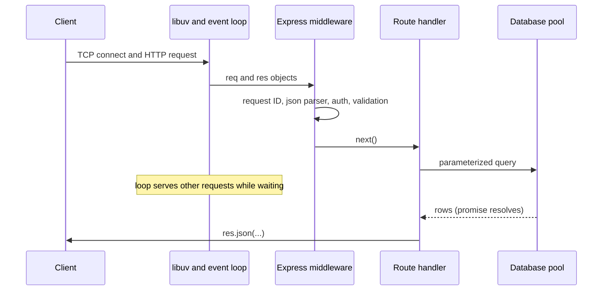
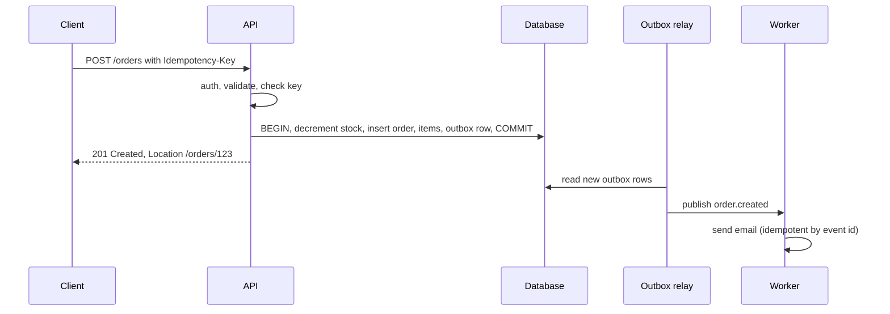
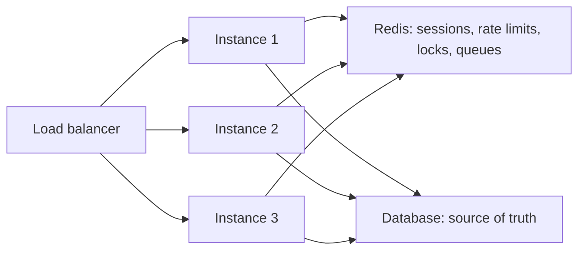
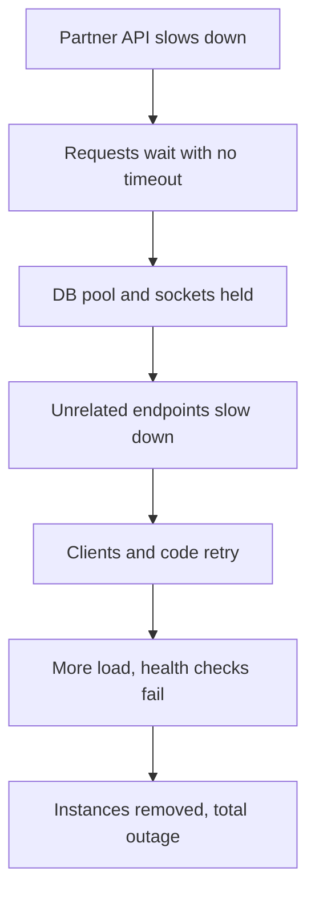
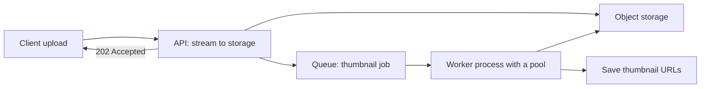
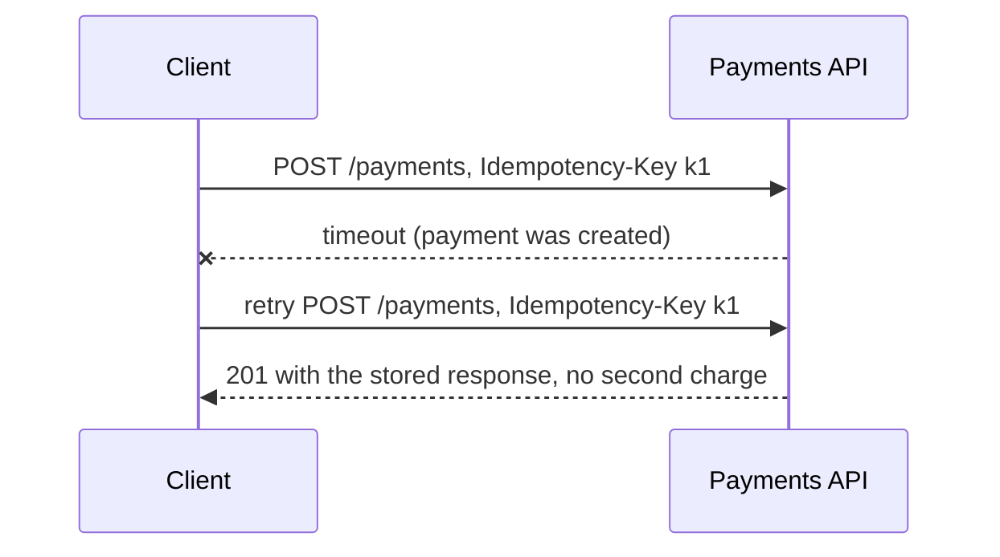

# Node.js Backend — Mixed Interview Questions

> This file is mixed, cross-topic interview practice for the whole Node.js backend subject. Each topic document already has its own interview questions; use this file after you have studied the topics, and again right before an interview.

## Table of contents

1. [All topic questions at a glance](#all-topic-questions-at-a-glance)
2. [Mixed and cross-topic questions](#mixed-and-cross-topic-questions)
3. [Rapid revision round](#rapid-revision-round)
4. [Summary](#summary)

## All topic questions at a glance

Every question from the 14 topic documents, in order. Use this list to find a question quickly, or to check that you can answer each one out loud.

### [Node.js Runtime and Architecture](01-nodejs-runtime-and-architecture.md)

- [Q1. What is Node.js?](01-nodejs-runtime-and-architecture.md#q1-what-is-nodejs)
- [Q2. Is Node.js single-threaded?](01-nodejs-runtime-and-architecture.md#q2-is-nodejs-single-threaded)
- [Q3. What is libuv and what does it do?](01-nodejs-runtime-and-architecture.md#q3-what-is-libuv-and-what-does-it-do)
- [Q4. Which operations use the libuv thread pool?](01-nodejs-runtime-and-architecture.md#q4-which-operations-use-the-libuv-thread-pool)
- [Q5. What is the difference between blocking and non-blocking code? Give an example.](01-nodejs-runtime-and-architecture.md#q5-what-is-the-difference-between-blocking-and-non-blocking-code-give-an-example)
- [Q6. Your Express API suddenly becomes slow for all users when one report endpoint is called. What is happening and how do you fix it?](01-nodejs-runtime-and-architecture.md#q6-your-express-api-suddenly-becomes-slow-for-all-users-when-one-report-endpoint-is-called-what-is-happening-and-how-do-you-fix-it)
- [Q7. When would you not choose Node.js?](01-nodejs-runtime-and-architecture.md#q7-when-would-you-not-choose-nodejs)
- [Q8. What is the difference between Node.js and the browser as JavaScript environments?](01-nodejs-runtime-and-architecture.md#q8-what-is-the-difference-between-nodejs-and-the-browser-as-javascript-environments)
- [Q9. Why is Node.js good for I/O-bound applications?](01-nodejs-runtime-and-architecture.md#q9-why-is-nodejs-good-for-io-bound-applications)
- [Q10. A teammate sets `UV_THREADPOOL_SIZE=64` to make outgoing HTTP calls faster. Will it help?](01-nodejs-runtime-and-architecture.md#q10-a-teammate-sets-uv_threadpool_size64-to-make-outgoing-http-calls-faster-will-it-help)
- [Q11. What is the `process` object? Name some things you use it for.](01-nodejs-runtime-and-architecture.md#q11-what-is-the-process-object-name-some-things-you-use-it-for)
- [Q12. What happens when a promise rejection is not handled in Node.js?](01-nodejs-runtime-and-architecture.md#q12-what-happens-when-a-promise-rejection-is-not-handled-in-nodejs)
- [Q13. What does LTS mean, and which Node.js version would you use for a new project?](01-nodejs-runtime-and-architecture.md#q13-what-does-lts-mean-and-which-nodejs-version-would-you-use-for-a-new-project)
- [Q14. What are worker threads, and how are they different from the libuv thread pool?](01-nodejs-runtime-and-architecture.md#q14-what-are-worker-threads-and-how-are-they-different-from-the-libuv-thread-pool)
- [Q15. What is new in modern Node.js that removes the need for some npm packages?](01-nodejs-runtime-and-architecture.md#q15-what-is-new-in-modern-nodejs-that-removes-the-need-for-some-npm-packages)
- [Q16. How is Node.js different from Deno and Bun?](01-nodejs-runtime-and-architecture.md#q16-how-is-nodejs-different-from-deno-and-bun)
- [Q17. Why does a Node.js process sometimes not exit after your script ends? And why does it sometimes exit too early?](01-nodejs-runtime-and-architecture.md#q17-why-does-a-nodejs-process-sometimes-not-exit-after-your-script-ends-and-why-does-it-sometimes-exit-too-early)

### [The Node.js Event Loop](02-node-event-loop.md)

- [Q1. Explain the Node.js event loop and its phases.](02-node-event-loop.md#q1-explain-the-nodejs-event-loop-and-its-phases)
- [Q2. What does this print?](02-node-event-loop.md#q2-what-does-this-print)
- [Q3. What is the difference between process.nextTick, setImmediate and setTimeout(fn, 0)?](02-node-event-loop.md#q3-what-is-the-difference-between-processnexttick-setimmediate-and-settimeoutfn-0)
- [Q4. What does this print, and is the order guaranteed?](02-node-event-loop.md#q4-what-does-this-print-and-is-the-order-guaranteed)
- [Q5. What does this print?](02-node-event-loop.md#q5-what-does-this-print)
- [Q6. What does this print?](02-node-event-loop.md#q6-what-does-this-print)
- [Q7. What does this print?](02-node-event-loop.md#q7-what-does-this-print)
- [Q8. What does this print in Node.js 22? Would it be different in Node.js 10?](02-node-event-loop.md#q8-what-does-this-print-in-nodejs-22-would-it-be-different-in-nodejs-10)
- [Q9. What does this print?](02-node-event-loop.md#q9-what-does-this-print)
- [Q10. This file prints a different order when it is named `.mjs` instead of `.cjs`. Why?](02-node-event-loop.md#q10-this-file-prints-a-different-order-when-it-is-named-mjs-instead-of-cjs-why)
- [Q11. What does this print?](02-node-event-loop.md#q11-what-does-this-print)
- [Q12. What does this print?](02-node-event-loop.md#q12-what-does-this-print)
- [Q13. What does this print?](02-node-event-loop.md#q13-what-does-this-print)
- [Q14. What does this print?](02-node-event-loop.md#q14-what-does-this-print)
- [Q15. What happens here, and how do you fix it?](02-node-event-loop.md#q15-what-happens-here-and-how-do-you-fix-it)
- [Q16. Your Node.js API's p99 latency jumps from 50 ms to 2 seconds, but the database is fast and CPU is around 100% of one core. How do you investigate?](02-node-event-loop.md#q16-your-nodejs-apis-p99-latency-jumps-from-50-ms-to-2-seconds-but-the-database-is-fast-and-cpu-is-around-100-of-one-core-how-do-you-investigate)
- [Q17. How do you measure event loop lag in production?](02-node-event-loop.md#q17-how-do-you-measure-event-loop-lag-in-production)
- [Q18. How would you process 1 million records in a Node.js server without freezing other requests?](02-node-event-loop.md#q18-how-would-you-process-1-million-records-in-a-nodejs-server-without-freezing-other-requests)
- [Q19. Why does Node.js core emit some errors with process.nextTick instead of throwing or emitting immediately?](02-node-event-loop.md#q19-why-does-nodejs-core-emit-some-errors-with-processnexttick-instead-of-throwing-or-emitting-immediately)
- [Q20. Why does an idle Node.js server not use 100% CPU even though the event loop is "always running"?](02-node-event-loop.md#q20-why-does-an-idle-nodejs-server-not-use-100-cpu-even-though-the-event-loop-is-always-running)
- [Q21. When does a Node.js process exit? What is `unref()`?](02-node-event-loop.md#q21-when-does-a-nodejs-process-exit-what-is-unref)
- [Q22. Compare the browser event loop and the Node.js event loop.](02-node-event-loop.md#q22-compare-the-browser-event-loop-and-the-nodejs-event-loop)
- [Q23. Is `EventEmitter.emit()` synchronous or asynchronous? Where do its listeners run in the event loop?](02-node-event-loop.md#q23-is-eventemitteremit-synchronous-or-asynchronous-where-do-its-listeners-run-in-the-event-loop)

### [Modules, npm and Packages](03-modules-npm-and-packages.md)

- [Q1. What is the difference between CommonJS and ES modules in Node.js?](03-modules-npm-and-packages.md#q1-what-is-the-difference-between-commonjs-and-es-modules-in-nodejs)
- [Q2. How does `require()` resolve a module?](03-modules-npm-and-packages.md#q2-how-does-require-resolve-a-module)
- [Q3. Why does a module behave like a singleton? When does that break?](03-modules-npm-and-packages.md#q3-why-does-a-module-behave-like-a-singleton-when-does-that-break)
- [Q4. What is the difference between `exports` and `module.exports`?](03-modules-npm-and-packages.md#q4-what-is-the-difference-between-exports-and-moduleexports)
- [Q5. Your CommonJS project needs a package that is now ESM-only. What are your options?](03-modules-npm-and-packages.md#q5-your-commonjs-project-needs-a-package-that-is-now-esm-only-what-are-your-options)
- [Q6. What is the `exports` field in package.json and why use it?](03-modules-npm-and-packages.md#q6-what-is-the-exports-field-in-packagejson-and-why-use-it)
- [Q7. dependencies vs devDependencies vs peerDependencies — explain with examples.](03-modules-npm-and-packages.md#q7-dependencies-vs-devdependencies-vs-peerdependencies--explain-with-examples)
- [Q8. Explain `^1.2.3` vs `~1.2.3` vs `1.2.3`. What does `^0.2.3` allow?](03-modules-npm-and-packages.md#q8-explain-123-vs-123-vs-123-what-does-023-allow)
- [Q9. What is package-lock.json and should you commit it?](03-modules-npm-and-packages.md#q9-what-is-package-lockjson-and-should-you-commit-it)
- [Q10. What is the difference between `npm install` and `npm ci`?](03-modules-npm-and-packages.md#q10-what-is-the-difference-between-npm-install-and-npm-ci)
- [Q11. What are phantom dependencies, and how does pnpm prevent them?](03-modules-npm-and-packages.md#q11-what-are-phantom-dependencies-and-how-does-pnpm-prevent-them)
- [Q12. How do you handle a security vulnerability reported in a transitive dependency?](03-modules-npm-and-packages.md#q12-how-do-you-handle-a-security-vulnerability-reported-in-a-transitive-dependency)
- [Q13. What is a supply-chain attack in the npm ecosystem? How do you reduce the risk?](03-modules-npm-and-packages.md#q13-what-is-a-supply-chain-attack-in-the-npm-ecosystem-how-do-you-reduce-the-risk)
- [Q14. What happens with circular dependencies in Node.js?](03-modules-npm-and-packages.md#q14-what-happens-with-circular-dependencies-in-nodejs)
- [Q15. In ESM, how do you get the current file's directory? Why doesn't `__dirname` work?](03-modules-npm-and-packages.md#q15-in-esm-how-do-you-get-the-current-files-directory-why-doesnt-__dirname-work)
- [Q16. What does `npx` do? When would you avoid it?](03-modules-npm-and-packages.md#q16-what-does-npx-do-when-would-you-avoid-it)
- [Q17. What are npm workspaces, and why would you use a monorepo?](03-modules-npm-and-packages.md#q17-what-are-npm-workspaces-and-why-would-you-use-a-monorepo)
- [Q18. You run `npm ci` in Docker and it fails with "package.json and package-lock.json are not in sync". What happened, and what do you do?](03-modules-npm-and-packages.md#q18-you-run-npm-ci-in-docker-and-it-fails-with-packagejson-and-package-lockjson-are-not-in-sync-what-happened-and-what-do-you-do)

### [Core Modules: fs, path, events, Buffer and More](04-core-modules-fs-path-events-buffer.md)

- [Q1. What are the differences between the sync, callback and promise versions of the fs API?](04-core-modules-fs-path-events-buffer.md#q1-what-are-the-differences-between-the-sync-callback-and-promise-versions-of-the-fs-api)
- [Q2. What is the difference between `path.join` and `path.resolve`?](04-core-modules-fs-path-events-buffer.md#q2-what-is-the-difference-between-pathjoin-and-pathresolve)
- [Q3. How do you prevent path traversal when serving user-requested files?](04-core-modules-fs-path-events-buffer.md#q3-how-do-you-prevent-path-traversal-when-serving-user-requested-files)
- [Q4. What happens when an EventEmitter emits an `error` event and there is no listener?](04-core-modules-fs-path-events-buffer.md#q4-what-happens-when-an-eventemitter-emits-an-error-event-and-there-is-no-listener)
- [Q5. Is `EventEmitter.emit()` synchronous? What does this print?](04-core-modules-fs-path-events-buffer.md#q5-is-eventemitteremit-synchronous-what-does-this-print)
- [Q6. What does the "MaxListenersExceededWarning: Possible EventEmitter memory leak detected" warning mean, and how do you fix it?](04-core-modules-fs-path-events-buffer.md#q6-what-does-the-maxlistenersexceededwarning-possible-eventemitter-memory-leak-detected-warning-mean-and-how-do-you-fix-it)
- [Q7. How do you handle errors from async listeners on an EventEmitter?](04-core-modules-fs-path-events-buffer.md#q7-how-do-you-handle-errors-from-async-listeners-on-an-eventemitter)
- [Q8. What is a Buffer, and why does Node.js need it?](04-core-modules-fs-path-events-buffer.md#q8-what-is-a-buffer-and-why-does-nodejs-need-it)
- [Q9. What is the difference between `Buffer.alloc` and `Buffer.allocUnsafe`?](04-core-modules-fs-path-events-buffer.md#q9-what-is-the-difference-between-bufferalloc-and-bufferallocunsafe)
- [Q10. What does this print and why?](04-core-modules-fs-path-events-buffer.md#q10-what-does-this-print-and-why)
- [Q11. Text from a file stream sometimes shows `�` characters at random places. What is wrong?](04-core-modules-fs-path-events-buffer.md#q11-text-from-a-file-stream-sometimes-shows--characters-at-random-places-what-is-wrong)
- [Q12. How do you generate a secure random token, and how do you store passwords?](04-core-modules-fs-path-events-buffer.md#q12-how-do-you-generate-a-secure-random-token-and-how-do-you-store-passwords)
- [Q13. How do you verify a webhook signature? Why not use `===`?](04-core-modules-fs-path-events-buffer.md#q13-how-do-you-verify-a-webhook-signature-why-not-use-)
- [Q14. What is the difference between `exec`, `execFile`, `spawn` and `fork`?](04-core-modules-fs-path-events-buffer.md#q14-what-is-the-difference-between-exec-execfile-spawn-and-fork)
- [Q15. How do you implement graceful shutdown in a Node.js HTTP server?](04-core-modules-fs-path-events-buffer.md#q15-how-do-you-implement-graceful-shutdown-in-a-nodejs-http-server)
- [Q16. How do you add a timeout to an outgoing `fetch` call in Node.js?](04-core-modules-fs-path-events-buffer.md#q16-how-do-you-add-a-timeout-to-an-outgoing-fetch-call-in-nodejs)
- [Q17. Why should you not call `fs.existsSync()` or `fs.access()` before reading a file?](04-core-modules-fs-path-events-buffer.md#q17-why-should-you-not-call-fsexistssync-or-fsaccess-before-reading-a-file)
- [Q18. Write a tiny EventEmitter with `on`, `off` and `emit`.](04-core-modules-fs-path-events-buffer.md#q18-write-a-tiny-eventemitter-with-on-off-and-emit)

### [Streams](05-streams.md)

- [Q1. What are streams in Node.js, and why use them?](05-streams.md#q1-what-are-streams-in-nodejs-and-why-use-them)
- [Q2. What are the four types of streams? Give an example of each.](05-streams.md#q2-what-are-the-four-types-of-streams-give-an-example-of-each)
- [Q3. What is backpressure, and how does Node.js handle it?](05-streams.md#q3-what-is-backpressure-and-how-does-nodejs-handle-it)
- [Q4. What is the difference between `pipe()` and `stream.pipeline()`?](05-streams.md#q4-what-is-the-difference-between-pipe-and-streampipeline)
- [Q5. What is the difference between flowing and paused mode?](05-streams.md#q5-what-is-the-difference-between-flowing-and-paused-mode)
- [Q6. What does this print?](05-streams.md#q6-what-does-this-print)
- [Q7. What does this print, and in what order do the events fire?](05-streams.md#q7-what-does-this-print-and-in-what-order-do-the-events-fire)
- [Q8. Write a Transform stream that converts text to uppercase.](05-streams.md#q8-write-a-transform-stream-that-converts-text-to-uppercase)
- [Q9. How would you import a 5 GB CSV file into a database in Node.js?](05-streams.md#q9-how-would-you-import-a-5-gb-csv-file-into-a-database-in-nodejs)
- [Q10. How do you stream a large file download in Express, and what happens if the client disconnects?](05-streams.md#q10-how-do-you-stream-a-large-file-download-in-express-and-what-happens-if-the-client-disconnects)
- [Q11. How do you safely handle large file uploads?](05-streams.md#q11-how-do-you-safely-handle-large-file-uploads)
- [Q12. What is object mode?](05-streams.md#q12-what-is-object-mode)
- [Q13. Why does text processed with `chunk.toString()` sometimes contain broken characters, and why do some lines get cut in half?](05-streams.md#q13-why-does-text-processed-with-chunktostring-sometimes-contain-broken-characters-and-why-do-some-lines-get-cut-in-half)
- [Q14. A Node.js service that generates CSV exports gets killed with "JavaScript heap out of memory". How do you fix it?](05-streams.md#q14-a-nodejs-service-that-generates-csv-exports-gets-killed-with-javascript-heap-out-of-memory-how-do-you-fix-it)
- [Q15. How do you hash a large file without loading it into memory?](05-streams.md#q15-how-do-you-hash-a-large-file-without-loading-it-into-memory)
- [Q16. What are Web Streams, and how do they relate to Node.js streams?](05-streams.md#q16-what-are-web-streams-and-how-do-they-relate-to-nodejs-streams)
- [Q17. What happens if you never call `end()` on a writable stream, or never call the callback in `_write`/`_transform`?](05-streams.md#q17-what-happens-if-you-never-call-end-on-a-writable-stream-or-never-call-the-callback-in-_write_transform)
- [Q18. When would you not use streams?](05-streams.md#q18-when-would-you-not-use-streams)

### [HTTP Servers and Express](06-http-servers-and-express.md)

- [Q1. What is the difference between Node's `http` module and Express?](06-http-servers-and-express.md#q1-what-is-the-difference-between-nodes-http-module-and-express)
- [Q2. What is middleware in Express, and how does `next` work?](06-http-servers-and-express.md#q2-what-is-middleware-in-express-and-how-does-next-work)
- [Q3. How does Express know a function is an error handler?](06-http-servers-and-express.md#q3-how-does-express-know-a-function-is-an-error-handler)
- [Q4. How do you handle errors in async route handlers in Express 4 and Express 5?](06-http-servers-and-express.md#q4-how-do-you-handle-errors-in-async-route-handlers-in-express-4-and-express-5)
- [Q5. What does this print for `GET /`?](06-http-servers-and-express.md#q5-what-does-this-print-for-get-)
- [Q6. What does this print for `GET /`?](06-http-servers-and-express.md#q6-what-does-this-print-for-get-)
- [Q7. This request sometimes hangs forever. Find the bug.](06-http-servers-and-express.md#q7-this-request-sometimes-hangs-forever-find-the-bug)
- [Q8. Why do we get "Cannot set headers after they are sent to the client"?](06-http-servers-and-express.md#q8-why-do-we-get-cannot-set-headers-after-they-are-sent-to-the-client)
- [Q9. What does `express.json()` do, and what happens if a client sends a 10 MB JSON body?](06-http-servers-and-express.md#q9-what-does-expressjson-do-and-what-happens-if-a-client-sends-a-10-mb-json-body)
- [Q10. How do you structure a large Express application?](06-http-servers-and-express.md#q10-how-do-you-structure-a-large-express-application)
- [Q11. Why separate `app.ts` from `server.ts`?](06-http-servers-and-express.md#q11-why-separate-appts-from-serverts)
- [Q12. How do you add a `user` property to `req` in TypeScript?](06-http-servers-and-express.md#q12-how-do-you-add-a-user-property-to-req-in-typescript)
- [Q13. How do you get the real client IP behind a load balancer?](06-http-servers-and-express.md#q13-how-do-you-get-the-real-client-ip-behind-a-load-balancer)
- [Q14. How do you send a 2 GB file to a client without running out of memory?](06-http-servers-and-express.md#q14-how-do-you-send-a-2-gb-file-to-a-client-without-running-out-of-memory)
- [Q15. Why should you configure server timeouts?](06-http-servers-and-express.md#q15-why-should-you-configure-server-timeouts)
- [Q16. Write a middleware that answers 503 if a request takes longer than N milliseconds.](06-http-servers-and-express.md#q16-write-a-middleware-that-answers-503-if-a-request-takes-longer-than-n-milliseconds)
- [Q17. Review this handler. What would you change?](06-http-servers-and-express.md#q17-review-this-handler-what-would-you-change)
- [Q18. Express, Fastify or NestJS — which would you choose for a new service?](06-http-servers-and-express.md#q18-express-fastify-or-nestjs--which-would-you-choose-for-a-new-service)
- [Q19. How does Koa middleware differ from Express middleware?](06-http-servers-and-express.md#q19-how-does-koa-middleware-differ-from-express-middleware)
- [Q20. How do you upgrade an application from Express 4 to Express 5?](06-http-servers-and-express.md#q20-how-do-you-upgrade-an-application-from-express-4-to-express-5)

### [REST API Design](07-rest-api-design.md)

- [Q1. What is REST, and what makes an API RESTful?](07-rest-api-design.md#q1-what-is-rest-and-what-makes-an-api-restful)
- [Q2. What does "stateless" mean? Does it forbid sessions and databases?](07-rest-api-design.md#q2-what-does-stateless-mean-does-it-forbid-sessions-and-databases)
- [Q3. Which HTTP methods are safe and which are idempotent? Why does it matter?](07-rest-api-design.md#q3-which-http-methods-are-safe-and-which-are-idempotent-why-does-it-matter)
- [Q4. What is the difference between PUT and PATCH?](07-rest-api-design.md#q4-what-is-the-difference-between-put-and-patch)
- [Q5. When should POST create a resource and when should PUT?](07-rest-api-design.md#q5-when-should-post-create-a-resource-and-when-should-put)
- [Q6. What is the difference between 401 and 403?](07-rest-api-design.md#q6-what-is-the-difference-between-401-and-403)
- [Q7. When do you use 400 vs 422, and 409 vs 412?](07-rest-api-design.md#q7-when-do-you-use-400-vs-422-and-409-vs-412)
- [Q8. How do you design error responses for an API?](07-rest-api-design.md#q8-how-do-you-design-error-responses-for-an-api)
- [Q9. Compare offset pagination and cursor pagination.](07-rest-api-design.md#q9-compare-offset-pagination-and-cursor-pagination)
- [Q10. Users report seeing the same item twice while scrolling an infinite list. What is happening?](07-rest-api-design.md#q10-users-report-seeing-the-same-item-twice-while-scrolling-an-infinite-list-what-is-happening)
- [Q11. How do you version an API, and what counts as a breaking change?](07-rest-api-design.md#q11-how-do-you-version-an-api-and-what-counts-as-a-breaking-change)
- [Q12. A mobile client's `POST /payments` timed out. How do you prevent a double charge when it retries?](07-rest-api-design.md#q12-a-mobile-clients-post-payments-timed-out-how-do-you-prevent-a-double-charge-when-it-retries)
- [Q13. Two admins edit the same product at the same time. How do you prevent lost updates?](07-rest-api-design.md#q13-two-admins-edit-the-same-product-at-the-same-time-how-do-you-prevent-lost-updates)
- [Q14. How would you design an endpoint that generates a large report taking several minutes?](07-rest-api-design.md#q14-how-would-you-design-an-endpoint-that-generates-a-large-report-taking-several-minutes)
- [Q15. How do you model an action like "cancel an order" in REST?](07-rest-api-design.md#q15-how-do-you-model-an-action-like-cancel-an-order-in-rest)
- [Q16. Design the URIs for users, their orders, and the items in an order.](07-rest-api-design.md#q16-design-the-uris-for-users-their-orders-and-the-items-in-an-order)
- [Q17. Review this API design.](07-rest-api-design.md#q17-review-this-api-design)
- [Q18. How do you implement sorting and filtering safely?](07-rest-api-design.md#q18-how-do-you-implement-sorting-and-filtering-safely)
- [Q19. What is HATEOAS? Would you use it?](07-rest-api-design.md#q19-what-is-hateoas-would-you-use-it)
- [Q20. What is OpenAPI and how do you use it in a team?](07-rest-api-design.md#q20-what-is-openapi-and-how-do-you-use-it-in-a-team)
- [Q21. REST, GraphQL or gRPC — when would you choose each?](07-rest-api-design.md#q21-rest-graphql-or-grpc--when-would-you-choose-each)
- [Q22. How do you protect a public API from abuse and overload?](07-rest-api-design.md#q22-how-do-you-protect-a-public-api-from-abuse-and-overload)
- [Q23. What is BOLA (IDOR) and how do you prevent it?](07-rest-api-design.md#q23-what-is-bola-idor-and-how-do-you-prevent-it)
- [Q24. Should `DELETE` return 404 when the resource is already gone?](07-rest-api-design.md#q24-should-delete-return-404-when-the-resource-is-already-gone)
- [Q25. How do you design a bulk create endpoint?](07-rest-api-design.md#q25-how-do-you-design-a-bulk-create-endpoint)

### [Validation and Error Handling](08-validation-and-error-handling.md)

- [Q1. Why do you need server-side validation if the Angular form already validates?](08-validation-and-error-handling.md#q1-why-do-you-need-server-side-validation-if-the-angular-form-already-validates)
- [Q2. What is the difference between validation and sanitization?](08-validation-and-error-handling.md#q2-what-is-the-difference-between-validation-and-sanitization)
- [Q3. How do you validate requests in an Express + TypeScript API?](08-validation-and-error-handling.md#q3-how-do-you-validate-requests-in-an-express--typescript-api)
- [Q4. What is mass assignment and how do you prevent it?](08-validation-and-error-handling.md#q4-what-is-mass-assignment-and-how-do-you-prevent-it)
- [Q5. What is the difference between operational errors and programmer errors?](08-validation-and-error-handling.md#q5-what-is-the-difference-between-operational-errors-and-programmer-errors)
- [Q6. Design an error class hierarchy for an API.](08-validation-and-error-handling.md#q6-design-an-error-class-hierarchy-for-an-api)
- [Q7. What happens here, and how do you fix it?](08-validation-and-error-handling.md#q7-what-happens-here-and-how-do-you-fix-it)
- [Q8. What is the default behavior of Node on an unhandled promise rejection, and what should your app do?](08-validation-and-error-handling.md#q8-what-is-the-default-behavior-of-node-on-an-unhandled-promise-rejection-and-what-should-your-app-do)
- [Q9. Why does this crash the process even though there is a try/catch?](08-validation-and-error-handling.md#q9-why-does-this-crash-the-process-even-though-there-is-a-trycatch)
- [Q10. How do you build a central error handler in Express? What must it do?](08-validation-and-error-handling.md#q10-how-do-you-build-a-central-error-handler-in-express-what-must-it-do)
- [Q11. How do you implement graceful shutdown in a Node.js HTTP service?](08-validation-and-error-handling.md#q11-how-do-you-implement-graceful-shutdown-in-a-nodejs-http-service)
- [Q12. Your API becomes unresponsive when a third-party shipping API is slow. Why, and how do you fix it?](08-validation-and-error-handling.md#q12-your-api-becomes-unresponsive-when-a-third-party-shipping-api-is-slow-why-and-how-do-you-fix-it)
- [Q13. When should you retry a failed request, and how?](08-validation-and-error-handling.md#q13-when-should-you-retry-a-failed-request-and-how)
- [Q14. What is wrong with this code?](08-validation-and-error-handling.md#q14-what-is-wrong-with-this-code)
- [Q15. Should you validate data coming from your own database or from internal services?](08-validation-and-error-handling.md#q15-should-you-validate-data-coming-from-your-own-database-or-from-internal-services)
- [Q16. How do you handle errors when calling several services in parallel?](08-validation-and-error-handling.md#q16-how-do-you-handle-errors-when-calling-several-services-in-parallel)
- [Q17. How do you make sure validation errors are useful for the frontend?](08-validation-and-error-handling.md#q17-how-do-you-make-sure-validation-errors-are-useful-for-the-frontend)

### [Authentication and Authorization](09-authentication-and-authorization.md)

- [Q1. What is the difference between authentication and authorization?](09-authentication-and-authorization.md#q1-what-is-the-difference-between-authentication-and-authorization)
- [Q2. How should passwords be stored? Why not SHA-256?](09-authentication-and-authorization.md#q2-how-should-passwords-be-stored-why-not-sha-256)
- [Q3. Explain session-based authentication and its security settings.](09-authentication-and-authorization.md#q3-explain-session-based-authentication-and-its-security-settings)
- [Q4. What is a JWT, and what does its signature guarantee?](09-authentication-and-authorization.md#q4-what-is-a-jwt-and-what-does-its-signature-guarantee)
- [Q5. HS256 vs RS256 — when do you use each?](09-authentication-and-authorization.md#q5-hs256-vs-rs256--when-do-you-use-each)
- [Q6. What are the main security pitfalls of JWTs?](09-authentication-and-authorization.md#q6-what-are-the-main-security-pitfalls-of-jwts)
- [Q7. Sessions or JWTs for a new web application?](09-authentication-and-authorization.md#q7-sessions-or-jwts-for-a-new-web-application)
- [Q8. Explain access tokens, refresh tokens, rotation and reuse detection.](09-authentication-and-authorization.md#q8-explain-access-tokens-refresh-tokens-rotation-and-reuse-detection)
- [Q9. Where should a SPA store tokens: localStorage or cookies?](09-authentication-and-authorization.md#q9-where-should-a-spa-store-tokens-localstorage-or-cookies)
- [Q10. What is CSRF, and how do you prevent it?](09-authentication-and-authorization.md#q10-what-is-csrf-and-how-do-you-prevent-it)
- [Q11. Explain OAuth 2.0 and the Authorization Code flow with PKCE.](09-authentication-and-authorization.md#q11-explain-oauth-20-and-the-authorization-code-flow-with-pkce)
- [Q12. What is the difference between OAuth 2.0 and OpenID Connect? ID token vs access token?](09-authentication-and-authorization.md#q12-what-is-the-difference-between-oauth-20-and-openid-connect-id-token-vs-access-token)
- [Q13. Which OAuth grant would you use for a backend service calling another API at night?](09-authentication-and-authorization.md#q13-which-oauth-grant-would-you-use-for-a-backend-service-calling-another-api-at-night)
- [Q14. How would you implement authentication middleware in Express?](09-authentication-and-authorization.md#q14-how-would-you-implement-authentication-middleware-in-express)
- [Q15. What is BOLA/IDOR, and how do you prevent it?](09-authentication-and-authorization.md#q15-what-is-bolaidor-and-how-do-you-prevent-it)
- [Q16. RBAC vs ABAC — when do you use each?](09-authentication-and-authorization.md#q16-rbac-vs-abac--when-do-you-use-each)
- [Q17. How do you guarantee tenant isolation in a multi-tenant SaaS API?](09-authentication-and-authorization.md#q17-how-do-you-guarantee-tenant-isolation-in-a-multi-tenant-saas-api)
- [Q18. How do you protect a login endpoint against brute force and credential stuffing?](09-authentication-and-authorization.md#q18-how-do-you-protect-a-login-endpoint-against-brute-force-and-credential-stuffing)
- [Q19. Design a secure password reset flow.](09-authentication-and-authorization.md#q19-design-a-secure-password-reset-flow)
- [Q20. How does TOTP-based MFA work? Is it phishing-resistant?](09-authentication-and-authorization.md#q20-how-does-totp-based-mfa-work-is-it-phishing-resistant)
- [Q21. How do you design API keys for a public developer API?](09-authentication-and-authorization.md#q21-how-do-you-design-api-keys-for-a-public-developer-api)
- [Q22. What does Passport.js do, and when would you not use it?](09-authentication-and-authorization.md#q22-what-does-passportjs-do-and-when-would-you-not-use-it)
- [Q23. Review this login code.](09-authentication-and-authorization.md#q23-review-this-login-code)
- [Q24. A user changes their password. What should happen to their existing sessions and tokens?](09-authentication-and-authorization.md#q24-a-user-changes-their-password-what-should-happen-to-their-existing-sessions-and-tokens)
- [Q25. Why do we get 401 errors right after deploying a new auth server, and how do you design key rotation?](09-authentication-and-authorization.md#q25-why-do-we-get-401-errors-right-after-deploying-a-new-auth-server-and-how-do-you-design-key-rotation)

### [Databases for Backend Developers](10-databases.md)

- [Q1. SQL or NoSQL — how do you choose?](10-databases.md#q1-sql-or-nosql--how-do-you-choose)
- [Q2. Explain INNER, LEFT, RIGHT and FULL OUTER joins.](10-databases.md#q2-explain-inner-left-right-and-full-outer-joins)
- [Q3. What does this query return, and why?](10-databases.md#q3-what-does-this-query-return-and-why)
- [Q4. Why did this LEFT JOIN lose customers?](10-databases.md#q4-why-did-this-left-join-lose-customers)
- [Q5. What is normalization? When would you denormalize?](10-databases.md#q5-what-is-normalization-when-would-you-denormalize)
- [Q6. How does a B-tree index work, and why does column order matter in a composite index?](10-databases.md#q6-how-does-a-b-tree-index-work-and-why-does-column-order-matter-in-a-composite-index)
- [Q7. An endpoint listing a customer's orders became slow as data grew. How do you investigate?](10-databases.md#q7-an-endpoint-listing-a-customers-orders-became-slow-as-data-grew-how-do-you-investigate)
- [Q8. What are ACID transactions? Give an example where you need one.](10-databases.md#q8-what-are-acid-transactions-give-an-example-where-you-need-one)
- [Q9. Explain isolation levels and the anomalies they prevent.](10-databases.md#q9-explain-isolation-levels-and-the-anomalies-they-prevent)
- [Q10. Two customers buy the last item at the same time. How do you prevent overselling?](10-databases.md#q10-two-customers-buy-the-last-item-at-the-same-time-how-do-you-prevent-overselling)
- [Q11. Optimistic vs pessimistic locking — when do you use each?](10-databases.md#q11-optimistic-vs-pessimistic-locking--when-do-you-use-each)
- [Q12. What is the N+1 problem and how do you fix it?](10-databases.md#q12-what-is-the-n1-problem-and-how-do-you-fix-it)
- [Q13. Why do we need connection pooling, and how big should the pool be?](10-databases.md#q13-why-do-we-need-connection-pooling-and-how-big-should-the-pool-be)
- [Q14. ORM or raw SQL?](10-databases.md#q14-orm-or-raw-sql)
- [Q15. What is SQL injection, and how do you prevent it?](10-databases.md#q15-what-is-sql-injection-and-how-do-you-prevent-it)
- [Q16. How do you run schema migrations safely with zero downtime?](10-databases.md#q16-how-do-you-run-schema-migrations-safely-with-zero-downtime)
- [Q17. MongoDB: embed or reference?](10-databases.md#q17-mongodb-embed-or-reference)
- [Q18. What is replication lag, and how does it affect users?](10-databases.md#q18-what-is-replication-lag-and-how-does-it-affect-users)
- [Q19. When would you shard a database, and what are the costs?](10-databases.md#q19-when-would-you-shard-a-database-and-what-are-the-costs)
- [Q20. Design the database schema for orders, items and payments.](10-databases.md#q20-design-the-database-schema-for-orders-items-and-payments)
- [Q21. What happens here, and how do you fix it?](10-databases.md#q21-what-happens-here-and-how-do-you-fix-it)
- [Q22. How would you store money and timestamps?](10-databases.md#q22-how-would-you-store-money-and-timestamps)

### [Caching in Node.js](11-caching.md)

- [Q1. What is a cache, and when should you add one to a backend?](11-caching.md#q1-what-is-a-cache-and-when-should-you-add-one-to-a-backend)
- [Q2. Explain cache-aside, read-through, write-through and write-behind.](11-caching.md#q2-explain-cache-aside-read-through-write-through-and-write-behind)
- [Q3. When data changes, should you update the cache or delete the key? In which order?](11-caching.md#q3-when-data-changes-should-you-update-the-cache-or-delete-the-key-in-which-order)
- [Q4. What is a cache stampede, and how do you prevent it?](11-caching.md#q4-what-is-a-cache-stampede-and-how-do-you-prevent-it)
- [Q5. What are cache penetration and cache avalanche? How are they different from a stampede?](11-caching.md#q5-what-are-cache-penetration-and-cache-avalanche-how-are-they-different-from-a-stampede)
- [Q6. Implement an LRU cache with O(1) `get` and `set`.](11-caching.md#q6-implement-an-lru-cache-with-o1-get-and-set)
- [Q7. What does this code print?](11-caching.md#q7-what-does-this-code-print)
- [Q8. What does this code print, and what is the problem?](11-caching.md#q8-what-does-this-code-print-and-what-is-the-problem)
- [Q9. Code review: what is wrong with this caching middleware?](11-caching.md#q9-code-review-what-is-wrong-with-this-caching-middleware)
- [Q10. In-process cache or Redis? When would you use both?](11-caching.md#q10-in-process-cache-or-redis-when-would-you-use-both)
- [Q11. Design a real-time game leaderboard with Redis.](11-caching.md#q11-design-a-real-time-game-leaderboard-with-redis)
- [Q12. How do you implement a distributed lock with Redis, and what are its limits?](11-caching.md#q12-how-do-you-implement-a-distributed-lock-with-redis-and-what-are-its-limits)
- [Q13. You use one Redis for caching and for BullMQ job queues. Which `maxmemory-policy` do you choose?](11-caching.md#q13-you-use-one-redis-for-caching-and-for-bullmq-job-queues-which-maxmemory-policy-do-you-choose)
- [Q14. What is the difference between `Cache-Control: no-cache` and `no-store`? How do ETags and 304 work in Express?](11-caching.md#q14-what-is-the-difference-between-cache-control-no-cache-and-no-store-how-do-etags-and-304-work-in-express)
- [Q15. After you added caching, a user reports seeing another user's data. How do you investigate?](11-caching.md#q15-after-you-added-caching-a-user-reports-seeing-another-users-data-how-do-you-investigate)
- [Q16. The hit ratio of your cache is 20%. What do you check?](11-caching.md#q16-the-hit-ratio-of-your-cache-is-20-what-do-you-check)
- [Q17. How do you choose a TTL? What is the difference between expiration and eviction?](11-caching.md#q17-how-do-you-choose-a-ttl-what-is-the-difference-between-expiration-and-eviction)
- [Q18. Can you get strong consistency with a cache? How do you give users read-your-writes?](11-caching.md#q18-can-you-get-strong-consistency-with-a-cache-how-do-you-give-users-read-your-writes)
- [Q19. Redis is down. What should your API do?](11-caching.md#q19-redis-is-down-what-should-your-api-do)
- [Q20. Design cache keys for a product search endpoint with filters and pagination.](11-caching.md#q20-design-cache-keys-for-a-product-search-endpoint-with-filters-and-pagination)

### [Concurrency in Node.js: Worker Threads, Child Processes and Cluster](12-concurrency-worker-threads-and-cluster.md)

- [Q1. Node.js is single-threaded. How can it handle thousands of concurrent requests?](12-concurrency-worker-threads-and-cluster.md#q1-nodejs-is-single-threaded-how-can-it-handle-thousands-of-concurrent-requests)
- [Q2. An endpoint that generates a PDF makes the whole API slow. What is happening and how do you fix it?](12-concurrency-worker-threads-and-cluster.md#q2-an-endpoint-that-generates-a-pdf-makes-the-whole-api-slow-what-is-happening-and-how-do-you-fix-it)
- [Q3. Does wrapping CPU-heavy code in a Promise or `async` function make it non-blocking?](12-concurrency-worker-threads-and-cluster.md#q3-does-wrapping-cpu-heavy-code-in-a-promise-or-async-function-make-it-non-blocking)
- [Q4. What are worker threads, and how do they differ from child processes and cluster?](12-concurrency-worker-threads-and-cluster.md#q4-what-are-worker-threads-and-how-do-they-differ-from-child-processes-and-cluster)
- [Q5. What can you send to a worker with `postMessage`? What does this print?](12-concurrency-worker-threads-and-cluster.md#q5-what-can-you-send-to-a-worker-with-postmessage-what-does-this-print)
- [Q6. What do `SharedArrayBuffer` and `Atomics` do? What does this print?](12-concurrency-worker-threads-and-cluster.md#q6-what-do-sharedarraybuffer-and-atomics-do-what-does-this-print)
- [Q7. Why should you use a worker pool instead of creating a worker per task? How would you size it?](12-concurrency-worker-threads-and-cluster.md#q7-why-should-you-use-a-worker-pool-instead-of-creating-a-worker-per-task-how-would-you-size-it)
- [Q8. Explain `spawn`, `exec`, `execFile` and `fork`.](12-concurrency-worker-threads-and-cluster.md#q8-explain-spawn-exec-execfile-and-fork)
- [Q9. Code review: find the security bug.](12-concurrency-worker-threads-and-cluster.md#q9-code-review-find-the-security-bug)
- [Q10. How does the cluster module work? What are its limits?](12-concurrency-worker-threads-and-cluster.md#q10-how-does-the-cluster-module-work-what-are-its-limits)
- [Q11. Cluster, PM2 or Kubernetes replicas — how do you choose?](12-concurrency-worker-threads-and-cluster.md#q11-cluster-pm2-or-kubernetes-replicas--how-do-you-choose)
- [Q12. What does this code print? Why is it a bug?](12-concurrency-worker-threads-and-cluster.md#q12-what-does-this-code-print-why-is-it-a-bug)
- [Q13. Two users book the same seat at the same moment and both succeed. How do you fix it?](12-concurrency-worker-threads-and-cluster.md#q13-two-users-book-the-same-seat-at-the-same-moment-and-both-succeed-how-do-you-fix-it)
- [Q14. Implement a function that runs async tasks with a concurrency limit.](12-concurrency-worker-threads-and-cluster.md#q14-implement-a-function-that-runs-async-tasks-with-a-concurrency-limit)
- [Q15. Why is unbounded `Promise.all` over a large array dangerous?](12-concurrency-worker-threads-and-cluster.md#q15-why-is-unbounded-promiseall-over-a-large-array-dangerous)
- [Q16. What is event loop utilization and how is it different from CPU usage?](12-concurrency-worker-threads-and-cluster.md#q16-what-is-event-loop-utilization-and-how-is-it-different-from-cpu-usage)
- [Q17. Your service runs 6 instances, each with an in-memory rate limiter allowing 100 requests per minute per user. What is the problem?](12-concurrency-worker-threads-and-cluster.md#q17-your-service-runs-6-instances-each-with-an-in-memory-rate-limiter-allowing-100-requests-per-minute-per-user-what-is-the-problem)
- [Q18. Senior trade-off: when would you not use Node.js for a service?](12-concurrency-worker-threads-and-cluster.md#q18-senior-trade-off-when-would-you-not-use-nodejs-for-a-service)

### [Background Jobs and Queues](13-background-jobs-and-queues.md)

- [Q1. Why would you use a background job queue instead of doing the work in the request?](13-background-jobs-and-queues.md#q1-why-would-you-use-a-background-job-queue-instead-of-doing-the-work-in-the-request)
- [Q2. How does BullMQ work, and what are its main features?](13-background-jobs-and-queues.md#q2-how-does-bullmq-work-and-what-are-its-main-features)
- [Q3. What is the difference between at-most-once, at-least-once and exactly-once delivery?](13-background-jobs-and-queues.md#q3-what-is-the-difference-between-at-most-once-at-least-once-and-exactly-once-delivery)
- [Q4. How do you make a consumer idempotent? Give a concrete example.](13-background-jobs-and-queues.md#q4-how-do-you-make-a-consumer-idempotent-give-a-concrete-example)
- [Q5. What is the outbox pattern and what problem does it solve?](13-background-jobs-and-queues.md#q5-what-is-the-outbox-pattern-and-what-problem-does-it-solve)
- [Q6. Compare RabbitMQ and Kafka. When would you choose each?](13-background-jobs-and-queues.md#q6-compare-rabbitmq-and-kafka-when-would-you-choose-each)
- [Q7. What does this print?](13-background-jobs-and-queues.md#q7-what-does-this-print)
- [Q8. Your queue has 200,000 waiting jobs and keeps growing. What do you do?](13-background-jobs-and-queues.md#q8-your-queue-has-200000-waiting-jobs-and-keeps-growing-what-do-you-do)
- [Q9. How do you run a job every night at 02:00 when the app runs on 6 instances?](13-background-jobs-and-queues.md#q9-how-do-you-run-a-job-every-night-at-0200-when-the-app-runs-on-6-instances)
- [Q10. How do you verify an incoming webhook?](13-background-jobs-and-queues.md#q10-how-do-you-verify-an-incoming-webhook)
- [Q11. You must send webhooks to customer URLs. What do you build?](13-background-jobs-and-queues.md#q11-you-must-send-webhooks-to-customer-urls-what-do-you-build)
- [Q12. A BullMQ job sometimes runs twice. Why, and how do you fix it?](13-background-jobs-and-queues.md#q12-a-bullmq-job-sometimes-runs-twice-why-and-how-do-you-fix-it)
- [Q13. What is a dead-letter queue and how do you use it?](13-background-jobs-and-queues.md#q13-what-is-a-dead-letter-queue-and-how-do-you-use-it)
- [Q14. Which errors should a job retry, and why use jitter?](13-background-jobs-and-queues.md#q14-which-errors-should-a-job-retry-and-why-use-jitter)
- [Q15. Code review: what is wrong with this consumer?](13-background-jobs-and-queues.md#q15-code-review-what-is-wrong-with-this-consumer)
- [Q16. How do you shut down a worker process without losing jobs?](13-background-jobs-and-queues.md#q16-how-do-you-shut-down-a-worker-process-without-losing-jobs)
- [Q17. Design: users can export 1 million rows to CSV. How do you build it?](13-background-jobs-and-queues.md#q17-design-users-can-export-1-million-rows-to-csv-how-do-you-build-it)

### [Production Node.js](14-production-nodejs.md)

- [Q1. How do you manage configuration and secrets in a Node.js service?](14-production-nodejs.md#q1-how-do-you-manage-configuration-and-secrets-in-a-nodejs-service)
- [Q2. Why structured logging, and how do you attach a request ID to every log line?](14-production-nodejs.md#q2-why-structured-logging-and-how-do-you-attach-a-request-id-to-every-log-line)
- [Q3. What is the difference between liveness and readiness probes? What goes wrong if you mix them up?](14-production-nodejs.md#q3-what-is-the-difference-between-liveness-and-readiness-probes-what-goes-wrong-if-you-mix-them-up)
- [Q4. Walk me through a graceful shutdown.](14-production-nodejs.md#q4-walk-me-through-a-graceful-shutdown)
- [Q5. What does a good Dockerfile for a Node.js service look like?](14-production-nodejs.md#q5-what-does-a-good-dockerfile-for-a-nodejs-service-look-like)
- [Q6. Explain the main rate limiting algorithms. Which would you use for a public API?](14-production-nodejs.md#q6-explain-the-main-rate-limiting-algorithms-which-would-you-use-for-a-public-api)
- [Q7. What does this print? (token bucket)](14-production-nodejs.md#q7-what-does-this-print-token-bucket)
- [Q8. What does this print? (fixed window boundary)](14-production-nodejs.md#q8-what-does-this-print-fixed-window-boundary)
- [Q9. What is prototype pollution? Show how it happens.](14-production-nodejs.md#q9-what-is-prototype-pollution-show-how-it-happens)
- [Q10. What is ReDoS and how do you prevent it in Node.js?](14-production-nodejs.md#q10-what-is-redos-and-how-do-you-prevent-it-in-nodejs)
- [Q11. Your Node.js service's memory keeps growing until it is OOM-killed. How do you investigate?](14-production-nodejs.md#q11-your-nodejs-services-memory-keeps-growing-until-it-is-oom-killed-how-do-you-investigate)
- [Q12. How do you profile a slow Node.js endpoint?](14-production-nodejs.md#q12-how-do-you-profile-a-slow-nodejs-endpoint)
- [Q13. Users see random 502 errors from the load balancer, about 0.1% of requests, especially under low traffic. What could it be?](14-production-nodejs.md#q13-users-see-random-502-errors-from-the-load-balancer-about-01-of-requests-especially-under-low-traffic-what-could-it-be)
- [Q14. How do you deploy a database migration without downtime?](14-production-nodejs.md#q14-how-do-you-deploy-a-database-migration-without-downtime)
- [Q15. Rolling, blue-green or canary — how do you choose?](14-production-nodejs.md#q15-rolling-blue-green-or-canary--how-do-you-choose)
- [Q16. What metrics would you put on a dashboard for a Node.js API?](14-production-nodejs.md#q16-what-metrics-would-you-put-on-a-dashboard-for-a-nodejs-api)
- [Q17. Code review: what is wrong with this production setup?](14-production-nodejs.md#q17-code-review-what-is-wrong-with-this-production-setup)
- [Q18. When would you choose serverless for a Node.js backend, and what are the pitfalls?](14-production-nodejs.md#q18-when-would-you-choose-serverless-for-a-nodejs-backend-and-what-are-the-pitfalls)
## Mixed and cross-topic questions

These questions combine two or more topics, the way real backend interviews do. One scenario can test the event loop, streams, error handling and databases at the same time. Every "what does this print?" answer in this section was run with Node.js 22 to confirm the output.

### Q1. Follow one request through a Node.js and Express API: what happens between the TCP connection and the JSON response?

**What the interviewer is checking:** Whether you can connect the runtime (libuv, event loop), the HTTP layer (streams, parsing), Express (middleware, errors) and the database (pool, async I/O) into one story, instead of knowing each piece alone.

**Short spoken answer (30–60 seconds):**
> The client opens a TCP connection. The operating system accepts it, and libuv tells the event loop in the poll phase. Node's HTTP parser reads the headers and creates `req`, which is a readable stream, and `res`, which is a writable stream. Express then runs the middleware chain in order: request ID, logging, `express.json()` reads and parses the body with a size limit, then auth, then validation. My handler calls a service, which takes a connection from the database pool and sends the query. While the database works, the event loop is free to serve other requests. When the result arrives, the promise resolves as a microtask, my handler continues and calls `res.json()`, which serializes the object and writes it to the socket. If anything throws, Express 5 sends the error to my central error handler. The connection stays open for keep-alive until `keepAliveTimeout`.

**Detailed explanation:**

| Step | What happens | Where it is explained |
| --- | --- | --- |
| 1 | The kernel accepts the TCP connection; libuv reports it in the **poll** phase | [Event loop](02-node-event-loop.md#the-six-phases) |
| 2 | Node's HTTP parser reads headers; `headersTimeout` protects against slow clients | [HTTP servers](06-http-servers-and-express.md#server-timeouts-and-limits) |
| 3 | `req` (Readable) and `res` (Writable) are created | [Streams](05-streams.md#streams-in-http) |
| 4 | Express runs middleware in registration order; each calls `next()` | [Middleware](06-http-servers-and-express.md#middleware) |
| 5 | `express.json()` buffers the body up to its `limit`, then parses it | [HTTP servers](06-http-servers-and-express.md#middleware) |
| 6 | Auth middleware verifies the session or JWT and sets `req.user` | [Auth middleware](09-authentication-and-authorization.md#auth-middleware-in-express) |
| 7 | Validation parses the body into a typed object (Zod or similar) | [Validation](08-validation-and-error-handling.md#a-reusable-validation-middleware-for-express) |
| 8 | The service takes a pooled connection and sends a parameterized query; the loop is free while it waits | [Connection pooling](10-databases.md#connection-pooling) |
| 9 | The query result arrives through the poll phase; the `await` continues as a microtask | [Event loop](02-node-event-loop.md#promise-microtasks-and-the-order-of-the-two-queues) |
| 10 | `res.json()` serializes and writes; errors go to the central error middleware | [Central error handler](08-validation-and-error-handling.md#a-central-error-handling-middleware) |



**Follow-up questions:**
- **Where can this request block other users?** — Only in synchronous JavaScript: a huge `JSON.parse`, a slow regex, a sync crypto call, a big loop. Waiting for the database never blocks the loop.
- **What happens if the client disconnects in the middle?** — `req` emits `'close'` (and `res` is destroyed). The handler keeps running unless you pass an `AbortSignal` to downstream calls and stop the work.
- **Which thread runs the database query?** — No Node.js thread runs it. The network socket is handled by the OS through libuv's poll; only file system, DNS lookup, crypto and zlib work use the thread pool.

**Common mistakes:** Saying "Node creates a thread per request". Saying the database query runs in the libuv thread pool (network I/O does not). Forgetting body limits and timeouts in the story.

**Where this is used in real projects:** Debugging latency ("which step is slow?"), placing middleware in the right order, and explaining your architecture in system design rounds.

Topics: [Runtime](01-nodejs-runtime-and-architecture.md#how-the-pieces-work-together) · [Event loop](02-node-event-loop.md) · [HTTP servers and Express](06-http-servers-and-express.md#the-request-lifecycle) · [Databases](10-databases.md)

---

### Q2. What does this print? (EventEmitter, nextTick, promises and timers together)

```js
const { EventEmitter } = require('node:events');
const fs = require('node:fs');

const orders = new EventEmitter();

orders.on('created', (id) => {
  console.log('A: send email for', id);
  process.nextTick(() => console.log('B: tick for', id));
  Promise.resolve().then(() => console.log('C: promise for', id));
  setImmediate(() => console.log('D: immediate for', id));
});

fs.readFile(__filename, () => {      // runs in the poll phase
  console.log('1: before emit');
  orders.emit('created', 7);
  console.log('2: after emit');
  setTimeout(() => console.log('3: timeout'), 0);
});
```

**What the interviewer is checking:** That you know `emit()` is synchronous, and that you can apply the queue order (nextTick, then promises, then the next phase) inside an I/O callback.

**Answer:**

```text
1: before emit
A: send email for 7
2: after emit
B: tick for 7
C: promise for 7
D: immediate for 7
3: timeout
```

**Step by step:**

1. The `readFile` callback runs in the **poll** phase. It prints `1`.
2. `emit()` calls the listener **synchronously**. The listener prints `A` and schedules a tick, a promise and an immediate.
3. Back in the callback, `2` prints, and a 0 ms timer is scheduled.
4. The callback returns. Node drains the **nextTick** queue (`B`), then the **microtask** queue (`C`).
5. After poll comes the **check** phase: the immediate prints `D`.
6. The loop wraps around to the **timers** phase: `3`.

The order is guaranteed because everything starts inside an I/O callback. (From the main module, `setTimeout(0)` vs `setImmediate` would not be guaranteed.) Verified 8 times with Node.js 22, same output each time.

**Follow-up questions:**
- **How do you make the listener's work truly asynchronous?** — Do the work in `setImmediate` or after an `await`, or put it on a job queue if it is slow (like sending an email).
- **What if the listener throws?** — The error is thrown out of `emit()` into the `readFile` callback, `2` never prints, and with no `try/catch` the process crashes with an uncaught exception.

**Common mistakes:** Thinking `emit()` queues the listener for later. Putting `D` before `B` and `C`.

**Where this is used in real projects:** Domain events inside a service (`order.created` → email, audit log). Knowing that listeners run synchronously tells you that a slow listener slows down the request that emitted the event.

Topics: [EventEmitter](04-core-modules-fs-path-events-buffer.md#eventemitter) · [Event loop phases](02-node-event-loop.md#the-six-phases) · [nextTick](02-node-event-loop.md#processnexttick)

---

### Q3. Production issue: logins take 3 seconds while a large file import is running, but CPU is low. What is going on?

**What the interviewer is checking:** Knowledge of the libuv thread pool, which work shares it, and how to separate "event loop is blocked" from "thread pool is saturated".

**Short spoken answer (30–60 seconds):**
> Low CPU on the main thread tells me the event loop is probably not blocked. My suspect is the libuv thread pool. It has only four threads by default, and it is shared by file system calls, `dns.lookup`, async crypto like `scrypt` and `pbkdf2`, and zlib. The import reads thousands of files, or compresses them, so the four threads are busy and every password hash for login waits in the same queue. I'd confirm it by measuring event loop delay, which stays low, and the time from calling `scrypt` to its callback, which grows. Fixes: limit the import's concurrency, raise `UV_THREADPOOL_SIZE` a bit before startup, move the import to a separate worker process, and keep login hashing on instances that are not doing batch work.

**Detailed explanation:**

- The **event loop** runs your JavaScript. The **thread pool** runs certain blocking C work so the loop does not have to.
- The pool is **one shared queue** for the whole process. `fs.readFile`, `crypto.scrypt`, `zlib.gzip` and `dns.lookup` all wait in the same line.
- An import that starts 500 `fs.readFile` calls at once puts 500 tasks in the queue. A login's `scrypt` call is task 501.
- Event loop delay stays small, because the main thread is free. This is the key clue that separates it from a CPU-blocked loop.

| Symptom | Event loop blocked | Thread pool saturated |
| --- | --- | --- |
| Main-thread CPU | High (near 100% of one core) | Low or normal |
| Event loop delay (p99) | High | Low |
| Which requests are slow | All requests | Only those that use fs, crypto, zlib or `dns.lookup` |
| Typical fix | Move CPU work to workers | Limit concurrency, size the pool, separate workloads |

**Code:**

```js
// ❌ Starts every file read at once: floods the 4-thread pool
await Promise.all(files.map((f) => fs.promises.readFile(f)));

// ✅ Limit concurrency so other pool users (login hashing) still get a turn
const results = [];
for (let i = 0; i < files.length; i += 4) {
  const batch = files.slice(i, i + 4);
  results.push(...(await Promise.all(batch.map((f) => fs.promises.readFile(f)))));
}
```

**Follow-up questions:**
- **Will `UV_THREADPOOL_SIZE=64` fix it?** — It can help, but more threads than CPU cores make CPU-heavy pool work (hashing) slower each, and it must be set before the pool is first used. Fix the concurrency first.
- **Do outgoing HTTP calls use the pool?** — No. Sockets use the OS event mechanism. Only `dns.lookup` (used by default for host names) uses the pool.
- **Would worker threads help?** — Not directly: worker threads share the same libuv thread pool. A separate **process** for the import has its own pool.

**Common mistakes:** Blaming the event loop without measuring. Thinking network calls use the thread pool. Raising the pool size to a huge number.

**Where this is used in real projects:** Services that do password hashing and file processing in the same process; image or PDF services that also serve API traffic.

Topics: [Thread pool](01-nodejs-runtime-and-architecture.md#one-javascript-thread-and-many-helpers) · [Password hashing](09-authentication-and-authorization.md#storing-passwords-safely) · [Limiting concurrency](12-concurrency-worker-threads-and-cluster.md#limiting-concurrency) · [Event loop lag](02-node-event-loop.md#measuring-event-loop-lag)

---

### Q4. What does this print, and what is the bug? (caching a promise)

```js
const cache = new Map();
let calls = 0;

async function loadProduct(id) {
  calls++;
  if (calls === 1) throw new Error('DB timeout');
  return { id, name: 'Lamp' };
}

function getProduct(id) {
  if (!cache.has(id)) cache.set(id, loadProduct(id)); // cache the promise
  return cache.get(id);
}

async function main() {
  for (let i = 1; i <= 3; i++) {
    try {
      const p = await getProduct(42);
      console.log(i, 'ok', p.name);
    } catch (err) {
      console.log(i, 'error', err.message);
    }
  }
  console.log('db calls:', calls);
}
main();
```

**What the interviewer is checking:** Caching promises (request coalescing) is a good idea, but you must handle failure. This tests caching and error handling together.

**Answer:**

```text
1 error DB timeout
2 error DB timeout
3 error DB timeout
db calls: 1
```

**Step by step:**

1. The first call misses the cache, starts `loadProduct` and stores the **promise** in the map.
2. That promise rejects with `DB timeout`. Call 1 prints the error.
3. Calls 2 and 3 find the **same rejected promise** in the map and get the same error. The database is never asked again (`db calls: 1`).
4. One short database hiccup is now cached forever (or until the TTL), and every user sees the error.

**Fix:**

```js
function getProduct(id) {
  if (!cache.has(id)) {
    const promise = loadProduct(id).catch((err) => {
      cache.delete(id);      // ✅ do not keep a failed load
      throw err;
    });
    cache.set(id, promise);
  }
  return cache.get(id);
}
```

With the fix, the output is `1 error DB timeout`, `2 ok Lamp`, `3 ok Lamp`, `db calls: 2` (verified).

**Follow-up questions:**
- **Why cache the promise at all?** — So 100 concurrent requests for the same key share one database query. It is the simplest protection against a cache stampede inside one process.
- **Should you ever cache errors?** — Sometimes, on purpose and briefly: caching "not found" for a few seconds protects against cache penetration. Never cache transient errors like timeouts.
- **What else is missing here?** — A TTL and a size limit (an LRU), or the map grows forever.

**Common mistakes:** Saying it prints `2 ok Lamp`. Forgetting that a rejected promise stays rejected.

**Where this is used in real projects:** In-process caches for configuration, feature flags and product data; DataLoader-style batching in GraphQL.

Topics: [Cache stampede](11-caching.md#when-caches-fail-stampede-penetration-and-avalanche) · [Async error patterns](08-validation-and-error-handling.md#async-error-patterns)

---

### Q5. Design the `POST /orders` endpoint end to end. What does it need to be production-ready?

**What the interviewer is checking:** Whether you can combine REST design, validation, auth, transactions, idempotency, caching and background jobs into one coherent design, and explain the order of the steps.

**Short spoken answer (30–60 seconds):**
> The client sends `POST /orders` with an `Idempotency-Key` header. First, auth middleware checks the user. Then I validate the body with a schema that rejects unknown fields, so a client cannot send a price. In the service I check the idempotency key: if I already processed it, I return the stored response. Then one database transaction: I lock or conditionally update the stock, insert the order and its items with prices from the database, and insert an outbox row for the `order.created` event. After commit, I answer `201 Created` with a `Location` header. A relay publishes the outbox event to a queue, and workers send the email and update search. Finally I invalidate cached data such as product stock. Errors come back as Problem Details with clear codes, for example `409` for out of stock.

**Detailed explanation:**

1. **Auth and authorization:** `req.user` from a session or JWT; the order belongs to `req.user.id`, never to a `customerId` from the body.
2. **Validation:** a strict schema (`items: [{ productId, quantity }]`, quantity range, max items). Prices and totals come from the database, not from the client.
3. **Idempotency:** a unique `(customer_id, idempotency_key)` constraint, so a retry after a timeout cannot create a second order.
4. **Transaction:** `UPDATE products SET stock = stock - $1 WHERE id = $2 AND stock >= $1` (atomic, no overselling), insert order, insert items, insert outbox row. All or nothing.
5. **Response:** `201 Created`, `Location: /orders/123`, the order body.
6. **Side effects after commit:** the outbox relay publishes `order.created`; BullMQ or a broker delivers it to idempotent consumers (email, analytics).
7. **Cache:** delete affected keys (product stock, the customer's order list) after the commit.
8. **Limits:** rate limit per user, body size limit, timeouts on the database.



**Follow-up questions:**
- **Why not send the email inside the request?** — It is slow and can fail; a failure would either fail the order or be lost. The outbox plus a queue makes it reliable and retried.
- **Why not publish to the queue directly after commit?** — If the process crashes between commit and publish, the event is lost. The outbox row is written in the same transaction, so it cannot be lost.
- **Which status for "out of stock"?** — `409 Conflict` (the request conflicts with the current state), with a Problem Details body and a machine-readable code.

**Common mistakes:** Trusting prices from the client. Calling a payment API inside the database transaction. No idempotency, so retries create duplicate orders. Sending emails before the transaction commits.

**Where this is used in real projects:** Every e-commerce, booking or payments backend.

Topics: [REST API design](07-rest-api-design.md#worked-example-an-orders-api) · [Validation](08-validation-and-error-handling.md) · [Transactions](10-databases.md#transactions-and-acid) · [Outbox pattern](13-background-jobs-and-queues.md#the-outbox-pattern) · [Idempotency keys](07-rest-api-design.md#idempotency-keys-for-safe-retries) · [Cache invalidation](11-caching.md#cache-invalidation-strategies)

---

### Q6. What does this print? (pipeline with a failing transform)

```js
const { pipeline, Readable, Transform, Writable } = require('node:stream');

const source = Readable.from(['a', 'b', 'c']);

const upper = new Transform({
  transform(chunk, _enc, done) {
    if (chunk.toString() === 'b') return done(new Error('bad row b'));
    done(null, chunk.toString().toUpperCase());
  },
});

const sink = new Writable({
  write(chunk, _enc, done) {
    console.log('write', chunk.toString());
    done();
  },
});

pipeline(source, upper, sink, (err) => {
  console.log('pipeline done:', err ? err.message : 'ok');
  console.log('destroyed:', source.destroyed, upper.destroyed, sink.destroyed);
});
```

**What the interviewer is checking:** That `pipeline` forwards errors and cleans up every stream — the main reason to prefer it over `pipe()` in a server.

**Answer:**

```text
write A
pipeline done: bad row b
destroyed: true true true
```

**Step by step:**

1. `a` passes through the transform and is written as `A`.
2. `b` makes the transform call `done(err)`. The transform emits `'error'`.
3. `pipeline` sees the error and **destroys all three streams**. `c` is never processed.
4. The final callback runs once, with the error.

With `source.pipe(upper).pipe(sink)` instead, the error would not be forwarded: you would need an `'error'` listener on every stream, and the source would not be destroyed, so a file handle or socket could leak.

**Follow-up questions:**
- **How do you use it with `async/await`?** — `await pipeline(...)` from `node:stream/promises`. It rejects with the same error.
- **In an HTTP download, what if the client disconnects?** — `res` is destroyed, `pipeline` fails with a "premature close" error, and the file stream is destroyed too. That is what you want.
- **Should one bad CSV row stop the whole import?** — Often not. Catch the row error inside the transform, write the bad row to an error report, and continue.

**Common mistakes:** Using `pipe()` without error handling in a server. Expecting `C` to be written.

**Where this is used in real projects:** File downloads and uploads, CSV imports and exports, gzip responses.

Topics: [pipe vs pipeline](05-streams.md#pipe-vs-pipeline) · [Error handling](08-validation-and-error-handling.md#async-error-patterns)

---

### Q7. What does this print, and what is wrong with it? (`forEach` with `async`)

```js
const sleep = (ms) => new Promise((r) => setTimeout(r, ms));
const saved = [];

async function saveOrder(id) {
  await sleep(10 * id);        // pretend this is a database insert
  saved.push(id);
}

async function importOrders(ids) {
  ids.forEach(async (id) => {
    await saveOrder(id);
  });
  console.log('import finished, saved:', saved.length);
}

importOrders([3, 1, 2]).then(() => console.log('promise resolved'));
setTimeout(() => console.log('later, saved:', saved), 100);
```

**What the interviewer is checking:** Understanding that `forEach` ignores the promises its callback returns — a common bug in import scripts and batch jobs.

**Answer:**

```text
import finished, saved: 0
promise resolved
later, saved: [ 1, 2, 3 ]
```

**Step by step:**

1. `forEach` calls the async callback three times. Each call starts `saveOrder` and returns a promise. `forEach` throws those promises away.
2. `importOrders` logs `saved: 0` at once and its own promise resolves: `promise resolved`. The caller believes the import is done.
3. The saves finish later, in order of their delays (10, 20, 30 ms): `[1, 2, 3]`, not the input order.
4. If a save failed, its rejection would be **unhandled** and crash the process (Node.js 15+).

**Fix (choose by need):**

```js
// Sequential, in order (slow but simple, keeps order)
for (const id of ids) await saveOrder(id);

// Parallel, all at once (fast, but unbounded for big arrays)
await Promise.all(ids.map(saveOrder));

// Parallel with a limit (best for large imports): use a small limiter or p-limit
```

**Follow-up questions:**
- **Why is unbounded `Promise.all` dangerous for 50,000 rows?** — It starts every query at once, exhausts the database pool, and causes timeouts and memory spikes.
- **How would you make the import safe to re-run?** — Use upserts or a unique key per row, so a retried import does not create duplicates.

**Common mistakes:** Expecting `saved: 3`. Expecting `[3, 1, 2]`.

**Where this is used in real projects:** Seed scripts, migrations, CSV imports, queue consumers that process a batch.

Topics: [Limiting concurrency](12-concurrency-worker-threads-and-cluster.md#limiting-concurrency) · [Unhandled rejections](08-validation-and-error-handling.md#unhandledrejection-and-uncaughtexception) · [Event loop](02-node-event-loop.md)

---

### Q8. Code review: find the problems in this payment webhook handler.

```ts
app.use(express.json());

app.post("/webhooks/payments", express.raw({ type: "application/json" }), async (req, res) => {
  const signature = req.header("x-signature");
  const expected = createHmac("sha256", SECRET).update(JSON.stringify(req.body)).digest("hex");
  if (signature !== expected) return res.status(401).send("bad signature");

  const event = req.body;
  await pool.query("BEGIN");
  await pool.query("UPDATE orders SET status = 'PAID' WHERE id = $1", [event.orderId]);
  await pool.query("INSERT INTO payments (order_id, amount) VALUES ($1, $2)", [event.orderId, event.amount]);
  await pool.query("COMMIT");

  await sendReceiptEmail(event.orderId); // calls an email provider
  res.sendStatus(200);
});
```

**What the interviewer is checking:** Security, Express middleware order, database transactions and queue design in one snippet.

**Short spoken answer (30–60 seconds):**
> I see five problems. First, `express.json()` runs globally before the route, so the body is already parsed and `express.raw()` does nothing. The HMAC is computed over `JSON.stringify` of the parsed object, not the exact raw bytes, so valid signatures can fail. Second, the comparison uses `!==`, which is not constant-time; use `timingSafeEqual`, and also check a timestamp to stop replays. Third, the transaction uses `pool.query`, so `BEGIN`, the updates and `COMMIT` can run on different connections — it is not a transaction at all. Fourth, there is no idempotency: providers retry webhooks, so the same event can insert two payments. Fifth, the email is sent before answering, so a slow email provider makes the webhook time out and the provider retries. I'd verify, store the event by ID in one real transaction, answer 2xx fast, and send the email from a queue.

**Detailed explanation:**

| Problem | Why it is wrong | Fix |
| --- | --- | --- |
| Global `express.json()` before the route | Body is parsed first; the raw bytes are gone | Mount the webhook route (with `express.raw()`) **before** `express.json()`, or skip JSON parsing for that path |
| HMAC over `JSON.stringify(req.body)` | Key order and spacing can differ from the signed bytes | HMAC over the raw `Buffer` |
| `!==` comparison, no timestamp | Timing leaks; replays of old events are accepted | `timingSafeEqual` on equal-length buffers; reject old timestamps |
| `pool.query("BEGIN")` | Each `pool.query` may use a different connection | `const client = await pool.connect()`, run all statements on `client`, `release()` in `finally` |
| No dedupe | Retried webhooks double-insert | `INSERT INTO processed_events (event_id)` with a unique constraint in the same transaction |
| Email inside the request | Slow provider means timeout and more retries | Enqueue a job, answer `200` quickly |

**Follow-up questions:**
- **What should you return for a duplicate event?** — `200`: it was already processed, so the provider can stop retrying.
- **What should you return when the signature is bad?** — `400` or `401`, and log it without the secret. Do not process the body.
- **Why not trust `event.amount`?** — Trust it only after the signature is verified, and still compare it with the order total in your database.

**Common mistakes:** Finding only the email problem. Not knowing that `pool.query` does not pin a connection.

**Where this is used in real projects:** Stripe, PayPal, GitHub and Shopify webhooks.

Topics: [Webhooks](13-background-jobs-and-queues.md#webhooks) · [Body parsers](06-http-servers-and-express.md#middleware) · [Transactions](10-databases.md#transactions-and-acid) · [HMAC and timingSafeEqual](04-core-modules-fs-path-events-buffer.md#crypto-basics) · [Idempotent consumers](13-background-jobs-and-queues.md#idempotent-consumers)

---

### Q9. Your service runs on one instance. You scale it to six. What breaks?

**What the interviewer is checking:** Whether you know which state lives in process memory, and how each piece must move to shared infrastructure.

**Short spoken answer (30–60 seconds):**
> Everything that lives in one process's memory stops being shared. In-memory sessions break, because the next request may go to another instance — I move them to Redis or use stateless tokens. In-memory rate limiters now allow six times the limit, so I move the counters to Redis. An in-process cache becomes six caches that can disagree, so I invalidate through Redis pub/sub or keep TTLs short. A `setInterval` cron job now runs six times, so I use a BullMQ job scheduler or a lock. WebSocket broadcasts reach only clients on the same instance, so I need a pub/sub adapter. In-process locks no longer protect anything; I use database constraints or a distributed lock. And file uploads saved to local disk are not visible to other instances, so they go to object storage.

**Detailed explanation:**

| In-process state | What breaks with 6 instances | Shared solution |
| --- | --- | --- |
| Sessions in memory | User is "logged out" when routed to another instance | Redis session store, or JWT access tokens |
| Rate limit counters | Effective limit becomes 6× | Redis-backed limiter |
| In-process cache | Stale data differs per instance | Short TTL, pub/sub invalidation, or Redis cache |
| `setInterval` jobs | Job runs 6 times | Job scheduler (BullMQ), or leader election / lock |
| In-memory locks or mutex | Two instances do the same work | DB constraints, row locks, or a Redis lock |
| WebSocket rooms | Messages reach only local clients | Redis pub/sub adapter |
| Local disk uploads | Other instances cannot read the file | Object storage (S3 or similar) |



**Follow-up questions:**
- **Do you need sticky sessions?** — Avoid them if possible; they make scaling and deploys uneven. With shared session storage you do not need them.
- **Is the cluster module the same problem?** — Yes. Cluster workers are separate processes with no shared memory.

**Common mistakes:** Only mentioning sessions. Thinking Kubernetes replicas share memory.

**Where this is used in real projects:** Every move from "one VM" to containers with autoscaling.

Topics: [Cluster limits](12-concurrency-worker-threads-and-cluster.md#the-cluster-module) · [Sessions](09-authentication-and-authorization.md#session-based-authentication) · [Cache levels](11-caching.md#cache-levels-in-a-backend) · [Scheduled jobs](13-background-jobs-and-queues.md#scheduled-jobs) · [Distributed rate limiting](14-production-nodejs.md#rate-limiting)

---

### Q10. Production issue: a partner API becomes slow, and ten minutes later your whole service is down. Explain the chain of events and how you prevent it.

**What the interviewer is checking:** Understanding of cascading failures: timeouts, retries, pools, queues, and load shedding working together.

**Short spoken answer (30–60 seconds):**
> Without timeouts, every request that calls the partner waits. Each waiting request holds memory, a socket and maybe a database connection. Soon the database pool is empty, so even endpoints that never call the partner start to wait. Then our clients time out and retry, and our own code retries too — so traffic doubles exactly when we are weakest. Health checks fail, the load balancer removes instances, and the remaining ones get even more load. To prevent it, I put a short timeout on every outgoing call, inside a total budget for the request. I retry only idempotent calls, with exponential backoff, jitter and a small limit, at one layer only. I add a circuit breaker that fails fast when the partner is down. I keep the database connection out of the slow call, and I move non-urgent partner calls to a queue with rate limits.

**Detailed explanation:**

1. **Timeouts:** `AbortSignal.timeout()` on `fetch`, `statement_timeout` on queries, `connectionTimeoutMillis` on the pool.
2. **Timeout budget:** if the client gives up after 3 seconds, all downstream timeouts together must fit in 3 seconds.
3. **Retries:** only for transient errors and idempotent operations (or with an idempotency key). Exponential backoff with jitter. Retry in **one** layer, not in the client, the gateway and the service at once.
4. **Circuit breaker:** after N failures, fail fast for a while instead of waiting for timeouts.
5. **Bulkheads:** a separate concurrency limit for the partner calls, so they cannot take all sockets or pool connections.
6. **Load shedding:** return `503` quickly when the service is overloaded, instead of queueing forever.
7. **Async path:** if the user does not need the partner's answer right now, put the call on a queue and process it with rate limits and retries.



**Follow-up questions:**
- **Why jitter?** — Without it, all clients retry at the same moment and hit the recovering service together.
- **Should the readiness probe check the partner?** — No. If it did, every instance would leave the load balancer when the partner is slow, turning a partial problem into a full outage.

**Common mistakes:** "Just add retries." Retrying non-idempotent `POST /payments` without an idempotency key.

**Where this is used in real projects:** Payment providers, shipping APIs, email providers, any external dependency.

Topics: [Timeouts](08-validation-and-error-handling.md#timeouts-for-downstream-calls) · [Careful retries](08-validation-and-error-handling.md#careful-retries) · [Retries and backoff in queues](13-background-jobs-and-queues.md#retries-backoff-and-dead-letter-queues) · [Health checks](14-production-nodejs.md#health-checks-liveness-and-readiness)

---

### Q11. What does this print? (AsyncLocalStorage across timers and events)

```js
const { AsyncLocalStorage } = require('node:async_hooks');
const { EventEmitter } = require('node:events');

const als = new AsyncLocalStorage();
const bus = new EventEmitter();

bus.on('audit', () => console.log('audit sees', als.getStore()?.requestId));

function handle(requestId, delay) {
  als.run({ requestId }, async () => {
    await new Promise((r) => setTimeout(r, delay));
    console.log('handler', requestId, 'sees', als.getStore().requestId);
    setImmediate(() => bus.emit('audit'));
  });
}

handle('req-1', 50);
handle('req-2', 10);
bus.emit('audit');
```

**What the interviewer is checking:** How request context (for example a request ID in logs) follows async work, and why a listener sees the context of whoever called `emit()`.

**Answer:**

```text
audit sees undefined
handler req-2 sees req-2
audit sees req-2
handler req-1 sees req-1
audit sees req-1
```

**Step by step:**

1. `handle('req-1', 50)` and `handle('req-2', 10)` start two contexts. Each one waits on a timer.
2. The last line calls `emit()` outside any `run()`. The listener runs synchronously in that empty context: `audit sees undefined`.
3. After 10 ms, req-2's timer fires. The `await` continues **inside req-2's context**, even though many other things ran in between: `handler req-2 sees req-2`.
4. The `setImmediate` callback keeps req-2's context, and `emit()` runs the listener synchronously in it: `audit sees req-2`.
5. At 50 ms, the same happens for req-1.

Verified 10 times with Node.js 22.

**Follow-up questions:**
- **Why use this instead of passing `requestId` to every function?** — Logging libraries (pino with a mixin, OpenTelemetry) can read the context anywhere, so you do not change every function signature.
- **When can the context get lost?** — With some callback-based libraries that use their own pooling or queues, or with code that stores a callback and calls it later from another context. `AsyncResource.bind()` fixes those cases.

**Common mistakes:** Thinking the listener sees the context where it was **registered**. Thinking the context is lost after `await`.

**Where this is used in real projects:** Request IDs in every log line, tenant IDs, tracing.

Topics: [AsyncLocalStorage](14-production-nodejs.md#asynclocalstorage) · [EventEmitter](04-core-modules-fs-path-events-buffer.md#eventemitter) · [Event loop](02-node-event-loop.md)

---

### Q12. Does this process exit? What does it print?

```js
const http = require('node:http');

const server = http.createServer((req, res) => res.end('ok'));
server.listen(0, () => console.log('listening'));

const heartbeat = setInterval(() => console.log('heartbeat'), 1000);
heartbeat.unref();

process.on('beforeExit', () => console.log('beforeExit'));
process.on('exit', (code) => console.log('exit', code));

setTimeout(() => {
  console.log('closing server');
  server.close();
}, 50);
```

**What the interviewer is checking:** What keeps a Node.js process alive (active handles), what `unref()` does, and the order of `beforeExit` and `exit`. This is the basis of graceful shutdown.

**Answer:** Yes, it exits with code 0, after about 50 ms:

```text
listening
closing server
beforeExit
exit 0
```

**Step by step:**

1. The listening server is an **active handle**. It keeps the process alive.
2. The interval is `unref()`'ed, so it does **not** keep the process alive. It never fires, because the process ends before 1 second.
3. At 50 ms the server closes. There are no open connections, so it closes at once.
4. Now nothing is keeping the loop alive. Node emits `beforeExit` (the loop is empty), then `exit` with code 0.

**Follow-up questions:**
- **What if a client had an open keep-alive connection?** — Since Node.js 19, `server.close()` also closes idle keep-alive connections. An active request would keep the server open until it finishes.
- **Can you do async work in the `exit` handler?** — No. Only synchronous code runs there. Use `beforeExit` or your own shutdown function for async cleanup.
- **When is `beforeExit` not emitted?** — When the process ends with `process.exit()` or because of an uncaught exception.

**Common mistakes:** Thinking the interval keeps the process alive. Expecting `heartbeat` to print.

**Where this is used in real projects:** Graceful shutdown, CLI tools that "hang" at the end, and test runners that do not exit because of an open handle.

Topics: [When does the process exit](02-node-event-loop.md#when-does-the-process-exit) · [Timers](04-core-modules-fs-path-events-buffer.md#timers-in-nodejs) · [Graceful shutdown](14-production-nodejs.md#graceful-shutdown)

---

### Q13. Users upload photos and you must create three thumbnail sizes. Worker threads, child process, job queue or a separate service — which do you choose?

**What the interviewer is checking:** Senior trade-off thinking across concurrency, queues and streams: latency, reliability, isolation and operations cost.

**Short spoken answer (30–60 seconds):**
> Image resizing is CPU-heavy, so it must not run on the main thread. The first question is whether the user needs the thumbnails in the same response. Usually not, so I stream the upload to object storage, answer `202` or `201` at once, and put a job on a queue. A separate worker process consumes the jobs, so the API stays fast and retries are automatic. Inside that worker I'd use a library like sharp, which already does its work off the main thread, or a worker thread pool for pure-JavaScript processing. A child process makes sense when the tool is a separate program like ImageMagick or ffmpeg. A separate service in another language is worth it only at large scale or when a team owns it. Worker threads inside the API process are fine for small, fast tasks where the user waits for the result.

**Detailed explanation:**

| Option | Good for | Costs and risks |
| --- | --- | --- |
| Worker threads in the API process | Short CPU work where the user waits (under a second or two) | Shares memory and CPU with the API; a crash or memory spike can hurt API traffic |
| Child process (`execFile`, `spawn`) | Calling an existing program (ffmpeg, ImageMagick) | Process start cost; must pass arguments safely (no shell) |
| Job queue + worker processes | Work the user does not need right now; needs retries | More infrastructure (Redis, monitoring); eventual results |
| Separate service | Large scale, other language, separate team | Network calls, deployment, ownership |



**Follow-up questions:**
- **How does the client get the thumbnails?** — Poll `GET /photos/:id` (status `processing` / `ready`), or receive a WebSocket or push notification when the job completes.
- **What if the worker crashes in the middle of a job?** — BullMQ detects the stalled job when its lock expires and gives it to another worker. The job must be idempotent (overwrite the same output keys).
- **How do you avoid loading a 50 MB upload into memory?** — Stream it straight to storage with a size limit; never buffer the whole file.

**Common mistakes:** Resizing inside the request handler on the main thread. Creating a new worker thread per image instead of a pool.

**Where this is used in real projects:** Media uploads, PDF generation, video transcoding, report exports.

Topics: [Concurrency options](12-concurrency-worker-threads-and-cluster.md#your-options-at-a-glance) · [Background jobs](13-background-jobs-and-queues.md#why-background-jobs) · [Streams in HTTP](05-streams.md#streams-in-http)

---

### Q14. After every deploy you see a few failed requests and some customers get the same email twice. What is wrong, and how do you fix it?

**What the interviewer is checking:** Graceful shutdown for both the HTTP server and the queue worker, and why consumers must be idempotent anyway.

**Short spoken answer (30–60 seconds):**
> The failed requests mean the old pods are killed while they still serve traffic. Either the app does not handle `SIGTERM` — often because `npm start` is PID 1 and does not forward the signal — or it closes before the load balancer stops sending requests. The duplicate emails mean a worker was killed in the middle of a job; the job lock expired, the job was retried, and the email step ran again. I'd fix the shutdown: exec-form `CMD ["node", ...]`, fail readiness first and wait a few seconds, then `server.close()`, then `worker.close()` so BullMQ finishes active jobs, then close Redis and the database pool, all inside the grace period. And because at-least-once delivery means duplicates can always happen, I'd make the email job idempotent: record the event ID in a table with a unique constraint, or pass an idempotency key to the email provider.

**Detailed explanation:**

1. **Signal delivery:** with `npm start` or a shell-form `CMD`, Node.js may never receive `SIGTERM` and is killed after the grace period.
2. **Readiness race:** endpoint removal and `SIGTERM` happen in parallel; wait a few seconds after failing readiness.
3. **HTTP:** `server.close()` stops new connections and waits for in-flight requests.
4. **Workers:** `await worker.close()` stops taking new jobs and waits for the active ones.
5. **Grace period:** all of this must finish within `terminationGracePeriodSeconds` (30 s by default). Long jobs need a longer grace period or must be resumable.
6. **Idempotency:** even with perfect shutdown, a crash or network error can cause a retry. Consumers must handle duplicates.

**Follow-up questions:**
- **Why not just raise the grace period to 10 minutes?** — Deploys become slow, and a stuck process blocks the rollout. Make long jobs resumable or split them into smaller jobs instead.
- **Is "exactly once" possible?** — Not end to end with external side effects. You get "effectively once" with at-least-once delivery plus idempotent consumers.

**Common mistakes:** Only fixing the HTTP server and forgetting the worker. Trying to "fix" duplicates only with shutdown logic.

**Where this is used in real projects:** Every Kubernetes or ECS deployment that runs API and worker pods.

Topics: [Graceful shutdown](14-production-nodejs.md#graceful-shutdown) · [Delivery guarantees](13-background-jobs-and-queues.md#delivery-guarantees-and-idempotent-consumers) · [Docker PID 1](14-production-nodejs.md#docker-for-nodejs)

---

### Q15. You own an Express 4 service written in CommonJS on Node.js 20. Plan the upgrade to a current LTS, Express 5 and ES modules.

**What the interviewer is checking:** Practical knowledge of version facts (Node.js LTS, `require(esm)`, Express 5 breaking changes) and a safe, step-by-step upgrade plan.

**Short spoken answer (30–60 seconds):**
> I'd do it in three separate steps, each deployed on its own, so I always know what broke. Step one: upgrade Node.js. Node 20 is end of life since April 2026, so I move to Node 24 — or 26 once it is LTS — in CI, Docker and `engines`, and fix deprecation warnings. Step two: Express 5. I update route strings, because wildcards must be named like `/*splat` and optional parts use braces; check `req.body` is `undefined` without a parser; and status codes and `res.redirect` signatures are stricter. Async errors now go to the error handler automatically, so the old wrappers become optional. Step three: ESM. I set `"type": "module"`, change `require` to `import`, add file extensions, and replace `__dirname` with `import.meta.dirname`. Because `require(esm)` works in modern Node, I can also migrate file by file. Tests run after every step.

**Detailed explanation:**

| Step | Main changes | Risk check |
| --- | --- | --- |
| Node.js 20 → 24 | Docker base image, CI matrix, `engines`, native addons rebuilt | Run tests; watch deprecation warnings (for example DEP0190 for `spawn` with `shell: true` and an args array) |
| Express 4 → 5 | Route syntax (`/*splat`, `{.:ext}`), `req.query` is a getter, `req.body` undefined without a parser, async errors forwarded | Search routes for `*`, `?`, `(`; run integration tests |
| CommonJS → ESM | `"type": "module"`, imports with extensions, `import.meta.dirname`, JSON imports with `with { type: 'json' }` | Libraries that are CommonJS still work through `import`; ESM with top-level `await` cannot be `require()`d |

**Follow-up questions:**
- **Can a CommonJS file use an ESM-only package?** — Yes: with `await import()` everywhere, or with `require()` since Node.js 22.12 if the package has no top-level `await`.
- **Do you need TypeScript compilation?** — Node.js can strip erasable TypeScript types since 22.18, but it does not type-check and does not support `enum`; most production services still run `tsc` in CI and often build with it.

**Common mistakes:** Doing all three upgrades in one big change. Forgetting the Docker base image.

**Where this is used in real projects:** Every long-lived Node.js service.

Topics: [Releases and LTS](01-nodejs-runtime-and-architecture.md#releases-and-lts-versions) · [Mixing CommonJS and ESM](03-modules-npm-and-packages.md#mixing-commonjs-and-es-modules) · [Express 4 vs 5](06-http-servers-and-express.md#express-basics)

---

### Q16. Your manager says: "This endpoint takes 1.8 seconds. Make it ten times faster." What do you do?

**What the interviewer is checking:** A measure-first approach that crosses databases, caching, the event loop and HTTP.

**Short spoken answer (30–60 seconds):**
> I don't guess; I measure where the 1.8 seconds go. I look at the trace for that endpoint: database time, external calls, and time on the event loop. Most often it is the database: an N+1 pattern or a missing index. I check the queries with `EXPLAIN ANALYZE`, batch the N+1 into one query, and add an index that matches the filter and sort. Then I check if independent calls run one after another when they could run in parallel with `Promise.all`. If the data is read often and changes rarely, I add cache-aside with Redis and invalidate on write. If the time is CPU on the event loop — a huge JSON response, for example — I paginate or return fewer fields. I measure again after each change, and I keep the p99, not just the average.

**Detailed explanation:**

| Where the time goes | Typical fix | Topic |
| --- | --- | --- |
| Many small queries (N+1) | Join or `WHERE id = ANY($1)` batch | [N+1](10-databases.md#the-n1-query-problem) |
| Slow single query | Index matching `WHERE` + `ORDER BY`; check the plan | [Indexes](10-databases.md#indexes) |
| Sequential awaits | `Promise.all` for independent calls | [Event loop](02-node-event-loop.md) |
| Repeated identical reads | Cache-aside with TTL and invalidation | [Caching patterns](11-caching.md#caching-patterns) |
| Huge response | Pagination, field selection, compression at the proxy | [Pagination](07-rest-api-design.md#pagination) |
| CPU on the main thread | Profile with `--cpu-prof`; fix the hot function | [Profiling](14-production-nodejs.md#performance-profiling-memory-and-connections) |
| New TCP+TLS per outgoing call | Keep-alive agent | [Keep-alive](14-production-nodejs.md#performance-profiling-memory-and-connections) |
| Waiting for a pool connection | Right-size the pool; shorten transactions | [Connection pooling](10-databases.md#connection-pooling) |

**Follow-up questions:**
- **Why look at p99?** — The average hides the slow requests users complain about. A cache can make the average great while misses stay slow.
- **When is caching the wrong first step?** — When the query is slow because of a missing index. Caching hides the problem, and every cache miss is still slow.

**Common mistakes:** Adding Redis first. Optimizing JavaScript code when 95% of the time is in the database.

**Where this is used in real projects:** Performance tickets, SLO work, and "the dashboard is slow" incidents.

Topics: [Databases](10-databases.md#reading-query-plans-with-explain) · [Caching](11-caching.md) · [Production performance](14-production-nodejs.md#performance-profiling-memory-and-connections)

---

### Q17. You are asked to do a security review of a Node.js REST API. What do you check, layer by layer?

**What the interviewer is checking:** A structured security view that covers authentication, authorization, input, output, dependencies and runtime — not a random list.

**Short spoken answer (30–60 seconds):**
> I go from the edge inward. At the edge: HTTPS only, correct `trust proxy`, rate limits, body size limits and server timeouts. Authentication: passwords hashed with Argon2id or scrypt, sessions in HttpOnly Secure SameSite cookies or short-lived JWTs verified with an algorithm allowlist, refresh tokens rotated. Authorization: object-level checks on every request, because BOLA is the top API risk, and field-level rules against mass assignment. Input: strict schemas with unknown keys rejected, parameterized SQL, no `exec` with user input, safe file paths, and no dangerous deep merges that allow prototype pollution. Output: no stack traces, no internal fields, correct CORS and security headers. Then the supply chain: lockfile, `npm ci`, audit in CI. And runtime: non-root container, secrets from a secret manager, logs without tokens.

**Detailed explanation:**

| Layer | What to check | Topic |
| --- | --- | --- |
| Edge | TLS, HSTS, `trust proxy`, rate limits, body limits, timeouts | [Security hardening](14-production-nodejs.md#security-hardening) |
| Authentication | Password hashing, session cookie flags, JWT verification, refresh rotation, login rate limits | [Auth](09-authentication-and-authorization.md) |
| Authorization | Object-level (BOLA), function-level (admin routes), field-level (mass assignment), tenant isolation | [Authorization models](09-authentication-and-authorization.md#authorization-models) |
| Input | Schemas, SQL parameters, command injection, path traversal, ReDoS, prototype pollution | [Validation](08-validation-and-error-handling.md) |
| Output | Error format without internals, response DTOs, CORS allowlist, helmet headers | [Error format](07-rest-api-design.md#error-format-with-rfc-9457-problem-details) |
| Dependencies | Lockfile, `npm ci`, `npm audit`, Renovate or Dependabot, few install scripts | [Supply chain](03-modules-npm-and-packages.md#supply-chain-risks) |
| Runtime | Non-root user, secrets management, log redaction, least-privilege DB user | [Docker](14-production-nodejs.md#docker-for-nodejs) |

**Follow-up questions:**
- **Which single bug do you see most in real APIs?** — Missing object-level authorization: the code checks "is logged in" but not "does this order belong to this user".
- **Does CORS protect the API?** — No. CORS only controls which browser pages can read responses. Any script or server can still call the API.

**Common mistakes:** Only talking about XSS and SQL injection. Treating CORS as access control.

**Where this is used in real projects:** Pre-release reviews, penetration test preparation, and code review of new endpoints.

Topics: [REST security basics](07-rest-api-design.md#security-basics-for-rest-apis) · [Auth](09-authentication-and-authorization.md) · [Production security](14-production-nodejs.md#security-hardening)

---

### Q18. You use Redis for sessions, caching, rate limiting and BullMQ. Redis goes down for five minutes. What happens to each feature, and what should happen?

**What the interviewer is checking:** Failure-mode design: which features may fail open, which must fail closed, and how one shared dependency affects many features.

**Short spoken answer (30–60 seconds):**
> Each use needs its own decision. The cache should fail open: catch the error with a short timeout and go to the database, maybe with a concurrency limit so the database is not flooded. Sessions in Redis mean nobody can be authenticated — that is fail closed, users see errors or must log in again. If that is not acceptable, I can use short-lived JWT access tokens, which are verified without Redis. For rate limiting, the general API limiter can fail open, but login and password reset should fail closed or fall back to a strict in-memory limit. BullMQ producers cannot enqueue, so I either return an error, retry with a timeout, or write the job to an outbox table and enqueue later. Workers pause and continue when Redis is back. Long term, I'd separate the cache Redis from the queue and session Redis, because they need different eviction and persistence settings.

**Detailed explanation:**

| Feature | Behavior when Redis is down | Recommended handling |
| --- | --- | --- |
| Cache | Every lookup fails | Fail open to the database with short timeouts and a limit |
| Sessions | Users cannot be authenticated | Accept the outage, or use stateless access tokens for reads |
| Rate limiting | Counters unavailable | Fail open for general limits; strict fallback for login and reset |
| BullMQ producers | `add()` fails | Outbox table, or return `503` with `Retry-After` |
| BullMQ workers | Stop getting jobs | Reconnect automatically; jobs continue after recovery |

**Follow-up questions:**
- **Why separate Redis instances?** — A cache wants `allkeys-lru` eviction and no persistence. Queues and sessions need `noeviction` and persistence (AOF). One instance cannot have both settings.
- **How do you avoid a "thundering herd" when Redis comes back?** — Warm the hottest keys, use request coalescing and TTL jitter.

**Common mistakes:** "Everything fails open." Using one Redis with `allkeys-lru` for BullMQ (jobs get evicted).

**Where this is used in real projects:** Incident reviews and architecture reviews of any service that shares Redis across features.

Topics: [Redis basics](11-caching.md#redis-basics-for-nodejs-developers) · [Sessions](09-authentication-and-authorization.md#session-based-authentication) · [Rate limiting](14-production-nodejs.md#rate-limiting) · [BullMQ](13-background-jobs-and-queues.md#job-queues-with-bullmq-and-redis)

---

### Q19. Code review: this service's memory grows until it is OOM-killed. Find the leaks.

```js
const { EventEmitter } = require('node:events');
const priceUpdates = new EventEmitter();
const userCache = {};                        // 1

app.get('/prices/stream', (req, res) => {
  res.setHeader('Content-Type', 'text/event-stream');
  const send = (p) => res.write(`data: ${JSON.stringify(p)}\n\n`);
  priceUpdates.on('update', send);           // 2
});

app.get('/users/:id', async (req, res) => {
  if (!userCache[req.params.id]) {
    userCache[req.params.id] = await userRepo.findById(req.params.id);
  }
  res.json(userCache[req.params.id]);
});

app.post('/reports', async (req, res) => {
  const rows = await db.query('SELECT * FROM orders');          // 3
  res.json(buildReport(rows.rows));
});
```

**What the interviewer is checking:** Recognizing the three most common Node.js memory problems: listener leaks, unbounded caches and loading too much data at once.

**Short spoken answer (30–60 seconds):**
> There are three problems. First, the server-sent events route adds a listener for every client but never removes it. When a client disconnects, the listener and its closure — including `res` — stay in memory forever, and Node prints a MaxListenersExceededWarning. I'd remove the listener on `req.on('close')`. Second, `userCache` is a plain object with no size limit and no TTL, and any ID creates a key, even IDs that do not exist. It grows forever and serves stale data. I'd use an LRU with a max size and TTL, or Redis. Third, the report loads every order into memory, then builds a second big structure. That is a memory spike that grows with the data. I'd stream rows with a cursor or move the report to a background job that writes to a file.

**Detailed explanation:**

```js
// ✅ 2: remove the listener when the client goes away
app.get('/prices/stream', (req, res) => {
  res.setHeader('Content-Type', 'text/event-stream');
  const send = (p) => res.write(`data: ${JSON.stringify(p)}\n\n`);
  priceUpdates.on('update', send);
  req.on('close', () => priceUpdates.off('update', send));
});

// ✅ 1: bounded cache with TTL (npm "lru-cache")
const userCache = new LRUCache({ max: 10_000, ttl: 60_000 });
```

How to confirm in production: watch `heapUsed` over time, take two heap snapshots a few minutes apart, and compare which object types grow (here: closures, `ServerResponse` objects, and one huge object).

**Follow-up questions:**
- **Is setting `setMaxListeners(0)` a fix?** — No. It only hides the warning; the leak continues.
- **Why does the report problem look like a leak?** — Memory jumps and the GC cannot free it while the request runs. With several concurrent reports, the process goes over its limit.

**Common mistakes:** Only finding the cache. "Fixing" with a bigger `--max-old-space-size`.

**Where this is used in real projects:** SSE and WebSocket endpoints, in-memory caches, admin export endpoints.

Topics: [EventEmitter](04-core-modules-fs-path-events-buffer.md#eventemitter) · [LRU cache](11-caching.md#eviction-policies-and-an-lru-cache) · [Streams](05-streams.md#real-world-examples) · [Memory leaks](14-production-nodejs.md#performance-profiling-memory-and-connections)

---

### Q20. Your API runs behind an AWS load balancer and calls a database and two other services. Which timeouts do you set, and to what values?

**What the interviewer is checking:** Knowledge of server-side timeouts, client-side timeouts and their relationship with the load balancer and the client's own timeout.

**Short spoken answer (30–60 seconds):**
> I start from the outside. The frontend gives up after, say, 10 seconds, so my whole request budget must be less than that. Node's server timeouts protect against slow clients: `headersTimeout` and `requestTimeout` lower than the defaults for a JSON API, for example 10 and 30 seconds. `keepAliveTimeout` must be higher than the load balancer's idle timeout — 65 seconds when the ALB uses 60 — otherwise Node closes idle connections just as the balancer reuses them, and users see random 502s. Inside the request, every call gets its own timeout that fits the budget: maybe 1 second for the database with `statement_timeout`, 2 seconds for each service with `AbortSignal.timeout`, and a pool `connectionTimeoutMillis` so I do not wait forever for a connection. Finally, the shutdown timer is shorter than Kubernetes' 30-second grace period.

**Detailed explanation:**

| Timeout | Typical value | Why |
| --- | --- | --- |
| Frontend request timeout | 10 s | What users accept |
| Node `requestTimeout` | 30 s (default 300 s) | Stop slow request bodies |
| Node `headersTimeout` | 10 s (default 60 s) | Slowloris protection |
| Node `keepAliveTimeout` | 65 s (default 5 s) | Above the ALB idle timeout (60 s by default) |
| DB `statement_timeout` | 1–5 s | Cancel runaway queries |
| Pool `connectionTimeoutMillis` | 1–2 s (default 0 = wait forever) | Fail fast when the pool is exhausted |
| `fetch` to other services | 1–3 s each, within the budget | One slow service must not hold the request |
| Shutdown force timer | Below 30 s | Finish before Kubernetes sends `SIGKILL` |

**Follow-up questions:**
- **Does `requestTimeout` stop a slow handler?** — No. It only limits receiving the request. Slow work in the handler needs its own timeouts.
- **What happens to the work when a client timeout fires?** — The client gives up, but your server may still be working. Pass an `AbortSignal` through to downstream calls so the work stops too.

**Common mistakes:** Leaving `fetch` without a timeout. Setting `keepAliveTimeout` lower than the load balancer's.

**Where this is used in real projects:** Every service behind ALB, Nginx or an API gateway.

Topics: [Server timeouts](06-http-servers-and-express.md#server-timeouts-and-limits) · [Downstream timeouts and budget](08-validation-and-error-handling.md#timeouts-for-downstream-calls) · [Timeouts in production](14-production-nodejs.md#security-hardening)

---

### Q21. For a public payments API, how do rate limiting, idempotency keys and client retries work together?

**What the interviewer is checking:** Senior-level understanding that these three mechanisms solve different problems and must be designed together.

**Short spoken answer (30–60 seconds):**
> They protect different things. Rate limiting protects my service from too much traffic: when a client is over its limit I answer `429` with `Retry-After`. Retries protect the client from temporary failures: timeouts, `503`, `429`. Idempotency keys make those retries safe: the client sends the same `Idempotency-Key` for the same logical payment, and I return the stored result instead of charging twice. So the contract is: clients retry only with backoff and jitter, respect `Retry-After`, and always reuse the same key for a retry. On my side, the key is stored with the request hash and the response, so a retry with the same key but a different body is rejected with `422`, and a retry while the first request is still running gets `409`. Rate limiting counts retries too, so a broken client cannot retry in a tight loop.

**Detailed explanation:**

| Mechanism | Protects | Server side | Client side |
| --- | --- | --- | --- |
| Rate limiting | The server | Token bucket per API key in Redis; `429` + `Retry-After` + `RateLimit` headers | Slow down; respect `Retry-After` |
| Retries | The client | Clear status codes: what is retryable (`429`, `503`, timeouts) and what is not (`400`, `422`) | Exponential backoff with jitter and a cap |
| Idempotency keys | Data correctness | Store key + request hash + response; return the same response on retry | New key per logical operation; same key on retry |



**Follow-up questions:**
- **How long do you keep idempotency keys?** — Long enough to cover all client retries, often 24 hours, then delete them.
- **Should a `429` response count toward the limit?** — Usually yes, so a client that ignores `429` keeps getting blocked.

**Common mistakes:** Thinking rate limiting prevents duplicates. Generating a new idempotency key for each retry.

**Where this is used in real projects:** Stripe-style payment APIs, order APIs, any public API with mobile clients on bad networks.

Topics: [Idempotency keys](07-rest-api-design.md#idempotency-keys-for-safe-retries) · [Rate limiting headers](07-rest-api-design.md#rate-limiting-headers) · [Rate limiting algorithms](14-production-nodejs.md#rate-limiting) · [Careful retries](08-validation-and-error-handling.md#careful-retries)

---

### Q22. Error rates jump at 14:05. How do you use logs, metrics and traces to find the cause across the API and the queue workers?

**What the interviewer is checking:** Practical observability: how request IDs, structured logs, RED metrics and distributed tracing connect.

**Short spoken answer (30–60 seconds):**
> I start with metrics, because they show the shape of the problem: which endpoints, which status codes, since when. I compare with deploys and with dependency metrics — database latency, Redis, external APIs — and with event loop delay. Then I open traces for a few failing requests. A trace shows which span is slow or failing, for example a database query or a call to a partner. From the trace I get the trace or request ID, and I search the structured logs for that ID to see the exact error and context. If a request created a job, the job carries the same correlation ID, so I can follow it into the worker logs. If the cause is a deploy, I roll back first and investigate after.

**Detailed explanation:**

1. **Metrics (what and when):** request rate, error rate, duration (RED) per route pattern; event loop delay; pool usage; queue depth.
2. **Traces (where):** OpenTelemetry spans for HTTP, database, Redis and outgoing calls; the slow or failing span points to the cause.
3. **Logs (why):** JSON logs with `requestId`/`traceId`, error code, stack trace; searched by ID.
4. **Correlation across async boundaries:** put the correlation ID into job data and message headers; restore it in the worker with `AsyncLocalStorage`.
5. **Mitigate first:** rollback, feature flag off, scale out, or shed load — then find the root cause.

**Follow-up questions:**
- **Why use route patterns, not raw URLs, as metric labels?** — `/orders/123` creates a new time series per ID and can overload the metrics system. Use `/orders/:id`.
- **What should never be in logs?** — Passwords, tokens, full card numbers, and usually full request bodies. Use the logger's redaction feature.

**Common mistakes:** Starting by reading random log lines. Logs without request IDs.

**Where this is used in real projects:** On-call incidents and postmortems.

Topics: [Structured logging](14-production-nodejs.md#structured-logging) · [Observability](14-production-nodejs.md#observability-metrics-and-tracing) · [Background jobs](13-background-jobs-and-queues.md)

---

### Q23. A partner API allows 100 requests per second. Six instances of your service call it. How do you stay under the limit?

**What the interviewer is checking:** The difference between limiting incoming traffic and limiting outgoing traffic, and how to coordinate across instances.

**Short spoken answer (30–60 seconds):**
> An in-process limiter on each instance does not work well: six instances with 100 per second each send up to 600. One option is to divide the limit, about 16 per second per instance, but autoscaling breaks that. A better option is to send all calls to the partner through a queue. BullMQ has a rate limiter on the queue, for example 100 jobs per second, shared by all workers through Redis. Workers process the jobs, and when the partner still returns `429`, I read `Retry-After` and delay the job. For calls where the user waits for the answer, I use a shared token bucket in Redis, with a short wait and a clear error when no token is available. I also cache partner responses when possible, because the cheapest call is the one you do not make.

**Detailed explanation:**

| Approach | Works across instances? | Notes |
| --- | --- | --- |
| In-process limiter (p-limit, token bucket in memory) | No | Limit multiplies with instance count |
| Fixed share per instance | Partly | Breaks with autoscaling |
| Queue with a global rate limit (BullMQ `limiter`) | Yes | Best for background calls; adds latency |
| Shared token bucket in Redis | Yes | For synchronous calls; needs atomic Lua script |
| Caching partner responses | Yes | Reduces calls; watch freshness |

**Follow-up questions:**
- **What is the difference between concurrency limiting and rate limiting?** — Concurrency limits how many calls run at the same time; rate limits how many start per time window. Partners often have both.
- **What do you do when the partner returns `429` anyway?** — Respect `Retry-After`, back off with jitter, and alert if it happens often.

**Common mistakes:** Using the incoming-request rate limiter (`express-rate-limit`) for outgoing calls.

**Where this is used in real projects:** Payment, shipping, SMS and email providers; social media APIs.

Topics: [Limiting concurrency](12-concurrency-worker-threads-and-cluster.md#limiting-concurrency) · [BullMQ](13-background-jobs-and-queues.md#job-queues-with-bullmq-and-redis) · [Token bucket](14-production-nodejs.md#rate-limiting)

---

### Q24. You run 20 pods, each with a `pg` pool of 20 connections. PostgreSQL allows 100 connections. What happens, and how do you size pools?

**What the interviewer is checking:** Connection math across processes, pool behavior, and the relationship between pools, cluster workers and autoscaling.

**Short spoken answer (30–60 seconds):**
> 20 pods times 20 connections is 400 possible connections, but PostgreSQL allows 100. Under load, pools try to open more connections and get "too many clients" errors, and the database also spends memory on each connection. The rule is: total connections from all processes must stay below the database limit, with room for migrations and admin tools. Here, 20 pods could use about 4 connections each. That sounds small, but a Node.js process needs few connections, because a query holds a connection only for milliseconds — unless transactions are long. If I need more pods, I put a connection pooler like PgBouncer in front of PostgreSQL. And I remember that each cluster worker or PM2 instance has its own pool too, so the math is per process, not per pod.

**Detailed explanation:**

- **Formula:** `processes × pool max ≤ database max_connections − reserve`.
- **Processes**, not pods: 20 pods × 4 cluster workers = 80 pools.
- **Autoscaling:** compute with the **maximum** pod count.
- **Pool timeouts:** set `connectionTimeoutMillis`, so a request fails fast instead of waiting forever when the pool is empty.
- **Hold connections briefly:** no external HTTP calls inside a transaction; release the client in `finally`.

**Follow-up questions:**
- **How do you know the pool is the bottleneck?** — Metrics for pool waiting count and wait time; requests that are slow while database CPU is low.
- **Does a bigger pool make queries faster?** — No. Beyond a point, more connections make the database slower because of contention. Fewer, busy connections are better.

**Common mistakes:** Sizing the pool per pod without counting pods. Creating a new pool per request.

**Where this is used in real projects:** Every containerized service that uses PostgreSQL or MySQL.

Topics: [Connection pooling](10-databases.md#connection-pooling) · [Cluster](12-concurrency-worker-threads-and-cluster.md#the-cluster-module) · [Production connections](14-production-nodejs.md#performance-profiling-memory-and-connections)

---

### Q25. A teammate wants to store the refresh token in `localStorage`, cache `GET /me` in a CDN for speed, and return full error stack traces "to help the frontend". Respond to each idea.

**What the interviewer is checking:** Whether you can explain security trade-offs clearly and kindly in a code review, connecting auth, caching and error handling.

**Short spoken answer (30–60 seconds):**
> All three ideas have good intentions but create security problems. A refresh token in `localStorage` can be read by any script that gets onto the page through XSS, and it lives for weeks. I'd keep the access token in memory and the refresh token in an HttpOnly, Secure, SameSite cookie scoped to the refresh endpoint, with rotation and reuse detection. Caching `GET /me` in a shared CDN is dangerous: one user's profile could be served to another user. Personal responses must be `Cache-Control: private` or `no-store`, and if we need speed we can cache inside the service with a user-specific key. Stack traces in production responses leak file paths, library versions and sometimes data. The frontend needs a stable error code, a message and a request ID; the stack trace stays in our logs, where the request ID finds it.

**Detailed explanation:**

| Idea | Risk | Better approach |
| --- | --- | --- |
| Refresh token in `localStorage` | XSS steals a long-lived token | HttpOnly cookie + rotation, or a BFF that keeps tokens server-side |
| CDN caching `GET /me` | Cross-user data leak | `private`/`no-store`; per-user server cache; `Vary` is not enough for shared caches with auth |
| Stack traces in responses | Information disclosure | Problem Details with `code` and `requestId`; stack only in logs |

**Follow-up questions:**
- **If the cookie is HttpOnly, is CSRF now a problem?** — Yes, cookies are sent automatically. Use `SameSite`, a CSRF token or Origin checks for state-changing requests.
- **How do you help frontend developers debug without stack traces?** — Include the request ID in every error response and give them access to search logs by it.

**Common mistakes:** Agreeing because "we use HTTPS". Thinking `Authorization` headers make CDN caching safe by themselves.

**Where this is used in real projects:** Code reviews and architecture discussions between frontend and backend teams.

Topics: [Where to keep tokens](09-authentication-and-authorization.md#where-to-keep-tokens-in-the-browser-and-csrf) · [HTTP caching from Express](11-caching.md#http-caching-from-express) · [Central error handler](08-validation-and-error-handling.md#a-central-error-handling-middleware)

---

## Rapid revision round

Short questions with short answers. Read them out loud the day before the interview. Each one links to the document that explains it.

### R1. What are the main parts of Node.js?
V8 runs JavaScript, libuv gives the event loop and the thread pool, C++ bindings connect them, and the core library (`fs`, `http`, `crypto`...) is the JavaScript API on top. [Runtime](01-nodejs-runtime-and-architecture.md#the-building-blocks)

### R2. Is Node.js single-threaded?
Your JavaScript runs on one main thread. Node.js itself also uses the libuv thread pool, V8 helper threads, and optional worker threads. [Runtime](01-nodejs-runtime-and-architecture.md#one-javascript-thread-and-many-helpers)

### R3. Which work uses the libuv thread pool?
File system calls, `dns.lookup`, async crypto (`scrypt`, `pbkdf2`, `randomBytes`) and zlib. Network sockets do not. The default size is 4 threads. [Runtime](01-nodejs-runtime-and-architecture.md#one-javascript-thread-and-many-helpers)

### R4. Name the event loop phases in order.
Timers, pending callbacks, idle/prepare, poll, check, close callbacks. [Event loop](02-node-event-loop.md#the-six-phases)

### R5. When does the nextTick queue run?
After the current operation finishes and before promise microtasks (in CommonJS), between every callback. Recursive `nextTick` can starve I/O. [Event loop](02-node-event-loop.md#processnexttick)

### R6. Is `setTimeout(fn, 0)` vs `setImmediate` order guaranteed?
Not in the main module. Inside an I/O callback, `setImmediate` always runs first because the check phase comes right after poll. [Event loop](02-node-event-loop.md#settimeout-vs-setimmediate)

### R7. How do you measure event loop lag?
`monitorEventLoopDelay()` from `node:perf_hooks` gives a histogram (p99, max); `performance.eventLoopUtilization()` gives how busy the loop is. [Event loop](02-node-event-loop.md#measuring-event-loop-lag)

### R8. Which Node.js versions are LTS in late October 2026?
Node.js 22 and 24 are in Maintenance LTS; Node.js 26 becomes Active LTS on 28 October 2026. Node.js 20 reached end of life in April 2026. [Releases](01-nodejs-runtime-and-architecture.md#releases-and-lts-versions)

### R9. What changes from Node.js 27?
One major release per year, and every release becomes LTS after an Alpha and a Current period. [Releases](01-nodejs-runtime-and-architecture.md#releases-and-lts-versions)

### R10. Can Node.js run TypeScript directly?
Yes, by stripping erasable types (on by default since 22.18 and 23.6, stable since 24.12 and 25.2). It does not type-check and does not support `enum`; `--experimental-transform-types` was removed in Node.js 26. [Modern features](01-nodejs-runtime-and-architecture.md#modern-built-in-features)

### R11. Can `require()` load an ES module?
Yes, since Node.js 22.12 (and 20.19) by default, stable since 25.4 — if the module has no top-level `await`, otherwise you get `ERR_REQUIRE_ASYNC_MODULE`. [Modules](03-modules-npm-and-packages.md#mixing-commonjs-and-es-modules)

### R12. What replaces `__dirname` in ESM?
`import.meta.dirname` (and `import.meta.filename`), available since Node.js 20.11. [Modules](03-modules-npm-and-packages.md#es-modules-in-nodejs)

### R13. Why is a module a singleton?
`require` caches the module by its resolved file path, so every `require` gets the same exports object. Two copies of a package in different paths break this. [Modules](03-modules-npm-and-packages.md#module-caching-and-singletons)

### R14. What does `^1.2.3` allow?
Any `1.x.y` that is at least `1.2.3`, but not `2.0.0`. For `^0.2.3` only `0.2.x` versions from `0.2.3`. [Semver](03-modules-npm-and-packages.md#semantic-versioning-and-ranges)

### R15. `npm install` vs `npm ci`?
`npm ci` installs exactly the lockfile, deletes `node_modules` first and fails if `package.json` and the lockfile disagree. Use it in CI and Docker. [Lockfiles](03-modules-npm-and-packages.md#lockfiles-npm-install-and-npm-ci)

### R16. `path.join` vs `path.resolve`?
`join` just joins segments and normalizes; `resolve` builds an absolute path, starting from the current working directory if needed. [path](04-core-modules-fs-path-events-buffer.md#path-working-with-file-paths)

### R17. What happens if an EventEmitter emits `'error'` with no listener?
The error is thrown, and if nobody catches it the process crashes. [EventEmitter](04-core-modules-fs-path-events-buffer.md#eventemitter)

### R18. `Buffer.alloc` vs `Buffer.allocUnsafe`?
`alloc` fills the memory with zeros. `allocUnsafe` is faster but may contain old data from memory; overwrite it fully before use. [Buffer](04-core-modules-fs-path-events-buffer.md#buffer-binary-data)

### R19. How do you compare secrets or signatures?
With `crypto.timingSafeEqual` on buffers of equal length, never with `===`. [Crypto](04-core-modules-fs-path-events-buffer.md#crypto-basics)

### R20. What are the four stream types?
Readable, Writable, Duplex and Transform. [Streams](05-streams.md#the-four-stream-types)

### R21. What is backpressure?
When the writer is slower than the reader, `write()` returns `false`; you pause until `'drain'`. `pipe` and `pipeline` do it for you. [Backpressure](05-streams.md#backpressure)

### R22. Why `pipeline` instead of `pipe`?
`pipeline` forwards errors from every stream and destroys all of them on failure, so nothing leaks. [pipe vs pipeline](05-streams.md#pipe-vs-pipeline)

### R23. What is the default `highWaterMark`?
16 objects in object mode; for byte streams 64 KiB on Linux and macOS since Node.js 22 (16 KiB on Windows); 64 KiB for file read streams. [Backpressure](05-streams.md#backpressure)

### R24. How does Express know a middleware is an error handler?
It has four parameters: `(err, req, res, next)`. [Error handling](06-http-servers-and-express.md#error-handling-and-async-errors)

### R25. What is the main difference between Express 4 and 5 for async code?
Express 5 sends thrown errors and rejected promises from handlers to the error middleware automatically; Express 4 needs `next(err)` or a wrapper. [Express](06-http-servers-and-express.md#error-handling-and-async-errors)

### R26. Why does "Cannot set headers after they are sent" happen?
The code sends a response twice, usually a missing `return` after `res.json()` or calling `next()` after responding. [Express](06-http-servers-and-express.md#common-mistakes)

### R27. Which HTTP methods are idempotent?
`GET`, `HEAD`, `OPTIONS`, `PUT` and `DELETE`. `POST` is not, and `PATCH` is not guaranteed. [REST](07-rest-api-design.md#http-methods-safety-and-idempotency)

### R28. 401 vs 403?
`401`: we do not know who you are (missing or invalid credentials). `403`: we know you, but you are not allowed. [Status codes](07-rest-api-design.md#choosing-status-codes)

### R29. What is RFC 9457?
The Problem Details format for HTTP API errors: `type`, `title`, `status`, `detail`, `instance`, plus your own fields, with `application/problem+json`. [Error format](07-rest-api-design.md#error-format-with-rfc-9457-problem-details)

### R30. Offset or cursor pagination for an infinite feed?
Cursor (keyset) pagination: stable when rows are inserted and fast on deep pages. [Pagination](07-rest-api-design.md#pagination)

### R31. How do ETags prevent lost updates?
The client sends `If-Match` with the ETag it read; the server answers `412 Precondition Failed` if the resource changed meanwhile. [ETags](07-rest-api-design.md#concurrency-control-with-etags)

### R32. Validation vs sanitization?
Validation rejects input that does not fit the rules; sanitization changes input to make it safe. For output, encode for the context (HTML, SQL parameters). [Validation](08-validation-and-error-handling.md#validation-sanitization-normalization-and-encoding)

### R33. Operational vs programmer errors?
Operational errors are expected failures (timeout, invalid input) and are handled. Programmer errors are bugs; log them and let the process restart. [Errors](08-validation-and-error-handling.md#operational-errors-vs-programmer-errors)

### R34. What does Node.js do on an unhandled rejection by default?
Since Node.js 15 it throws it as an uncaught exception, so the process exits with code 1. [Errors](08-validation-and-error-handling.md#unhandledrejection-and-uncaughtexception)

### R35. Which algorithm should you use for passwords?
Argon2id (or scrypt, or bcrypt for legacy), with a unique salt, and the async API so the event loop is not blocked. Never a plain SHA-256. [Passwords](09-authentication-and-authorization.md#storing-passwords-safely)

### R36. What does a JWT signature guarantee?
That the token was issued by someone with the key and was not changed. It does not hide the payload; anyone can read it. [JWT](09-authentication-and-authorization.md#token-based-authentication-with-jwt)

### R37. Most important JWT verification rule?
Allowlist the algorithm on the server, verify the signature, then check `exp`, `iss` and `aud` before trusting any claim. [JWT pitfalls](09-authentication-and-authorization.md#jwt-pitfalls)

### R38. Which cookie flags should a session cookie have?
`HttpOnly`, `Secure`, `SameSite=Lax` or `Strict`, and ideally the `__Host-` prefix. [Sessions](09-authentication-and-authorization.md#session-based-authentication)

### R39. What is PKCE for?
It stops a stolen authorization code from being used: the client proves it started the flow by sending the original `code_verifier`. [OAuth 2.0](09-authentication-and-authorization.md#oauth-20)

### R40. How should you rate-limit login?
With two limits: one per IP and one per account, stored in a shared store like Redis. [Login protection](09-authentication-and-authorization.md#protecting-the-login-endpoint)

### R41. What does an index cost?
Faster reads, but slower writes and more storage; every insert and update must also update the index. [Indexes](10-databases.md#indexes)

### R42. What is the N+1 problem?
One query for a list, then one more query per row. Fix it with a join or one batched `WHERE id = ANY(...)` query. [N+1](10-databases.md#the-n1-query-problem)

### R43. How do you prevent SQL injection?
Parameterized queries; use an allowlist for identifiers like sort columns, which cannot be parameters. [SQL injection](10-databases.md#sql-injection-and-parameterized-queries)

### R44. Optimistic or pessimistic locking?
Optimistic (version column) when conflicts are rare; pessimistic (`SELECT ... FOR UPDATE`) when conflicts are frequent and retries are expensive. [Locking](10-databases.md#optimistic-and-pessimistic-locking)

### R45. What is cache-aside?
Read the cache; on a miss load from the database and store the result with a TTL. On writes, update the database and delete the key. [Caching patterns](11-caching.md#caching-patterns)

### R46. Cache stampede, penetration, avalanche?
Stampede: many requests miss one hot key at once. Penetration: requests for keys that never exist. Avalanche: many keys expire together, or the cache goes down. [Cache failures](11-caching.md#when-caches-fail-stampede-penetration-and-avalanche)

### R47. `no-cache` vs `no-store`?
`no-cache` may store but must revalidate before use; `no-store` must not store at all. [HTTP caching](11-caching.md#http-caching-from-express)

### R48. Worker thread vs child process vs cluster?
Worker threads run JavaScript in parallel inside one process; child processes run other programs; cluster forks copies of a server that share a port. [Concurrency](12-concurrency-worker-threads-and-cluster.md#comparison-table)

### R49. Does `async` make CPU-heavy code non-blocking?
No. It still runs on the main thread. Only moving it to a worker thread or another process helps. [Concurrency](12-concurrency-worker-threads-and-cluster.md#the-problem-cpu-bound-work-blocks-everything)

### R50. How does cluster distribute connections?
Round-robin from the primary on all platforms except Windows, where the default leaves it to the operating system. [Cluster](12-concurrency-worker-threads-and-cluster.md#the-cluster-module)

### R51. What delivery guarantee do most queues give?
At-least-once. So consumers must be idempotent. [Delivery guarantees](13-background-jobs-and-queues.md#delivery-guarantees-and-idempotent-consumers)

### R52. What changed in BullMQ 6?
The old repeatable jobs API and `debounce` were removed (use Job Schedulers and deduplication), and `ioredis` must be installed separately. [BullMQ](13-background-jobs-and-queues.md#job-queues-with-bullmq-and-redis)

### R53. What is the outbox pattern?
Write the event to an outbox table in the same transaction as the data change; a relay publishes it later, so events are never lost. [Outbox](13-background-jobs-and-queues.md#the-outbox-pattern)

### R54. Liveness vs readiness?
Liveness: "is the process stuck? restart it". Readiness: "can it take traffic now?". Do not check dependencies in liveness. [Health checks](14-production-nodejs.md#health-checks-liveness-and-readiness)

### R55. Why exec-form `CMD ["node", "dist/server.js"]` in Docker?
So Node.js receives `SIGTERM` directly; with `npm start` or a shell form, the signal may not reach it. [Docker](14-production-nodejs.md#docker-for-nodejs)

### R56. Why must `keepAliveTimeout` be above the load balancer's idle timeout?
Otherwise Node.js may close an idle connection just as the load balancer reuses it, causing random 502 errors. [Timeouts](06-http-servers-and-express.md#server-timeouts-and-limits)

### R57. What is the Prometheus client for Node.js called now?
`@prometheus-io/client`; the old `prom-client` package is deprecated on npm. [Metrics](14-production-nodejs.md#observability-metrics-and-tracing)

### R58. Is the Node.js permission model a sandbox?
No. It is a "seat belt" for trusted code (stable since 23.5 and 22.13); malicious code can bypass it. [Modern features](01-nodejs-runtime-and-architecture.md#modern-built-in-features)

## Summary

- **The event loop is behind almost every Node.js question.** Know the phases, the nextTick and microtask queues, and the difference between waiting (cheap) and computing (blocks everyone).
- **Separate the three kinds of "slow":** a blocked event loop (CPU), a saturated thread pool (fs, crypto, zlib), and slow dependencies (database, APIs). Each has a different symptom and fix.
- **Everything fails, so design for failure:** timeouts on every call, retries only with backoff, jitter and idempotency, graceful shutdown, and a clear fail-open or fail-closed decision per feature.
- **At-least-once is the normal guarantee.** Idempotency keys for APIs and idempotent consumers for queues turn duplicates into harmless repeats.
- **State in memory does not scale.** Sessions, rate limits, caches, locks and cron jobs must move to shared stores when you run more than one process.
- **Security is layered:** strong password hashing, correct cookie or token handling, object-level authorization on every request, strict input schemas, parameterized SQL, and safe defaults in production.
- **Measure before you optimize:** traces, metrics, event loop delay and query plans first; caching and code changes second.
- **Know the current versions:** Node.js 22/24/26 LTS facts, Express 5, `require(esm)`, type stripping, BullMQ 6 — and say clearly when something is new or experimental.
- **Answer in a structure:** define, why it exists, how it works, a small example, where you used it, and the trade-offs.
