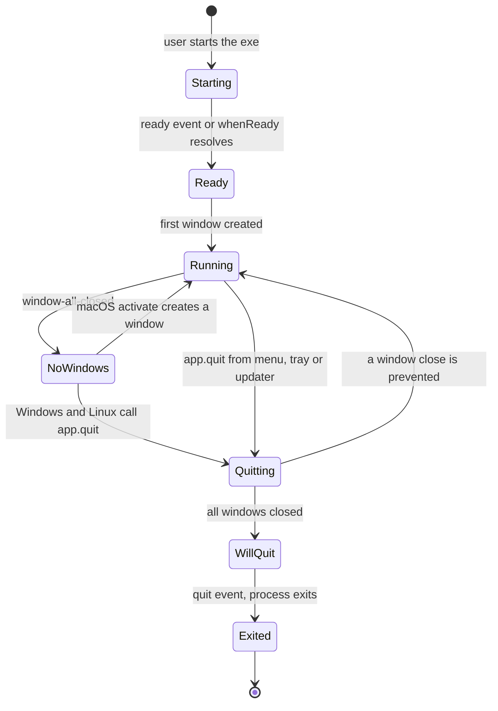
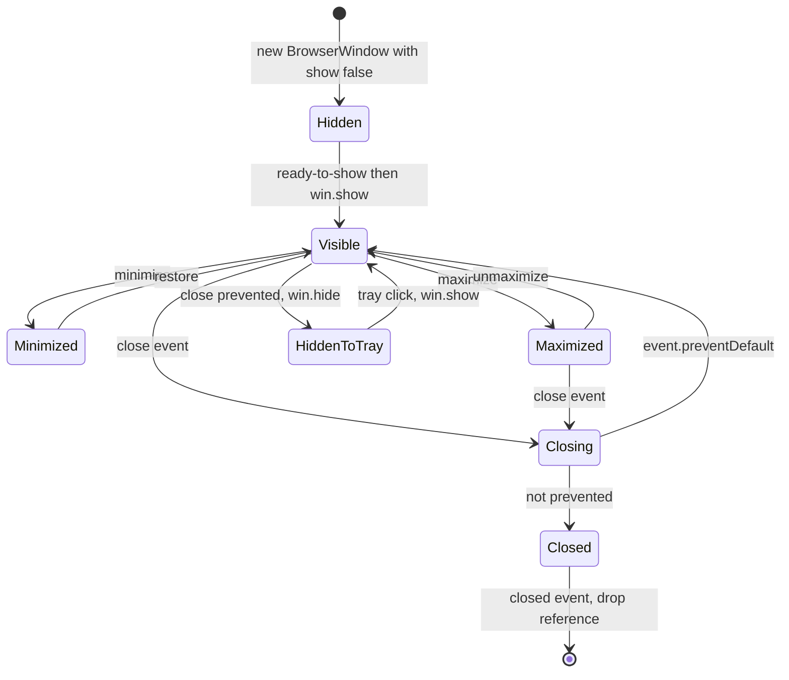
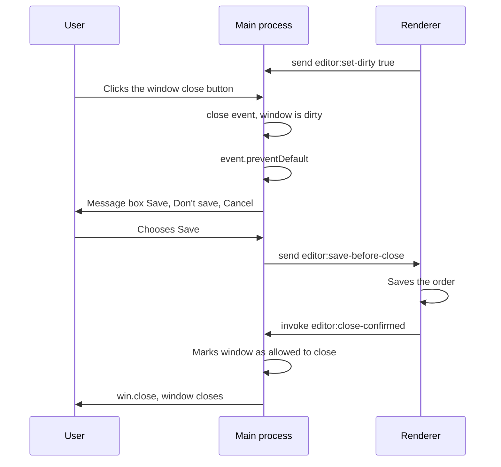
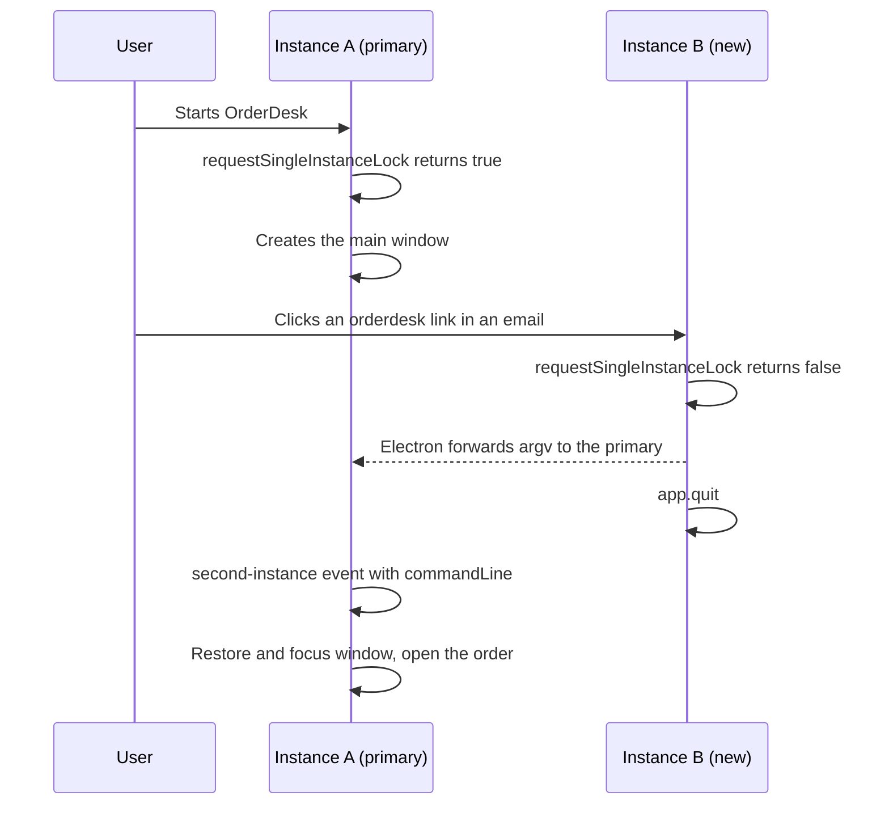

# App and Window Lifecycle

> In this document you will learn how an Electron app starts, runs and quits, how windows are created, shown, closed and restored, and how to build the desktop features users expect: one running instance, deep links, a tray icon, menus, keyboard shortcuts, remembered window positions and launch at login. Lifecycle questions are common in desktop interviews because lifecycle bugs (lost data on close, duplicate instances, invisible windows) are common in real apps.

**Before this:** [Electron architecture and process model](01-electron-architecture-and-process-model.md) · **Interview questions:** [jump to the interview section](#interview-questions)

## Table of contents

1. [The app lifecycle](#the-app-lifecycle)
2. [App events in detail](#app-events-in-detail)
3. [Quitting the app correctly](#quitting-the-app-correctly)
4. [Creating windows with BrowserWindow](#creating-windows-with-browserwindow)
5. [Window events](#window-events)
6. [Closing a window with unsaved changes](#closing-a-window-with-unsaved-changes)
7. [Managing multiple windows](#managing-multiple-windows)
8. [Parent and modal windows](#parent-and-modal-windows)
9. [Single-instance lock](#single-instance-lock)
10. [Deep links and protocol handlers](#deep-links-and-protocol-handlers)
11. [Tray icon and context menu](#tray-icon-and-context-menu)
12. [Application menu](#application-menu)
13. [Accelerators vs globalShortcut](#accelerators-vs-globalshortcut)
14. [Saving and restoring window bounds](#saving-and-restoring-window-bounds)
15. [Where to store files with app.getPath](#where-to-store-files-with-appgetpath)
16. [Launch at login](#launch-at-login)
17. [Windows taskbar features](#windows-taskbar-features)
18. [Common mistakes](#common-mistakes)
19. [Best practices](#best-practices)
20. [How to explain the app lifecycle in an interview](#how-to-explain-the-app-lifecycle-in-an-interview)
21. [Interview questions](#interview-questions)
22. [Summary](#summary)
23. [References](#references)

---

## The app lifecycle

### What it is

The **app lifecycle** is the list of stages an Electron app goes through, from the moment the user starts it until the process exits. The **`app`** module in the main process emits an event at each stage. Your code listens to those events to do the right work at the right time.

### Why it matters

Many Electron APIs only work at certain stages:

- You cannot create a `BrowserWindow`, use the `screen` module, or create a `Tray` before the app is **ready**.
- Some settings must be applied **before** ready, for example `app.setPath('sessionData', ...)`, `protocol.registerSchemesAsPrivileged(...)` and `app.enableSandbox()`.
- Cleanup (flushing logs, closing the database) must happen **before** the process exits.

If you do things at the wrong stage, you get errors, missing features or lost data.

### Analogy

Think of a shop:

1. **Before opening** (before `ready`): the manager unlocks the door and sets up the rules. Customers cannot enter yet.
2. **Open** (`ready`): the shop opens its counters (windows).
3. **All counters closed** (`window-all-closed`): on Windows, this usually means "close the shop". On macOS, the shop often stays open with the lights on, waiting for the next customer.
4. **Closing time** (`before-quit` → `will-quit` → `quit`): the manager counts the cash, locks the safe, then leaves.

### The lifecycle as a state diagram



In words: the app starts, becomes ready, creates windows and runs. When the user closes the last window, Windows and Linux apps usually quit. macOS apps usually stay running until the user presses `Cmd+Q`. During quitting, a window can still cancel the quit (for example, "you have unsaved changes").

---

## App events in detail

Here are the important `app` events in the order they normally fire.

| Event | When it fires | Typical use |
| --- | --- | --- |
| `will-finish-launching` | Very early. On Windows and Linux it is the same as `ready`. On macOS it fires a bit earlier. | macOS: register `open-url` listeners early |
| `ready` / `app.whenReady()` | Electron finished initializing | Create windows, tray, menus, register IPC that needs ready-only APIs |
| `window-all-closed` | The last window closed | Quit on Windows/Linux; stay alive on macOS |
| `activate` (macOS) | App launched or Dock icon clicked | Recreate a window if none are open |
| `before-quit` | Quitting started, before windows close | Set an `isQuitting` flag, start cleanup |
| `will-quit` | All windows closed, process about to exit | Unregister global shortcuts, final cleanup |
| `quit` | The app is quitting | Last log line (receives `exitCode`) |
| `second-instance` | Another copy of the app was started (with the single-instance lock) | Focus the existing window, handle its arguments |
| `open-url` (macOS) | A deep link like `orderdesk://...` was opened | Handle the link on macOS |

### `ready` and `app.whenReady()`

`ready` fires once, when Electron has finished initializing. `app.whenReady()` returns a promise that resolves at the same time (or immediately, if the app is already ready). Prefer `whenReady()`, because it works with `async/await` and does not miss the event if you subscribe late.

```js
const { app, BrowserWindow } = require('electron');

console.log('1. main.js starts, app.isReady() =', app.isReady()); // false

app.whenReady().then(() => {
  console.log('3. ready, app.isReady() =', app.isReady()); // true
  new BrowserWindow({ width: 800, height: 600 }).loadFile('index.html');
});

console.log('2. top-level code finished');
// Printed in the terminal:
// 1. main.js starts, app.isReady() = false
// 2. top-level code finished
// 3. ready, app.isReady() = true
```

```js
// ❌ Wrong: creating a window at the top level, before ready
const win = new BrowserWindow(); // throws: cannot create BrowserWindow before app is ready

// ✅ Correct
app.whenReady().then(createMainWindow);
```

### Work you must do **before** ready

Some calls only take effect if they run before `ready`:

```js
const { app, protocol } = require('electron');
const path = require('node:path');

// 1. Custom schemes must be registered as privileged before ready (only once)
protocol.registerSchemesAsPrivileged([
  { scheme: 'app', privileges: { standard: true, secure: true, supportFetchAPI: true } },
]);

// 2. Optional: force the sandbox for every renderer
app.enableSandbox();

// 3. Optional: a separate data folder for a staging build
if (process.env.ORDERDESK_PROFILE === 'staging') {
  app.setPath('userData', path.join(app.getPath('appData'), 'OrderDesk-Staging'));
}

app.whenReady().then(() => {
  /* create windows */
});
```

If your main file is an ES module (`main.mjs` or `"type": "module"`), remember that ESM loads asynchronously. Electron's ESM guide says to `await` every promise you need before `ready`, and to be careful with dynamic `import()`, because the app may already be ready when it resolves.

### `window-all-closed`: Windows vs macOS

On Windows and Linux, users expect an app to exit when they close its last window. On macOS, apps usually keep running (the menu bar stays, the Dock icon stays) until the user quits with `Cmd+Q`.

```js
app.on('window-all-closed', () => {
  if (process.platform !== 'darwin') {
    app.quit(); // Windows and Linux: quit
  }
  // macOS: do nothing, the app stays running
});

app.whenReady().then(() => {
  createMainWindow();

  // macOS: the user clicked the Dock icon and no windows are open
  app.on('activate', () => {
    if (BrowserWindow.getAllWindows().length === 0) createMainWindow();
  });
});
```

Important detail: **if you do not subscribe to `window-all-closed` at all, Electron quits when all windows close** (on every platform). As soon as you subscribe, you take over that decision. So a listener that forgets to call `app.quit()` on Windows creates a "zombie" app: no windows, but the process keeps running in the background.

A tray app is the exception. If your app lives in the system tray (for example a sync client), you subscribe and intentionally do **not** quit, even on Windows. The user quits from the tray menu.

### `before-quit`, `will-quit` and `quit`

These three fire when the app quits (for example after `app.quit()`).

1. **`before-quit`** fires first, before Electron starts closing windows. Calling `event.preventDefault()` cancels the quit.
2. Electron then closes every window. Each window gets its `close` event and may cancel it.
3. **`will-quit`** fires when all windows have closed. `event.preventDefault()` still cancels the quit.
4. **`quit`** fires last, with the exit code. You cannot cancel it.

```js
let isQuitting = false;

app.on('before-quit', () => {
  isQuitting = true; // windows check this flag in their 'close' handler
  log.info('Quitting OrderDesk');
});

app.on('will-quit', () => {
  globalShortcut.unregisterAll();
});

app.on('quit', (_event, exitCode) => {
  log.info('Exited with code', exitCode);
});
```

### Windows shutdown, restart and log-off

This is a Windows-specific trap that interviewers like:

> On Windows, `before-quit`, `will-quit` and `quit` are **not emitted** if the app closes because the system is shutting down, restarting, or the user is logging off.

Instead, each `BrowserWindow` receives:

- **`query-session-end`** (Windows): a shutdown/restart/log-off is about to happen. Calling `event.preventDefault()` can **delay** it (Windows then shows its "this app is preventing shutdown" screen).
- **`session-end`** (Windows): the session is ending and you cannot stop it. Do your fastest, most important cleanup here.

```js
mainWindow.on('session-end', () => {
  // Windows is shutting down. Do only fast, critical work.
  settingsStore.flushSync();   // e.g. write pending settings synchronously
  log.info('Windows session ending');
});
```

The real lesson: **do not rely on quit events to save user data.** Save continuously (autosave every few seconds, or after each change), so a shutdown, a power cut or a crash loses at most a few seconds of work.

---

## Quitting the app correctly

| Method | What it does | Events |
| --- | --- | --- |
| `app.quit()` | Tries to close all windows politely, then exits. Windows can cancel. | `before-quit`, window `close` events, `will-quit`, `quit` |
| `app.exit(code)` | Exits immediately. Windows close without asking. | No `before-quit` or `will-quit` |
| `app.relaunch()` | Schedules a new instance to start **after** this one exits. Does not quit by itself. | — |

```js
// Restart the app after the user changes the language
function restartApp() {
  app.relaunch();   // start again when we exit
  app.quit();       // polite quit; unsaved-changes prompts still work
}

// After an unrecoverable error (no prompts, exit now)
function emergencyExit() {
  log.error('Fatal error, exiting');
  app.exit(1);
}
```

### Asynchronous cleanup before quitting

`before-quit` handlers are synchronous. If you need async cleanup (for example, close a database or finish uploading logs), cancel the quit, do the work, then quit again. Use a flag so you do not loop forever:

```js
let cleanupDone = false;

app.on('before-quit', async (event) => {
  if (cleanupDone) return;          // second time: let the quit continue
  event.preventDefault();           // first time: pause the quit

  try {
    await Promise.race([
      Promise.all([orderDb.close(), syncService.stop()]),
      new Promise((resolve) => setTimeout(resolve, 3000)), // never block quitting for more than 3 s
    ]);
  } catch (error) {
    log.error('Cleanup failed', error);
  } finally {
    cleanupDone = true;
    app.quit();                     // quit again; this time the handler returns early
  }
});
```

Step-by-step:

1. The user clicks **File → Exit**, which calls `app.quit()`.
2. `before-quit` fires. `cleanupDone` is `false`, so the handler calls `preventDefault()`. The quit stops. Windows stay open for now.
3. The handler waits for the database and sync service to close, but at most 3 seconds (a timeout protects against a stuck cleanup).
4. `cleanupDone` becomes `true` and the handler calls `app.quit()` again.
5. `before-quit` fires again. This time the handler returns immediately. The quit continues: windows close, `will-quit` and `quit` fire, the process exits.

---

## Creating windows with BrowserWindow

### What it is

**`BrowserWindow`** creates and controls a native window that shows a web page. It is a main-process class. You can only create it after `ready`.

### A realistic main window

```js
const { app, BrowserWindow, nativeTheme } = require('electron');
const path = require('node:path');

function createMainWindow(savedBounds) {
  const win = new BrowserWindow({
    // Size and position
    width: savedBounds?.width ?? 1280,
    height: savedBounds?.height ?? 800,
    x: savedBounds?.x,              // undefined = centered
    y: savedBounds?.y,
    minWidth: 960,
    minHeight: 600,

    // Appearance
    title: 'OrderDesk',
    icon: path.join(__dirname, 'assets', 'orderdesk.ico'), // Windows taskbar/window icon
    backgroundColor: nativeTheme.shouldUseDarkColors ? '#1e1e1e' : '#ffffff',
    show: false,                    // show later, when the first paint is ready
    autoHideMenuBar: true,          // Windows/Linux: menu bar appears when Alt is pressed

    // Security (see the security document)
    webPreferences: {
      preload: path.join(__dirname, 'preload.js'),
      contextIsolation: true,
      nodeIntegration: false,
      sandbox: true,
      spellcheck: true,
    },
  });

  win.once('ready-to-show', () => {
    if (savedBounds?.isMaximized) win.maximize();
    win.show();
  });

  win.loadURL('app://bundle/index.html');
  return win;
}
```

### Important options

| Option | Default | What it does |
| --- | --- | --- |
| `width`, `height` | 800 × 600 | Initial size (in device-independent pixels) |
| `x`, `y` | centered | Initial position |
| `minWidth`, `minHeight`, `maxWidth`, `maxHeight` | none | Size limits |
| `show` | `true` | Show the window immediately when created |
| `backgroundColor` | white | Color shown before the page paints |
| `frame` | `true` | `false` creates a frameless window (no OS title bar or borders) |
| `titleBarStyle` | `'default'` | `'hidden'` hides the title bar but keeps window controls when combined with `titleBarOverlay` |
| `titleBarOverlay` | none | Windows/Linux: draws native minimize/maximize/close buttons over your custom title bar |
| `parent`, `modal` | none / `false` | Child and modal windows |
| `resizable`, `movable`, `minimizable`, `maximizable`, `closable` | `true` | Window behavior |
| `fullscreen`, `kiosk` | `false` | Full-screen and kiosk mode |
| `alwaysOnTop` | `false` | Keeps the window above others |
| `skipTaskbar` | `false` | Hides the window from the taskbar |
| `icon` | executable icon | Window and taskbar icon (use `.ico` on Windows) |
| `webPreferences` | secure defaults | Page settings: `preload`, `contextIsolation`, `sandbox`, `nodeIntegration`, `partition`, `spellcheck`, `devTools`, `backgroundThrottling` |

### `show: false` + `ready-to-show`

If you create a window with `show: true` (the default), the user sees a white (or `backgroundColor`) rectangle while the page loads. Then the content "pops in". This looks unprofessional.

The fix: create the window hidden and show it when Chromium says the first paint is ready.

```js
const win = new BrowserWindow({ show: false, backgroundColor: '#ffffff' });
win.once('ready-to-show', () => win.show());
win.loadURL('app://bundle/index.html');
```

`ready-to-show` fires when the page has been rendered while hidden, so the window can appear without a visual flash. Two notes:

- For a heavy app (big Angular bundle), `ready-to-show` might take a second or two. Many teams show a lightweight **splash** or skeleton screen first. See [Performance, architecture and alternatives](09-performance-architecture-and-alternatives.md).
- Always set `backgroundColor` to match your app's theme. If the window must be shown before the page paints, the user at least sees the right color.

### Custom title bars on Windows

Modern Windows apps often draw their own title bar (with a search box or tabs) but keep the native window buttons. Electron supports this with **`titleBarStyle: 'hidden'`** plus **`titleBarOverlay`**:

```js
const win = new BrowserWindow({
  titleBarStyle: 'hidden',
  titleBarOverlay: {
    color: '#1f2937',       // background behind the native buttons
    symbolColor: '#ffffff', // color of the minimize/maximize/close icons
    height: 40,
  },
  webPreferences: { preload: path.join(__dirname, 'preload.js') },
});
```

In your page CSS, mark the draggable area and keep buttons clickable:

```css
.title-bar {
  height: 40px;
  -webkit-app-region: drag;      /* user can drag the window by this area */
}
.title-bar button,
.title-bar input {
  -webkit-app-region: no-drag;   /* these stay clickable */
}
```

Compared with `frame: false`, this keeps native behavior like the Windows 11 snap layouts menu when hovering the maximize button, and correct button sizes on high-DPI screens.

---

## Window events

`BrowserWindow` is an event emitter. These are the events you use most:

| Event | When | Typical use |
| --- | --- | --- |
| `ready-to-show` | First paint done while hidden | Show the window |
| `show` / `hide` | Window shown or hidden | Pause or resume work |
| `focus` / `blur` | Window gained or lost focus | Refresh data on focus; pause timers on blur |
| `close` | Window is about to close (cancelable) | Ask about unsaved changes; hide to tray |
| `closed` | Window closed | Remove references, clean up |
| `resize` / `resized` | Size changed / resizing finished (`resized`: Windows, macOS) | Save bounds (debounced) |
| `move` / `moved` | Position changed / move finished (`moved`: Windows, macOS) | Save bounds |
| `maximize` / `unmaximize` / `minimize` / `restore` | State changes | Save the maximized state |
| `enter-full-screen` / `leave-full-screen` | Full-screen changes | Adjust layout |
| `unresponsive` / `responsive` | Page stopped / started responding | Offer "wait or reload" |
| `query-session-end` / `session-end` | Windows shutdown or log-off | Emergency save |

```js
mainWindow.on('focus', () => {
  mainWindow.webContents.send('app:focused'); // the page can refresh stale data
});

mainWindow.on('unresponsive', async () => {
  const { response } = await dialog.showMessageBox(mainWindow, {
    type: 'warning',
    message: 'OrderDesk is not responding',
    detail: 'You can wait for it, or reload the window. Unsaved changes may be lost if you reload.',
    buttons: ['Wait', 'Reload'],
    defaultId: 0,
    cancelId: 0,
  });
  if (response === 1) mainWindow.webContents.forcefullyCrashRenderer(); // the crash handler then reloads
});

mainWindow.on('closed', () => {
  mainWindow = null; // never use a destroyed window
});
```

About the `unresponsive` example: `forcefullyCrashRenderer()` kills a hung renderer, which emits `render-process-gone`. Your crash-recovery code (see [Logging, crash recovery and monitoring](08-logging-crash-recovery-and-monitoring.md)) then reloads the page. Calling `reload()` on a truly hung renderer may not work, because the renderer is busy.

### `close` vs `closed`

- **`close`** happens **before** the window closes. You can call `event.preventDefault()` to keep it open. It also fires before the page's `beforeunload` and `unload` DOM events.
- **`closed`** happens **after** the window is gone. You cannot stop it. After `closed`, calling methods on the window throws "Object has been destroyed". Set your reference to `null` and remove it from any registry.

```js
// ❌ Wrong: using a window after it closed
setInterval(() => mainWindow.webContents.send('clock:tick', Date.now()), 1000);
// After the user closes the window: TypeError: Object has been destroyed

// ✅ Correct: check, and stop the timer when the window closes
const timer = setInterval(() => {
  if (mainWindow && !mainWindow.isDestroyed()) {
    mainWindow.webContents.send('clock:tick', Date.now());
  }
}, 1000);
mainWindow.on('closed', () => clearInterval(timer));
```

### Window lifecycle diagram



---

## Closing a window with unsaved changes

### The problem

The user edits an order and clicks the window's **X** button. If the changes are not saved, you want to ask: **Save / Don't save / Cancel**.

The difficulty: the main process controls closing, but only the renderer knows whether the form is "dirty" (has unsaved changes). And the `close` handler in main is synchronous: you must decide to `preventDefault()` **immediately**, you cannot first ask the renderer and wait.

### The solution: the renderer reports its dirty state in advance

1. The renderer tells main whenever the dirty state changes (`setDirty(true/false)`).
2. Main stores the state per window.
3. On `close`, if the window is dirty, main prevents the close and shows a native dialog.
4. Based on the answer, main asks the renderer to save, or closes without saving, or does nothing.



### Main process code

```js
// main/unsaved-changes.js
const { BrowserWindow, dialog, ipcMain } = require('electron');
const { isTrustedSender } = require('./ipc-security'); // checks event.senderFrame — see the IPC document

const dirtyWindows = new Set();     // ids of windows with unsaved changes
const allowedToClose = new Set();   // ids that already confirmed

ipcMain.on('editor:set-dirty', (event, isDirty) => {
  if (!isTrustedSender(event.senderFrame)) return;
  const win = BrowserWindow.fromWebContents(event.sender);
  if (!win) return;
  if (isDirty === true) dirtyWindows.add(win.id);
  else dirtyWindows.delete(win.id);
});

ipcMain.handle('editor:close-confirmed', (event) => {
  if (!isTrustedSender(event.senderFrame)) throw new Error('Unauthorized sender');
  const win = BrowserWindow.fromWebContents(event.sender);
  if (!win) return;
  allowedToClose.add(win.id);
  win.close(); // the close handler will now let it through
});

function protectUnsavedChanges(win) {
  const id = win.id; // read once, so the 'closed' handler never touches a destroyed window
  win.on('close', (event) => {
    if (!dirtyWindows.has(id) || allowedToClose.has(id)) return; // nothing to ask

    event.preventDefault(); // must be called synchronously
    dialog
      .showMessageBox(win, {
        type: 'question',
        message: 'Save changes to this order before closing?',
        buttons: ['Save', "Don't save", 'Cancel'],
        defaultId: 0,
        cancelId: 2,
        noLink: true,
      })
      .then(({ response }) => {
        if (response === 0) {
          win.webContents.send('editor:save-before-close'); // renderer saves, then confirms
        } else if (response === 1) {
          allowedToClose.add(id);
          win.close();
        }
        // response === 2 (Cancel): do nothing, the window stays open
      });
  });

  win.on('closed', () => {
    dirtyWindows.delete(id);
    allowedToClose.delete(id);
  });
}

module.exports = { protectUnsavedChanges };
```

### Preload and renderer code

```js
// preload.js (part of the exposed API)
contextBridge.exposeInMainWorld('orderDesk', {
  setDirty: (isDirty) => ipcRenderer.send('editor:set-dirty', Boolean(isDirty)),
  confirmClose: () => ipcRenderer.invoke('editor:close-confirmed'),
  onSaveBeforeClose: (callback) => {
    const listener = () => callback();
    ipcRenderer.on('editor:save-before-close', listener);
    return () => ipcRenderer.removeListener('editor:save-before-close', listener);
  },
});
```

```js
// renderer: order editor
orderForm.addEventListener('input', () => window.orderDesk.setDirty(true));

window.orderDesk.onSaveBeforeClose(async () => {
  try {
    await saveOrder(readForm());
    window.orderDesk.setDirty(false);
    await window.orderDesk.confirmClose();
  } catch (error) {
    showError(`Could not save: ${error.message}. The window will stay open.`);
  }
});
```

Why not just use the DOM `beforeunload` event? In Electron, returning a value from `beforeunload` silently cancels the close, but Electron does **not** show the browser's "Leave site?" dialog. You would have to show your own dialog anyway. The pattern above gives you a native dialog and full control. (`beforeunload` is still useful as a safety net.)

What about **quitting** the app (not just closing one window)? `app.quit()` closes every window, so each dirty window's `close` handler runs and can cancel. If the user cancels in any window, the whole quit is cancelled. That is the behavior users expect.

---

## Managing multiple windows

### The problem

Real apps open several windows: a main window, a settings window, one window per order, a print preview. Without structure you get bugs:

- The user clicks "Settings" twice and gets two settings windows.
- Code keeps a reference to a closed window and crashes with "Object has been destroyed".
- You need to send "settings changed" to every open window, but you have no list.

### The solution: a window registry

Keep all windows in a **`Map`** keyed by a meaningful name (`'main'`, `'settings'`, `'order:SO-10442'`). Before creating a window, check the map. If the window exists, focus it. Remove it from the map on `closed`.

```js
// main/window-manager.js
class WindowManager {
  #windows = new Map(); // key -> BrowserWindow

  openOrFocus(key, createWindow) {
    const existing = this.#windows.get(key);
    if (existing && !existing.isDestroyed()) {
      if (existing.isMinimized()) existing.restore();
      existing.focus();
      return existing;
    }
    const win = createWindow();
    this.#windows.set(key, win);
    win.once('closed', () => {
      if (this.#windows.get(key) === win) this.#windows.delete(key);
    });
    return win;
  }

  get(key) {
    const win = this.#windows.get(key);
    return win && !win.isDestroyed() ? win : undefined;
  }

  broadcast(channel, payload) {
    for (const win of this.#windows.values()) {
      if (!win.isDestroyed()) win.webContents.send(channel, payload);
    }
  }
}

module.exports = { windowManager: new WindowManager() };
```

```js
// main/windows.js — ONE secure factory for every window
const { BrowserWindow } = require('electron');
const path = require('node:path');
const { windowManager } = require('./window-manager');

function createSecureWindow(options = {}) {
  const { webPreferences, ...windowOptions } = options;
  return new BrowserWindow({
    show: false,
    backgroundColor: '#ffffff',
    ...windowOptions,
    webPreferences: {
      ...webPreferences,
      // Security settings come last so callers cannot override them by accident
      preload: path.join(__dirname, '..', 'preload.js'),
      contextIsolation: true,
      nodeIntegration: false,
      sandbox: true,
    },
  });
}

function openOrderWindow(orderId) {
  return windowManager.openOrFocus(`order:${orderId}`, () => {
    const win = createSecureWindow({ width: 900, height: 700, title: `Order ${orderId}` });
    win.once('ready-to-show', () => win.show());
    win.loadURL(`app://bundle/index.html#/orders/${encodeURIComponent(orderId)}`);
    return win;
  });
}

function openSettingsWindow() {
  return windowManager.openOrFocus('settings', () => {
    const win = createSecureWindow({ width: 640, height: 520, resizable: false, title: 'Settings' });
    win.once('ready-to-show', () => win.show());
    win.loadURL('app://bundle/index.html#/settings');
    return win;
  });
}

module.exports = { createSecureWindow, openOrderWindow, openSettingsWindow };
```

```js
// Later: tell every window that settings changed
windowManager.broadcast('settings:changed', { theme: 'dark', currency: 'INR' });
```

Walkthrough of `openOrderWindow('SO-1')` called twice:

1. First call: the map has no `order:SO-1`. `createWindow()` builds a hidden window, loads the order route and returns it. The manager stores it and registers a `closed` listener.
2. Second call (the user double-clicks the order again): the map has a live window for `order:SO-1`. If it is minimized, the manager restores it. It focuses it and returns the same window. No duplicate.
3. The user closes the window. `closed` fires. The manager removes the key. The next call creates a fresh window.

The check `this.#windows.get(key) === win` protects against a rare race: if a new window was registered under the same key before the old one's `closed` event, the old listener does not delete the new entry.

### Talking between windows

Windows cannot call each other directly (each is a separate renderer process). Common options:

- **Through main (broker):** window A sends an IPC message to main; main updates its state and broadcasts to the other windows. This is the simplest and the most common.
- **Shared state in main:** main owns the data (for example the current user and settings). Windows read it through `invoke` and subscribe to changes.
- **MessagePorts:** for high-volume direct communication. See [IPC and preload scripts](03-ipc-and-preload-scripts.md#messageports-for-direct-and-high-volume-channels).

---

## Parent and modal windows

- A **child window** (`parent: mainWindow`) always stays on top of its parent.
- A **modal window** (`parent` + `modal: true`) is a child window that **disables its parent** until it closes. Use it for dialogs that must be answered, like "Select a printer" or "Sign in again".

```js
function openPrinterPicker(parentWindow) {
  const picker = createSecureWindow({
    parent: parentWindow,
    modal: true,
    width: 480,
    height: 360,
    resizable: false,
    minimizable: false,
    maximizable: false,
    title: 'Select a printer',
  });
  picker.once('ready-to-show', () => picker.show());
  picker.loadURL('app://bundle/index.html#/printer-picker');
  return picker;
}
```

Platform differences:

- On **macOS**, modal windows appear as **sheets** attached to the parent, and child windows move with the parent.
- On **Windows and Linux**, child windows do **not** move when the parent moves.
- Closing the parent also closes its child windows.

For simple questions (OK/Cancel, an error message), you do not need a custom modal window. Use the native `dialog.showMessageBox(parentWindow, options)`, which is modal to the window you pass.

---

## Single-instance lock

### The problem

By default, every double-click on the app icon starts a **new instance** with its own main process. For most business apps that is wrong:

- Two instances may write to the same settings file or SQLite database at the same time and corrupt it.
- Two tray icons appear.
- A deep link opens a second app instead of the running one.

### The solution

Call **`app.requestSingleInstanceLock()`** at startup.

- It returns `true` in the **first** instance (the primary instance). Continue normally.
- It returns `false` in any later instance. That instance should quit immediately.
- The primary instance receives a **`second-instance`** event with the command-line arguments and working directory of the instance that tried to start. Use it to focus your window and handle the arguments (for example, a file to open or a deep link).

```js
// main.js — near the top, before creating any window
const { app, BrowserWindow } = require('electron');

const gotTheLock = app.requestSingleInstanceLock({ startedAt: Date.now() }); // optional data

if (!gotTheLock) {
  app.quit(); // another instance is running; it will get 'second-instance'
} else {
  app.on('second-instance', (_event, commandLine, workingDirectory, additionalData) => {
    // Someone tried to start a second copy. Bring our window to the front.
    const win = getMainWindow();
    if (win) {
      if (win.isMinimized()) win.restore();
      if (!win.isVisible()) win.show();   // it may be hidden in the tray
      win.focus();
    }
    handleCommandLine(commandLine, workingDirectory); // e.g. a deep link or a file path
  });

  app.whenReady().then(() => {
    createMainWindow();
    handleCommandLine(process.argv, process.cwd()); // arguments of THIS (first) launch
  });
}
```

Notes:

- `second-instance` is guaranteed to fire after `ready`, so it is safe to use windows inside it.
- Electron's docs warn that `commandLine` may be reordered or have extra arguments appended (Chromium adds some switches). So **search** the arguments for what you need instead of assuming a fixed position.
- If the second instance runs as a different user, `commandLine` does not include its arguments.
- `additionalData` lets the second instance pass a JSON-like object to the first.
- On macOS, the system already prevents a second instance when the user opens the app from Finder, but the lock is still useful for command-line launches.



---

## Deep links and protocol handlers

### What it is

A **deep link** is a URL with your own scheme, such as `orderdesk://order/SO-10442`. When the user clicks it in a browser, an email or Teams chat, the operating system starts (or focuses) your app and passes it the URL. This is also called a **custom protocol handler**.

Do not confuse this with `protocol.handle`, which serves content **inside** your app's windows (for example `app://bundle/index.html`). Deep links are about the **operating system** opening your app.

### Registering the scheme

At runtime, call **`app.setAsDefaultProtocolClient(scheme)`**. On Windows this writes registry keys under the current user. Installers can also register the scheme (for example electron-builder's `protocols` setting), which is cleaner for production.

```js
const path = require('node:path');

const SCHEME = 'orderdesk';

if (process.defaultApp) {
  // Development: we run through electron.exe, so tell Windows how to start OUR app
  if (process.argv.length >= 2) {
    app.setAsDefaultProtocolClient(SCHEME, process.execPath, [path.resolve(process.argv[1])]);
  }
} else {
  // Packaged app: the exe is our app
  app.setAsDefaultProtocolClient(SCHEME);
}
```

`process.defaultApp` is `true` when the app runs through the default Electron executable (`electron .`). In that case Windows would start plain `electron.exe` without your app folder, so you pass the path to your app as an argument.

### Receiving the URL on Windows

On Windows (and Linux), the URL arrives as a **command-line argument**:

- **App not running (cold start):** the URL is in `process.argv` of the new process.
- **App already running:** the new process fails the single-instance lock and quits. The running instance gets the URL in the `second-instance` event's `commandLine`.

On macOS, the URL arrives in the `open-url` event instead (register it early, before `ready`, so you do not miss a launch URL).

### Parse and validate the URL

**A deep link is untrusted input.** Any web page or email can contain `orderdesk://...` with anything after it. Never pass parts of it to a shell, a file path or `shell.openExternal`. Allow only known actions and strictly validated IDs.

```js
// main/deep-links.js
const PROTOCOL = 'orderdesk:';
const ALLOWED_ACTIONS = new Set(['order', 'customer']);

function findDeepLink(argv) {
  const arg = argv.find((a) => a.toLowerCase().startsWith(`${PROTOCOL}//`));
  if (!arg) return null;

  let url;
  try {
    url = new URL(arg);
  } catch {
    return null; // not a valid URL
  }

  const action = url.hostname.toLowerCase(); // for orderdesk://order/SO-1 the host is "order"
  if (!ALLOWED_ACTIONS.has(action)) return null;

  const id = url.pathname.replace(/^\//, '');
  if (!/^[A-Za-z0-9-]{1,40}$/.test(id)) return null; // strict ID format

  return { action, id };
}

function handleCommandLine(argv) {
  const link = findDeepLink(argv);
  if (!link) return;
  if (link.action === 'order') openOrderWindow(link.id);
  if (link.action === 'customer') showCustomer(link.id);
}

module.exports = { findDeepLink, handleCommandLine };
```

```js
// Tested with Node.js:
findDeepLink(['OrderDesk.exe', '--some-chromium-switch', 'orderdesk://order/SO-10442']);
// { action: 'order', id: 'SO-10442' }
findDeepLink(['OrderDesk.exe', 'orderdesk://shell/cmd']);
// null  (action not allowed)
findDeepLink(['OrderDesk.exe']);
// null  (no link)
```

Two details from the test:

- For non-web schemes like `orderdesk:`, Node's URL parser keeps the host's letter case (`orderdesk://Order/1` gives the host `Order`), so the code lowercases it.
- The parser normalizes `..` segments in the path, and the strict ID regex rejects anything unusual anyway.

```js
// macOS: register early, at the top level of main.js
app.on('open-url', (event, url) => {
  event.preventDefault();
  handleCommandLine([url]);
});
```

---

## Tray icon and context menu

A **tray icon** is the small icon in the Windows notification area (bottom-right, near the clock). Background apps (sync clients, chat apps, hardware monitors) use it so the app can keep running without a window.

```js
// main/tray.js
const { app, Menu, Tray, nativeImage } = require('electron');
const path = require('node:path');

let tray = null; // module-level reference so it is not garbage collected

function createTray({ showMainWindow, syncNow }) {
  const icon = nativeImage.createFromPath(path.join(__dirname, '..', 'assets', 'tray.ico'));
  tray = new Tray(icon);
  tray.setToolTip('OrderDesk — connected');

  const menu = Menu.buildFromTemplate([
    { label: 'Open OrderDesk', click: showMainWindow },
    { label: 'Sync now', click: syncNow },
    { type: 'separator' },
    { label: 'Quit', click: () => app.quit() },
  ]);
  tray.setContextMenu(menu);  // shown on right-click on Windows

  tray.on('click', showMainWindow); // left-click on Windows opens the window
  return tray;
}

function setTrayStatus(online) {
  tray?.setToolTip(online ? 'OrderDesk — connected' : 'OrderDesk — offline');
}

module.exports = { createTray, setTrayStatus };
```

Keep the `Tray` object in a variable that lives as long as the app. If you create it inside a function and do not keep a reference, it can be garbage collected and the icon disappears after some time. The Electron FAQ mentions exactly this problem.

### Minimize to tray on close

Many tray apps hide the window instead of closing it. The window must still close for real when the app quits.

```js
let isQuitting = false;
app.on('before-quit', () => { isQuitting = true; });

mainWindow.on('close', (event) => {
  if (!isQuitting) {
    event.preventDefault(); // do not destroy the window
    mainWindow.hide();      // just hide it; the tray brings it back
  }
});

app.on('window-all-closed', () => {
  // Tray app: keep running even on Windows. The user quits from the tray menu.
});
```

Without the `isQuitting` flag, the window would block quitting forever, because `app.quit()` closes windows and the handler would cancel every close. That is a classic bug: "the app cannot be closed, even from Task Manager's normal End Task flow, and the installer cannot update it".

---

## Application menu

The **application menu** is the menu bar (File, Edit, View…). On Windows and Linux it appears at the top of each window. On macOS it appears at the top of the screen.

If you do not set a menu, Electron shows a **default menu** with standard items. Most apps replace it.

```js
// main/menu.js
const { app, Menu, shell } = require('electron');

function buildAppMenu({ openSettingsWindow, newOrder }) {
  const isMac = process.platform === 'darwin';

  const template = [
    ...(isMac ? [{ role: 'appMenu' }] : []),
    {
      label: 'File',
      submenu: [
        { label: 'New Order', accelerator: 'CmdOrCtrl+N', click: newOrder },
        { label: 'Settings', accelerator: 'CmdOrCtrl+,', click: openSettingsWindow },
        { type: 'separator' },
        isMac ? { role: 'close' } : { role: 'quit', label: 'Exit' },
      ],
    },
    { role: 'editMenu' },  // Undo, Redo, Cut, Copy, Paste, Select All — with correct shortcuts
    {
      label: 'View',
      submenu: [
        { role: 'reload' },
        { role: 'toggleDevTools', visible: !app.isPackaged }, // only in development
        { type: 'separator' },
        { role: 'resetZoom' }, { role: 'zoomIn' }, { role: 'zoomOut' },
        { type: 'separator' },
        { role: 'togglefullscreen' },
      ],
    },
    {
      role: 'help',
      submenu: [
        {
          label: 'User Guide',
          click: () => shell.openExternal('https://docs.contoso.com/orderdesk'), // fixed, trusted URL
        },
      ],
    },
  ];

  Menu.setApplicationMenu(Menu.buildFromTemplate(template));
}

module.exports = { buildAppMenu };
```

Key ideas:

- **Roles** (`role: 'copy'`, `'editMenu'`, `'quit'`, `'reload'`) give you standard, correctly-behaving items with platform-correct labels and shortcuts. Keep the Edit menu: on macOS, copy/paste shortcuts do not work in your page without it.
- **`CmdOrCtrl`** means `Cmd` on macOS and `Ctrl` on Windows/Linux.
- `Menu.setApplicationMenu(null)` removes the menu completely. On Windows this also removes its keyboard shortcuts, including the default reload and DevTools shortcuts, which is often what you want in a kiosk app.

### Context menus (right-click)

Chromium does not show a right-click menu in Electron by default. You can build one from the main process using the `context-menu` event of `webContents`:

```js
mainWindow.webContents.on('context-menu', (_event, params) => {
  const menu = Menu.buildFromTemplate([
    { role: 'cut', enabled: params.editFlags.canCut },
    { role: 'copy', enabled: params.editFlags.canCopy },
    { role: 'paste', enabled: params.editFlags.canPaste },
    { type: 'separator' },
    { role: 'selectAll' },
  ]);
  menu.popup({ window: mainWindow });
});
```

---

## Accelerators vs globalShortcut

An **accelerator** is a string that describes a keyboard shortcut, like `'CmdOrCtrl+Shift+P'` or `'F5'`. You use the same format in menus and in `globalShortcut`.

| | Menu accelerator | `globalShortcut` |
| --- | --- | --- |
| Works when | Your app's window is **focused** | **Always**, even when another app is focused |
| Set with | `accelerator` on a menu item | `globalShortcut.register(accelerator, callback)` |
| Conflicts | Only inside your app | With every other app on the system |
| Typical use | Save, New, Find | Push-to-talk, "show app" hotkey, screen capture |

```js
// Global shortcut: Ctrl+Shift+O shows OrderDesk from anywhere
const { app, globalShortcut } = require('electron');

app.whenReady().then(() => {
  const ok = globalShortcut.register('CommandOrControl+Shift+O', () => {
    showMainWindow();
  });
  if (!ok) log.warn('Ctrl+Shift+O is already used by another application');
});

app.on('will-quit', () => {
  globalShortcut.unregisterAll(); // always release global shortcuts
});
```

Rules for `globalShortcut`:

- Register it after `ready`.
- It returns `false` if registration failed. If another app already owns the shortcut, the operating system may not tell you, and it silently does not work.
- Use it rarely. It steals the key combination from every other app while yours is running.

For shortcuts that should work only inside one window but are not menu items, you can also handle them in the page with normal `keydown` listeners, or in main with `webContents.on('before-input-event', ...)`, which sees key presses before the page does:

```js
mainWindow.webContents.on('before-input-event', (event, input) => {
  // Block Ctrl+R reload in the packaged kiosk build
  if (app.isPackaged && input.type === 'keyDown' && input.control && input.key.toLowerCase() === 'r') {
    event.preventDefault();
  }
});
```

---

## Saving and restoring window bounds

Users expect a window to open where they left it, with the same size and maximized state. You need to:

1. Save the **normal** bounds (size and position when not maximized) and the maximized flag.
2. Save them when they change (debounced) and when the window closes.
3. On start, **check that the saved position is still on a connected screen**. If the user unplugged their second monitor, a window at `x: 2100` would open off-screen and be invisible.

```js
// main/window-state.js
const { screen } = require('electron');

function debounce(fn, waitMs) {
  let timer;
  return (...args) => {
    clearTimeout(timer);
    timer = setTimeout(() => fn(...args), waitMs);
  };
}

function isVisibleOnSomeDisplay(bounds) {
  return screen.getAllDisplays().some(({ workArea: area }) =>
    bounds.x < area.x + area.width &&
    bounds.x + bounds.width > area.x &&
    bounds.y < area.y + area.height &&
    bounds.y + bounds.height > area.y);
}

function loadWindowState(settings) {
  const saved = settings.get('mainWindowState'); // e.g. { x, y, width, height, isMaximized }
  if (!saved) return undefined;
  if (!isVisibleOnSomeDisplay(saved)) {
    // Keep the size, forget the position: Electron will center the window
    return { width: saved.width, height: saved.height, isMaximized: saved.isMaximized };
  }
  return saved;
}

function trackWindowState(win, settings) {
  const save = () => {
    if (win.isDestroyed()) return;
    settings.set('mainWindowState', {
      ...win.getNormalBounds(),  // bounds as if not maximized/minimized
      isMaximized: win.isMaximized(),
    });
  };
  const saveSoon = debounce(save, 500);

  win.on('resize', saveSoon);
  win.on('move', saveSoon);
  win.on('maximize', save);
  win.on('unmaximize', save);
  win.on('close', save); // final save while the window still exists
}

module.exports = { loadWindowState, trackWindowState };
```

```js
// main.js
app.whenReady().then(() => {
  const savedState = loadWindowState(settings);
  mainWindow = createMainWindow(savedState); // uses x, y, width, height; maximizes in ready-to-show
  trackWindowState(mainWindow, settings);
});
```

Why `getNormalBounds()` and not `getBounds()`? If the window is maximized, `getBounds()` returns the full-screen size. When the user later un-maximizes, you want the size they had *before* maximizing.

Why debounce? `resize` and `move` fire many times per second while dragging. Debouncing writes once, 500 ms after the user stops. (Debounce is explained in [Debounce, throttle and performance](../02-javascript/20-debounce-throttle-and-performance.md).)

The overlap check was tested with Node.js: a saved window at `x: 100` on a 1920-pixel-wide screen is visible; a window saved at `x: 2100` (on a monitor that is no longer connected) is not, so its position is dropped.

Note: the `screen` module only works after `ready`.

---

## Where to store files with app.getPath

**`app.getPath(name)`** returns the correct folder for a purpose, on every operating system. Never hard-code `C:\Users\...`, and **never write into the installation folder**: on Windows, per-machine installs live in `C:\Program Files\`, which normal users cannot write to. Writing there either fails or gets redirected by Windows in confusing ways.

| Name | Typical Windows value (user `asha`, app `OrderDesk`) | Use it for |
| --- | --- | --- |
| `home` | `C:\Users\asha` | Rarely needed directly |
| `appData` | `C:\Users\asha\AppData\Roaming` | Parent of `userData` |
| `userData` | `C:\Users\asha\AppData\Roaming\OrderDesk` | Settings, local database, caches you own |
| `sessionData` | same as `userData` by default | Chromium data: cookies, localStorage, IndexedDB, cache |
| `logs` | inside `userData` by default on Windows | Log files |
| `temp` | `C:\Users\asha\AppData\Local\Temp` | Short-lived temporary files |
| `crashDumps` | inside `userData` by default | Crash dump files |
| `exe` | e.g. `C:\Users\asha\AppData\Local\Programs\OrderDesk\OrderDesk.exe` | Path of the running executable |
| `desktop`, `documents`, `downloads`, `pictures`, `music`, `videos` | User folders | Default locations in save dialogs |
| `recent` (Windows) | The user's Recent items folder | Rarely needed |

```js
const path = require('node:path');

const settingsFile = path.join(app.getPath('userData'), 'settings.json');
const databaseFile = path.join(app.getPath('userData'), 'orders.sqlite');
const defaultExportPath = path.join(app.getPath('documents'), 'OrderDesk Exports');

console.log(app.getPath('userData')); // C:\Users\asha\AppData\Roaming\OrderDesk
```

Details worth knowing:

- `userData` is `appData` + your **app name** (from `productName`, or `name`, in `package.json`). If you rename the product, the folder changes and users "lose" their settings. Choose the name carefully, or migrate.
- To change `userData` or `sessionData`, call `app.setPath(...)` **before `ready`**, so Chromium uses the new location for cookies and caches.
- `app.setAppLogsPath()` without arguments sets the logs folder to the default location; `app.getPath('logs')` then returns it.
- More about storing data (settings files, SQLite, atomic writes) is in [Filesystem, child processes and native features](05-filesystem-child-processes-and-native-features.md#where-to-store-data).

---

## Launch at login

Some apps (tray apps, POS terminals, sync clients) should start when the user logs in. Use **`app.setLoginItemSettings`**. On Windows, Electron writes the app to the user's startup entries in the registry, so it also appears in Task Manager's **Startup apps** tab and in Windows Settings.

```js
const LOGIN_ARG = '--launched-at-login';

function setLaunchAtLogin(enabled) {
  app.setLoginItemSettings({
    openAtLogin: enabled,
    path: process.execPath,  // default; set explicitly for clarity
    args: [LOGIN_ARG],       // lets us detect a login launch
  });
}

function isLaunchAtLoginEnabled() {
  return app.getLoginItemSettings({ path: process.execPath, args: [LOGIN_ARG] }).openAtLogin;
}

// At startup: when launched at login, start hidden in the tray
const launchedAtLogin = process.argv.includes(LOGIN_ARG);

app.whenReady().then(() => {
  createTray(/* ... */);
  mainWindow = createMainWindow();
  if (!launchedAtLogin) {
    mainWindow.once('ready-to-show', () => mainWindow.show());
  }
});
```

Rules:

- **Ask the user** (a checkbox in Settings). Do not silently add yourself to startup; users and IT departments dislike it.
- On Windows, pass the **same `path` and `args`** to `getLoginItemSettings` that you used in `setLoginItemSettings`, otherwise the check may not find your entry.
- The Windows `enabled` option controls the "startup approved" state that Task Manager shows; if the user disabled your app in Task Manager, respect it.
- With Squirrel.Windows installers, the executable path differs (`Update.exe` launches the app). See [Packaging, installers and code signing](06-packaging-installers-and-code-signing.md).

---

## Windows taskbar features

Small touches make an Electron app feel native on Windows:

```js
// 1. AppUserModelID: groups windows correctly in the taskbar and is required for notifications
app.setAppUserModelId('com.contoso.orderdesk'); // must match the ID your installer uses

// 2. Progress in the taskbar button (0..1; -1 removes it)
mainWindow.setProgressBar(0.42);
mainWindow.setProgressBar(-1);

// 3. Flash the taskbar button to get attention (stops when the window is focused)
mainWindow.flashFrame(true);

// 4. Overlay badge on the taskbar icon (e.g. unread count or error state)
mainWindow.setOverlayIcon(nativeImage.createFromPath(errorIconPath), 'Sync error');

// 5. Jump list tasks (right-click on the taskbar icon)
app.setUserTasks([
  {
    program: process.execPath,
    arguments: '--new-order',
    iconPath: process.execPath,
    iconIndex: 0,
    title: 'New Order',
    description: 'Create a new order',
  },
]);
```

The new process started by a jump list task fails the single-instance lock, and your `second-instance` handler receives `--new-order` in `commandLine`. This is another reason to search the arguments instead of assuming positions.

---

## Common mistakes

1. **Creating windows, trays or using `screen` before `ready`.** These throw or misbehave. Use `app.whenReady()`.
2. **Subscribing to `window-all-closed` and forgetting to quit on Windows.** The app keeps running with no windows.
3. **Saving important data only in `before-quit`.** On Windows shutdown it is not emitted. Autosave continuously; use `session-end` only for last-second work.
4. **Using a window after `closed`.** Causes "Object has been destroyed". Set references to `null`, remove windows from registries, check `isDestroyed()`.
5. **Hide-to-tray without an `isQuitting` flag.** The app can never quit, and updates fail.
6. **No single-instance lock.** Two instances corrupt shared files, and deep links open a second app.
7. **Assuming the deep link is `argv[1]`.** Chromium may add arguments, and dev mode has an extra path. Search for your scheme.
8. **Trusting deep link content.** It is attacker-controlled input. Validate strictly.
9. **Restoring a window position without checking displays.** The window opens off-screen after a monitor is unplugged.
10. **Writing files next to the executable.** Fails for per-machine installs in Program Files. Use `app.getPath('userData')`.
11. **Not keeping a reference to `Tray`.** The tray icon disappears after garbage collection.
12. **Registering many `globalShortcut`s and never unregistering them.** Conflicts with other apps; always `unregisterAll()` in `will-quit`.

## Best practices

- **One startup path:** single-instance lock → pre-ready setup → `whenReady` → create window → handle `process.argv`. Reason: predictable order, no races.
- **Show windows with `show: false` + `ready-to-show` + a matching `backgroundColor`.** Reason: no white flash.
- **Create all windows through one secure factory.** Reason: consistent security settings and behavior.
- **Track windows in a registry `Map`.** Reason: no duplicates, safe broadcasting, clean removal on `closed`.
- **Autosave instead of relying on quit events.** Reason: shutdowns, crashes and power cuts do not fire quit events.
- **Use an `isQuitting` flag for hide-on-close.** Reason: real quits and updates must work.
- **Validate deep links and command-line arguments like web input.** Reason: any web page can trigger your scheme.
- **Store per-user data under `userData`; never under the install folder.** Reason: permissions and clean uninstalls.
- **Ask before enabling launch at login.** Reason: user trust and enterprise policies.
- **Use menu roles and `CmdOrCtrl`.** Reason: correct platform behavior for free.

---

## How to explain the app lifecycle in an interview

1. **Define it:** "The app lifecycle is the sequence of `app` events in the main process: `ready`, `window-all-closed`, `activate` on macOS, and then `before-quit`, `will-quit` and `quit` when the app exits. Windows have their own lifecycle: `ready-to-show`, `close`, `closed`."
2. **Why it exists:** "Many APIs only work at certain moments. Windows, the tray and the screen module need `ready`. Protocol schemes and data paths must be set before `ready`. Cleanup must happen before exit."
3. **How it works:** "I create the window in `app.whenReady()`, hidden, and show it on `ready-to-show`. On Windows I quit in `window-all-closed`; on macOS I keep the app and recreate a window on `activate`. For unsaved changes, the renderer reports a dirty flag, and the window's `close` handler calls `preventDefault` and shows a dialog."
4. **Small example:** "A tray app hides its window on close unless an `isQuitting` flag, set in `before-quit`, is true. That way the X button hides the window, but Quit from the tray really quits."
5. **Where it is useful:** "Single-instance lock with `second-instance` for focusing the running app and handling deep links; saving and restoring window bounds; launch at login."
6. **Trade-offs / gotchas:** "On Windows shutdown, `before-quit` and `will-quit` are not emitted, so I autosave and use `session-end` for emergency work. And a listener on `window-all-closed` replaces the default quit behavior, so I must call `app.quit()` myself."

---

## Interview questions

### Q1. Walk me through the lifecycle of an Electron app.

**What the interviewer is checking:** Whether you know the main `app` events, their order, and what work belongs in each.

**Short spoken answer (30–60 seconds):**
> When the user starts the app, the main process runs `main.js`. Before `ready`, I do things that must happen early: the single-instance lock, registering privileged schemes, and setting data paths. When Electron is initialized, `ready` fires — I use `app.whenReady()` — and I create the main window, the tray and the menu. While running, windows open and close. When the last window closes, `window-all-closed` fires; on Windows and Linux I call `app.quit()`, on macOS I keep running and recreate a window on `activate`. Quitting then goes through `before-quit`, the windows' `close` events, `will-quit` and finally `quit`. Any window can cancel the quit, for example for unsaved changes.

**Detailed explanation:** See [App events in detail](#app-events-in-detail) and the [lifecycle state diagram](#the-lifecycle-as-a-state-diagram).

**Follow-up questions:**
- **What is the difference between `ready` and `whenReady()`?** — Same moment. `whenReady()` returns a promise, works with `await`, and resolves immediately if you call it after `ready` already fired, so you cannot miss it.
- **What is `will-finish-launching`?** — An early event. On Windows and Linux it is the same as `ready`. On macOS it fires earlier and is where you set up `open-url` listeners.
- **Which event can you not cancel?** — `quit` (and `session-end` on Windows).

**Common mistakes:** Forgetting the macOS/Windows difference. Not knowing that `before-quit` happens before windows close and `will-quit` after.

**Where this is used in real projects:** Startup code organization, clean shutdown of databases and sync services.

---

### Q2. What happens if you listen to `window-all-closed` but do nothing in the handler?

**What the interviewer is checking:** Knowledge of default behavior.

**Short spoken answer (30–60 seconds):**
> Without a listener, Electron quits automatically when all windows close. As soon as I add a listener, Electron leaves the decision to me. So an empty handler means the app keeps running with no windows. That is correct for a tray app or on macOS, but on Windows for a normal app it creates a background process the user cannot see, which also blocks updates and new launches if I use a single-instance lock. So in a normal app I call `app.quit()` on Windows and Linux inside that handler.

**Follow-up questions:**
- **How would a user notice this bug?** — Clicking the app icon does nothing (the hidden instance holds the single-instance lock), or the installer says the app is still running.

**Common mistakes:** "The app quits anyway." It does not.

**Where this is used in real projects:** Tray apps intentionally keep running; normal apps must quit.

---

### Q3. How do you prevent a window from closing when there are unsaved changes?

**What the interviewer is checking:** Correct use of the cancelable `close` event, and the synchronous-decision problem.

**Short spoken answer (30–60 seconds):**
> The window's `close` event is cancelable with `event.preventDefault()`, but I must decide synchronously, so I cannot ask the renderer and wait. So the renderer tells the main process whenever its dirty state changes, with something like `setDirty(true)`, and main stores it per window. In the `close` handler, if the window is dirty, I call `preventDefault()` and show a native message box: Save, Don't save, Cancel. For Save, I send a message to the renderer, it saves and then calls a `confirmClose` IPC, and main closes the window with a flag that lets it through. For Don't save, I set the flag and close. For Cancel, I do nothing.

**Code:** See [Closing a window with unsaved changes](#closing-a-window-with-unsaved-changes).

**Follow-up questions:**
- **Why not just use `beforeunload` in the page?** — Returning a value cancels the close silently; Electron does not show the browser's "Leave site?" dialog. You still need your own dialog, and a native one from main is better.
- **What happens during `app.quit()` if one window is dirty?** — Its `close` handler cancels, and that cancels the whole quit. After the user saves and confirms, the user quits again (or your code calls `app.quit()` again).
- **What if saving fails?** — Keep the window open and show the error. Never close after a failed save.

**Common mistakes:** Trying to `await` an IPC reply before deciding to `preventDefault()`. Forgetting the allow flag, which causes an infinite loop of dialogs.

**Where this is used in real projects:** Order editors, document editors, any form-heavy desktop app.

---

### Q4. On Windows, the app loses data when the user shuts down the PC. Your cleanup is in `before-quit`. Why?

**What the interviewer is checking:** A Windows-specific lifecycle trap.

**Short spoken answer (30–60 seconds):**
> On Windows, `before-quit`, `will-quit` and `quit` are not emitted when the app closes because of a system shutdown, restart or log-off. So that cleanup never runs. Each window instead gets `query-session-end`, where I can delay the shutdown, and `session-end`, where the session is ending and I can only do fast work. The real fix is not to depend on quit events for saving user data: I autosave after changes or every few seconds, and use `session-end` only for a final quick flush.

**Follow-up questions:**
- **Should you block shutdown with `query-session-end`?** — Only briefly and only when there is real unsaved work. Windows shows the user a screen listing apps that are preventing shutdown, and the user can force it anyway.
- **What about a power cut or a crash?** — No event fires at all. Only autosave and atomic writes protect you.

**Common mistakes:** Assuming quit events always run.

**Where this is used in real projects:** POS and kiosk apps that are switched off at the end of the day.

---

### Q5. How do you make sure only one instance of your app runs?

**What the interviewer is checking:** `requestSingleInstanceLock` and the `second-instance` flow.

**Short spoken answer (30–60 seconds):**
> At startup I call `app.requestSingleInstanceLock()`. The first instance gets `true` and continues. Any later instance gets `false` and calls `app.quit()` immediately. Electron then emits `second-instance` in the first instance, with the command line and working directory of the instance that tried to start. In that handler I restore and focus the main window — showing it if it is hidden in the tray — and I look through the arguments for things like a deep link or a file path to open. This prevents two instances from writing to the same database and makes deep links open in the running app.

**Code:** See [Single-instance lock](#single-instance-lock).

**Follow-up questions:**
- **Is the order of `commandLine` reliable?** — No. Electron's docs say it may be reordered or have arguments appended. Search for the argument you need.
- **When does `second-instance` fire relative to `ready`?** — It is guaranteed to fire after `ready`.
- **Can the second instance pass structured data?** — Yes, via `requestSingleInstanceLock(additionalData)`; the first instance receives it as the fourth argument.

**Common mistakes:** Creating windows before checking the lock (a flash of a second window). Forgetting to show a tray-hidden window.

**Where this is used in real projects:** Almost every business desktop app.

---

### Q6. How do deep links work on Windows in Electron, and what security issues do they have?

**What the interviewer is checking:** Registration, Windows argument delivery, and treating links as untrusted input.

**Short spoken answer (30–60 seconds):**
> I register a scheme like `orderdesk` with `app.setAsDefaultProtocolClient` or in the installer. On Windows that creates registry entries, so when a user clicks `orderdesk://order/SO-1`, Windows starts my exe with the URL as a command-line argument. If the app is not running, I read it from `process.argv` after `ready`. If it is running, the new instance fails the single-instance lock, and the running instance gets the URL in `second-instance`. On macOS it comes through `open-url` instead. The security point is that any web page can trigger my scheme with any content, so I parse it with `URL`, allow only known actions, validate IDs with a strict pattern, and never pass any part to a shell, file path or `openExternal`.

**Follow-up questions:**
- **Why does registration need extra arguments in development?** — In dev you run `electron.exe .`, so Windows must start `electron.exe` with your app path. Check `process.defaultApp` and pass `[path.resolve(process.argv[1])]`.
- **Should a deep link perform an action immediately, like "approve refund"?** — No. Deep links should navigate to a screen. Any sensitive action needs the user to confirm inside the app, because a malicious page can send the user a link.

**Common mistakes:** `commandLine.pop()` without validation. Executing commands from link content.

**Where this is used in real projects:** Links from emails, Teams or a web portal to a record in the desktop app; OAuth redirects to a desktop app.

---

### Q7. What is the difference between `app.quit()`, `app.exit()` and `app.relaunch()`?

**Short answer:** `app.quit()` is a polite quit: it emits `before-quit`, closes windows (which may cancel), then emits `will-quit` and `quit`. `app.exit(code)` exits immediately without those events and without asking windows. `app.relaunch()` does not quit; it schedules a new instance to start when the current one exits, so you call `app.quit()` or `app.exit()` after it. Calling `relaunch()` several times starts several instances.

---

### Q8. Why create windows with `show: false` and show them on `ready-to-show`?

**What the interviewer is checking:** Startup polish and knowledge of window events.

**Short spoken answer (30–60 seconds):**
> If a window is shown immediately, the user sees an empty white rectangle while HTML, CSS and JavaScript load, and then the content pops in. With `show: false`, the window is created hidden, Chromium renders the page in the background, and `ready-to-show` fires when the first paint is ready. Then I call `win.show()`, so the window appears fully drawn. I also set `backgroundColor` to the app's theme so any early frame has the right color. For heavy apps I might show a light splash screen first, because `ready-to-show` waits for the real UI.

**Follow-up questions:**
- **Can `ready-to-show` not fire?** — Yes, if you set `paintWhenInitiallyHidden: false`. Then you must show the window another way, for example on `did-finish-load`.
- **What if the page fails to load?** — `ready-to-show` may still fire for an error page, or not at all. Listen to `did-fail-load` and show an error page or the window anyway, so the user is not left with nothing.

**Common mistakes:** Showing the window in `did-finish-load` (later than needed) or never handling load failures.

**Where this is used in real projects:** Every production app's main window.

---

### Q9. How would you manage many windows, for example one window per order?

**What the interviewer is checking:** State management in main and avoiding destroyed-object bugs.

**Short spoken answer (30–60 seconds):**
> I keep a registry in the main process, a `Map` from a key like `order:SO-1` to the `BrowserWindow`. To open an order, I check the map: if a live window exists, I restore and focus it; otherwise I create one through a single secure window factory, store it, and remove it from the map on `closed`. The same registry lets me broadcast events, like "settings changed", to every window. This avoids duplicate windows, keeps security settings consistent, and avoids using destroyed windows.

**Code:** See [Managing multiple windows](#managing-multiple-windows).

**Follow-up questions:**
- **How do windows share data?** — Main owns shared state. Windows read it with `invoke` and get updates through `webContents.send`. For direct high-volume traffic, use MessagePorts.
- **What about memory?** — Each window is a renderer process (often 50–150 MB). Limit how many can be open, and destroy windows you do not need instead of hiding them.

**Common mistakes:** Global variables for each window type. Forgetting to remove closed windows.

**Where this is used in real projects:** Multi-document apps, detail windows, pop-out panels.

---

### Q10. Explain parent and modal windows. When would you use a modal window instead of `dialog.showMessageBox`?

**Short answer:** A child window (`parent: win`) stays on top of its parent. A modal window (`parent` + `modal: true`) also disables the parent until it closes. On macOS modals are sheets; on Windows, child windows do not follow the parent when it moves. Use `dialog.showMessageBox(win, ...)` for simple questions and messages: it is native, accessible and needs no HTML. Use a custom modal `BrowserWindow` when you need a rich UI, like a printer picker with a live list or a re-login form.

---

### Q11. How do you build a minimize-to-tray app, and what bug must you avoid?

**What the interviewer is checking:** The `isQuitting` pattern and tray lifetime.

**Short spoken answer (30–60 seconds):**
> I create a `Tray` after `ready`, keep it in a module-level variable so it is not garbage collected, and give it a context menu with Open and Quit. In the window's `close` handler, if we are not quitting, I call `preventDefault()` and `hide()`. In `before-quit` I set `isQuitting = true`, so when the user picks Quit from the tray, the close handler lets the windows close. I also do not quit in `window-all-closed`. The bug to avoid is hiding on every close without the flag: then `app.quit()` can never close the window, so the app cannot exit and auto-updates fail.

**Follow-up questions:**
- **What does the single-instance handler do for a tray app?** — It shows the hidden window (`win.show()`), not just `focus()`.
- **How does the auto-updater interact with this?** — `quitAndInstall` must be able to close windows; with the flag set in `before-quit`, it works. See [Auto-updates](07-auto-updates.md).

**Common mistakes:** Creating the tray in a local variable. No real quit path.

**Where this is used in real projects:** Sync clients, chat apps, background monitors, POS helpers.

---

### Q12. What is the difference between a menu accelerator and `globalShortcut`?

**What the interviewer is checking:** Scope of shortcuts and good citizenship.

**Short spoken answer (30–60 seconds):**
> Both use the same accelerator format, like `CmdOrCtrl+S`. A menu accelerator only works while my app's window is focused; it is the normal way to add shortcuts like Save or New Order. `globalShortcut.register` registers a system-wide shortcut that fires even when another app is in front. It must be registered after `ready`, it can fail if another app owns the combination, and it takes the shortcut away from every other app. So I use it rarely, for things like a "show app" hotkey, and I always call `globalShortcut.unregisterAll()` in `will-quit`.

**Follow-up questions:**
- **How do you block a shortcut like Ctrl+R in production?** — Remove the default menu (`Menu.setApplicationMenu(null)` or a menu without `reload`), or handle `before-input-event` and call `preventDefault()`.
- **What does `CmdOrCtrl` mean?** — `Cmd` on macOS, `Ctrl` on Windows and Linux.

**Common mistakes:** Using global shortcuts for normal in-app actions.

**Where this is used in real projects:** In-app shortcuts for productivity; global hotkeys for push-to-talk or quick capture.

---

### Q13. How do you save and restore window size and position correctly?

**What the interviewer is checking:** Attention to real-world edge cases.

**Short spoken answer (30–60 seconds):**
> I save `win.getNormalBounds()` plus `isMaximized()` into a settings file in `userData`. I save on `resize` and `move` with a debounce, because those events fire constantly while dragging, and again on `close`. On startup I check that the saved rectangle overlaps at least one display's work area using `screen.getAllDisplays()`. If the user unplugged a monitor, the saved position is off-screen, so I keep the size and let Electron center the window. Then I create the window hidden with those bounds and maximize it in `ready-to-show` if needed.

**Follow-up questions:**
- **Why `getNormalBounds()`?** — For a maximized window, `getBounds()` returns the maximized size; you want the size it returns to when un-maximized.
- **When can you use `screen`?** — Only after `ready`.

**Common mistakes:** No off-screen check, which leaves users with an invisible window. Saving on every `resize` event without debouncing.

**Where this is used in real projects:** Every multi-monitor office setup.

---

### Q14. Where should an Electron app store its settings and database on Windows? Why not next to the exe?

**What the interviewer is checking:** Windows permissions and `app.getPath`.

**Short spoken answer (30–60 seconds):**
> In `app.getPath('userData')`, which on Windows is `C:\Users\<user>\AppData\Roaming\<AppName>`. Logs go to `app.getPath('logs')` and temporary files to `app.getPath('temp')`. I never write next to the exe because per-machine installs live in `C:\Program Files`, which normal users cannot write to. Also, an update or uninstall replaces the install folder, so data there would be lost. `userData` is per-user, writable, and survives updates.

**Follow-up questions:**
- **How do you run a staging and production build side by side?** — Use different app names, or call `app.setPath('userData', ...)` before `ready` for the staging build.
- **What is `sessionData`?** — Where Chromium stores cookies, localStorage, IndexedDB and cache; by default the same as `userData`.

**Common mistakes:** Hard-coding paths; using `__dirname` for writable files (inside `app.asar` it is not writable at all).

**Where this is used in real projects:** Settings, local SQLite databases, offline queues, logs.

---

### Q15. How do you implement "launch at login" on Windows?

**Short answer:** Call `app.setLoginItemSettings({ openAtLogin: true, path: process.execPath, args: ['--launched-at-login'] })`. Electron writes the startup entry for the current user in the registry, visible in Task Manager's Startup apps. Read the state with `getLoginItemSettings` using the same `path` and `args`. At startup, check `process.argv` for your argument and start hidden in the tray. Only enable it after the user opts in.

---

### Q16. Debugging: users report the app "does not open" when they click the icon, but Task Manager shows it running. What do you check?

**What the interviewer is checking:** Structured debugging with lifecycle knowledge.

**Short spoken answer (30–60 seconds):**
> This sounds like a hidden instance holding the single-instance lock. I would check three things. First, is there a `window-all-closed` listener that does not quit on Windows, leaving a windowless process? Second, does a hide-to-tray close handler run without a tray icon, or is the tray icon garbage collected so the user cannot reach it? Third, does the `second-instance` handler only call `focus()` on a hidden window instead of `show()`? I would also check logs for a renderer that failed to load, where `ready-to-show` never fired so the window was never shown. The fixes are to quit properly, keep a tray reference, call `show()` and `restore()` in `second-instance`, and handle `did-fail-load`.

**Follow-up questions:**
- **How would you confirm it on a user's machine?** — Ask for the log file from `app.getPath('logs')`; log every lifecycle event with timestamps.

**Common mistakes:** Jumping to "reinstall the app" without a hypothesis.

**Where this is used in real projects:** Support tickets for tray apps and auto-start apps.

---

### Q17. How do you do async cleanup, like closing a database, before the app quits?

**Short answer:** `before-quit` handlers cannot be awaited. Call `event.preventDefault()` the first time, run the async cleanup with a timeout, set a `cleanupDone` flag, and call `app.quit()` again; the handler returns early the second time. The timeout ensures a stuck cleanup never prevents quitting. See [Asynchronous cleanup before quitting](#asynchronous-cleanup-before-quitting).

---

### Q18. What should you do before `ready`, and what must wait until after?

**Short answer:** Before `ready`: `app.requestSingleInstanceLock()`, `protocol.registerSchemesAsPrivileged()` (only once), `app.enableSandbox()`, `app.setPath('userData' | 'sessionData', ...)`, command-line switches with `app.commandLine.appendSwitch`, and macOS `open-url` listeners. After `ready`: creating `BrowserWindow`, `Tray`, using `screen`, `globalShortcut.register`, `protocol.handle`, `session.defaultSession` handlers, `utilityProcess.fork`.

---

## Summary

- The `app` module emits lifecycle events: **`ready`** (use `app.whenReady()`), **`window-all-closed`**, **`activate`** (macOS), then **`before-quit`** → window `close` events → **`will-quit`** → **`quit`**.
- Without a `window-all-closed` listener, the app quits when all windows close. With a listener, **you** decide; call `app.quit()` on Windows/Linux in normal apps.
- On Windows **shutdown/restart/log-off**, quit events are not emitted; windows get `query-session-end` and `session-end`. **Autosave** instead of relying on quit events.
- Create windows with **`show: false`** and show them on **`ready-to-show`**, with a matching `backgroundColor`.
- The window **`close`** event is cancelable and synchronous. For unsaved changes, the renderer reports a dirty flag in advance; main prevents the close and shows a native dialog.
- Track windows in a **registry `Map`**, create them through **one secure factory**, and remove them on `closed`.
- **`requestSingleInstanceLock()`** + **`second-instance`** keeps one instance, focuses it and forwards its arguments.
- **Deep links** arrive in `process.argv` (cold start) or `second-instance` (Windows/Linux), and `open-url` (macOS). They are **untrusted input**.
- Keep a reference to **`Tray`**; use an **`isQuitting`** flag for hide-to-tray.
- Menu **accelerators** work when focused; **`globalShortcut`** is system-wide and should be rare.
- Save **normal bounds** + maximized state, debounced, and verify the saved position is on a connected display.
- Store data under **`app.getPath('userData')`**, never in the install folder. Enable **launch at login** only with user consent.

## References

- Electron: `app` API — https://www.electronjs.org/docs/latest/api/app
- Electron: `BrowserWindow` API — https://www.electronjs.org/docs/latest/api/browser-window
- Electron: Building your First App (lifecycle basics) — https://www.electronjs.org/docs/latest/tutorial/tutorial-first-app
- Electron: Deep Links — https://www.electronjs.org/docs/latest/tutorial/launch-app-from-url-in-another-app
- Electron: `Tray` API — https://www.electronjs.org/docs/latest/api/tray
- Electron: `Menu` API — https://www.electronjs.org/docs/latest/api/menu
- Electron: Keyboard Shortcuts — https://www.electronjs.org/docs/latest/tutorial/keyboard-shortcuts
- Electron: `globalShortcut` API — https://www.electronjs.org/docs/latest/api/global-shortcut
- Electron: `screen` API — https://www.electronjs.org/docs/latest/api/screen
- Electron: `dialog` API — https://www.electronjs.org/docs/latest/api/dialog
- Electron: Window Customization (custom title bars) — https://www.electronjs.org/docs/latest/tutorial/custom-title-bar
- Electron: Taskbar customization on Windows — https://www.electronjs.org/docs/latest/tutorial/windows-taskbar
- Electron: ES Modules (ESM) in Electron — https://www.electronjs.org/docs/latest/tutorial/esm
- Electron FAQ — https://www.electronjs.org/docs/latest/faq

