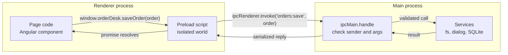
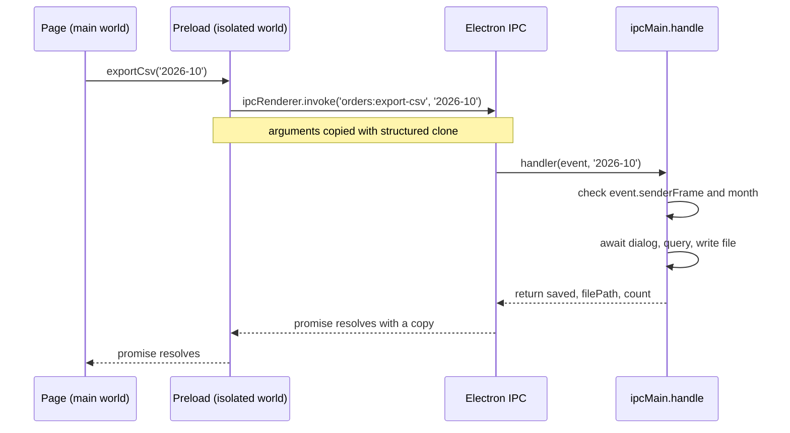
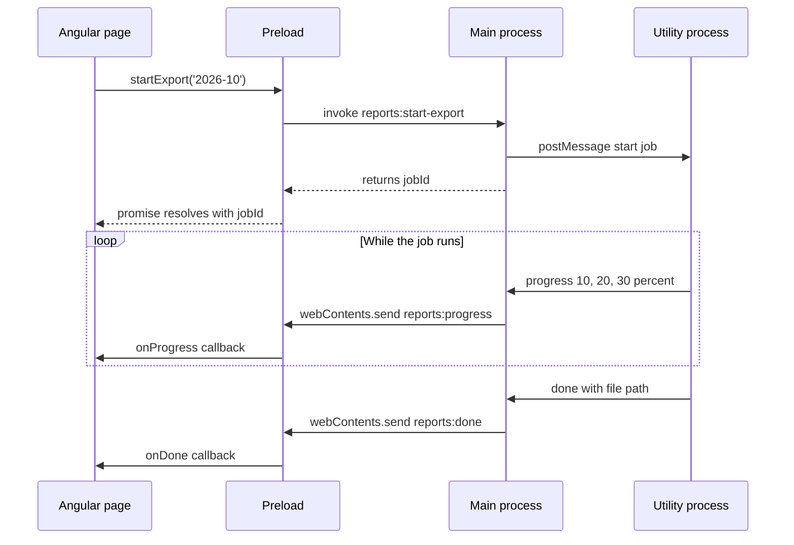

# IPC and Preload Scripts

> In this document you will learn how the processes of an Electron app talk to each other: request/response with `invoke`/`handle`, one-way messages, events from main to the page, and MessagePorts. You will learn to design a small, safe preload API with `contextBridge`, validate every message, handle errors and serialization correctly, build a fully typed IPC contract in TypeScript, and wrap it in an Angular service. IPC is the heart of every Electron app and the most common deep-dive topic in Electron interviews.

**Before this:** [Electron architecture and process model](01-electron-architecture-and-process-model.md) · [Promises](../02-javascript/17-callbacks-and-promises.md) · **Interview questions:** [jump to the interview section](#interview-questions)

## Table of contents

1. [Why IPC exists](#why-ipc-exists)
2. [The three layers of every IPC call](#the-three-layers-of-every-ipc-call)
3. [Pattern 1: request and response with invoke and handle](#pattern-1-request-and-response-with-invoke-and-handle)
4. [Pattern 2: one-way messages with send and on](#pattern-2-one-way-messages-with-send-and-on)
5. [Pattern 3: main to renderer with webContents.send](#pattern-3-main-to-renderer-with-webcontentssend)
6. [MessagePorts for direct and high-volume channels](#messageports-for-direct-and-high-volume-channels)
7. [Why you should avoid sendSync](#why-you-should-avoid-sendsync)
8. [Designing the preload API with contextBridge](#designing-the-preload-api-with-contextbridge)
9. [Serialization rules](#serialization-rules)
10. [Error handling across IPC](#error-handling-across-ipc)
11. [Validating the sender](#validating-the-sender)
12. [Validating the arguments](#validating-the-arguments)
13. [A typed IPC contract in TypeScript](#a-typed-ipc-contract-in-typescript)
14. [Listener cleanup](#listener-cleanup)
15. [Real-world patterns: subscriptions, progress, cancellation](#real-world-patterns-subscriptions-progress-cancellation)
16. [Large payloads](#large-payloads)
17. [Angular service that wraps the preload API](#angular-service-that-wraps-the-preload-api)
18. [Common mistakes](#common-mistakes)
19. [Best practices](#best-practices)
20. [How to explain IPC in an interview](#how-to-explain-ipc-in-an-interview)
21. [Interview questions](#interview-questions)
22. [Summary](#summary)
23. [References](#references)

---

## Why IPC exists

**IPC** (inter-process communication) means sending messages between processes.

An Electron app is several processes (see [the process model](01-electron-architecture-and-process-model.md#the-process-model-at-a-glance)). Each process has its **own memory**. The renderer cannot call a function in the main process, and it cannot read the main process's variables, because they live in a different memory space. The operating system enforces this separation.

So when the page needs something only the main process can do (open a file dialog, write to disk, print a receipt, read a setting from SQLite), it must **send a message** and wait for an answer. Electron provides the message channel: `ipcRenderer` on the renderer side and `ipcMain` on the main side.

### Analogy

Think of a bank. Customers (the renderer) stand in the public hall. The vault (files, OS, database) is in the back office (the main process). Customers cannot walk into the back office. They fill in a **form** (an IPC message) at the counter. The clerk (the preload) passes only approved form types to the back office. A back-office employee (the IPC handler) **checks the form** (validation) and decides whether to do the action. The customer gets back a **receipt** (the response).

Where the analogy breaks: a bank clerk might reject bad forms. In Electron, the preload is not a security boundary you can rely on, because the page decides what to put on the form. **All checks must happen in the main process.**

### Why this design is good

- **Security:** untrusted UI code never touches the file system or OS directly.
- **Stability:** a crash in the page does not corrupt main-process state.
- **Clear architecture:** the IPC channels are your app's internal API. You can document, type, validate and test them like a REST API.

---

## The three layers of every IPC call

Every call crosses three layers in two processes:



1. **Page** (main world): calls a function the preload exposed, like `window.orderDesk.saveOrder(order)`. It knows nothing about channels.
2. **Preload** (isolated world): turns that call into an IPC message on one fixed channel, like `ipcRenderer.invoke('orders:save', order)`.
3. **Main**: a handler registered for that channel checks **who sent it** and **what was sent**, does the work, and returns a result.

Keeping these layers separate gives you a clean internal API: page code depends on named functions, not on channel strings.

---

## Pattern 1: request and response with invoke and handle

### What it is

**`ipcRenderer.invoke(channel, ...args)`** sends a message and returns a **promise**. In the main process, **`ipcMain.handle(channel, handler)`** registers the function that answers. Whatever the handler returns (a value or a promise) becomes the promise's result in the renderer. If the handler throws, the promise rejects.

This is the pattern you will use for most calls. It is like an HTTP request to a local server.

### A small example

```js
// main.js
const { app, ipcMain } = require('electron');

ipcMain.handle('app:get-version', () => {
  return app.getVersion(); // "1.4.2"
});
```

```js
// preload.js
const { contextBridge, ipcRenderer } = require('electron');

contextBridge.exposeInMainWorld('orderDesk', {
  getVersion: () => ipcRenderer.invoke('app:get-version'),
});
```

```js
// renderer.js
window.orderDesk.getVersion().then((version) => {
  document.querySelector('#version').textContent = `v${version}`; // v1.4.2
});
```

### A realistic example: "Export orders" with a save dialog

```js
// main/ipc/export-handlers.js
const { BrowserWindow, dialog, ipcMain, app } = require('electron');
const fs = require('node:fs/promises');
const path = require('node:path');
const { isTrustedSender } = require('../ipc-security');
const { orderRepository } = require('../services/order-repository');
const { toCsv } = require('../services/csv');

ipcMain.handle('orders:export-csv', async (event, month) => {
  if (!isTrustedSender(event.senderFrame)) throw new Error('Unauthorized sender');
  if (typeof month !== 'string' || !/^\d{4}-(0[1-9]|1[0-2])$/.test(month)) {
    throw new Error('Month must look like 2026-10');
  }

  const win = BrowserWindow.fromWebContents(event.sender);
  const { canceled, filePath } = await dialog.showSaveDialog(win, {
    title: 'Export orders',
    defaultPath: path.join(app.getPath('documents'), `orders-${month}.csv`),
    filters: [{ name: 'CSV files', extensions: ['csv'] }],
  });
  if (canceled || !filePath) return { saved: false };

  const orders = await orderRepository.findByMonth(month);
  await fs.writeFile(filePath, toCsv(orders), 'utf8');
  return { saved: true, filePath, count: orders.length };
});
```

Notice three things:

1. The **user picks the file path** in a native dialog in main. The renderer never sends a path to write to. This removes a whole class of path attacks.
2. The handler checks the **sender** and the **argument** before doing anything.
3. It returns a **plain object**, which serializes cleanly.

### How it works inside (sequence)



Step by step:

1. The page calls `exportCsv('2026-10')`. Through the context bridge, this runs the preload's function.
2. The preload calls `ipcRenderer.invoke`. Electron **serializes** the arguments (structured clone), sends them to the main process, and immediately returns a pending promise. The page is not blocked; it can keep rendering.
3. In main, Electron finds the handler for `'orders:export-csv'` and calls it with an **event object** plus the arguments.
4. The handler validates, awaits the dialog and the file write. Main stays responsive during these awaits because they are asynchronous.
5. The handler's return value is serialized and sent back. The renderer's promise resolves with a **copy** of the object.

### Rules of `handle`

- **One handler per channel.** Calling `ipcMain.handle` twice for the same channel throws an error ("Attempted to register a second handler"). Use `ipcMain.removeHandler(channel)` first if you really need to replace it (for example in hot-reload during development).
- **`ipcMain.handleOnce`** answers a single call and then removes itself.
- If no handler is registered when the renderer invokes, the promise rejects with an error saying no handler is registered for that channel. Register handlers **before** you create windows.

---

## Pattern 2: one-way messages with send and on

### What it is

**`ipcRenderer.send(channel, ...args)`** sends a message and does **not** wait for an answer. The main process listens with **`ipcMain.on(channel, listener)`**. Unlike `handle`, many listeners can listen to the same channel.

Use it for "fire and forget" notifications where the page does not need a result: "the form is now dirty", "the user is active", "log this message".

```js
// preload.js
contextBridge.exposeInMainWorld('orderDesk', {
  setDirty: (isDirty) => ipcRenderer.send('editor:set-dirty', Boolean(isDirty)),
  logInfo: (message) => ipcRenderer.send('log:info', String(message).slice(0, 2000)),
});
```

```js
// main.js
ipcMain.on('log:info', (event, message) => {
  if (!isTrustedSender(event.senderFrame)) return;
  if (typeof message !== 'string') return;
  log.info('[renderer]', message);
});
```

### invoke vs send

| | `invoke` + `handle` | `send` + `on` |
| --- | --- | --- |
| Returns | A promise with the result | Nothing |
| Errors | Reject the promise | Lost (renderer never knows) |
| Handlers per channel | Exactly one | Any number |
| Use for | Most calls: queries, commands that can fail | Notifications, telemetry, logs |

Before `invoke` existed (Electron 7), people used `send` plus `event.reply(...)` from main and a second listener in the renderer to fake request/response. You may see this in old code. Use `invoke` instead; it handles matching replies to requests and errors for you.

---

## Pattern 3: main to renderer with webContents.send

### What it is

The main process often needs to **push** information to a page: download progress, "an update is ready", "the printer went offline", "new orders arrived from sync". It uses **`webContents.send(channel, ...args)`** on the target window's `webContents`. The renderer listens with **`ipcRenderer.on(channel, listener)`** in the preload.

There is no `invoke` in this direction. If main needs an answer from the page, the page replies with a separate `send` or `invoke` call.

### The safe preload pattern for events

```js
// preload.js
contextBridge.exposeInMainWorld('orderDesk', {
  onPrinterStatus: (callback) => {
    const listener = (_event, status) => callback(status); // drop the event object
    ipcRenderer.on('printer:status', listener);
    return () => ipcRenderer.removeListener('printer:status', listener); // unsubscribe
  },
});
```

Two important details:

1. **Do not pass the `event` object to the page.** The event's `sender` property is the `ipcRenderer` object. Passing `callback` directly to `ipcRenderer.on` would leak it. Wrap it and pass only the data.
2. **Return an unsubscribe function.** The page (for example an Angular component) calls it when it is destroyed. Otherwise listeners pile up and leak memory. See [Listener cleanup](#listener-cleanup).

```js
// ❌ Wrong: leaks ipcRenderer through event.sender, and cannot be removed
contextBridge.exposeInMainWorld('orderDesk', {
  onPrinterStatus: (callback) => ipcRenderer.on('printer:status', callback),
});

// ✅ Correct: data only, plus an unsubscribe function (shown above)
```

```js
// main/printer-monitor.js
const { windowManager } = require('./window-manager');

function reportPrinterStatus(status) {
  // status: { name: 'EPSON TM-T88V', online: false, reason: 'Paper out' }
  windowManager.broadcast('printer:status', status);
}
```

```js
// renderer
const stopWatching = window.orderDesk.onPrinterStatus((status) => {
  banner.textContent = status.online ? '' : `Printer offline: ${status.reason}`;
});
// later, when the screen closes:
stopWatching();
```

### Sending to the right window

`webContents.send` sends to the **main frame** of that page. Make sure the window still exists:

```js
function sendToWindow(win, channel, payload) {
  if (win && !win.isDestroyed() && !win.webContents.isDestroyed()) {
    win.webContents.send(channel, payload);
  }
}
```

If you need to target a specific iframe, `webContents.sendToFrame(frameId, channel, ...args)` exists, but most apps only talk to the main frame.

### Progress events: sequence

A typical long job (report export) uses `invoke` to start and events to report progress:



The full code for this pattern is in [Real-world patterns](#real-world-patterns-subscriptions-progress-cancellation).

---

## MessagePorts for direct and high-volume channels

### What it is

A **MessagePort** is one end of a two-way message channel. It is a standard web API (`MessageChannel` in browsers). Electron adds main-process versions: **`MessageChannelMain`** creates a pair of ports, and each **`MessagePortMain`** is one end.

You create a channel in main, keep or forward one end, and **transfer** the other end to a renderer. After that, the two ends talk **directly** without your main-process code relaying every message.

### Why it exists

- **Renderer ↔ renderer:** normal IPC has no direct path between two windows. Through main, every message is handled twice.
- **Renderer ↔ utility process:** for example, a renderer streams data from a background worker. With a port, main is not involved after setup. (This is a feature of `utilityProcess` that `child_process.fork` does not have.)
- **High volume:** for many messages per second, a dedicated port keeps that traffic separate from your other channels.

### Example: connect a renderer to a utility process

```js
// main.js
const { app, BrowserWindow, MessageChannelMain, utilityProcess } = require('electron');
const path = require('node:path');

app.whenReady().then(() => {
  const mainWindow = createMainWindow();
  const searchWorker = utilityProcess.fork(path.join(__dirname, 'search-worker.js'));

  mainWindow.webContents.once('did-finish-load', () => {
    const { port1, port2 } = new MessageChannelMain();
    searchWorker.postMessage({ type: 'connect' }, [port1]);          // one end to the worker
    mainWindow.webContents.postMessage('search:port', null, [port2]); // other end to the page
  });
});
```

```js
// search-worker.js (utility process)
const { searchIndex } = require('./search-index');

process.parentPort.on('message', (event) => {
  if (event.data.type !== 'connect') return;
  const [port] = event.ports;
  port.on('message', (msg) => {
    const results = searchIndex(msg.data.query).slice(0, 50);
    port.postMessage({ query: msg.data.query, results });
  });
  port.start(); // MessagePortMain does not deliver queued messages until start()
});
```

```js
// preload.js — receive the port and pass it to the page
const { ipcRenderer } = require('electron');

ipcRenderer.on('search:port', (event) => {
  const [port] = event.ports;
  // With context isolation, hand the port to the page with window.postMessage.
  // Naming the page's own origin (instead of '*', as in some examples) means the port
  // is not delivered if the window has somehow navigated to a different origin.
  window.postMessage({ type: 'search-port' }, 'app://bundle', [port]);
});
```

```js
// renderer page
window.addEventListener('message', (event) => {
  if (event.source !== window || event.data?.type !== 'search-port') return;
  const [port] = event.ports;
  port.onmessage = (msg) => renderResults(msg.data.results);
  searchBox.addEventListener('input', () => port.postMessage({ query: searchBox.value }));
});
```

Things to know:

- Ports can only be transferred with **`webContents.postMessage`**, **`ipcRenderer.postMessage`** and `utilityProcess` `postMessage`. `send` and `invoke` cannot transfer ports.
- In main, `MessagePortMain` uses **Node-style events** (`port.on('message', ...)`, read `event.data`) and needs **`port.start()`**. In the renderer it is a normal DOM `MessagePort` (`onmessage` starts it automatically).
- Electron adds a **`close`** event that fires when the other end closes or is garbage collected. Use it to clean up.
- **Security:** a port is a capability. Whoever holds it can send messages to the other side. Only transfer ports to trusted pages, and still validate messages in the worker.

### When to use MessagePorts

| Need | Use |
| --- | --- |
| Normal calls from page to main | `invoke`/`handle` |
| Main pushes occasional events | `webContents.send` |
| Two windows exchange lots of data | MessagePort between them |
| Page streams with a background worker | MessagePort between page and utility process |

---

## Why you should avoid sendSync

**`ipcRenderer.sendSync(channel, ...args)`** sends a message and **blocks the whole renderer process** until main answers (main sets `event.returnValue`). Electron's own docs say to use it only as a last resort.

```js
// ❌ Wrong: the page freezes until main answers
const settings = ipcRenderer.sendSync('settings:get-all');

// ✅ Correct: the page keeps running
const settings = await ipcRenderer.invoke('settings:get-all');
```

Why it is bad:

- While waiting, the renderer cannot paint, scroll or respond to clicks.
- If the main process is busy (or blocked), the renderer waits as long as main is stuck.
- If the main handler forgets to set `event.returnValue`, the renderer hangs.

The only common reason people use it is to get a value **synchronously at startup**. Better options: pass the value with `webPreferences.additionalArguments` (it appears in the preload's `process.argv`), or load it with `invoke` before you bootstrap the UI.

---

## Designing the preload API with contextBridge

### What it is

**`contextBridge.exposeInMainWorld(apiKey, api)`** makes `api` available in the page as `window[apiKey]`. It works across the isolation boundary: functions are **proxied** (calling them runs the preload's code), and data is **copied** (and frozen).

### Rules for a good preload API

1. **One function per action.** `saveOrder(order)`, not `invoke(channel, data)`.
2. **The preload chooses the channel.** The page cannot pass a channel name.
3. **Never expose `ipcRenderer`, `require`, `process`, `shell`, `fs` or similar objects.**
4. **Events go through wrappers** that drop the event object and return an unsubscribe function.
5. **Keep it thin.** No business logic in the preload. It only forwards. Validation happens in main.
6. **Group by feature:** `orderDesk.orders.save`, `orderDesk.reports.startExport`, `orderDesk.app.getInfo`.

```js
// ❌ Wrong: a generic gateway. Any script in the page can call any channel.
contextBridge.exposeInMainWorld('api', {
  invoke: (channel, ...args) => ipcRenderer.invoke(channel, ...args),
  on: (channel, cb) => ipcRenderer.on(channel, cb),
});
```

```js
// Still weak: an allowlist of channels is better than nothing,
// but the API is still stringly-typed and easy to widen by accident.
const ALLOWED = new Set(['orders:list', 'orders:save']);
contextBridge.exposeInMainWorld('api', {
  invoke: (channel, ...args) => {
    if (!ALLOWED.has(channel)) throw new Error('Channel not allowed');
    return ipcRenderer.invoke(channel, ...args);
  },
});
```

```js
// ✅ Correct: explicit functions; the preload owns channel names
contextBridge.exposeInMainWorld('orderDesk', {
  orders: {
    list: (filter) => ipcRenderer.invoke('orders:list', filter),
    save: (order) => ipcRenderer.invoke('orders:save', order),
  },
  reports: {
    startExport: (month) => ipcRenderer.invoke('reports:start-export', month),
    onProgress: (callback) => {
      const listener = (_event, payload) => callback(payload);
      ipcRenderer.on('reports:progress', listener);
      return () => ipcRenderer.removeListener('reports:progress', listener);
    },
  },
});
```

Why the explicit version is safer: if an attacker gets script execution in your page (XSS), they can only call `orders.list`, `orders.save` and `reports.startExport` — each one validated in main. With the generic gateway they can call **every** channel, including internal ones you never meant to expose, and listen to every event.

### What crosses the bridge

| Type | Works? | Notes |
| --- | --- | --- |
| `string`, `number`, `boolean` | Yes | |
| Plain objects and arrays | Yes | Copied and frozen; prototypes dropped |
| `Promise` | Yes | Returned promises work as normal promises in the page |
| `Function` | Yes | **Proxied**; calling it runs the original. Classes and constructors do not work |
| `Error` | Yes | Copied; message and stack may change; **custom properties are lost** |
| `Element`, `Blob`, cloneable types | Yes | |
| `Symbol` | No | Dropped |
| Class instances | Partly | Values copied, **prototype lost** (methods disappear) |
| `ipcRenderer` | No | Since Electron 29 it arrives as an empty object |

This is about the **context bridge** (preload world ↔ page world, same process). IPC between processes has its own, similar rules, covered next.

---

## Serialization rules

### What it is

When you send data over IPC, Electron **serializes** it (turns it into bytes), sends it to the other process, and **deserializes** it there. The result is a **copy**, never the same object. Electron uses the HTML **structured clone algorithm** for this, the same algorithm as `postMessage` and the global `structuredClone()` function.

Because Node.js has the same `structuredClone()`, you can **preview** what survives IPC with plain Node. The outputs below were produced by running the code with Node.js 22.

### What survives and what does not

```js
class Order {
  constructor(id, total) { this.id = id; this.total = total; }
  get totalWithTax() { return this.total * 1.18; }
  format() { return `#${this.id}`; }
}

const copy = structuredClone(new Order('SO-1', 100));
console.log(copy);                  // { id: 'SO-1', total: 100 }
console.log(copy instanceof Order); // false
console.log(typeof copy.format);    // undefined
console.log(copy.totalWithTax);     // undefined
```

The data fields survive. The **class, its methods and getters do not**. The receiver gets a plain object.

```js
const payload = {
  createdAt: new Date('2026-10-18T10:00:00Z'),
  tags: new Set(['urgent']),
  stock: new Map([['TEA-01', 4]]),
  big: 10n,
  nothing: undefined,
  pattern: /SO-\d+/g,
};
const p2 = structuredClone(payload);
console.log(p2.createdAt instanceof Date, p2.tags instanceof Set, p2.stock.get('TEA-01'), p2.big, 'nothing' in p2, p2.pattern);
// true true 4 10n true /SO-\d+/g
```

Unlike `JSON.stringify`, structured clone keeps `Date`, `Map`, `Set`, `BigInt`, `RegExp`, typed arrays, `undefined` properties, and even shared references and cycles:

```js
const customer = { name: 'Asha' };
const data = { a: customer, b: customer };
data.self = data;
const c = structuredClone(data);
console.log(c.a === c.b, c.self === c); // true true
```

Things that **throw**:

```js
structuredClone({ onDone: () => {} });          // DataCloneError: () => {} could not be cloned.
structuredClone({ p: Promise.resolve(1) });     // DataCloneError: #<Promise> could not be cloned.
structuredClone({ s: Symbol('x') });            // DataCloneError: Symbol(x) could not be cloned.
```

In Electron, sending these over IPC throws an error in the sender (Electron's docs list functions, promises, symbols, `WeakMap` and `WeakSet`). Electron objects backed by C++ (`BrowserWindow`, `WebContents`), DOM objects (`Element`) and some Node objects (for example `process.env`) cannot be sent either.

Buffers become plain `Uint8Array`s:

```js
const fromMain = structuredClone(Buffer.from('hi'));
console.log(Buffer.isBuffer(fromMain), fromMain.constructor.name); // false Uint8Array
```

So if main returns a `Buffer` (for example a PDF from `printToPDF`), the renderer receives a `Uint8Array`. That is fine for `new Blob([bytes])`.

### Practical rules

- Send **plain data**: strings, numbers, booleans, arrays, plain objects. Prefer ISO date strings (`'2026-10-18T10:00:00Z'`) in your contract; they are also easy to log and test.
- Do not send class instances and expect methods. Convert to plain objects (DTOs) and rebuild classes on the other side if needed.
- Never send functions or callbacks over IPC. For "call me back", use events (`webContents.send`) or MessagePorts.
- Remember that every message is a **copy**. Changing the object in the renderer does not change main's object.

---

## Error handling across IPC

### The problem

If an `ipcMain.handle` handler throws, the renderer's promise rejects. But the error that arrives is **not** the error you threw. Electron's docs say errors thrown through `handle` are not transparent: they are serialized, and only the `message` property of the original error reaches the renderer. The message is also wrapped with extra text.

```js
// main
ipcMain.handle('orders:get', async (_event, id) => {
  const order = await orderRepository.findById(id);
  if (!order) {
    const error = new Error('Order not found');
    error.code = 'ORDER_NOT_FOUND';   // custom property
    error.status = 404;
    throw error;
  }
  return order;
});
```

```js
// renderer
try {
  await window.orderDesk.orders.get('SO-999');
} catch (error) {
  console.log(error.message);
  // Error invoking remote method 'orders:get': Error: Order not found
  console.log(error.code);  // undefined — custom properties are lost
}
```

(The exact wording of the wrapped message comes from Electron and can change between versions. Do not parse it.)

The same loss happens with structured clone in general. Tested with Node.js:

```js
const err = new Error('Order not found');
err.code = 'ORDER_NOT_FOUND';
const copy = structuredClone(err);
console.log(copy instanceof Error, copy.message, copy.code); // true Order not found undefined
```

### The solution: return result objects for expected failures

Use **two kinds of failure**:

- **Expected business failures** (not found, validation failed, printer offline, permission denied): **return** a result object with a stable error `code`. The UI can react to the code.
- **Unexpected bugs** (a null reference, a crashed database): let them throw. Log them in main with the full stack. The renderer shows a generic "Something went wrong".

```js
// main/ipc/result.js
const ok = (data) => ({ ok: true, data });
const fail = (code, message) => ({ ok: false, error: { code, message } });
module.exports = { ok, fail };
```

```js
// main
ipcMain.handle('orders:get', async (event, id) => {
  if (!isTrustedSender(event.senderFrame)) throw new Error('Unauthorized sender');
  if (typeof id !== 'string' || !/^SO-\d{1,10}$/.test(id)) return fail('INVALID_ID', 'Invalid order ID');

  try {
    const order = await orderRepository.findById(id);
    return order ? ok(order) : fail('ORDER_NOT_FOUND', `Order ${id} was not found`);
  } catch (error) {
    log.error('orders:get failed', { id, error });              // full details stay in main's log
    return fail('INTERNAL', 'Could not load the order. Please try again.');
  }
});
```

```js
// renderer
const result = await window.orderDesk.orders.get(orderId);
if (result.ok) {
  showOrder(result.data);
} else if (result.error.code === 'ORDER_NOT_FOUND') {
  showEmptyState('This order no longer exists.');
} else {
  showToast(result.error.message);
}
```

Advantages:

- Error codes survive IPC and are easy to test.
- Internal details (SQL, file paths, stack traces) do not leak to the page.
- TypeScript can force the UI to handle the failure case (see the [typed contract](#a-typed-ipc-contract-in-typescript)).

An alternative is to throw an error whose `message` contains a JSON payload and parse it in the preload. It works, but it is fragile. Result objects are clearer.

---

## Validating the sender

### Why

Your IPC handlers can be called by **any frame in any renderer that has your preload**. That can include:

- A page that navigated to a different site (if navigation was not blocked).
- An `<iframe>` that loads third-party content (for example an embedded payment form or a help widget).
- A popup window.

The Electron security checklist says: validate the sender of **all** IPC messages.

### How

Each handler's `event` has **`event.senderFrame`**: the `WebFrameMain` that sent the message. Check its **`origin`** against an allowlist. Electron's docs recommend checking `origin` rather than the URL, because URLs like `about:blank` or `blob:` do not say who controls them.

`senderFrame` can be **`null`** if the frame navigated away or was destroyed before you read it. Treat `null` as untrusted.

```js
// main/ipc-security.js
const { app } = require('electron');

const TRUSTED_ORIGINS = new Set(['app://bundle']);
if (!app.isPackaged) TRUSTED_ORIGINS.add('http://localhost:4200'); // Angular dev server

function isTrustedSender(frame) {
  if (!frame) return false;               // frame is gone
  return TRUSTED_ORIGINS.has(frame.origin);
}

module.exports = { isTrustedSender };
```

```js
ipcMain.handle('settings:get', (event) => {
  if (!isTrustedSender(event.senderFrame)) {
    log.warn('Blocked settings:get from', event.senderFrame?.url);
    throw new Error('Unauthorized sender');
  }
  return settings.getPublicSettings();
});
```

### A trap: Node's `URL` and custom schemes

You might try `new URL(event.senderFrame.url).origin`. In the main process, `URL` is **Node's** parser. For a non-web scheme like `app:`, Node returns the origin `'null'`:

```js
console.log(new URL('app://bundle/index.html').origin); // null
```

(Verified with Node.js.) Chromium, which registered `app` as a standard scheme, reports `frame.origin` as `'app://bundle'`. So use **`frame.origin`** directly. If you ever compare against `'null'`, you would accept every opaque origin, which is exactly what you want to block.

### Checking the main frame only

If only your top-level page should call a channel (not iframes), also check that the sender is the main frame:

```js
function isTrustedMainFrame(event) {
  const frame = event.senderFrame;
  return frame !== null && frame === event.sender.mainFrame && TRUSTED_ORIGINS.has(frame.origin);
}
```

---

## Validating the arguments

### Why

Types in TypeScript disappear at runtime. A message from the renderer is **untrusted input**, like the body of an HTTP request. An attacker with XSS can send anything: a string where you expect a number, an object with extra fields, a 500 MB string, a path like `..\..\Windows\System32\config`.

### How

Validate every argument in main **before** using it:

- Check the **type** and **shape**.
- Check **ranges and formats** (IDs match a pattern, quantities are positive integers, strings have a maximum length).
- **Copy only the fields you expect** into a new object. Ignore everything else (`isAdmin: true` sneaked into an order object must not reach your database).

```js
// main/validation/order.js
function validateOrderInput(input) {
  if (typeof input !== 'object' || input === null || Array.isArray(input)) {
    throw new TypeError('Order must be an object');
  }
  const { customerId, items } = input;
  if (typeof customerId !== 'string' || !/^C-\d{1,10}$/.test(customerId)) {
    throw new TypeError('Invalid customerId');
  }
  if (!Array.isArray(items) || items.length === 0 || items.length > 200) {
    throw new TypeError('Items must be a non-empty array (max 200)');
  }
  for (const item of items) {
    if (typeof item?.sku !== 'string' || item.sku.length > 32) throw new TypeError('Invalid sku');
    if (!Number.isInteger(item.quantity) || item.quantity < 1 || item.quantity > 999) {
      throw new TypeError('Invalid quantity');
    }
  }
  // Return a NEW object with only the allowed fields
  return { customerId, items: items.map(({ sku, quantity }) => ({ sku, quantity })) };
}

console.log(validateOrderInput({
  customerId: 'C-42',
  items: [{ sku: 'TEA-01', quantity: 2, price: -1 }],
  isAdmin: true,
}));
// { customerId: 'C-42', items: [ { sku: 'TEA-01', quantity: 2 } ] }
```

(Output verified with Node.js. Note that `price` and `isAdmin` were dropped: the price must come from the database, never from the renderer.)

### Using a schema library

For many channels, a schema library such as **zod**, **valibot** or **ajv** (JSON Schema) is easier and gives you TypeScript types from the same schema:

```ts
import { z } from 'zod';

const OrderInputSchema = z.object({
  customerId: z.string().regex(/^C-\d{1,10}$/),
  items: z.array(z.object({
    sku: z.string().max(32),
    quantity: z.number().int().min(1).max(999),
  })).min(1).max(200),
}); // unknown keys are stripped by default

type OrderInput = z.infer<typeof OrderInputSchema>;

ipcMain.handle('orders:save', async (event, raw: unknown) => {
  if (!isTrustedSender(event.senderFrame)) throw new Error('Unauthorized sender');
  const parsed = OrderInputSchema.safeParse(raw);
  if (!parsed.success) return fail('VALIDATION', 'The order is not valid');
  return ok(await orderService.save(parsed.data));
});
```

Runtime validation is covered in depth in [Runtime validation and type-safe APIs](../03-typescript/11-runtime-validation-and-type-safe-apis.md).

### Never let the renderer decide dangerous things

Even with validation, some values should **not come from the renderer at all**:

| Instead of letting the page send… | Do this |
| --- | --- |
| A file path to write to | Main shows a save dialog, or builds the path from a validated ID inside `userData` |
| A URL to open with `shell.openExternal` | Main maps a key (`'help'`) to a fixed URL, or validates against an allowlist |
| A command line to run | Main has fixed commands; the page sends only validated parameters |
| A price or permission flag | Main reads it from the database or the auth token |

---

## A typed IPC contract in TypeScript

### The problem

With plain JavaScript, channel names are strings spread across three files. A typo (`'order:save'` vs `'orders:save'`) or a changed argument shape breaks the app only at runtime. In a big app with 50+ channels, this becomes painful.

### The solution: one shared contract file

Define every channel **once**, with its argument and result types. Main, preload and renderer all import the types from that file. The compiler then catches mismatches everywhere.

The code in this section was type-checked with TypeScript 5.9 in `--strict` mode (using small stand-in types for the `electron` module). The `@ts-expect-error` lines prove that wrong calls are rejected.

```text
src/
  shared/ipc-contract.ts   <- types only, imported by all three
  main/ipc.ts              <- typed handler registration + validators
  preload/preload.ts       <- typed API exposed with contextBridge
  renderer/global.d.ts     <- declares window.orderDesk for the page
```

### 1. The shared contract

```ts
// shared/ipc-contract.ts — the single source of truth for every IPC channel

export interface OrderItemInput {
  sku: string;
  quantity: number;
}

export interface OrderInput {
  customerId: string;
  items: OrderItemInput[];
}

export interface OrderSummary {
  id: string;
  customerName: string;
  total: number;
  createdAt: string; // ISO string: safe and simple to serialize
}

export interface OrderFilter {
  status: 'draft' | 'submitted' | 'all';
  limit: number;
}

export interface AppInfo {
  appVersion: string;
  electron: string;
  platform: string;
}

/** A result object instead of thrown errors, so error codes survive IPC. */
export type IpcResult<T> =
  | { ok: true; data: T }
  | { ok: false; error: { code: string; message: string } };

/** Request/response channels: renderer invokes, main handles. */
export interface InvokeChannels {
  'app:get-info': { args: []; result: AppInfo };
  'orders:list': { args: [filter: OrderFilter]; result: OrderSummary[] };
  'orders:save': { args: [order: OrderInput]; result: IpcResult<{ id: string }> };
  'reports:start-export': { args: [month: string]; result: IpcResult<{ jobId: string }> };
  'reports:cancel-export': { args: [jobId: string]; result: void };
}

/** Event channels: main sends, renderer subscribes. */
export interface EventChannels {
  'reports:progress': { jobId: string; percent: number };
  'reports:done': { jobId: string; filePath: string };
  'app:update-ready': { version: string };
}

export type InvokeChannel = keyof InvokeChannels;
export type EventChannel = keyof EventChannels;
export type ArgsOf<C extends InvokeChannel> = InvokeChannels[C]['args'];
export type ResultOf<C extends InvokeChannel> = InvokeChannels[C]['result'];
```

The contract uses **indexed access types** (`InvokeChannels[C]['args']`) and **labeled tuple types** (`[filter: OrderFilter]`). If these are new to you, see [keyof, typeof, indexed and mapped types](../03-typescript/06-keyof-typeof-indexed-and-mapped-types.md).

### 2. Main: typed handlers that must be validated

The key idea: **types describe what you expect; validators prove it at runtime.** A mapped type forces you to write a validator for every channel. If you add a channel to the contract and forget its validator, the code does not compile.

```ts
// main/ipc.ts
import { ipcMain, type IpcMainInvokeEvent, type WebContents, type WebFrameMain } from 'electron';
import type { ArgsOf, EventChannel, EventChannels, InvokeChannel, ResultOf } from '../shared/ipc-contract.js';

const TRUSTED_ORIGINS = new Set(['app://bundle']);

export function isTrustedSender(frame: WebFrameMain | null): boolean {
  return frame !== null && TRUSTED_ORIGINS.has(frame.origin);
}

/** Every channel MUST have a validator: forgetting one is a compile error. */
export type Validators = {
  [C in InvokeChannel]: (args: unknown[]) => ArgsOf<C>;
};

export function registerHandler<C extends InvokeChannel>(
  channel: C,
  validate: Validators[C],
  handler: (event: IpcMainInvokeEvent, ...args: ArgsOf<C>) => ResultOf<C> | Promise<ResultOf<C>>,
): void {
  ipcMain.handle(channel, (event, ...rawArgs: unknown[]) => {
    if (!isTrustedSender(event.senderFrame)) {
      throw new Error(`Blocked ${channel} from untrusted sender`);
    }
    const args = validate(rawArgs); // throws on bad input
    return handler(event, ...args);
  });
}

export function sendToRenderer<C extends EventChannel>(
  contents: WebContents,
  channel: C,
  payload: EventChannels[C],
): void {
  if (!contents.isDestroyed()) contents.send(channel, payload);
}
```

Validators (hand-written here; a schema library does the same job):

```ts
function expectString(value: unknown, name: string, pattern: RegExp): string {
  if (typeof value !== 'string' || !pattern.test(value)) throw new TypeError(`Invalid ${name}`);
  return value;
}

export const validators: Validators = {
  'app:get-info': (args) => {
    if (args.length !== 0) throw new TypeError('No arguments expected');
    return [];
  },
  'orders:list': ([filter]) => {
    const f = filter as { status?: unknown; limit?: unknown } | null;
    const status = f?.status;
    if (status !== 'draft' && status !== 'submitted' && status !== 'all') throw new TypeError('Invalid status');
    const limit = f?.limit;
    if (typeof limit !== 'number' || !Number.isInteger(limit) || limit < 1 || limit > 500) {
      throw new TypeError('Invalid limit');
    }
    return [{ status, limit }];
  },
  'orders:save': ([order]) => {
    const o = order as { customerId?: unknown; items?: unknown } | null;
    const customerId = expectString(o?.customerId, 'customerId', /^C-\d{1,10}$/);
    if (!Array.isArray(o?.items) || o.items.length === 0 || o.items.length > 200) {
      throw new TypeError('Invalid items');
    }
    const items = o.items.map((raw: unknown) => {
      const item = raw as { sku?: unknown; quantity?: unknown } | null;
      const sku = expectString(item?.sku, 'sku', /^[A-Z0-9-]{1,32}$/);
      const quantity = item?.quantity;
      if (typeof quantity !== 'number' || !Number.isInteger(quantity) || quantity < 1 || quantity > 999) {
        throw new TypeError('Invalid quantity');
      }
      return { sku, quantity };
    });
    return [{ customerId, items }];
  },
  'reports:start-export': ([month]) => [expectString(month, 'month', /^\d{4}-(0[1-9]|1[0-2])$/)],
  'reports:cancel-export': ([jobId]) => [expectString(jobId, 'jobId', /^[a-f0-9-]{36}$/)],
};
```

Using it:

```ts
registerHandler('orders:save', validators['orders:save'], async (_event, order) => {
  // `order` is typed as OrderInput AND has been validated at runtime
  const id = await orderService.save(order);
  return { ok: true, data: { id } };
});

// @ts-expect-error — wrong result shape is a compile error
registerHandler('app:get-info', validators['app:get-info'], () => ({ version: 1 }));
```

### 3. Preload: a typed API

```ts
// preload/preload.ts — bundled into ONE CommonJS file for the sandboxed preload
import { contextBridge, ipcRenderer, type IpcRendererEvent } from 'electron';
import type { ArgsOf, EventChannel, EventChannels, InvokeChannel, ResultOf } from '../shared/ipc-contract.js';

function invoke<C extends InvokeChannel>(channel: C, ...args: ArgsOf<C>): Promise<ResultOf<C>> {
  return ipcRenderer.invoke(channel, ...args);
}

function subscribe<C extends EventChannel>(
  channel: C,
  callback: (payload: EventChannels[C]) => void,
): () => void {
  const listener = (_event: IpcRendererEvent, payload: EventChannels[C]) => callback(payload);
  ipcRenderer.on(channel, listener);
  return () => ipcRenderer.removeListener(channel, listener);
}

const api = {
  app: {
    getInfo: () => invoke('app:get-info'),
    onUpdateReady: (callback: (payload: EventChannels['app:update-ready']) => void) =>
      subscribe('app:update-ready', callback),
  },
  orders: {
    list: (filter: ArgsOf<'orders:list'>[0]) => invoke('orders:list', filter),
    save: (order: ArgsOf<'orders:save'>[0]) => invoke('orders:save', order),
  },
  reports: {
    startExport: (month: string) => invoke('reports:start-export', month),
    cancelExport: (jobId: string) => invoke('reports:cancel-export', jobId),
    onProgress: (callback: (payload: EventChannels['reports:progress']) => void) =>
      subscribe('reports:progress', callback),
    onDone: (callback: (payload: EventChannels['reports:done']) => void) => subscribe('reports:done', callback),
  },
};

export type OrderDeskApi = typeof api;

contextBridge.exposeInMainWorld('orderDesk', api);
```

Note that `invoke` and `subscribe` are **private helpers inside the preload**. They are not exposed. The page only gets the named functions in `api`.

`export type OrderDeskApi = typeof api` derives the page's type directly from the real implementation, so they can never drift apart.

**Bundling matters here.** This preload imports from `../shared/ipc-contract.js`. With `import type`, TypeScript removes that import from the output, so it is fine. But if the preload imports any **runtime** value (for example a shared `CHANNELS` constant object), the compiled file contains a `require('../shared/...')`, which **fails in a sandboxed preload**. Bundle the preload into a single file (Vite, webpack, esbuild or electron-vite all do this).

### 4. Renderer: declare the global

```ts
// renderer/global.d.ts — tells TypeScript what the preload exposed
import type { OrderDeskApi } from '../preload/preload.js';

declare global {
  interface Window {
    orderDesk: OrderDeskApi;
  }
}

export {};
```

```ts
// renderer/orders-page.ts — fully typed calls
export async function submitOrder(): Promise<string> {
  const result = await window.orderDesk.orders.save({
    customerId: 'C-42',
    items: [{ sku: 'TEA-01', quantity: 2 }],
  });
  if (!result.ok) {
    return `Failed: ${result.error.code}`; // narrowed by the `ok` discriminant
  }
  return `Saved ${result.data.id}`;
}

// @ts-expect-error — quantity must be a number
window.orderDesk.orders.save({ customerId: 'C-1', items: [{ sku: 'A', quantity: '2' }] });

// @ts-expect-error — there is no such function in the API
window.orderDesk.orders.delete('SO-1');
```

### What the typed contract does and does not give you

| Gives you | Does not give you |
| --- | --- |
| Autocomplete for every API function | Runtime safety — an attacker ignores your types |
| Compile errors for wrong arguments or results | Protection against a compromised renderer |
| One place to see the whole internal API | Validation (you still need validators in main) |
| Safe refactoring of channel names | |

Remember: **TypeScript checks your code at compile time. Validators check messages at runtime.** You need both.

---

## Listener cleanup

### The problem

Every call to `ipcRenderer.on` adds a listener. If a component subscribes each time it is created and never unsubscribes, listeners pile up:

- The callback runs many times for one event (the progress bar jumps, a toast appears five times).
- Old component instances stay in memory, because the listener's closure references them (a **memory leak**; see [Memory management](../02-javascript/19-memory-management-and-garbage-collection.md)).
- Node's `EventEmitter` prints a `MaxListenersExceededWarning` after 10 listeners on one channel.

### The solution

Every subscription function in the preload **returns an unsubscribe function**, and the page calls it when it no longer needs the events.

```js
// preload.js
function subscribe(channel, callback) {
  const listener = (_event, payload) => callback(payload);
  ipcRenderer.on(channel, listener);
  return () => ipcRenderer.removeListener(channel, listener);
}

contextBridge.exposeInMainWorld('orderDesk', {
  onSyncStatus: (callback) => subscribe('sync:status', callback),
});
```

```js
// ❌ Wrong: removeAllListeners from the page side removes OTHER components' listeners too
contextBridge.exposeInMainWorld('orderDesk', {
  offSyncStatus: () => ipcRenderer.removeAllListeners('sync:status'),
});

// ❌ Wrong: removeListener with the page's callback does nothing,
// because the preload registered a different function (the wrapper)
contextBridge.exposeInMainWorld('orderDesk', {
  offSyncStatus: (callback) => ipcRenderer.removeListener('sync:status', callback),
});
```

The second wrong version is subtle. Two reasons it fails: the preload registered `listener` (the wrapper), not `callback`; and functions passed through the context bridge are proxies, so the same page function may not arrive as the same object twice. Returning an unsubscribe closure avoids both problems.

```ts
// Angular component (cleanup on destroy)
export class SyncBadgeComponent implements OnInit, OnDestroy {
  status = 'idle';
  private unsubscribe?: () => void;

  constructor(private zone: NgZone) {}

  ngOnInit(): void {
    this.unsubscribe = window.orderDesk.onSyncStatus((status) => {
      this.zone.run(() => (this.status = status)); // see the Angular section
    });
  }

  ngOnDestroy(): void {
    this.unsubscribe?.();
  }
}
```

In the main process, also clean up listeners you add with `ipcMain.on` for one window, and stop timers or workers that send to a window when it closes.

---

## Real-world patterns: subscriptions, progress, cancellation

### Pattern: long-running job with progress and cancel

A report export can take a minute. The UI should show progress and allow cancel. The design:

1. `startExport(month)` → `invoke` → main creates a **job ID**, starts the work in a utility process, and returns the ID **immediately**.
2. Main forwards progress as events tagged with the job ID: `reports:progress { jobId, percent }`.
3. `cancelExport(jobId)` → `invoke` → main tells the worker to stop.
4. When finished, main sends `reports:done { jobId, filePath }` (or `reports:failed`).

Why return a job ID instead of awaiting the whole export in one `invoke`? Because one long `invoke` cannot report progress, cannot be cancelled cleanly, and if the window reloads, the promise is lost. Job IDs make the job independent of one promise.

```js
// main/reports.js
const { ipcMain, utilityProcess, BrowserWindow } = require('electron');
const { randomUUID } = require('node:crypto');
const path = require('node:path');
const { isTrustedSender } = require('./ipc-security');
const { ok, fail } = require('./ipc/result');

const jobs = new Map(); // jobId -> { worker, webContents }

ipcMain.handle('reports:start-export', (event, month) => {
  if (!isTrustedSender(event.senderFrame)) throw new Error('Unauthorized sender');
  if (typeof month !== 'string' || !/^\d{4}-(0[1-9]|1[0-2])$/.test(month)) {
    return fail('INVALID_MONTH', 'Month must look like 2026-10');
  }
  if (jobs.size >= 2) return fail('BUSY', 'Two exports are already running');

  const jobId = randomUUID();
  const contents = event.sender;
  const worker = utilityProcess.fork(path.join(__dirname, 'workers', 'report-worker.js'), [], {
    serviceName: 'OrderDesk Report Export',
  });
  jobs.set(jobId, { worker, contents });

  worker.on('message', (msg) => {
    if (contents.isDestroyed()) return;
    if (msg.type === 'progress') contents.send('reports:progress', { jobId, percent: msg.percent });
    if (msg.type === 'done') contents.send('reports:done', { jobId, filePath: msg.filePath });
    if (msg.type === 'failed') contents.send('reports:failed', { jobId, message: 'Export failed' });
  });
  worker.on('exit', () => jobs.delete(jobId));

  // If the window closes, stop its jobs
  contents.once('destroyed', () => {
    const job = jobs.get(jobId);
    if (job) job.worker.kill();
  });

  worker.postMessage({ type: 'start', month });
  return ok({ jobId });
});

ipcMain.handle('reports:cancel-export', (event, jobId) => {
  if (!isTrustedSender(event.senderFrame)) throw new Error('Unauthorized sender');
  const job = jobs.get(jobId);
  if (job && job.contents === event.sender) job.worker.kill(); // only the owner can cancel
});
```

Note the last line: a window can only cancel **its own** job. Without that check, any trusted window could cancel another window's export by guessing or reading its ID.

```js
// renderer
async function exportMonth(month) {
  const started = await window.orderDesk.reports.startExport(month);
  if (!started.ok) return showToast(started.error.message);
  const { jobId } = started.data;

  const stopProgress = window.orderDesk.reports.onProgress((p) => {
    if (p.jobId === jobId) progressBar.value = p.percent;
  });
  const stopDone = window.orderDesk.reports.onDone((d) => {
    if (d.jobId !== jobId) return;
    showToast(`Saved to ${d.filePath}`);
    stopProgress();
    stopDone();
  });

  cancelButton.onclick = () => window.orderDesk.reports.cancelExport(jobId);
}
```

### Pattern: throttle high-frequency events

A worker might report progress 1,000 times per second. Sending each one over IPC wastes CPU in both processes and repaints the UI needlessly. Throttle in main:

```js
function createProgressForwarder(contents, jobId, intervalMs = 100) {
  let lastSent = 0;
  let lastPercent = -1;
  return (percent) => {
    const now = Date.now();
    if (percent === 100 || (now - lastSent >= intervalMs && percent !== lastPercent)) {
      lastSent = now;
      lastPercent = percent;
      if (!contents.isDestroyed()) contents.send('reports:progress', { jobId, percent });
    }
  };
}
```

### Pattern: state subscription (current value + changes)

For state like "is the user online" or "current sync status", a new screen needs the **current value** immediately and then **changes**. Expose both: `getSyncStatus()` (invoke) and `onSyncStatus(cb)` (events). Or let the subscribe function fetch the current value first:

```js
// preload.js
contextBridge.exposeInMainWorld('orderDesk', {
  watchSyncStatus: (callback) => {
    const listener = (_event, status) => callback(status);
    ipcRenderer.on('sync:status', listener);
    ipcRenderer.invoke('sync:get-status').then(callback); // initial value
    return () => ipcRenderer.removeListener('sync:status', listener);
  },
});
```

Subscribe **before** fetching the initial value, so you do not miss a change that happens in between.

### Pattern: broadcast state changes to all windows

When settings change in one window, every window should update:

```js
ipcMain.handle('settings:update', async (event, patch) => {
  if (!isTrustedSender(event.senderFrame)) throw new Error('Unauthorized sender');
  const next = await settingsService.update(validateSettingsPatch(patch));
  windowManager.broadcast('settings:changed', next); // includes the sender window
  return next;
});
```

---

## Large payloads

Every IPC message is copied (serialized in one process, deserialized in the other). Copying a few kilobytes is very fast. Copying hundreds of megabytes is slow, uses a lot of memory (the data exists in both processes at once) and can stall both processes.

Guidelines:

- **Pass references, not contents.** For files, let main read and process the file; send only results or a summary. If the page needs to display a large file (an image, a PDF), serve it through your custom protocol (for example `app://files/<id>`) so Chromium streams it, instead of sending bytes over IPC.
- **Page through data.** For a table of 200,000 orders, use `orders.list({ offset, limit: 100 })` with virtual scrolling, not one message with everything.
- **Chunk streams.** For live data (log tail, serial port data), send small chunks at a throttled rate, or use a MessagePort.
- **Use binary types for binary data.** Send `Uint8Array`/`ArrayBuffer`, not base64 strings (base64 is about 33% bigger and costs encoding time).
- **Measure.** If a message is over a few megabytes, ask whether it needs to cross IPC at all.

```js
// ❌ Wrong: send a 300 MB CSV to the page to parse it there
const text = await fs.readFile(bigCsvPath, 'utf8');
win.webContents.send('import:data', text);

// ✅ Correct: parse in a worker, send a summary and the first page of rows
const summary = await importWorker.parse(bigCsvPath); // { rowCount, errors, previewRows: first 100 }
win.webContents.send('import:summary', summary);
```

---

## Angular service that wraps the preload API

### Why wrap it

Angular components should not use `window.orderDesk` directly:

- **Testability:** a service can be replaced by a fake in unit tests.
- **Running in a browser:** during development or in a web build, `window.orderDesk` does not exist. The service can detect this and use fallbacks.
- **Change detection:** events from Electron arrive **outside the Angular zone**, so Angular does not know the UI must update. The service fixes this in one place.
- **RxJS:** the service can turn subscriptions into Observables that clean up automatically.

### The zone problem

Angular 16 uses **Zone.js** to know when to run change detection. Zone.js patches browser APIs in the page's world (events, timers, promises), so after any patched async callback, Angular checks the components.

The callbacks from your preload's `ipcRenderer.on` listeners are triggered by Electron IPC inside the preload's **isolated world**. Zone.js does not patch that, so the callback runs **outside** the Angular zone. Your component updates a property, but **the screen does not change** until something else (a click) triggers change detection. This is one of the most common Angular + Electron bugs.

The fix: run the callback inside the zone with **`NgZone.run`**. Angular change detection is explained in [Change detection and signals](../06-angular-16/10-change-detection-and-signals.md).

For promises returned by `invoke`, behavior can depend on how the promise crosses the bridge and how Zone.js handles it. Running the resolution inside `zone.run` as well makes the behavior predictable and costs almost nothing, so the service below does it for both.

### The service (Angular 16)

```ts
// src/app/core/desktop/desktop-api.service.ts
import { Injectable, NgZone } from '@angular/core';
import { Observable } from 'rxjs';
import type { OrderDeskApi } from '../../../../electron/preload/preload';
import type { OrderFilter, OrderInput, OrderSummary, IpcResult } from '../../../../electron/shared/ipc-contract';

@Injectable({ providedIn: 'root' })
export class DesktopApiService {
  private readonly api: OrderDeskApi | undefined = window.orderDesk;

  constructor(private readonly zone: NgZone) {}

  /** True when running inside Electron with our preload. */
  get isDesktop(): boolean {
    return this.api !== undefined;
  }

  listOrders(filter: OrderFilter): Promise<OrderSummary[]> {
    return this.inZone(this.requireApi().orders.list(filter));
  }

  saveOrder(order: OrderInput): Promise<IpcResult<{ id: string }>> {
    return this.inZone(this.requireApi().orders.save(order));
  }

  startExport(month: string): Promise<IpcResult<{ jobId: string }>> {
    return this.inZone(this.requireApi().reports.startExport(month));
  }

  /** Progress of one export job as an Observable; unsubscribing removes the IPC listener. */
  exportProgress$(jobId: string): Observable<number> {
    return new Observable<number>((subscriber) => {
      const unsubscribe = this.requireApi().reports.onProgress((progress) => {
        if (progress.jobId !== jobId) return;
        this.zone.run(() => {
          subscriber.next(progress.percent);
          if (progress.percent >= 100) subscriber.complete();
        });
      });
      return unsubscribe; // RxJS calls this on unsubscribe or complete
    });
  }

  /** Update notifications from the main process. */
  updateReady$(): Observable<string> {
    return new Observable<string>((subscriber) =>
      this.requireApi().app.onUpdateReady(({ version }) => this.zone.run(() => subscriber.next(version))),
    );
  }

  private requireApi(): OrderDeskApi {
    if (!this.api) throw new Error('Desktop features are not available in the browser build');
    return this.api;
  }

  /** Resolve or reject inside the Angular zone so change detection always runs. */
  private inZone<T>(promise: Promise<T>): Promise<T> {
    return new Promise<T>((resolve, reject) => {
      promise.then(
        (value) => this.zone.run(() => resolve(value)),
        (error) => this.zone.run(() => reject(error)),
      );
    });
  }
}
```

```ts
// src/app/reports/export-panel.component.ts
import { Component, OnDestroy } from '@angular/core';
import { Subscription } from 'rxjs';
import { DesktopApiService } from '../core/desktop/desktop-api.service';

@Component({
  selector: 'app-export-panel',
  template: `
    <button (click)="start()" [disabled]="running">Export October</button>
    <progress *ngIf="running" max="100" [value]="percent"></progress>
    <p *ngIf="message">{{ message }}</p>
  `,
})
export class ExportPanelComponent implements OnDestroy {
  running = false;
  percent = 0;
  message = '';
  private progressSub?: Subscription;

  constructor(private readonly desktop: DesktopApiService) {}

  async start(): Promise<void> {
    const started = await this.desktop.startExport('2026-10');
    if (!started.ok) {
      this.message = started.error.message;
      return;
    }
    this.running = true;
    this.progressSub = this.desktop.exportProgress$(started.data.jobId).subscribe({
      next: (percent) => (this.percent = percent),   // screen updates: we are inside the zone
      complete: () => {
        this.running = false;
        this.message = 'Export finished';
      },
    });
  }

  ngOnDestroy(): void {
    this.progressSub?.unsubscribe(); // also removes the IPC listener
  }
}
```

Also add `orderDesk` to the `Window` type in the Angular project (the `global.d.ts` from the [typed contract](#4-renderer-declare-the-global)), and include that file in `tsconfig.app.json`.

### Testing the component without Electron

```ts
const fakeDesktop: Partial<DesktopApiService> = {
  startExport: () => Promise.resolve({ ok: true, data: { jobId: 'job-1' } }),
  exportProgress$: () => of(50, 100),
};

TestBed.configureTestingModule({
  declarations: [ExportPanelComponent],
  providers: [{ provide: DesktopApiService, useValue: fakeDesktop }],
});
```

Angular testing is covered in [Angular testing](../06-angular-16/14-testing.md).

> **Newer Angular (17+):** signals became stable in Angular 17, so you can expose these values as signals (for example with `toSignal(this.desktop.updateReady$())`). Zoneless change detection arrived later (experimental in 18, developer preview in 20.0, stable in 20.2). In a zoneless app you update a signal instead of calling `NgZone.run`; signals notify Angular directly.

---

## Common mistakes

1. **Exposing `ipcRenderer` or a generic `invoke(channel, ...)` to the page.** Any XSS can then call every channel.
2. **Passing the page's callback directly to `ipcRenderer.on`.** Leaks the event object (with `sender`) and cannot be removed.
3. **No unsubscribe function.** Listeners pile up; callbacks run many times; memory leaks.
4. **No sender check.** Iframes, popups or navigated pages can call your handlers.
5. **Trusting TypeScript types at runtime.** Types vanish after compilation. Validate in main.
6. **Letting the renderer send file paths, URLs, commands or prices.** Decide dangerous values in main.
7. **Using `sendSync`.** Freezes the renderer.
8. **Expecting custom error properties after `invoke` rejects.** Only the message arrives (wrapped). Use result objects.
9. **Sending class instances and calling their methods on the other side.** Prototypes are lost.
10. **Sending huge payloads.** Copies are slow and double memory. Page, chunk or stream.
11. **Calling `ipcMain.handle` twice for one channel** (for example in a function that runs per window). It throws. Register handlers once at startup.
12. **Forgetting `NgZone.run` in Angular.** Data arrives but the screen does not update.
13. **Comparing `new URL(frame.url).origin` for custom schemes in main.** Node returns `'null'`. Use `frame.origin`.
14. **Requiring a local file from a sandboxed preload.** Fails; bundle the preload.

## Best practices

- **Design IPC like a public API.** Name channels `domain:action` (`orders:save`), document them in one contract file, and version them carefully. Reason: clarity and safe refactoring.
- **Prefer `invoke`/`handle`.** Reason: results and errors come back; no manual reply matching.
- **Validate sender and arguments in every handler, in main.** Reason: the renderer is untrusted.
- **Use a central `registerHandler` wrapper.** Reason: sender checks, validation, logging and error mapping happen in one place, so no handler can forget them.
- **Return result objects for expected failures.** Reason: error codes survive IPC and internals do not leak.
- **Expose narrow, grouped functions with `contextBridge`.** Reason: least privilege.
- **Return unsubscribe functions for every event subscription.** Reason: no leaks, no duplicate callbacks.
- **Use job IDs for long tasks; throttle progress events.** Reason: cancellable, resilient, efficient.
- **Keep payloads small; send plain data.** Reason: speed and predictable serialization.
- **Bundle the preload; keep it thin.** Reason: sandbox compatibility and a small attack surface.
- **In Angular, wrap the API in a service with `NgZone.run` and Observables.** Reason: change detection, testability and automatic cleanup.

---

## How to explain IPC in an interview

1. **Define it:** "IPC in Electron is message passing between the main process and renderer processes. They are separate processes with separate memory, so they cannot call each other's functions. Electron gives us `ipcRenderer` in the renderer and `ipcMain` in main."
2. **Why it exists:** "The renderer is untrusted web content without Node.js, and main has full system access. IPC is the narrow, controlled gate between them."
3. **How it works:** "For request/response I use `ipcRenderer.invoke` with `ipcMain.handle`, which returns a promise. For one-way messages I use `send` with `ipcMain.on`. For pushing from main I use `webContents.send`, and for direct high-volume channels, MessagePorts. Data is copied with the structured clone algorithm, so functions and class prototypes do not survive, and thrown errors only keep their message."
4. **Small example:** "The preload exposes `window.api.saveOrder(order)` with `contextBridge`. That calls `invoke('orders:save', order)`. In main, the handler checks `event.senderFrame.origin`, validates the order with a schema, saves it, and returns `{ ok: true, data: { id } }`."
5. **Where it is useful:** "Every desktop feature: file dialogs, saving, printing, update notifications, progress bars for long jobs, and syncing state between windows."
6. **Trade-offs / gotchas:** "Never expose `ipcRenderer` itself or a generic channel gateway. Always return an unsubscribe function for events. Avoid `sendSync` because it blocks the renderer. Keep payloads small. And in Angular, IPC callbacks run outside the zone, so I wrap them in `NgZone.run`."

---

## Interview questions

### Q1. How do the main and renderer processes communicate in Electron?

**What the interviewer is checking:** That you know all the IPC patterns and when to use each.

**Short spoken answer (30–60 seconds):**
> They communicate by sending messages over IPC, because they are separate processes with separate memory. For request and response, the renderer calls `ipcRenderer.invoke` and main answers with `ipcMain.handle`; the renderer gets a promise with the result. For one-way messages, the renderer uses `ipcRenderer.send` and main listens with `ipcMain.on`. For main to renderer, main calls `webContents.send` on a window, and the preload listens with `ipcRenderer.on`. For direct or high-volume channels, for example between two windows or a window and a utility process, main creates a `MessageChannelMain` and transfers the ports. In a secure app, the page never touches `ipcRenderer`; the preload exposes small functions through `contextBridge`.

**Follow-up questions:**
- **Which pattern do you use most?** — `invoke`/`handle`, because it gives results and errors and is easy to reason about, like a local HTTP API.
- **Is there an `invoke` from main to the renderer?** — No. Main sends an event; if it needs an answer, the renderer replies with its own `send` or `invoke`. Use a request ID to match replies.
- **Can renderers talk directly?** — Not with plain IPC. Use main as a broker or give both a MessagePort.

**Common mistakes:** Mentioning only `send`/`on` (the old style). Forgetting `webContents.send` for the main-to-renderer direction.

**Where this is used in real projects:** All features that need the OS: files, printing, notifications, updates, settings.

---

### Q2. What is the difference between `ipcRenderer.invoke` and `ipcRenderer.send`?

**What the interviewer is checking:** Request/response vs fire-and-forget, and their error behavior.

**Short spoken answer (30–60 seconds):**
> `invoke` is request/response. It returns a promise, main handles it with `ipcMain.handle`, the return value comes back as the result, and if the handler throws, the promise rejects. There can be only one handler per channel. `send` is fire-and-forget. It returns nothing, main listens with `ipcMain.on`, any number of listeners can listen, and if something fails the renderer never knows. I use `invoke` for anything that returns data or can fail, and `send` only for notifications like "the form is dirty" or log messages.

**Follow-up questions:**
- **What happens if you call `ipcMain.handle` twice for the same channel?** — It throws an error. Remove the old handler with `ipcMain.removeHandler` first, or register once at startup.
- **What happens if no handler is registered?** — The `invoke` promise rejects with an error saying no handler is registered for that channel.
- **How did people do request/response before `invoke`?** — `send` plus `event.reply` in main and a separate listener in the renderer, matching requests manually.

**Common mistakes:** Thinking `send` waits for main. Not knowing about the one-handler rule.

**Where this is used in real projects:** Queries and commands use `invoke`; telemetry and dirty flags use `send`.

---

### Q3. What is `contextBridge`, and why must you not expose `ipcRenderer` directly?

**What the interviewer is checking:** The core security idea of the preload.

**Short spoken answer (30–60 seconds):**
> `contextBridge.exposeInMainWorld` lets the preload, which runs in an isolated JavaScript world, give the page a safe API object on `window`. Functions are proxied and data is copied, so the page cannot reach into the preload's scope. If I exposed `ipcRenderer` itself, or a generic `invoke(channel, data)`, any script that runs in the page — for example through XSS — could call every IPC channel, including internal ones, and listen to every event. So I expose one small function per action, the preload chooses the channel, and main still validates everything. Since Electron 29, `ipcRenderer` cannot even cross the bridge, but a generic wrapper is just as dangerous.

**Follow-up questions:**
- **Is an allowlist of channels in a generic wrapper acceptable?** — Better than nothing, but explicit functions are clearer, typed, and harder to widen by accident.
- **Does a safe preload mean handlers do not need validation?** — No. The page controls the arguments. Validation must be in main.
- **What does `contextBridge` do with a returned class instance?** — Copies its own data, drops the prototype, so methods are gone.

**Common mistakes:** `exposeInMainWorld('electron', { ipcRenderer })`. Passing callbacks straight to `ipcRenderer.on`.

**Where this is used in real projects:** Every secure Electron app and every Electron security review.

---

### Q4. How do you validate IPC messages in the main process?

**What the interviewer is checking:** Treating IPC as an untrusted API boundary.

**Short spoken answer (30–60 seconds):**
> Two checks in every handler. First the sender: I read `event.senderFrame`, return false if it is null, and compare its `origin` to an allowlist like `app://bundle`, plus `localhost` in development. Second the arguments: types are gone at runtime, so I validate with a schema — type, shape, ranges, string lengths, ID patterns — and build a new object with only the expected fields. I also design handlers so dangerous values never come from the renderer: main shows the save dialog instead of accepting a path, and main reads prices from the database. I put all of this in a `registerHandler` wrapper so no handler can skip it.

**Code:**

```js
function registerHandler(channel, schema, handler) {
  ipcMain.handle(channel, async (event, raw) => {
    if (!isTrustedSender(event.senderFrame)) throw new Error('Unauthorized sender');
    const parsed = schema.safeParse(raw);
    if (!parsed.success) return { ok: false, error: { code: 'VALIDATION', message: 'Invalid input' } };
    return handler(event, parsed.data);
  });
}
```

**Follow-up questions:**
- **Why `origin` and not the URL?** — Electron's docs recommend `origin` because URLs such as `about:blank` or `blob:` do not identify who controls the content.
- **Why can `senderFrame` be null?** — If the frame navigated or was destroyed after sending. Treat null as untrusted.
- **Why not `new URL(frame.url).origin`?** — In main, Node's `URL` returns `'null'` for custom schemes like `app:`.

**Common mistakes:** Only validating in the preload. Checking `url.startsWith('app://')` style strings.

**Where this is used in real projects:** Security reviews; preventing XSS from escalating to file or OS access.

---

### Q5. What can and cannot be sent over IPC?

**What the interviewer is checking:** Structured clone knowledge.

**Short spoken answer (30–60 seconds):**
> IPC uses the structured clone algorithm, so the other side gets a copy. Primitives, plain objects, arrays, `Date`, `Map`, `Set`, `RegExp`, `BigInt`, typed arrays and `ArrayBuffer`s work, and even cycles survive. Functions, promises, symbols, `WeakMap` and `WeakSet` throw. DOM elements and Electron objects like `BrowserWindow` cannot be sent. Class instances arrive as plain objects without methods, and a Node `Buffer` arrives as a `Uint8Array`. So I design the contract with plain data, usually ISO strings for dates.

**Follow-up questions:**
- **How can you check what survives?** — Run `structuredClone(value)` in Node or the browser; it uses the same algorithm.
- **What about `undefined` properties?** — Kept by structured clone (unlike JSON).

**Common mistakes:** Assuming JSON rules (dates becoming strings) or assuming object identity is shared.

**Where this is used in real projects:** Designing DTOs for the IPC contract.

---

### Q6. What does this print in the renderer?

```js
// main
class Order {
  constructor(id, total) { this.id = id; this.total = total; }
  format() { return `#${this.id}`; }
}
ipcMain.handle('orders:get', () => new Order('SO-1', 100));

// renderer
const order = await window.orderDesk.getOrder();
console.log(order);
console.log(typeof order.format);
```

**Answer:**

```text
{ id: 'SO-1', total: 100 }
undefined
```

**Why:**
1. The handler returns an `Order` instance.
2. Electron serializes it with structured clone. Structured clone copies **own data properties** (`id`, `total`) but not the prototype.
3. The renderer receives a **plain object**. `format` lived on `Order.prototype`, which was not copied, so `typeof order.format` is `'undefined'`.

The same result is produced by `structuredClone(new Order('SO-1', 100))` in Node.js, which we ran to confirm it. (Browser DevTools may print the object as `{id: 'SO-1', total: 100}`.)

---

### Q7. What does the renderer see here?

```js
// main
ipcMain.handle('orders:delete', () => {
  const error = new Error('Order is already shipped');
  error.code = 'ALREADY_SHIPPED';
  throw error;
});

// renderer
try {
  await window.orderDesk.deleteOrder('SO-1');
} catch (e) {
  console.log(e.code);
  console.log(e.message.includes('Order is already shipped'));
}
```

**Answer:**

```text
undefined
true
```

**Why:** Errors thrown in `ipcMain.handle` are serialized, and only the original `message` reaches the renderer, wrapped in extra text (in current versions it looks like `Error invoking remote method 'orders:delete': Error: Order is already shipped`). Custom properties like `code` are lost. This is Electron behavior (documented in the `ipcMain` and `ipcRenderer` docs); the `code` loss matches what `structuredClone` does to an `Error` in Node.js, which we verified. Fix: return `{ ok: false, error: { code: 'ALREADY_SHIPPED', message } }` instead of throwing.

---

### Q8. How do you handle errors across IPC?

**What the interviewer is checking:** A deliberate error strategy.

**Short spoken answer (30–60 seconds):**
> I separate expected failures from bugs. Expected failures — validation errors, not found, printer offline, permission denied — are returned as result objects like `{ ok: false, error: { code, message } }`, because thrown errors lose everything except the message when they cross IPC. Unexpected exceptions are caught in my handler wrapper, logged in main with the full stack and context, and returned as a generic `INTERNAL` error, so I do not leak file paths or SQL to the page. In TypeScript the result is a discriminated union, so the UI is forced to handle both cases.

**Follow-up questions:**
- **Why not throw and parse the message?** — The message is wrapped by Electron and the format is not a contract. Parsing it is fragile.
- **What about timeouts?** — `invoke` has no built-in timeout. For calls that can hang (hardware, network), add a timeout in main (for example with `AbortSignal.timeout`) and return a `TIMEOUT` error.

**Common mistakes:** Relying on `error.code` in the renderer. Sending raw exception stacks to the UI.

**Where this is used in real projects:** Consistent error UX across a large app.

---

### Q9. How do you send events from main to a renderer safely, and how do you clean them up?

**What the interviewer is checking:** The preload subscription pattern.

**Short spoken answer (30–60 seconds):**
> Main calls `webContents.send(channel, payload)` on the target window, after checking it is not destroyed. In the preload I expose a function like `onProgress(callback)` that registers a wrapper listener with `ipcRenderer.on`. The wrapper drops the event object and calls the callback with the data only, so I do not leak `event.sender`. The function returns an unsubscribe function that calls `removeListener` with the same wrapper. The page — in Angular, the component's `ngOnDestroy` or the Observable teardown — calls it. Without cleanup, listeners pile up and callbacks run many times.

**Follow-up questions:**
- **Why not expose `removeAllListeners(channel)`?** — It removes other components' listeners on that channel too.
- **Why does `removeListener(channel, callback)` with the page's callback fail?** — The registered function is the wrapper, not the callback; also bridged functions are proxies.

**Common mistakes:** `ipcRenderer.on(channel, callback)` directly. No unsubscribe.

**Where this is used in real projects:** Update notifications, sync status, download progress, hardware events.

---

### Q10. Why is `sendSync` discouraged?

**Short answer:** It blocks the **entire renderer process** until main replies. The page cannot paint or respond, and if main is slow or stuck, the page freezes too. If the handler forgets `event.returnValue`, the renderer hangs. Use `invoke` instead. If you need a value at startup, pass it via `webPreferences.additionalArguments` or fetch it with `invoke` before bootstrapping the UI.

---

### Q11. What are MessagePorts in Electron, and when would you use them?

**What the interviewer is checking:** Knowledge beyond basic IPC.

**Short spoken answer (30–60 seconds):**
> A MessagePort is one end of a two-way channel, the same concept as the web's `MessageChannel`. In main, `MessageChannelMain` creates two ports. I can transfer one to a renderer with `webContents.postMessage` and the other to another renderer or a utility process. After that, the two ends talk directly, and my main-process code is not in the middle of every message. I use it for renderer-to-renderer communication, or to let a page stream data with a background worker, like a search index. In main the port uses Node-style events and needs `start()`. A port is a capability, so I only give it to trusted pages.

**Follow-up questions:**
- **Can you send a port with `ipcRenderer.send`?** — No. Only `postMessage` methods can transfer ports.
- **How does the port reach the page with context isolation?** — The preload receives it in `event.ports` and forwards it with `window.postMessage(data, origin, [port])`; the page checks `event.source === window`.
- **How do you know the other side closed?** — Electron adds a `close` event on ports.

**Common mistakes:** Forgetting `port.start()` in main. Believing ports bypass the need for validation.

**Where this is used in real projects:** Multi-window editors, worker-backed search, streaming device data.

---

### Q12. Design a typed IPC layer in TypeScript. How do you keep main, preload and renderer in sync?

**What the interviewer is checking:** Senior-level API design with TypeScript.

**Short spoken answer (30–60 seconds):**
> I create one shared contract file that maps every invoke channel to its argument tuple and result type, and every event channel to its payload type. Main registers handlers through a generic `registerHandler<C>` that infers argument and result types from the contract and also requires a runtime validator — I use a mapped type so a missing validator is a compile error. The preload has private typed `invoke` and `subscribe` helpers and builds a named API object; I export `type Api = typeof api`. The renderer declares `window.orderDesk: Api` in a `global.d.ts`. So a renamed channel or changed argument breaks the build in all three places, while the validators still protect at runtime.

**Code:** See [A typed IPC contract in TypeScript](#a-typed-ipc-contract-in-typescript).

**Follow-up questions:**
- **Why are types not enough?** — They disappear after compilation; a compromised renderer can send anything.
- **What breaks if the preload imports a runtime constant from the shared file?** — The output contains `require('../shared/...')`, which fails in a sandboxed preload. Bundle it, or use `import type` only.
- **How would you generate validators and types from one source?** — Define zod schemas and derive types with `z.infer`, so the schema is the single source of truth.

**Common mistakes:** Typing only the renderer side. Using `any` for handler args.

**Where this is used in real projects:** Large apps with dozens of channels and several developers.

---

### Q13. Your Angular component receives data from Electron, but the screen does not update until you click somewhere. Why?

**What the interviewer is checking:** Zone.js understanding in an Electron context.

**Short spoken answer (30–60 seconds):**
> Angular 16 runs change detection after async work that Zone.js knows about. The IPC listener callback is triggered from the preload's isolated world by Electron, and Zone.js has not patched that, so the callback runs outside the Angular zone. The component property changes, but Angular does not check the view until some other zone event, like a click. The fix is to wrap the callback in `NgZone.run`, ideally in one service that turns IPC events into Observables. Calling `ChangeDetectorRef.detectChanges` also works locally, but fixing it once in the service is cleaner.

**Code:**

```ts
exportProgress$(jobId: string): Observable<number> {
  return new Observable((subscriber) =>
    window.orderDesk.reports.onProgress((p) => {
      if (p.jobId === jobId) this.zone.run(() => subscriber.next(p.percent));
    }),
  );
}
```

**Follow-up questions:**
- **What about OnPush components?** — `zone.run` triggers change detection, but an OnPush component only updates if its inputs change, an event fires inside it, or it uses the `async` pipe or `markForCheck`. With Observables and the `async` pipe, it works.
- **How does this change with newer Angular?** — With signals (stable in 17) and zoneless change detection (stable in Angular 20.2), you set a signal and Angular is notified without Zone.js.

**Common mistakes:** Adding `setTimeout` hacks. Calling `zone.run` in every component instead of one service.

**Where this is used in real projects:** Every Angular + Electron app with progress, update or sync events.

---

### Q14. Code review: find the problems.

```js
// preload.js
contextBridge.exposeInMainWorld('api', {
  send: (channel, data) => ipcRenderer.send(channel, data),
  on: (channel, cb) => ipcRenderer.on(channel, cb),
  readFile: (p) => ipcRenderer.sendSync('fs:read', p),
});

// main.js
ipcMain.on('fs:read', (event, p) => {
  event.returnValue = fs.readFileSync(p, 'utf8');
});
```

**What the interviewer is checking:** Spotting several IPC and security problems at once.

**Short spoken answer (30–60 seconds):**
> There are five problems. One, `send` with any channel lets the page send every message, including internal ones. Two, `on` passes the page's callback straight to `ipcRenderer.on`, which leaks the event object with `sender`, and there is no way to unsubscribe. Three, `readFile` uses `sendSync`, which blocks the renderer. Four, main reads **any path** the page sends, with no sender check — an XSS could read `C:\Users\...\.ssh` or browser cookies. Five, main uses `readFileSync`, which blocks the main process and freezes all windows on a big file. I would replace it with specific functions, `invoke`/`handle`, a sender check, a path that is validated against an allowed folder or chosen in a dialog, and `fs/promises`.

**Fixed version:**

```js
// preload.js
contextBridge.exposeInMainWorld('orderDesk', {
  openOrderFile: () => ipcRenderer.invoke('orders:open-file'), // main shows the dialog
  onOrderImported: (callback) => {
    const listener = (_e, summary) => callback(summary);
    ipcRenderer.on('orders:imported', listener);
    return () => ipcRenderer.removeListener('orders:imported', listener);
  },
});

// main.js
ipcMain.handle('orders:open-file', async (event) => {
  if (!isTrustedSender(event.senderFrame)) throw new Error('Unauthorized sender');
  const win = BrowserWindow.fromWebContents(event.sender);
  const { canceled, filePaths } = await dialog.showOpenDialog(win, {
    properties: ['openFile'],
    filters: [{ name: 'Order files', extensions: ['json'] }],
  });
  if (canceled) return { ok: false, error: { code: 'CANCELED', message: 'No file selected' } };
  const text = await fs.promises.readFile(filePaths[0], 'utf8');
  return { ok: true, data: parseOrders(text) };
});
```

**Follow-up questions:**
- **If the page must read files from one folder, how do you allow it safely?** — Accept only a relative name, resolve it inside the allowed folder, and reject anything that escapes it. See [Filesystem, child processes and native features](05-filesystem-child-processes-and-native-features.md).

**Common mistakes:** Finding only the `sendSync` problem.

**Where this is used in real projects:** Pull-request reviews of preload and IPC code.

---

### Q15. A user reports that a toast appears three times for one event. What is the likely cause?

**What the interviewer is checking:** Listener-leak debugging.

**Short spoken answer (30–60 seconds):**
> Most likely duplicate IPC listeners. A component subscribes with `ipcRenderer.on` through the preload every time it is created — for example on route changes — and never unsubscribes. After visiting the screen three times, there are three listeners, so the toast fires three times. It could also be that the main process registers its event forwarding once per window open, so it sends three times. I would check `ipcRenderer.listenerCount(channel)` in the preload during debugging, and fix it by returning an unsubscribe function from the preload and calling it in `ngOnDestroy` or through Observable teardown.

**Follow-up questions:**
- **What warning might you see?** — Node's `MaxListenersExceededWarning` after more than 10 listeners on one channel.

**Common mistakes:** Debouncing the toast to hide the symptom.

**Where this is used in real projects:** SPAs with route-based components that subscribe to desktop events.

---

### Q16. How would you implement a long-running export with progress and cancel over IPC?

**What the interviewer is checking:** End-to-end design across processes.

**Short spoken answer (30–60 seconds):**
> I would not await the whole export in one `invoke`. Instead, `startExport` is an `invoke` that validates the input, creates a job ID with `crypto.randomUUID`, starts the work in a utility process, and returns the ID immediately. The worker posts progress to main; main throttles it to around ten updates per second and forwards it with `webContents.send`, tagged with the job ID. `cancelExport(jobId)` is another `invoke` that kills the worker, and main checks that the window cancelling is the one that started the job. When the window is destroyed, main kills its jobs. Done and failed are separate events.

**Code:** See [Real-world patterns](#real-world-patterns-subscriptions-progress-cancellation).

**Follow-up questions:**
- **Why a job ID?** — Multiple jobs can run, progress events are matched to the right job, and the job survives a page reload (the page can ask for the job status again).
- **What if the user closes the app during an export?** — Kill workers in `before-quit`, and delete partial output files, or write to a temp file and rename at the end.

**Common mistakes:** Running the export in main synchronously. No ownership check on cancel.

**Where this is used in real projects:** Reports, imports, backups, large uploads.

---

### Q17. How do you send a large file (for example a 200 MB video) from main to the renderer?

**What the interviewer is checking:** Awareness of copying costs.

**Short spoken answer (30–60 seconds):**
> I avoid sending it over IPC at all. IPC copies the data, so 200 MB would be serialized, copied and held in both processes. Instead, I serve it through a custom protocol handler, like `app://media/<id>`, which uses `net.fetch` or a file response, so Chromium streams it and supports range requests for video seeking. The page just sets `<video src="app://media/abc">`. The protocol handler validates the ID and only serves files from an allowed folder. For data the page must process, I let a worker process it and send results, or send small chunks.

**Follow-up questions:**
- **When is sending binary over IPC fine?** — For small or medium payloads (a thumbnail, a generated PDF of a few MB). Send `Uint8Array`, not base64.

**Common mistakes:** base64-encoding large files into IPC messages.

**Where this is used in real projects:** Media apps, document viewers, image editors.

---

### Q18. What is `event.sender` vs `event.senderFrame`?

**Short answer:** `event.sender` is the `WebContents` that sent the message (the whole page/renderer). `event.senderFrame` is the specific `WebFrameMain` (main frame or iframe) that sent it; it can be `null` if the frame has navigated away or been destroyed. Use `senderFrame.origin` for trust decisions, and `BrowserWindow.fromWebContents(event.sender)` to find the window, for example to parent a dialog.

---

### Q19. Why can a handler registered with `ipcMain.handle` throw "Attempted to register a second handler"?

**Short answer:** Only one `handle` handler is allowed per channel. The error usually means handler registration runs more than once — for example inside `createWindow()` (once per window), or during hot reload in development. Register handlers once at startup, use `event.sender` to tell windows apart, and use `ipcMain.removeHandler(channel)` before re-registering in dev.

---

### Q20. Scenario: your Electron app embeds a third-party help widget in an iframe. What IPC risks does that create, and how do you handle them?

**What the interviewer is checking:** Applying sender validation to a real scenario.

**Short spoken answer (30–60 seconds):**
> The iframe runs third-party code inside my page's renderer. Whether it can reach my preload API depends on frames: by default the preload's `contextBridge` API is exposed in the main frame, but if `nodeIntegrationInSubFrames` is enabled, preloads also run in iframes and expose the API there. Either way, I assume the iframe can try to send IPC. So every handler checks `event.senderFrame.origin` against my own origin, and sensitive handlers also check that the sender is the main frame. I keep `nodeIntegrationInSubFrames` off, give the iframe the `sandbox` attribute, restrict it with CSP `frame-src`, and use a permission handler to deny things like camera or notifications for its origin.

**Follow-up questions:**
- **Could you avoid the iframe?** — Yes: open the help site in the system browser with a validated `shell.openExternal`, or put it in a separate `WebContentsView` with no preload and its own session.

**Common mistakes:** Assuming iframes cannot reach IPC, so not checking the frame.

**Where this is used in real projects:** Embedded support chat, payment forms, analytics dashboards.

---

### Q21. Explain `additionalArguments`. When is it better than IPC?

**Short answer:** `webPreferences.additionalArguments` is a list of strings appended to the renderer's `process.argv`, which the preload can read synchronously (in a sandboxed preload, `process` is available). It is useful for small, static values needed immediately at startup, like a window role (`--window=settings`) or a non-secret config flag. It avoids `sendSync`. Do not use it for secrets or large data; anyone inspecting the process command line can see it.

---

### Q22. How would you test IPC handlers?

**What the interviewer is checking:** Testable architecture.

**Short spoken answer (30–60 seconds):**
> I keep handlers thin: each handler only checks the sender, validates input and calls a service. The services and validators are plain functions or classes without Electron imports, so I unit test them with Jest or Vitest in Node. For the handler wrapper itself, I can inject a fake `ipcMain` with a `handle` method that stores the functions, then call them with a fake event whose `senderFrame.origin` is trusted or not. For end-to-end tests, I use Playwright's Electron support to launch the real app, click through the UI, and assert the result, which covers the preload and real IPC.

**Follow-up questions:**
- **How do you test the preload?** — Mostly through E2E. You can also unit test the API object by mocking `electron` (`contextBridge`, `ipcRenderer`) in Jest.

**Common mistakes:** Business logic inside handlers, which makes testing require Electron.

**Where this is used in real projects:** CI for desktop apps. See [Performance, architecture and alternatives](09-performance-architecture-and-alternatives.md) for testing Electron apps.

---

### Q23. What is the difference between the context bridge and IPC? Both "copy data".

**Short answer:** The **context bridge** connects two JavaScript worlds **in the same renderer process** (preload world and page world). It proxies functions and copies and freezes other values. **IPC** connects **different processes** (renderer and main) and serializes data with structured clone; functions cannot cross at all. A page call usually goes through both: page → (context bridge) → preload → (IPC) → main.

---

### Q24. Should business logic live in the preload, the renderer or main?

**What the interviewer is checking:** Architecture judgment.

**Short spoken answer (30–60 seconds):**
> Not in the preload. The preload should be a thin, boring adapter that maps named functions to IPC channels, because it is part of the security boundary and is hard to test. UI logic and presentation state live in the renderer, in Angular services and components. Anything that needs the OS, trusted data or must be enforced — saving to the database, calculating prices, checking permissions, printing — lives in main or in a utility process behind main, in services that IPC handlers call. Rules the user must not bypass are always enforced in main, because the renderer can be manipulated.

**Common mistakes:** Validation or authorization in the renderer only.

**Where this is used in real projects:** Layered desktop architecture (see [Performance, architecture and alternatives](09-performance-architecture-and-alternatives.md)).

---

## Summary

- **IPC** is message passing between separate processes. The renderer cannot call main's functions directly.
- **`invoke`/`handle`**: request/response with a promise; one handler per channel; the default choice.
- **`send`/`on`**: fire-and-forget; many listeners; for notifications.
- **`webContents.send`**: main pushes events; the preload subscribes with a wrapper that drops the event object and **returns an unsubscribe function**.
- **MessagePorts** (`MessageChannelMain`) give direct channels between windows or with utility processes; transfer them with `postMessage`; call `start()` in main.
- **Avoid `sendSync`**: it blocks the renderer.
- Expose **small, specific functions** with `contextBridge`; never `ipcRenderer` or a generic channel gateway.
- IPC uses **structured clone**: copies only; no functions, promises or symbols; class prototypes lost; `Buffer` becomes `Uint8Array`.
- Thrown errors lose everything except the **message**. Return **result objects** with error codes for expected failures.
- **Validate the sender** (`event.senderFrame?.origin` against an allowlist) and **validate every argument** in main. Do not let the renderer choose paths, URLs, commands or prices.
- A **typed contract** keeps main, preload and renderer in sync at compile time; validators protect at runtime. Bundle the preload.
- Use **job IDs**, throttled progress events and ownership checks for long tasks. Keep payloads small.
- In **Angular 16**, wrap the API in a service, convert events to Observables and use **`NgZone.run`**, because IPC callbacks run outside the zone.

## References

- Electron: Inter-Process Communication — https://www.electronjs.org/docs/latest/tutorial/ipc
- Electron: `ipcMain` API — https://www.electronjs.org/docs/latest/api/ipc-main
- Electron: `ipcRenderer` API — https://www.electronjs.org/docs/latest/api/ipc-renderer
- Electron: `IpcMainInvokeEvent` structure — https://www.electronjs.org/docs/latest/api/structures/ipc-main-invoke-event
- Electron: `contextBridge` API — https://www.electronjs.org/docs/latest/api/context-bridge
- Electron: Context Isolation — https://www.electronjs.org/docs/latest/tutorial/context-isolation
- Electron: MessagePorts in Electron — https://www.electronjs.org/docs/latest/tutorial/message-ports
- Electron: `MessageChannelMain` API — https://www.electronjs.org/docs/latest/api/message-channel-main
- Electron: Process Sandboxing (preload limits) — https://www.electronjs.org/docs/latest/tutorial/sandbox
- Electron: Security checklist (validate IPC senders, do not expose Electron APIs) — https://www.electronjs.org/docs/latest/tutorial/security
- MDN: The structured clone algorithm — https://developer.mozilla.org/en-US/docs/Web/API/Web_Workers_API/Structured_clone_algorithm
- MDN: `structuredClone()` — https://developer.mozilla.org/en-US/docs/Web/API/Window/structuredClone
- Angular (v16): NgZone — https://v16.angular.io/api/core/NgZone
- Angular (v16): Zone pollution and running code outside Angular — https://v16.angular.io/guide/zone

