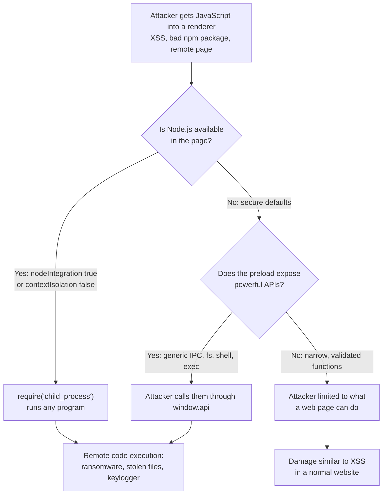
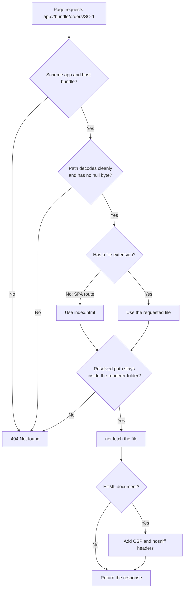

# Electron Security

> In this document you will learn why Electron security is different from web security, how a small XSS bug can become full control of a user's computer, and how to prevent that by following the official Electron security checklist item by item, with code. You will finish with a complete secure configuration and a code-review exercise. Security is one of the most important Electron interview topics, especially for senior and desktop roles.

**Before this:** [Electron architecture and process model](01-electron-architecture-and-process-model.md) · [IPC and preload scripts](03-ipc-and-preload-scripts.md) · [Web security: XSS, CSRF, CORS, CSP](../01-cs-and-web-fundamentals/08-browser-storage-and-web-security-basics.md) · **Interview questions:** [jump to the interview section](#interview-questions)

## Table of contents

1. [Why Electron security is different](#why-electron-security-is-different)
2. [The threat model: from XSS to remote code execution](#the-threat-model-from-xss-to-remote-code-execution)
3. [Defense in depth: the layers](#defense-in-depth-the-layers)
4. [The official security checklist](#the-official-security-checklist)
5. [Load only secure content](#load-only-secure-content)
6. [Node integration, context isolation and the sandbox](#node-integration-context-isolation-and-the-sandbox)
7. [Permission request handlers](#permission-request-handlers)
8. [Do not disable webSecurity or allow insecure content](#do-not-disable-websecurity-or-allow-insecure-content)
9. [Content Security Policy](#content-security-policy)
10. [No experimental features or enableBlinkFeatures](#no-experimental-features-or-enableblinkfeatures)
11. [The webview tag and modern alternatives](#the-webview-tag-and-modern-alternatives)
12. [Limit navigation](#limit-navigation)
13. [Control new windows](#control-new-windows)
14. [Validate URLs before shell.openExternal](#validate-urls-before-shellopenexternal)
15. [Keep Electron updated](#keep-electron-updated)
16. [Validate IPC senders and do not expose Electron APIs](#validate-ipc-senders-and-do-not-expose-electron-apis)
17. [Prefer a custom protocol over file](#prefer-a-custom-protocol-over-file)
18. [Electron fuses](#electron-fuses)
19. [The removed remote module](#the-removed-remote-module)
20. [ASAR is not encryption: secrets and safeStorage](#asar-is-not-encryption-secrets-and-safestorage)
21. [A complete secure configuration](#a-complete-secure-configuration)
22. [Code-review exercise: find and fix the vulnerabilities](#code-review-exercise-find-and-fix-the-vulnerabilities)
23. [Common mistakes](#common-mistakes)
24. [Best practices](#best-practices)
25. [How to explain Electron security in an interview](#how-to-explain-electron-security-in-an-interview)
26. [Interview questions](#interview-questions)
27. [Summary](#summary)
28. [References](#references)

---

## Why Electron security is different

In a normal browser, a website runs in a **sandbox**. Even if the website has a bug, the attacker can only do what web pages can do: read that site's data, make requests as the user on that site. They cannot read your files or start programs. Google, Mozilla and Apple spend huge effort keeping that sandbox strong.

An Electron app is different in three ways:

1. **It has Node.js.** The main process (and, if you misconfigure it, the renderer) can read and write any file the user can, start programs, and open network connections.
2. **You write the "browser" part.** In Chrome, Google decides which permissions to grant, where a page may navigate and which popups may open. In Electron, **your main-process code makes these decisions** (see [Electron compared with the browser](01-electron-architecture-and-process-model.md#electron-compared-with-the-browsers-multi-process-model)).
3. **Users trust desktop apps more.** An installed, signed app looks legitimate. Users click "Allow" more easily and do not see an address bar showing where content comes from.

So the main question in Electron security is:

> **If an attacker can run JavaScript in one of my renderers, how much damage can they do?**

With secure settings, the answer should be: "about as much as XSS in a normal website, and no more". With insecure settings, the answer is: "everything the user can do on their computer".

---

## The threat model: from XSS to remote code execution

A **threat model** is a description of who might attack, how, and what they want. Here are realistic ways an attacker gets JavaScript into your renderer:

- **XSS (cross-site scripting):** your app shows untrusted data as HTML. Example: a customer name `` displayed with `innerHTML`, or a Markdown note rendered without sanitizing.
- **A compromised dependency:** a malicious version of an npm package in your frontend bundle.
- **Remote content:** your app loads a web page from a server. If that server, its CDN or the network is compromised, the attacker controls the page.
- **Navigation to an attacker's site:** a link in user content navigates the window to `https://evil.example`, and that page now runs inside your window — possibly with your preload API.
- **Malicious input from outside:** deep links (`orderdesk://...`), opened files, clipboard content, messages from a server.

Now compare what that JavaScript can do:



This chain is the most important idea in this document. **Context isolation and sandboxing stop the first path. A small, validated preload API stops the second path.** You need both.

A real example of this class of bug: the Discord desktop app had a remote code execution vulnerability (reported in 2020) that combined a missing context isolation setting with an XSS and a navigation issue. Bugs like this are why the Electron defaults changed and why the checklist exists.

---

## Defense in depth: the layers

**Defense in depth** means using several independent protections, so that if one fails, the next still stops the attack.

| Layer | Protection | Stops |
| --- | --- | --- |
| 1. Content | No XSS: `textContent`, Angular's sanitization, CSP | Attacker running script at all |
| 2. Renderer | `nodeIntegration: false`, `contextIsolation: true`, `sandbox: true` | Script reaching Node.js or the preload's scope |
| 3. Preload | Small, specific API; no `ipcRenderer`, `shell`, `fs` | Script reaching powerful functions |
| 4. Main (IPC) | Validate sender and arguments; dangerous values decided in main | Script abusing the functions that exist |
| 5. Navigation | `will-navigate`, `setWindowOpenHandler`, permission handlers | Attacker pages inside your windows |
| 6. Binary | Fuses, ASAR integrity, code signing, current Electron | Tampering with or reusing your executable |

Example of layers working together: an attacker finds an XSS in your order notes field (layer 1 fails). Because of CSP, their inline `<script>` does not run. Suppose they find a CSP bypass too. Because of context isolation, they cannot reach `require`. Because the preload exposes only `orders.save`, the worst they can do is save an order — and main validates it and takes prices from the database. The attack stays small.

---

## The official security checklist

The Electron documentation has a numbered security checklist. These are its 20 items, with where each is covered below:

| # | Checklist item | Section |
| --- | --- | --- |
| 1 | Only load secure content | [Load only secure content](#load-only-secure-content) |
| 2 | Do not enable Node.js integration for remote content | [Node integration, context isolation and the sandbox](#node-integration-context-isolation-and-the-sandbox) |
| 3 | Enable context isolation in all renderers | same |
| 4 | Enable process sandboxing | same |
| 5 | Use `ses.setPermissionRequestHandler()` in all sessions that load remote content | [Permission request handlers](#permission-request-handlers) |
| 6 | Do not disable `webSecurity` | [Do not disable webSecurity](#do-not-disable-websecurity-or-allow-insecure-content) |
| 7 | Define a Content-Security-Policy and use restrictive rules | [Content Security Policy](#content-security-policy) |
| 8 | Do not enable `allowRunningInsecureContent` | [Do not disable webSecurity](#do-not-disable-websecurity-or-allow-insecure-content) |
| 9 | Do not enable experimental features | [No experimental features](#no-experimental-features-or-enableblinkfeatures) |
| 10 | Do not use `enableBlinkFeatures` | same |
| 11 | `<webview>`: do not use `allowpopups` | [The webview tag](#the-webview-tag-and-modern-alternatives) |
| 12 | `<webview>`: verify options and params | same |
| 13 | Disable or limit navigation | [Limit navigation](#limit-navigation) |
| 14 | Disable or limit creation of new windows | [Control new windows](#control-new-windows) |
| 15 | Do not use `shell.openExternal` with untrusted content | [Validate URLs before shell.openExternal](#validate-urls-before-shellopenexternal) |
| 16 | Use a current version of Electron | [Keep Electron updated](#keep-electron-updated) |
| 17 | Validate the `sender` of all IPC messages | [Validate IPC senders](#validate-ipc-senders-and-do-not-expose-electron-apis) |
| 18 | Avoid usage of the `file://` protocol and prefer usage of custom protocols | [Prefer a custom protocol over file](#prefer-a-custom-protocol-over-file) |
| 19 | Check which fuses you can change | [Electron fuses](#electron-fuses) |
| 20 | Do not expose Electron APIs to untrusted web content | [Validate IPC senders](#validate-ipc-senders-and-do-not-expose-electron-apis) |

In development, Electron prints **security warnings** in the DevTools console when it detects some insecure settings (for example no CSP, or `webSecurity` disabled). Do not ignore them.

---

## Load only secure content

Load remote resources only over **HTTPS** (and WebSockets only over **WSS**). Over plain HTTP, anyone on the network path (public Wi-Fi, a compromised router, a proxy) can modify the response and inject script into your app.

```js
// ❌ Wrong
mainWindow.loadURL('http://portal.contoso.com');
// <script src="http://cdn.example.com/chart.js"></script>

// ✅ Correct
mainWindow.loadURL('https://portal.contoso.com');
// Better: bundle your scripts with the app and load nothing from CDNs
```

Even better: **ship your UI inside the app** and serve it through a custom protocol, and use HTTPS only for API calls. Then your UI code cannot be changed by a server compromise; it changes only when you ship a signed update.

If your app must show remote content (for example an existing web portal), treat that content as **less trusted**: no preload API or a very small one, its own session, strict navigation limits and a permission handler.

---

## Node integration, context isolation and the sandbox

These three settings in `webPreferences` are the core of renderer security.

| Setting | Secure value | Default | Default since |
| --- | --- | --- | --- |
| `nodeIntegration` | `false` | `false` | Electron 5 |
| `contextIsolation` | `true` | `true` | Electron 12 |
| `sandbox` | `true` | `true` | Electron 20 |

### `nodeIntegration: false`

**What it controls:** whether the web page gets Node.js (`require`, `process`, `Buffer`).

With `true`, the page can do `require('child_process').exec(...)`. Any XSS becomes remote code execution. **Never enable it** for any page that shows content you do not fully control — and in practice, keep it off everywhere.

Related options that must also stay off: `nodeIntegrationInWorker` (Node in Web Workers) and `nodeIntegrationInSubFrames` (preloads and Node in iframes).

### `contextIsolation: true`

**What it controls:** whether the preload script and Electron's internal code run in a **separate JavaScript world** from the page.

Why it matters even when `nodeIntegration` is off: without isolation, the page and the preload share globals. The page can:

- Overwrite built-in functions (`Array.prototype.push`, `JSON.parse`, `Function.prototype.call`) and change how the preload's code behaves (this is called **prototype pollution**).
- Read variables the preload put on `window`, including any Electron or Node objects.

Example of the danger:

```js
// preload.js WITHOUT context isolation (insecure)
const { ipcRenderer } = require('electron');
window.saveNote = (text) => ipcRenderer.send('notes:save', text);

// Attacker script in the page can tamper with what the preload uses:
// e.g. replace a built-in method the preload relies on, intercept arguments,
// or grab references the preload left on window.
```

With context isolation, the page has its own copies of all built-ins. Changing them in the page does not affect the preload. The only connection is what `contextBridge.exposeInMainWorld` explicitly provides.

### `sandbox: true`

**What it controls:** whether the renderer process runs inside **Chromium's OS-level sandbox**, and how much Node.js the preload gets.

- The **OS-level sandbox** restricts what the renderer process itself can do with the operating system (on Windows, a restricted token and job objects). Even if an attacker finds a bug in Chromium's renderer engine and runs native code, the sandbox limits the damage.
- In a sandboxed renderer, the **preload** only gets a small set of APIs (`contextBridge`, `ipcRenderer`, `webFrame`, `webUtils`, `nativeImage`, `crashReporter`; Electron 44 and older also allowed `events`, `timers` and `url`, which Electron 45 removed). See [Preload scripts](01-electron-architecture-and-process-model.md#preload-scripts).

Notes:

- Setting `nodeIntegration: true` **turns the sandbox off** for that renderer automatically.
- `app.enableSandbox()` (before `ready`) forces the sandbox for **all** renderers, overriding `sandbox: false`.
- The `--no-sandbox` command-line flag disables it for all processes. Use it only for debugging, never in production.

### Write the secure values explicitly

The defaults are already secure, but write them anyway:

```js
webPreferences: {
  preload: path.join(__dirname, 'preload.js'),
  contextIsolation: true,
  nodeIntegration: false,
  sandbox: true,
}
```

Reason: a reviewer sees the intent immediately, a search for `nodeIntegration: true` in a large code base is easy, and nobody accidentally depends on an old default when copying code from an old tutorial.

---

## Permission request handlers

### The problem

Web pages can request powerful permissions: camera and microphone (`media`), location (`geolocation`), notifications, screen capture (`display-capture`), MIDI, USB/HID/serial devices, clipboard read, and more.

In Chrome, the user sees a permission prompt. In Electron, there is **no prompt**. Electron's docs say it **automatically approves all permission requests** unless you configure a handler. So remote content, an iframe or injected script could turn on the microphone silently.

### The fix

Install handlers on **every session** you use (usually `session.defaultSession`, plus any custom partitions). Deny by default, allow only what your app needs, and only for your own origin.

```js
// main/permissions.js
const { session } = require('electron');

function isAppUrl(rawUrl) {
  try {
    const url = new URL(rawUrl);
    return url.protocol === 'app:' && url.host === 'bundle';
  } catch {
    return false;
  }
}

const ALLOWED_PERMISSIONS = new Set(['notifications', 'clipboard-sanitized-write']);

function installPermissionHandlers(ses = session.defaultSession) {
  // 1. Requests (the page asks for something, e.g. Notification.requestPermission())
  ses.setPermissionRequestHandler((webContents, permission, callback, details) => {
    const allowed = ALLOWED_PERMISSIONS.has(permission) && isAppUrl(details.requestingUrl);
    if (!allowed) log.warn('Denied permission', permission, 'for', details.requestingUrl);
    callback(allowed);
  });

  // 2. Checks (the page asks "do I have it?", e.g. navigator.permissions.query)
  ses.setPermissionCheckHandler((webContents, permission, requestingOrigin) => {
    return ALLOWED_PERMISSIONS.has(permission) && requestingOrigin === 'app://bundle';
  });

  // 3. Devices (WebHID, WebSerial, WebUSB) — deny unless you need them
  ses.setDevicePermissionHandler(() => false);
}

module.exports = { installPermissionHandlers };
```

```js
// main.js — session.defaultSession is available only after ready
app.whenReady().then(() => {
  installPermissionHandlers();
  createMainWindow();
});
```

Notes:

- The request handler is asynchronous (you call `callback(true/false)`), so you could show your own native dialog for some permissions, like a browser does.
- The check handler is synchronous and returns a boolean. Some features call only the check handler, so set both.
- Parse URLs with `new URL()`; do not use `startsWith` on raw strings.
- `requestingOrigin` in the check handler is a string from Chromium; for your standard `app` scheme it is `'app://bundle'`. Remember that Node's `URL` gives origin `'null'` for custom schemes, which is why `isAppUrl` compares `protocol` and `host` instead of `origin`.
- If your app uses hardware APIs like WebSerial on purpose (for example a barcode scanner), allow only the specific device and only for your origin. See [Filesystem, child processes and native features](05-filesystem-child-processes-and-native-features.md).

---

## Do not disable webSecurity or allow insecure content

### `webSecurity: false`

`webSecurity` (default `true`) enforces the **same-origin policy**: a page from one origin cannot read responses from another origin unless that server allows it with CORS. (The same-origin policy is explained in [Browser storage and web security basics](../01-cs-and-web-fundamentals/08-browser-storage-and-web-security-basics.md).)

Developers sometimes set `webSecurity: false` to "fix" a CORS error when calling their API. This removes the protection for **all** origins, and it also enables `allowRunningInsecureContent`.

```js
// ❌ Wrong: "fixes" CORS by turning off the same-origin policy
new BrowserWindow({ webPreferences: { webSecurity: false } });
```

Better fixes for CORS:

1. **Configure CORS on the API server** to allow your app's origin (for example `app://bundle`). This is the normal, correct fix.
2. **Make the request from the main process** (with Node's `fetch` or Electron's `net.fetch`), where CORS does not apply, and expose a narrow IPC function like `orders.list()`. This also keeps tokens out of the renderer.
3. **Use a protocol handler** that proxies one specific API path (`app://api/...`) to your backend, as shown in Electron's `protocol.handle` documentation.

### `allowRunningInsecureContent: true`

This lets an HTTPS page load scripts, styles or iframes over plain HTTP ("mixed content"). An attacker on the network can replace those HTTP resources. Keep the default `false`.

---

## Content Security Policy

### What it is

A **Content Security Policy (CSP)** is a list of rules that tells Chromium which sources of scripts, styles, images, connections and frames the page may use. It is your main protection **after** an injection: even if an attacker inserts `<script>` or an inline event handler into the page, CSP can stop it from running. CSP in depth is covered in [Web security: XSS, CSRF, CORS, CSP](../01-cs-and-web-fundamentals/08-browser-storage-and-web-security-basics.md).

### A good default for an Electron app

```text
default-src 'none';
script-src 'self';
style-src 'self';
img-src 'self' data:;
font-src 'self';
connect-src 'self' https://api.contoso.com;
base-uri 'none';
form-action 'none';
object-src 'none';
frame-src 'none';
frame-ancestors 'none'
```

What it means:

- Scripts only from your own bundle (`'self'`). **No `'unsafe-inline'`** (no inline `<script>` or `onclick=""`), **no `'unsafe-eval'`** (no `eval`, `new Function`).
- Network requests only to your own origin and your API.
- No plugins (`object-src 'none'`), no frames, no `<base>` tag tricks.

### How to set it

**Option 1: a `<meta>` tag** in `index.html`. It works for any way of loading, including `file://`. Note: `frame-ancestors` is ignored in a meta tag (CSP spec rule), so leave it out there.

```html
<meta
  http-equiv="Content-Security-Policy"
  content="default-src 'none'; script-src 'self'; style-src 'self'; img-src 'self' data:; font-src 'self'; connect-src 'self' https://api.contoso.com; base-uri 'none'; form-action 'none'; object-src 'none'; frame-src 'none'"
/>
```

**Option 2: an HTTP header.** Electron respects the `Content-Security-Policy` response header. For pages you serve through `protocol.handle`, add the header to your `Response` (shown in [the custom protocol section](#prefer-a-custom-protocol-over-file)). For remote pages, you can add it with `session.webRequest.onHeadersReceived`:

```js
session.defaultSession.webRequest.onHeadersReceived((details, callback) => {
  callback({
    responseHeaders: {
      ...details.responseHeaders,
      'Content-Security-Policy': ["default-src 'none'; script-src 'self'; style-src 'self'"],
    },
  });
});
```

### CSP with Angular

- Angular's production build creates external script files, so `script-src 'self'` works.
- Angular component styles are added as `<style>` elements at runtime, which normally needs `style-src 'self' 'unsafe-inline'`. Allowing inline **styles** is much less dangerous than inline scripts. Angular 16 added support for a CSP **nonce** for these styles (the `ngCspNonce` attribute or the `CSP_NONCE` token), which lets you avoid `'unsafe-inline'` if you generate a nonce per page load.
- In development, `ng serve` needs `connect-src` for its live-reload WebSocket (for example `ws://localhost:4200`). Use a separate, slightly looser policy only for dev.
- Angular itself sanitizes values bound with `[innerHTML]`. Never bypass it with `bypassSecurityTrustHtml` on untrusted data. See [Angular security](../06-angular-16/15-security.md).

### Test it

Open DevTools and look for "Refused to execute inline script because it violates the following Content Security Policy directive" messages. Try injecting `` into a field in a test build: with a good CSP and safe rendering, nothing happens.

---

## No experimental features or enableBlinkFeatures

```js
// ❌ Wrong
new BrowserWindow({
  webPreferences: {
    experimentalFeatures: true,             // turns on Chromium's experimental web platform features
    enableBlinkFeatures: 'SomeBlinkFeature' // turns on specific Blink features by name
  },
});
```

Experimental features are not finished and not fully security-reviewed. They can contain bugs that let a page do things it should not. Both options default to off. Leave them off. If you need a new web feature, wait until it is enabled by default in the Chromium version your Electron release ships.

---

## The webview tag and modern alternatives

### What it is

`<webview>` is an Electron-specific HTML tag that embeds another web page in its own process, with its own settings. It is **disabled by default** (`webviewTag: false`), and Electron's docs discourage it: it is based on Chromium internals that change, and Electron does not guarantee it will stay available.

### If you must use it

Checklist items 11 and 12:

- **Do not use `allowpopups`.** It lets the embedded page open new windows.
- **Verify options and params before the webview is created.** Use the `will-attach-webview` event to remove preloads, force secure `webPreferences` and check the `src`:

```js
app.on('web-contents-created', (_event, contents) => {
  contents.on('will-attach-webview', (event, webPreferences, params) => {
    delete webPreferences.preload;            // never let page-chosen preloads run
    webPreferences.nodeIntegration = false;
    webPreferences.contextIsolation = true;
    webPreferences.sandbox = true;

    if (!params.src.startsWith('https://help.contoso.com/')) {
      event.preventDefault();                 // block unknown content
    }
  });
});
```

(For `params.src` a prefix check that includes the trailing slash is acceptable; for anything more complex, parse with `new URL()` and compare `origin`.)

### Modern alternatives

| Need | Use |
| --- | --- |
| Show your own UI | A normal `BrowserWindow` page |
| Embed a third-party page next to your UI | **`WebContentsView`** (Electron 30+) controlled from main, with no preload and its own session |
| Show simple embedded content | An `<iframe>` with the `sandbox` attribute and a strict CSP `frame-src` |
| Show a document or help site | Open it in the user's browser with a validated `shell.openExternal` |

`BrowserView`, the older way to embed pages from main, is **deprecated since Electron 30** in favor of `WebContentsView`.

```js
// Embed a third-party portal safely next to your UI
const { WebContentsView, session } = require('electron');

const portalSession = session.fromPartition('persist:vendor-portal'); // separate cookies and storage
installPermissionHandlers(portalSession);                             // deny-by-default for this session too

const portalView = new WebContentsView({
  webPreferences: {
    session: portalSession,
    contextIsolation: true,
    sandbox: true,
    nodeIntegration: false,
    // no preload: this page gets no desktop API at all
  },
});
mainWindow.contentView.addChildView(portalView);
portalView.setBounds({ x: 320, y: 0, width: 960, height: 800 });
portalView.webContents.loadURL('https://vendor.example.com/portal');
```

---

## Limit navigation

### The problem

If an attacker can make your window **navigate** to their page, their page runs inside your window. Depending on your setup it may get your **preload API**, and it looks like part of your trusted app (no address bar). Navigation can be triggered by a link in user content, `window.location = ...` from injected script, a form submission or a redirect.

### The fix

Handle `will-navigate` on every `webContents`. If your app is a single-page app (Angular, React), it never needs full-page navigation, so block **all** of it. Otherwise, allow only an exact list of origins, parsed with `new URL()`.

```js
// main/navigation.js
const { app } = require('electron');

function isAllowedNavigation(rawUrl) {
  let url;
  try {
    url = new URL(rawUrl);
  } catch {
    return false;
  }
  if (url.protocol === 'app:' && url.host === 'bundle') return true;
  if (!app.isPackaged && url.origin === 'http://localhost:4200') return true; // dev server
  return false;
}

app.on('web-contents-created', (_event, contents) => {
  contents.on('will-navigate', (event, url) => {
    if (!isAllowedNavigation(url)) {
      event.preventDefault();
      log.warn('Blocked navigation to', url);
    }
  });

  contents.on('will-redirect', (event, url) => {
    if (!isAllowedNavigation(url)) event.preventDefault();
  });
});

module.exports = { isAllowedNavigation };
```

Tested with Node.js:

```js
isAllowedNavigation('app://bundle/index.html#/orders');      // true
isAllowedNavigation('https://evil.example');                 // false
isAllowedNavigation('http://localhost:4200/orders');         // true (dev only)
isAllowedNavigation('http://localhost:4200.evil.example/');  // false
isAllowedNavigation('app://bundle.evil/');                   // false
```

Why not `url.startsWith('http://localhost:4200')`? Because `http://localhost:4200.evil.example/` starts with that string. Electron's docs warn about exactly this: simple string comparisons can be fooled; use a URL parser.

Details:

- `will-navigate` fires for navigations started by the page (links, `window.location`, forms). It does **not** fire for `webContents.loadURL()` from main, or for in-page changes (hash changes, `history.pushState`), which stay inside your app anyway.
- `will-navigate` fires for the **main frame**. For iframes there is `will-frame-navigate`. If you allow iframes, check those too.
- Registering in `web-contents-created` applies the rule to **every** page: windows, popups, views and webviews. You cannot forget one.

---

## Control new windows

### The problem

`window.open(url)`, `<a target="_blank">` and some form submissions create **new windows**. Without control, a page can open an attacker's site in a new Electron window — possibly with different, weaker settings.

### The fix: `setWindowOpenHandler`

`webContents.setWindowOpenHandler(handler)` is called **before** a new window is created. Return `{ action: 'deny' }` to block it, or `{ action: 'allow' }` (optionally with `overrideBrowserWindowOptions`) to allow it. A common pattern: deny everything, and open allowed external links in the user's real browser.

```js
const { shell } = require('electron');

app.on('web-contents-created', (_event, contents) => {
  contents.setWindowOpenHandler(({ url }) => {
    if (isSafeExternalUrl(url)) {
      shell.openExternal(url); // open in Edge/Chrome, not inside the app
    } else {
      log.warn('Blocked window.open for', url);
    }
    return { action: 'deny' };  // never create an Electron window from page content
  });
});
```

If you really need an in-app popup (for example an OAuth login page), allow only that exact origin and force secure options:

```js
contents.setWindowOpenHandler(({ url }) => {
  const target = new URL(url);
  if (target.origin === 'https://login.contoso.com') {
    return {
      action: 'allow',
      overrideBrowserWindowOptions: {
        width: 500,
        height: 700,
        webPreferences: { contextIsolation: true, sandbox: true, nodeIntegration: false }, // no preload
      },
    };
  }
  return { action: 'deny' };
});
```

`setWindowOpenHandler` replaced the old `new-window` event, which was deprecated in Electron 13 and removed in Electron 22. If you see `new-window` in code, it is outdated.

> **Electron 45:** a popup opened with `window.open()` from an **unsandboxed** window is now sandboxed and runs in its own process by default. The opener gets `null` back from `window.open()`, and the popup's `window.opener` is `null`. This is safer. Do not undo it with `sandbox: false` in `overrideBrowserWindowOptions` unless you really need the old shared-process behavior. Better: keep every window sandboxed from the start.

---

## Validate URLs before shell.openExternal

### The problem

`shell.openExternal(url)` asks the **operating system** to open a URL with its default handler. That is not only the browser. On Windows, many URL schemes start programs:

- `file:///C:/Users/asha/Downloads/invoice.exe` — runs a file.
- `ms-msdt:` — was abused in the "Follina" vulnerability (CVE-2022-30190) to run code through a Windows diagnostic tool.
- `search-ms:`, `ms-settings:` and other registered schemes — open system tools.
- Custom schemes from other installed apps.

Electron's checklist says it directly: do not use `shell.openExternal` with untrusted content, because it can be used to execute arbitrary commands.

### The fix: an allowlist

```js
// main/external-links.js
const ALLOWED_EXTERNAL_HOSTS = new Set(['docs.contoso.com', 'support.contoso.com']);

function isSafeExternalUrl(rawUrl) {
  let url;
  try {
    url = new URL(rawUrl);
  } catch {
    return false;
  }
  return (
    url.protocol === 'https:' &&
    url.username === '' &&
    url.password === '' &&
    ALLOWED_EXTERNAL_HOSTS.has(url.hostname)
  );
}

async function openExternalSafely(rawUrl) {
  if (!isSafeExternalUrl(rawUrl)) {
    log.warn('Refused to open external URL', rawUrl);
    return false;
  }
  await shell.openExternal(rawUrl);
  return true;
}

module.exports = { isSafeExternalUrl, openExternalSafely };
```

Tested with Node.js:

| URL | Result | Why |
| --- | --- | --- |
| `https://docs.contoso.com/orders/help` | allowed | HTTPS + allowlisted host |
| `HTTPS://DOCS.CONTOSO.COM/x` | allowed | the URL parser lowercases scheme and host |
| `https://docs.contoso.com.evil.example/phish` | denied | different host |
| `http://docs.contoso.com/` | denied | not HTTPS |
| `file:///C:/Windows/System32/calc.exe` | denied | not HTTPS |
| `ms-msdt:/id PCWDiagnostic` | denied | not HTTPS |
| `javascript:alert(1)` | denied | not HTTPS |
| `not a url` | denied | parse error |

Even better: do not accept URLs from the renderer at all. Expose `openHelp(topic)` where `topic` is a key like `'returns'`, and main maps it to a fixed URL. If your app must open arbitrary user links (for example links inside chat messages), allow only `https:` (and maybe `mailto:`), and consider showing the full URL to the user before opening it.

---

## Keep Electron updated

Each Electron release bundles a specific Chromium. Chromium fixes security bugs constantly, including bugs that are exploited "in the wild" before a fix exists. Your users get those fixes **only** when you ship an app update with a newer Electron.

- Electron releases a new major every 8 weeks and supports the **latest three** stable majors.
- Security fixes are backported only to supported versions.
- An app stuck on an unsupported Electron has known, public Chromium vulnerabilities.

Practical rules:

- Upgrade at least every few months; track the release schedule.
- Apply minor/patch releases quickly (they often contain security fixes).
- Update your other dependencies too (`npm audit`, Dependabot or Renovate). See [Authentication and authorization](../07-nodejs-backend/09-authentication-and-authorization.md).
- Ship through a working, signed auto-update channel ([Auto-updates](07-auto-updates.md)).

More on versions: [Release cadence and support policy](01-electron-architecture-and-process-model.md#release-cadence-and-support-policy).

---

## Validate IPC senders and do not expose Electron APIs

These two checklist items (17 and 20) are about IPC, which has its own document. The short version:

- **Validate the sender of every IPC message** with `event.senderFrame?.origin` against an allowlist (treat `null` as untrusted). See [Validating the sender](03-ipc-and-preload-scripts.md#validating-the-sender).
- **Do not expose Electron APIs** (especially `ipcRenderer`, or wrappers that pass channels and callbacks straight through) to web content. Expose specific functions, and give event callbacks only the data, never the event object. See [Designing the preload API](03-ipc-and-preload-scripts.md#designing-the-preload-api-with-contextbridge).
- **Validate arguments** and decide dangerous values (paths, URLs, commands, prices) in main. See [Validating the arguments](03-ipc-and-preload-scripts.md#validating-the-arguments).

The worst IPC handlers are the ones that turn renderer input into OS actions:

```js
// ❌ Wrong: remote code execution as a feature
ipcMain.handle('tools:run', (_event, command) => require('node:child_process').execSync(command).toString());

// ❌ Wrong: reads any file on the machine
ipcMain.handle('files:read', (_event, filePath) => fs.promises.readFile(filePath, 'utf8'));

// ❌ Wrong: opens any URL or program
ipcMain.handle('links:open', (_event, url) => shell.openExternal(url));
```

Each one makes the renderer as powerful as the main process, which defeats every other protection in this document.

---

## Prefer a custom protocol over file

### The problem with `file://`

`loadFile('index.html')` loads your page from a `file://` URL. Pages on `file://` get **more privileges** than normal web pages. Electron's checklist explains the risk: a `file://` page can access files on the machine, so an XSS in your page could load arbitrary local files (for example `file:///C:/Users/asha/AppData/...`). Also:

- All `file://` URLs are treated as roughly the same "origin", so origin-based checks are weak.
- Deep routes in single-page apps break, because there is no server to rewrite `/orders/SO-1` to `index.html`.
- You cannot set real HTTP headers (like CSP) on `file://` responses.

### The fix: serve your files from your own scheme

Register a scheme like `app` and answer its requests with `protocol.handle`. Your page then loads from `app://bundle/index.html`. You decide **exactly** which files can be served.

`protocol.handle` arrived in Electron 25 and replaced the older `registerFileProtocol`, `registerBufferProtocol`, `interceptFileProtocol` and similar methods, which are deprecated.

```js
// main/app-protocol.js
const { app, net, protocol } = require('electron');
const path = require('node:path');
const { pathToFileURL } = require('node:url');

const SCHEME = 'app';
const HOST = 'bundle';
const RENDERER_DIR = path.join(__dirname, '..', 'renderer'); // the built Angular app (inside app.asar)

const CSP = [
  "default-src 'none'",
  "script-src 'self'",
  "style-src 'self' 'unsafe-inline'", // Angular component styles; see the CSP section for nonces
  "img-src 'self' data:",
  "font-src 'self'",
  "connect-src 'self' https://api.contoso.com",
  "base-uri 'none'",
  "form-action 'none'",
  "object-src 'none'",
  "frame-src 'none'",
  "frame-ancestors 'none'",
].join('; ');

// 1. BEFORE ready, once: give the scheme normal web powers
protocol.registerSchemesAsPrivileged([
  {
    scheme: SCHEME,
    privileges: {
      standard: true,        // behaves like http(s): real origin 'app://bundle', relative URLs work
      secure: true,          // treated like HTTPS (secure context)
      supportFetchAPI: true, // fetch('app://bundle/config.json') works
    },
  },
]);

/** Map a request URL to a file inside RENDERER_DIR, or return null if not allowed. */
function resolveAppRequest(requestUrl, rendererDir = RENDERER_DIR) {
  let url;
  try {
    url = new URL(requestUrl);
  } catch {
    return null;
  }
  if (url.protocol !== `${SCHEME}:` || url.host !== HOST) return null;

  let pathname;
  try {
    pathname = decodeURIComponent(url.pathname); // makes '..%2f' tricks visible
  } catch {
    return null; // malformed escape sequence
  }
  if (pathname.includes('\0')) return null;

  // SPA fallback: Angular routes like /orders/SO-1 have no extension -> index.html
  const relative = path.extname(pathname) === '' ? 'index.html' : pathname.replace(/^[/\\]+/, '');

  const filePath = path.resolve(rendererDir, relative);
  const rel = path.relative(rendererDir, filePath);
  if (rel === '' || rel.startsWith('..') || path.isAbsolute(rel)) return null; // escaped the folder
  return filePath;
}

// 2. AFTER ready: answer every app:// request
function registerAppProtocol() {
  protocol.handle(SCHEME, async (request) => {
    const filePath = resolveAppRequest(request.url);
    if (!filePath) return new Response('Not found', { status: 404 });

    const response = await net.fetch(pathToFileURL(filePath).toString());
    if (!filePath.endsWith('.html')) return response;

    // Add security headers to HTML documents
    const headers = new Headers(response.headers);
    headers.set('Content-Security-Policy', CSP);
    headers.set('X-Content-Type-Options', 'nosniff');
    return new Response(response.body, { status: response.status, headers });
  });
}

module.exports = { registerAppProtocol, resolveAppRequest };
```

```js
// main.js
// Requiring the module runs registerSchemesAsPrivileged at load time, before ready
const { registerAppProtocol } = require('./main/app-protocol');

app.whenReady().then(() => {
  registerAppProtocol();
  mainWindow.loadURL('app://bundle/index.html');
});
```

### How a request flows through the handler



### The path check, tested

The `resolveAppRequest` function was tested with Node.js (Windows paths):

| Request | Result |
| --- | --- |
| `app://bundle/index.html` | serves `index.html` |
| `app://bundle/` | serves `index.html` |
| `app://bundle/orders/SO-10442` | serves `index.html` (SPA route) |
| `app://bundle/main.4f2a1c.js` | serves `main.4f2a1c.js` |
| `app://bundle/assets/logo.svg` | serves `assets\logo.svg` |
| `app://bundle/../../main.js` | serves `main.js` **inside** the folder (the URL parser already removed the `..` segments) |
| `app://bundle/..%2f..%2fmain.js` | **blocked** (decodes to `../../main.js`, escapes the folder) |
| `app://bundle/..%5c..%5cmain.js` | **blocked** (backslashes, Windows traversal) |
| `app://bundle/C:%5cWindows%5cwin.ini` | **blocked** (absolute path) |
| `app://bundle/%E0%A4%A` | **blocked** (malformed escape) |
| `app://bundle/a%00.js` | **blocked** (null byte) |
| `app://evil/index.html` | **blocked** (wrong host) |

Why check `path.relative` instead of `filePath.startsWith(RENDERER_DIR)`? Because a sibling folder like `renderer-old` also "starts with" `renderer`. The relative-path check has no such hole. The same technique is used for file access in [Filesystem, child processes and native features](05-filesystem-child-processes-and-native-features.md#preventing-path-traversal).

### Notes

- `protocol.handle` registers the handler on the **default session**. If a window uses a different `partition` or `session`, register on that session too: `session.fromPartition('persist:x').protocol.handle(...)`.
- With a standard, secure scheme, your page has a proper origin (`app://bundle`), so `localStorage`, IndexedDB, `fetch` and Angular's `PathLocationStrategy` all work normally. Your API server's CORS configuration must allow the origin `app://bundle`.
- Once nothing in your app uses `file://`, also flip the **`GrantFileProtocolExtraPrivileges`** fuse off (next section) so `file://` pages lose their extra powers.
- If your handler must decide based on **who made the request**, Electron's docs recommend `request.initiatorOrigin` over `request.referrer`, because the page cannot control it.

---

## Electron fuses

### What they are

**Fuses** are on/off switches compiled into the Electron **binary**. You flip them at **package time**, before code signing. Because they are inside the signed executable, your app code cannot turn them back on at runtime. An attacker also cannot change them without breaking the signature. What protects the signed bits is the operating system's code-integrity features, such as AppLocker on Windows or Gatekeeper on macOS.

### Why they matter

Some Electron features are useful for development but dangerous in a shipped app. The classic example is **`ELECTRON_RUN_AS_NODE`**: if this environment variable is set, `OrderDesk.exe` behaves like plain `node.exe`. An attacker (or malware already on the machine) can then run any script **as your signed, trusted app**, which may bypass application allowlisting and inherit your app's reputation and permissions:

```bash
# What an attacker could do if the RunAsNode fuse is still enabled
set ELECTRON_RUN_AS_NODE=1
"C:\Program Files\OrderDesk\OrderDesk.exe" C:\Users\Public\payload.js
```

Similarly, `--inspect` arguments or `NODE_OPTIONS` can inject code into your main process.

### The fuses

| Fuse (`FuseV1Options`) | Default | Recommended for production | What it does |
| --- | --- | --- | --- |
| `RunAsNode` | enabled | **disable** | Respect `ELECTRON_RUN_AS_NODE`. When disabled, `child_process.fork` from main throws (use `utilityProcess` instead). |
| `EnableNodeOptionsEnvironmentVariable` | enabled | **disable** | Respect `NODE_OPTIONS` and `NODE_EXTRA_CA_CERTS`. (Check first if your enterprise users need `NODE_EXTRA_CA_CERTS` for a corporate proxy.) |
| `EnableNodeCliInspectArguments` | enabled | **disable** | Respect `--inspect` and similar flags (and `SIGUSR1` on POSIX). |
| `EnableEmbeddedAsarIntegrityValidation` | disabled | **enable** | Verify `app.asar` against a hash embedded at build time (macOS since Electron 16, Windows since Electron 30; the feature is marked stable since Electron 39). |
| `OnlyLoadAppFromAsar` | disabled | **enable** | Load app code only from `app.asar`, not from an `app` folder next to it. Needed to make the integrity check meaningful. |
| `GrantFileProtocolExtraPrivileges` | enabled | **disable** if you do not use `file://` | Extra privileges for `file://` pages. |
| `EnableCookieEncryption` | disabled | consider enabling | Encrypt the cookie store on disk with OS-level keys. **One-way:** turning it off later corrupts existing cookies. |
| `LoadBrowserProcessSpecificV8Snapshot` | disabled | leave unless needed | Use a separate V8 snapshot for the main process. |
| `WasmTrapHandlers` | enabled | leave | Performance feature for WebAssembly memory checks on supported 64-bit systems. |

### Flipping fuses with Electron Forge

```js
// forge.config.js
const { FusesPlugin } = require('@electron-forge/plugin-fuses');
const { FuseV1Options, FuseVersion } = require('@electron/fuses');

module.exports = {
  packagerConfig: { asar: true },
  plugins: [
    new FusesPlugin({
      version: FuseVersion.V1,
      [FuseV1Options.RunAsNode]: false,
      [FuseV1Options.EnableNodeOptionsEnvironmentVariable]: false,
      [FuseV1Options.EnableNodeCliInspectArguments]: false,
      [FuseV1Options.EnableEmbeddedAsarIntegrityValidation]: true,
      [FuseV1Options.OnlyLoadAppFromAsar]: true,
      [FuseV1Options.GrantFileProtocolExtraPrivileges]: false,
      [FuseV1Options.EnableCookieEncryption]: true,
    }),
  ],
};
```

### Flipping fuses with `@electron/fuses` directly (for example in an electron-builder `afterPack` hook)

```js
// build/after-pack.js — Windows example
const path = require('node:path');
const { flipFuses, FuseVersion, FuseV1Options } = require('@electron/fuses');

exports.default = async function afterPack(context) {
  if (context.electronPlatformName !== 'win32') return;
  const exePath = path.join(context.appOutDir, `${context.packager.appInfo.productFilename}.exe`);

  await flipFuses(exePath, {
    version: FuseVersion.V1,
    [FuseV1Options.RunAsNode]: false,
    [FuseV1Options.EnableNodeOptionsEnvironmentVariable]: false,
    [FuseV1Options.EnableNodeCliInspectArguments]: false,
    [FuseV1Options.OnlyLoadAppFromAsar]: true,
    [FuseV1Options.GrantFileProtocolExtraPrivileges]: false,
  });
};
```

For ASAR integrity, the packaging tool must also **embed the hash** of `app.asar` in the executable. Electron Forge (7.4+) and `@electron/packager` (18.3.1+) do this automatically when `asar` is enabled; with other tools, check their documentation. Packaging and signing are covered in [Packaging, installers and code signing](06-packaging-installers-and-code-signing.md).

You can read the current fuse state of a built executable with the CLI: `npx @electron/fuses read --app "dist/win-unpacked/OrderDesk.exe"`.

Test the packaged app after flipping fuses. For example, disabling `RunAsNode` breaks code (or a dependency) that uses `child_process.fork` from the main process.

---

## The removed remote module

Old Electron code often uses the **`remote`** module:

```js
// Old, insecure pattern (Electron 13 and earlier) — do not copy
const { remote } = require('electron');
remote.dialog.showOpenDialog(...);
remote.require('fs').readFileSync(...);
```

`remote` let the renderer call **any** main-process object as if it were local, through hidden synchronous IPC. That was:

- **Insecure:** the renderer effectively had the main process's full power.
- **Slow and fragile:** every property access was a synchronous IPC round trip, and object lifetimes across processes caused leaks and crashes.

It was deprecated in Electron 12 and **removed in Electron 14**. A userland package (`@electron/remote`) exists for migrating old apps, but do not use it in new code. Replace each use with a specific `invoke`/`handle` pair.

---

## ASAR is not encryption: secrets and safeStorage

### ASAR is only an archive

Your app's code is packed into `resources\app.asar`. **ASAR is a simple archive format, like a `.zip` without compression. It is not encryption.** Anyone can extract it:

```bash
npx @electron/asar extract "C:\Program Files\OrderDesk\resources\app.asar" extracted
```

So **everything in your app is readable by the user**: source code (even if minified), configuration files, and any API keys or passwords you put there. Obfuscation only slows people down.

### Rule: secrets in the app are not secret

```js
// ❌ Wrong: anyone can extract this from app.asar
const PAYMENT_API_KEY = 'sk_live_51Hx...';
await fetch('https://api.payments.example/charge', { headers: { Authorization: `Bearer ${PAYMENT_API_KEY}` } });
```

Better designs:

- **Keep shared secrets on your server.** The desktop app calls **your** backend, and the backend calls the third-party API with the secret.
- **Use per-user credentials.** The user signs in (for example OAuth 2.0 / OpenID Connect with PKCE in the system browser), and the app stores only that user's tokens. If a token leaks, you revoke one user's token, not a global key. Auth flows are covered in [Auth architecture and multi-tenancy](../09-system-design/06-auth-architecture-and-multi-tenancy.md).
- **Scope and rotate** any key that must exist on the client (for example a public analytics key that only allows sending events).

### Storing local secrets: `safeStorage`

Your app still needs to store some secrets locally, like the user's refresh token or a local database key. Do **not** store them in plain text in `settings.json` or `localStorage`.

Electron's **`safeStorage`** module (main process) encrypts strings with the operating system's protection:

| OS | Protection |
| --- | --- |
| Windows | **DPAPI**: protects data from **other users** on the same machine. It does **not** protect from other apps running as the same user. |
| macOS | Keychain |
| Linux | A secret store such as `gnome-libsecret` or `kwallet`; if none is available, the fallback is effectively unprotected (check `getSelectedStorageBackend()` for `basic_text`) |

```js
// main/token-store.js
const { app, safeStorage } = require('electron');
const fs = require('node:fs/promises');
const path = require('node:path');

const TOKEN_FILE = path.join(app.getPath('userData'), 'session.bin');

async function saveRefreshToken(token) {
  if (!(await safeStorage.isAsyncEncryptionAvailable())) {
    throw new Error('Secure storage is not available on this system');
  }
  const encrypted = await safeStorage.encryptStringAsync(token); // Buffer
  await fs.writeFile(TOKEN_FILE, encrypted);
}

async function loadRefreshToken() {
  let encrypted;
  try {
    encrypted = await fs.readFile(TOKEN_FILE);
  } catch {
    return null; // no saved session
  }
  const { result, shouldReEncrypt } = await safeStorage.decryptStringAsync(encrypted);
  if (shouldReEncrypt) await saveRefreshToken(result); // the OS key changed; store again
  return result;
}

module.exports = { saveRefreshToken, loadRefreshToken };
```

Notes:

- The asynchronous methods (`isAsyncEncryptionAvailable`, `encryptStringAsync`, `decryptStringAsync`) are the API to use in current Electron. The synchronous methods (`isEncryptionAvailable`, `encryptString`, `decryptString`) were **deprecated in Electron 45**, and the breaking-changes notes plan to remove them in Electron 46. If you maintain an app on an older Electron that does not have the async API yet, use the synchronous one the same way and migrate when you upgrade.
- Use `safeStorage` only after `ready` (on Windows it reports encryption as available once the app has emitted `ready`).
- **Never send the decrypted token to the renderer** if you can avoid it. Make authenticated API calls from main (or attach the token in main), so an XSS cannot read it.
- The old `keytar` package (native Keychain/Credential Manager access) is archived and no longer maintained; `safeStorage` is the built-in replacement for most needs.

### Do not overestimate local protection

The user owns the machine. Malware running as the same user can usually read what your app can read. Local encryption protects against other users, casual copying of files, and backups leaking secrets. It does not make the client a safe place for **your company's** secrets.

---

## A complete secure configuration

Here is a complete set of main-process security code that brings the checklist together. It assumes your renderer is built into `renderer/` and served from `app://bundle`.

```js
// main/security.js — import this first in main.js
const { app, session, shell } = require('electron');
const { isAllowedNavigation } = require('./navigation');
const { isSafeExternalUrl } = require('./external-links');
const { installPermissionHandlers } = require('./permissions');
require('./app-protocol'); // registers the privileged 'app' scheme before ready

// Optional extra safety: force the sandbox for every renderer
app.enableSandbox();

// Apply rules to every web page the app ever creates
app.on('web-contents-created', (_event, contents) => {
  // 1. No navigation away from our app
  contents.on('will-navigate', (event, url) => {
    if (!isAllowedNavigation(url)) event.preventDefault();
  });
  contents.on('will-redirect', (event, url) => {
    if (!isAllowedNavigation(url)) event.preventDefault();
  });

  // 2. No new Electron windows from page content; safe links go to the system browser
  contents.setWindowOpenHandler(({ url }) => {
    if (isSafeExternalUrl(url)) shell.openExternal(url);
    return { action: 'deny' };
  });

  // 3. No <webview> at all
  contents.on('will-attach-webview', (event) => event.preventDefault());
});

app.whenReady().then(() => {
  // 4. Deny-by-default permissions on the default session
  installPermissionHandlers(session.defaultSession);
});
```

```js
// main/windows.js — the only place windows are created
const { app, BrowserWindow } = require('electron');
const path = require('node:path');

function createSecureWindow(options = {}) {
  const { webPreferences, ...windowOptions } = options;
  return new BrowserWindow({
    show: false,
    backgroundColor: '#ffffff',
    ...windowOptions,
    webPreferences: {
      ...webPreferences,
      preload: path.join(__dirname, '..', 'preload.js'), // bundled, narrow API
      contextIsolation: true,                             // checklist 3
      nodeIntegration: false,                             // checklist 2
      nodeIntegrationInWorker: false,
      nodeIntegrationInSubFrames: false,
      sandbox: true,                                      // checklist 4
      webSecurity: true,                                  // checklist 6
      allowRunningInsecureContent: false,                 // checklist 8
      experimentalFeatures: false,                        // checklist 9
      webviewTag: false,                                  // checklist 11-12
      navigateOnDragDrop: false,                          // dropping a file must not navigate the window
      devTools: !app.isPackaged,                          // no DevTools in production builds
    },
  });
}

module.exports = { createSecureWindow };
```

```js
// main.js
require('./main/security');                 // must run before ready
const { app } = require('electron');
const { registerAppProtocol } = require('./main/app-protocol');
const { createSecureWindow } = require('./main/windows');
const { registerIpcHandlers } = require('./main/ipc');

if (!app.requestSingleInstanceLock()) app.quit();

app.whenReady().then(() => {
  registerAppProtocol();                    // checklist 18
  registerIpcHandlers();                    // sender + argument validation inside (checklist 17)
  const mainWindow = createSecureWindow({ width: 1280, height: 800 });
  mainWindow.once('ready-to-show', () => mainWindow.show());
  mainWindow.loadURL('app://bundle/index.html');
});
```

Plus, outside the code:

- **Fuses** flipped at package time (checklist 19).
- **Current Electron** and dependencies (checklist 16).
- **Code signing** of the executable and installer ([Packaging, installers and code signing](06-packaging-installers-and-code-signing.md)).
- **CSP** in the HTML and in the protocol response headers (checklist 7).
- **No XSS** in the renderer: `textContent`, Angular templates, sanitized HTML.

About `devTools: !app.isPackaged`: DevTools are not a security boundary (the user owns the machine and can inspect the app in other ways), but disabling them in production stops casual tampering and makes social-engineering attacks ("paste this into the console") harder.

---

## Code-review exercise: find and fix the vulnerabilities

### The vulnerable app

Read this code and list every problem before reading the answer.

```js
// main.js (vulnerable)
const { app, BrowserWindow, ipcMain, shell } = require('electron');
const { exec } = require('node:child_process');
const fs = require('node:fs');

let win;
app.whenReady().then(() => {
  win = new BrowserWindow({
    webPreferences: {
      nodeIntegration: true,
      contextIsolation: false,
      webSecurity: false,
      preload: __dirname + '/preload.js',
    },
  });
  win.loadURL('http://intranet.contoso.local/orderdesk');
});

ipcMain.on('open-link', (event, url) => shell.openExternal(url));

ipcMain.handle('print-report', (event, fileName) => {
  return new Promise((resolve) => {
    exec(`print /d:\\\\printsrv\\HP-4 C:\\Reports\\${fileName}`, (err, out) => resolve(out));
  });
});

ipcMain.handle('read-config', (event, filePath) => fs.readFileSync(filePath, 'utf8'));
```

```js
// preload.js (vulnerable)
const { ipcRenderer } = require('electron');
window.api = {
  send: (channel, ...args) => ipcRenderer.send(channel, ...args),
  invoke: (channel, ...args) => ipcRenderer.invoke(channel, ...args),
};
```

```html
<!-- renderer (vulnerable): no CSP -->
<div id="notes"></div>
<script>
  window.api.invoke('get-notes').then((notes) => {
    document.getElementById('notes').innerHTML = notes.map((n) => `<p>${n.text}</p>`).join('');
  });
</script>
```

### The problems

| # | Problem | Impact |
| --- | --- | --- |
| 1 | `nodeIntegration: true` (which also disables the sandbox) | Any script in the page can `require('child_process')` |
| 2 | `contextIsolation: false` | The page shares the preload's world; `window.api` and built-ins can be tampered with |
| 3 | `webSecurity: false` | Same-origin policy off; mixed content allowed |
| 4 | Loading over **HTTP** from the network | Anyone on the network can inject script |
| 5 | Remote page gets the full preload API and Node | A compromise of the intranet server = RCE on every desk |
| 6 | Generic `send`/`invoke` in the preload | The page can call every channel |
| 7 | `open-link` passes renderer input to `shell.openExternal` | Opens `file:`/`ms-msdt:` URLs, runs programs |
| 8 | `print-report` builds a shell command from `fileName` | Command injection: `x.pdf & powershell -c ...` |
| 9 | `read-config` reads any path, synchronously | Reads any file (tokens, SSH keys); blocks main |
| 10 | No sender validation on any handler | Any frame can call them |
| 11 | `innerHTML` with note text, and no CSP | Stored XSS: a note containing `` runs script |
| 12 | Relative-looking preload path built by string concatenation | Fragile; use `path.join(__dirname, 'preload.js')` |
| 13 | No navigation limits, no window-open handler, no permission handler | Attacker pages can load inside the app; silent camera/mic access |

Notice how the problems **chain**: a note with HTML (11) runs script (no CSP), which has Node.js (1, 2) — or, even after fixing 1 and 2, can call `print-report` through the generic API (6) with an injected command (8). Fixing only one layer is not enough.

### The fixed app

```js
// main.js (fixed)
const { app, BrowserWindow, ipcMain, shell, dialog } = require('electron');
const { execFile } = require('node:child_process');
const fs = require('node:fs/promises');
const path = require('node:path');
require('./main/security');                                   // navigation, window-open, permissions
const { registerAppProtocol } = require('./main/app-protocol');
const { isTrustedSender } = require('./main/ipc-security');

const REPORTS_DIR = path.join(app.getPath('userData'), 'reports');
const HELP_LINKS = { returns: 'https://docs.contoso.com/orderdesk/returns' };

app.whenReady().then(() => {
  registerAppProtocol();
  const win = new BrowserWindow({
    show: false,
    webPreferences: {
      preload: path.join(__dirname, 'preload.js'),
      contextIsolation: true,
      nodeIntegration: false,
      sandbox: true,
    },
  });
  win.once('ready-to-show', () => win.show());
  win.loadURL('app://bundle/index.html');                    // UI shipped inside the app
});

ipcMain.handle('help:open', async (event, topic) => {
  if (!isTrustedSender(event.senderFrame)) throw new Error('Unauthorized sender');
  if (typeof topic !== 'string' || !Object.hasOwn(HELP_LINKS, topic)) return false;
  await shell.openExternal(HELP_LINKS[topic]);                // page sends a key, not a URL
  return true;
});

ipcMain.handle('reports:print', async (event, reportId) => {
  if (!isTrustedSender(event.senderFrame)) throw new Error('Unauthorized sender');
  if (typeof reportId !== 'string' || !/^R-\d{1,10}$/.test(reportId)) {
    return { ok: false, error: { code: 'INVALID_ID', message: 'Invalid report' } };
  }
  const filePath = path.join(REPORTS_DIR, `${reportId}.pdf`); // path built in main from a validated ID
  await fs.access(filePath);
  // execFile: no shell, arguments passed as an array, so nothing is interpreted as a command
  await new Promise((resolve, reject) =>
    execFile('PDFtoPrinter.exe', [filePath, 'HP-4'], { windowsHide: true }, (err) => (err ? reject(err) : resolve())),
  );
  return { ok: true, data: null };
});

ipcMain.handle('settings:get', async (event) => {
  if (!isTrustedSender(event.senderFrame)) throw new Error('Unauthorized sender');
  const text = await fs.readFile(path.join(app.getPath('userData'), 'settings.json'), 'utf8'); // fixed file
  return JSON.parse(text);
});
```

```js
// preload.js (fixed)
const { contextBridge, ipcRenderer } = require('electron');

contextBridge.exposeInMainWorld('orderDesk', {
  openHelp: (topic) => ipcRenderer.invoke('help:open', topic),
  printReport: (reportId) => ipcRenderer.invoke('reports:print', reportId),
  getSettings: () => ipcRenderer.invoke('settings:get'),
  getNotes: () => ipcRenderer.invoke('notes:list'),
});
```

```js
// renderer (fixed): an external module script (<script type="module" src="notes.js">),
// served with a strict CSP; no inline script
const notes = await window.orderDesk.getNotes();
const container = document.getElementById('notes');
container.replaceChildren(
  ...notes.map((note) => {
    const p = document.createElement('p');
    p.textContent = note.text; // text, not HTML
    return p;
  }),
);
```

(`PDFtoPrinter.exe` is an example of a helper tool shipped with the app. The important part is `execFile` with an argument array instead of `exec` with a string. Running external programs safely is covered in [Filesystem, child processes and native features](05-filesystem-child-processes-and-native-features.md#child-processes).)

In the fixed `help:open` handler, the type check runs before the lookup is used, and `Object.hasOwn` prevents tricks like `topic = '__proto__'` or `'constructor'` from matching inherited properties.

---

## Common mistakes

1. **"We only load local files, so security does not matter."** XSS in your own UI and compromised npm packages still run in your renderer.
2. **Turning off `contextIsolation` or `sandbox` to make an old library work.** Fix the integration instead; move the library to main or the preload.
3. **`webSecurity: false` to fix CORS.** Fix CORS on the server or make the request from main.
4. **No permission handler.** Electron approves all permission requests by default.
5. **`startsWith` URL checks.** `https://docs.contoso.com.evil.example` passes. Parse with `new URL()` and compare exact values.
6. **Passing renderer input to `shell.openExternal`, `exec` or `fs`.** These turn a renderer bug into an OS-level bug.
7. **Using `exec` with string concatenation.** Command injection. Use `execFile`/`spawn` with an argument array and no shell.
8. **Secrets in the app bundle.** ASAR is readable. Keep shared secrets on the server.
9. **Tokens in `localStorage`.** Readable by any XSS. Keep them in main, encrypted with `safeStorage`.
10. **Copying old tutorials** that use `remote`, `nodeIntegration: true`, the `new-window` event or `BrowserView`.
11. **Leaving fuses at their defaults.** `ELECTRON_RUN_AS_NODE` turns your signed exe into a Node.js runner.
12. **Staying on an unsupported Electron version.** Known Chromium vulnerabilities stay open.
13. **Applying security handlers to the main window only.** Use `web-contents-created` so popups, views and new windows get them too.

## Best practices

- **Assume the renderer is compromised.** Design every IPC handler and preload function for that case. Reason: XSS and supply-chain attacks happen.
- **Keep the secure defaults and write them explicitly.** Reason: visibility in code review.
- **Ship your UI inside the app and serve it via `protocol.handle`.** Reason: no server or network can change your UI; you control exactly which files are served.
- **Strict CSP, no inline scripts, no `eval`.** Reason: stops most injected script from running.
- **Block navigation and new windows by default; open external links in the system browser after an allowlist check.** Reason: attacker pages never run inside your app.
- **Deny permissions by default on every session.** Reason: no silent camera, microphone or location access.
- **Decide dangerous values in main.** Paths from dialogs or validated IDs, URLs from fixed maps, commands from fixed programs with argument arrays. Reason: the renderer cannot steer OS actions.
- **Flip fuses and enable ASAR integrity.** Reason: your signed binary cannot be reused as a generic Node runner or have its code swapped.
- **Keep secrets on the server; store user tokens with `safeStorage`; keep tokens in main.** Reason: the client is not a safe place for shared secrets.
- **Upgrade Electron on a schedule and ship signed auto-updates.** Reason: Chromium fixes reach users only through you.
- **Use Electron's security warnings and add a security review step for every new IPC channel.** Reason: new channels are the most common new attack surface.

---

## How to explain Electron security in an interview

1. **Define it:** "Electron security is about making sure that if an attacker gets JavaScript into a renderer — through XSS, a bad npm package or remote content — they cannot reach Node.js or the operating system."
2. **Why it exists:** "Unlike a browser, Electron has Node.js, and I write the trusted browser process. With bad settings, XSS becomes remote code execution on the user's machine."
3. **How it works:** "Layers. Keep `nodeIntegration` off, `contextIsolation` and `sandbox` on. Expose only small, validated functions through the preload. Validate the sender and arguments of every IPC message in main. Add a strict CSP, block navigation and new windows, deny permissions by default, validate URLs before `shell.openExternal`, serve files with a custom protocol instead of `file://`, flip fuses like `RunAsNode` off, and keep Electron updated."
4. **Small example:** "If a customer note is rendered with `innerHTML` and contains an `onerror` script, CSP blocks it. Even if it ran, context isolation means no `require`, and the preload only offers `saveOrder`, which main validates. So the damage stays inside the page."
5. **Where it is useful:** "Every app, but especially apps that show user-generated content, load any remote content, or run on shared or enterprise machines."
6. **Trade-offs / gotchas:** "Security settings sometimes conflict with old libraries or convenience, and people disable them to fix CORS or make a library work — that is the wrong fix. Also, ASAR is not encryption, so secrets in the app are not secret; and the defaults are good only if nobody overrides them."

---

## Interview questions

### Q1. Why is security in Electron more critical than in a normal web app?

**What the interviewer is checking:** Understanding of the XSS-to-RCE escalation and who owns the browser process.

**Short spoken answer (30–60 seconds):**
> In a browser, a web page is sandboxed: XSS lets an attacker act inside that website, but not touch the computer. Electron adds Node.js and native APIs, and I write the browser process myself. If a renderer has Node.js, or if my preload or IPC handlers expose powerful operations, then an XSS — or a compromised npm package, or a hijacked remote page — can run programs and read files on the user's machine. That is remote code execution. Also, decisions Chrome makes for users, like permission prompts and blocking navigation to bad sites, are now my code's job. So Electron security is about keeping a renderer compromise as small as a normal website compromise.

**Follow-up questions:**
- **What is the most common root cause of Electron RCE bugs?** — XSS combined with weakened isolation (`nodeIntegration: true` or `contextIsolation: false`) or with an over-powered preload/IPC API, often plus missing navigation limits.
- **Does using Angular or React remove XSS?** — It greatly reduces it (they escape bindings by default), but `innerHTML` bindings, `bypassSecurityTrust*`, Markdown rendering and third-party scripts can still introduce it.

**Common mistakes:** "Electron is insecure" (it is secure by default if you do not weaken it). Only mentioning `nodeIntegration`.

**Where this is used in real projects:** Security reviews, threat modeling, penetration test findings.

---

### Q2. Explain `nodeIntegration`, `contextIsolation` and `sandbox`. What are the defaults?

**What the interviewer is checking:** Precise knowledge of the three core settings and their history.

**Short spoken answer (30–60 seconds):**
> `nodeIntegration` decides whether the web page gets Node.js — `require`, `process`. It must be false, which is the default since Electron 5. `contextIsolation` runs the preload and Electron's internals in a separate JavaScript world from the page, so the page cannot touch the preload's variables or tamper with built-ins it uses; it is on by default since Electron 12, and `contextBridge` is how you share an API across it. `sandbox` puts the renderer in Chromium's OS-level sandbox and limits the preload to a small set of APIs; it is on by default since Electron 20. Turning `nodeIntegration` on also disables the sandbox for that renderer.

**Follow-up questions:**
- **Why is context isolation needed if Node is already off?** — Without it, the page shares globals with the preload. It can override built-ins (prototype pollution) or grab objects the preload left on `window`, and so reach `ipcRenderer` or whatever the preload uses.
- **How do you force the sandbox everywhere?** — `app.enableSandbox()` before `ready`.
- **What can a sandboxed preload `require`?** — `electron` (limited to `contextBridge`, `crashReporter`, `ipcRenderer`, `nativeImage`, `webFrame`, `webUtils`). Up to Electron 44 it could also require `events`, `timers` and `url`; Electron 45 removed those shims and the `Buffer` and `setImmediate` globals.

**Common mistakes:** Mixing up the versions or saying the sandbox is off by default (that was true before Electron 20).

**Where this is used in real projects:** Every `BrowserWindow` you create.

---

### Q3. Walk me through the Electron security checklist.

**What the interviewer is checking:** Breadth.

**Short spoken answer (30–60 seconds):**
> I group it. Content: load only secure content over HTTPS, define a strict CSP. Renderer settings: no Node integration, context isolation on, sandbox on, do not disable `webSecurity`, no `allowRunningInsecureContent`, no experimental or Blink features. Embedding: avoid `<webview>`, or verify its options and do not allow popups. Navigation: limit `will-navigate`, control new windows with `setWindowOpenHandler`, and never pass untrusted content to `shell.openExternal`. Permissions: set permission request handlers on every session. IPC: validate the sender of every message and do not expose Electron APIs to web content. Platform: prefer a custom protocol over `file://`, flip the fuses you can, and use a current Electron version.

**Follow-up questions:**
- **Which items would you do first in an existing insecure app?** — Isolation and sandbox settings, removing generic IPC/`remote` usage, sender and argument validation, navigation and window-open handlers. Then CSP, permissions, custom protocol and fuses.

**Common mistakes:** Listing only three or four items.

**Where this is used in real projects:** Security hardening projects and audit responses.

---

### Q4. How do you prevent navigation to malicious sites inside your app?

**What the interviewer is checking:** `will-navigate`, URL parsing, and applying it to all webContents.

**Short spoken answer (30–60 seconds):**
> I register an `app.on('web-contents-created')` listener so every page — windows, popups, views — gets the rules. In it, I handle `will-navigate` and `will-redirect`: I parse the target with `new URL()` and allow only my exact origins, like `app://bundle`, plus `localhost` in development; everything else gets `event.preventDefault()`. For a single-page app I can block all navigation. I never use `startsWith`, because `localhost:4200.evil.example` would pass. And I call `setWindowOpenHandler` to deny new windows, opening allowlisted links in the system browser instead.

**Follow-up questions:**
- **Does `will-navigate` fire for `loadURL`?** — No. It fires for navigations started by the page. In-page navigation (hash changes, `pushState`) fires `did-navigate-in-page` instead.
- **What about iframes?** — `will-frame-navigate` covers frames; also restrict frames with CSP `frame-src`.

**Common mistakes:** Applying handlers only to the main window.

**Where this is used in real projects:** Every app that shows links in user content.

---

### Q5. Why is `shell.openExternal` dangerous, and how do you use it safely?

**What the interviewer is checking:** Awareness of OS protocol handlers.

**Short spoken answer (30–60 seconds):**
> `shell.openExternal` asks the operating system to open a URL with whatever handler is registered for its scheme. On Windows that includes `file:` URLs to executables and schemes like `ms-msdt:`, which was abused in the Follina vulnerability, and other apps' custom schemes. So if a renderer can pass any string to it, an attacker can launch programs. I use an allowlist: parse with `new URL()`, require `https:`, no credentials in the URL, and an exact hostname from a set. Even better, the renderer sends a key like `'returns-help'` and main maps it to a fixed URL.

**Follow-up questions:**
- **What about links in chat messages?** — Allow only `https:` (and maybe `mailto:`), and show the user the full URL before opening.

**Common mistakes:** Checking `url.includes('contoso.com')`.

**Where this is used in real projects:** Help links, OAuth login in the system browser, links in user content.

---

### Q6. Why prefer a custom protocol over `file://`? How do you implement it?

**What the interviewer is checking:** Modern best practice (`protocol.handle`) and path safety.

**Short spoken answer (30–60 seconds):**
> `file://` pages have extra privileges, so an XSS could read local files, all file URLs share a weak origin, deep links in a single-page app break, and I cannot set HTTP headers like CSP. With a custom protocol, I register a scheme like `app` as privileged — standard and secure — before `ready`, and after `ready` I use `protocol.handle` to serve files from my renderer folder. The handler decodes the path, falls back to `index.html` for routes, resolves it inside the folder, and rejects anything whose relative path escapes the folder. It returns the file with `net.fetch` and adds a CSP header. Then I can also turn off the `GrantFileProtocolExtraPrivileges` fuse.

**Code:** See [Prefer a custom protocol over file](#prefer-a-custom-protocol-over-file).

**Follow-up questions:**
- **Why `standard: true`?** — So the scheme behaves like `http`: it has a real origin (`app://bundle`), relative URLs resolve, and storage APIs work.
- **What replaced `registerFileProtocol`?** — `protocol.handle`, since Electron 25.
- **Why not check `filePath.startsWith(rootDir)`?** — A sibling folder like `renderer-old` would pass; use `path.relative` and reject `..` and absolute results.

**Common mistakes:** Forgetting to decode the path, so `%2e%2e%2f` slips through; forgetting the session issue for custom partitions.

**Where this is used in real projects:** Serving Angular/React builds in production.

---

### Q7. What are Electron fuses? Which ones would you flip?

**What the interviewer is checking:** Binary-level hardening knowledge.

**Short spoken answer (30–60 seconds):**
> Fuses are feature switches compiled into the Electron binary. I flip them at package time with `@electron/fuses` or the Forge fuses plugin, before signing, so they cannot be changed at runtime. In production I disable `RunAsNode`, so `ELECTRON_RUN_AS_NODE` cannot turn my signed exe into a Node.js runner; I disable `NODE_OPTIONS` support and the `--inspect` arguments, so nobody can inject code or a debugger into my main process; I enable embedded ASAR integrity validation together with `OnlyLoadAppFromAsar`, so modified app code is rejected; and if I do not use `file://`, I disable `GrantFileProtocolExtraPrivileges`. Cookie encryption is worth considering, but it is one-way.

**Follow-up questions:**
- **What breaks when you disable `RunAsNode`?** — `child_process.fork` from main throws; use `utilityProcess.fork` instead.
- **Why is `OnlyLoadAppFromAsar` needed for integrity?** — Otherwise Electron could load code from an `app` folder next to the archive, bypassing the ASAR check.
- **Which platforms support ASAR integrity?** — macOS since Electron 16, Windows since Electron 30.

**Common mistakes:** Not knowing fuses exist; thinking they are runtime options.

**Where this is used in real projects:** Enterprise and security-sensitive apps; responses to "living off the land" abuse of signed binaries.

---

### Q8. Is it safe to store an API key in your Electron app? How do you store secrets?

**What the interviewer is checking:** Client-side secret realism.

**Short spoken answer (30–60 seconds):**
> No. The app's code is in `app.asar`, which is an archive, not encryption; anyone can extract it in seconds. So any shared secret in the app is effectively public. I keep shared secrets on our backend and let the app call our backend. The app only holds per-user credentials, like OAuth tokens from a PKCE login, which can be revoked per user. I store those in the main process, encrypted with `safeStorage`, which uses DPAPI on Windows and the Keychain on macOS, and I avoid sending them to the renderer, so an XSS cannot steal them.

**Follow-up questions:**
- **What does DPAPI protect against?** — Other users on the same machine. Not other apps running as the same user.
- **What about obfuscation?** — It slows reverse engineering but does not protect secrets.
- **Why not `localStorage` for tokens?** — Any script in the page can read it.

**Common mistakes:** "We encrypt the key with a key stored in the app." That key is also extractable.

**Where this is used in real projects:** Payment integrations, third-party APIs, offline auth.

---

### Q9. Electron approves permission requests by default. What does that mean and what do you do?

**Short answer:** Without a handler, a page's requests for camera, microphone, geolocation, notifications, screen capture and similar permissions are granted silently — there is no browser prompt. Set `ses.setPermissionRequestHandler` (and `setPermissionCheckHandler`, and `setDevicePermissionHandler` for HID/serial/USB) on **every session**, deny by default, and allow only the permissions your app needs, only for your own origin. `session.defaultSession` is available only after `ready`.

---

### Q10. A developer set `webSecurity: false` to fix a CORS error. What do you tell them?

**What the interviewer is checking:** Not trading security for convenience; knowing correct alternatives.

**Short spoken answer (30–60 seconds):**
> That turns off the same-origin policy for every page in that window and also allows mixed content, so any script in the page can read responses from any site, including internal systems. The right fixes are: configure CORS on our API to allow our app's origin, like `app://bundle`; or make the API call from the main process, where CORS does not apply, and expose a narrow IPC function — which also keeps the auth token out of the renderer; or proxy one specific API path through a protocol handler. I would also check why the request is cross-origin in the first place.

**Common mistakes:** Accepting it "only for development" and then shipping it.

**Where this is used in real projects:** Code review of new API integrations.

---

### Q11. What is the difference between `will-navigate` and `setWindowOpenHandler`?

**Short answer:** `will-navigate` fires when a page tries to **replace itself** with another URL in the same window (link click, `location` change, form submit); you cancel with `event.preventDefault()`. `setWindowOpenHandler` runs when a page tries to **open a new window** (`window.open`, `target="_blank"`); you return `{ action: 'deny' }` or `{ action: 'allow', overrideBrowserWindowOptions }`. You need both. `setWindowOpenHandler` replaced the old `new-window` event (removed in Electron 22).

---

### Q12. Should you use the `webview` tag? What are the alternatives?

**What the interviewer is checking:** Up-to-date embedding knowledge.

**Short spoken answer (30–60 seconds):**
> I avoid it. It is disabled by default, Electron discourages it because it depends on Chromium internals that change, and it does not guarantee it will stay available. If I must use it, I never allow popups, and I use `will-attach-webview` to strip preloads, force secure `webPreferences` and check the source URL. For embedding third-party content next to my UI, the modern choice is a `WebContentsView` from the main process, with no preload, its own session partition and a permission handler. `BrowserView` is deprecated since Electron 30. For simpler cases, a sandboxed iframe or opening the page in the system browser is enough.

**Common mistakes:** Recommending `BrowserView` for new code.

**Where this is used in real projects:** Embedding vendor portals, help centers, payment pages.

---

### Q13. Review this IPC handler.

```js
ipcMain.handle('backup:create', (event, folder) => {
  return execSync(`robocopy "%APPDATA%\\OrderDesk" "${folder}" /E`).toString();
});
```

**What the interviewer is checking:** Command injection and design.

**Short spoken answer (30–60 seconds):**
> It is a command injection. `folder` comes from the renderer and goes into a shell string, so a value like `C:\x" & powershell -enc ... & "` runs any command. There is also no sender check, `execSync` blocks the main process during a long copy, and the renderer chooses the destination path. I would let main show a folder picker with `dialog.showOpenDialog({ properties: ['openDirectory'] })`, validate the result, and run the copy with `execFile` or `spawn` with an argument array and no shell — or, simpler, use Node's `fs.promises.cp` with `recursive: true` — asynchronously, reporting progress over IPC.

**Fixed version:**

```js
ipcMain.handle('backup:create', async (event) => {
  if (!isTrustedSender(event.senderFrame)) throw new Error('Unauthorized sender');
  const win = BrowserWindow.fromWebContents(event.sender);
  const { canceled, filePaths } = await dialog.showOpenDialog(win, {
    title: 'Choose a backup folder',
    properties: ['openDirectory', 'createDirectory'],
  });
  if (canceled) return { ok: false, error: { code: 'CANCELED', message: 'No folder selected' } };

  const target = path.join(filePaths[0], `OrderDesk-backup-${Date.now()}`);
  await fs.promises.cp(app.getPath('userData'), target, { recursive: true });
  return { ok: true, data: { target } };
});
```

(While the database is open, copy it with the database's own backup API instead of copying the file; see the filesystem document.)

**Common mistakes:** "Escape the quotes" — escaping shell strings correctly on Windows is very hard; avoid the shell.

**Where this is used in real projects:** Backup, export, printing and "open with tool" features.

---

### Q14. How do you safely show user-generated HTML (for example rich-text notes) in an Electron renderer?

**What the interviewer is checking:** XSS prevention as the first layer.

**Short spoken answer (30–60 seconds):**
> If possible, I do not render HTML at all: I store and display plain text with `textContent`, or Markdown rendered with a safe renderer that does not allow raw HTML. If I must render HTML, I sanitize it with a well-maintained sanitizer like DOMPurify with a strict allowlist of tags and attributes, and I keep a strict CSP with no inline scripts, so even a sanitizer bypass is unlikely to run script. In Angular, binding to `[innerHTML]` goes through Angular's sanitizer, and I never call `bypassSecurityTrustHtml` on user data. And because of isolation and a small preload API, a remaining XSS still cannot reach the OS.

**Common mistakes:** Writing a custom regex-based sanitizer.

**Where this is used in real projects:** Notes, comments, chat messages, email previews.

---

### Q15. What was the `remote` module and why was it removed?

**Short answer:** `remote` let renderer code use main-process objects directly (`remote.dialog`, `remote.require('fs')`) through hidden synchronous IPC. It gave renderers main-process power (bad for security), made every property access a slow synchronous round trip, and caused object-lifetime leaks. It was deprecated in Electron 12 and removed in Electron 14. Replace each use with a specific `invoke`/`handle` channel; avoid the `@electron/remote` userland shim in new code.

---

### Q16. Your app must display an existing web portal from a remote server. How do you make it as safe as possible?

**What the interviewer is checking:** Applying the checklist to the hardest case.

**Short spoken answer (30–60 seconds):**
> I treat the remote portal as untrusted. I load it only over HTTPS, in a window or `WebContentsView` with its own session partition, sandboxed, with context isolation, and ideally with **no preload at all**. If it needs a few desktop features, I give it a separate, tiny preload with only those functions, and every handler checks that `senderFrame.origin` is exactly the portal's origin. I lock navigation to the portal's origin and deny new windows, opening other links in the system browser. I set a deny-by-default permission handler on that session, and if I control the portal, it sends a strict CSP. My own app UI stays in a separate window loaded from `app://bundle` with the full API.

**Follow-up questions:**
- **What if the portal's server is hacked?** — The attacker controls the portal's page but still has only the tiny API and web-level powers. That is the point of the design.

**Common mistakes:** Giving the remote page the same preload as the local UI.

**Where this is used in real projects:** Wrapping legacy intranet portals, embedding SaaS dashboards.

---

### Q17. What is ASAR integrity, and does it make the app tamper-proof?

**Short answer:** With the `EnableEmbeddedAsarIntegrityValidation` and `OnlyLoadAppFromAsar` fuses enabled, Electron checks `app.asar` against a hash embedded in the executable at build time and terminates if it does not match (macOS since Electron 16, Windows since Electron 30). Combined with code signing of the executable, it stops someone from swapping your JavaScript while keeping your signed exe. It does not hide your code (anyone can still read the archive), and an administrator who can modify and re-sign binaries, or malware with the same rights, is outside its protection.

---

### Q18. How would you handle authentication tokens in an Electron app?

**What the interviewer is checking:** Secure token architecture on the desktop.

**Short spoken answer (30–60 seconds):**
> I use OAuth 2.0 with PKCE through the system browser, returning to the app through a deep link or a loopback redirect, so the user's password never touches my app. The main process receives the code and exchanges it for tokens. The refresh token is stored encrypted with `safeStorage` in `userData`; the access token stays in main's memory. API calls that need the token go through main — either as IPC functions like `orders.list()`, or main adds the header for requests to our API — so the renderer never sees the token and an XSS cannot exfiltrate it. On sign-out, I delete the stored token and revoke it on the server.

**Follow-up questions:**
- **Why the system browser and not an embedded window for login?** — The user sees the real address bar and their password manager works, the app cannot capture the password, and identity providers increasingly expect it (RFC 8252, OAuth for native apps).

**Common mistakes:** Storing tokens in `localStorage` or plain JSON.

**Where this is used in real projects:** Enterprise SSO (Entra ID, Okta) in desktop apps. See [Auth architecture](../09-system-design/06-auth-architecture-and-multi-tenancy.md).

---

### Q19. Scenario: a penetration test found that pressing Ctrl+Shift+I opens DevTools in production and they could call `window.orderDesk.orders.save` with a negative quantity. How serious is this and what do you fix?

**What the interviewer is checking:** Correct prioritization: DevTools is not the real problem.

**Short spoken answer (30–60 seconds):**
> DevTools access itself is low severity, because the user owns the machine and can always inspect a client app. I would still disable DevTools in production builds to reduce casual tampering. The real finding is that main accepted a negative quantity: that means the IPC handler trusts the renderer. Anyone with XSS could do the same. So I fix validation in main — strict schema validation for every argument, prices from the database, and business rules enforced in main or on the server — and I review the other handlers for the same problem.

**Common mistakes:** Treating "disable DevTools" as the fix.

**Where this is used in real projects:** Triaging pen-test reports.

---

### Q20. What CSP would you use for an Angular app in Electron?

**Short answer:** Start from `default-src 'none'` and add only what is needed: `script-src 'self'`, `style-src 'self'` plus either `'unsafe-inline'` (for Angular component styles) or a nonce via Angular 16's `ngCspNonce`/`CSP_NONCE`, `img-src 'self' data:`, `font-src 'self'`, `connect-src 'self' https://api.contoso.com`, `object-src 'none'`, `base-uri 'none'`, `form-action 'none'`, `frame-src 'none'`. Never `'unsafe-eval'` in production. Use a separate, slightly looser policy in development for `ng serve` (its WebSocket). Set it as a header in the protocol handler and/or a meta tag.

---

### Q21. How do you make sure every window, popup and view gets your security rules?

**Short answer:** Create windows only through one factory function that fixes the security `webPreferences` (placed after any caller options so they cannot be overridden), and install navigation, window-open and webview rules in `app.on('web-contents-created')`, which fires for every `webContents` (windows, popups, `WebContentsView`s, webviews). Install permission handlers on every session you create. Optionally call `app.enableSandbox()` before `ready`.

---

### Q22. Name some things that should never come from the renderer in an IPC call.

**Short answer:** File paths to read or write (use dialogs or IDs resolved inside an allowed folder), URLs for `shell.openExternal` (use keys or an allowlist), shell commands or program names (use fixed programs and argument arrays), SQL fragments, prices, discounts or permission flags (read them from the database or the auth context), and the identity of the user (main knows who is signed in). The renderer can send **intent and validated parameters**, not decisions.

---

## Summary

- The core question: **if a renderer runs attacker JavaScript, how much damage is possible?** Aim for "no more than XSS in a website".
- The danger chain: XSS / bad dependency / remote page → Node.js or powerful preload/IPC → **remote code execution**.
- Keep **`nodeIntegration: false`** (default since 5), **`contextIsolation: true`** (since 12), **`sandbox: true`** (since 20). Write them explicitly.
- Follow the **20-item security checklist**: secure content, permissions handlers, `webSecurity` on, strict CSP, no insecure content or experimental features, avoid `<webview>`, limit navigation and new windows, safe `shell.openExternal`, current Electron, validate IPC senders, custom protocol instead of `file://`, fuses, do not expose Electron APIs.
- Electron **approves permissions by default**; install deny-by-default handlers on every session.
- Parse URLs with **`new URL()`** and compare exact values; never `startsWith`.
- Serve your UI with **`protocol.handle`** (Electron 25+) from a privileged standard scheme, with path checks via `path.relative` and an `index.html` fallback.
- **Fuses**: disable `RunAsNode`, `NODE_OPTIONS`, inspect arguments and file-protocol extra privileges; enable ASAR integrity with `OnlyLoadAppFromAsar`.
- `remote` was removed (Electron 14); `BrowserView` is deprecated (Electron 30, use `WebContentsView`); `new-window` was removed (Electron 22).
- **ASAR is not encryption**: no shared secrets in the app. Store user tokens with **`safeStorage`** in main.
- Use `exec` never with renderer input; prefer `execFile`/`spawn` with argument arrays, and decide paths, URLs and prices in main.

## References

- Electron: Security (the checklist) — https://www.electronjs.org/docs/latest/tutorial/security
- Electron: Context Isolation — https://www.electronjs.org/docs/latest/tutorial/context-isolation
- Electron: Process Sandboxing — https://www.electronjs.org/docs/latest/tutorial/sandbox
- Electron: `protocol` API — https://www.electronjs.org/docs/latest/api/protocol
- Electron: Electron Fuses — https://www.electronjs.org/docs/latest/tutorial/fuses
- Electron: ASAR Integrity — https://www.electronjs.org/docs/latest/tutorial/asar-integrity
- Electron: ASAR Archives — https://www.electronjs.org/docs/latest/tutorial/asar-archives
- Electron: `safeStorage` API — https://www.electronjs.org/docs/latest/api/safe-storage
- Electron: `session` API (permission handlers) — https://www.electronjs.org/docs/latest/api/session
- Electron: `webContents` API (`will-navigate`, `setWindowOpenHandler`) — https://www.electronjs.org/docs/latest/api/web-contents
- Electron: `shell` API — https://www.electronjs.org/docs/latest/api/shell
- Electron: Web Embeds — https://www.electronjs.org/docs/latest/tutorial/web-embeds
- Electron: `WebPreferences` structure — https://www.electronjs.org/docs/latest/api/structures/web-preferences
- Electron: Breaking Changes — https://www.electronjs.org/docs/latest/breaking-changes
- MDN: Content Security Policy — https://developer.mozilla.org/en-US/docs/Web/HTTP/Guides/CSP
- Angular (v16): Security (sanitization, CSP nonce) — https://v16.angular.io/guide/security
- OWASP: Cross Site Scripting Prevention Cheat Sheet — https://cheatsheetseries.owasp.org/cheatsheets/Cross_Site_Scripting_Prevention_Cheat_Sheet.html
- OWASP: OS Command Injection Defense Cheat Sheet — https://cheatsheetseries.owasp.org/cheatsheets/OS_Command_Injection_Defense_Cheat_Sheet.html
- Microsoft: CVE-2022-30190 (MSDT "Follina") — https://msrc.microsoft.com/update-guide/vulnerability/CVE-2022-30190
- IETF RFC 8252: OAuth 2.0 for Native Apps — https://www.rfc-editor.org/rfc/rfc8252

